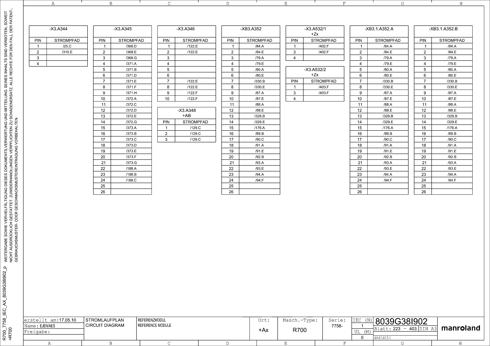

# +Ax — Sheet 223 of 403 — REFERENZMODUL

**REFERENCE MODULE**

> Part of the manroland **R700** printing press IEC/UL circuit diagrams.
> Drawing class: **Stromlaufplan / Circuit diagram** (DIN A3).
> Document `+Ax` covers the **Central control console** machine section.

## At a glance

| Field | Value |
|---|---|
| Document | `+Ax`  (8039G38I902) |
| Sheet | **223** of 403 |
| Section (DE) | REFERENZMODUL |
| Section (EN) | REFERENCE MODULE |
| Section type | REFERENCE_MODULE — Reference module |
| Machine type | `R700` |
| Series | `7758` |
| Created | 17.05.10 |
| Replaces | — |
| Columns used | A, B, C, D, E, F, G, H |
| Path numbers | — |
| Labels on sheet | 268 |
| Cross-refs out | 111 |
| Cross-refs in | 0 |

**Previous:** [+Ax sheet 222](SHEET_0222.md) · **Next:** [+Ax sheet 224](SHEET_0224.md) · **Document TOC:** [_TOC.md](_TOC.md)  (+Ax) · **Master TOC:** [all sheets](../_MASTER_TOC.md)

## Sheet image (300 DPI, exact vector render)



_Rendered directly from the PDF vector layer at 300 DPI (1-bit), no OCR and no resampling. Use it to confirm anything ambiguous in the text below._

## Cross-references on this sheet

Each entry is a wire leaving this sheet. The printed token is `/sheet.column`; the link resolves to that sheet inside the same document.

| Ref | Target sheet | Col | Path | Destination on target | Target section | From col |
|---|---|---|---|---|---|---|
| `/84.A` | [+Ax sheet 84](SHEET_0084.md) | A | — | — | ANLEGER | E |
| `/84.A` | [+Ax sheet 84](SHEET_0084.md) | A | — | — | ANLEGER | G |
| `/84.A` | [+Ax sheet 84](SHEET_0084.md) | A | — | — | ANLEGER | H |
| `/122.E` | [+Ax sheet 122](SHEET_0122.md) | E | — | — | REALTIMERECHNER FEHLBOGENKONTROLLE | C |
| `/402.F` | [+Ax sheet 402](SHEET_0402.md) | F | — | — | OPTION: INLINE COLORPILOT | F |
| `/25.C` | [+Ax sheet 25](SHEET_0025.md) | C | — | — | SPANNUNGSVERSORGUNG, SCHALTSCHRANKBELÜFTUNG | A |
| `/368.D` | [+Ax sheet 368](SHEET_0368.md) | D | — | — | OPTION: LOGISTIK AUSLEGER | B |
| `/84.E` | [+Ax sheet 84](SHEET_0084.md) | E | — | — | ANLEGER | E |
| `/84.E` | [+Ax sheet 84](SHEET_0084.md) | E | — | — | ANLEGER | G |
| `/84.E` | [+Ax sheet 84](SHEET_0084.md) | E | — | — | ANLEGER | H |
| `/310.E` | [+Ax sheet 310](SHEET_0310.md) | E | — | — | OPTION: IONISATIONSANLAGE ANLEGER | A |
| `/368.E` | [+Ax sheet 368](SHEET_0368.md) | E | — | — | OPTION: LOGISTIK AUSLEGER | B |
| `/122.E` | [+Ax sheet 122](SHEET_0122.md) | E | — | — | REALTIMERECHNER FEHLBOGENKONTROLLE | C |
| `/402.F` | [+Ax sheet 402](SHEET_0402.md) | F | — | — | OPTION: INLINE COLORPILOT | F |
| `/79.A` | [+Ax sheet 79](SHEET_0079.md) | A | — | — | ANLEGER | E |
| `/79.A` | [+Ax sheet 79](SHEET_0079.md) | A | — | — | ANLEGER | G |
| `/79.A` | [+Ax sheet 79](SHEET_0079.md) | A | — | — | ANLEGER | H |
| `/368.G` | [+Ax sheet 368](SHEET_0368.md) | G | — | — | OPTION: LOGISTIK AUSLEGER | B |
| `/79.E` | [+Ax sheet 79](SHEET_0079.md) | E | — | — | ANLEGER | E |
| `/79.E` | [+Ax sheet 79](SHEET_0079.md) | E | — | — | ANLEGER | G |
| `/79.E` | [+Ax sheet 79](SHEET_0079.md) | E | — | — | ANLEGER | H |
| `/371.A` | [+Ax sheet 371](SHEET_0371.md) | A | — | — | OPTION: VORDERMARKENEINSTELLUNG | B |
| `/80.A` | [+Ax sheet 80](SHEET_0080.md) | A | — | — | ANLEGER | E |
| `/80.A` | [+Ax sheet 80](SHEET_0080.md) | A | — | — | ANLEGER | G |
| `/80.A` | [+Ax sheet 80](SHEET_0080.md) | A | — | — | ANLEGER | H |
| `/371.B` | [+Ax sheet 371](SHEET_0371.md) | B | — | — | OPTION: VORDERMARKENEINSTELLUNG | B |
| `/80.E` | [+Ax sheet 80](SHEET_0080.md) | E | — | — | ANLEGER | E |
| `/80.E` | [+Ax sheet 80](SHEET_0080.md) | E | — | — | ANLEGER | G |
| `/80.E` | [+Ax sheet 80](SHEET_0080.md) | E | — | — | ANLEGER | H |
| `/371.D` | [+Ax sheet 371](SHEET_0371.md) | D | — | — | OPTION: VORDERMARKENEINSTELLUNG | B |
| `/371.E` | [+Ax sheet 371](SHEET_0371.md) | E | — | — | OPTION: VORDERMARKENEINSTELLUNG | B |
| `/122.E` | [+Ax sheet 122](SHEET_0122.md) | E | — | — | REALTIMERECHNER FEHLBOGENKONTROLLE | C |
| `/330.B` | [+Ax sheet 330](SHEET_0330.md) | B | — | — | OPTION: NONSTOP EINRICHTUNG MANUELL, ANLEGER | E |
| `/330.B` | [+Ax sheet 330](SHEET_0330.md) | B | — | — | OPTION: NONSTOP EINRICHTUNG MANUELL, ANLEGER | G |
| `/330.B` | [+Ax sheet 330](SHEET_0330.md) | B | — | — | OPTION: NONSTOP EINRICHTUNG MANUELL, ANLEGER | H |
| `/122.E` | [+Ax sheet 122](SHEET_0122.md) | E | — | — | REALTIMERECHNER FEHLBOGENKONTROLLE | C |
| `/330.E` | [+Ax sheet 330](SHEET_0330.md) | E | — | — | OPTION: NONSTOP EINRICHTUNG MANUELL, ANLEGER | E |
| `/330.E` | [+Ax sheet 330](SHEET_0330.md) | E | — | — | OPTION: NONSTOP EINRICHTUNG MANUELL, ANLEGER | G |
| `/330.E` | [+Ax sheet 330](SHEET_0330.md) | E | — | — | OPTION: NONSTOP EINRICHTUNG MANUELL, ANLEGER | H |
| `/371.F` | [+Ax sheet 371](SHEET_0371.md) | F | — | — | OPTION: VORDERMARKENEINSTELLUNG | B |
| `/403.F` | [+Ax sheet 403](SHEET_0403.md) | F | — | — | OPTION: INLINE COLORPILOT | F |
| `/87.A` | [+Ax sheet 87](SHEET_0087.md) | A | — | — | ANLEGER | E |
| `/87.A` | [+Ax sheet 87](SHEET_0087.md) | A | — | — | ANLEGER | G |
| `/87.A` | [+Ax sheet 87](SHEET_0087.md) | A | — | — | ANLEGER | H |
| `/122.F` | [+Ax sheet 122](SHEET_0122.md) | F | — | — | REALTIMERECHNER FEHLBOGENKONTROLLE | C |
| `/403.F` | [+Ax sheet 403](SHEET_0403.md) | F | — | — | OPTION: INLINE COLORPILOT | F |
| `/371.H` | [+Ax sheet 371](SHEET_0371.md) | H | — | — | OPTION: VORDERMARKENEINSTELLUNG | B |
| `/87.E` | [+Ax sheet 87](SHEET_0087.md) | E | — | — | ANLEGER | E |
| `/87.E` | [+Ax sheet 87](SHEET_0087.md) | E | — | — | ANLEGER | G |
| `/87.E` | [+Ax sheet 87](SHEET_0087.md) | E | — | — | ANLEGER | H |
| `/372.A` | [+Ax sheet 372](SHEET_0372.md) | A | — | — | OPTION: VORDERMARKENEINSTELLUNG | B |
| `/122.F` | [+Ax sheet 122](SHEET_0122.md) | F | — | — | REALTIMERECHNER FEHLBOGENKONTROLLE | C |
| `/88.A` | [+Ax sheet 88](SHEET_0088.md) | A | — | — | ANLEGER | E |
| `/88.A` | [+Ax sheet 88](SHEET_0088.md) | A | — | — | ANLEGER | G |
| `/88.A` | [+Ax sheet 88](SHEET_0088.md) | A | — | — | ANLEGER | H |
| `/372.C` | [+Ax sheet 372](SHEET_0372.md) | C | — | — | OPTION: VORDERMARKENEINSTELLUNG | B |
| `/88.E` | [+Ax sheet 88](SHEET_0088.md) | E | — | — | ANLEGER | E |
| `/88.E` | [+Ax sheet 88](SHEET_0088.md) | E | — | — | ANLEGER | G |
| `/88.E` | [+Ax sheet 88](SHEET_0088.md) | E | — | — | ANLEGER | H |
| `/372.D` | [+Ax sheet 372](SHEET_0372.md) | D | — | — | OPTION: VORDERMARKENEINSTELLUNG | B |
| `/372.E` | [+Ax sheet 372](SHEET_0372.md) | E | — | — | OPTION: VORDERMARKENEINSTELLUNG | B |
| `/329.B` | [+Ax sheet 329](SHEET_0329.md) | B | — | — | OPTION: NONSTOP EINRICHTUNG MANUELL, ANLEGER | E |
| `/329.B` | [+Ax sheet 329](SHEET_0329.md) | B | — | — | OPTION: NONSTOP EINRICHTUNG MANUELL, ANLEGER | G |
| `/329.B` | [+Ax sheet 329](SHEET_0329.md) | B | — | — | OPTION: NONSTOP EINRICHTUNG MANUELL, ANLEGER | H |
| `/329.E` | [+Ax sheet 329](SHEET_0329.md) | E | — | — | OPTION: NONSTOP EINRICHTUNG MANUELL, ANLEGER | E |
| `/329.E` | [+Ax sheet 329](SHEET_0329.md) | E | — | — | OPTION: NONSTOP EINRICHTUNG MANUELL, ANLEGER | G |
| `/329.E` | [+Ax sheet 329](SHEET_0329.md) | E | — | — | OPTION: NONSTOP EINRICHTUNG MANUELL, ANLEGER | H |
| `/372.G` | [+Ax sheet 372](SHEET_0372.md) | G | — | — | OPTION: VORDERMARKENEINSTELLUNG | B |
| `/373.A` | [+Ax sheet 373](SHEET_0373.md) | A | — | — | OPTION: VORDERMARKENEINSTELLUNG | B |
| `/176.A` | [+Ax sheet 176](SHEET_0176.md) | A | — | — | RESERVE | E |
| `/176.A` | [+Ax sheet 176](SHEET_0176.md) | A | — | — | RESERVE | G |
| `/176.A` | [+Ax sheet 176](SHEET_0176.md) | A | — | — | RESERVE | H |
| `/129.C` | [+Ax sheet 129](SHEET_0129.md) | C | — | — | REALTIMERECHNER ANLAGE | C |
| `/89.B` | [+Ax sheet 89](SHEET_0089.md) | B | — | — | ANLEGER | E |
| `/89.B` | [+Ax sheet 89](SHEET_0089.md) | B | — | — | ANLEGER | G |
| `/89.B` | [+Ax sheet 89](SHEET_0089.md) | B | — | — | ANLEGER | H |
| `/373.B` | [+Ax sheet 373](SHEET_0373.md) | B | — | — | OPTION: VORDERMARKENEINSTELLUNG | B |
| `/129.C` | [+Ax sheet 129](SHEET_0129.md) | C | — | — | REALTIMERECHNER ANLAGE | C |
| `/90.C` | [+Ax sheet 90](SHEET_0090.md) | C | — | — | ANLEGER | E |
| `/90.C` | [+Ax sheet 90](SHEET_0090.md) | C | — | — | ANLEGER | G |
| `/90.C` | [+Ax sheet 90](SHEET_0090.md) | C | — | — | ANLEGER | H |
| `/373.C` | [+Ax sheet 373](SHEET_0373.md) | C | — | — | OPTION: VORDERMARKENEINSTELLUNG | B |
| `/129.C` | [+Ax sheet 129](SHEET_0129.md) | C | — | — | REALTIMERECHNER ANLAGE | C |
| `/91.A` | [+Ax sheet 91](SHEET_0091.md) | A | — | — | ANLEGER | E |
| `/91.A` | [+Ax sheet 91](SHEET_0091.md) | A | — | — | ANLEGER | G |
| `/91.A` | [+Ax sheet 91](SHEET_0091.md) | A | — | — | ANLEGER | H |
| `/373.D` | [+Ax sheet 373](SHEET_0373.md) | D | — | — | OPTION: VORDERMARKENEINSTELLUNG | B |
| `/91.E` | [+Ax sheet 91](SHEET_0091.md) | E | — | — | ANLEGER | E |
| `/91.E` | [+Ax sheet 91](SHEET_0091.md) | E | — | — | ANLEGER | G |
| `/91.E` | [+Ax sheet 91](SHEET_0091.md) | E | — | — | ANLEGER | H |
| `/373.E` | [+Ax sheet 373](SHEET_0373.md) | E | — | — | OPTION: VORDERMARKENEINSTELLUNG | B |
| `/92.B` | [+Ax sheet 92](SHEET_0092.md) | B | — | — | ANLEGER | E |
| `/92.B` | [+Ax sheet 92](SHEET_0092.md) | B | — | — | ANLEGER | G |
| `/92.B` | [+Ax sheet 92](SHEET_0092.md) | B | — | — | ANLEGER | H |
| `/373.F` | [+Ax sheet 373](SHEET_0373.md) | F | — | — | OPTION: VORDERMARKENEINSTELLUNG | B |
| `/93.A` | [+Ax sheet 93](SHEET_0093.md) | A | — | — | ANLEGER | E |
| `/93.A` | [+Ax sheet 93](SHEET_0093.md) | A | — | — | ANLEGER | G |
| `/93.A` | [+Ax sheet 93](SHEET_0093.md) | A | — | — | ANLEGER | H |
| `/373.G` | [+Ax sheet 373](SHEET_0373.md) | G | — | — | OPTION: VORDERMARKENEINSTELLUNG | B |
| `/93.E` | [+Ax sheet 93](SHEET_0093.md) | E | — | — | ANLEGER | E |
| `/93.E` | [+Ax sheet 93](SHEET_0093.md) | E | — | — | ANLEGER | G |
| `/93.E` | [+Ax sheet 93](SHEET_0093.md) | E | — | — | ANLEGER | H |
| `/188.A` | [+Ax sheet 188](SHEET_0188.md) | A | — | — | RESERVE | B |
| `/94.A` | [+Ax sheet 94](SHEET_0094.md) | A | — | — | ANLEGER | E |
| `/94.A` | [+Ax sheet 94](SHEET_0094.md) | A | — | — | ANLEGER | G |
| `/94.A` | [+Ax sheet 94](SHEET_0094.md) | A | — | — | ANLEGER | H |
| `/188.B` | [+Ax sheet 188](SHEET_0188.md) | B | — | — | RESERVE | B |
| `/94.F` | [+Ax sheet 94](SHEET_0094.md) | F | — | — | ANLEGER | E |
| `/94.F` | [+Ax sheet 94](SHEET_0094.md) | F | — | — | ANLEGER | G |
| `/94.F` | [+Ax sheet 94](SHEET_0094.md) | F | — | — | ANLEGER | H |
| `/188.C` | [+Ax sheet 188](SHEET_0188.md) | C | — | — | RESERVE | B |

## Devices on this sheet

| Tag | Class | Class meaning (IEC) | Col | Sub | Terminal | Sign |
|---|---|---|---|---|---|---|
| `X3.A345` | — | cross-device reference | B | — | — | — |
| `X3.A346` | — | cross-device reference | C | — | — | — |
| `X3.A344` | — | cross-device reference | A | — | — | — |
| `X3.A348` | — | cross-device reference | C | — | — | — |
| `XB3.A352` | — | cross-device reference | D | — | — | — |
| `XB3.1.A352.A` | — | cross-device reference | G | — | — | — |
| `XB3.1.A352.B` | — | cross-device reference | H | — | — | — |

## Potentials / nets

_No named potentials on this sheet._

## Wire-end annotations (grouped as printed)

A wire that continues elsewhere is annotated with a small cluster: the destination description, the path/line number `#NN`, and the `/sheet.column` cross reference. Each row below is one such cluster exactly as it is grouped on the drawing.

| Col | Y | Path | Cross-ref | Text on the wire |
|---|---|---|---|---|
| A | 65.5 | — | — | `X3.A344` |
| B | 65.5 | — | — | `X3.A345` |
| C | 65.5 | — | — | `X3.A346` |
| D | 65.5 | — | — | `XB3.A352` |
| F | 65.5 | — | — | `X3.A532/1` |
| G | 65.5 | — | — | `XB3.1.A352.A` |
| H | 65.5 | — | — | `XB3.1.A352.B` |
| E | 78.3 | — | — | `+Zx` |
| A | 94.2 | — | — | `PIN 2 3 4 1 STROMPFAD` |
| B | 94.2 | — | — | `PIN STROMPFAD` |
| C | 94.2 | — | — | `PIN 10 2 3 4 5 6 7 8 9 1 STROMPFAD` |
| D | 94.2 | — | — | `PIN STROMPFAD` |
| E | 94.2 | — | — | `PIN 3 4 1 STROMPFAD` |
| G | 94.2 | — | — | `PIN STROMPFAD` |
| H | 94.2 | — | — | `PIN STROMPFAD` |
| B | 108.4 | — | — | `2 3 4 5 6 7 8 9 1` |
| D | 108.4 | — | — | `2 3 4 5 6 7 8 9 1` |
| F | 108.4 | — | — | `2 3 4 5 6 7 8 9 1` |
| G | 108.4 | — | — | `2 3 4 5 6 7 8 9 1` |
| A | 108.7 | — | `/25.C` | — |
| B | 108.7 | — | `/368.D` | — |
| C | 108.7 | — | `/122.E` | — |
| E | 108.7 | — | `/84.A` | — |
| F | 108.7 | — | `/402.F` | — |
| G | 108.7 | — | `/84.A` | — |
| H | 108.7 | — | `/84.A` | — |
| E | 122.8 | — | `/84.E` | — |
| G | 122.8 | — | `/84.E` | — |
| H | 122.8 | — | `/84.E` | — |
| A | 122.9 | — | `/310.E` | — |
| B | 122.9 | — | `/368.E` | — |
| C | 122.9 | — | `/122.E` | — |
| F | 122.9 | — | `/402.F` | — |
| E | 137.0 | — | `/79.A` | — |
| G | 137.0 | — | `/79.A` | — |
| H | 137.0 | — | `/79.A` | — |
| B | 137.1 | — | `/368.G` | — |
| B | 151.2 | — | `/371.A` | — |
| E | 151.2 | — | `/79.E` | — |
| G | 151.2 | — | `/79.E` | — |
| H | 151.2 | — | `/79.E` | — |
| F | 164.7 | — | — | `X3.A532/2` |
| B | 165.4 | — | `/371.B` | — |
| E | 165.4 | — | `/80.A` | — |
| G | 165.4 | — | `/80.A` | — |
| H | 165.4 | — | `/80.A` | — |
| E | 177.5 | — | — | `+Zx` |
| E | 179.5 | — | `/80.E` | — |
| G | 179.5 | — | `/80.E` | — |
| H | 179.5 | — | `/80.E` | — |
| B | 179.6 | — | `/371.D` | — |
| E | 193.4 | — | — | `PIN 3 4 1 STROMPFAD` |
| B | 193.7 | — | `/371.E` | — |
| C | 193.7 | — | `/122.E` | — |
| E | 193.7 | — | `/330.B` | — |
| G | 193.7 | — | `/330.B` | — |
| H | 193.7 | — | `/330.B` | — |
| B | 207.9 | — | `/371.F` | — |
| C | 207.9 | — | `/122.E` | — |
| E | 207.9 | — | `/330.E` | — |
| F | 207.9 | — | `/403.F` | — |
| G | 207.9 | — | `/330.E` | — |
| H | 207.9 | — | `/330.E` | — |
| B | 222.1 | — | `/371.H` | — |
| C | 222.1 | — | `/122.F` | — |
| E | 222.1 | — | `/87.A` | — |
| F | 222.1 | — | `/403.F` | — |
| G | 222.1 | — | `/87.A` | — |
| H | 222.1 | — | `/87.A` | — |
| B | 235.9 | — | — | `10 12 13 14 15 16 17 18 19 20 11` |
| D | 235.9 | — | — | `10 12 13 14 15 16 17 18 19 20 11` |
| F | 235.9 | — | — | `10 12 13 14 15 16 17 18 19 20 11` |
| G | 235.9 | — | — | `10 12 13 14 15 16 17 18 19 20 11` |
| B | 236.2 | — | `/372.A` | — |
| E | 236.2 | — | `/87.E` | — |
| G | 236.2 | — | `/87.E` | — |
| H | 236.2 | — | `/87.E` | — |
| C | 236.3 | — | `/122.F` | — |
| B | 250.4 | — | `/372.C` | — |
| E | 250.4 | — | `/88.A` | — |
| G | 250.4 | — | `/88.A` | — |
| H | 250.4 | — | `/88.A` | — |
| C | 263.9 | — | — | `X3.A348` |
| B | 264.6 | — | `/372.D` | — |
| E | 264.6 | — | `/88.E` | — |
| G | 264.6 | — | `/88.E` | — |
| H | 264.6 | — | `/88.E` | — |
| C | 276.6 | — | — | `+AB` |
| B | 278.8 | — | `/372.E` | — |
| E | 278.8 | — | `/329.B` | — |
| G | 278.8 | — | `/329.B` | — |
| H | 278.8 | — | `/329.B` | — |
| C | 292.6 | — | — | `PIN 2 3 1 STROMPFAD` |
| E | 292.9 | — | `/329.E` | — |
| G | 292.9 | — | `/329.E` | — |
| H | 292.9 | — | `/329.E` | — |
| B | 293.0 | — | `/372.G` | — |
| B | 307.1 | — | `/373.A` | — |
| C | 307.1 | — | `/129.C` | — |
| E | 307.1 | — | `/176.A` | — |
| G | 307.1 | — | `/176.A` | — |
| H | 307.1 | — | `/176.A` | — |
| B | 321.3 | — | `/373.B` | — |
| C | 321.3 | — | `/129.C` | — |
| E | 321.3 | — | `/89.B` | — |
| G | 321.3 | — | `/89.B` | — |
| H | 321.3 | — | `/89.B` | — |
| B | 335.5 | — | `/373.C` | — |
| C | 335.5 | — | `/129.C` | — |
| E | 335.5 | — | `/90.C` | — |
| G | 335.5 | — | `/90.C` | — |
| H | 335.5 | — | `/90.C` | — |
| E | 349.6 | — | `/91.A` | — |
| G | 349.6 | — | `/91.A` | — |
| H | 349.6 | — | `/91.A` | — |
| B | 349.7 | — | `/373.D` | — |
| B | 363.8 | — | `/373.E` | — |
| E | 363.8 | — | `/91.E` | — |
| G | 363.8 | — | `/91.E` | — |
| H | 363.8 | — | `/91.E` | — |
| B | 378.0 | — | `/373.F` | — |
| E | 378.0 | — | `/92.B` | — |
| G | 378.0 | — | `/92.B` | — |
| H | 378.0 | — | `/92.B` | — |
| B | 391.8 | — | — | `22 23 24 25 26 21` |
| D | 391.8 | — | — | `22 23 24 25 26 21` |
| F | 391.8 | — | — | `22 23 24 25 26 21` |
| G | 391.8 | — | — | `22 23 24 25 26 21` |
| E | 392.1 | — | `/93.A` | — |
| G | 392.1 | — | `/93.A` | — |
| H | 392.1 | — | `/93.A` | — |
| B | 392.2 | — | `/373.G` | — |
| B | 406.3 | — | `/188.A` | — |
| E | 406.3 | — | `/93.E` | — |
| G | 406.3 | — | `/93.E` | — |
| H | 406.3 | — | `/93.E` | — |
| B | 420.5 | — | `/188.B` | — |
| E | 420.5 | — | `/94.A` | — |
| G | 420.5 | — | `/94.A` | — |
| H | 420.5 | — | `/94.A` | — |
| B | 434.7 | — | `/188.C` | — |
| E | 434.7 | — | `/94.F` | — |
| G | 434.7 | — | `/94.F` | — |
| H | 434.7 | — | `/94.F` | — |


## Reconstructed tables

This sheet carries tabular content (pin map / terminal assignment / index). The grid below was rebuilt from the drawing's own rule lines, so each row is exactly one physical row of the table.

### Table 1 — 4 data rows × 2 columns (at x=70.9, y=62.4) — **X3.A344**

| PIN | STROMPFAD |
|---|---|
| `1` | `/25.C` |
| `2` | `/310.E` |
| `3` |  |
| `4` |  |


### Table 2 — 26 data rows × 2 columns (at x=226.8, y=62.4) — **X3.A345**

| PIN | STROMPFAD |
|---|---|
| `1` | `/368.D` |
| `2` | `/368.E` |
| `3` | `/368.G` |
| `4` | `/371.A` |
| `5` | `/371.B` |
| `6` | `/371.D` |
| `7` | `/371.E` |
| `8` | `/371.F` |
| `9` | `/371.H` |
| `10` | `/372.A` |
| `11` | `/372.C` |
| `12` | `/372.D` |
| `13` | `/372.E` |
| `14` | `/372.G` |
| `15` | `/373.A` |
| `16` | `/373.B` |
| `17` | `/373.C` |
| `18` | `/373.D` |
| `19` | `/373.E` |
| `20` | `/373.F` |
| `21` | `/373.G` |
| `22` | `/188.A` |
| `23` | `/188.B` |
| `24` | `/188.C` |
| `25` |  |
| `26` |  |


### Table 3 — 16 data rows × 2 columns (at x=382.7, y=62.4) — **X3.A346**

| PIN | STROMPFAD |
|---|---|
| `1` | `/122.E` |
| `2` | `/122.E` |
| `3` |  |
| `4` |  |
| `5` |  |
| `6` |  |
| `7` | `/122.E` |
| `8` | `/122.E` |
| `9` | `/122.F` |
| `10` | `/122.F` |
|  | `X3.A348` |
|  | `+AB` |
| `PIN` | `STROMPFAD` |
| `1` | `/129.C` |
| `2` | `/129.C` |
| `3` | `/129.C` |


### Table 4 — 26 data rows × 2 columns (at x=538.6, y=62.4) — **XB3.A352**

| PIN | STROMPFAD |
|---|---|
| `1` | `/84.A` |
| `2` | `/84.E` |
| `3` | `/79.A` |
| `4` | `/79.E` |
| `5` | `/80.A` |
| `6` | `/80.E` |
| `7` | `/330.B` |
| `8` | `/330.E` |
| `9` | `/87.A` |
| `10` | `/87.E` |
| `11` | `/88.A` |
| `12` | `/88.E` |
| `13` | `/329.B` |
| `14` | `/329.E` |
| `15` | `/176.A` |
| `16` | `/89.B` |
| `17` | `/90.C` |
| `18` | `/91.A` |
| `19` | `/91.E` |
| `20` | `/92.B` |
| `21` | `/93.A` |
| `22` | `/93.E` |
| `23` | `/94.A` |
| `24` | `/94.F` |
| `25` |  |
| `26` |  |


### Table 5 — 9 data rows × 2 columns (at x=694.5, y=62.4) — **X3.A532/1 +Zx**

| PIN | STROMPFAD |
|---|---|
| `1` | `/402.F` |
| `3` | `/402.F` |
| `4` |  |
|  | `X3.A532/2` |
|  | `+Zx` |
| `PIN` | `STROMPFAD` |
| `1` | `/403.F` |
| `3` | `/403.F` |
| `4` |  |


### Table 6 — 26 data rows × 2 columns (at x=850.4, y=62.4) — **XB3.1.A352.A**

| PIN | STROMPFAD |
|---|---|
| `1` | `/84.A` |
| `2` | `/84.E` |
| `3` | `/79.A` |
| `4` | `/79.E` |
| `5` | `/80.A` |
| `6` | `/80.E` |
| `7` | `/330.B` |
| `8` | `/330.E` |
| `9` | `/87.A` |
| `10` | `/87.E` |
| `11` | `/88.A` |
| `12` | `/88.E` |
| `13` | `/329.B` |
| `14` | `/329.E` |
| `15` | `/176.A` |
| `16` | `/89.B` |
| `17` | `/90.C` |
| `18` | `/91.A` |
| `19` | `/91.E` |
| `20` | `/92.B` |
| `21` | `/93.A` |
| `22` | `/93.E` |
| `23` | `/94.A` |
| `24` | `/94.F` |
| `25` |  |
| `26` |  |


### Table 7 — 26 data rows × 2 columns (at x=1006.3, y=62.4) — **XB3.1.A352.B**

| PIN | STROMPFAD |
|---|---|
| `1` | `/84.A` |
| `2` | `/84.E` |
| `3` | `/79.A` |
| `4` | `/79.E` |
| `5` | `/80.A` |
| `6` | `/80.E` |
| `7` | `/330.B` |
| `8` | `/330.E` |
| `9` | `/87.A` |
| `10` | `/87.E` |
| `11` | `/88.A` |
| `12` | `/88.E` |
| `13` | `/329.B` |
| `14` | `/329.E` |
| `15` | `/176.A` |
| `16` | `/89.B` |
| `17` | `/90.C` |
| `18` | `/91.A` |
| `19` | `/91.E` |
| `20` | `/92.B` |
| `21` | `/93.A` |
| `22` | `/93.E` |
| `23` | `/94.A` |
| `24` | `/94.F` |
| `25` |  |
| `26` |  |


## Notes and free text on this sheet

| Text | Col | Y (pt) |
|---|---|---|
| `PIN` | B | 94.2 |
| `STROMPFAD` | B | 94.15 |
| `PIN` | C | 94.2 |
| `STROMPFAD` | C | 94.15 |
| `PIN` | A | 94.2 |
| `STROMPFAD` | A | 94.15 |
| `+AB` | C | 276.61 |
| `PIN` | D | 94.2 |
| `STROMPFAD` | E | 94.15 |
| `PIN` | F | 94.2 |
| `STROMPFAD` | G | 94.15 |
| `PIN` | G | 94.2 |
| `STROMPFAD` | H | 94.15 |
| `PIN` | E | 94.2 |
| `STROMPFAD` | F | 94.15 |
| `X3.A532/1` | F | 65.51 |
| `+Zx` | E | 78.29 |
| `X3.A532/2` | F | 164.72 |

## Complete label inventory (exact text from the drawing)

Every text object inside the drawing area of this sheet, in DIN reading order (column A→H, then top→bottom). This is the authoritative list: if a string is not here it is not printed on this sheet.

| Col | Y | X | Dir | Type | Text |
|---|---|---|---|---|---|
| A | 65.5 | 119.8 | → | device ref | `X3.A344` |
| A | 94.2 | 84.0 | → | text | `PIN` |
| A | 94.2 | 132.2 | → | text | `STROMPFAD` |
| A | 108.4 | 90.0 | → | number | `1` |
| A | 108.7 | 152.6 | → | cross-reference | `/25.C` |
| A | 122.5 | 89.4 | → | number | `2` |
| A | 122.9 | 150.5 | → | cross-reference | `/310.E` |
| A | 136.7 | 89.4 | → | number | `3` |
| A | 150.9 | 89.4 | → | number | `4` |
| B | 65.5 | 275.7 | → | device ref | `X3.A345` |
| B | 94.2 | 240.0 | → | text | `PIN` |
| B | 94.2 | 288.1 | → | text | `STROMPFAD` |
| B | 108.4 | 251.7 | → | number | `1` |
| B | 108.7 | 306.1 | → | cross-reference | `/368.D` |
| B | 122.5 | 250.0 | → | number | `2` |
| B | 122.9 | 306.4 | → | cross-reference | `/368.E` |
| B | 136.7 | 250.0 | → | number | `3` |
| B | 137.1 | 306.0 | → | cross-reference | `/368.G` |
| B | 150.9 | 250.0 | → | number | `4` |
| B | 151.2 | 306.1 | → | cross-reference | `/371.A` |
| B | 165.1 | 250.0 | → | number | `5` |
| B | 165.4 | 306.3 | → | cross-reference | `/371.B` |
| B | 179.2 | 250.0 | → | number | `6` |
| B | 179.6 | 306.1 | → | cross-reference | `/371.D` |
| B | 193.4 | 250.0 | → | number | `7` |
| B | 193.7 | 306.4 | → | cross-reference | `/371.E` |
| B | 207.6 | 250.0 | → | number | `8` |
| B | 207.9 | 306.6 | → | cross-reference | `/371.F` |
| B | 221.8 | 250.0 | → | number | `9` |
| B | 222.1 | 306.4 | → | cross-reference | `/371.H` |
| B | 235.9 | 244.6 | → | number | `10` |
| B | 236.2 | 306.1 | → | cross-reference | `/372.A` |
| B | 250.1 | 246.3 | → | number | `11` |
| B | 250.4 | 306.1 | → | cross-reference | `/372.C` |
| B | 264.3 | 244.6 | → | number | `12` |
| B | 264.6 | 306.1 | → | cross-reference | `/372.D` |
| B | 278.5 | 244.6 | → | number | `13` |
| B | 278.8 | 306.4 | → | cross-reference | `/372.E` |
| B | 292.6 | 244.6 | → | number | `14` |
| B | 293.0 | 306.0 | → | cross-reference | `/372.G` |
| B | 306.8 | 244.6 | → | number | `15` |
| B | 307.1 | 306.1 | → | cross-reference | `/373.A` |
| B | 321.0 | 244.6 | → | number | `16` |
| B | 321.3 | 306.3 | → | cross-reference | `/373.B` |
| B | 335.1 | 244.6 | → | number | `17` |
| B | 335.5 | 306.1 | → | cross-reference | `/373.C` |
| B | 349.3 | 244.6 | → | number | `18` |
| B | 349.7 | 306.1 | → | cross-reference | `/373.D` |
| B | 363.5 | 244.6 | → | number | `19` |
| B | 363.8 | 306.4 | → | cross-reference | `/373.E` |
| B | 377.7 | 244.6 | → | number | `20` |
| B | 378.0 | 306.6 | → | cross-reference | `/373.F` |
| B | 391.8 | 246.3 | → | number | `21` |
| B | 392.2 | 306.0 | → | cross-reference | `/373.G` |
| B | 406.0 | 244.6 | → | number | `22` |
| B | 406.3 | 306.1 | → | cross-reference | `/188.A` |
| B | 420.2 | 244.6 | → | number | `23` |
| B | 420.5 | 306.3 | → | cross-reference | `/188.B` |
| B | 434.4 | 244.6 | → | number | `24` |
| B | 434.7 | 306.1 | → | cross-reference | `/188.C` |
| B | 448.5 | 244.6 | → | number | `25` |
| B | 462.7 | 244.6 | → | number | `26` |
| C | 65.5 | 428.7 | → | device ref | `X3.A346` |
| C | 94.2 | 395.9 | → | text | `PIN` |
| C | 94.2 | 444.0 | → | text | `STROMPFAD` |
| C | 108.4 | 407.6 | → | number | `1` |
| C | 108.7 | 455.2 | → | cross-reference | `/122.E` |
| C | 122.5 | 405.9 | → | number | `2` |
| C | 122.9 | 455.2 | → | cross-reference | `/122.E` |
| C | 136.7 | 405.9 | → | number | `3` |
| C | 150.9 | 405.9 | → | number | `4` |
| C | 165.1 | 405.9 | → | number | `5` |
| C | 179.2 | 405.9 | → | number | `6` |
| C | 193.4 | 405.9 | → | number | `7` |
| C | 193.7 | 455.2 | → | cross-reference | `/122.E` |
| C | 207.6 | 405.9 | → | number | `8` |
| C | 207.9 | 455.2 | → | cross-reference | `/122.E` |
| C | 221.8 | 405.9 | → | number | `9` |
| C | 222.1 | 455.4 | → | cross-reference | `/122.F` |
| C | 235.9 | 400.5 | → | number | `10` |
| C | 236.3 | 455.4 | → | cross-reference | `/122.F` |
| C | 263.9 | 431.6 | → | device ref | `X3.A348` |
| C | 276.6 | 443.3 | → | text | `+AB` |
| C | 292.6 | 395.9 | → | text | `PIN` |
| C | 292.6 | 444.0 | → | text | `STROMPFAD` |
| C | 306.8 | 401.8 | → | number | `1` |
| C | 307.1 | 462.0 | → | cross-reference | `/129.C` |
| C | 321.0 | 401.2 | → | number | `2` |
| C | 321.3 | 462.0 | → | cross-reference | `/129.C` |
| C | 335.1 | 401.2 | → | number | `3` |
| C | 335.5 | 462.0 | → | cross-reference | `/129.C` |
| D | 65.5 | 583.9 | → | device ref | `XB3.A352` |
| D | 94.2 | 551.8 | → | text | `PIN` |
| D | 108.4 | 563.5 | → | number | `1` |
| D | 122.5 | 561.8 | → | number | `2` |
| D | 136.7 | 561.8 | → | number | `3` |
| D | 150.9 | 561.8 | → | number | `4` |
| D | 165.1 | 561.8 | → | number | `5` |
| D | 179.2 | 561.8 | → | number | `6` |
| D | 193.4 | 561.8 | → | number | `7` |
| D | 207.6 | 561.8 | → | number | `8` |
| D | 221.8 | 561.8 | → | number | `9` |
| D | 235.9 | 556.4 | → | number | `10` |
| D | 250.1 | 558.1 | → | number | `11` |
| D | 264.3 | 556.4 | → | number | `12` |
| D | 278.5 | 556.4 | → | number | `13` |
| D | 292.6 | 556.4 | → | number | `14` |
| D | 306.8 | 556.4 | → | number | `15` |
| D | 321.0 | 556.4 | → | number | `16` |
| D | 335.1 | 556.4 | → | number | `17` |
| D | 349.3 | 556.4 | → | number | `18` |
| D | 363.5 | 556.4 | → | number | `19` |
| D | 377.7 | 556.4 | → | number | `20` |
| D | 391.8 | 558.1 | → | number | `21` |
| D | 406.0 | 556.4 | → | number | `22` |
| D | 420.2 | 556.4 | → | number | `23` |
| D | 434.4 | 556.4 | → | number | `24` |
| D | 448.5 | 556.4 | → | number | `25` |
| D | 462.7 | 556.4 | → | number | `26` |
| E | 78.3 | 756.1 | → | text | `+Zx` |
| E | 94.2 | 600.0 | → | text | `STROMPFAD` |
| E | 94.2 | 707.7 | → | text | `PIN` |
| E | 108.4 | 713.6 | → | number | `1` |
| E | 108.7 | 620.4 | → | cross-reference | `/84.A` |
| E | 122.5 | 713.1 | → | number | `3` |
| E | 122.8 | 620.6 | → | cross-reference | `/84.E` |
| E | 136.7 | 713.1 | → | number | `4` |
| E | 137.0 | 620.4 | → | cross-reference | `/79.A` |
| E | 151.2 | 620.6 | → | cross-reference | `/79.E` |
| E | 165.4 | 620.4 | → | cross-reference | `/80.A` |
| E | 177.5 | 756.1 | → | text | `+Zx` |
| E | 179.5 | 620.6 | → | cross-reference | `/80.E` |
| E | 193.4 | 707.7 | → | text | `PIN` |
| E | 193.7 | 618.1 | → | cross-reference | `/330.B` |
| E | 207.6 | 713.6 | → | number | `1` |
| E | 207.9 | 618.2 | → | cross-reference | `/330.E` |
| E | 221.8 | 713.1 | → | number | `3` |
| E | 222.1 | 620.4 | → | cross-reference | `/87.A` |
| E | 235.9 | 713.1 | → | number | `4` |
| E | 236.2 | 620.6 | → | cross-reference | `/87.E` |
| E | 250.4 | 620.4 | → | cross-reference | `/88.A` |
| E | 264.6 | 620.6 | → | cross-reference | `/88.E` |
| E | 278.8 | 618.1 | → | cross-reference | `/329.B` |
| E | 292.9 | 618.2 | → | cross-reference | `/329.E` |
| E | 307.1 | 618.0 | → | cross-reference | `/176.A` |
| E | 321.3 | 620.5 | → | cross-reference | `/89.B` |
| E | 335.5 | 620.4 | → | cross-reference | `/90.C` |
| E | 349.6 | 620.4 | → | cross-reference | `/91.A` |
| E | 363.8 | 620.6 | → | cross-reference | `/91.E` |
| E | 378.0 | 620.5 | → | cross-reference | `/92.B` |
| E | 392.1 | 620.4 | → | cross-reference | `/93.A` |
| E | 406.3 | 620.6 | → | cross-reference | `/93.E` |
| E | 420.5 | 620.4 | → | cross-reference | `/94.A` |
| E | 434.7 | 620.8 | → | cross-reference | `/94.F` |
| F | 65.5 | 739.7 | → | text | `X3.A532/1` |
| F | 94.2 | 755.9 | → | text | `STROMPFAD` |
| F | 94.2 | 863.6 | → | text | `PIN` |
| F | 108.4 | 875.3 | → | number | `1` |
| F | 108.7 | 774.3 | → | cross-reference | `/402.F` |
| F | 122.5 | 873.6 | → | number | `2` |
| F | 122.9 | 774.3 | → | cross-reference | `/402.F` |
| F | 136.7 | 873.6 | → | number | `3` |
| F | 150.9 | 873.6 | → | number | `4` |
| F | 164.7 | 739.0 | → | text | `X3.A532/2` |
| F | 165.1 | 873.6 | → | number | `5` |
| F | 179.2 | 873.6 | → | number | `6` |
| F | 193.4 | 755.9 | → | text | `STROMPFAD` |
| F | 193.4 | 873.6 | → | number | `7` |
| F | 207.6 | 873.6 | → | number | `8` |
| F | 207.9 | 774.3 | → | cross-reference | `/403.F` |
| F | 221.8 | 873.6 | → | number | `9` |
| F | 222.1 | 774.3 | → | cross-reference | `/403.F` |
| F | 235.9 | 868.3 | → | number | `10` |
| F | 250.1 | 870.0 | → | number | `11` |
| F | 264.3 | 868.3 | → | number | `12` |
| F | 278.5 | 868.3 | → | number | `13` |
| F | 292.6 | 868.3 | → | number | `14` |
| F | 306.8 | 868.3 | → | number | `15` |
| F | 321.0 | 868.3 | → | number | `16` |
| F | 335.1 | 868.3 | → | number | `17` |
| F | 349.3 | 868.3 | → | number | `18` |
| F | 363.5 | 868.3 | → | number | `19` |
| F | 377.7 | 868.3 | → | number | `20` |
| F | 391.8 | 870.0 | → | number | `21` |
| F | 406.0 | 868.3 | → | number | `22` |
| F | 420.2 | 868.3 | → | number | `23` |
| F | 434.4 | 868.3 | → | number | `24` |
| F | 448.5 | 868.3 | → | number | `25` |
| F | 462.7 | 868.3 | → | number | `26` |
| G | 65.5 | 886.0 | → | device ref | `XB3.1.A352.A` |
| G | 94.2 | 911.8 | → | text | `STROMPFAD` |
| G | 94.2 | 1019.5 | → | text | `PIN` |
| G | 108.4 | 1031.2 | → | number | `1` |
| G | 108.7 | 932.2 | → | cross-reference | `/84.A` |
| G | 122.5 | 1029.5 | → | number | `2` |
| G | 122.8 | 932.5 | → | cross-reference | `/84.E` |
| G | 136.7 | 1029.5 | → | number | `3` |
| G | 137.0 | 932.2 | → | cross-reference | `/79.A` |
| G | 150.9 | 1029.5 | → | number | `4` |
| G | 151.2 | 932.5 | → | cross-reference | `/79.E` |
| G | 165.1 | 1029.5 | → | number | `5` |
| G | 165.4 | 932.2 | → | cross-reference | `/80.A` |
| G | 179.2 | 1029.5 | → | number | `6` |
| G | 179.5 | 932.5 | → | cross-reference | `/80.E` |
| G | 193.4 | 1029.5 | → | number | `7` |
| G | 193.7 | 929.9 | → | cross-reference | `/330.B` |
| G | 207.6 | 1029.5 | → | number | `8` |
| G | 207.9 | 930.0 | → | cross-reference | `/330.E` |
| G | 221.8 | 1029.5 | → | number | `9` |
| G | 222.1 | 932.2 | → | cross-reference | `/87.A` |
| G | 235.9 | 1024.2 | → | number | `10` |
| G | 236.2 | 932.5 | → | cross-reference | `/87.E` |
| G | 250.1 | 1025.9 | → | number | `11` |
| G | 250.4 | 932.2 | → | cross-reference | `/88.A` |
| G | 264.3 | 1024.2 | → | number | `12` |
| G | 264.6 | 932.5 | → | cross-reference | `/88.E` |
| G | 278.5 | 1024.2 | → | number | `13` |
| G | 278.8 | 929.9 | → | cross-reference | `/329.B` |
| G | 292.6 | 1024.2 | → | number | `14` |
| G | 292.9 | 930.0 | → | cross-reference | `/329.E` |
| G | 306.8 | 1024.2 | → | number | `15` |
| G | 307.1 | 929.8 | → | cross-reference | `/176.A` |
| G | 321.0 | 1024.2 | → | number | `16` |
| G | 321.3 | 932.3 | → | cross-reference | `/89.B` |
| G | 335.1 | 1024.2 | → | number | `17` |
| G | 335.5 | 932.2 | → | cross-reference | `/90.C` |
| G | 349.3 | 1024.2 | → | number | `18` |
| G | 349.6 | 932.2 | → | cross-reference | `/91.A` |
| G | 363.5 | 1024.2 | → | number | `19` |
| G | 363.8 | 932.5 | → | cross-reference | `/91.E` |
| G | 377.7 | 1024.2 | → | number | `20` |
| G | 378.0 | 932.3 | → | cross-reference | `/92.B` |
| G | 391.8 | 1025.9 | → | number | `21` |
| G | 392.1 | 932.2 | → | cross-reference | `/93.A` |
| G | 406.0 | 1024.2 | → | number | `22` |
| G | 406.3 | 932.5 | → | cross-reference | `/93.E` |
| G | 420.2 | 1024.2 | → | number | `23` |
| G | 420.5 | 932.2 | → | cross-reference | `/94.A` |
| G | 434.4 | 1024.2 | → | number | `24` |
| G | 434.7 | 932.6 | → | cross-reference | `/94.F` |
| G | 448.5 | 1024.2 | → | number | `25` |
| G | 462.7 | 1024.2 | → | number | `26` |
| H | 65.5 | 1042.3 | → | device ref | `XB3.1.A352.B` |
| H | 94.2 | 1067.7 | → | text | `STROMPFAD` |
| H | 108.7 | 1088.1 | → | cross-reference | `/84.A` |
| H | 122.8 | 1088.4 | → | cross-reference | `/84.E` |
| H | 137.0 | 1088.1 | → | cross-reference | `/79.A` |
| H | 151.2 | 1088.4 | → | cross-reference | `/79.E` |
| H | 165.4 | 1088.1 | → | cross-reference | `/80.A` |
| H | 179.5 | 1088.4 | → | cross-reference | `/80.E` |
| H | 193.7 | 1085.8 | → | cross-reference | `/330.B` |
| H | 207.9 | 1086.0 | → | cross-reference | `/330.E` |
| H | 222.1 | 1088.1 | → | cross-reference | `/87.A` |
| H | 236.2 | 1088.4 | → | cross-reference | `/87.E` |
| H | 250.4 | 1088.1 | → | cross-reference | `/88.A` |
| H | 264.6 | 1088.4 | → | cross-reference | `/88.E` |
| H | 278.8 | 1085.8 | → | cross-reference | `/329.B` |
| H | 292.9 | 1086.0 | → | cross-reference | `/329.E` |
| H | 307.1 | 1085.7 | → | cross-reference | `/176.A` |
| H | 321.3 | 1088.2 | → | cross-reference | `/89.B` |
| H | 335.5 | 1088.1 | → | cross-reference | `/90.C` |
| H | 349.6 | 1088.1 | → | cross-reference | `/91.A` |
| H | 363.8 | 1088.4 | → | cross-reference | `/91.E` |
| H | 378.0 | 1088.2 | → | cross-reference | `/92.B` |
| H | 392.1 | 1088.1 | → | cross-reference | `/93.A` |
| H | 406.3 | 1088.4 | → | cross-reference | `/93.E` |
| H | 420.5 | 1088.1 | → | cross-reference | `/94.A` |
| H | 434.7 | 1088.5 | → | cross-reference | `/94.F` |

## Reading-order text block

The same content as a plain block, grouped by DIN column — convenient to paste or to match against a visual description.

```text
=== Column A ===
  65.5  119.8  devref       X3.A344
  94.2   84.0  text         PIN
  94.2  132.2  text         STROMPFAD
 108.4   90.0  numeric      1
 108.7  152.6  xref         /25.C
 122.5   89.4  numeric      2
 122.9  150.5  xref         /310.E
 136.7   89.4  numeric      3
 150.9   89.4  numeric      4
=== Column B ===
  65.5  275.7  devref       X3.A345
  94.2  240.0  text         PIN
  94.2  288.1  text         STROMPFAD
 108.4  251.7  numeric      1
 108.7  306.1  xref         /368.D
 122.5  250.0  numeric      2
 122.9  306.4  xref         /368.E
 136.7  250.0  numeric      3
 137.1  306.0  xref         /368.G
 150.9  250.0  numeric      4
 151.2  306.1  xref         /371.A
 165.1  250.0  numeric      5
 165.4  306.3  xref         /371.B
 179.2  250.0  numeric      6
 179.6  306.1  xref         /371.D
 193.4  250.0  numeric      7
 193.7  306.4  xref         /371.E
 207.6  250.0  numeric      8
 207.9  306.6  xref         /371.F
 221.8  250.0  numeric      9
 222.1  306.4  xref         /371.H
 235.9  244.6  numeric      10
 236.2  306.1  xref         /372.A
 250.1  246.3  numeric      11
 250.4  306.1  xref         /372.C
 264.3  244.6  numeric      12
 264.6  306.1  xref         /372.D
 278.5  244.6  numeric      13
 278.8  306.4  xref         /372.E
 292.6  244.6  numeric      14
 293.0  306.0  xref         /372.G
 306.8  244.6  numeric      15
 307.1  306.1  xref         /373.A
 321.0  244.6  numeric      16
 321.3  306.3  xref         /373.B
 335.1  244.6  numeric      17
 335.5  306.1  xref         /373.C
 349.3  244.6  numeric      18
 349.7  306.1  xref         /373.D
 363.5  244.6  numeric      19
 363.8  306.4  xref         /373.E
 377.7  244.6  numeric      20
 378.0  306.6  xref         /373.F
 391.8  246.3  numeric      21
 392.2  306.0  xref         /373.G
 406.0  244.6  numeric      22
 406.3  306.1  xref         /188.A
 420.2  244.6  numeric      23
 420.5  306.3  xref         /188.B
 434.4  244.6  numeric      24
 434.7  306.1  xref         /188.C
 448.5  244.6  numeric      25
 462.7  244.6  numeric      26
=== Column C ===
  65.5  428.7  devref       X3.A346
  94.2  395.9  text         PIN
  94.2  444.0  text         STROMPFAD
 108.4  407.6  numeric      1
 108.7  455.2  xref         /122.E
 122.5  405.9  numeric      2
 122.9  455.2  xref         /122.E
 136.7  405.9  numeric      3
 150.9  405.9  numeric      4
 165.1  405.9  numeric      5
 179.2  405.9  numeric      6
 193.4  405.9  numeric      7
 193.7  455.2  xref         /122.E
 207.6  405.9  numeric      8
 207.9  455.2  xref         /122.E
 221.8  405.9  numeric      9
 222.1  455.4  xref         /122.F
 235.9  400.5  numeric      10
 236.3  455.4  xref         /122.F
 263.9  431.6  devref       X3.A348
 276.6  443.3  text         +AB
 292.6  395.9  text         PIN
 292.6  444.0  text         STROMPFAD
 306.8  401.8  numeric      1
 307.1  462.0  xref         /129.C
 321.0  401.2  numeric      2
 321.3  462.0  xref         /129.C
 335.1  401.2  numeric      3
 335.5  462.0  xref         /129.C
=== Column D ===
  65.5  583.9  devref       XB3.A352
  94.2  551.8  text         PIN
 108.4  563.5  numeric      1
 122.5  561.8  numeric      2
 136.7  561.8  numeric      3
 150.9  561.8  numeric      4
 165.1  561.8  numeric      5
 179.2  561.8  numeric      6
 193.4  561.8  numeric      7
 207.6  561.8  numeric      8
 221.8  561.8  numeric      9
 235.9  556.4  numeric      10
 250.1  558.1  numeric      11
 264.3  556.4  numeric      12
 278.5  556.4  numeric      13
 292.6  556.4  numeric      14
 306.8  556.4  numeric      15
 321.0  556.4  numeric      16
 335.1  556.4  numeric      17
 349.3  556.4  numeric      18
 363.5  556.4  numeric      19
 377.7  556.4  numeric      20
 391.8  558.1  numeric      21
 406.0  556.4  numeric      22
 420.2  556.4  numeric      23
 434.4  556.4  numeric      24
 448.5  556.4  numeric      25
 462.7  556.4  numeric      26
=== Column E ===
  78.3  756.1  text         +Zx
  94.2  600.0  text         STROMPFAD
  94.2  707.7  text         PIN
 108.4  713.6  numeric      1
 108.7  620.4  xref         /84.A
 122.5  713.1  numeric      3
 122.8  620.6  xref         /84.E
 136.7  713.1  numeric      4
 137.0  620.4  xref         /79.A
 151.2  620.6  xref         /79.E
 165.4  620.4  xref         /80.A
 177.5  756.1  text         +Zx
 179.5  620.6  xref         /80.E
 193.4  707.7  text         PIN
 193.7  618.1  xref         /330.B
 207.6  713.6  numeric      1
 207.9  618.2  xref         /330.E
 221.8  713.1  numeric      3
 222.1  620.4  xref         /87.A
 235.9  713.1  numeric      4
 236.2  620.6  xref         /87.E
 250.4  620.4  xref         /88.A
 264.6  620.6  xref         /88.E
 278.8  618.1  xref         /329.B
 292.9  618.2  xref         /329.E
 307.1  618.0  xref         /176.A
 321.3  620.5  xref         /89.B
 335.5  620.4  xref         /90.C
 349.6  620.4  xref         /91.A
 363.8  620.6  xref         /91.E
 378.0  620.5  xref         /92.B
 392.1  620.4  xref         /93.A
 406.3  620.6  xref         /93.E
 420.5  620.4  xref         /94.A
 434.7  620.8  xref         /94.F
=== Column F ===
  65.5  739.7  text         X3.A532/1
  94.2  755.9  text         STROMPFAD
  94.2  863.6  text         PIN
 108.4  875.3  numeric      1
 108.7  774.3  xref         /402.F
 122.5  873.6  numeric      2
 122.9  774.3  xref         /402.F
 136.7  873.6  numeric      3
 150.9  873.6  numeric      4
 164.7  739.0  text         X3.A532/2
 165.1  873.6  numeric      5
 179.2  873.6  numeric      6
 193.4  755.9  text         STROMPFAD
 193.4  873.6  numeric      7
 207.6  873.6  numeric      8
 207.9  774.3  xref         /403.F
 221.8  873.6  numeric      9
 222.1  774.3  xref         /403.F
 235.9  868.3  numeric      10
 250.1  870.0  numeric      11
 264.3  868.3  numeric      12
 278.5  868.3  numeric      13
 292.6  868.3  numeric      14
 306.8  868.3  numeric      15
 321.0  868.3  numeric      16
 335.1  868.3  numeric      17
 349.3  868.3  numeric      18
 363.5  868.3  numeric      19
 377.7  868.3  numeric      20
 391.8  870.0  numeric      21
 406.0  868.3  numeric      22
 420.2  868.3  numeric      23
 434.4  868.3  numeric      24
 448.5  868.3  numeric      25
 462.7  868.3  numeric      26
=== Column G ===
  65.5  886.0  devref       XB3.1.A352.A
  94.2  911.8  text         STROMPFAD
  94.2 1019.5  text         PIN
 108.4 1031.2  numeric      1
 108.7  932.2  xref         /84.A
 122.5 1029.5  numeric      2
 122.8  932.5  xref         /84.E
 136.7 1029.5  numeric      3
 137.0  932.2  xref         /79.A
 150.9 1029.5  numeric      4
 151.2  932.5  xref         /79.E
 165.1 1029.5  numeric      5
 165.4  932.2  xref         /80.A
 179.2 1029.5  numeric      6
 179.5  932.5  xref         /80.E
 193.4 1029.5  numeric      7
 193.7  929.9  xref         /330.B
 207.6 1029.5  numeric      8
 207.9  930.0  xref         /330.E
 221.8 1029.5  numeric      9
 222.1  932.2  xref         /87.A
 235.9 1024.2  numeric      10
 236.2  932.5  xref         /87.E
 250.1 1025.9  numeric      11
 250.4  932.2  xref         /88.A
 264.3 1024.2  numeric      12
 264.6  932.5  xref         /88.E
 278.5 1024.2  numeric      13
 278.8  929.9  xref         /329.B
 292.6 1024.2  numeric      14
 292.9  930.0  xref         /329.E
 306.8 1024.2  numeric      15
 307.1  929.8  xref         /176.A
 321.0 1024.2  numeric      16
 321.3  932.3  xref         /89.B
 335.1 1024.2  numeric      17
 335.5  932.2  xref         /90.C
 349.3 1024.2  numeric      18
 349.6  932.2  xref         /91.A
 363.5 1024.2  numeric      19
 363.8  932.5  xref         /91.E
 377.7 1024.2  numeric      20
 378.0  932.3  xref         /92.B
 391.8 1025.9  numeric      21
 392.1  932.2  xref         /93.A
 406.0 1024.2  numeric      22
 406.3  932.5  xref         /93.E
 420.2 1024.2  numeric      23
 420.5  932.2  xref         /94.A
 434.4 1024.2  numeric      24
 434.7  932.6  xref         /94.F
 448.5 1024.2  numeric      25
 462.7 1024.2  numeric      26
=== Column H ===
  65.5 1042.3  devref       XB3.1.A352.B
  94.2 1067.7  text         STROMPFAD
 108.7 1088.1  xref         /84.A
 122.8 1088.4  xref         /84.E
 137.0 1088.1  xref         /79.A
 151.2 1088.4  xref         /79.E
 165.4 1088.1  xref         /80.A
 179.5 1088.4  xref         /80.E
 193.7 1085.8  xref         /330.B
 207.9 1086.0  xref         /330.E
 222.1 1088.1  xref         /87.A
 236.2 1088.4  xref         /87.E
 250.4 1088.1  xref         /88.A
 264.6 1088.4  xref         /88.E
 278.8 1085.8  xref         /329.B
 292.9 1086.0  xref         /329.E
 307.1 1085.7  xref         /176.A
 321.3 1088.2  xref         /89.B
 335.5 1088.1  xref         /90.C
 349.6 1088.1  xref         /91.A
 363.8 1088.4  xref         /91.E
 378.0 1088.2  xref         /92.B
 392.1 1088.1  xref         /93.A
 406.3 1088.4  xref         /93.E
 420.5 1088.1  xref         /94.A
 434.7 1088.5  xref         /94.F
```

---
_Generated from the PDF vector text layer; no OCR. Source: `R700_7758_IEC_AX_8039G38I902_p`, sheet 223._
