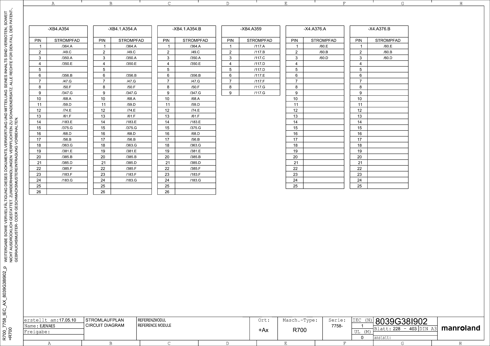

# +Ax — Sheet 228 of 403 — REFERENZMODUL

**REFERENCE MODULE**

> Part of the manroland **R700** printing press IEC/UL circuit diagrams.
> Drawing class: **Stromlaufplan / Circuit diagram** (DIN A3).
> Document `+Ax` covers the **Central control console** machine section.

## At a glance

| Field | Value |
|---|---|
| Document | `+Ax`  (8039G38I902) |
| Sheet | **228** of 403 |
| Section (DE) | REFERENZMODUL |
| Section (EN) | REFERENCE MODULE |
| Section type | REFERENCE_MODULE — Reference module |
| Machine type | `R700` |
| Series | `7758` |
| Created | 17.05.10 |
| Replaces | — |
| Columns used | A, B, C, D, E, F, G |
| Path numbers | — |
| Labels on sheet | 239 |
| Cross-refs out | 84 |
| Cross-refs in | 0 |

**Previous:** [+Ax sheet 227](SHEET_0227.md) · **Next:** [+Ax sheet 229](SHEET_0229.md) · **Document TOC:** [_TOC.md](_TOC.md)  (+Ax) · **Master TOC:** [all sheets](../_MASTER_TOC.md)

## Sheet image (300 DPI, exact vector render)



_Rendered directly from the PDF vector layer at 300 DPI (1-bit), no OCR and no resampling. Use it to confirm anything ambiguous in the text below._

## Cross-references on this sheet

Each entry is a wire leaving this sheet. The printed token is `/sheet.column`; the link resolves to that sheet inside the same document.

| Ref | Target sheet | Col | Path | Destination on target | Target section | From col |
|---|---|---|---|---|---|---|
| `/60.E` | [+Ax sheet 60](SHEET_0060.md) | E | — | — | DRUCKLUFTANLAGE | F |
| `/60.E` | [+Ax sheet 60](SHEET_0060.md) | E | — | — | DRUCKLUFTANLAGE | G |
| `/364.A` | [+Ax sheet 364](SHEET_0364.md) | A | — | — | OPTION: LOGISTIK AUSLEGER | A |
| `/364.A` | [+Ax sheet 364](SHEET_0364.md) | A | — | — | OPTION: LOGISTIK AUSLEGER | B |
| `/364.A` | [+Ax sheet 364](SHEET_0364.md) | A | — | — | OPTION: LOGISTIK AUSLEGER | C |
| `/117.A` | [+Ax sheet 117](SHEET_0117.md) | A | — | — | REALTIMERECHNER, DISPLAY | E |
| `/60.B` | [+Ax sheet 60](SHEET_0060.md) | B | — | — | DRUCKLUFTANLAGE | F |
| `/60.B` | [+Ax sheet 60](SHEET_0060.md) | B | — | — | DRUCKLUFTANLAGE | G |
| `/117.B` | [+Ax sheet 117](SHEET_0117.md) | B | — | — | REALTIMERECHNER, DISPLAY | E |
| `/49.C` | [+Ax sheet 49](SHEET_0049.md) | C | — | — | NOT AUS | A |
| `/49.C` | [+Ax sheet 49](SHEET_0049.md) | C | — | — | NOT AUS | B |
| `/49.C` | [+Ax sheet 49](SHEET_0049.md) | C | — | — | NOT AUS | C |
| `/350.A` | [+Ax sheet 350](SHEET_0350.md) | A | — | — | OPTION: LOGISTIK ANLEGER | A |
| `/350.A` | [+Ax sheet 350](SHEET_0350.md) | A | — | — | OPTION: LOGISTIK ANLEGER | B |
| `/350.A` | [+Ax sheet 350](SHEET_0350.md) | A | — | — | OPTION: LOGISTIK ANLEGER | C |
| `/60.D` | [+Ax sheet 60](SHEET_0060.md) | D | — | — | DRUCKLUFTANLAGE | F |
| `/60.D` | [+Ax sheet 60](SHEET_0060.md) | D | — | — | DRUCKLUFTANLAGE | G |
| `/117.C` | [+Ax sheet 117](SHEET_0117.md) | C | — | — | REALTIMERECHNER, DISPLAY | E |
| `/350.E` | [+Ax sheet 350](SHEET_0350.md) | E | — | — | OPTION: LOGISTIK ANLEGER | A |
| `/350.E` | [+Ax sheet 350](SHEET_0350.md) | E | — | — | OPTION: LOGISTIK ANLEGER | B |
| `/350.E` | [+Ax sheet 350](SHEET_0350.md) | E | — | — | OPTION: LOGISTIK ANLEGER | C |
| `/117.D` | [+Ax sheet 117](SHEET_0117.md) | D | — | — | REALTIMERECHNER, DISPLAY | E |
| `/117.D` | [+Ax sheet 117](SHEET_0117.md) | D | — | — | REALTIMERECHNER, DISPLAY | E |
| `/356.B` | [+Ax sheet 356](SHEET_0356.md) | B | — | — | OPTION: LOGISTIK ANLEGER | A |
| `/356.B` | [+Ax sheet 356](SHEET_0356.md) | B | — | — | OPTION: LOGISTIK ANLEGER | B |
| `/356.B` | [+Ax sheet 356](SHEET_0356.md) | B | — | — | OPTION: LOGISTIK ANLEGER | C |
| `/117.E` | [+Ax sheet 117](SHEET_0117.md) | E | — | — | REALTIMERECHNER, DISPLAY | E |
| `/47.G` | [+Ax sheet 47](SHEET_0047.md) | G | — | — | NOT AUS | A |
| `/47.G` | [+Ax sheet 47](SHEET_0047.md) | G | — | — | NOT AUS | B |
| `/47.G` | [+Ax sheet 47](SHEET_0047.md) | G | — | — | NOT AUS | C |
| `/117.F` | [+Ax sheet 117](SHEET_0117.md) | F | — | — | REALTIMERECHNER, DISPLAY | E |
| `/50.F` | [+Ax sheet 50](SHEET_0050.md) | F | — | — | STOP SICHERN | A |
| `/50.F` | [+Ax sheet 50](SHEET_0050.md) | F | — | — | STOP SICHERN | B |
| `/50.F` | [+Ax sheet 50](SHEET_0050.md) | F | — | — | STOP SICHERN | C |
| `/117.G` | [+Ax sheet 117](SHEET_0117.md) | G | — | — | REALTIMERECHNER, DISPLAY | E |
| `/347.G` | [+Ax sheet 347](SHEET_0347.md) | G | — | — | OPTION: LOGISTIK ANLEGER | A |
| `/347.G` | [+Ax sheet 347](SHEET_0347.md) | G | — | — | OPTION: LOGISTIK ANLEGER | B |
| `/347.G` | [+Ax sheet 347](SHEET_0347.md) | G | — | — | OPTION: LOGISTIK ANLEGER | C |
| `/117.G` | [+Ax sheet 117](SHEET_0117.md) | G | — | — | REALTIMERECHNER, DISPLAY | E |
| `/68.A` | [+Ax sheet 68](SHEET_0068.md) | A | — | — | SAUGBÄNDERTISCH | A |
| `/68.A` | [+Ax sheet 68](SHEET_0068.md) | A | — | — | SAUGBÄNDERTISCH | B |
| `/68.A` | [+Ax sheet 68](SHEET_0068.md) | A | — | — | SAUGBÄNDERTISCH | C |
| `/59.D` | [+Ax sheet 59](SHEET_0059.md) | D | — | — | DRUCKLUFTANLAGE | A |
| `/59.D` | [+Ax sheet 59](SHEET_0059.md) | D | — | — | DRUCKLUFTANLAGE | B |
| `/59.D` | [+Ax sheet 59](SHEET_0059.md) | D | — | — | DRUCKLUFTANLAGE | C |
| `/74.E` | [+Ax sheet 74](SHEET_0074.md) | E | — | — | FEUCHTMITTELKÜHLGERÄT | A |
| `/74.E` | [+Ax sheet 74](SHEET_0074.md) | E | — | — | FEUCHTMITTELKÜHLGERÄT | B |
| `/74.E` | [+Ax sheet 74](SHEET_0074.md) | E | — | — | FEUCHTMITTELKÜHLGERÄT | C |
| `/61.F` | [+Ax sheet 61](SHEET_0061.md) | F | — | — | DRUCKLUFTANLAGE | A |
| `/61.F` | [+Ax sheet 61](SHEET_0061.md) | F | — | — | DRUCKLUFTANLAGE | B |
| `/61.F` | [+Ax sheet 61](SHEET_0061.md) | F | — | — | DRUCKLUFTANLAGE | C |
| `/183.E` | [+Ax sheet 183](SHEET_0183.md) | E | — | — | RESERVE | A |
| `/183.E` | [+Ax sheet 183](SHEET_0183.md) | E | — | — | RESERVE | B |
| `/183.E` | [+Ax sheet 183](SHEET_0183.md) | E | — | — | RESERVE | C |
| `/375.G` | [+Ax sheet 375](SHEET_0375.md) | G | — | — | OPTION: VORDERMARKENEINSTELLUNG | A |
| `/375.G` | [+Ax sheet 375](SHEET_0375.md) | G | — | — | OPTION: VORDERMARKENEINSTELLUNG | B |
| `/375.G` | [+Ax sheet 375](SHEET_0375.md) | G | — | — | OPTION: VORDERMARKENEINSTELLUNG | C |
| `/68.D` | [+Ax sheet 68](SHEET_0068.md) | D | — | — | SAUGBÄNDERTISCH | A |
| `/68.D` | [+Ax sheet 68](SHEET_0068.md) | D | — | — | SAUGBÄNDERTISCH | B |
| `/68.D` | [+Ax sheet 68](SHEET_0068.md) | D | — | — | SAUGBÄNDERTISCH | C |
| `/56.B` | [+Ax sheet 56](SHEET_0056.md) | B | — | — | LUFTVERSORGUNG | A |
| `/56.B` | [+Ax sheet 56](SHEET_0056.md) | B | — | — | LUFTVERSORGUNG | B |
| `/56.B` | [+Ax sheet 56](SHEET_0056.md) | B | — | — | LUFTVERSORGUNG | C |
| `/363.G` | [+Ax sheet 363](SHEET_0363.md) | G | — | — | OPTION: LOGISTIK AUSLEGER | A |
| `/363.G` | [+Ax sheet 363](SHEET_0363.md) | G | — | — | OPTION: LOGISTIK AUSLEGER | B |
| `/363.G` | [+Ax sheet 363](SHEET_0363.md) | G | — | — | OPTION: LOGISTIK AUSLEGER | C |
| `/381.E` | [+Ax sheet 381](SHEET_0381.md) | E | — | — | OPTION: INLINEFOILER PRINDOR | A |
| `/381.E` | [+Ax sheet 381](SHEET_0381.md) | E | — | — | OPTION: INLINEFOILER PRINDOR | B |
| `/381.E` | [+Ax sheet 381](SHEET_0381.md) | E | — | — | OPTION: INLINEFOILER PRINDOR | C |
| `/385.B` | [+Ax sheet 385](SHEET_0385.md) | B | — | — | OPTION: INLINEFOILER PRINDOR | A |
| `/385.B` | [+Ax sheet 385](SHEET_0385.md) | B | — | — | OPTION: INLINEFOILER PRINDOR | B |
| `/385.B` | [+Ax sheet 385](SHEET_0385.md) | B | — | — | OPTION: INLINEFOILER PRINDOR | C |
| `/385.D` | [+Ax sheet 385](SHEET_0385.md) | D | — | — | OPTION: INLINEFOILER PRINDOR | A |
| `/385.D` | [+Ax sheet 385](SHEET_0385.md) | D | — | — | OPTION: INLINEFOILER PRINDOR | B |
| `/385.D` | [+Ax sheet 385](SHEET_0385.md) | D | — | — | OPTION: INLINEFOILER PRINDOR | C |
| `/385.F` | [+Ax sheet 385](SHEET_0385.md) | F | — | — | OPTION: INLINEFOILER PRINDOR | A |
| `/385.F` | [+Ax sheet 385](SHEET_0385.md) | F | — | — | OPTION: INLINEFOILER PRINDOR | B |
| `/385.F` | [+Ax sheet 385](SHEET_0385.md) | F | — | — | OPTION: INLINEFOILER PRINDOR | C |
| `/183.F` | [+Ax sheet 183](SHEET_0183.md) | F | — | — | RESERVE | A |
| `/183.F` | [+Ax sheet 183](SHEET_0183.md) | F | — | — | RESERVE | B |
| `/183.F` | [+Ax sheet 183](SHEET_0183.md) | F | — | — | RESERVE | C |
| `/183.G` | [+Ax sheet 183](SHEET_0183.md) | G | — | — | RESERVE | A |
| `/183.G` | [+Ax sheet 183](SHEET_0183.md) | G | — | — | RESERVE | B |
| `/183.G` | [+Ax sheet 183](SHEET_0183.md) | G | — | — | RESERVE | C |

## Devices on this sheet

| Tag | Class | Class meaning (IEC) | Col | Sub | Terminal | Sign |
|---|---|---|---|---|---|---|
| `XB4.A354` | — | cross-device reference | A | — | — | — |
| `X4.A376.A` | — | cross-device reference | E | — | — | — |
| `X4.A376.B` | — | cross-device reference | G | — | — | — |
| `XB4.A359` | — | cross-device reference | D | — | — | — |
| `XB4.1.A354.A` | — | cross-device reference | B | — | — | — |
| `XB4.1.A354.B` | — | cross-device reference | C | — | — | — |

## Potentials / nets

_No named potentials on this sheet._

## Wire-end annotations (grouped as printed)

A wire that continues elsewhere is annotated with a small cluster: the destination description, the path/line number `#NN`, and the `/sheet.column` cross reference. Each row below is one such cluster exactly as it is grouped on the drawing.

| Col | Y | Path | Cross-ref | Text on the wire |
|---|---|---|---|---|
| A | 65.5 | — | — | `XB4.A354` |
| B | 65.5 | — | — | `XB4.1.A354.A` |
| C | 65.5 | — | — | `XB4.1.A354.B` |
| D | 65.5 | — | — | `XB4.A359` |
| E | 65.5 | — | — | `X4.A376.A` |
| G | 65.5 | — | — | `X4.A376.B` |
| A | 94.2 | — | — | `PIN STROMPFAD` |
| B | 94.2 | — | — | `PIN STROMPFAD` |
| C | 94.2 | — | — | `PIN STROMPFAD` |
| D | 94.2 | — | — | `PIN 2 3 4 5 6 7 8 9 1 STROMPFAD` |
| E | 94.2 | — | — | `PIN STROMPFAD` |
| G | 94.2 | — | — | `PIN STROMPFAD` |
| A | 108.4 | — | — | `2 3 4 5 6 7 8 9 1` |
| B | 108.4 | — | — | `2 3 4 5 6 7 8 9 1` |
| C | 108.4 | — | — | `2 3 4 5 6 7 8 9 1` |
| E | 108.4 | — | — | `2 3 4 5 6 7 8 9 1` |
| F | 108.4 | — | — | `2 3 4 5 6 7 8 9 1` |
| A | 108.7 | — | `/364.A` | — |
| B | 108.7 | — | `/364.A` | — |
| C | 108.7 | — | `/364.A` | — |
| E | 108.7 | — | `/117.A` | — |
| F | 108.7 | — | `/60.E` | — |
| G | 108.7 | — | `/60.E` | — |
| F | 122.8 | — | `/60.B` | — |
| G | 122.8 | — | `/60.B` | — |
| A | 122.9 | — | `/49.C` | — |
| B | 122.9 | — | `/49.C` | — |
| C | 122.9 | — | `/49.C` | — |
| E | 122.9 | — | `/117.B` | — |
| A | 137.0 | — | `/350.A` | — |
| B | 137.0 | — | `/350.A` | — |
| C | 137.0 | — | `/350.A` | — |
| E | 137.1 | — | `/117.C` | — |
| F | 137.1 | — | `/60.D` | — |
| G | 137.1 | — | `/60.D` | — |
| A | 151.2 | — | `/350.E` | — |
| B | 151.2 | — | `/350.E` | — |
| C | 151.2 | — | `/350.E` | — |
| E | 151.2 | — | `/117.D` | — |
| E | 165.4 | — | `/117.D` | — |
| A | 179.6 | — | `/356.B` | — |
| B | 179.6 | — | `/356.B` | — |
| C | 179.6 | — | `/356.B` | — |
| E | 179.6 | — | `/117.E` | — |
| A | 193.7 | — | `/47.G` | — |
| B | 193.7 | — | `/47.G` | — |
| C | 193.7 | — | `/47.G` | — |
| E | 193.7 | — | `/117.F` | — |
| A | 207.9 | — | `/50.F` | — |
| B | 207.9 | — | `/50.F` | — |
| C | 207.9 | — | `/50.F` | — |
| E | 207.9 | — | `/117.G` | — |
| A | 222.1 | — | `/347.G` | — |
| B | 222.1 | — | `/347.G` | — |
| C | 222.1 | — | `/347.G` | — |
| E | 222.1 | — | `/117.G` | — |
| A | 235.9 | — | — | `10 12 13 14 15 16 17 18 19 20 11` |
| B | 235.9 | — | — | `10 12 13 14 15 16 17 18 19 20 11` |
| C | 235.9 | — | — | `10 12 13 14 15 16 17 18 19 20 11` |
| E | 235.9 | — | — | `10 12 13 14 15 16 17 18 19 20 11` |
| F | 235.9 | — | — | `10 12 13 14 15 16 17 18 19 20 11` |
| A | 236.2 | — | `/68.A` | — |
| B | 236.2 | — | `/68.A` | — |
| C | 236.2 | — | `/68.A` | — |
| A | 250.4 | — | `/59.D` | — |
| B | 250.4 | — | `/59.D` | — |
| C | 250.4 | — | `/59.D` | — |
| A | 264.6 | — | `/74.E` | — |
| B | 264.6 | — | `/74.E` | — |
| C | 264.6 | — | `/74.E` | — |
| A | 278.8 | — | `/61.F` | — |
| B | 278.8 | — | `/61.F` | — |
| C | 278.8 | — | `/61.F` | — |
| A | 292.9 | — | `/183.E` | — |
| B | 292.9 | — | `/183.E` | — |
| C | 292.9 | — | `/183.E` | — |
| A | 307.1 | — | `/375.G` | — |
| B | 307.1 | — | `/375.G` | — |
| C | 307.1 | — | `/375.G` | — |
| A | 321.3 | — | `/68.D` | — |
| B | 321.3 | — | `/68.D` | — |
| C | 321.3 | — | `/68.D` | — |
| A | 335.4 | — | `/56.B` | — |
| B | 335.4 | — | `/56.B` | — |
| C | 335.4 | — | `/56.B` | — |
| A | 349.6 | — | `/363.G` | — |
| B | 349.6 | — | `/363.G` | — |
| C | 349.6 | — | `/363.G` | — |
| A | 363.8 | — | `/381.E` | — |
| B | 363.8 | — | `/381.E` | — |
| C | 363.8 | — | `/381.E` | — |
| A | 378.0 | — | `/385.B` | — |
| B | 378.0 | — | `/385.B` | — |
| C | 378.0 | — | `/385.B` | — |
| A | 391.8 | — | — | `22 23 24 25 26 21` |
| B | 391.8 | — | — | `22 23 24 25 26 21` |
| C | 391.8 | — | — | `22 23 24 25 26 21` |
| E | 391.8 | — | — | `22 23 24 25 21` |
| F | 391.8 | — | — | `22 23 24 25 21` |
| A | 392.2 | — | `/385.D` | — |
| B | 392.2 | — | `/385.D` | — |
| C | 392.2 | — | `/385.D` | — |
| A | 406.3 | — | `/385.F` | — |
| B | 406.3 | — | `/385.F` | — |
| C | 406.3 | — | `/385.F` | — |
| A | 420.5 | — | `/183.F` | — |
| B | 420.5 | — | `/183.F` | — |
| C | 420.5 | — | `/183.F` | — |
| A | 434.7 | — | `/183.G` | — |
| B | 434.7 | — | `/183.G` | — |
| C | 434.7 | — | `/183.G` | — |


## Reconstructed tables

This sheet carries tabular content (pin map / terminal assignment / index). The grid below was rebuilt from the drawing's own rule lines, so each row is exactly one physical row of the table.

### Table 1 — 26 data rows × 2 columns (at x=70.9, y=62.4) — **XB4.A354**

| PIN | STROMPFAD |
|---|---|
| `1` | `/364.A` |
| `2` | `/49.C` |
| `3` | `/350.A` |
| `4` | `/350.E` |
| `5` |  |
| `6` | `/356.B` |
| `7` | `/47.G` |
| `8` | `/50.F` |
| `9` | `/347.G` |
| `10` | `/68.A` |
| `11` | `/59.D` |
| `12` | `/74.E` |
| `13` | `/61.F` |
| `14` | `/183.E` |
| `15` | `/375.G` |
| `16` | `/68.D` |
| `17` | `/56.B` |
| `18` | `/363.G` |
| `19` | `/381.E` |
| `20` | `/385.B` |
| `21` | `/385.D` |
| `22` | `/385.F` |
| `23` | `/183.F` |
| `24` | `/183.G` |
| `25` |  |
| `26` |  |


### Table 2 — 26 data rows × 2 columns (at x=226.8, y=62.4) — **XB4.1.A354.A**

| PIN | STROMPFAD |
|---|---|
| `1` | `/364.A` |
| `2` | `/49.C` |
| `3` | `/350.A` |
| `4` | `/350.E` |
| `5` |  |
| `6` | `/356.B` |
| `7` | `/47.G` |
| `8` | `/50.F` |
| `9` | `/347.G` |
| `10` | `/68.A` |
| `11` | `/59.D` |
| `12` | `/74.E` |
| `13` | `/61.F` |
| `14` | `/183.E` |
| `15` | `/375.G` |
| `16` | `/68.D` |
| `17` | `/56.B` |
| `18` | `/363.G` |
| `19` | `/381.E` |
| `20` | `/385.B` |
| `21` | `/385.D` |
| `22` | `/385.F` |
| `23` | `/183.F` |
| `24` | `/183.G` |
| `25` |  |
| `26` |  |


### Table 3 — 26 data rows × 2 columns (at x=382.7, y=62.4) — **XB4.1.A354.B**

| PIN | STROMPFAD |
|---|---|
| `1` | `/364.A` |
| `2` | `/49.C` |
| `3` | `/350.A` |
| `4` | `/350.E` |
| `5` |  |
| `6` | `/356.B` |
| `7` | `/47.G` |
| `8` | `/50.F` |
| `9` | `/347.G` |
| `10` | `/68.A` |
| `11` | `/59.D` |
| `12` | `/74.E` |
| `13` | `/61.F` |
| `14` | `/183.E` |
| `15` | `/375.G` |
| `16` | `/68.D` |
| `17` | `/56.B` |
| `18` | `/363.G` |
| `19` | `/381.E` |
| `20` | `/385.B` |
| `21` | `/385.D` |
| `22` | `/385.F` |
| `23` | `/183.F` |
| `24` | `/183.G` |
| `25` |  |
| `26` |  |


### Table 4 — 9 data rows × 2 columns (at x=538.6, y=62.4) — **XB4.A359**

| PIN | STROMPFAD |
|---|---|
| `1` | `/117.A` |
| `2` | `/117.B` |
| `3` | `/117.C` |
| `4` | `/117.D` |
| `5` | `/117.D` |
| `6` | `/117.E` |
| `7` | `/117.F` |
| `8` | `/117.G` |
| `9` | `/117.G` |


### Table 5 — 25 data rows × 2 columns (at x=694.5, y=62.4) — **X4.A376.A**

| PIN | STROMPFAD |
|---|---|
| `1` | `/60.E` |
| `2` | `/60.B` |
| `3` | `/60.D` |
| `4` |  |
| `5` |  |
| `6` |  |
| `7` |  |
| `8` |  |
| `9` |  |
| `10` |  |
| `11` |  |
| `12` |  |
| `13` |  |
| `14` |  |
| `15` |  |
| `16` |  |
| `17` |  |
| `18` |  |
| `19` |  |
| `20` |  |
| `21` |  |
| `22` |  |
| `23` |  |
| `24` |  |
| `25` |  |


### Table 6 — 25 data rows × 2 columns (at x=850.4, y=62.4) — **X4.A376.B**

| PIN | STROMPFAD |
|---|---|
| `1` | `/60.E` |
| `2` | `/60.B` |
| `3` | `/60.D` |
| `4` |  |
| `5` |  |
| `6` |  |
| `7` |  |
| `8` |  |
| `9` |  |
| `10` |  |
| `11` |  |
| `12` |  |
| `13` |  |
| `14` |  |
| `15` |  |
| `16` |  |
| `17` |  |
| `18` |  |
| `19` |  |
| `20` |  |
| `21` |  |
| `22` |  |
| `23` |  |
| `24` |  |
| `25` |  |


## Notes and free text on this sheet

| Text | Col | Y (pt) |
|---|---|---|
| `PIN` | A | 94.2 |
| `STROMPFAD` | A | 94.15 |
| `PIN` | E | 94.2 |
| `STROMPFAD` | F | 94.15 |
| `PIN` | F | 94.2 |
| `STROMPFAD` | G | 94.15 |
| `PIN` | D | 94.2 |
| `STROMPFAD` | E | 94.15 |
| `PIN` | B | 94.2 |
| `STROMPFAD` | B | 94.15 |
| `PIN` | C | 94.2 |
| `STROMPFAD` | C | 94.15 |

## Complete label inventory (exact text from the drawing)

Every text object inside the drawing area of this sheet, in DIN reading order (column A→H, then top→bottom). This is the authoritative list: if a string is not here it is not printed on this sheet.

| Col | Y | X | Dir | Type | Text |
|---|---|---|---|---|---|
| A | 65.5 | 116.2 | → | device ref | `XB4.A354` |
| A | 94.2 | 84.0 | → | text | `PIN` |
| A | 94.2 | 132.2 | → | text | `STROMPFAD` |
| A | 108.4 | 95.8 | → | number | `1` |
| A | 108.7 | 150.2 | → | cross-reference | `/364.A` |
| A | 122.5 | 94.1 | → | number | `2` |
| A | 122.9 | 152.6 | → | cross-reference | `/49.C` |
| A | 136.7 | 94.1 | → | number | `3` |
| A | 137.0 | 150.2 | → | cross-reference | `/350.A` |
| A | 150.9 | 94.1 | → | number | `4` |
| A | 151.2 | 150.5 | → | cross-reference | `/350.E` |
| A | 165.1 | 94.1 | → | number | `5` |
| A | 179.2 | 94.1 | → | number | `6` |
| A | 179.6 | 150.4 | → | cross-reference | `/356.B` |
| A | 193.4 | 94.1 | → | number | `7` |
| A | 193.7 | 152.5 | → | cross-reference | `/47.G` |
| A | 207.6 | 94.1 | → | number | `8` |
| A | 207.9 | 153.1 | → | cross-reference | `/50.F` |
| A | 221.8 | 94.1 | → | number | `9` |
| A | 222.1 | 150.1 | → | cross-reference | `/347.G` |
| A | 235.9 | 88.7 | → | number | `10` |
| A | 236.2 | 152.6 | → | cross-reference | `/68.A` |
| A | 250.1 | 90.4 | → | number | `11` |
| A | 250.4 | 152.6 | → | cross-reference | `/59.D` |
| A | 264.3 | 88.7 | → | number | `12` |
| A | 264.6 | 152.9 | → | cross-reference | `/74.E` |
| A | 278.5 | 88.7 | → | number | `13` |
| A | 278.8 | 153.1 | → | cross-reference | `/61.F` |
| A | 292.6 | 88.7 | → | number | `14` |
| A | 292.9 | 150.5 | → | cross-reference | `/183.E` |
| A | 306.8 | 88.7 | → | number | `15` |
| A | 307.1 | 150.1 | → | cross-reference | `/375.G` |
| A | 321.0 | 88.7 | → | number | `16` |
| A | 321.3 | 152.6 | → | cross-reference | `/68.D` |
| A | 335.1 | 88.7 | → | number | `17` |
| A | 335.4 | 152.8 | → | cross-reference | `/56.B` |
| A | 349.3 | 88.7 | → | number | `18` |
| A | 349.7 | 150.1 | → | cross-reference | `/363.G` |
| A | 363.5 | 88.7 | → | number | `19` |
| A | 363.8 | 150.5 | → | cross-reference | `/381.E` |
| A | 377.7 | 88.7 | → | number | `20` |
| A | 378.0 | 150.4 | → | cross-reference | `/385.B` |
| A | 391.8 | 90.4 | → | number | `21` |
| A | 392.2 | 150.2 | → | cross-reference | `/385.D` |
| A | 406.0 | 88.7 | → | number | `22` |
| A | 406.3 | 150.7 | → | cross-reference | `/385.F` |
| A | 420.2 | 88.7 | → | number | `23` |
| A | 420.5 | 150.7 | → | cross-reference | `/183.F` |
| A | 434.4 | 88.7 | → | number | `24` |
| A | 434.7 | 150.1 | → | cross-reference | `/183.G` |
| A | 448.5 | 88.7 | → | number | `25` |
| A | 462.7 | 88.7 | → | number | `26` |
| B | 65.5 | 262.3 | → | device ref | `XB4.1.A354.A` |
| B | 94.2 | 240.0 | → | text | `PIN` |
| B | 94.2 | 288.1 | → | text | `STROMPFAD` |
| B | 108.4 | 251.7 | → | number | `1` |
| B | 108.7 | 306.1 | → | cross-reference | `/364.A` |
| B | 122.5 | 250.0 | → | number | `2` |
| B | 122.9 | 308.6 | → | cross-reference | `/49.C` |
| B | 136.7 | 250.0 | → | number | `3` |
| B | 137.0 | 306.1 | → | cross-reference | `/350.A` |
| B | 150.9 | 250.0 | → | number | `4` |
| B | 151.2 | 306.4 | → | cross-reference | `/350.E` |
| B | 165.1 | 250.0 | → | number | `5` |
| B | 179.2 | 250.0 | → | number | `6` |
| B | 179.6 | 306.3 | → | cross-reference | `/356.B` |
| B | 193.4 | 250.0 | → | number | `7` |
| B | 193.7 | 308.4 | → | cross-reference | `/47.G` |
| B | 207.6 | 250.0 | → | number | `8` |
| B | 207.9 | 309.0 | → | cross-reference | `/50.F` |
| B | 221.8 | 250.0 | → | number | `9` |
| B | 222.1 | 306.0 | → | cross-reference | `/347.G` |
| B | 235.9 | 244.6 | → | number | `10` |
| B | 236.2 | 308.6 | → | cross-reference | `/68.A` |
| B | 250.1 | 246.3 | → | number | `11` |
| B | 250.4 | 308.6 | → | cross-reference | `/59.D` |
| B | 264.3 | 244.6 | → | number | `12` |
| B | 264.6 | 308.8 | → | cross-reference | `/74.E` |
| B | 278.5 | 244.6 | → | number | `13` |
| B | 278.8 | 309.0 | → | cross-reference | `/61.F` |
| B | 292.6 | 244.6 | → | number | `14` |
| B | 292.9 | 306.4 | → | cross-reference | `/183.E` |
| B | 306.8 | 244.6 | → | number | `15` |
| B | 307.1 | 306.0 | → | cross-reference | `/375.G` |
| B | 321.0 | 244.6 | → | number | `16` |
| B | 321.3 | 308.6 | → | cross-reference | `/68.D` |
| B | 335.1 | 244.6 | → | number | `17` |
| B | 335.4 | 308.7 | → | cross-reference | `/56.B` |
| B | 349.3 | 244.6 | → | number | `18` |
| B | 349.7 | 306.0 | → | cross-reference | `/363.G` |
| B | 363.5 | 244.6 | → | number | `19` |
| B | 363.8 | 306.4 | → | cross-reference | `/381.E` |
| B | 377.7 | 244.6 | → | number | `20` |
| B | 378.0 | 306.3 | → | cross-reference | `/385.B` |
| B | 391.8 | 246.3 | → | number | `21` |
| B | 392.2 | 306.1 | → | cross-reference | `/385.D` |
| B | 406.0 | 244.6 | → | number | `22` |
| B | 406.3 | 306.6 | → | cross-reference | `/385.F` |
| B | 420.2 | 244.6 | → | number | `23` |
| B | 420.5 | 306.6 | → | cross-reference | `/183.F` |
| B | 434.4 | 244.6 | → | number | `24` |
| B | 434.7 | 306.0 | → | cross-reference | `/183.G` |
| B | 448.5 | 244.6 | → | number | `25` |
| B | 462.7 | 244.6 | → | number | `26` |
| C | 65.5 | 418.7 | → | device ref | `XB4.1.A354.B` |
| C | 94.2 | 395.9 | → | text | `PIN` |
| C | 94.2 | 444.0 | → | text | `STROMPFAD` |
| C | 108.4 | 407.6 | → | number | `1` |
| C | 108.7 | 462.0 | → | cross-reference | `/364.A` |
| C | 122.5 | 405.9 | → | number | `2` |
| C | 122.9 | 464.5 | → | cross-reference | `/49.C` |
| C | 136.7 | 405.9 | → | number | `3` |
| C | 137.0 | 462.0 | → | cross-reference | `/350.A` |
| C | 150.9 | 405.9 | → | number | `4` |
| C | 151.2 | 462.3 | → | cross-reference | `/350.E` |
| C | 165.1 | 405.9 | → | number | `5` |
| C | 179.2 | 405.9 | → | number | `6` |
| C | 179.6 | 462.2 | → | cross-reference | `/356.B` |
| C | 193.4 | 405.9 | → | number | `7` |
| C | 193.7 | 464.3 | → | cross-reference | `/47.G` |
| C | 207.6 | 405.9 | → | number | `8` |
| C | 207.9 | 464.9 | → | cross-reference | `/50.F` |
| C | 221.8 | 405.9 | → | number | `9` |
| C | 222.1 | 461.9 | → | cross-reference | `/347.G` |
| C | 235.9 | 400.5 | → | number | `10` |
| C | 236.2 | 464.5 | → | cross-reference | `/68.A` |
| C | 250.1 | 402.2 | → | number | `11` |
| C | 250.4 | 464.5 | → | cross-reference | `/59.D` |
| C | 264.3 | 400.5 | → | number | `12` |
| C | 264.6 | 464.7 | → | cross-reference | `/74.E` |
| C | 278.5 | 400.5 | → | number | `13` |
| C | 278.8 | 464.9 | → | cross-reference | `/61.F` |
| C | 292.6 | 400.5 | → | number | `14` |
| C | 292.9 | 462.3 | → | cross-reference | `/183.E` |
| C | 306.8 | 400.5 | → | number | `15` |
| C | 307.1 | 461.9 | → | cross-reference | `/375.G` |
| C | 321.0 | 400.5 | → | number | `16` |
| C | 321.3 | 464.5 | → | cross-reference | `/68.D` |
| C | 335.1 | 400.5 | → | number | `17` |
| C | 335.4 | 464.6 | → | cross-reference | `/56.B` |
| C | 349.3 | 400.5 | → | number | `18` |
| C | 349.7 | 461.9 | → | cross-reference | `/363.G` |
| C | 363.5 | 400.5 | → | number | `19` |
| C | 363.8 | 462.3 | → | cross-reference | `/381.E` |
| C | 377.7 | 400.5 | → | number | `20` |
| C | 378.0 | 462.2 | → | cross-reference | `/385.B` |
| C | 391.8 | 402.2 | → | number | `21` |
| C | 392.2 | 462.0 | → | cross-reference | `/385.D` |
| C | 406.0 | 400.5 | → | number | `22` |
| C | 406.3 | 462.5 | → | cross-reference | `/385.F` |
| C | 420.2 | 400.5 | → | number | `23` |
| C | 420.5 | 462.5 | → | cross-reference | `/183.F` |
| C | 434.4 | 400.5 | → | number | `24` |
| C | 434.7 | 461.9 | → | cross-reference | `/183.G` |
| C | 448.5 | 400.5 | → | number | `25` |
| C | 462.7 | 400.5 | → | number | `26` |
| D | 65.5 | 583.9 | → | device ref | `XB4.A359` |
| D | 94.2 | 551.8 | → | text | `PIN` |
| D | 108.4 | 557.7 | → | number | `1` |
| D | 122.5 | 557.1 | → | number | `2` |
| D | 136.7 | 557.1 | → | number | `3` |
| D | 150.9 | 557.1 | → | number | `4` |
| D | 165.1 | 557.1 | → | number | `5` |
| D | 179.2 | 557.1 | → | number | `6` |
| D | 193.4 | 557.1 | → | number | `7` |
| D | 207.6 | 557.1 | → | number | `8` |
| D | 221.8 | 557.1 | → | number | `9` |
| E | 65.5 | 738.0 | → | device ref | `X4.A376.A` |
| E | 94.2 | 600.0 | → | text | `STROMPFAD` |
| E | 94.2 | 707.7 | → | text | `PIN` |
| E | 108.4 | 719.4 | → | number | `1` |
| E | 108.7 | 618.0 | → | cross-reference | `/117.A` |
| E | 122.5 | 717.7 | → | number | `2` |
| E | 122.9 | 618.1 | → | cross-reference | `/117.B` |
| E | 136.7 | 717.7 | → | number | `3` |
| E | 137.1 | 618.0 | → | cross-reference | `/117.C` |
| E | 150.9 | 717.7 | → | number | `4` |
| E | 151.2 | 618.0 | → | cross-reference | `/117.D` |
| E | 165.1 | 717.7 | → | number | `5` |
| E | 165.4 | 618.0 | → | cross-reference | `/117.D` |
| E | 179.2 | 717.7 | → | number | `6` |
| E | 179.6 | 618.2 | → | cross-reference | `/117.E` |
| E | 193.4 | 717.7 | → | number | `7` |
| E | 193.7 | 618.4 | → | cross-reference | `/117.F` |
| E | 207.6 | 717.7 | → | number | `8` |
| E | 207.9 | 617.8 | → | cross-reference | `/117.G` |
| E | 221.8 | 717.7 | → | number | `9` |
| E | 222.1 | 617.8 | → | cross-reference | `/117.G` |
| E | 235.9 | 712.3 | → | number | `10` |
| E | 250.1 | 714.0 | → | number | `11` |
| E | 264.3 | 712.3 | → | number | `12` |
| E | 278.5 | 712.3 | → | number | `13` |
| E | 292.6 | 712.3 | → | number | `14` |
| E | 306.8 | 712.3 | → | number | `15` |
| E | 321.0 | 712.3 | → | number | `16` |
| E | 335.1 | 712.3 | → | number | `17` |
| E | 349.3 | 712.3 | → | number | `18` |
| E | 363.5 | 712.3 | → | number | `19` |
| E | 377.7 | 712.3 | → | number | `20` |
| E | 391.8 | 714.0 | → | number | `21` |
| E | 406.0 | 712.3 | → | number | `22` |
| E | 420.2 | 712.3 | → | number | `23` |
| E | 434.4 | 712.3 | → | number | `24` |
| E | 448.5 | 712.3 | → | number | `25` |
| F | 94.2 | 755.9 | → | text | `STROMPFAD` |
| F | 94.2 | 863.6 | → | text | `PIN` |
| F | 108.4 | 875.3 | → | number | `1` |
| F | 108.7 | 776.6 | → | cross-reference | `/60.E` |
| F | 122.5 | 873.6 | → | number | `2` |
| F | 122.8 | 776.4 | → | cross-reference | `/60.B` |
| F | 136.7 | 873.6 | → | number | `3` |
| F | 137.1 | 776.3 | → | cross-reference | `/60.D` |
| F | 150.9 | 873.6 | → | number | `4` |
| F | 165.1 | 873.6 | → | number | `5` |
| F | 179.2 | 873.6 | → | number | `6` |
| F | 193.4 | 873.6 | → | number | `7` |
| F | 207.6 | 873.6 | → | number | `8` |
| F | 221.8 | 873.6 | → | number | `9` |
| F | 235.9 | 868.3 | → | number | `10` |
| F | 250.1 | 870.0 | → | number | `11` |
| F | 264.3 | 868.3 | → | number | `12` |
| F | 278.5 | 868.3 | → | number | `13` |
| F | 292.6 | 868.3 | → | number | `14` |
| F | 306.8 | 868.3 | → | number | `15` |
| F | 321.0 | 868.3 | → | number | `16` |
| F | 335.1 | 868.3 | → | number | `17` |
| F | 349.3 | 868.3 | → | number | `18` |
| F | 363.5 | 868.3 | → | number | `19` |
| F | 377.7 | 868.3 | → | number | `20` |
| F | 391.8 | 870.0 | → | number | `21` |
| F | 406.0 | 868.3 | → | number | `22` |
| F | 420.2 | 868.3 | → | number | `23` |
| F | 434.4 | 868.3 | → | number | `24` |
| F | 448.5 | 868.3 | → | number | `25` |
| G | 65.5 | 894.3 | → | device ref | `X4.A376.B` |
| G | 94.2 | 911.8 | → | text | `STROMPFAD` |
| G | 108.7 | 932.5 | → | cross-reference | `/60.E` |
| G | 122.8 | 932.3 | → | cross-reference | `/60.B` |
| G | 137.1 | 932.2 | → | cross-reference | `/60.D` |

## Reading-order text block

The same content as a plain block, grouped by DIN column — convenient to paste or to match against a visual description.

```text
=== Column A ===
  65.5  116.2  devref       XB4.A354
  94.2   84.0  text         PIN
  94.2  132.2  text         STROMPFAD
 108.4   95.8  numeric      1
 108.7  150.2  xref         /364.A
 122.5   94.1  numeric      2
 122.9  152.6  xref         /49.C
 136.7   94.1  numeric      3
 137.0  150.2  xref         /350.A
 150.9   94.1  numeric      4
 151.2  150.5  xref         /350.E
 165.1   94.1  numeric      5
 179.2   94.1  numeric      6
 179.6  150.4  xref         /356.B
 193.4   94.1  numeric      7
 193.7  152.5  xref         /47.G
 207.6   94.1  numeric      8
 207.9  153.1  xref         /50.F
 221.8   94.1  numeric      9
 222.1  150.1  xref         /347.G
 235.9   88.7  numeric      10
 236.2  152.6  xref         /68.A
 250.1   90.4  numeric      11
 250.4  152.6  xref         /59.D
 264.3   88.7  numeric      12
 264.6  152.9  xref         /74.E
 278.5   88.7  numeric      13
 278.8  153.1  xref         /61.F
 292.6   88.7  numeric      14
 292.9  150.5  xref         /183.E
 306.8   88.7  numeric      15
 307.1  150.1  xref         /375.G
 321.0   88.7  numeric      16
 321.3  152.6  xref         /68.D
 335.1   88.7  numeric      17
 335.4  152.8  xref         /56.B
 349.3   88.7  numeric      18
 349.7  150.1  xref         /363.G
 363.5   88.7  numeric      19
 363.8  150.5  xref         /381.E
 377.7   88.7  numeric      20
 378.0  150.4  xref         /385.B
 391.8   90.4  numeric      21
 392.2  150.2  xref         /385.D
 406.0   88.7  numeric      22
 406.3  150.7  xref         /385.F
 420.2   88.7  numeric      23
 420.5  150.7  xref         /183.F
 434.4   88.7  numeric      24
 434.7  150.1  xref         /183.G
 448.5   88.7  numeric      25
 462.7   88.7  numeric      26
=== Column B ===
  65.5  262.3  devref       XB4.1.A354.A
  94.2  240.0  text         PIN
  94.2  288.1  text         STROMPFAD
 108.4  251.7  numeric      1
 108.7  306.1  xref         /364.A
 122.5  250.0  numeric      2
 122.9  308.6  xref         /49.C
 136.7  250.0  numeric      3
 137.0  306.1  xref         /350.A
 150.9  250.0  numeric      4
 151.2  306.4  xref         /350.E
 165.1  250.0  numeric      5
 179.2  250.0  numeric      6
 179.6  306.3  xref         /356.B
 193.4  250.0  numeric      7
 193.7  308.4  xref         /47.G
 207.6  250.0  numeric      8
 207.9  309.0  xref         /50.F
 221.8  250.0  numeric      9
 222.1  306.0  xref         /347.G
 235.9  244.6  numeric      10
 236.2  308.6  xref         /68.A
 250.1  246.3  numeric      11
 250.4  308.6  xref         /59.D
 264.3  244.6  numeric      12
 264.6  308.8  xref         /74.E
 278.5  244.6  numeric      13
 278.8  309.0  xref         /61.F
 292.6  244.6  numeric      14
 292.9  306.4  xref         /183.E
 306.8  244.6  numeric      15
 307.1  306.0  xref         /375.G
 321.0  244.6  numeric      16
 321.3  308.6  xref         /68.D
 335.1  244.6  numeric      17
 335.4  308.7  xref         /56.B
 349.3  244.6  numeric      18
 349.7  306.0  xref         /363.G
 363.5  244.6  numeric      19
 363.8  306.4  xref         /381.E
 377.7  244.6  numeric      20
 378.0  306.3  xref         /385.B
 391.8  246.3  numeric      21
 392.2  306.1  xref         /385.D
 406.0  244.6  numeric      22
 406.3  306.6  xref         /385.F
 420.2  244.6  numeric      23
 420.5  306.6  xref         /183.F
 434.4  244.6  numeric      24
 434.7  306.0  xref         /183.G
 448.5  244.6  numeric      25
 462.7  244.6  numeric      26
=== Column C ===
  65.5  418.7  devref       XB4.1.A354.B
  94.2  395.9  text         PIN
  94.2  444.0  text         STROMPFAD
 108.4  407.6  numeric      1
 108.7  462.0  xref         /364.A
 122.5  405.9  numeric      2
 122.9  464.5  xref         /49.C
 136.7  405.9  numeric      3
 137.0  462.0  xref         /350.A
 150.9  405.9  numeric      4
 151.2  462.3  xref         /350.E
 165.1  405.9  numeric      5
 179.2  405.9  numeric      6
 179.6  462.2  xref         /356.B
 193.4  405.9  numeric      7
 193.7  464.3  xref         /47.G
 207.6  405.9  numeric      8
 207.9  464.9  xref         /50.F
 221.8  405.9  numeric      9
 222.1  461.9  xref         /347.G
 235.9  400.5  numeric      10
 236.2  464.5  xref         /68.A
 250.1  402.2  numeric      11
 250.4  464.5  xref         /59.D
 264.3  400.5  numeric      12
 264.6  464.7  xref         /74.E
 278.5  400.5  numeric      13
 278.8  464.9  xref         /61.F
 292.6  400.5  numeric      14
 292.9  462.3  xref         /183.E
 306.8  400.5  numeric      15
 307.1  461.9  xref         /375.G
 321.0  400.5  numeric      16
 321.3  464.5  xref         /68.D
 335.1  400.5  numeric      17
 335.4  464.6  xref         /56.B
 349.3  400.5  numeric      18
 349.7  461.9  xref         /363.G
 363.5  400.5  numeric      19
 363.8  462.3  xref         /381.E
 377.7  400.5  numeric      20
 378.0  462.2  xref         /385.B
 391.8  402.2  numeric      21
 392.2  462.0  xref         /385.D
 406.0  400.5  numeric      22
 406.3  462.5  xref         /385.F
 420.2  400.5  numeric      23
 420.5  462.5  xref         /183.F
 434.4  400.5  numeric      24
 434.7  461.9  xref         /183.G
 448.5  400.5  numeric      25
 462.7  400.5  numeric      26
=== Column D ===
  65.5  583.9  devref       XB4.A359
  94.2  551.8  text         PIN
 108.4  557.7  numeric      1
 122.5  557.1  numeric      2
 136.7  557.1  numeric      3
 150.9  557.1  numeric      4
 165.1  557.1  numeric      5
 179.2  557.1  numeric      6
 193.4  557.1  numeric      7
 207.6  557.1  numeric      8
 221.8  557.1  numeric      9
=== Column E ===
  65.5  738.0  devref       X4.A376.A
  94.2  600.0  text         STROMPFAD
  94.2  707.7  text         PIN
 108.4  719.4  numeric      1
 108.7  618.0  xref         /117.A
 122.5  717.7  numeric      2
 122.9  618.1  xref         /117.B
 136.7  717.7  numeric      3
 137.1  618.0  xref         /117.C
 150.9  717.7  numeric      4
 151.2  618.0  xref         /117.D
 165.1  717.7  numeric      5
 165.4  618.0  xref         /117.D
 179.2  717.7  numeric      6
 179.6  618.2  xref         /117.E
 193.4  717.7  numeric      7
 193.7  618.4  xref         /117.F
 207.6  717.7  numeric      8
 207.9  617.8  xref         /117.G
 221.8  717.7  numeric      9
 222.1  617.8  xref         /117.G
 235.9  712.3  numeric      10
 250.1  714.0  numeric      11
 264.3  712.3  numeric      12
 278.5  712.3  numeric      13
 292.6  712.3  numeric      14
 306.8  712.3  numeric      15
 321.0  712.3  numeric      16
 335.1  712.3  numeric      17
 349.3  712.3  numeric      18
 363.5  712.3  numeric      19
 377.7  712.3  numeric      20
 391.8  714.0  numeric      21
 406.0  712.3  numeric      22
 420.2  712.3  numeric      23
 434.4  712.3  numeric      24
 448.5  712.3  numeric      25
=== Column F ===
  94.2  755.9  text         STROMPFAD
  94.2  863.6  text         PIN
 108.4  875.3  numeric      1
 108.7  776.6  xref         /60.E
 122.5  873.6  numeric      2
 122.8  776.4  xref         /60.B
 136.7  873.6  numeric      3
 137.1  776.3  xref         /60.D
 150.9  873.6  numeric      4
 165.1  873.6  numeric      5
 179.2  873.6  numeric      6
 193.4  873.6  numeric      7
 207.6  873.6  numeric      8
 221.8  873.6  numeric      9
 235.9  868.3  numeric      10
 250.1  870.0  numeric      11
 264.3  868.3  numeric      12
 278.5  868.3  numeric      13
 292.6  868.3  numeric      14
 306.8  868.3  numeric      15
 321.0  868.3  numeric      16
 335.1  868.3  numeric      17
 349.3  868.3  numeric      18
 363.5  868.3  numeric      19
 377.7  868.3  numeric      20
 391.8  870.0  numeric      21
 406.0  868.3  numeric      22
 420.2  868.3  numeric      23
 434.4  868.3  numeric      24
 448.5  868.3  numeric      25
=== Column G ===
  65.5  894.3  devref       X4.A376.B
  94.2  911.8  text         STROMPFAD
 108.7  932.5  xref         /60.E
 122.8  932.3  xref         /60.B
 137.1  932.2  xref         /60.D
```

---
_Generated from the PDF vector text layer; no OCR. Source: `R700_7758_IEC_AX_8039G38I902_p`, sheet 228._
