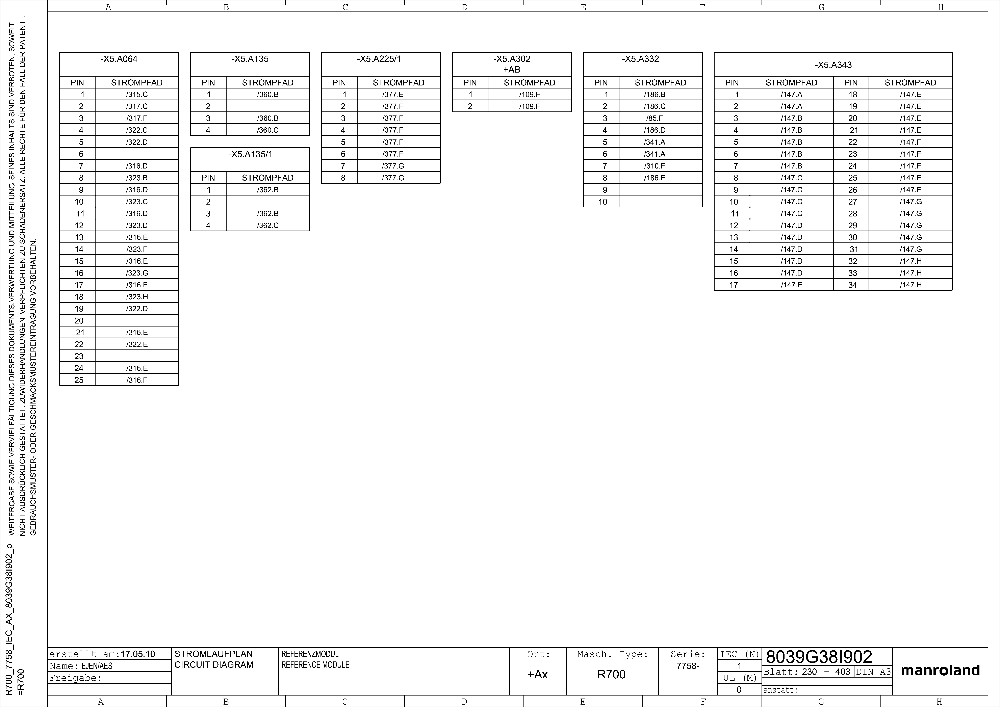

# +Ax — Sheet 230 of 403 — REFERENZMODUL

**REFERENCE MODULE**

> Part of the manroland **R700** printing press IEC/UL circuit diagrams.
> Drawing class: **Stromlaufplan / Circuit diagram** (DIN A3).
> Document `+Ax` covers the **Central control console** machine section.

## At a glance

| Field | Value |
|---|---|
| Document | `+Ax`  (8039G38I902) |
| Sheet | **230** of 403 |
| Section (DE) | REFERENZMODUL |
| Section (EN) | REFERENCE MODULE |
| Section type | REFERENCE_MODULE — Reference module |
| Machine type | `R700` |
| Series | `7758` |
| Created | 17.05.10 |
| Replaces | — |
| Columns used | A, B, C, D, E, F, G, H |
| Path numbers | — |
| Labels on sheet | 191 |
| Cross-refs out | 80 |
| Cross-refs in | 0 |

**Previous:** [+Ax sheet 229](SHEET_0229.md) · **Next:** [+Ax sheet 231](SHEET_0231.md) · **Document TOC:** [_TOC.md](_TOC.md)  (+Ax) · **Master TOC:** [all sheets](../_MASTER_TOC.md)

## Sheet image (300 DPI, exact vector render)



_Rendered directly from the PDF vector layer at 300 DPI (1-bit), no OCR and no resampling. Use it to confirm anything ambiguous in the text below._

## Cross-references on this sheet

Each entry is a wire leaving this sheet. The printed token is `/sheet.column`; the link resolves to that sheet inside the same document.

| Ref | Target sheet | Col | Path | Destination on target | Target section | From col |
|---|---|---|---|---|---|---|
| `/360.B` | [+Ax sheet 360](SHEET_0360.md) | B | — | — | OPTION: LOGISTIK ANLEGER | B |
| `/377.E` | [+Ax sheet 377](SHEET_0377.md) | E | — | — | OPTION: TELEPRESENCE | C |
| `/186.B` | [+Ax sheet 186](SHEET_0186.md) | B | — | — | RESERVE | F |
| `/147.A` | [+Ax sheet 147](SHEET_0147.md) | A | — | — | ÜBERWACHUNGSRECHNER SICHERHEITSBUS | G |
| `/147.E` | [+Ax sheet 147](SHEET_0147.md) | E | — | — | ÜBERWACHUNGSRECHNER SICHERHEITSBUS | H |
| `/109.F` | [+Ax sheet 109](SHEET_0109.md) | F | — | — | SAUGKOPF, FORMATEINSTELLUNG / | E |
| `/315.C` | [+Ax sheet 315](SHEET_0315.md) | C | — | — | OPTION: "EJEKTOR" ANLAGE / SELECT AIRSTATION / | A |
| `/147.A` | [+Ax sheet 147](SHEET_0147.md) | A | — | — | ÜBERWACHUNGSRECHNER SICHERHEITSBUS | G |
| `/147.E` | [+Ax sheet 147](SHEET_0147.md) | E | — | — | ÜBERWACHUNGSRECHNER SICHERHEITSBUS | H |
| `/377.F` | [+Ax sheet 377](SHEET_0377.md) | F | — | — | OPTION: TELEPRESENCE | C |
| `/109.F` | [+Ax sheet 109](SHEET_0109.md) | F | — | — | SAUGKOPF, FORMATEINSTELLUNG / | E |
| `/317.C` | [+Ax sheet 317](SHEET_0317.md) | C | — | — | OPTION: "EJEKTOR" ANLAGE / SELECT AIRSTATION / | A |
| `/186.C` | [+Ax sheet 186](SHEET_0186.md) | C | — | — | RESERVE | F |
| `/85.F` | [+Ax sheet 85](SHEET_0085.md) | F | — | — | ANLEGER | F |
| `/317.F` | [+Ax sheet 317](SHEET_0317.md) | F | — | — | OPTION: "EJEKTOR" ANLAGE / SELECT AIRSTATION / | A |
| `/360.B` | [+Ax sheet 360](SHEET_0360.md) | B | — | — | OPTION: LOGISTIK ANLEGER | B |
| `/377.F` | [+Ax sheet 377](SHEET_0377.md) | F | — | — | OPTION: TELEPRESENCE | C |
| `/147.B` | [+Ax sheet 147](SHEET_0147.md) | B | — | — | ÜBERWACHUNGSRECHNER SICHERHEITSBUS | G |
| `/147.E` | [+Ax sheet 147](SHEET_0147.md) | E | — | — | ÜBERWACHUNGSRECHNER SICHERHEITSBUS | H |
| `/147.B` | [+Ax sheet 147](SHEET_0147.md) | B | — | — | ÜBERWACHUNGSRECHNER SICHERHEITSBUS | G |
| `/147.E` | [+Ax sheet 147](SHEET_0147.md) | E | — | — | ÜBERWACHUNGSRECHNER SICHERHEITSBUS | H |
| `/377.F` | [+Ax sheet 377](SHEET_0377.md) | F | — | — | OPTION: TELEPRESENCE | C |
| `/322.C` | [+Ax sheet 322](SHEET_0322.md) | C | — | — | OPTION: "EJEKTOR" ANLAGE / SELECT AIRSTATION / | A |
| `/360.C` | [+Ax sheet 360](SHEET_0360.md) | C | — | — | OPTION: LOGISTIK ANLEGER | B |
| `/186.D` | [+Ax sheet 186](SHEET_0186.md) | D | — | — | RESERVE | F |
| `/341.A` | [+Ax sheet 341](SHEET_0341.md) | A | — | — | OPTION: INLINESHEETER RS104 S | F |
| `/147.B` | [+Ax sheet 147](SHEET_0147.md) | B | — | — | ÜBERWACHUNGSRECHNER SICHERHEITSBUS | G |
| `/377.F` | [+Ax sheet 377](SHEET_0377.md) | F | — | — | OPTION: TELEPRESENCE | C |
| `/147.F` | [+Ax sheet 147](SHEET_0147.md) | F | — | — | ÜBERWACHUNGSRECHNER SICHERHEITSBUS | H |
| `/322.D` | [+Ax sheet 322](SHEET_0322.md) | D | — | — | OPTION: "EJEKTOR" ANLAGE / SELECT AIRSTATION / | A |
| `/341.A` | [+Ax sheet 341](SHEET_0341.md) | A | — | — | OPTION: INLINESHEETER RS104 S | F |
| `/147.B` | [+Ax sheet 147](SHEET_0147.md) | B | — | — | ÜBERWACHUNGSRECHNER SICHERHEITSBUS | G |
| `/377.F` | [+Ax sheet 377](SHEET_0377.md) | F | — | — | OPTION: TELEPRESENCE | C |
| `/147.F` | [+Ax sheet 147](SHEET_0147.md) | F | — | — | ÜBERWACHUNGSRECHNER SICHERHEITSBUS | H |
| `/147.B` | [+Ax sheet 147](SHEET_0147.md) | B | — | — | ÜBERWACHUNGSRECHNER SICHERHEITSBUS | G |
| `/377.G` | [+Ax sheet 377](SHEET_0377.md) | G | — | — | OPTION: TELEPRESENCE | C |
| `/310.F` | [+Ax sheet 310](SHEET_0310.md) | F | — | — | OPTION: IONISATIONSANLAGE ANLEGER | F |
| `/147.F` | [+Ax sheet 147](SHEET_0147.md) | F | — | — | ÜBERWACHUNGSRECHNER SICHERHEITSBUS | H |
| `/316.D` | [+Ax sheet 316](SHEET_0316.md) | D | — | — | OPTION: "EJEKTOR" ANLAGE / SELECT AIRSTATION / | A |
| `/323.B` | [+Ax sheet 323](SHEET_0323.md) | B | — | — | OPTION: "EJEKTOR" ANLAGE / SELECT AIRSTATION / | A |
| `/186.E` | [+Ax sheet 186](SHEET_0186.md) | E | — | — | RESERVE | F |
| `/147.F` | [+Ax sheet 147](SHEET_0147.md) | F | — | — | ÜBERWACHUNGSRECHNER SICHERHEITSBUS | H |
| `/377.G` | [+Ax sheet 377](SHEET_0377.md) | G | — | — | OPTION: TELEPRESENCE | C |
| `/147.C` | [+Ax sheet 147](SHEET_0147.md) | C | — | — | ÜBERWACHUNGSRECHNER SICHERHEITSBUS | G |
| `/362.B` | [+Ax sheet 362](SHEET_0362.md) | B | — | — | OPTION: LOGISTIK ANLEGER | B |
| `/147.F` | [+Ax sheet 147](SHEET_0147.md) | F | — | — | ÜBERWACHUNGSRECHNER SICHERHEITSBUS | H |
| `/316.D` | [+Ax sheet 316](SHEET_0316.md) | D | — | — | OPTION: "EJEKTOR" ANLAGE / SELECT AIRSTATION / | A |
| `/147.C` | [+Ax sheet 147](SHEET_0147.md) | C | — | — | ÜBERWACHUNGSRECHNER SICHERHEITSBUS | G |
| `/147.G` | [+Ax sheet 147](SHEET_0147.md) | G | — | — | ÜBERWACHUNGSRECHNER SICHERHEITSBUS | H |
| `/323.C` | [+Ax sheet 323](SHEET_0323.md) | C | — | — | OPTION: "EJEKTOR" ANLAGE / SELECT AIRSTATION / | A |
| `/147.C` | [+Ax sheet 147](SHEET_0147.md) | C | — | — | ÜBERWACHUNGSRECHNER SICHERHEITSBUS | G |
| `/362.B` | [+Ax sheet 362](SHEET_0362.md) | B | — | — | OPTION: LOGISTIK ANLEGER | B |
| `/147.G` | [+Ax sheet 147](SHEET_0147.md) | G | — | — | ÜBERWACHUNGSRECHNER SICHERHEITSBUS | H |
| `/316.D` | [+Ax sheet 316](SHEET_0316.md) | D | — | — | OPTION: "EJEKTOR" ANLAGE / SELECT AIRSTATION / | A |
| `/147.C` | [+Ax sheet 147](SHEET_0147.md) | C | — | — | ÜBERWACHUNGSRECHNER SICHERHEITSBUS | G |
| `/147.G` | [+Ax sheet 147](SHEET_0147.md) | G | — | — | ÜBERWACHUNGSRECHNER SICHERHEITSBUS | H |
| `/323.D` | [+Ax sheet 323](SHEET_0323.md) | D | — | — | OPTION: "EJEKTOR" ANLAGE / SELECT AIRSTATION / | A |
| `/362.C` | [+Ax sheet 362](SHEET_0362.md) | C | — | — | OPTION: LOGISTIK ANLEGER | B |
| `/147.D` | [+Ax sheet 147](SHEET_0147.md) | D | — | — | ÜBERWACHUNGSRECHNER SICHERHEITSBUS | G |
| `/316.E` | [+Ax sheet 316](SHEET_0316.md) | E | — | — | OPTION: "EJEKTOR" ANLAGE / SELECT AIRSTATION / | A |
| `/147.G` | [+Ax sheet 147](SHEET_0147.md) | G | — | — | ÜBERWACHUNGSRECHNER SICHERHEITSBUS | H |
| `/147.D` | [+Ax sheet 147](SHEET_0147.md) | D | — | — | ÜBERWACHUNGSRECHNER SICHERHEITSBUS | G |
| `/323.F` | [+Ax sheet 323](SHEET_0323.md) | F | — | — | OPTION: "EJEKTOR" ANLAGE / SELECT AIRSTATION / | A |
| `/147.G` | [+Ax sheet 147](SHEET_0147.md) | G | — | — | ÜBERWACHUNGSRECHNER SICHERHEITSBUS | H |
| `/147.D` | [+Ax sheet 147](SHEET_0147.md) | D | — | — | ÜBERWACHUNGSRECHNER SICHERHEITSBUS | G |
| `/316.E` | [+Ax sheet 316](SHEET_0316.md) | E | — | — | OPTION: "EJEKTOR" ANLAGE / SELECT AIRSTATION / | A |
| `/147.D` | [+Ax sheet 147](SHEET_0147.md) | D | — | — | ÜBERWACHUNGSRECHNER SICHERHEITSBUS | G |
| `/147.H` | [+Ax sheet 147](SHEET_0147.md) | H | — | — | ÜBERWACHUNGSRECHNER SICHERHEITSBUS | H |
| `/323.G` | [+Ax sheet 323](SHEET_0323.md) | G | — | — | OPTION: "EJEKTOR" ANLAGE / SELECT AIRSTATION / | A |
| `/147.D` | [+Ax sheet 147](SHEET_0147.md) | D | — | — | ÜBERWACHUNGSRECHNER SICHERHEITSBUS | G |
| `/147.H` | [+Ax sheet 147](SHEET_0147.md) | H | — | — | ÜBERWACHUNGSRECHNER SICHERHEITSBUS | H |
| `/316.E` | [+Ax sheet 316](SHEET_0316.md) | E | — | — | OPTION: "EJEKTOR" ANLAGE / SELECT AIRSTATION / | A |
| `/147.E` | [+Ax sheet 147](SHEET_0147.md) | E | — | — | ÜBERWACHUNGSRECHNER SICHERHEITSBUS | G |
| `/147.H` | [+Ax sheet 147](SHEET_0147.md) | H | — | — | ÜBERWACHUNGSRECHNER SICHERHEITSBUS | H |
| `/323.H` | [+Ax sheet 323](SHEET_0323.md) | H | — | — | OPTION: "EJEKTOR" ANLAGE / SELECT AIRSTATION / | A |
| `/322.D` | [+Ax sheet 322](SHEET_0322.md) | D | — | — | OPTION: "EJEKTOR" ANLAGE / SELECT AIRSTATION / | A |
| `/316.E` | [+Ax sheet 316](SHEET_0316.md) | E | — | — | OPTION: "EJEKTOR" ANLAGE / SELECT AIRSTATION / | A |
| `/322.E` | [+Ax sheet 322](SHEET_0322.md) | E | — | — | OPTION: "EJEKTOR" ANLAGE / SELECT AIRSTATION / | A |
| `/316.E` | [+Ax sheet 316](SHEET_0316.md) | E | — | — | OPTION: "EJEKTOR" ANLAGE / SELECT AIRSTATION / | A |
| `/316.F` | [+Ax sheet 316](SHEET_0316.md) | F | — | — | OPTION: "EJEKTOR" ANLAGE / SELECT AIRSTATION / | A |

## Devices on this sheet

| Tag | Class | Class meaning (IEC) | Col | Sub | Terminal | Sign |
|---|---|---|---|---|---|---|
| `X5.A064` | — | cross-device reference | A | — | — | — |
| `X5.A302` | — | cross-device reference | D | — | — | — |
| `X5.A135` | — | cross-device reference | B | — | — | — |
| `X5.A332` | — | cross-device reference | E | — | — | — |
| `X5.A343` | — | cross-device reference | G | — | — | — |

## Potentials / nets

_No named potentials on this sheet._

## Wire-end annotations (grouped as printed)

A wire that continues elsewhere is annotated with a small cluster: the destination description, the path/line number `#NN`, and the `/sheet.column` cross reference. Each row below is one such cluster exactly as it is grouped on the drawing.

| Col | Y | Path | Cross-ref | Text on the wire |
|---|---|---|---|---|
| A | 65.5 | — | — | `X5.A064` |
| B | 65.5 | — | — | `X5.A135` |
| C | 65.5 | — | — | `X5.A225/1` |
| D | 65.5 | — | — | `X5.A302` |
| E | 65.5 | — | — | `X5.A332` |
| G | 72.6 | — | — | `X5.A343` |
| D | 78.2 | — | — | `+AB` |
| A | 94.2 | — | — | `PIN STROMPFAD` |
| B | 94.2 | — | — | `PIN 2 3 4 1 STROMPFAD` |
| C | 94.2 | — | — | `PIN 2 3 4 5 6 7 8 1 STROMPFAD` |
| D | 94.2 | — | — | `PIN 2 1 STROMPFAD` |
| E | 94.2 | — | — | `PIN 10 2 3 4 5 6 7 8 9 1 STROMPFAD` |
| G | 94.2 | — | — | `PIN STROMPFAD` |
| H | 94.2 | — | — | `PIN 18 19 20 22 23 24 25 26 27 28 29 30 32 33 34 21 31 STROMPFAD` |
| A | 108.4 | — | — | `2 3 4 5 6 7 8 9 1` |
| F | 108.4 | — | — | `2 3 4 5 6 7 8 9 1` |
| A | 108.7 | — | `/315.C` | — |
| B | 108.7 | — | `/360.B` | — |
| C | 108.7 | — | `/377.E` | — |
| E | 108.7 | — | `/109.F` | — |
| F | 108.7 | — | `/186.B` | — |
| G | 108.7 | — | `/147.A` | — |
| H | 108.7 | — | `/147.E` | — |
| A | 122.9 | — | `/317.C` | — |
| C | 122.9 | — | `/377.F` | — |
| E | 122.9 | — | `/109.F` | — |
| F | 122.9 | — | `/186.C` | — |
| G | 122.9 | — | `/147.A` | — |
| H | 122.9 | — | `/147.E` | — |
| A | 137.0 | — | `/317.F` | — |
| B | 137.0 | — | `/360.B` | — |
| C | 137.0 | — | `/377.F` | — |
| F | 137.0 | — | `/85.F` | — |
| G | 137.0 | — | `/147.B` | — |
| H | 137.0 | — | `/147.E` | — |
| A | 151.2 | — | `/322.C` | — |
| B | 151.2 | — | `/360.C` | — |
| C | 151.2 | — | `/377.F` | — |
| F | 151.2 | — | `/186.D` | — |
| G | 151.2 | — | `/147.B` | — |
| H | 151.2 | — | `/147.E` | — |
| A | 165.4 | — | `/322.D` | — |
| C | 165.4 | — | `/377.F` | — |
| F | 165.4 | — | `/341.A` | — |
| G | 165.4 | — | `/147.B` | — |
| H | 165.4 | — | `/147.F` | — |
| B | 178.9 | — | — | `X5.A135/1` |
| C | 179.6 | — | `/377.F` | — |
| F | 179.6 | — | `/341.A` | — |
| G | 179.6 | — | `/147.B` | — |
| H | 179.6 | — | `/147.F` | — |
| C | 193.7 | — | `/377.G` | — |
| F | 193.7 | — | `/310.F` | — |
| G | 193.7 | — | `/147.B` | — |
| H | 193.7 | — | `/147.F` | — |
| A | 193.8 | — | `/316.D` | — |
| B | 207.5 | — | — | `PIN 2 3 4 1 STROMPFAD` |
| A | 207.9 | — | `/323.B` | — |
| C | 207.9 | — | `/377.G` | — |
| F | 207.9 | — | `/186.E` | — |
| G | 207.9 | — | `/147.C` | — |
| H | 207.9 | — | `/147.F` | — |
| A | 222.1 | — | `/316.D` | — |
| B | 222.1 | — | `/362.B` | — |
| G | 222.1 | — | `/147.C` | — |
| H | 222.1 | — | `/147.F` | — |
| A | 235.9 | — | — | `10 12 13 14 15 16 17 18 19 20 11` |
| F | 235.9 | — | — | `10 12 13 14 15 16 17 11` |
| A | 236.3 | — | `/323.C` | — |
| G | 236.3 | — | `/147.C` | — |
| H | 236.3 | — | `/147.G` | — |
| A | 250.4 | — | `/316.D` | — |
| B | 250.4 | — | `/362.B` | — |
| G | 250.4 | — | `/147.C` | — |
| H | 250.4 | — | `/147.G` | — |
| A | 264.6 | — | `/323.D` | — |
| B | 264.6 | — | `/362.C` | — |
| G | 264.6 | — | `/147.D` | — |
| H | 264.6 | — | `/147.G` | — |
| A | 278.8 | — | `/316.E` | — |
| G | 278.8 | — | `/147.D` | — |
| H | 278.8 | — | `/147.G` | — |
| A | 292.9 | — | `/323.F` | — |
| G | 293.0 | — | `/147.D` | — |
| H | 293.0 | — | `/147.G` | — |
| A | 307.1 | — | `/316.E` | — |
| G | 307.1 | — | `/147.D` | — |
| H | 307.1 | — | `/147.H` | — |
| A | 321.3 | — | `/323.G` | — |
| G | 321.3 | — | `/147.D` | — |
| H | 321.3 | — | `/147.H` | — |
| A | 335.5 | — | `/316.E` | — |
| G | 335.5 | — | `/147.E` | — |
| H | 335.5 | — | `/147.H` | — |
| A | 349.7 | — | `/323.H` | — |
| A | 363.8 | — | `/322.D` | — |
| A | 391.8 | — | — | `22 23 24 25 21` |
| A | 392.1 | — | `/316.E` | — |
| A | 406.3 | — | `/322.E` | — |
| A | 434.7 | — | `/316.E` | — |
| A | 448.9 | — | `/316.F` | — |


## Reconstructed tables

This sheet carries tabular content (pin map / terminal assignment / index). The grid below was rebuilt from the drawing's own rule lines, so each row is exactly one physical row of the table.

### Table 1 — 25 data rows × 2 columns (at x=70.9, y=62.4) — **X5.A064**

| PIN | STROMPFAD |
|---|---|
| `1` | `/315.C` |
| `2` | `/317.C` |
| `3` | `/317.F` |
| `4` | `/322.C` |
| `5` | `/322.D` |
| `6` |  |
| `7` | `/316.D` |
| `8` | `/323.B` |
| `9` | `/316.D` |
| `10` | `/323.C` |
| `11` | `/316.D` |
| `12` | `/323.D` |
| `13` | `/316.E` |
| `14` | `/323.F` |
| `15` | `/316.E` |
| `16` | `/323.G` |
| `17` | `/316.E` |
| `18` | `/323.H` |
| `19` | `/322.D` |
| `20` |  |
| `21` | `/316.E` |
| `22` | `/322.E` |
| `23` |  |
| `24` | `/316.E` |
| `25` | `/316.F` |


### Table 2 — 10 data rows × 2 columns (at x=226.8, y=62.4) — **X5.A135**

| PIN | STROMPFAD |
|---|---|
| `1` | `/360.B` |
| `2` |  |
| `3` | `/360.B` |
| `4` | `/360.C` |
|  | `X5.A135/1` |
| `PIN` | `STROMPFAD` |
| `1` | `/362.B` |
| `2` |  |
| `3` | `/362.B` |
| `4` | `/362.C` |


### Table 3 — 8 data rows × 2 columns (at x=382.7, y=62.4) — **X5.A225/1**

| PIN | STROMPFAD |
|---|---|
| `1` | `/377.E` |
| `2` | `/377.F` |
| `3` | `/377.F` |
| `4` | `/377.F` |
| `5` | `/377.F` |
| `6` | `/377.F` |
| `7` | `/377.G` |
| `8` | `/377.G` |


### Table 4 — 2 data rows × 2 columns (at x=538.6, y=62.4) — **X5.A302 +AB**

| PIN | STROMPFAD |
|---|---|
| `1` | `/109.F` |
| `2` | `/109.F` |


### Table 5 — 10 data rows × 2 columns (at x=694.5, y=62.4) — **X5.A332**

| PIN | STROMPFAD |
|---|---|
| `1` | `/186.B` |
| `2` | `/186.C` |
| `3` | `/85.F` |
| `4` | `/186.D` |
| `5` | `/341.A` |
| `6` | `/341.A` |
| `7` | `/310.F` |
| `8` | `/186.E` |
| `9` |  |
| `10` |  |


### Table 6 — 17 data rows × 4 columns (at x=850.4, y=62.4) — **X5.A343**

| PIN | STROMPFAD | PIN | STROMPFAD |
|---|---|---|---|
| `1` | `/147.A` | `18` | `/147.E` |
| `2` | `/147.A` | `19` | `/147.E` |
| `3` | `/147.B` | `20` | `/147.E` |
| `4` | `/147.B` | `21` | `/147.E` |
| `5` | `/147.B` | `22` | `/147.F` |
| `6` | `/147.B` | `23` | `/147.F` |
| `7` | `/147.B` | `24` | `/147.F` |
| `8` | `/147.C` | `25` | `/147.F` |
| `9` | `/147.C` | `26` | `/147.F` |
| `10` | `/147.C` | `27` | `/147.G` |
| `11` | `/147.C` | `28` | `/147.G` |
| `12` | `/147.D` | `29` | `/147.G` |
| `13` | `/147.D` | `30` | `/147.G` |
| `14` | `/147.D` | `31` | `/147.G` |
| `15` | `/147.D` | `32` | `/147.H` |
| `16` | `/147.D` | `33` | `/147.H` |
| `17` | `/147.E` | `34` | `/147.H` |


## Notes and free text on this sheet

| Text | Col | Y (pt) |
|---|---|---|
| `PIN` | A | 94.2 |
| `STROMPFAD` | A | 94.15 |
| `PIN` | C | 94.2 |
| `STROMPFAD` | C | 94.15 |
| `X5.A225/1` | C | 65.51 |
| `PIN` | D | 94.2 |
| `STROMPFAD` | E | 94.15 |
| `+AB` | D | 78.18 |
| `PIN` | B | 94.2 |
| `STROMPFAD` | B | 94.15 |
| `X5.A135/1` | B | 178.9 |
| `PIN` | E | 94.2 |
| `STROMPFAD` | F | 94.15 |
| `PIN` | F | 94.2 |
| `STROMPFAD` | G | 94.15 |
| `PIN` | G | 94.2 |
| `STROMPFAD` | H | 94.15 |

## Complete label inventory (exact text from the drawing)

Every text object inside the drawing area of this sheet, in DIN reading order (column A→H, then top→bottom). This is the authoritative list: if a string is not here it is not printed on this sheet.

| Col | Y | X | Dir | Type | Text |
|---|---|---|---|---|---|
| A | 65.5 | 119.8 | → | device ref | `X5.A064` |
| A | 94.2 | 84.0 | → | text | `PIN` |
| A | 94.2 | 132.2 | → | text | `STROMPFAD` |
| A | 108.4 | 95.8 | → | number | `1` |
| A | 108.7 | 150.2 | → | cross-reference | `/315.C` |
| A | 122.5 | 94.1 | → | number | `2` |
| A | 122.9 | 150.2 | → | cross-reference | `/317.C` |
| A | 136.7 | 94.1 | → | number | `3` |
| A | 137.0 | 150.7 | → | cross-reference | `/317.F` |
| A | 150.9 | 94.1 | → | number | `4` |
| A | 151.2 | 150.2 | → | cross-reference | `/322.C` |
| A | 165.1 | 94.1 | → | number | `5` |
| A | 165.4 | 150.2 | → | cross-reference | `/322.D` |
| A | 179.2 | 94.1 | → | number | `6` |
| A | 193.4 | 94.1 | → | number | `7` |
| A | 193.8 | 150.2 | → | cross-reference | `/316.D` |
| A | 207.6 | 94.1 | → | number | `8` |
| A | 207.9 | 150.4 | → | cross-reference | `/323.B` |
| A | 221.8 | 94.1 | → | number | `9` |
| A | 222.1 | 150.2 | → | cross-reference | `/316.D` |
| A | 235.9 | 88.7 | → | number | `10` |
| A | 236.3 | 150.2 | → | cross-reference | `/323.C` |
| A | 250.1 | 90.4 | → | number | `11` |
| A | 250.4 | 150.2 | → | cross-reference | `/316.D` |
| A | 264.3 | 88.7 | → | number | `12` |
| A | 264.6 | 150.2 | → | cross-reference | `/323.D` |
| A | 278.5 | 88.7 | → | number | `13` |
| A | 278.8 | 150.5 | → | cross-reference | `/316.E` |
| A | 292.6 | 88.7 | → | number | `14` |
| A | 293.0 | 150.7 | → | cross-reference | `/323.F` |
| A | 306.8 | 88.7 | → | number | `15` |
| A | 307.1 | 150.5 | → | cross-reference | `/316.E` |
| A | 321.0 | 88.7 | → | number | `16` |
| A | 321.3 | 150.1 | → | cross-reference | `/323.G` |
| A | 335.1 | 88.7 | → | number | `17` |
| A | 335.5 | 150.5 | → | cross-reference | `/316.E` |
| A | 349.3 | 88.7 | → | number | `18` |
| A | 349.7 | 150.5 | → | cross-reference | `/323.H` |
| A | 363.5 | 88.7 | → | number | `19` |
| A | 363.8 | 150.2 | → | cross-reference | `/322.D` |
| A | 377.7 | 88.7 | → | number | `20` |
| A | 391.8 | 90.4 | → | number | `21` |
| A | 392.2 | 150.5 | → | cross-reference | `/316.E` |
| A | 406.0 | 88.7 | → | number | `22` |
| A | 406.3 | 150.5 | → | cross-reference | `/322.E` |
| A | 420.2 | 88.7 | → | number | `23` |
| A | 434.4 | 88.7 | → | number | `24` |
| A | 434.7 | 150.5 | → | cross-reference | `/316.E` |
| A | 448.5 | 88.7 | → | number | `25` |
| A | 448.9 | 150.7 | → | cross-reference | `/316.F` |
| B | 65.5 | 275.7 | → | device ref | `X5.A135` |
| B | 94.2 | 240.0 | → | text | `PIN` |
| B | 94.2 | 288.1 | → | text | `STROMPFAD` |
| B | 108.4 | 245.9 | → | number | `1` |
| B | 108.7 | 306.3 | → | cross-reference | `/360.B` |
| B | 122.5 | 245.3 | → | number | `2` |
| B | 136.7 | 245.3 | → | number | `3` |
| B | 137.0 | 306.3 | → | cross-reference | `/360.B` |
| B | 150.9 | 245.3 | → | number | `4` |
| B | 151.2 | 306.1 | → | cross-reference | `/360.C` |
| B | 178.9 | 272.0 | → | text | `X5.A135/1` |
| B | 207.5 | 288.1 | → | text | `STROMPFAD` |
| B | 207.6 | 240.0 | → | text | `PIN` |
| B | 221.8 | 245.9 | → | number | `1` |
| B | 222.1 | 306.3 | → | cross-reference | `/362.B` |
| B | 235.9 | 245.3 | → | number | `2` |
| B | 250.1 | 245.3 | → | number | `3` |
| B | 250.4 | 306.3 | → | cross-reference | `/362.B` |
| B | 264.3 | 245.3 | → | number | `4` |
| B | 264.6 | 306.1 | → | cross-reference | `/362.C` |
| C | 65.5 | 425.1 | → | text | `X5.A225/1` |
| C | 94.2 | 395.9 | → | text | `PIN` |
| C | 94.2 | 444.0 | → | text | `STROMPFAD` |
| C | 108.4 | 407.6 | → | number | `1` |
| C | 108.7 | 455.2 | → | cross-reference | `/377.E` |
| C | 122.5 | 405.9 | → | number | `2` |
| C | 122.9 | 455.4 | → | cross-reference | `/377.F` |
| C | 136.7 | 405.9 | → | number | `3` |
| C | 137.0 | 455.4 | → | cross-reference | `/377.F` |
| C | 150.9 | 405.9 | → | number | `4` |
| C | 151.2 | 455.4 | → | cross-reference | `/377.F` |
| C | 165.1 | 405.9 | → | number | `5` |
| C | 165.4 | 455.4 | → | cross-reference | `/377.F` |
| C | 179.2 | 405.9 | → | number | `6` |
| C | 179.6 | 455.4 | → | cross-reference | `/377.F` |
| C | 193.4 | 405.9 | → | number | `7` |
| C | 193.7 | 454.8 | → | cross-reference | `/377.G` |
| C | 207.6 | 405.9 | → | number | `8` |
| C | 207.9 | 454.8 | → | cross-reference | `/377.G` |
| D | 65.5 | 587.5 | → | device ref | `X5.A302` |
| D | 78.2 | 599.2 | → | text | `+AB` |
| D | 94.2 | 551.8 | → | text | `PIN` |
| D | 108.4 | 557.7 | → | number | `1` |
| D | 122.5 | 557.1 | → | number | `2` |
| E | 65.5 | 740.6 | → | device ref | `X5.A332` |
| E | 94.2 | 600.0 | → | text | `STROMPFAD` |
| E | 94.2 | 707.7 | → | text | `PIN` |
| E | 108.4 | 719.4 | → | number | `1` |
| E | 108.7 | 618.4 | → | cross-reference | `/109.F` |
| E | 122.5 | 717.7 | → | number | `2` |
| E | 122.9 | 618.4 | → | cross-reference | `/109.F` |
| E | 136.7 | 717.7 | → | number | `3` |
| E | 150.9 | 717.7 | → | number | `4` |
| E | 165.1 | 717.7 | → | number | `5` |
| E | 179.2 | 717.7 | → | number | `6` |
| E | 193.4 | 717.7 | → | number | `7` |
| E | 207.6 | 717.7 | → | number | `8` |
| E | 221.8 | 717.7 | → | number | `9` |
| E | 235.9 | 712.3 | → | number | `10` |
| F | 94.2 | 755.9 | → | text | `STROMPFAD` |
| F | 94.2 | 863.6 | → | text | `PIN` |
| F | 108.4 | 875.3 | → | number | `1` |
| F | 108.7 | 766.9 | → | cross-reference | `/186.B` |
| F | 122.5 | 873.6 | → | number | `2` |
| F | 122.9 | 766.8 | → | cross-reference | `/186.C` |
| F | 136.7 | 873.6 | → | number | `3` |
| F | 137.0 | 769.6 | → | cross-reference | `/85.F` |
| F | 150.9 | 873.6 | → | number | `4` |
| F | 151.2 | 766.8 | → | cross-reference | `/186.D` |
| F | 165.1 | 873.6 | → | number | `5` |
| F | 165.4 | 766.8 | → | cross-reference | `/341.A` |
| F | 179.2 | 873.6 | → | number | `6` |
| F | 179.6 | 766.8 | → | cross-reference | `/341.A` |
| F | 193.4 | 873.6 | → | number | `7` |
| F | 193.7 | 767.2 | → | cross-reference | `/310.F` |
| F | 207.6 | 873.6 | → | number | `8` |
| F | 207.9 | 767.1 | → | cross-reference | `/186.E` |
| F | 221.8 | 873.6 | → | number | `9` |
| F | 235.9 | 868.3 | → | number | `10` |
| F | 250.1 | 870.0 | → | number | `11` |
| F | 264.3 | 868.3 | → | number | `12` |
| F | 278.5 | 868.3 | → | number | `13` |
| F | 292.6 | 868.3 | → | number | `14` |
| F | 306.8 | 868.3 | → | number | `15` |
| F | 321.0 | 868.3 | → | number | `16` |
| F | 335.1 | 868.3 | → | number | `17` |
| G | 72.6 | 970.2 | → | device ref | `X5.A343` |
| G | 94.2 | 911.8 | → | text | `STROMPFAD` |
| G | 94.2 | 1005.3 | → | text | `PIN` |
| G | 108.4 | 1010.0 | → | number | `18` |
| G | 108.7 | 929.8 | → | cross-reference | `/147.A` |
| G | 122.5 | 1010.0 | → | number | `19` |
| G | 122.9 | 929.8 | → | cross-reference | `/147.A` |
| G | 136.7 | 1010.0 | → | number | `20` |
| G | 137.0 | 929.9 | → | cross-reference | `/147.B` |
| G | 150.9 | 1011.7 | → | number | `21` |
| G | 151.2 | 929.9 | → | cross-reference | `/147.B` |
| G | 165.1 | 1010.0 | → | number | `22` |
| G | 165.4 | 929.9 | → | cross-reference | `/147.B` |
| G | 179.2 | 1010.0 | → | number | `23` |
| G | 179.6 | 929.9 | → | cross-reference | `/147.B` |
| G | 193.4 | 1010.0 | → | number | `24` |
| G | 193.7 | 929.9 | → | cross-reference | `/147.B` |
| G | 207.6 | 1010.0 | → | number | `25` |
| G | 207.9 | 929.8 | → | cross-reference | `/147.C` |
| G | 221.8 | 1010.0 | → | number | `26` |
| G | 222.1 | 929.8 | → | cross-reference | `/147.C` |
| G | 235.9 | 1010.0 | → | number | `27` |
| G | 236.3 | 929.8 | → | cross-reference | `/147.C` |
| G | 250.1 | 1010.0 | → | number | `28` |
| G | 250.4 | 929.8 | → | cross-reference | `/147.C` |
| G | 264.3 | 1010.0 | → | number | `29` |
| G | 264.6 | 929.8 | → | cross-reference | `/147.D` |
| G | 278.5 | 1010.0 | → | number | `30` |
| G | 278.8 | 929.8 | → | cross-reference | `/147.D` |
| G | 292.6 | 1011.7 | → | number | `31` |
| G | 293.0 | 929.8 | → | cross-reference | `/147.D` |
| G | 306.8 | 1010.0 | → | number | `32` |
| G | 307.1 | 929.8 | → | cross-reference | `/147.D` |
| G | 321.0 | 1010.0 | → | number | `33` |
| G | 321.3 | 929.8 | → | cross-reference | `/147.D` |
| G | 335.1 | 1010.0 | → | number | `34` |
| G | 335.5 | 930.0 | → | cross-reference | `/147.E` |
| H | 94.2 | 1053.5 | → | text | `STROMPFAD` |
| H | 108.7 | 1071.8 | → | cross-reference | `/147.E` |
| H | 122.9 | 1071.8 | → | cross-reference | `/147.E` |
| H | 137.0 | 1071.8 | → | cross-reference | `/147.E` |
| H | 151.2 | 1071.8 | → | cross-reference | `/147.E` |
| H | 165.4 | 1071.9 | → | cross-reference | `/147.F` |
| H | 179.6 | 1071.9 | → | cross-reference | `/147.F` |
| H | 193.7 | 1071.9 | → | cross-reference | `/147.F` |
| H | 207.9 | 1071.9 | → | cross-reference | `/147.F` |
| H | 222.1 | 1071.9 | → | cross-reference | `/147.F` |
| H | 236.3 | 1071.4 | → | cross-reference | `/147.G` |
| H | 250.4 | 1071.4 | → | cross-reference | `/147.G` |
| H | 264.6 | 1071.4 | → | cross-reference | `/147.G` |
| H | 278.8 | 1071.4 | → | cross-reference | `/147.G` |
| H | 293.0 | 1071.4 | → | cross-reference | `/147.G` |
| H | 307.1 | 1071.8 | → | cross-reference | `/147.H` |
| H | 321.3 | 1071.8 | → | cross-reference | `/147.H` |
| H | 335.5 | 1071.8 | → | cross-reference | `/147.H` |

## Reading-order text block

The same content as a plain block, grouped by DIN column — convenient to paste or to match against a visual description.

```text
=== Column A ===
  65.5  119.8  devref       X5.A064
  94.2   84.0  text         PIN
  94.2  132.2  text         STROMPFAD
 108.4   95.8  numeric      1
 108.7  150.2  xref         /315.C
 122.5   94.1  numeric      2
 122.9  150.2  xref         /317.C
 136.7   94.1  numeric      3
 137.0  150.7  xref         /317.F
 150.9   94.1  numeric      4
 151.2  150.2  xref         /322.C
 165.1   94.1  numeric      5
 165.4  150.2  xref         /322.D
 179.2   94.1  numeric      6
 193.4   94.1  numeric      7
 193.8  150.2  xref         /316.D
 207.6   94.1  numeric      8
 207.9  150.4  xref         /323.B
 221.8   94.1  numeric      9
 222.1  150.2  xref         /316.D
 235.9   88.7  numeric      10
 236.3  150.2  xref         /323.C
 250.1   90.4  numeric      11
 250.4  150.2  xref         /316.D
 264.3   88.7  numeric      12
 264.6  150.2  xref         /323.D
 278.5   88.7  numeric      13
 278.8  150.5  xref         /316.E
 292.6   88.7  numeric      14
 293.0  150.7  xref         /323.F
 306.8   88.7  numeric      15
 307.1  150.5  xref         /316.E
 321.0   88.7  numeric      16
 321.3  150.1  xref         /323.G
 335.1   88.7  numeric      17
 335.5  150.5  xref         /316.E
 349.3   88.7  numeric      18
 349.7  150.5  xref         /323.H
 363.5   88.7  numeric      19
 363.8  150.2  xref         /322.D
 377.7   88.7  numeric      20
 391.8   90.4  numeric      21
 392.2  150.5  xref         /316.E
 406.0   88.7  numeric      22
 406.3  150.5  xref         /322.E
 420.2   88.7  numeric      23
 434.4   88.7  numeric      24
 434.7  150.5  xref         /316.E
 448.5   88.7  numeric      25
 448.9  150.7  xref         /316.F
=== Column B ===
  65.5  275.7  devref       X5.A135
  94.2  240.0  text         PIN
  94.2  288.1  text         STROMPFAD
 108.4  245.9  numeric      1
 108.7  306.3  xref         /360.B
 122.5  245.3  numeric      2
 136.7  245.3  numeric      3
 137.0  306.3  xref         /360.B
 150.9  245.3  numeric      4
 151.2  306.1  xref         /360.C
 178.9  272.0  text         X5.A135/1
 207.5  288.1  text         STROMPFAD
 207.6  240.0  text         PIN
 221.8  245.9  numeric      1
 222.1  306.3  xref         /362.B
 235.9  245.3  numeric      2
 250.1  245.3  numeric      3
 250.4  306.3  xref         /362.B
 264.3  245.3  numeric      4
 264.6  306.1  xref         /362.C
=== Column C ===
  65.5  425.1  text         X5.A225/1
  94.2  395.9  text         PIN
  94.2  444.0  text         STROMPFAD
 108.4  407.6  numeric      1
 108.7  455.2  xref         /377.E
 122.5  405.9  numeric      2
 122.9  455.4  xref         /377.F
 136.7  405.9  numeric      3
 137.0  455.4  xref         /377.F
 150.9  405.9  numeric      4
 151.2  455.4  xref         /377.F
 165.1  405.9  numeric      5
 165.4  455.4  xref         /377.F
 179.2  405.9  numeric      6
 179.6  455.4  xref         /377.F
 193.4  405.9  numeric      7
 193.7  454.8  xref         /377.G
 207.6  405.9  numeric      8
 207.9  454.8  xref         /377.G
=== Column D ===
  65.5  587.5  devref       X5.A302
  78.2  599.2  text         +AB
  94.2  551.8  text         PIN
 108.4  557.7  numeric      1
 122.5  557.1  numeric      2
=== Column E ===
  65.5  740.6  devref       X5.A332
  94.2  600.0  text         STROMPFAD
  94.2  707.7  text         PIN
 108.4  719.4  numeric      1
 108.7  618.4  xref         /109.F
 122.5  717.7  numeric      2
 122.9  618.4  xref         /109.F
 136.7  717.7  numeric      3
 150.9  717.7  numeric      4
 165.1  717.7  numeric      5
 179.2  717.7  numeric      6
 193.4  717.7  numeric      7
 207.6  717.7  numeric      8
 221.8  717.7  numeric      9
 235.9  712.3  numeric      10
=== Column F ===
  94.2  755.9  text         STROMPFAD
  94.2  863.6  text         PIN
 108.4  875.3  numeric      1
 108.7  766.9  xref         /186.B
 122.5  873.6  numeric      2
 122.9  766.8  xref         /186.C
 136.7  873.6  numeric      3
 137.0  769.6  xref         /85.F
 150.9  873.6  numeric      4
 151.2  766.8  xref         /186.D
 165.1  873.6  numeric      5
 165.4  766.8  xref         /341.A
 179.2  873.6  numeric      6
 179.6  766.8  xref         /341.A
 193.4  873.6  numeric      7
 193.7  767.2  xref         /310.F
 207.6  873.6  numeric      8
 207.9  767.1  xref         /186.E
 221.8  873.6  numeric      9
 235.9  868.3  numeric      10
 250.1  870.0  numeric      11
 264.3  868.3  numeric      12
 278.5  868.3  numeric      13
 292.6  868.3  numeric      14
 306.8  868.3  numeric      15
 321.0  868.3  numeric      16
 335.1  868.3  numeric      17
=== Column G ===
  72.6  970.2  devref       X5.A343
  94.2  911.8  text         STROMPFAD
  94.2 1005.3  text         PIN
 108.4 1010.0  numeric      18
 108.7  929.8  xref         /147.A
 122.5 1010.0  numeric      19
 122.9  929.8  xref         /147.A
 136.7 1010.0  numeric      20
 137.0  929.9  xref         /147.B
 150.9 1011.7  numeric      21
 151.2  929.9  xref         /147.B
 165.1 1010.0  numeric      22
 165.4  929.9  xref         /147.B
 179.2 1010.0  numeric      23
 179.6  929.9  xref         /147.B
 193.4 1010.0  numeric      24
 193.7  929.9  xref         /147.B
 207.6 1010.0  numeric      25
 207.9  929.8  xref         /147.C
 221.8 1010.0  numeric      26
 222.1  929.8  xref         /147.C
 235.9 1010.0  numeric      27
 236.3  929.8  xref         /147.C
 250.1 1010.0  numeric      28
 250.4  929.8  xref         /147.C
 264.3 1010.0  numeric      29
 264.6  929.8  xref         /147.D
 278.5 1010.0  numeric      30
 278.8  929.8  xref         /147.D
 292.6 1011.7  numeric      31
 293.0  929.8  xref         /147.D
 306.8 1010.0  numeric      32
 307.1  929.8  xref         /147.D
 321.0 1010.0  numeric      33
 321.3  929.8  xref         /147.D
 335.1 1010.0  numeric      34
 335.5  930.0  xref         /147.E
=== Column H ===
  94.2 1053.5  text         STROMPFAD
 108.7 1071.8  xref         /147.E
 122.9 1071.8  xref         /147.E
 137.0 1071.8  xref         /147.E
 151.2 1071.8  xref         /147.E
 165.4 1071.9  xref         /147.F
 179.6 1071.9  xref         /147.F
 193.7 1071.9  xref         /147.F
 207.9 1071.9  xref         /147.F
 222.1 1071.9  xref         /147.F
 236.3 1071.4  xref         /147.G
 250.4 1071.4  xref         /147.G
 264.6 1071.4  xref         /147.G
 278.8 1071.4  xref         /147.G
 293.0 1071.4  xref         /147.G
 307.1 1071.8  xref         /147.H
 321.3 1071.8  xref         /147.H
 335.5 1071.8  xref         /147.H
```

---
_Generated from the PDF vector text layer; no OCR. Source: `R700_7758_IEC_AX_8039G38I902_p`, sheet 230._
