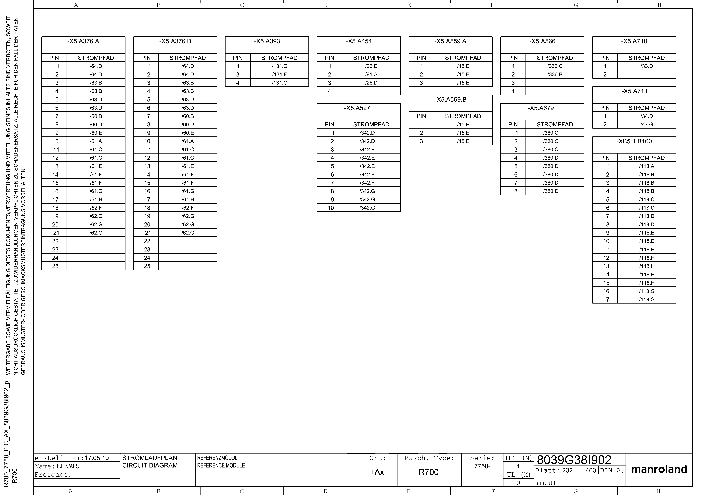

# +Ax — Sheet 232 of 403 — REFERENZMODUL

**REFERENCE MODULE**

> Part of the manroland **R700** printing press IEC/UL circuit diagrams.
> Drawing class: **Stromlaufplan / Circuit diagram** (DIN A3).
> Document `+Ax` covers the **Central control console** machine section.

## At a glance

| Field | Value |
|---|---|
| Document | `+Ax`  (8039G38I902) |
| Sheet | **232** of 403 |
| Section (DE) | REFERENZMODUL |
| Section (EN) | REFERENCE MODULE |
| Section type | REFERENCE_MODULE — Reference module |
| Machine type | `R700` |
| Series | `7758` |
| Created | 17.05.10 |
| Replaces | — |
| Columns used | A, B, C, D, E, F, G, H |
| Path numbers | — |
| Labels on sheet | 236 |
| Cross-refs out | 94 |
| Cross-refs in | 0 |

**Previous:** [+Ax sheet 231](SHEET_0231.md) · **Next:** [+Ax sheet 233](SHEET_0233.md) · **Document TOC:** [_TOC.md](_TOC.md)  (+Ax) · **Master TOC:** [all sheets](../_MASTER_TOC.md)

## Sheet image (300 DPI, exact vector render)



_Rendered directly from the PDF vector layer at 300 DPI (1-bit), no OCR and no resampling. Use it to confirm anything ambiguous in the text below._

## Cross-references on this sheet

Each entry is a wire leaving this sheet. The printed token is `/sheet.column`; the link resolves to that sheet inside the same document.

| Ref | Target sheet | Col | Path | Destination on target | Target section | From col |
|---|---|---|---|---|---|---|
| `/33.D` | [+Ax sheet 33](SHEET_0033.md) | D | — | STROMPFAD PIN 1 2 | SPANNUNGSVERSORGUNG, SCHALTSCHRANKBELÜFTUNG | H |
| `/15.E` | [+Ax sheet 15](SHEET_0015.md) | E | — | — | SPANNUNGSVERSORGUNG, SCHALTSCHRANKBELÜFTUNG | F |
| `/64.D` | [+Ax sheet 64](SHEET_0064.md) | D | — | — | DRUCKLUFTANLAGE | A |
| `/64.D` | [+Ax sheet 64](SHEET_0064.md) | D | — | — | DRUCKLUFTANLAGE | B |
| `/131.G` | [+Ax sheet 131](SHEET_0131.md) | G | — | — | REALTIMERECHNER ANLAGE | C |
| `/26.D` | [+Ax sheet 26](SHEET_0026.md) | D | — | — | SPANNUNGSVERSORGUNG, SCHALTSCHRANKBELÜFTUNG | E |
| `/336.C` | [+Ax sheet 336](SHEET_0336.md) | C | — | — | OPTION: LOGISTIK ANLEGER / | G |
| `/91.A` | [+Ax sheet 91](SHEET_0091.md) | A | — | — | ANLEGER | E |
| `/15.E` | [+Ax sheet 15](SHEET_0015.md) | E | — | — | SPANNUNGSVERSORGUNG, SCHALTSCHRANKBELÜFTUNG | F |
| `/336.B` | [+Ax sheet 336](SHEET_0336.md) | B | — | — | OPTION: LOGISTIK ANLEGER / | G |
| `/131.F` | [+Ax sheet 131](SHEET_0131.md) | F | — | — | REALTIMERECHNER ANLAGE | C |
| `/64.D` | [+Ax sheet 64](SHEET_0064.md) | D | — | — | DRUCKLUFTANLAGE | A |
| `/64.D` | [+Ax sheet 64](SHEET_0064.md) | D | — | — | DRUCKLUFTANLAGE | B |
| `/63.B` | [+Ax sheet 63](SHEET_0063.md) | B | — | — | DRUCKLUFTANLAGE | A |
| `/63.B` | [+Ax sheet 63](SHEET_0063.md) | B | — | — | DRUCKLUFTANLAGE | B |
| `/15.E` | [+Ax sheet 15](SHEET_0015.md) | E | — | — | SPANNUNGSVERSORGUNG, SCHALTSCHRANKBELÜFTUNG | F |
| `/131.G` | [+Ax sheet 131](SHEET_0131.md) | G | — | — | REALTIMERECHNER ANLAGE | C |
| `/26.D` | [+Ax sheet 26](SHEET_0026.md) | D | — | — | SPANNUNGSVERSORGUNG, SCHALTSCHRANKBELÜFTUNG | E |
| `/63.B` | [+Ax sheet 63](SHEET_0063.md) | B | — | — | DRUCKLUFTANLAGE | A |
| `/63.B` | [+Ax sheet 63](SHEET_0063.md) | B | — | — | DRUCKLUFTANLAGE | B |
| `/63.D` | [+Ax sheet 63](SHEET_0063.md) | D | — | — | DRUCKLUFTANLAGE | A |
| `/63.D` | [+Ax sheet 63](SHEET_0063.md) | D | — | — | DRUCKLUFTANLAGE | B |
| `/63.D` | [+Ax sheet 63](SHEET_0063.md) | D | — | — | DRUCKLUFTANLAGE | A |
| `/63.D` | [+Ax sheet 63](SHEET_0063.md) | D | — | — | DRUCKLUFTANLAGE | B |
| `/60.B` | [+Ax sheet 60](SHEET_0060.md) | B | — | — | DRUCKLUFTANLAGE | A |
| `/60.B` | [+Ax sheet 60](SHEET_0060.md) | B | — | — | DRUCKLUFTANLAGE | B |
| `/34.D` | [+Ax sheet 34](SHEET_0034.md) | D | — | — | SPANNUNGSVERSORGUNG, SCHALTSCHRANKBELÜFTUNG | H |
| `/15.E` | [+Ax sheet 15](SHEET_0015.md) | E | — | — | SPANNUNGSVERSORGUNG, SCHALTSCHRANKBELÜFTUNG | F |
| `/47.G` | [+Ax sheet 47](SHEET_0047.md) | G | — | — | NOT AUS | H |
| `/60.D` | [+Ax sheet 60](SHEET_0060.md) | D | — | — | DRUCKLUFTANLAGE | A |
| `/60.D` | [+Ax sheet 60](SHEET_0060.md) | D | — | — | DRUCKLUFTANLAGE | B |
| `/60.E` | [+Ax sheet 60](SHEET_0060.md) | E | — | — | DRUCKLUFTANLAGE | A |
| `/60.E` | [+Ax sheet 60](SHEET_0060.md) | E | — | — | DRUCKLUFTANLAGE | B |
| `/15.E` | [+Ax sheet 15](SHEET_0015.md) | E | — | — | SPANNUNGSVERSORGUNG, SCHALTSCHRANKBELÜFTUNG | F |
| `/342.D` | [+Ax sheet 342](SHEET_0342.md) | D | — | — | OPTION: INLINESHEETER RS104 S | E |
| `/380.C` | [+Ax sheet 380](SHEET_0380.md) | C | — | — | OPTION: TELEPRESENCE | G |
| `/61.A` | [+Ax sheet 61](SHEET_0061.md) | A | — | — | DRUCKLUFTANLAGE | A |
| `/61.A` | [+Ax sheet 61](SHEET_0061.md) | A | — | — | DRUCKLUFTANLAGE | B |
| `/15.E` | [+Ax sheet 15](SHEET_0015.md) | E | — | — | SPANNUNGSVERSORGUNG, SCHALTSCHRANKBELÜFTUNG | F |
| `/342.D` | [+Ax sheet 342](SHEET_0342.md) | D | — | — | OPTION: INLINESHEETER RS104 S | E |
| `/380.C` | [+Ax sheet 380](SHEET_0380.md) | C | — | — | OPTION: TELEPRESENCE | G |
| `/342.E` | [+Ax sheet 342](SHEET_0342.md) | E | — | — | OPTION: INLINESHEETER RS104 S | E |
| `/61.C` | [+Ax sheet 61](SHEET_0061.md) | C | — | — | DRUCKLUFTANLAGE | A |
| `/61.C` | [+Ax sheet 61](SHEET_0061.md) | C | — | — | DRUCKLUFTANLAGE | B |
| `/380.C` | [+Ax sheet 380](SHEET_0380.md) | C | — | — | OPTION: TELEPRESENCE | G |
| `/342.E` | [+Ax sheet 342](SHEET_0342.md) | E | — | — | OPTION: INLINESHEETER RS104 S | E |
| `/61.C` | [+Ax sheet 61](SHEET_0061.md) | C | — | — | DRUCKLUFTANLAGE | A |
| `/61.C` | [+Ax sheet 61](SHEET_0061.md) | C | — | — | DRUCKLUFTANLAGE | B |
| `/380.D` | [+Ax sheet 380](SHEET_0380.md) | D | — | — | OPTION: TELEPRESENCE | G |
| `/61.E` | [+Ax sheet 61](SHEET_0061.md) | E | — | — | DRUCKLUFTANLAGE | A |
| `/61.E` | [+Ax sheet 61](SHEET_0061.md) | E | — | — | DRUCKLUFTANLAGE | B |
| `/342.E` | [+Ax sheet 342](SHEET_0342.md) | E | — | — | OPTION: INLINESHEETER RS104 S | E |
| `/118.A` | [+Ax sheet 118](SHEET_0118.md) | A | — | — | REALTIMERECHNER WINKELKODIERER | H |
| `/380.D` | [+Ax sheet 380](SHEET_0380.md) | D | — | — | OPTION: TELEPRESENCE | G |
| `/61.F` | [+Ax sheet 61](SHEET_0061.md) | F | — | — | DRUCKLUFTANLAGE | A |
| `/61.F` | [+Ax sheet 61](SHEET_0061.md) | F | — | — | DRUCKLUFTANLAGE | B |
| `/118.B` | [+Ax sheet 118](SHEET_0118.md) | B | — | — | REALTIMERECHNER WINKELKODIERER | H |
| `/342.F` | [+Ax sheet 342](SHEET_0342.md) | F | — | — | OPTION: INLINESHEETER RS104 S | E |
| `/380.D` | [+Ax sheet 380](SHEET_0380.md) | D | — | — | OPTION: TELEPRESENCE | G |
| `/61.F` | [+Ax sheet 61](SHEET_0061.md) | F | — | — | DRUCKLUFTANLAGE | A |
| `/61.F` | [+Ax sheet 61](SHEET_0061.md) | F | — | — | DRUCKLUFTANLAGE | B |
| `/118.B` | [+Ax sheet 118](SHEET_0118.md) | B | — | — | REALTIMERECHNER WINKELKODIERER | H |
| `/342.F` | [+Ax sheet 342](SHEET_0342.md) | F | — | — | OPTION: INLINESHEETER RS104 S | E |
| `/380.D` | [+Ax sheet 380](SHEET_0380.md) | D | — | — | OPTION: TELEPRESENCE | G |
| `/61.G` | [+Ax sheet 61](SHEET_0061.md) | G | — | — | DRUCKLUFTANLAGE | A |
| `/61.G` | [+Ax sheet 61](SHEET_0061.md) | G | — | — | DRUCKLUFTANLAGE | B |
| `/118.B` | [+Ax sheet 118](SHEET_0118.md) | B | — | — | REALTIMERECHNER WINKELKODIERER | H |
| `/342.G` | [+Ax sheet 342](SHEET_0342.md) | G | — | — | OPTION: INLINESHEETER RS104 S | E |
| `/380.D` | [+Ax sheet 380](SHEET_0380.md) | D | — | — | OPTION: TELEPRESENCE | G |
| `/61.H` | [+Ax sheet 61](SHEET_0061.md) | H | — | — | DRUCKLUFTANLAGE | A |
| `/61.H` | [+Ax sheet 61](SHEET_0061.md) | H | — | — | DRUCKLUFTANLAGE | B |
| `/342.G` | [+Ax sheet 342](SHEET_0342.md) | G | — | — | OPTION: INLINESHEETER RS104 S | E |
| `/118.C` | [+Ax sheet 118](SHEET_0118.md) | C | — | — | REALTIMERECHNER WINKELKODIERER | H |
| `/62.F` | [+Ax sheet 62](SHEET_0062.md) | F | — | — | DRUCKLUFTANLAGE | A |
| `/62.F` | [+Ax sheet 62](SHEET_0062.md) | F | — | — | DRUCKLUFTANLAGE | B |
| `/342.G` | [+Ax sheet 342](SHEET_0342.md) | G | — | — | OPTION: INLINESHEETER RS104 S | E |
| `/118.C` | [+Ax sheet 118](SHEET_0118.md) | C | — | — | REALTIMERECHNER WINKELKODIERER | H |
| `/62.G` | [+Ax sheet 62](SHEET_0062.md) | G | — | — | DRUCKLUFTANLAGE | A |
| `/62.G` | [+Ax sheet 62](SHEET_0062.md) | G | — | — | DRUCKLUFTANLAGE | B |
| `/118.D` | [+Ax sheet 118](SHEET_0118.md) | D | — | — | REALTIMERECHNER WINKELKODIERER | H |
| `/62.G` | [+Ax sheet 62](SHEET_0062.md) | G | — | — | DRUCKLUFTANLAGE | A |
| `/62.G` | [+Ax sheet 62](SHEET_0062.md) | G | — | — | DRUCKLUFTANLAGE | B |
| `/118.D` | [+Ax sheet 118](SHEET_0118.md) | D | — | — | REALTIMERECHNER WINKELKODIERER | H |
| `/118.E` | [+Ax sheet 118](SHEET_0118.md) | E | — | — | REALTIMERECHNER WINKELKODIERER | H |
| `/62.G` | [+Ax sheet 62](SHEET_0062.md) | G | — | — | DRUCKLUFTANLAGE | A |
| `/62.G` | [+Ax sheet 62](SHEET_0062.md) | G | — | — | DRUCKLUFTANLAGE | B |
| `/118.E` | [+Ax sheet 118](SHEET_0118.md) | E | — | — | REALTIMERECHNER WINKELKODIERER | H |
| `/118.E` | [+Ax sheet 118](SHEET_0118.md) | E | — | — | REALTIMERECHNER WINKELKODIERER | H |
| `/118.F` | [+Ax sheet 118](SHEET_0118.md) | F | — | — | REALTIMERECHNER WINKELKODIERER | H |
| `/118.H` | [+Ax sheet 118](SHEET_0118.md) | H | — | — | REALTIMERECHNER WINKELKODIERER | H |
| `/118.H` | [+Ax sheet 118](SHEET_0118.md) | H | — | — | REALTIMERECHNER WINKELKODIERER | H |
| `/118.F` | [+Ax sheet 118](SHEET_0118.md) | F | — | — | REALTIMERECHNER WINKELKODIERER | H |
| `/118.G` | [+Ax sheet 118](SHEET_0118.md) | G | — | — | REALTIMERECHNER WINKELKODIERER | H |
| `/118.G` | [+Ax sheet 118](SHEET_0118.md) | G | — | — | REALTIMERECHNER WINKELKODIERER | H |

## Devices on this sheet

| Tag | Class | Class meaning (IEC) | Col | Sub | Terminal | Sign |
|---|---|---|---|---|---|---|
| `XB5.1.B160` | — | cross-device reference | H | — | — | — |
| `X5.A376.A` | — | cross-device reference | A | — | — | — |
| `X5.A376.B` | — | cross-device reference | B | — | — | — |
| `X5.A393` | — | cross-device reference | C | — | — | — |
| `X5.A454` | — | cross-device reference | D | — | — | — |
| `X5.A527` | — | cross-device reference | D | — | — | — |
| `X5.A559.A` | — | cross-device reference | E | — | — | — |
| `X5.A559.B` | — | cross-device reference | F | — | — | — |
| `X5.A566` | — | cross-device reference | G | — | — | — |
| `X5.A679` | — | cross-device reference | G | — | — | — |
| `X5.A710` | — | cross-device reference | H | — | — | — |
| `X5.A711` | — | cross-device reference | H | — | — | — |

## Potentials / nets

_No named potentials on this sheet._

## Wire-end annotations (grouped as printed)

A wire that continues elsewhere is annotated with a small cluster: the destination description, the path/line number `#NN`, and the `/sheet.column` cross reference. Each row below is one such cluster exactly as it is grouped on the drawing.

| Col | Y | Path | Cross-ref | Text on the wire |
|---|---|---|---|---|
| A | 65.5 | — | — | `X5.A376.A` |
| B | 65.5 | — | — | `X5.A376.B` |
| C | 65.5 | — | — | `X5.A393` |
| D | 65.5 | — | — | `X5.A454` |
| E | 65.5 | — | — | `X5.A559.A` |
| G | 65.5 | — | — | `X5.A566` |
| H | 65.5 | — | — | `X5.A710` |
| A | 94.2 | — | — | `PIN STROMPFAD` |
| B | 94.2 | — | — | `PIN STROMPFAD` |
| C | 94.2 | — | — | `PIN 3 4 1 STROMPFAD` |
| D | 94.2 | — | — | `PIN 2 3 4 1 STROMPFAD` |
| E | 94.2 | — | — | `PIN 2 3 1 STROMPFAD` |
| G | 94.2 | — | — | `PIN 2 3 4 1 STROMPFAD` |
| H | 94.2 | — | `/33.D` | `PIN 2 1 STROMPFAD` |
| A | 108.4 | — | — | `2 3 4 5 6 7 8 9 1` |
| B | 108.4 | — | — | `2 3 4 5 6 7 8 9 1` |
| A | 108.7 | — | `/64.D` | — |
| B | 108.7 | — | `/64.D` | — |
| C | 108.7 | — | `/131.G` | — |
| E | 108.7 | — | `/26.D` | — |
| F | 108.7 | — | `/15.E` | — |
| G | 108.7 | — | `/336.C` | — |
| E | 122.8 | — | `/91.A` | — |
| F | 122.8 | — | `/15.E` | — |
| A | 122.9 | — | `/64.D` | — |
| B | 122.9 | — | `/64.D` | — |
| C | 122.9 | — | `/131.F` | — |
| G | 122.9 | — | `/336.B` | — |
| A | 137.0 | — | `/63.B` | — |
| B | 137.0 | — | `/63.B` | — |
| F | 137.0 | — | `/15.E` | — |
| C | 137.1 | — | `/131.G` | — |
| E | 137.1 | — | `/26.D` | — |
| H | 150.6 | — | — | `X5.A711` |
| A | 151.2 | — | `/63.B` | — |
| B | 151.2 | — | `/63.B` | — |
| F | 164.7 | — | — | `X5.A559.B` |
| A | 165.4 | — | `/63.D` | — |
| B | 165.4 | — | `/63.D` | — |
| D | 178.9 | — | — | `X5.A527` |
| G | 178.9 | — | — | `X5.A679` |
| H | 179.2 | — | — | `PIN 2 1 STROMPFAD` |
| A | 179.6 | — | `/63.D` | — |
| B | 179.6 | — | `/63.D` | — |
| E | 193.4 | — | — | `PIN 2 3 1 STROMPFAD` |
| A | 193.7 | — | `/60.B` | — |
| B | 193.7 | — | `/60.B` | — |
| H | 193.8 | — | `/34.D` | — |
| D | 207.5 | — | — | `PIN 10 2 3 4 5 6 7 8 9 1 STROMPFAD` |
| G | 207.5 | — | — | `PIN 2 3 4 5 6 7 8 1 STROMPFAD` |
| A | 207.9 | — | `/60.D` | — |
| B | 207.9 | — | `/60.D` | — |
| F | 207.9 | — | `/15.E` | — |
| H | 207.9 | — | `/47.G` | — |
| A | 222.1 | — | `/60.E` | — |
| B | 222.1 | — | `/60.E` | — |
| E | 222.1 | — | `/342.D` | — |
| F | 222.1 | — | `/15.E` | — |
| G | 222.1 | — | `/380.C` | — |
| H | 235.6 | — | — | `XB5.1.B160` |
| A | 235.9 | — | — | `10 12 13 14 15 16 17 18 19 20 11` |
| B | 235.9 | — | — | `10 12 13 14 15 16 17 18 19 20 11` |
| A | 236.2 | — | `/61.A` | — |
| B | 236.2 | — | `/61.A` | — |
| F | 236.2 | — | `/15.E` | — |
| E | 236.3 | — | `/342.D` | — |
| G | 236.3 | — | `/380.C` | — |
| A | 250.4 | — | `/61.C` | — |
| B | 250.4 | — | `/61.C` | — |
| E | 250.4 | — | `/342.E` | — |
| G | 250.4 | — | `/380.C` | — |
| H | 264.2 | — | — | `PIN STROMPFAD` |
| A | 264.6 | — | `/61.C` | — |
| B | 264.6 | — | `/61.C` | — |
| E | 264.6 | — | `/342.E` | — |
| G | 264.6 | — | `/380.D` | — |
| G | 278.4 | — | — | `2 3 4 5 6 7 8 9 1` |
| A | 278.8 | — | `/61.E` | — |
| B | 278.8 | — | `/61.E` | — |
| E | 278.8 | — | `/342.E` | — |
| G | 278.8 | — | `/380.D` | — |
| H | 278.8 | — | `/118.A` | — |
| A | 292.9 | — | `/61.F` | — |
| B | 292.9 | — | `/61.F` | — |
| E | 292.9 | — | `/342.F` | — |
| H | 292.9 | — | `/118.B` | — |
| G | 293.0 | — | `/380.D` | — |
| A | 307.1 | — | `/61.F` | — |
| B | 307.1 | — | `/61.F` | — |
| E | 307.1 | — | `/342.F` | — |
| G | 307.1 | — | `/380.D` | — |
| H | 307.1 | — | `/118.B` | — |
| A | 321.3 | — | `/61.G` | — |
| B | 321.3 | — | `/61.G` | — |
| E | 321.3 | — | `/342.G` | — |
| G | 321.3 | — | `/380.D` | — |
| H | 321.3 | — | `/118.B` | — |
| A | 335.5 | — | `/61.H` | — |
| B | 335.5 | — | `/61.H` | — |
| E | 335.5 | — | `/342.G` | — |
| H | 335.5 | — | `/118.C` | — |
| A | 349.6 | — | `/62.F` | — |
| B | 349.6 | — | `/62.F` | — |
| E | 349.6 | — | `/342.G` | — |
| H | 349.7 | — | `/118.C` | — |
| A | 363.8 | — | `/62.G` | — |
| B | 363.8 | — | `/62.G` | — |
| H | 363.8 | — | `/118.D` | — |
| A | 378.0 | — | `/62.G` | — |
| B | 378.0 | — | `/62.G` | — |
| H | 378.0 | — | `/118.D` | — |
| A | 391.8 | — | — | `22 23 24 25 21` |
| B | 391.8 | — | — | `22 23 24 25 21` |
| H | 392.1 | — | `/118.E` | — |
| A | 392.2 | — | `/62.G` | — |
| B | 392.2 | — | `/62.G` | — |
| G | 406.0 | — | — | `10 12 13 14 15 16 17 11` |
| H | 406.3 | — | `/118.E` | — |
| H | 420.5 | — | `/118.E` | — |
| H | 434.7 | — | `/118.F` | — |
| H | 448.9 | — | `/118.H` | — |
| H | 463.1 | — | `/118.H` | — |
| H | 477.2 | — | `/118.F` | — |
| H | 491.4 | — | `/118.G` | — |
| H | 505.6 | — | `/118.G` | — |


## Reconstructed tables

This sheet carries tabular content (pin map / terminal assignment / index). The grid below was rebuilt from the drawing's own rule lines, so each row is exactly one physical row of the table.

### Table 1 — 25 data rows × 2 columns (at x=70.9, y=62.4) — **X5.A376.A**

| PIN | STROMPFAD |
|---|---|
| `1` | `/64.D` |
| `2` | `/64.D` |
| `3` | `/63.B` |
| `4` | `/63.B` |
| `5` | `/63.D` |
| `6` | `/63.D` |
| `7` | `/60.B` |
| `8` | `/60.D` |
| `9` | `/60.E` |
| `10` | `/61.A` |
| `11` | `/61.C` |
| `12` | `/61.C` |
| `13` | `/61.E` |
| `14` | `/61.F` |
| `15` | `/61.F` |
| `16` | `/61.G` |
| `17` | `/61.H` |
| `18` | `/62.F` |
| `19` | `/62.G` |
| `20` | `/62.G` |
| `21` | `/62.G` |
| `22` |  |
| `23` |  |
| `24` |  |
| `25` |  |


### Table 2 — 25 data rows × 2 columns (at x=226.8, y=62.4) — **X5.A376.B**

| PIN | STROMPFAD |
|---|---|
| `1` | `/64.D` |
| `2` | `/64.D` |
| `3` | `/63.B` |
| `4` | `/63.B` |
| `5` | `/63.D` |
| `6` | `/63.D` |
| `7` | `/60.B` |
| `8` | `/60.D` |
| `9` | `/60.E` |
| `10` | `/61.A` |
| `11` | `/61.C` |
| `12` | `/61.C` |
| `13` | `/61.E` |
| `14` | `/61.F` |
| `15` | `/61.F` |
| `16` | `/61.G` |
| `17` | `/61.H` |
| `18` | `/62.F` |
| `19` | `/62.G` |
| `20` | `/62.G` |
| `21` | `/62.G` |
| `22` |  |
| `23` |  |
| `24` |  |
| `25` |  |


### Table 3 — 3 data rows × 2 columns (at x=382.7, y=62.4) — **X5.A393**

| PIN | STROMPFAD |
|---|---|
| `1` | `/131.G` |
| `3` | `/131.F` |
| `4` | `/131.G` |


### Table 4 — 16 data rows × 2 columns (at x=538.6, y=62.4) — **X5.A454**

| PIN | STROMPFAD |
|---|---|
| `1` | `/26.D` |
| `2` | `/91.A` |
| `3` | `/26.D` |
| `4` |  |
|  | `X5.A527` |
| `PIN` | `STROMPFAD` |
| `1` | `/342.D` |
| `2` | `/342.D` |
| `3` | `/342.E` |
| `4` | `/342.E` |
| `5` | `/342.E` |
| `6` | `/342.F` |
| `7` | `/342.F` |
| `8` | `/342.G` |
| `9` | `/342.G` |
| `10` | `/342.G` |


### Table 5 — 8 data rows × 2 columns (at x=694.5, y=62.4) — **X5.A559.A**

| PIN | STROMPFAD |
|---|---|
| `1` | `/15.E` |
| `2` | `/15.E` |
| `3` | `/15.E` |
|  | `X5.A559.B` |
| `PIN` | `STROMPFAD` |
| `1` | `/15.E` |
| `2` | `/15.E` |
| `3` | `/15.E` |


### Table 6 — 14 data rows × 2 columns (at x=850.4, y=62.4) — **X5.A566**

| PIN | STROMPFAD |
|---|---|
| `1` | `/336.C` |
| `2` | `/336.B` |
| `3` |  |
| `4` |  |
|  | `X5.A679` |
| `PIN` | `STROMPFAD` |
| `1` | `/380.C` |
| `2` | `/380.C` |
| `3` | `/380.C` |
| `4` | `/380.D` |
| `5` | `/380.D` |
| `6` | `/380.D` |
| `7` | `/380.D` |
| `8` | `/380.D` |


### Table 7 — 25 data rows × 2 columns (at x=1006.3, y=62.4) — **X5.A710**

| PIN | STROMPFAD |
|---|---|
| `1` | `/33.D` |
| `2` |  |
|  | `X5.A711` |
| `PIN` | `STROMPFAD` |
| `1` | `/34.D` |
| `2` | `/47.G` |
|  | `XB5.1.B160` |
| `PIN` | `STROMPFAD` |
| `1` | `/118.A` |
| `2` | `/118.B` |
| `3` | `/118.B` |
| `4` | `/118.B` |
| `5` | `/118.C` |
| `6` | `/118.C` |
| `7` | `/118.D` |
| `8` | `/118.D` |
| `9` | `/118.E` |
| `10` | `/118.E` |
| `11` | `/118.E` |
| `12` | `/118.F` |
| `13` | `/118.H` |
| `14` | `/118.H` |
| `15` | `/118.F` |
| `16` | `/118.G` |
| `17` | `/118.G` |


## Notes and free text on this sheet

| Text | Col | Y (pt) |
|---|---|---|
| `PIN` | G | 264.27 |
| `STROMPFAD` | H | 264.23 |
| `PIN` | A | 94.2 |
| `STROMPFAD` | A | 94.15 |
| `PIN` | B | 94.2 |
| `STROMPFAD` | B | 94.15 |
| `PIN` | C | 94.2 |
| `STROMPFAD` | C | 94.15 |
| `PIN` | D | 94.2 |
| `STROMPFAD` | E | 94.15 |
| `PIN` | E | 94.2 |
| `STROMPFAD` | F | 94.15 |
| `PIN` | F | 94.2 |
| `STROMPFAD` | G | 94.15 |

## Complete label inventory (exact text from the drawing)

Every text object inside the drawing area of this sheet, in DIN reading order (column A→H, then top→bottom). This is the authoritative list: if a string is not here it is not printed on this sheet.

| Col | Y | X | Dir | Type | Text |
|---|---|---|---|---|---|
| A | 65.5 | 114.4 | → | device ref | `X5.A376.A` |
| A | 94.2 | 84.0 | → | text | `PIN` |
| A | 94.2 | 132.2 | → | text | `STROMPFAD` |
| A | 108.4 | 95.8 | → | number | `1` |
| A | 108.7 | 152.6 | → | cross-reference | `/64.D` |
| A | 122.5 | 94.1 | → | number | `2` |
| A | 122.9 | 152.6 | → | cross-reference | `/64.D` |
| A | 136.7 | 94.1 | → | number | `3` |
| A | 137.0 | 152.8 | → | cross-reference | `/63.B` |
| A | 150.9 | 94.1 | → | number | `4` |
| A | 151.2 | 152.8 | → | cross-reference | `/63.B` |
| A | 165.1 | 94.1 | → | number | `5` |
| A | 165.4 | 152.6 | → | cross-reference | `/63.D` |
| A | 179.2 | 94.1 | → | number | `6` |
| A | 179.6 | 152.6 | → | cross-reference | `/63.D` |
| A | 193.4 | 94.1 | → | number | `7` |
| A | 193.7 | 152.8 | → | cross-reference | `/60.B` |
| A | 207.6 | 94.1 | → | number | `8` |
| A | 207.9 | 152.6 | → | cross-reference | `/60.D` |
| A | 221.8 | 94.1 | → | number | `9` |
| A | 222.1 | 152.9 | → | cross-reference | `/60.E` |
| A | 235.9 | 88.7 | → | number | `10` |
| A | 236.2 | 152.6 | → | cross-reference | `/61.A` |
| A | 250.1 | 90.4 | → | number | `11` |
| A | 250.4 | 152.6 | → | cross-reference | `/61.C` |
| A | 264.3 | 88.7 | → | number | `12` |
| A | 264.6 | 152.6 | → | cross-reference | `/61.C` |
| A | 278.5 | 88.7 | → | number | `13` |
| A | 278.8 | 152.9 | → | cross-reference | `/61.E` |
| A | 292.6 | 88.7 | → | number | `14` |
| A | 292.9 | 153.1 | → | cross-reference | `/61.F` |
| A | 306.8 | 88.7 | → | number | `15` |
| A | 307.1 | 153.1 | → | cross-reference | `/61.F` |
| A | 321.0 | 88.7 | → | number | `16` |
| A | 321.3 | 152.5 | → | cross-reference | `/61.G` |
| A | 335.1 | 88.7 | → | number | `17` |
| A | 335.5 | 152.9 | → | cross-reference | `/61.H` |
| A | 349.3 | 88.7 | → | number | `18` |
| A | 349.6 | 153.1 | → | cross-reference | `/62.F` |
| A | 363.5 | 88.7 | → | number | `19` |
| A | 363.8 | 152.5 | → | cross-reference | `/62.G` |
| A | 377.7 | 88.7 | → | number | `20` |
| A | 378.0 | 152.5 | → | cross-reference | `/62.G` |
| A | 391.8 | 90.4 | → | number | `21` |
| A | 392.2 | 152.5 | → | cross-reference | `/62.G` |
| A | 406.0 | 88.7 | → | number | `22` |
| A | 420.2 | 88.7 | → | number | `23` |
| A | 434.4 | 88.7 | → | number | `24` |
| A | 448.5 | 88.7 | → | number | `25` |
| B | 65.5 | 270.7 | → | device ref | `X5.A376.B` |
| B | 94.2 | 240.0 | → | text | `PIN` |
| B | 94.2 | 288.1 | → | text | `STROMPFAD` |
| B | 108.4 | 251.7 | → | number | `1` |
| B | 108.7 | 308.6 | → | cross-reference | `/64.D` |
| B | 122.5 | 250.0 | → | number | `2` |
| B | 122.9 | 308.6 | → | cross-reference | `/64.D` |
| B | 136.7 | 250.0 | → | number | `3` |
| B | 137.0 | 308.7 | → | cross-reference | `/63.B` |
| B | 150.9 | 250.0 | → | number | `4` |
| B | 151.2 | 308.7 | → | cross-reference | `/63.B` |
| B | 165.1 | 250.0 | → | number | `5` |
| B | 165.4 | 308.6 | → | cross-reference | `/63.D` |
| B | 179.2 | 250.0 | → | number | `6` |
| B | 179.6 | 308.6 | → | cross-reference | `/63.D` |
| B | 193.4 | 250.0 | → | number | `7` |
| B | 193.7 | 308.7 | → | cross-reference | `/60.B` |
| B | 207.6 | 250.0 | → | number | `8` |
| B | 207.9 | 308.6 | → | cross-reference | `/60.D` |
| B | 221.8 | 250.0 | → | number | `9` |
| B | 222.1 | 308.8 | → | cross-reference | `/60.E` |
| B | 235.9 | 244.6 | → | number | `10` |
| B | 236.2 | 308.6 | → | cross-reference | `/61.A` |
| B | 250.1 | 246.3 | → | number | `11` |
| B | 250.4 | 308.6 | → | cross-reference | `/61.C` |
| B | 264.3 | 244.6 | → | number | `12` |
| B | 264.6 | 308.6 | → | cross-reference | `/61.C` |
| B | 278.5 | 244.6 | → | number | `13` |
| B | 278.8 | 308.8 | → | cross-reference | `/61.E` |
| B | 292.6 | 244.6 | → | number | `14` |
| B | 292.9 | 309.0 | → | cross-reference | `/61.F` |
| B | 306.8 | 244.6 | → | number | `15` |
| B | 307.1 | 309.0 | → | cross-reference | `/61.F` |
| B | 321.0 | 244.6 | → | number | `16` |
| B | 321.3 | 308.4 | → | cross-reference | `/61.G` |
| B | 335.1 | 244.6 | → | number | `17` |
| B | 335.5 | 308.8 | → | cross-reference | `/61.H` |
| B | 349.3 | 244.6 | → | number | `18` |
| B | 349.6 | 309.0 | → | cross-reference | `/62.F` |
| B | 363.5 | 244.6 | → | number | `19` |
| B | 363.8 | 308.4 | → | cross-reference | `/62.G` |
| B | 377.7 | 244.6 | → | number | `20` |
| B | 378.0 | 308.4 | → | cross-reference | `/62.G` |
| B | 391.8 | 246.3 | → | number | `21` |
| B | 392.2 | 308.4 | → | cross-reference | `/62.G` |
| B | 406.0 | 244.6 | → | number | `22` |
| B | 420.2 | 244.6 | → | number | `23` |
| B | 434.4 | 244.6 | → | number | `24` |
| B | 448.5 | 244.6 | → | number | `25` |
| C | 65.5 | 431.6 | → | device ref | `X5.A393` |
| C | 94.2 | 395.9 | → | text | `PIN` |
| C | 94.2 | 444.0 | → | text | `STROMPFAD` |
| C | 108.4 | 401.8 | → | number | `1` |
| C | 108.7 | 461.9 | → | cross-reference | `/131.G` |
| C | 122.5 | 401.2 | → | number | `3` |
| C | 122.9 | 462.5 | → | cross-reference | `/131.F` |
| C | 136.7 | 401.2 | → | number | `4` |
| C | 137.1 | 461.9 | → | cross-reference | `/131.G` |
| D | 65.5 | 587.5 | → | device ref | `X5.A454` |
| D | 94.2 | 551.8 | → | text | `PIN` |
| D | 108.4 | 557.7 | → | number | `1` |
| D | 122.5 | 557.1 | → | number | `2` |
| D | 136.7 | 557.1 | → | number | `3` |
| D | 150.9 | 557.1 | → | number | `4` |
| D | 178.9 | 584.6 | → | device ref | `X5.A527` |
| D | 207.6 | 551.8 | → | text | `PIN` |
| D | 221.8 | 563.5 | → | number | `1` |
| D | 235.9 | 561.8 | → | number | `2` |
| D | 250.1 | 561.8 | → | number | `3` |
| D | 264.3 | 561.8 | → | number | `4` |
| D | 278.5 | 561.8 | → | number | `5` |
| D | 292.6 | 561.8 | → | number | `6` |
| D | 306.8 | 561.8 | → | number | `7` |
| D | 321.0 | 561.8 | → | number | `8` |
| D | 335.1 | 561.8 | → | number | `9` |
| D | 349.3 | 556.4 | → | number | `10` |
| E | 65.5 | 738.0 | → | device ref | `X5.A559.A` |
| E | 94.2 | 600.0 | → | text | `STROMPFAD` |
| E | 94.2 | 707.7 | → | text | `PIN` |
| E | 108.4 | 713.6 | → | number | `1` |
| E | 108.7 | 620.4 | → | cross-reference | `/26.D` |
| E | 122.5 | 713.1 | → | number | `2` |
| E | 122.8 | 620.4 | → | cross-reference | `/91.A` |
| E | 136.7 | 713.1 | → | number | `3` |
| E | 137.1 | 620.4 | → | cross-reference | `/26.D` |
| E | 193.4 | 707.7 | → | text | `PIN` |
| E | 207.5 | 600.0 | → | text | `STROMPFAD` |
| E | 207.6 | 713.6 | → | number | `1` |
| E | 221.8 | 713.1 | → | number | `2` |
| E | 222.1 | 610.9 | → | cross-reference | `/342.D` |
| E | 235.9 | 713.1 | → | number | `3` |
| E | 236.3 | 610.9 | → | cross-reference | `/342.D` |
| E | 250.4 | 611.1 | → | cross-reference | `/342.E` |
| E | 264.6 | 611.1 | → | cross-reference | `/342.E` |
| E | 278.8 | 611.1 | → | cross-reference | `/342.E` |
| E | 293.0 | 611.3 | → | cross-reference | `/342.F` |
| E | 307.1 | 611.3 | → | cross-reference | `/342.F` |
| E | 321.3 | 610.7 | → | cross-reference | `/342.G` |
| E | 335.5 | 610.7 | → | cross-reference | `/342.G` |
| E | 349.7 | 610.7 | → | cross-reference | `/342.G` |
| F | 94.2 | 755.9 | → | text | `STROMPFAD` |
| F | 94.2 | 863.6 | → | text | `PIN` |
| F | 108.4 | 869.5 | → | number | `1` |
| F | 108.7 | 776.6 | → | cross-reference | `/15.E` |
| F | 122.5 | 869.0 | → | number | `2` |
| F | 122.8 | 776.6 | → | cross-reference | `/15.E` |
| F | 136.7 | 869.0 | → | number | `3` |
| F | 137.0 | 776.6 | → | cross-reference | `/15.E` |
| F | 150.9 | 869.0 | → | number | `4` |
| F | 164.7 | 738.4 | → | device ref | `X5.A559.B` |
| F | 193.4 | 755.9 | → | text | `STROMPFAD` |
| F | 207.6 | 863.6 | → | text | `PIN` |
| F | 207.9 | 776.6 | → | cross-reference | `/15.E` |
| F | 221.8 | 875.3 | → | number | `1` |
| F | 222.1 | 776.6 | → | cross-reference | `/15.E` |
| F | 235.9 | 873.6 | → | number | `2` |
| F | 236.2 | 776.6 | → | cross-reference | `/15.E` |
| F | 250.1 | 873.6 | → | number | `3` |
| F | 264.3 | 873.6 | → | number | `4` |
| F | 278.5 | 873.6 | → | number | `5` |
| F | 292.6 | 873.6 | → | number | `6` |
| F | 306.8 | 873.6 | → | number | `7` |
| F | 321.0 | 873.6 | → | number | `8` |
| G | 65.5 | 899.3 | → | device ref | `X5.A566` |
| G | 94.2 | 911.8 | → | text | `STROMPFAD` |
| G | 94.2 | 1019.5 | → | text | `PIN` |
| G | 108.4 | 1025.4 | → | number | `1` |
| G | 108.7 | 929.8 | → | cross-reference | `/336.C` |
| G | 122.5 | 1024.9 | → | number | `2` |
| G | 122.9 | 929.9 | → | cross-reference | `/336.B` |
| G | 178.9 | 896.5 | → | device ref | `X5.A679` |
| G | 179.2 | 1019.5 | → | text | `PIN` |
| G | 193.4 | 1025.4 | → | number | `1` |
| G | 207.5 | 911.8 | → | text | `STROMPFAD` |
| G | 207.6 | 1024.9 | → | number | `2` |
| G | 222.1 | 922.7 | → | cross-reference | `/380.C` |
| G | 236.3 | 922.7 | → | cross-reference | `/380.C` |
| G | 250.4 | 922.7 | → | cross-reference | `/380.C` |
| G | 264.3 | 1019.5 | → | text | `PIN` |
| G | 264.6 | 922.7 | → | cross-reference | `/380.D` |
| G | 278.5 | 1031.2 | → | number | `1` |
| G | 278.8 | 922.7 | → | cross-reference | `/380.D` |
| G | 292.6 | 1029.5 | → | number | `2` |
| G | 293.0 | 922.7 | → | cross-reference | `/380.D` |
| G | 306.8 | 1029.5 | → | number | `3` |
| G | 307.1 | 922.7 | → | cross-reference | `/380.D` |
| G | 321.0 | 1029.5 | → | number | `4` |
| G | 321.3 | 922.7 | → | cross-reference | `/380.D` |
| G | 335.1 | 1029.5 | → | number | `5` |
| G | 349.3 | 1029.5 | → | number | `6` |
| G | 363.5 | 1029.5 | → | number | `7` |
| G | 377.7 | 1029.5 | → | number | `8` |
| G | 391.8 | 1029.5 | → | number | `9` |
| G | 406.0 | 1024.2 | → | number | `10` |
| G | 420.2 | 1025.9 | → | number | `11` |
| G | 434.4 | 1024.2 | → | number | `12` |
| G | 448.5 | 1024.2 | → | number | `13` |
| G | 462.7 | 1024.2 | → | number | `14` |
| G | 476.9 | 1024.2 | → | number | `15` |
| G | 491.0 | 1024.2 | → | number | `16` |
| G | 505.2 | 1024.2 | → | number | `17` |
| H | 65.5 | 1055.2 | → | device ref | `X5.A710` |
| H | 94.2 | 1067.7 | → | text | `STROMPFAD` |
| H | 108.7 | 1088.1 | → | cross-reference | `/33.D` |
| H | 150.5 | 1055.9 | → | device ref | `X5.A711` |
| H | 179.2 | 1067.7 | → | text | `STROMPFAD` |
| H | 193.7 | 1088.1 | → | cross-reference | `/34.D` |
| H | 207.9 | 1087.9 | → | cross-reference | `/47.G` |
| H | 235.6 | 1047.3 | → | device ref | `XB5.1.B160` |
| H | 264.2 | 1067.7 | → | text | `STROMPFAD` |
| H | 278.8 | 1085.7 | → | cross-reference | `/118.A` |
| H | 292.9 | 1085.8 | → | cross-reference | `/118.B` |
| H | 307.1 | 1085.8 | → | cross-reference | `/118.B` |
| H | 321.3 | 1085.8 | → | cross-reference | `/118.B` |
| H | 335.5 | 1085.7 | → | cross-reference | `/118.C` |
| H | 349.7 | 1085.7 | → | cross-reference | `/118.C` |
| H | 363.8 | 1085.7 | → | cross-reference | `/118.D` |
| H | 378.0 | 1085.7 | → | cross-reference | `/118.D` |
| H | 392.2 | 1086.0 | → | cross-reference | `/118.E` |
| H | 406.3 | 1086.0 | → | cross-reference | `/118.E` |
| H | 420.5 | 1086.0 | → | cross-reference | `/118.E` |
| H | 434.7 | 1086.1 | → | cross-reference | `/118.F` |
| H | 448.9 | 1086.0 | → | cross-reference | `/118.H` |
| H | 463.0 | 1086.0 | → | cross-reference | `/118.H` |
| H | 477.2 | 1086.1 | → | cross-reference | `/118.F` |
| H | 491.4 | 1085.5 | → | cross-reference | `/118.G` |
| H | 505.6 | 1085.5 | → | cross-reference | `/118.G` |

## Reading-order text block

The same content as a plain block, grouped by DIN column — convenient to paste or to match against a visual description.

```text
=== Column A ===
  65.5  114.4  devref       X5.A376.A
  94.2   84.0  text         PIN
  94.2  132.2  text         STROMPFAD
 108.4   95.8  numeric      1
 108.7  152.6  xref         /64.D
 122.5   94.1  numeric      2
 122.9  152.6  xref         /64.D
 136.7   94.1  numeric      3
 137.0  152.8  xref         /63.B
 150.9   94.1  numeric      4
 151.2  152.8  xref         /63.B
 165.1   94.1  numeric      5
 165.4  152.6  xref         /63.D
 179.2   94.1  numeric      6
 179.6  152.6  xref         /63.D
 193.4   94.1  numeric      7
 193.7  152.8  xref         /60.B
 207.6   94.1  numeric      8
 207.9  152.6  xref         /60.D
 221.8   94.1  numeric      9
 222.1  152.9  xref         /60.E
 235.9   88.7  numeric      10
 236.2  152.6  xref         /61.A
 250.1   90.4  numeric      11
 250.4  152.6  xref         /61.C
 264.3   88.7  numeric      12
 264.6  152.6  xref         /61.C
 278.5   88.7  numeric      13
 278.8  152.9  xref         /61.E
 292.6   88.7  numeric      14
 292.9  153.1  xref         /61.F
 306.8   88.7  numeric      15
 307.1  153.1  xref         /61.F
 321.0   88.7  numeric      16
 321.3  152.5  xref         /61.G
 335.1   88.7  numeric      17
 335.5  152.9  xref         /61.H
 349.3   88.7  numeric      18
 349.6  153.1  xref         /62.F
 363.5   88.7  numeric      19
 363.8  152.5  xref         /62.G
 377.7   88.7  numeric      20
 378.0  152.5  xref         /62.G
 391.8   90.4  numeric      21
 392.2  152.5  xref         /62.G
 406.0   88.7  numeric      22
 420.2   88.7  numeric      23
 434.4   88.7  numeric      24
 448.5   88.7  numeric      25
=== Column B ===
  65.5  270.7  devref       X5.A376.B
  94.2  240.0  text         PIN
  94.2  288.1  text         STROMPFAD
 108.4  251.7  numeric      1
 108.7  308.6  xref         /64.D
 122.5  250.0  numeric      2
 122.9  308.6  xref         /64.D
 136.7  250.0  numeric      3
 137.0  308.7  xref         /63.B
 150.9  250.0  numeric      4
 151.2  308.7  xref         /63.B
 165.1  250.0  numeric      5
 165.4  308.6  xref         /63.D
 179.2  250.0  numeric      6
 179.6  308.6  xref         /63.D
 193.4  250.0  numeric      7
 193.7  308.7  xref         /60.B
 207.6  250.0  numeric      8
 207.9  308.6  xref         /60.D
 221.8  250.0  numeric      9
 222.1  308.8  xref         /60.E
 235.9  244.6  numeric      10
 236.2  308.6  xref         /61.A
 250.1  246.3  numeric      11
 250.4  308.6  xref         /61.C
 264.3  244.6  numeric      12
 264.6  308.6  xref         /61.C
 278.5  244.6  numeric      13
 278.8  308.8  xref         /61.E
 292.6  244.6  numeric      14
 292.9  309.0  xref         /61.F
 306.8  244.6  numeric      15
 307.1  309.0  xref         /61.F
 321.0  244.6  numeric      16
 321.3  308.4  xref         /61.G
 335.1  244.6  numeric      17
 335.5  308.8  xref         /61.H
 349.3  244.6  numeric      18
 349.6  309.0  xref         /62.F
 363.5  244.6  numeric      19
 363.8  308.4  xref         /62.G
 377.7  244.6  numeric      20
 378.0  308.4  xref         /62.G
 391.8  246.3  numeric      21
 392.2  308.4  xref         /62.G
 406.0  244.6  numeric      22
 420.2  244.6  numeric      23
 434.4  244.6  numeric      24
 448.5  244.6  numeric      25
=== Column C ===
  65.5  431.6  devref       X5.A393
  94.2  395.9  text         PIN
  94.2  444.0  text         STROMPFAD
 108.4  401.8  numeric      1
 108.7  461.9  xref         /131.G
 122.5  401.2  numeric      3
 122.9  462.5  xref         /131.F
 136.7  401.2  numeric      4
 137.1  461.9  xref         /131.G
=== Column D ===
  65.5  587.5  devref       X5.A454
  94.2  551.8  text         PIN
 108.4  557.7  numeric      1
 122.5  557.1  numeric      2
 136.7  557.1  numeric      3
 150.9  557.1  numeric      4
 178.9  584.6  devref       X5.A527
 207.6  551.8  text         PIN
 221.8  563.5  numeric      1
 235.9  561.8  numeric      2
 250.1  561.8  numeric      3
 264.3  561.8  numeric      4
 278.5  561.8  numeric      5
 292.6  561.8  numeric      6
 306.8  561.8  numeric      7
 321.0  561.8  numeric      8
 335.1  561.8  numeric      9
 349.3  556.4  numeric      10
=== Column E ===
  65.5  738.0  devref       X5.A559.A
  94.2  600.0  text         STROMPFAD
  94.2  707.7  text         PIN
 108.4  713.6  numeric      1
 108.7  620.4  xref         /26.D
 122.5  713.1  numeric      2
 122.8  620.4  xref         /91.A
 136.7  713.1  numeric      3
 137.1  620.4  xref         /26.D
 193.4  707.7  text         PIN
 207.5  600.0  text         STROMPFAD
 207.6  713.6  numeric      1
 221.8  713.1  numeric      2
 222.1  610.9  xref         /342.D
 235.9  713.1  numeric      3
 236.3  610.9  xref         /342.D
 250.4  611.1  xref         /342.E
 264.6  611.1  xref         /342.E
 278.8  611.1  xref         /342.E
 293.0  611.3  xref         /342.F
 307.1  611.3  xref         /342.F
 321.3  610.7  xref         /342.G
 335.5  610.7  xref         /342.G
 349.7  610.7  xref         /342.G
=== Column F ===
  94.2  755.9  text         STROMPFAD
  94.2  863.6  text         PIN
 108.4  869.5  numeric      1
 108.7  776.6  xref         /15.E
 122.5  869.0  numeric      2
 122.8  776.6  xref         /15.E
 136.7  869.0  numeric      3
 137.0  776.6  xref         /15.E
 150.9  869.0  numeric      4
 164.7  738.4  devref       X5.A559.B
 193.4  755.9  text         STROMPFAD
 207.6  863.6  text         PIN
 207.9  776.6  xref         /15.E
 221.8  875.3  numeric      1
 222.1  776.6  xref         /15.E
 235.9  873.6  numeric      2
 236.2  776.6  xref         /15.E
 250.1  873.6  numeric      3
 264.3  873.6  numeric      4
 278.5  873.6  numeric      5
 292.6  873.6  numeric      6
 306.8  873.6  numeric      7
 321.0  873.6  numeric      8
=== Column G ===
  65.5  899.3  devref       X5.A566
  94.2  911.8  text         STROMPFAD
  94.2 1019.5  text         PIN
 108.4 1025.4  numeric      1
 108.7  929.8  xref         /336.C
 122.5 1024.9  numeric      2
 122.9  929.9  xref         /336.B
 178.9  896.5  devref       X5.A679
 179.2 1019.5  text         PIN
 193.4 1025.4  numeric      1
 207.5  911.8  text         STROMPFAD
 207.6 1024.9  numeric      2
 222.1  922.7  xref         /380.C
 236.3  922.7  xref         /380.C
 250.4  922.7  xref         /380.C
 264.3 1019.5  text         PIN
 264.6  922.7  xref         /380.D
 278.5 1031.2  numeric      1
 278.8  922.7  xref         /380.D
 292.6 1029.5  numeric      2
 293.0  922.7  xref         /380.D
 306.8 1029.5  numeric      3
 307.1  922.7  xref         /380.D
 321.0 1029.5  numeric      4
 321.3  922.7  xref         /380.D
 335.1 1029.5  numeric      5
 349.3 1029.5  numeric      6
 363.5 1029.5  numeric      7
 377.7 1029.5  numeric      8
 391.8 1029.5  numeric      9
 406.0 1024.2  numeric      10
 420.2 1025.9  numeric      11
 434.4 1024.2  numeric      12
 448.5 1024.2  numeric      13
 462.7 1024.2  numeric      14
 476.9 1024.2  numeric      15
 491.0 1024.2  numeric      16
 505.2 1024.2  numeric      17
=== Column H ===
  65.5 1055.2  devref       X5.A710
  94.2 1067.7  text         STROMPFAD
 108.7 1088.1  xref         /33.D
 150.5 1055.9  devref       X5.A711
 179.2 1067.7  text         STROMPFAD
 193.7 1088.1  xref         /34.D
 207.9 1087.9  xref         /47.G
 235.6 1047.3  devref       XB5.1.B160
 264.2 1067.7  text         STROMPFAD
 278.8 1085.7  xref         /118.A
 292.9 1085.8  xref         /118.B
 307.1 1085.8  xref         /118.B
 321.3 1085.8  xref         /118.B
 335.5 1085.7  xref         /118.C
 349.7 1085.7  xref         /118.C
 363.8 1085.7  xref         /118.D
 378.0 1085.7  xref         /118.D
 392.2 1086.0  xref         /118.E
 406.3 1086.0  xref         /118.E
 420.5 1086.0  xref         /118.E
 434.7 1086.1  xref         /118.F
 448.9 1086.0  xref         /118.H
 463.0 1086.0  xref         /118.H
 477.2 1086.1  xref         /118.F
 491.4 1085.5  xref         /118.G
 505.6 1085.5  xref         /118.G
```

---
_Generated from the PDF vector text layer; no OCR. Source: `R700_7758_IEC_AX_8039G38I902_p`, sheet 232._
