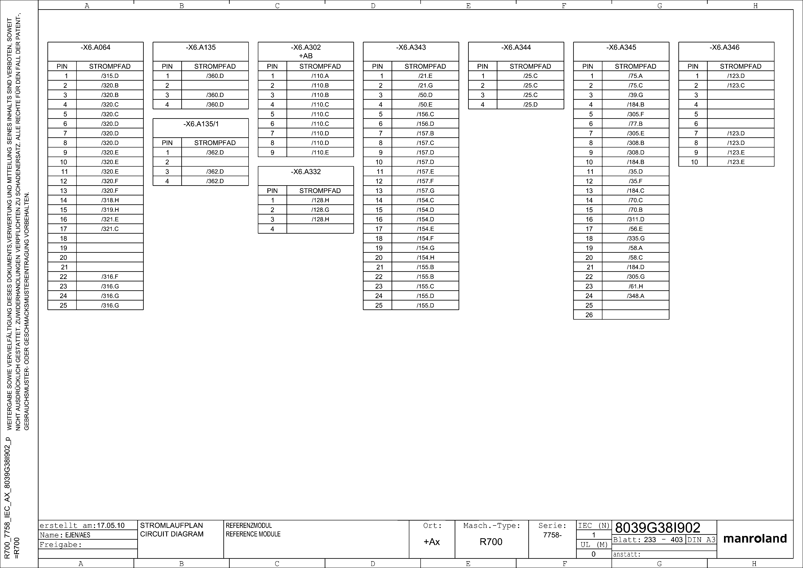

# +Ax — Sheet 233 of 403 — REFERENZMODUL

**REFERENCE MODULE**

> Part of the manroland **R700** printing press IEC/UL circuit diagrams.
> Drawing class: **Stromlaufplan / Circuit diagram** (DIN A3).
> Document `+Ax` covers the **Central control console** machine section.

## At a glance

| Field | Value |
|---|---|
| Document | `+Ax`  (8039G38I902) |
| Sheet | **233** of 403 |
| Section (DE) | REFERENZMODUL |
| Section (EN) | REFERENCE MODULE |
| Section type | REFERENCE_MODULE — Reference module |
| Machine type | `R700` |
| Series | `7758` |
| Created | 17.05.10 |
| Replaces | — |
| Columns used | A, B, C, D, E, F, G, H |
| Path numbers | — |
| Labels on sheet | 237 |
| Cross-refs out | 98 |
| Cross-refs in | 0 |

**Previous:** [+Ax sheet 232](SHEET_0232.md) · **Next:** [+Ax sheet 234](SHEET_0234.md) · **Document TOC:** [_TOC.md](_TOC.md)  (+Ax) · **Master TOC:** [all sheets](../_MASTER_TOC.md)

## Sheet image (300 DPI, exact vector render)



_Rendered directly from the PDF vector layer at 300 DPI (1-bit), no OCR and no resampling. Use it to confirm anything ambiguous in the text below._

## Cross-references on this sheet

Each entry is a wire leaving this sheet. The printed token is `/sheet.column`; the link resolves to that sheet inside the same document.

| Ref | Target sheet | Col | Path | Destination on target | Target section | From col |
|---|---|---|---|---|---|---|
| `/21.E` | [+Ax sheet 21](SHEET_0021.md) | E | — | — | SPANNUNGSVERSORGUNG, SCHALTSCHRANKBELÜFTUNG | E |
| `/75.A` | [+Ax sheet 75](SHEET_0075.md) | A | — | — | FEUCHTMITTELKÜHLGERÄT | G |
| `/110.A` | [+Ax sheet 110](SHEET_0110.md) | A | — | — | SAUGKOPF LÄNGSEINSTELLUNG / | C |
| `/25.C` | [+Ax sheet 25](SHEET_0025.md) | C | — | — | SPANNUNGSVERSORGUNG, SCHALTSCHRANKBELÜFTUNG | F |
| `/315.D` | [+Ax sheet 315](SHEET_0315.md) | D | — | — | OPTION: "EJEKTOR" ANLAGE / SELECT AIRSTATION / | A |
| `/360.D` | [+Ax sheet 360](SHEET_0360.md) | D | — | — | OPTION: LOGISTIK ANLEGER | B |
| `/123.D` | [+Ax sheet 123](SHEET_0123.md) | D | — | — | REALTIMERECHNER FEHLBOGENKONTROLLE | H |
| `/320.B` | [+Ax sheet 320](SHEET_0320.md) | B | — | — | OPTION: "EJEKTOR" ANLAGE / SELECT AIRSTATION / | A |
| `/110.B` | [+Ax sheet 110](SHEET_0110.md) | B | — | — | SAUGKOPF LÄNGSEINSTELLUNG / | C |
| `/21.G` | [+Ax sheet 21](SHEET_0021.md) | G | — | — | SPANNUNGSVERSORGUNG, SCHALTSCHRANKBELÜFTUNG | E |
| `/25.C` | [+Ax sheet 25](SHEET_0025.md) | C | — | — | SPANNUNGSVERSORGUNG, SCHALTSCHRANKBELÜFTUNG | F |
| `/75.C` | [+Ax sheet 75](SHEET_0075.md) | C | — | — | FEUCHTMITTELKÜHLGERÄT | G |
| `/123.C` | [+Ax sheet 123](SHEET_0123.md) | C | — | — | REALTIMERECHNER FEHLBOGENKONTROLLE | H |
| `/320.B` | [+Ax sheet 320](SHEET_0320.md) | B | — | — | OPTION: "EJEKTOR" ANLAGE / SELECT AIRSTATION / | A |
| `/110.B` | [+Ax sheet 110](SHEET_0110.md) | B | — | — | SAUGKOPF LÄNGSEINSTELLUNG / | C |
| `/39.G` | [+Ax sheet 39](SHEET_0039.md) | G | — | — | HAUPTANTRIEB | G |
| `/50.D` | [+Ax sheet 50](SHEET_0050.md) | D | — | — | STOP SICHERN | E |
| `/25.C` | [+Ax sheet 25](SHEET_0025.md) | C | — | — | SPANNUNGSVERSORGUNG, SCHALTSCHRANKBELÜFTUNG | F |
| `/360.D` | [+Ax sheet 360](SHEET_0360.md) | D | — | — | OPTION: LOGISTIK ANLEGER | B |
| `/50.E` | [+Ax sheet 50](SHEET_0050.md) | E | — | — | STOP SICHERN | E |
| `/184.B` | [+Ax sheet 184](SHEET_0184.md) | B | — | — | RESERVE | G |
| `/320.C` | [+Ax sheet 320](SHEET_0320.md) | C | — | — | OPTION: "EJEKTOR" ANLAGE / SELECT AIRSTATION / | A |
| `/360.D` | [+Ax sheet 360](SHEET_0360.md) | D | — | — | OPTION: LOGISTIK ANLEGER | B |
| `/110.C` | [+Ax sheet 110](SHEET_0110.md) | C | — | — | SAUGKOPF LÄNGSEINSTELLUNG / | C |
| `/25.D` | [+Ax sheet 25](SHEET_0025.md) | D | — | — | SPANNUNGSVERSORGUNG, SCHALTSCHRANKBELÜFTUNG | F |
| `/305.F` | [+Ax sheet 305](SHEET_0305.md) | F | — | — | SCHÖN & WIDERDRUCK HAUPTSCHALTSCHRANK | G |
| `/320.C` | [+Ax sheet 320](SHEET_0320.md) | C | — | — | OPTION: "EJEKTOR" ANLAGE / SELECT AIRSTATION / | A |
| `/110.C` | [+Ax sheet 110](SHEET_0110.md) | C | — | — | SAUGKOPF LÄNGSEINSTELLUNG / | C |
| `/156.C` | [+Ax sheet 156](SHEET_0156.md) | C | — | — | ÜBERWACHUNGSRECHNER/ANSTEUERUNG NOT AUS | E |
| `/77.B` | [+Ax sheet 77](SHEET_0077.md) | B | — | — | ANLEGER | G |
| `/320.D` | [+Ax sheet 320](SHEET_0320.md) | D | — | — | OPTION: "EJEKTOR" ANLAGE / SELECT AIRSTATION / | A |
| `/110.C` | [+Ax sheet 110](SHEET_0110.md) | C | — | — | SAUGKOPF LÄNGSEINSTELLUNG / | C |
| `/156.D` | [+Ax sheet 156](SHEET_0156.md) | D | — | — | ÜBERWACHUNGSRECHNER/ANSTEUERUNG NOT AUS | E |
| `/157.B` | [+Ax sheet 157](SHEET_0157.md) | B | — | — | ÜBERWACHUNGSRECHNER/ANSTEUERUNG NOT AUS | E |
| `/305.E` | [+Ax sheet 305](SHEET_0305.md) | E | — | — | SCHÖN & WIDERDRUCK HAUPTSCHALTSCHRANK | G |
| `/320.D` | [+Ax sheet 320](SHEET_0320.md) | D | — | — | OPTION: "EJEKTOR" ANLAGE / SELECT AIRSTATION / | A |
| `/110.D` | [+Ax sheet 110](SHEET_0110.md) | D | — | — | SAUGKOPF LÄNGSEINSTELLUNG / | C |
| `/123.D` | [+Ax sheet 123](SHEET_0123.md) | D | — | — | REALTIMERECHNER FEHLBOGENKONTROLLE | H |
| `/308.B` | [+Ax sheet 308](SHEET_0308.md) | B | — | — | OPTION: KOMBIGERÄT | G |
| `/320.D` | [+Ax sheet 320](SHEET_0320.md) | D | — | — | OPTION: "EJEKTOR" ANLAGE / SELECT AIRSTATION / | A |
| `/110.D` | [+Ax sheet 110](SHEET_0110.md) | D | — | — | SAUGKOPF LÄNGSEINSTELLUNG / | C |
| `/157.C` | [+Ax sheet 157](SHEET_0157.md) | C | — | — | ÜBERWACHUNGSRECHNER/ANSTEUERUNG NOT AUS | E |
| `/123.D` | [+Ax sheet 123](SHEET_0123.md) | D | — | — | REALTIMERECHNER FEHLBOGENKONTROLLE | H |
| `/320.E` | [+Ax sheet 320](SHEET_0320.md) | E | — | — | OPTION: "EJEKTOR" ANLAGE / SELECT AIRSTATION / | A |
| `/110.E` | [+Ax sheet 110](SHEET_0110.md) | E | — | — | SAUGKOPF LÄNGSEINSTELLUNG / | C |
| `/123.E` | [+Ax sheet 123](SHEET_0123.md) | E | — | — | REALTIMERECHNER FEHLBOGENKONTROLLE | H |
| `/362.D` | [+Ax sheet 362](SHEET_0362.md) | D | — | — | OPTION: LOGISTIK ANLEGER | B |
| `/157.D` | [+Ax sheet 157](SHEET_0157.md) | D | — | — | ÜBERWACHUNGSRECHNER/ANSTEUERUNG NOT AUS | E |
| `/308.D` | [+Ax sheet 308](SHEET_0308.md) | D | — | — | OPTION: KOMBIGERÄT | G |
| `/320.E` | [+Ax sheet 320](SHEET_0320.md) | E | — | — | OPTION: "EJEKTOR" ANLAGE / SELECT AIRSTATION / | A |
| `/184.B` | [+Ax sheet 184](SHEET_0184.md) | B | — | — | RESERVE | G |
| `/123.E` | [+Ax sheet 123](SHEET_0123.md) | E | — | — | REALTIMERECHNER FEHLBOGENKONTROLLE | H |
| `/157.D` | [+Ax sheet 157](SHEET_0157.md) | D | — | — | ÜBERWACHUNGSRECHNER/ANSTEUERUNG NOT AUS | E |
| `/320.E` | [+Ax sheet 320](SHEET_0320.md) | E | — | — | OPTION: "EJEKTOR" ANLAGE / SELECT AIRSTATION / | A |
| `/157.E` | [+Ax sheet 157](SHEET_0157.md) | E | — | — | ÜBERWACHUNGSRECHNER/ANSTEUERUNG NOT AUS | E |
| `/35.D` | [+Ax sheet 35](SHEET_0035.md) | D | — | — | SCHMIERUNG | G |
| `/362.D` | [+Ax sheet 362](SHEET_0362.md) | D | — | — | OPTION: LOGISTIK ANLEGER | B |
| `/35.F` | [+Ax sheet 35](SHEET_0035.md) | F | — | — | SCHMIERUNG | G |
| `/320.F` | [+Ax sheet 320](SHEET_0320.md) | F | — | — | OPTION: "EJEKTOR" ANLAGE / SELECT AIRSTATION / | A |
| `/157.F` | [+Ax sheet 157](SHEET_0157.md) | F | — | — | ÜBERWACHUNGSRECHNER/ANSTEUERUNG NOT AUS | E |
| `/362.D` | [+Ax sheet 362](SHEET_0362.md) | D | — | — | OPTION: LOGISTIK ANLEGER | B |
| `/320.F` | [+Ax sheet 320](SHEET_0320.md) | F | — | — | OPTION: "EJEKTOR" ANLAGE / SELECT AIRSTATION / | A |
| `/157.G` | [+Ax sheet 157](SHEET_0157.md) | G | — | — | ÜBERWACHUNGSRECHNER/ANSTEUERUNG NOT AUS | E |
| `/184.C` | [+Ax sheet 184](SHEET_0184.md) | C | — | — | RESERVE | G |
| `/70.C` | [+Ax sheet 70](SHEET_0070.md) | C | — | — | WASCHVORRICHTUNGEN DRUCKWERKE | G |
| `/318.H` | [+Ax sheet 318](SHEET_0318.md) | H | — | — | OPTION: "EJEKTOR" ANLAGE / SELECT AIRSTATION / | A |
| `/128.H` | [+Ax sheet 128](SHEET_0128.md) | H | — | — | REALTIMERECHNER ANLEGER | C |
| `/154.C` | [+Ax sheet 154](SHEET_0154.md) | C | — | — | ÜBERWACHUNGSRECHNER/ANSTEUERUNG NOT AUS | E |
| `/70.B` | [+Ax sheet 70](SHEET_0070.md) | B | — | — | WASCHVORRICHTUNGEN DRUCKWERKE | G |
| `/128.G` | [+Ax sheet 128](SHEET_0128.md) | G | — | — | REALTIMERECHNER ANLEGER | C |
| `/319.H` | [+Ax sheet 319](SHEET_0319.md) | H | — | — | OPTION: "EJEKTOR" ANLAGE / SELECT AIRSTATION / | A |
| `/154.D` | [+Ax sheet 154](SHEET_0154.md) | D | — | — | ÜBERWACHUNGSRECHNER/ANSTEUERUNG NOT AUS | E |
| `/321.E` | [+Ax sheet 321](SHEET_0321.md) | E | — | — | OPTION: "EJEKTOR" ANLAGE / SELECT AIRSTATION / | A |
| `/128.H` | [+Ax sheet 128](SHEET_0128.md) | H | — | — | REALTIMERECHNER ANLEGER | C |
| `/154.D` | [+Ax sheet 154](SHEET_0154.md) | D | — | — | ÜBERWACHUNGSRECHNER/ANSTEUERUNG NOT AUS | E |
| `/311.D` | [+Ax sheet 311](SHEET_0311.md) | D | — | — | OPTION: IONISATIONSANLAGE ANLEGER | G |
| `/56.E` | [+Ax sheet 56](SHEET_0056.md) | E | — | — | LUFTVERSORGUNG | G |
| `/154.E` | [+Ax sheet 154](SHEET_0154.md) | E | — | — | ÜBERWACHUNGSRECHNER/ANSTEUERUNG NOT AUS | E |
| `/321.C` | [+Ax sheet 321](SHEET_0321.md) | C | — | — | OPTION: "EJEKTOR" ANLAGE / SELECT AIRSTATION / | A |
| `/154.F` | [+Ax sheet 154](SHEET_0154.md) | F | — | — | ÜBERWACHUNGSRECHNER/ANSTEUERUNG NOT AUS | E |
| `/335.G` | [+Ax sheet 335](SHEET_0335.md) | G | — | — | 1 OPTION: LOGISTIK (ANLEGER AUSLEGER) | G |
| `/58.A` | [+Ax sheet 58](SHEET_0058.md) | A | — | — | LUFTVERSORGUNG | G |
| `/154.G` | [+Ax sheet 154](SHEET_0154.md) | G | — | — | ÜBERWACHUNGSRECHNER/ANSTEUERUNG NOT AUS | E |
| `/58.C` | [+Ax sheet 58](SHEET_0058.md) | C | — | — | LUFTVERSORGUNG | G |
| `/154.H` | [+Ax sheet 154](SHEET_0154.md) | H | — | — | ÜBERWACHUNGSRECHNER/ANSTEUERUNG NOT AUS | E |
| `/155.B` | [+Ax sheet 155](SHEET_0155.md) | B | — | — | ÜBERWACHUNGSRECHNER/ANSTEUERUNG NOT AUS | E |
| `/184.D` | [+Ax sheet 184](SHEET_0184.md) | D | — | — | RESERVE | G |
| `/155.B` | [+Ax sheet 155](SHEET_0155.md) | B | — | — | ÜBERWACHUNGSRECHNER/ANSTEUERUNG NOT AUS | E |
| `/316.F` | [+Ax sheet 316](SHEET_0316.md) | F | — | — | OPTION: "EJEKTOR" ANLAGE / SELECT AIRSTATION / | A |
| `/305.G` | [+Ax sheet 305](SHEET_0305.md) | G | — | — | SCHÖN & WIDERDRUCK HAUPTSCHALTSCHRANK | G |
| `/316.G` | [+Ax sheet 316](SHEET_0316.md) | G | — | — | OPTION: "EJEKTOR" ANLAGE / SELECT AIRSTATION / | A |
| `/61.H` | [+Ax sheet 61](SHEET_0061.md) | H | — | — | DRUCKLUFTANLAGE | G |
| `/155.C` | [+Ax sheet 155](SHEET_0155.md) | C | — | — | ÜBERWACHUNGSRECHNER/ANSTEUERUNG NOT AUS | E |
| `/348.A` | [+Ax sheet 348](SHEET_0348.md) | A | — | — | OPTION: LOGISTIK ANLEGER | G |
| `/316.G` | [+Ax sheet 316](SHEET_0316.md) | G | — | — | OPTION: "EJEKTOR" ANLAGE / SELECT AIRSTATION / | A |
| `/155.D` | [+Ax sheet 155](SHEET_0155.md) | D | — | — | ÜBERWACHUNGSRECHNER/ANSTEUERUNG NOT AUS | E |
| `/316.G` | [+Ax sheet 316](SHEET_0316.md) | G | — | — | OPTION: "EJEKTOR" ANLAGE / SELECT AIRSTATION / | A |
| `/155.D` | [+Ax sheet 155](SHEET_0155.md) | D | — | — | ÜBERWACHUNGSRECHNER/ANSTEUERUNG NOT AUS | E |

## Devices on this sheet

| Tag | Class | Class meaning (IEC) | Col | Sub | Terminal | Sign |
|---|---|---|---|---|---|---|
| `X6.A064` | — | cross-device reference | A | — | — | — |
| `X6.A343` | — | cross-device reference | D | — | — | — |
| `X6.A302` | — | cross-device reference | C | — | — | — |
| `X6.A332` | — | cross-device reference | C | — | — | — |
| `X6.A135` | — | cross-device reference | B | — | — | — |
| `X6.A345` | — | cross-device reference | G | — | — | — |
| `X6.A344` | — | cross-device reference | F | — | — | — |
| `X6.A346` | — | cross-device reference | H | — | — | — |

## Potentials / nets

_No named potentials on this sheet._

## Wire-end annotations (grouped as printed)

A wire that continues elsewhere is annotated with a small cluster: the destination description, the path/line number `#NN`, and the `/sheet.column` cross reference. Each row below is one such cluster exactly as it is grouped on the drawing.

| Col | Y | Path | Cross-ref | Text on the wire |
|---|---|---|---|---|
| A | 65.5 | — | — | `X6.A064` |
| B | 65.5 | — | — | `X6.A135` |
| C | 65.5 | — | — | `X6.A302` |
| D | 65.5 | — | — | `X6.A343` |
| F | 65.5 | — | — | `X6.A344` |
| G | 65.5 | — | — | `X6.A345` |
| H | 65.5 | — | — | `X6.A346` |
| C | 78.2 | — | — | `+AB` |
| A | 94.2 | — | — | `PIN STROMPFAD` |
| B | 94.2 | — | — | `PIN 2 3 4 1 STROMPFAD` |
| C | 94.2 | — | — | `PIN 2 3 4 5 6 7 8 9 1 STROMPFAD` |
| D | 94.2 | — | — | `PIN STROMPFAD` |
| E | 94.2 | — | — | `PIN 2 3 4 1 STROMPFAD` |
| G | 94.2 | — | — | `PIN STROMPFAD` |
| H | 94.2 | — | — | `PIN 10 2 3 4 5 6 7 8 9 1 STROMPFAD` |
| A | 108.4 | — | — | `2 3 4 5 6 7 8 9 1` |
| D | 108.4 | — | — | `2 3 4 5 6 7 8 9 1` |
| F | 108.4 | — | — | `2 3 4 5 6 7 8 9 1` |
| A | 108.7 | — | `/315.D` | — |
| B | 108.7 | — | `/360.D` | — |
| C | 108.7 | — | `/110.A` | — |
| E | 108.7 | — | `/21.E` | — |
| F | 108.7 | — | `/25.C` | — |
| G | 108.7 | — | `/75.A` | — |
| H | 108.7 | — | `/123.D` | — |
| A | 122.9 | — | `/320.B` | — |
| C | 122.9 | — | `/110.B` | — |
| E | 122.9 | — | `/21.G` | — |
| F | 122.9 | — | `/25.C` | — |
| G | 122.9 | — | `/75.C` | — |
| H | 122.9 | — | `/123.C` | — |
| A | 137.0 | — | `/320.B` | — |
| C | 137.0 | — | `/110.B` | — |
| G | 137.0 | — | `/39.G` | — |
| B | 137.1 | — | `/360.D` | — |
| E | 137.1 | — | `/50.D` | — |
| F | 137.1 | — | `/25.C` | — |
| A | 151.2 | — | `/320.C` | — |
| B | 151.2 | — | `/360.D` | — |
| C | 151.2 | — | `/110.C` | — |
| E | 151.2 | — | `/50.E` | — |
| F | 151.2 | — | `/25.D` | — |
| G | 151.2 | — | `/184.B` | — |
| A | 165.4 | — | `/320.C` | — |
| C | 165.4 | — | `/110.C` | — |
| E | 165.4 | — | `/156.C` | — |
| G | 165.4 | — | `/305.F` | — |
| B | 178.9 | — | — | `X6.A135/1` |
| G | 179.5 | — | `/77.B` | — |
| A | 179.6 | — | `/320.D` | — |
| C | 179.6 | — | `/110.C` | — |
| E | 179.6 | — | `/156.D` | — |
| E | 193.7 | — | `/157.B` | — |
| G | 193.7 | — | `/305.E` | — |
| A | 193.8 | — | `/320.D` | — |
| C | 193.8 | — | `/110.D` | — |
| H | 193.8 | — | `/123.D` | — |
| B | 207.5 | — | — | `PIN 2 3 4 1 STROMPFAD` |
| A | 207.9 | — | `/320.D` | — |
| C | 207.9 | — | `/110.D` | — |
| E | 207.9 | — | `/157.C` | — |
| G | 207.9 | — | `/308.B` | — |
| H | 207.9 | — | `/123.D` | — |
| A | 222.1 | — | `/320.E` | — |
| B | 222.1 | — | `/362.D` | — |
| C | 222.1 | — | `/110.E` | — |
| E | 222.1 | — | `/157.D` | — |
| G | 222.1 | — | `/308.D` | — |
| H | 222.1 | — | `/123.E` | — |
| A | 235.9 | — | — | `10 12 13 14 15 16 17 18 19 20 11` |
| D | 235.9 | — | — | `10 12 13 14 15 16 17 18 19 20 11` |
| F | 235.9 | — | — | `10 12 13 14 15 16 17 18 19 20 11` |
| A | 236.2 | — | `/320.E` | — |
| G | 236.2 | — | `/184.B` | — |
| H | 236.2 | — | `/123.E` | — |
| E | 236.3 | — | `/157.D` | — |
| C | 249.8 | — | — | `X6.A332` |
| A | 250.4 | — | `/320.E` | — |
| B | 250.4 | — | `/362.D` | — |
| E | 250.4 | — | `/157.E` | — |
| G | 250.4 | — | `/35.D` | — |
| A | 264.6 | — | `/320.F` | — |
| B | 264.6 | — | `/362.D` | — |
| E | 264.6 | — | `/157.F` | — |
| G | 264.6 | — | `/35.F` | — |
| C | 278.4 | — | — | `PIN 2 3 4 1 STROMPFAD` |
| A | 278.8 | — | `/320.F` | — |
| E | 278.8 | — | `/157.G` | — |
| G | 278.8 | — | `/184.C` | — |
| A | 293.0 | — | `/318.H` | — |
| C | 293.0 | — | `/128.H` | — |
| E | 293.0 | — | `/154.C` | — |
| G | 293.0 | — | `/70.C` | — |
| A | 307.1 | — | `/319.H` | — |
| C | 307.1 | — | `/128.G` | — |
| E | 307.1 | — | `/154.D` | — |
| G | 307.1 | — | `/70.B` | — |
| A | 321.3 | — | `/321.E` | — |
| C | 321.3 | — | `/128.H` | — |
| E | 321.3 | — | `/154.D` | — |
| G | 321.3 | — | `/311.D` | — |
| G | 335.4 | — | `/56.E` | — |
| A | 335.5 | — | `/321.C` | — |
| E | 335.5 | — | `/154.E` | — |
| E | 349.6 | — | `/154.F` | — |
| G | 349.6 | — | `/335.G` | — |
| E | 363.8 | — | `/154.G` | — |
| G | 363.8 | — | `/58.A` | — |
| E | 378.0 | — | `/154.H` | — |
| G | 378.0 | — | `/58.C` | — |
| A | 391.8 | — | — | `22 23 24 25 21` |
| D | 391.8 | — | — | `22 23 24 25 21` |
| F | 391.8 | — | — | `22 23 24 25 26 21` |
| E | 392.1 | — | `/155.B` | — |
| G | 392.2 | — | `/184.D` | — |
| A | 406.3 | — | `/316.F` | — |
| E | 406.3 | — | `/155.B` | — |
| G | 406.3 | — | `/305.G` | — |
| A | 420.5 | — | `/316.G` | — |
| E | 420.5 | — | `/155.C` | — |
| G | 420.5 | — | `/61.H` | — |
| A | 434.7 | — | `/316.G` | — |
| E | 434.7 | — | `/155.D` | — |
| G | 434.7 | — | `/348.A` | — |
| A | 448.9 | — | `/316.G` | — |
| E | 448.9 | — | `/155.D` | — |


## Reconstructed tables

This sheet carries tabular content (pin map / terminal assignment / index). The grid below was rebuilt from the drawing's own rule lines, so each row is exactly one physical row of the table.

### Table 1 — 25 data rows × 2 columns (at x=70.9, y=62.4) — **X6.A064**

| PIN | STROMPFAD |
|---|---|
| `1` | `/315.D` |
| `2` | `/320.B` |
| `3` | `/320.B` |
| `4` | `/320.C` |
| `5` | `/320.C` |
| `6` | `/320.D` |
| `7` | `/320.D` |
| `8` | `/320.D` |
| `9` | `/320.E` |
| `10` | `/320.E` |
| `11` | `/320.E` |
| `12` | `/320.F` |
| `13` | `/320.F` |
| `14` | `/318.H` |
| `15` | `/319.H` |
| `16` | `/321.E` |
| `17` | `/321.C` |
| `18` |  |
| `19` |  |
| `20` |  |
| `21` |  |
| `22` | `/316.F` |
| `23` | `/316.G` |
| `24` | `/316.G` |
| `25` | `/316.G` |


### Table 2 — 10 data rows × 2 columns (at x=226.8, y=62.4) — **X6.A135**

| PIN | STROMPFAD |
|---|---|
| `1` | `/360.D` |
| `2` |  |
| `3` | `/360.D` |
| `4` | `/360.D` |
|  | `X6.A135/1` |
| `PIN` | `STROMPFAD` |
| `1` | `/362.D` |
| `2` |  |
| `3` | `/362.D` |
| `4` | `/362.D` |


### Table 3 — 15 data rows × 2 columns (at x=382.7, y=62.4) — **X6.A302 +AB**

| PIN | STROMPFAD |
|---|---|
| `1` | `/110.A` |
| `2` | `/110.B` |
| `3` | `/110.B` |
| `4` | `/110.C` |
| `5` | `/110.C` |
| `6` | `/110.C` |
| `7` | `/110.D` |
| `8` | `/110.D` |
| `9` | `/110.E` |
|  | `X6.A332` |
| `PIN` | `STROMPFAD` |
| `1` | `/128.H` |
| `2` | `/128.G` |
| `3` | `/128.H` |
| `4` |  |


### Table 4 — 25 data rows × 2 columns (at x=538.6, y=62.4) — **X6.A343**

| PIN | STROMPFAD |
|---|---|
| `1` | `/21.E` |
| `2` | `/21.G` |
| `3` | `/50.D` |
| `4` | `/50.E` |
| `5` | `/156.C` |
| `6` | `/156.D` |
| `7` | `/157.B` |
| `8` | `/157.C` |
| `9` | `/157.D` |
| `10` | `/157.D` |
| `11` | `/157.E` |
| `12` | `/157.F` |
| `13` | `/157.G` |
| `14` | `/154.C` |
| `15` | `/154.D` |
| `16` | `/154.D` |
| `17` | `/154.E` |
| `18` | `/154.F` |
| `19` | `/154.G` |
| `20` | `/154.H` |
| `21` | `/155.B` |
| `22` | `/155.B` |
| `23` | `/155.C` |
| `24` | `/155.D` |
| `25` | `/155.D` |


### Table 5 — 4 data rows × 2 columns (at x=694.5, y=62.4) — **X6.A344**

| PIN | STROMPFAD |
|---|---|
| `1` | `/25.C` |
| `2` | `/25.C` |
| `3` | `/25.C` |
| `4` | `/25.D` |


### Table 6 — 26 data rows × 2 columns (at x=850.4, y=62.4) — **X6.A345**

| PIN | STROMPFAD |
|---|---|
| `1` | `/75.A` |
| `2` | `/75.C` |
| `3` | `/39.G` |
| `4` | `/184.B` |
| `5` | `/305.F` |
| `6` | `/77.B` |
| `7` | `/305.E` |
| `8` | `/308.B` |
| `9` | `/308.D` |
| `10` | `/184.B` |
| `11` | `/35.D` |
| `12` | `/35.F` |
| `13` | `/184.C` |
| `14` | `/70.C` |
| `15` | `/70.B` |
| `16` | `/311.D` |
| `17` | `/56.E` |
| `18` | `/335.G` |
| `19` | `/58.A` |
| `20` | `/58.C` |
| `21` | `/184.D` |
| `22` | `/305.G` |
| `23` | `/61.H` |
| `24` | `/348.A` |
| `25` |  |
| `26` |  |


### Table 7 — 10 data rows × 2 columns (at x=1006.3, y=62.4) — **X6.A346**

| PIN | STROMPFAD |
|---|---|
| `1` | `/123.D` |
| `2` | `/123.C` |
| `3` |  |
| `4` |  |
| `5` |  |
| `6` |  |
| `7` | `/123.D` |
| `8` | `/123.D` |
| `9` | `/123.E` |
| `10` | `/123.E` |


## Notes and free text on this sheet

| Text | Col | Y (pt) |
|---|---|---|
| `PIN` | A | 94.2 |
| `STROMPFAD` | A | 94.15 |
| `PIN` | D | 94.2 |
| `STROMPFAD` | E | 94.15 |
| `PIN` | C | 94.2 |
| `STROMPFAD` | C | 94.15 |
| `+AB` | C | 78.18 |
| `PIN` | B | 94.2 |
| `STROMPFAD` | B | 94.15 |
| `X6.A135/1` | B | 178.9 |
| `PIN` | F | 94.2 |
| `STROMPFAD` | G | 94.15 |
| `PIN` | E | 94.2 |
| `STROMPFAD` | F | 94.15 |
| `PIN` | G | 94.2 |
| `STROMPFAD` | H | 94.15 |

## Complete label inventory (exact text from the drawing)

Every text object inside the drawing area of this sheet, in DIN reading order (column A→H, then top→bottom). This is the authoritative list: if a string is not here it is not printed on this sheet.

| Col | Y | X | Dir | Type | Text |
|---|---|---|---|---|---|
| A | 65.5 | 119.8 | → | device ref | `X6.A064` |
| A | 94.2 | 84.0 | → | text | `PIN` |
| A | 94.2 | 132.2 | → | text | `STROMPFAD` |
| A | 108.4 | 95.8 | → | number | `1` |
| A | 108.7 | 150.2 | → | cross-reference | `/315.D` |
| A | 122.5 | 94.1 | → | number | `2` |
| A | 122.9 | 150.4 | → | cross-reference | `/320.B` |
| A | 136.7 | 94.1 | → | number | `3` |
| A | 137.0 | 150.4 | → | cross-reference | `/320.B` |
| A | 150.9 | 94.1 | → | number | `4` |
| A | 151.2 | 150.2 | → | cross-reference | `/320.C` |
| A | 165.1 | 94.1 | → | number | `5` |
| A | 165.4 | 150.2 | → | cross-reference | `/320.C` |
| A | 179.2 | 94.1 | → | number | `6` |
| A | 179.6 | 150.2 | → | cross-reference | `/320.D` |
| A | 193.4 | 94.1 | → | number | `7` |
| A | 193.8 | 150.2 | → | cross-reference | `/320.D` |
| A | 207.6 | 94.1 | → | number | `8` |
| A | 207.9 | 150.2 | → | cross-reference | `/320.D` |
| A | 221.8 | 94.1 | → | number | `9` |
| A | 222.1 | 150.5 | → | cross-reference | `/320.E` |
| A | 235.9 | 88.7 | → | number | `10` |
| A | 236.2 | 150.5 | → | cross-reference | `/320.E` |
| A | 250.1 | 90.4 | → | number | `11` |
| A | 250.4 | 150.5 | → | cross-reference | `/320.E` |
| A | 264.3 | 88.7 | → | number | `12` |
| A | 264.6 | 150.7 | → | cross-reference | `/320.F` |
| A | 278.5 | 88.7 | → | number | `13` |
| A | 278.8 | 150.7 | → | cross-reference | `/320.F` |
| A | 292.6 | 88.7 | → | number | `14` |
| A | 293.0 | 150.5 | → | cross-reference | `/318.H` |
| A | 306.8 | 88.7 | → | number | `15` |
| A | 307.1 | 150.5 | → | cross-reference | `/319.H` |
| A | 321.0 | 88.7 | → | number | `16` |
| A | 321.3 | 150.5 | → | cross-reference | `/321.E` |
| A | 335.1 | 88.7 | → | number | `17` |
| A | 335.5 | 150.2 | → | cross-reference | `/321.C` |
| A | 349.3 | 88.7 | → | number | `18` |
| A | 363.5 | 88.7 | → | number | `19` |
| A | 377.7 | 88.7 | → | number | `20` |
| A | 391.8 | 90.4 | → | number | `21` |
| A | 406.0 | 88.7 | → | number | `22` |
| A | 406.3 | 150.7 | → | cross-reference | `/316.F` |
| A | 420.2 | 88.7 | → | number | `23` |
| A | 420.5 | 150.1 | → | cross-reference | `/316.G` |
| A | 434.4 | 88.7 | → | number | `24` |
| A | 434.7 | 150.1 | → | cross-reference | `/316.G` |
| A | 448.5 | 88.7 | → | number | `25` |
| A | 448.9 | 150.1 | → | cross-reference | `/316.G` |
| B | 65.5 | 275.7 | → | device ref | `X6.A135` |
| B | 94.2 | 240.0 | → | text | `PIN` |
| B | 94.2 | 288.1 | → | text | `STROMPFAD` |
| B | 108.4 | 245.9 | → | number | `1` |
| B | 108.7 | 306.1 | → | cross-reference | `/360.D` |
| B | 122.5 | 245.3 | → | number | `2` |
| B | 136.7 | 245.3 | → | number | `3` |
| B | 137.1 | 306.1 | → | cross-reference | `/360.D` |
| B | 150.9 | 245.3 | → | number | `4` |
| B | 151.2 | 306.1 | → | cross-reference | `/360.D` |
| B | 178.9 | 272.0 | → | text | `X6.A135/1` |
| B | 207.5 | 288.1 | → | text | `STROMPFAD` |
| B | 207.6 | 240.0 | → | text | `PIN` |
| B | 221.8 | 245.9 | → | number | `1` |
| B | 222.1 | 306.1 | → | cross-reference | `/362.D` |
| B | 235.9 | 245.3 | → | number | `2` |
| B | 250.1 | 245.3 | → | number | `3` |
| B | 250.4 | 306.1 | → | cross-reference | `/362.D` |
| B | 264.3 | 245.3 | → | number | `4` |
| B | 264.6 | 306.1 | → | cross-reference | `/362.D` |
| C | 65.5 | 431.6 | → | device ref | `X6.A302` |
| C | 78.2 | 443.3 | → | text | `+AB` |
| C | 94.2 | 395.9 | → | text | `PIN` |
| C | 94.2 | 444.0 | → | text | `STROMPFAD` |
| C | 108.4 | 401.8 | → | number | `1` |
| C | 108.7 | 462.0 | → | cross-reference | `/110.A` |
| C | 122.5 | 401.2 | → | number | `2` |
| C | 122.9 | 462.2 | → | cross-reference | `/110.B` |
| C | 136.7 | 401.2 | → | number | `3` |
| C | 137.0 | 462.2 | → | cross-reference | `/110.B` |
| C | 150.9 | 401.2 | → | number | `4` |
| C | 151.2 | 462.0 | → | cross-reference | `/110.C` |
| C | 165.1 | 401.2 | → | number | `5` |
| C | 165.4 | 462.0 | → | cross-reference | `/110.C` |
| C | 179.2 | 401.2 | → | number | `6` |
| C | 179.6 | 462.0 | → | cross-reference | `/110.C` |
| C | 193.4 | 401.2 | → | number | `7` |
| C | 193.8 | 462.0 | → | cross-reference | `/110.D` |
| C | 207.6 | 401.2 | → | number | `8` |
| C | 207.9 | 462.0 | → | cross-reference | `/110.D` |
| C | 221.8 | 401.2 | → | number | `9` |
| C | 222.1 | 462.3 | → | cross-reference | `/110.E` |
| C | 249.8 | 431.6 | → | device ref | `X6.A332` |
| C | 278.4 | 395.9 | → | text | `PIN` |
| C | 278.4 | 444.0 | → | text | `STROMPFAD` |
| C | 292.6 | 401.8 | → | number | `1` |
| C | 293.0 | 462.3 | → | cross-reference | `/128.H` |
| C | 306.8 | 401.2 | → | number | `2` |
| C | 307.1 | 461.9 | → | cross-reference | `/128.G` |
| C | 321.0 | 401.2 | → | number | `3` |
| C | 321.3 | 462.3 | → | cross-reference | `/128.H` |
| C | 335.1 | 401.2 | → | number | `4` |
| D | 65.5 | 587.5 | → | device ref | `X6.A343` |
| D | 94.2 | 551.8 | → | text | `PIN` |
| D | 108.4 | 563.5 | → | number | `1` |
| D | 122.5 | 561.8 | → | number | `2` |
| D | 136.7 | 561.8 | → | number | `3` |
| D | 150.9 | 561.8 | → | number | `4` |
| D | 165.1 | 561.8 | → | number | `5` |
| D | 179.2 | 561.8 | → | number | `6` |
| D | 193.4 | 561.8 | → | number | `7` |
| D | 207.6 | 561.8 | → | number | `8` |
| D | 221.8 | 561.8 | → | number | `9` |
| D | 235.9 | 556.4 | → | number | `10` |
| D | 250.1 | 558.1 | → | number | `11` |
| D | 264.3 | 556.4 | → | number | `12` |
| D | 278.5 | 556.4 | → | number | `13` |
| D | 292.6 | 556.4 | → | number | `14` |
| D | 306.8 | 556.4 | → | number | `15` |
| D | 321.0 | 556.4 | → | number | `16` |
| D | 335.1 | 556.4 | → | number | `17` |
| D | 349.3 | 556.4 | → | number | `18` |
| D | 363.5 | 556.4 | → | number | `19` |
| D | 377.7 | 556.4 | → | number | `20` |
| D | 391.8 | 558.1 | → | number | `21` |
| D | 406.0 | 556.4 | → | number | `22` |
| D | 420.2 | 556.4 | → | number | `23` |
| D | 434.4 | 556.4 | → | number | `24` |
| D | 448.5 | 556.4 | → | number | `25` |
| E | 94.2 | 600.0 | → | text | `STROMPFAD` |
| E | 94.2 | 707.7 | → | text | `PIN` |
| E | 108.4 | 713.6 | → | number | `1` |
| E | 108.7 | 620.6 | → | cross-reference | `/21.E` |
| E | 122.5 | 713.1 | → | number | `2` |
| E | 122.9 | 620.2 | → | cross-reference | `/21.G` |
| E | 136.7 | 713.1 | → | number | `3` |
| E | 137.1 | 620.4 | → | cross-reference | `/50.D` |
| E | 150.9 | 713.1 | → | number | `4` |
| E | 151.2 | 620.6 | → | cross-reference | `/50.E` |
| E | 165.4 | 618.0 | → | cross-reference | `/156.C` |
| E | 179.6 | 618.0 | → | cross-reference | `/156.D` |
| E | 193.7 | 618.1 | → | cross-reference | `/157.B` |
| E | 207.9 | 618.0 | → | cross-reference | `/157.C` |
| E | 222.1 | 618.0 | → | cross-reference | `/157.D` |
| E | 236.3 | 618.0 | → | cross-reference | `/157.D` |
| E | 250.4 | 618.2 | → | cross-reference | `/157.E` |
| E | 264.6 | 618.4 | → | cross-reference | `/157.F` |
| E | 278.8 | 617.8 | → | cross-reference | `/157.G` |
| E | 293.0 | 618.0 | → | cross-reference | `/154.C` |
| E | 307.1 | 618.0 | → | cross-reference | `/154.D` |
| E | 321.3 | 618.0 | → | cross-reference | `/154.D` |
| E | 335.5 | 618.2 | → | cross-reference | `/154.E` |
| E | 349.6 | 618.4 | → | cross-reference | `/154.F` |
| E | 363.8 | 617.8 | → | cross-reference | `/154.G` |
| E | 378.0 | 618.2 | → | cross-reference | `/154.H` |
| E | 392.2 | 618.1 | → | cross-reference | `/155.B` |
| E | 406.3 | 618.1 | → | cross-reference | `/155.B` |
| E | 420.5 | 618.0 | → | cross-reference | `/155.C` |
| E | 434.7 | 618.0 | → | cross-reference | `/155.D` |
| E | 448.9 | 618.0 | → | cross-reference | `/155.D` |
| F | 65.5 | 743.4 | → | device ref | `X6.A344` |
| F | 94.2 | 755.9 | → | text | `STROMPFAD` |
| F | 94.2 | 863.6 | → | text | `PIN` |
| F | 108.4 | 875.3 | → | number | `1` |
| F | 108.7 | 776.3 | → | cross-reference | `/25.C` |
| F | 122.5 | 873.6 | → | number | `2` |
| F | 122.9 | 776.3 | → | cross-reference | `/25.C` |
| F | 136.7 | 873.6 | → | number | `3` |
| F | 137.1 | 776.3 | → | cross-reference | `/25.C` |
| F | 150.9 | 873.6 | → | number | `4` |
| F | 151.2 | 776.3 | → | cross-reference | `/25.D` |
| F | 165.1 | 873.6 | → | number | `5` |
| F | 179.2 | 873.6 | → | number | `6` |
| F | 193.4 | 873.6 | → | number | `7` |
| F | 207.6 | 873.6 | → | number | `8` |
| F | 221.8 | 873.6 | → | number | `9` |
| F | 235.9 | 868.3 | → | number | `10` |
| F | 250.1 | 870.0 | → | number | `11` |
| F | 264.3 | 868.3 | → | number | `12` |
| F | 278.5 | 868.3 | → | number | `13` |
| F | 292.6 | 868.3 | → | number | `14` |
| F | 306.8 | 868.3 | → | number | `15` |
| F | 321.0 | 868.3 | → | number | `16` |
| F | 335.1 | 868.3 | → | number | `17` |
| F | 349.3 | 868.3 | → | number | `18` |
| F | 363.5 | 868.3 | → | number | `19` |
| F | 377.7 | 868.3 | → | number | `20` |
| F | 391.8 | 870.0 | → | number | `21` |
| F | 406.0 | 868.3 | → | number | `22` |
| F | 420.2 | 868.3 | → | number | `23` |
| F | 434.4 | 868.3 | → | number | `24` |
| F | 448.5 | 868.3 | → | number | `25` |
| F | 462.7 | 868.3 | → | number | `26` |
| G | 65.5 | 899.3 | → | device ref | `X6.A345` |
| G | 94.2 | 911.8 | → | text | `STROMPFAD` |
| G | 94.2 | 1019.5 | → | text | `PIN` |
| G | 108.4 | 1031.2 | → | number | `1` |
| G | 108.7 | 932.2 | → | cross-reference | `/75.A` |
| G | 122.5 | 1029.5 | → | number | `2` |
| G | 122.9 | 932.2 | → | cross-reference | `/75.C` |
| G | 136.7 | 1029.5 | → | number | `3` |
| G | 137.0 | 932.0 | → | cross-reference | `/39.G` |
| G | 150.9 | 1029.5 | → | number | `4` |
| G | 151.2 | 929.9 | → | cross-reference | `/184.B` |
| G | 165.1 | 1029.5 | → | number | `5` |
| G | 165.4 | 930.2 | → | cross-reference | `/305.F` |
| G | 179.2 | 1029.5 | → | number | `6` |
| G | 179.5 | 932.3 | → | cross-reference | `/77.B` |
| G | 193.4 | 1029.5 | → | number | `7` |
| G | 193.7 | 930.0 | → | cross-reference | `/305.E` |
| G | 207.6 | 1029.5 | → | number | `8` |
| G | 207.9 | 929.9 | → | cross-reference | `/308.B` |
| G | 221.8 | 1029.5 | → | number | `9` |
| G | 222.1 | 929.8 | → | cross-reference | `/308.D` |
| G | 235.9 | 1024.2 | → | number | `10` |
| G | 236.2 | 929.9 | → | cross-reference | `/184.B` |
| G | 250.4 | 932.2 | → | cross-reference | `/35.D` |
| G | 264.6 | 932.6 | → | cross-reference | `/35.F` |
| G | 278.8 | 929.8 | → | cross-reference | `/184.C` |
| G | 293.0 | 932.2 | → | cross-reference | `/70.C` |
| G | 307.1 | 932.3 | → | cross-reference | `/70.B` |
| G | 321.3 | 929.8 | → | cross-reference | `/311.D` |
| G | 335.4 | 932.5 | → | cross-reference | `/56.E` |
| G | 349.7 | 929.6 | → | cross-reference | `/335.G` |
| G | 363.8 | 932.2 | → | cross-reference | `/58.A` |
| G | 378.0 | 932.2 | → | cross-reference | `/58.C` |
| G | 392.2 | 929.8 | → | cross-reference | `/184.D` |
| G | 406.3 | 929.6 | → | cross-reference | `/305.G` |
| G | 420.5 | 932.5 | → | cross-reference | `/61.H` |
| G | 434.7 | 929.8 | → | cross-reference | `/348.A` |
| H | 65.5 | 1052.4 | → | device ref | `X6.A346` |
| H | 94.2 | 1067.7 | → | text | `STROMPFAD` |
| H | 108.7 | 1078.6 | → | cross-reference | `/123.D` |
| H | 122.9 | 1078.6 | → | cross-reference | `/123.C` |
| H | 193.8 | 1078.6 | → | cross-reference | `/123.D` |
| H | 207.9 | 1078.6 | → | cross-reference | `/123.D` |
| H | 222.1 | 1078.9 | → | cross-reference | `/123.E` |
| H | 236.2 | 1078.9 | → | cross-reference | `/123.E` |

## Reading-order text block

The same content as a plain block, grouped by DIN column — convenient to paste or to match against a visual description.

```text
=== Column A ===
  65.5  119.8  devref       X6.A064
  94.2   84.0  text         PIN
  94.2  132.2  text         STROMPFAD
 108.4   95.8  numeric      1
 108.7  150.2  xref         /315.D
 122.5   94.1  numeric      2
 122.9  150.4  xref         /320.B
 136.7   94.1  numeric      3
 137.0  150.4  xref         /320.B
 150.9   94.1  numeric      4
 151.2  150.2  xref         /320.C
 165.1   94.1  numeric      5
 165.4  150.2  xref         /320.C
 179.2   94.1  numeric      6
 179.6  150.2  xref         /320.D
 193.4   94.1  numeric      7
 193.8  150.2  xref         /320.D
 207.6   94.1  numeric      8
 207.9  150.2  xref         /320.D
 221.8   94.1  numeric      9
 222.1  150.5  xref         /320.E
 235.9   88.7  numeric      10
 236.2  150.5  xref         /320.E
 250.1   90.4  numeric      11
 250.4  150.5  xref         /320.E
 264.3   88.7  numeric      12
 264.6  150.7  xref         /320.F
 278.5   88.7  numeric      13
 278.8  150.7  xref         /320.F
 292.6   88.7  numeric      14
 293.0  150.5  xref         /318.H
 306.8   88.7  numeric      15
 307.1  150.5  xref         /319.H
 321.0   88.7  numeric      16
 321.3  150.5  xref         /321.E
 335.1   88.7  numeric      17
 335.5  150.2  xref         /321.C
 349.3   88.7  numeric      18
 363.5   88.7  numeric      19
 377.7   88.7  numeric      20
 391.8   90.4  numeric      21
 406.0   88.7  numeric      22
 406.3  150.7  xref         /316.F
 420.2   88.7  numeric      23
 420.5  150.1  xref         /316.G
 434.4   88.7  numeric      24
 434.7  150.1  xref         /316.G
 448.5   88.7  numeric      25
 448.9  150.1  xref         /316.G
=== Column B ===
  65.5  275.7  devref       X6.A135
  94.2  240.0  text         PIN
  94.2  288.1  text         STROMPFAD
 108.4  245.9  numeric      1
 108.7  306.1  xref         /360.D
 122.5  245.3  numeric      2
 136.7  245.3  numeric      3
 137.1  306.1  xref         /360.D
 150.9  245.3  numeric      4
 151.2  306.1  xref         /360.D
 178.9  272.0  text         X6.A135/1
 207.5  288.1  text         STROMPFAD
 207.6  240.0  text         PIN
 221.8  245.9  numeric      1
 222.1  306.1  xref         /362.D
 235.9  245.3  numeric      2
 250.1  245.3  numeric      3
 250.4  306.1  xref         /362.D
 264.3  245.3  numeric      4
 264.6  306.1  xref         /362.D
=== Column C ===
  65.5  431.6  devref       X6.A302
  78.2  443.3  text         +AB
  94.2  395.9  text         PIN
  94.2  444.0  text         STROMPFAD
 108.4  401.8  numeric      1
 108.7  462.0  xref         /110.A
 122.5  401.2  numeric      2
 122.9  462.2  xref         /110.B
 136.7  401.2  numeric      3
 137.0  462.2  xref         /110.B
 150.9  401.2  numeric      4
 151.2  462.0  xref         /110.C
 165.1  401.2  numeric      5
 165.4  462.0  xref         /110.C
 179.2  401.2  numeric      6
 179.6  462.0  xref         /110.C
 193.4  401.2  numeric      7
 193.8  462.0  xref         /110.D
 207.6  401.2  numeric      8
 207.9  462.0  xref         /110.D
 221.8  401.2  numeric      9
 222.1  462.3  xref         /110.E
 249.8  431.6  devref       X6.A332
 278.4  395.9  text         PIN
 278.4  444.0  text         STROMPFAD
 292.6  401.8  numeric      1
 293.0  462.3  xref         /128.H
 306.8  401.2  numeric      2
 307.1  461.9  xref         /128.G
 321.0  401.2  numeric      3
 321.3  462.3  xref         /128.H
 335.1  401.2  numeric      4
=== Column D ===
  65.5  587.5  devref       X6.A343
  94.2  551.8  text         PIN
 108.4  563.5  numeric      1
 122.5  561.8  numeric      2
 136.7  561.8  numeric      3
 150.9  561.8  numeric      4
 165.1  561.8  numeric      5
 179.2  561.8  numeric      6
 193.4  561.8  numeric      7
 207.6  561.8  numeric      8
 221.8  561.8  numeric      9
 235.9  556.4  numeric      10
 250.1  558.1  numeric      11
 264.3  556.4  numeric      12
 278.5  556.4  numeric      13
 292.6  556.4  numeric      14
 306.8  556.4  numeric      15
 321.0  556.4  numeric      16
 335.1  556.4  numeric      17
 349.3  556.4  numeric      18
 363.5  556.4  numeric      19
 377.7  556.4  numeric      20
 391.8  558.1  numeric      21
 406.0  556.4  numeric      22
 420.2  556.4  numeric      23
 434.4  556.4  numeric      24
 448.5  556.4  numeric      25
=== Column E ===
  94.2  600.0  text         STROMPFAD
  94.2  707.7  text         PIN
 108.4  713.6  numeric      1
 108.7  620.6  xref         /21.E
 122.5  713.1  numeric      2
 122.9  620.2  xref         /21.G
 136.7  713.1  numeric      3
 137.1  620.4  xref         /50.D
 150.9  713.1  numeric      4
 151.2  620.6  xref         /50.E
 165.4  618.0  xref         /156.C
 179.6  618.0  xref         /156.D
 193.7  618.1  xref         /157.B
 207.9  618.0  xref         /157.C
 222.1  618.0  xref         /157.D
 236.3  618.0  xref         /157.D
 250.4  618.2  xref         /157.E
 264.6  618.4  xref         /157.F
 278.8  617.8  xref         /157.G
 293.0  618.0  xref         /154.C
 307.1  618.0  xref         /154.D
 321.3  618.0  xref         /154.D
 335.5  618.2  xref         /154.E
 349.6  618.4  xref         /154.F
 363.8  617.8  xref         /154.G
 378.0  618.2  xref         /154.H
 392.2  618.1  xref         /155.B
 406.3  618.1  xref         /155.B
 420.5  618.0  xref         /155.C
 434.7  618.0  xref         /155.D
 448.9  618.0  xref         /155.D
=== Column F ===
  65.5  743.4  devref       X6.A344
  94.2  755.9  text         STROMPFAD
  94.2  863.6  text         PIN
 108.4  875.3  numeric      1
 108.7  776.3  xref         /25.C
 122.5  873.6  numeric      2
 122.9  776.3  xref         /25.C
 136.7  873.6  numeric      3
 137.1  776.3  xref         /25.C
 150.9  873.6  numeric      4
 151.2  776.3  xref         /25.D
 165.1  873.6  numeric      5
 179.2  873.6  numeric      6
 193.4  873.6  numeric      7
 207.6  873.6  numeric      8
 221.8  873.6  numeric      9
 235.9  868.3  numeric      10
 250.1  870.0  numeric      11
 264.3  868.3  numeric      12
 278.5  868.3  numeric      13
 292.6  868.3  numeric      14
 306.8  868.3  numeric      15
 321.0  868.3  numeric      16
 335.1  868.3  numeric      17
 349.3  868.3  numeric      18
 363.5  868.3  numeric      19
 377.7  868.3  numeric      20
 391.8  870.0  numeric      21
 406.0  868.3  numeric      22
 420.2  868.3  numeric      23
 434.4  868.3  numeric      24
 448.5  868.3  numeric      25
 462.7  868.3  numeric      26
=== Column G ===
  65.5  899.3  devref       X6.A345
  94.2  911.8  text         STROMPFAD
  94.2 1019.5  text         PIN
 108.4 1031.2  numeric      1
 108.7  932.2  xref         /75.A
 122.5 1029.5  numeric      2
 122.9  932.2  xref         /75.C
 136.7 1029.5  numeric      3
 137.0  932.0  xref         /39.G
 150.9 1029.5  numeric      4
 151.2  929.9  xref         /184.B
 165.1 1029.5  numeric      5
 165.4  930.2  xref         /305.F
 179.2 1029.5  numeric      6
 179.5  932.3  xref         /77.B
 193.4 1029.5  numeric      7
 193.7  930.0  xref         /305.E
 207.6 1029.5  numeric      8
 207.9  929.9  xref         /308.B
 221.8 1029.5  numeric      9
 222.1  929.8  xref         /308.D
 235.9 1024.2  numeric      10
 236.2  929.9  xref         /184.B
 250.4  932.2  xref         /35.D
 264.6  932.6  xref         /35.F
 278.8  929.8  xref         /184.C
 293.0  932.2  xref         /70.C
 307.1  932.3  xref         /70.B
 321.3  929.8  xref         /311.D
 335.4  932.5  xref         /56.E
 349.7  929.6  xref         /335.G
 363.8  932.2  xref         /58.A
 378.0  932.2  xref         /58.C
 392.2  929.8  xref         /184.D
 406.3  929.6  xref         /305.G
 420.5  932.5  xref         /61.H
 434.7  929.8  xref         /348.A
=== Column H ===
  65.5 1052.4  devref       X6.A346
  94.2 1067.7  text         STROMPFAD
 108.7 1078.6  xref         /123.D
 122.9 1078.6  xref         /123.C
 193.8 1078.6  xref         /123.D
 207.9 1078.6  xref         /123.D
 222.1 1078.9  xref         /123.E
 236.2 1078.9  xref         /123.E
```

---
_Generated from the PDF vector text layer; no OCR. Source: `R700_7758_IEC_AX_8039G38I902_p`, sheet 233._
