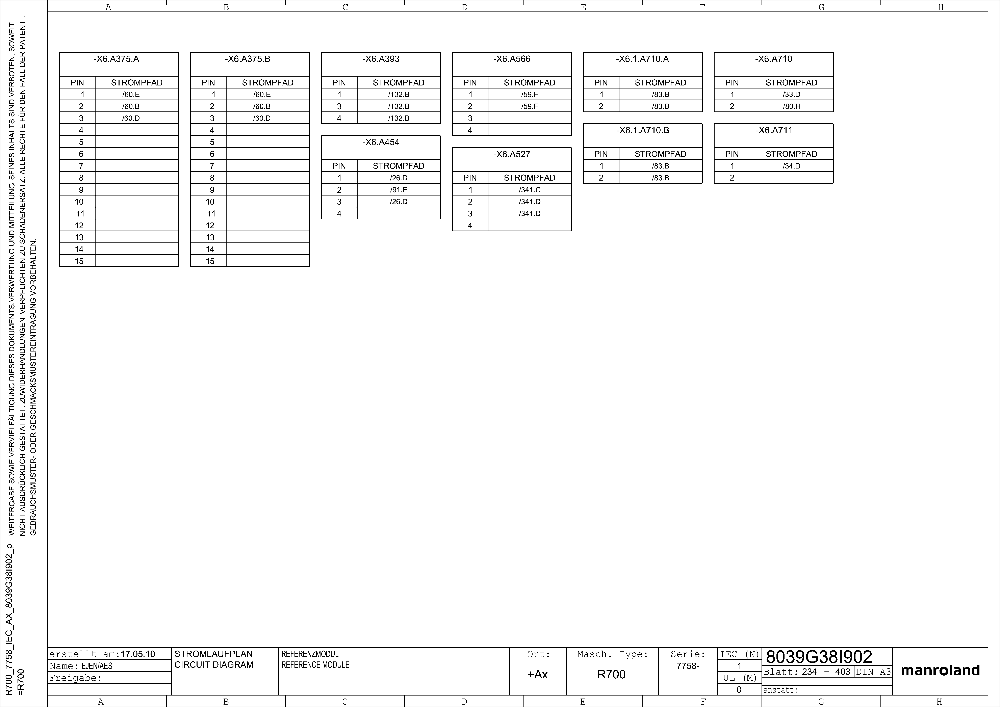

# +Ax — Sheet 234 of 403 — REFERENZMODUL

**REFERENCE MODULE**

> Part of the manroland **R700** printing press IEC/UL circuit diagrams.
> Drawing class: **Stromlaufplan / Circuit diagram** (DIN A3).
> Document `+Ax` covers the **Central control console** machine section.

## At a glance

| Field | Value |
|---|---|
| Document | `+Ax`  (8039G38I902) |
| Sheet | **234** of 403 |
| Section (DE) | REFERENZMODUL |
| Section (EN) | REFERENCE MODULE |
| Section type | REFERENCE_MODULE — Reference module |
| Machine type | `R700` |
| Series | `7758` |
| Created | 17.05.10 |
| Replaces | — |
| Columns used | A, B, C, D, E, F, G |
| Path numbers | — |
| Labels on sheet | 107 |
| Cross-refs out | 24 |
| Cross-refs in | 0 |

**Previous:** [+Ax sheet 233](SHEET_0233.md) · **Next:** [+Ax sheet 235](SHEET_0235.md) · **Document TOC:** [_TOC.md](_TOC.md)  (+Ax) · **Master TOC:** [all sheets](../_MASTER_TOC.md)

## Sheet image (300 DPI, exact vector render)



_Rendered directly from the PDF vector layer at 300 DPI (1-bit), no OCR and no resampling. Use it to confirm anything ambiguous in the text below._

## Cross-references on this sheet

Each entry is a wire leaving this sheet. The printed token is `/sheet.column`; the link resolves to that sheet inside the same document.

| Ref | Target sheet | Col | Path | Destination on target | Target section | From col |
|---|---|---|---|---|---|---|
| `/60.E` | [+Ax sheet 60](SHEET_0060.md) | E | — | — | DRUCKLUFTANLAGE | A |
| `/60.E` | [+Ax sheet 60](SHEET_0060.md) | E | — | — | DRUCKLUFTANLAGE | B |
| `/83.B` | [+Ax sheet 83](SHEET_0083.md) | B | — | — | ANLEGER | F |
| `/132.B` | [+Ax sheet 132](SHEET_0132.md) | B | — | — | REALTIMERECHNER ANLAGE | C |
| `/59.F` | [+Ax sheet 59](SHEET_0059.md) | F | — | — | DRUCKLUFTANLAGE | E |
| `/33.D` | [+Ax sheet 33](SHEET_0033.md) | D | — | — | SPANNUNGSVERSORGUNG, SCHALTSCHRANKBELÜFTUNG | G |
| `/60.B` | [+Ax sheet 60](SHEET_0060.md) | B | — | — | DRUCKLUFTANLAGE | A |
| `/60.B` | [+Ax sheet 60](SHEET_0060.md) | B | — | — | DRUCKLUFTANLAGE | B |
| `/83.B` | [+Ax sheet 83](SHEET_0083.md) | B | — | — | ANLEGER | F |
| `/132.B` | [+Ax sheet 132](SHEET_0132.md) | B | — | — | REALTIMERECHNER ANLAGE | C |
| `/59.F` | [+Ax sheet 59](SHEET_0059.md) | F | — | — | DRUCKLUFTANLAGE | E |
| `/80.H` | [+Ax sheet 80](SHEET_0080.md) | H | — | — | ANLEGER | G |
| `/132.B` | [+Ax sheet 132](SHEET_0132.md) | B | — | — | REALTIMERECHNER ANLAGE | C |
| `/60.D` | [+Ax sheet 60](SHEET_0060.md) | D | — | — | DRUCKLUFTANLAGE | A |
| `/60.D` | [+Ax sheet 60](SHEET_0060.md) | D | — | — | DRUCKLUFTANLAGE | B |
| `/34.D` | [+Ax sheet 34](SHEET_0034.md) | D | — | STROMPFAD PIN 1 2 | SPANNUNGSVERSORGUNG, SCHALTSCHRANKBELÜFTUNG | G |
| `/83.B` | [+Ax sheet 83](SHEET_0083.md) | B | — | — | ANLEGER | F |
| `/83.B` | [+Ax sheet 83](SHEET_0083.md) | B | — | — | ANLEGER | F |
| `/26.D` | [+Ax sheet 26](SHEET_0026.md) | D | — | — | SPANNUNGSVERSORGUNG, SCHALTSCHRANKBELÜFTUNG | C |
| `/91.E` | [+Ax sheet 91](SHEET_0091.md) | E | — | — | ANLEGER | C |
| `/341.C` | [+Ax sheet 341](SHEET_0341.md) | C | — | — | OPTION: INLINESHEETER RS104 S | E |
| `/26.D` | [+Ax sheet 26](SHEET_0026.md) | D | — | — | SPANNUNGSVERSORGUNG, SCHALTSCHRANKBELÜFTUNG | C |
| `/341.D` | [+Ax sheet 341](SHEET_0341.md) | D | — | — | OPTION: INLINESHEETER RS104 S | E |
| `/341.D` | [+Ax sheet 341](SHEET_0341.md) | D | — | — | OPTION: INLINESHEETER RS104 S | E |

## Devices on this sheet

| Tag | Class | Class meaning (IEC) | Col | Sub | Terminal | Sign |
|---|---|---|---|---|---|---|
| `X6.A375.B` | — | cross-device reference | B | — | — | — |
| `X6.A375.A` | — | cross-device reference | A | — | — | — |
| `X6.A454` | — | cross-device reference | C | — | — | — |
| `X6.A393` | — | cross-device reference | C | — | — | — |
| `X6.A566` | — | cross-device reference | D | — | — | — |
| `X6.A527` | — | cross-device reference | D | — | — | — |
| `X6.A710` | — | cross-device reference | G | — | — | — |
| `X6.A711` | — | cross-device reference | G | — | — | — |
| `X6.1.A710.A` | — | cross-device reference | E | — | — | — |
| `X6.1.A710.B` | — | cross-device reference | F | — | — | — |

## Potentials / nets

_No named potentials on this sheet._

## Wire-end annotations (grouped as printed)

A wire that continues elsewhere is annotated with a small cluster: the destination description, the path/line number `#NN`, and the `/sheet.column` cross reference. Each row below is one such cluster exactly as it is grouped on the drawing.

| Col | Y | Path | Cross-ref | Text on the wire |
|---|---|---|---|---|
| A | 65.5 | — | — | `X6.A375.A` |
| B | 65.5 | — | — | `X6.A375.B` |
| C | 65.5 | — | — | `X6.A393` |
| D | 65.5 | — | — | `X6.A566` |
| E | 65.5 | — | — | `X6.1.A710.A` |
| G | 65.5 | — | — | `X6.A710` |
| A | 94.2 | — | — | `PIN 10 12 13 14 15 11 2 3 4 5 6 7 8 9 1 STROMPFAD` |
| B | 94.2 | — | — | `PIN 10 12 13 14 15 11 2 3 4 5 6 7 8 9 1 STROMPFAD` |
| C | 94.2 | — | — | `PIN 3 4 1 STROMPFAD` |
| D | 94.2 | — | — | `PIN 2 3 4 1 STROMPFAD` |
| E | 94.2 | — | — | `PIN 2 1 STROMPFAD` |
| G | 94.2 | — | — | `PIN 2 1 STROMPFAD` |
| A | 108.7 | — | `/60.E` | — |
| B | 108.7 | — | `/60.E` | — |
| C | 108.7 | — | `/132.B` | — |
| E | 108.7 | — | `/59.F` | — |
| F | 108.7 | — | `/83.B` | — |
| G | 108.7 | — | `/33.D` | — |
| A | 122.8 | — | `/60.B` | — |
| B | 122.8 | — | `/60.B` | — |
| F | 122.8 | — | `/83.B` | — |
| C | 122.9 | — | `/132.B` | — |
| E | 122.9 | — | `/59.F` | — |
| G | 122.9 | — | `/80.H` | — |
| C | 137.0 | — | `/132.B` | — |
| A | 137.1 | — | `/60.D` | — |
| B | 137.1 | — | `/60.D` | — |
| F | 150.6 | — | — | `X6.1.A710.B` |
| G | 150.6 | — | — | `X6.A711` |
| C | 164.7 | — | — | `X6.A454` |
| D | 178.9 | — | — | `X6.A527` |
| E | 179.2 | — | — | `PIN 2 1 STROMPFAD` |
| G | 179.2 | — | `/34.D` | `PIN 2 1 STROMPFAD` |
| C | 193.4 | — | — | `PIN 2 3 4 1 STROMPFAD` |
| F | 193.7 | — | `/83.B` | — |
| D | 207.5 | — | — | `PIN 2 3 4 1 STROMPFAD` |
| C | 207.9 | — | `/26.D` | — |
| F | 207.9 | — | `/83.B` | — |
| C | 222.1 | — | `/91.E` | — |
| E | 222.1 | — | `/341.C` | — |
| C | 236.3 | — | `/26.D` | — |
| E | 236.3 | — | `/341.D` | — |
| E | 250.4 | — | `/341.D` | — |


## Reconstructed tables

This sheet carries tabular content (pin map / terminal assignment / index). The grid below was rebuilt from the drawing's own rule lines, so each row is exactly one physical row of the table.

### Table 1 — 15 data rows × 2 columns (at x=70.9, y=62.4) — **X6.A375.A**

| PIN | STROMPFAD |
|---|---|
| `1` | `/60.E` |
| `2` | `/60.B` |
| `3` | `/60.D` |
| `4` |  |
| `5` |  |
| `6` |  |
| `7` |  |
| `8` |  |
| `9` |  |
| `10` |  |
| `11` |  |
| `12` |  |
| `13` |  |
| `14` |  |
| `15` |  |


### Table 2 — 15 data rows × 2 columns (at x=226.8, y=62.4) — **X6.A375.B**

| PIN | STROMPFAD |
|---|---|
| `1` | `/60.E` |
| `2` | `/60.B` |
| `3` | `/60.D` |
| `4` |  |
| `5` |  |
| `6` |  |
| `7` |  |
| `8` |  |
| `9` |  |
| `10` |  |
| `11` |  |
| `12` |  |
| `13` |  |
| `14` |  |
| `15` |  |


### Table 3 — 9 data rows × 2 columns (at x=382.7, y=62.4) — **X6.A393**

| PIN | STROMPFAD |
|---|---|
| `1` | `/132.B` |
| `3` | `/132.B` |
| `4` | `/132.B` |
|  | `X6.A454` |
| `PIN` | `STROMPFAD` |
| `1` | `/26.D` |
| `2` | `/91.E` |
| `3` | `/26.D` |
| `4` |  |


### Table 4 — 10 data rows × 2 columns (at x=538.6, y=62.4) — **X6.A566**

| PIN | STROMPFAD |
|---|---|
| `1` | `/59.F` |
| `2` | `/59.F` |
| `3` |  |
| `4` |  |
|  | `X6.A527` |
| `PIN` | `STROMPFAD` |
| `1` | `/341.C` |
| `2` | `/341.D` |
| `3` | `/341.D` |
| `4` |  |


### Table 5 — 6 data rows × 2 columns (at x=694.5, y=62.4) — **X6.1.A710.A**

| PIN | STROMPFAD |
|---|---|
| `1` | `/83.B` |
| `2` | `/83.B` |
|  | `X6.1.A710.B` |
| `PIN` | `STROMPFAD` |
| `1` | `/83.B` |
| `2` | `/83.B` |


### Table 6 — 6 data rows × 2 columns (at x=850.4, y=62.4) — **X6.A710**

| PIN | STROMPFAD |
|---|---|
| `1` | `/33.D` |
| `2` | `/80.H` |
|  | `X6.A711` |
| `PIN` | `STROMPFAD` |
| `1` | `/34.D` |
| `2` |  |


## Notes and free text on this sheet

| Text | Col | Y (pt) |
|---|---|---|
| `PIN` | B | 94.2 |
| `STROMPFAD` | B | 94.15 |
| `PIN` | A | 94.2 |
| `STROMPFAD` | A | 94.15 |
| `PIN` | C | 193.41 |
| `STROMPFAD` | C | 193.37 |
| `PIN` | D | 94.2 |
| `STROMPFAD` | E | 94.15 |
| `PIN` | F | 94.2 |
| `STROMPFAD` | G | 94.15 |
| `PIN` | E | 94.2 |
| `STROMPFAD` | F | 94.15 |

## Complete label inventory (exact text from the drawing)

Every text object inside the drawing area of this sheet, in DIN reading order (column A→H, then top→bottom). This is the authoritative list: if a string is not here it is not printed on this sheet.

| Col | Y | X | Dir | Type | Text |
|---|---|---|---|---|---|
| A | 65.5 | 111.5 | → | device ref | `X6.A375.A` |
| A | 94.2 | 84.0 | → | text | `PIN` |
| A | 94.2 | 132.2 | → | text | `STROMPFAD` |
| A | 108.4 | 95.8 | → | number | `1` |
| A | 108.7 | 145.8 | → | cross-reference | `/60.E` |
| A | 122.5 | 94.1 | → | number | `2` |
| A | 122.8 | 145.7 | → | cross-reference | `/60.B` |
| A | 136.7 | 94.1 | → | number | `3` |
| A | 137.1 | 145.6 | → | cross-reference | `/60.D` |
| A | 150.9 | 94.1 | → | number | `4` |
| A | 165.1 | 94.1 | → | number | `5` |
| A | 179.2 | 94.1 | → | number | `6` |
| A | 193.4 | 94.1 | → | number | `7` |
| A | 207.6 | 94.1 | → | number | `8` |
| A | 221.8 | 94.1 | → | number | `9` |
| A | 235.9 | 88.7 | → | number | `10` |
| A | 250.1 | 90.4 | → | number | `11` |
| A | 264.3 | 88.7 | → | number | `12` |
| A | 278.5 | 88.7 | → | number | `13` |
| A | 292.6 | 88.7 | → | number | `14` |
| A | 306.8 | 88.7 | → | number | `15` |
| B | 65.5 | 267.9 | → | device ref | `X6.A375.B` |
| B | 94.2 | 240.0 | → | text | `PIN` |
| B | 94.2 | 288.1 | → | text | `STROMPFAD` |
| B | 108.4 | 251.7 | → | number | `1` |
| B | 108.7 | 301.7 | → | cross-reference | `/60.E` |
| B | 122.5 | 250.0 | → | number | `2` |
| B | 122.8 | 301.6 | → | cross-reference | `/60.B` |
| B | 136.7 | 250.0 | → | number | `3` |
| B | 137.1 | 301.5 | → | cross-reference | `/60.D` |
| B | 150.9 | 250.0 | → | number | `4` |
| B | 165.1 | 250.0 | → | number | `5` |
| B | 179.2 | 250.0 | → | number | `6` |
| B | 193.4 | 250.0 | → | number | `7` |
| B | 207.6 | 250.0 | → | number | `8` |
| B | 221.8 | 250.0 | → | number | `9` |
| B | 235.9 | 244.6 | → | number | `10` |
| B | 250.1 | 246.3 | → | number | `11` |
| B | 264.3 | 244.6 | → | number | `12` |
| B | 278.5 | 244.6 | → | number | `13` |
| B | 292.6 | 244.6 | → | number | `14` |
| B | 306.8 | 244.6 | → | number | `15` |
| C | 65.5 | 431.6 | → | device ref | `X6.A393` |
| C | 94.2 | 395.9 | → | text | `PIN` |
| C | 94.2 | 444.0 | → | text | `STROMPFAD` |
| C | 108.4 | 401.8 | → | number | `1` |
| C | 108.7 | 462.2 | → | cross-reference | `/132.B` |
| C | 122.5 | 401.2 | → | number | `3` |
| C | 122.9 | 462.2 | → | cross-reference | `/132.B` |
| C | 136.7 | 401.2 | → | number | `4` |
| C | 137.0 | 462.2 | → | cross-reference | `/132.B` |
| C | 164.7 | 431.6 | → | device ref | `X6.A454` |
| C | 193.4 | 395.9 | → | text | `PIN` |
| C | 193.4 | 444.0 | → | text | `STROMPFAD` |
| C | 207.6 | 401.8 | → | number | `1` |
| C | 207.9 | 464.5 | → | cross-reference | `/26.D` |
| C | 221.8 | 401.2 | → | number | `2` |
| C | 222.1 | 464.7 | → | cross-reference | `/91.E` |
| C | 235.9 | 401.2 | → | number | `3` |
| C | 236.3 | 464.5 | → | cross-reference | `/26.D` |
| C | 250.1 | 401.2 | → | number | `4` |
| D | 65.5 | 587.5 | → | device ref | `X6.A566` |
| D | 94.2 | 551.8 | → | text | `PIN` |
| D | 108.4 | 557.7 | → | number | `1` |
| D | 122.5 | 557.1 | → | number | `2` |
| D | 136.7 | 557.1 | → | number | `3` |
| D | 150.9 | 557.1 | → | number | `4` |
| D | 178.9 | 587.5 | → | device ref | `X6.A527` |
| D | 207.6 | 551.8 | → | text | `PIN` |
| D | 221.8 | 557.7 | → | number | `1` |
| D | 235.9 | 557.1 | → | number | `2` |
| D | 250.1 | 557.1 | → | number | `3` |
| D | 264.3 | 557.1 | → | number | `4` |
| E | 65.5 | 733.6 | → | device ref | `X6.1.A710.A` |
| E | 94.2 | 600.0 | → | text | `STROMPFAD` |
| E | 94.2 | 707.7 | → | text | `PIN` |
| E | 108.4 | 713.6 | → | number | `1` |
| E | 108.7 | 620.8 | → | cross-reference | `/59.F` |
| E | 122.5 | 713.1 | → | number | `2` |
| E | 122.9 | 620.8 | → | cross-reference | `/59.F` |
| E | 179.2 | 707.7 | → | text | `PIN` |
| E | 193.4 | 713.6 | → | number | `1` |
| E | 207.5 | 600.0 | → | text | `STROMPFAD` |
| E | 207.6 | 713.1 | → | number | `2` |
| E | 222.1 | 618.0 | → | cross-reference | `/341.C` |
| E | 236.3 | 618.0 | → | cross-reference | `/341.D` |
| E | 250.4 | 618.0 | → | cross-reference | `/341.D` |
| F | 94.2 | 755.9 | → | text | `STROMPFAD` |
| F | 94.2 | 863.6 | → | text | `PIN` |
| F | 108.4 | 869.5 | → | number | `1` |
| F | 108.7 | 776.4 | → | cross-reference | `/83.B` |
| F | 122.5 | 869.0 | → | number | `2` |
| F | 122.8 | 776.4 | → | cross-reference | `/83.B` |
| F | 150.6 | 734.0 | → | device ref | `X6.1.A710.B` |
| F | 179.2 | 755.9 | → | text | `STROMPFAD` |
| F | 179.2 | 863.6 | → | text | `PIN` |
| F | 193.4 | 869.5 | → | number | `1` |
| F | 193.7 | 776.4 | → | cross-reference | `/83.B` |
| F | 207.6 | 869.0 | → | number | `2` |
| F | 207.9 | 776.4 | → | cross-reference | `/83.B` |
| G | 65.5 | 899.3 | → | device ref | `X6.A710` |
| G | 94.2 | 911.8 | → | text | `STROMPFAD` |
| G | 108.7 | 932.2 | → | cross-reference | `/33.D` |
| G | 122.9 | 932.5 | → | cross-reference | `/80.H` |
| G | 150.5 | 900.0 | → | device ref | `X6.A711` |
| G | 179.2 | 911.8 | → | text | `STROMPFAD` |
| G | 193.7 | 932.2 | → | cross-reference | `/34.D` |

## Reading-order text block

The same content as a plain block, grouped by DIN column — convenient to paste or to match against a visual description.

```text
=== Column A ===
  65.5  111.5  devref       X6.A375.A
  94.2   84.0  text         PIN
  94.2  132.2  text         STROMPFAD
 108.4   95.8  numeric      1
 108.7  145.8  xref         /60.E
 122.5   94.1  numeric      2
 122.8  145.7  xref         /60.B
 136.7   94.1  numeric      3
 137.1  145.6  xref         /60.D
 150.9   94.1  numeric      4
 165.1   94.1  numeric      5
 179.2   94.1  numeric      6
 193.4   94.1  numeric      7
 207.6   94.1  numeric      8
 221.8   94.1  numeric      9
 235.9   88.7  numeric      10
 250.1   90.4  numeric      11
 264.3   88.7  numeric      12
 278.5   88.7  numeric      13
 292.6   88.7  numeric      14
 306.8   88.7  numeric      15
=== Column B ===
  65.5  267.9  devref       X6.A375.B
  94.2  240.0  text         PIN
  94.2  288.1  text         STROMPFAD
 108.4  251.7  numeric      1
 108.7  301.7  xref         /60.E
 122.5  250.0  numeric      2
 122.8  301.6  xref         /60.B
 136.7  250.0  numeric      3
 137.1  301.5  xref         /60.D
 150.9  250.0  numeric      4
 165.1  250.0  numeric      5
 179.2  250.0  numeric      6
 193.4  250.0  numeric      7
 207.6  250.0  numeric      8
 221.8  250.0  numeric      9
 235.9  244.6  numeric      10
 250.1  246.3  numeric      11
 264.3  244.6  numeric      12
 278.5  244.6  numeric      13
 292.6  244.6  numeric      14
 306.8  244.6  numeric      15
=== Column C ===
  65.5  431.6  devref       X6.A393
  94.2  395.9  text         PIN
  94.2  444.0  text         STROMPFAD
 108.4  401.8  numeric      1
 108.7  462.2  xref         /132.B
 122.5  401.2  numeric      3
 122.9  462.2  xref         /132.B
 136.7  401.2  numeric      4
 137.0  462.2  xref         /132.B
 164.7  431.6  devref       X6.A454
 193.4  395.9  text         PIN
 193.4  444.0  text         STROMPFAD
 207.6  401.8  numeric      1
 207.9  464.5  xref         /26.D
 221.8  401.2  numeric      2
 222.1  464.7  xref         /91.E
 235.9  401.2  numeric      3
 236.3  464.5  xref         /26.D
 250.1  401.2  numeric      4
=== Column D ===
  65.5  587.5  devref       X6.A566
  94.2  551.8  text         PIN
 108.4  557.7  numeric      1
 122.5  557.1  numeric      2
 136.7  557.1  numeric      3
 150.9  557.1  numeric      4
 178.9  587.5  devref       X6.A527
 207.6  551.8  text         PIN
 221.8  557.7  numeric      1
 235.9  557.1  numeric      2
 250.1  557.1  numeric      3
 264.3  557.1  numeric      4
=== Column E ===
  65.5  733.6  devref       X6.1.A710.A
  94.2  600.0  text         STROMPFAD
  94.2  707.7  text         PIN
 108.4  713.6  numeric      1
 108.7  620.8  xref         /59.F
 122.5  713.1  numeric      2
 122.9  620.8  xref         /59.F
 179.2  707.7  text         PIN
 193.4  713.6  numeric      1
 207.5  600.0  text         STROMPFAD
 207.6  713.1  numeric      2
 222.1  618.0  xref         /341.C
 236.3  618.0  xref         /341.D
 250.4  618.0  xref         /341.D
=== Column F ===
  94.2  755.9  text         STROMPFAD
  94.2  863.6  text         PIN
 108.4  869.5  numeric      1
 108.7  776.4  xref         /83.B
 122.5  869.0  numeric      2
 122.8  776.4  xref         /83.B
 150.6  734.0  devref       X6.1.A710.B
 179.2  755.9  text         STROMPFAD
 179.2  863.6  text         PIN
 193.4  869.5  numeric      1
 193.7  776.4  xref         /83.B
 207.6  869.0  numeric      2
 207.9  776.4  xref         /83.B
=== Column G ===
  65.5  899.3  devref       X6.A710
  94.2  911.8  text         STROMPFAD
 108.7  932.2  xref         /33.D
 122.9  932.5  xref         /80.H
 150.5  900.0  devref       X6.A711
 179.2  911.8  text         STROMPFAD
 193.7  932.2  xref         /34.D
```

---
_Generated from the PDF vector text layer; no OCR. Source: `R700_7758_IEC_AX_8039G38I902_p`, sheet 234._
