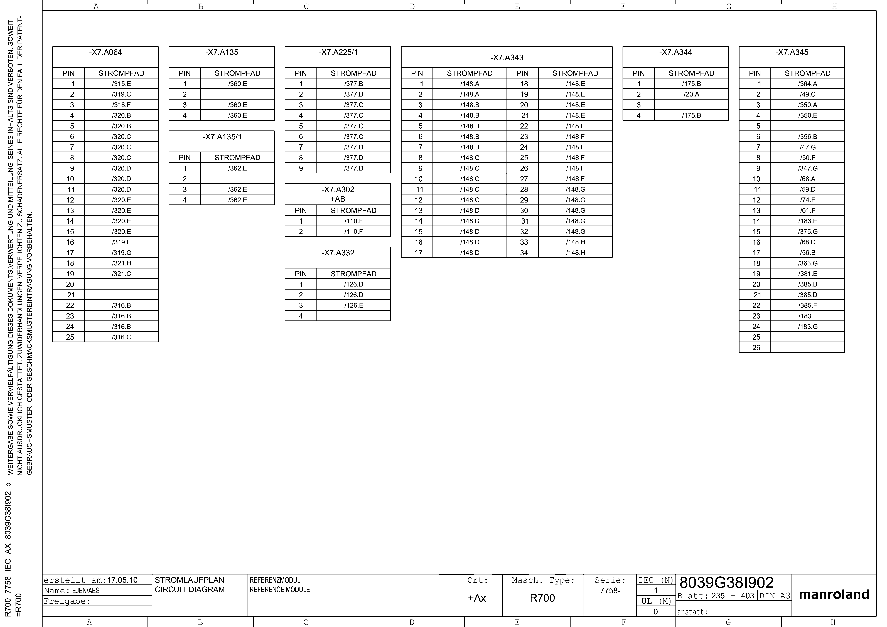

# +Ax — Sheet 235 of 403 — REFERENZMODUL

**REFERENCE MODULE**

> Part of the manroland **R700** printing press IEC/UL circuit diagrams.
> Drawing class: **Stromlaufplan / Circuit diagram** (DIN A3).
> Document `+Ax` covers the **Central control console** machine section.

## At a glance

| Field | Value |
|---|---|
| Document | `+Ax`  (8039G38I902) |
| Sheet | **235** of 403 |
| Section (DE) | REFERENZMODUL |
| Section (EN) | REFERENCE MODULE |
| Section type | REFERENCE_MODULE — Reference module |
| Machine type | `R700` |
| Series | `7758` |
| Created | 17.05.10 |
| Replaces | — |
| Columns used | A, B, C, D, E, F, G, H |
| Path numbers | — |
| Labels on sheet | 245 |
| Cross-refs out | 103 |
| Cross-refs in | 0 |

**Previous:** [+Ax sheet 234](SHEET_0234.md) · **Next:** [+Ax sheet 236](SHEET_0236.md) · **Document TOC:** [_TOC.md](_TOC.md)  (+Ax) · **Master TOC:** [all sheets](../_MASTER_TOC.md)

## Sheet image (300 DPI, exact vector render)



_Rendered directly from the PDF vector layer at 300 DPI (1-bit), no OCR and no resampling. Use it to confirm anything ambiguous in the text below._

## Cross-references on this sheet

Each entry is a wire leaving this sheet. The printed token is `/sheet.column`; the link resolves to that sheet inside the same document.

| Ref | Target sheet | Col | Path | Destination on target | Target section | From col |
|---|---|---|---|---|---|---|
| `/315.E` | [+Ax sheet 315](SHEET_0315.md) | E | — | — | OPTION: "EJEKTOR" ANLAGE / SELECT AIRSTATION / | A |
| `/360.E` | [+Ax sheet 360](SHEET_0360.md) | E | — | — | OPTION: LOGISTIK ANLEGER | B |
| `/377.B` | [+Ax sheet 377](SHEET_0377.md) | B | — | — | OPTION: TELEPRESENCE | C |
| `/148.A` | [+Ax sheet 148](SHEET_0148.md) | A | — | — | ÜBERWACHUNGSRECHNER SICHERHEITSBUS | E |
| `/148.E` | [+Ax sheet 148](SHEET_0148.md) | E | — | — | ÜBERWACHUNGSRECHNER SICHERHEITSBUS | F |
| `/175.B` | [+Ax sheet 175](SHEET_0175.md) | B | — | — | RESERVE | G |
| `/364.A` | [+Ax sheet 364](SHEET_0364.md) | A | — | — | OPTION: LOGISTIK AUSLEGER | H |
| `/20.A` | [+Ax sheet 20](SHEET_0020.md) | A | — | — | SPANNUNGSVERSORGUNG, SCHALTSCHRANKBELÜFTUNG | G |
| `/377.B` | [+Ax sheet 377](SHEET_0377.md) | B | — | — | OPTION: TELEPRESENCE | C |
| `/148.A` | [+Ax sheet 148](SHEET_0148.md) | A | — | — | ÜBERWACHUNGSRECHNER SICHERHEITSBUS | E |
| `/148.E` | [+Ax sheet 148](SHEET_0148.md) | E | — | — | ÜBERWACHUNGSRECHNER SICHERHEITSBUS | F |
| `/49.C` | [+Ax sheet 49](SHEET_0049.md) | C | — | — | NOT AUS | H |
| `/319.C` | [+Ax sheet 319](SHEET_0319.md) | C | — | — | OPTION: "EJEKTOR" ANLAGE / SELECT AIRSTATION / | A |
| `/318.F` | [+Ax sheet 318](SHEET_0318.md) | F | — | — | OPTION: "EJEKTOR" ANLAGE / SELECT AIRSTATION / | A |
| `/360.E` | [+Ax sheet 360](SHEET_0360.md) | E | — | — | OPTION: LOGISTIK ANLEGER | B |
| `/148.B` | [+Ax sheet 148](SHEET_0148.md) | B | — | — | ÜBERWACHUNGSRECHNER SICHERHEITSBUS | E |
| `/148.E` | [+Ax sheet 148](SHEET_0148.md) | E | — | — | ÜBERWACHUNGSRECHNER SICHERHEITSBUS | F |
| `/350.A` | [+Ax sheet 350](SHEET_0350.md) | A | — | — | OPTION: LOGISTIK ANLEGER | H |
| `/377.C` | [+Ax sheet 377](SHEET_0377.md) | C | — | — | OPTION: TELEPRESENCE | C |
| `/320.B` | [+Ax sheet 320](SHEET_0320.md) | B | — | — | OPTION: "EJEKTOR" ANLAGE / SELECT AIRSTATION / | A |
| `/360.E` | [+Ax sheet 360](SHEET_0360.md) | E | — | — | OPTION: LOGISTIK ANLEGER | B |
| `/148.B` | [+Ax sheet 148](SHEET_0148.md) | B | — | — | ÜBERWACHUNGSRECHNER SICHERHEITSBUS | E |
| `/148.E` | [+Ax sheet 148](SHEET_0148.md) | E | — | — | ÜBERWACHUNGSRECHNER SICHERHEITSBUS | F |
| `/175.B` | [+Ax sheet 175](SHEET_0175.md) | B | — | — | RESERVE | G |
| `/350.E` | [+Ax sheet 350](SHEET_0350.md) | E | — | — | OPTION: LOGISTIK ANLEGER | H |
| `/377.C` | [+Ax sheet 377](SHEET_0377.md) | C | — | — | OPTION: TELEPRESENCE | C |
| `/320.B` | [+Ax sheet 320](SHEET_0320.md) | B | — | — | OPTION: "EJEKTOR" ANLAGE / SELECT AIRSTATION / | A |
| `/148.B` | [+Ax sheet 148](SHEET_0148.md) | B | — | — | ÜBERWACHUNGSRECHNER SICHERHEITSBUS | E |
| `/148.E` | [+Ax sheet 148](SHEET_0148.md) | E | — | — | ÜBERWACHUNGSRECHNER SICHERHEITSBUS | F |
| `/377.C` | [+Ax sheet 377](SHEET_0377.md) | C | — | — | OPTION: TELEPRESENCE | C |
| `/148.B` | [+Ax sheet 148](SHEET_0148.md) | B | — | — | ÜBERWACHUNGSRECHNER SICHERHEITSBUS | E |
| `/356.B` | [+Ax sheet 356](SHEET_0356.md) | B | — | — | OPTION: LOGISTIK ANLEGER | H |
| `/148.F` | [+Ax sheet 148](SHEET_0148.md) | F | — | — | ÜBERWACHUNGSRECHNER SICHERHEITSBUS | F |
| `/320.C` | [+Ax sheet 320](SHEET_0320.md) | C | — | — | OPTION: "EJEKTOR" ANLAGE / SELECT AIRSTATION / | A |
| `/377.C` | [+Ax sheet 377](SHEET_0377.md) | C | — | — | OPTION: TELEPRESENCE | C |
| `/148.B` | [+Ax sheet 148](SHEET_0148.md) | B | — | — | ÜBERWACHUNGSRECHNER SICHERHEITSBUS | E |
| `/47.G` | [+Ax sheet 47](SHEET_0047.md) | G | — | — | NOT AUS | H |
| `/148.F` | [+Ax sheet 148](SHEET_0148.md) | F | — | — | ÜBERWACHUNGSRECHNER SICHERHEITSBUS | F |
| `/320.C` | [+Ax sheet 320](SHEET_0320.md) | C | — | — | OPTION: "EJEKTOR" ANLAGE / SELECT AIRSTATION / | A |
| `/377.D` | [+Ax sheet 377](SHEET_0377.md) | D | — | — | OPTION: TELEPRESENCE | C |
| `/50.F` | [+Ax sheet 50](SHEET_0050.md) | F | — | — | STOP SICHERN | H |
| `/148.F` | [+Ax sheet 148](SHEET_0148.md) | F | — | — | ÜBERWACHUNGSRECHNER SICHERHEITSBUS | F |
| `/320.C` | [+Ax sheet 320](SHEET_0320.md) | C | — | — | OPTION: "EJEKTOR" ANLAGE / SELECT AIRSTATION / | A |
| `/377.D` | [+Ax sheet 377](SHEET_0377.md) | D | — | — | OPTION: TELEPRESENCE | C |
| `/148.C` | [+Ax sheet 148](SHEET_0148.md) | C | — | — | ÜBERWACHUNGSRECHNER SICHERHEITSBUS | E |
| `/362.E` | [+Ax sheet 362](SHEET_0362.md) | E | — | — | OPTION: LOGISTIK ANLEGER | B |
| `/148.F` | [+Ax sheet 148](SHEET_0148.md) | F | — | — | ÜBERWACHUNGSRECHNER SICHERHEITSBUS | F |
| `/347.G` | [+Ax sheet 347](SHEET_0347.md) | G | — | — | OPTION: LOGISTIK ANLEGER | H |
| `/320.D` | [+Ax sheet 320](SHEET_0320.md) | D | — | — | OPTION: "EJEKTOR" ANLAGE / SELECT AIRSTATION / | A |
| `/377.D` | [+Ax sheet 377](SHEET_0377.md) | D | — | — | OPTION: TELEPRESENCE | C |
| `/148.C` | [+Ax sheet 148](SHEET_0148.md) | C | — | — | ÜBERWACHUNGSRECHNER SICHERHEITSBUS | E |
| `/68.A` | [+Ax sheet 68](SHEET_0068.md) | A | — | — | SAUGBÄNDERTISCH | H |
| `/148.F` | [+Ax sheet 148](SHEET_0148.md) | F | — | — | ÜBERWACHUNGSRECHNER SICHERHEITSBUS | F |
| `/320.D` | [+Ax sheet 320](SHEET_0320.md) | D | — | — | OPTION: "EJEKTOR" ANLAGE / SELECT AIRSTATION / | A |
| `/148.C` | [+Ax sheet 148](SHEET_0148.md) | C | — | — | ÜBERWACHUNGSRECHNER SICHERHEITSBUS | E |
| `/362.E` | [+Ax sheet 362](SHEET_0362.md) | E | — | — | OPTION: LOGISTIK ANLEGER | B |
| `/148.G` | [+Ax sheet 148](SHEET_0148.md) | G | — | — | ÜBERWACHUNGSRECHNER SICHERHEITSBUS | F |
| `/59.D` | [+Ax sheet 59](SHEET_0059.md) | D | — | — | DRUCKLUFTANLAGE | H |
| `/320.D` | [+Ax sheet 320](SHEET_0320.md) | D | — | — | OPTION: "EJEKTOR" ANLAGE / SELECT AIRSTATION / | A |
| `/148.C` | [+Ax sheet 148](SHEET_0148.md) | C | — | — | ÜBERWACHUNGSRECHNER SICHERHEITSBUS | E |
| `/74.E` | [+Ax sheet 74](SHEET_0074.md) | E | — | — | FEUCHTMITTELKÜHLGERÄT | H |
| `/320.E` | [+Ax sheet 320](SHEET_0320.md) | E | — | — | OPTION: "EJEKTOR" ANLAGE / SELECT AIRSTATION / | A |
| `/362.E` | [+Ax sheet 362](SHEET_0362.md) | E | — | — | OPTION: LOGISTIK ANLEGER | B |
| `/148.G` | [+Ax sheet 148](SHEET_0148.md) | G | — | — | ÜBERWACHUNGSRECHNER SICHERHEITSBUS | F |
| `/148.C` | [+Ax sheet 148](SHEET_0148.md) | C | — | — | ÜBERWACHUNGSRECHNER SICHERHEITSBUS | E |
| `/61.F` | [+Ax sheet 61](SHEET_0061.md) | F | — | — | DRUCKLUFTANLAGE | H |
| `/320.E` | [+Ax sheet 320](SHEET_0320.md) | E | — | — | OPTION: "EJEKTOR" ANLAGE / SELECT AIRSTATION / | A |
| `/148.G` | [+Ax sheet 148](SHEET_0148.md) | G | — | — | ÜBERWACHUNGSRECHNER SICHERHEITSBUS | F |
| `/148.D` | [+Ax sheet 148](SHEET_0148.md) | D | — | — | ÜBERWACHUNGSRECHNER SICHERHEITSBUS | E |
| `/320.E` | [+Ax sheet 320](SHEET_0320.md) | E | — | — | OPTION: "EJEKTOR" ANLAGE / SELECT AIRSTATION / | A |
| `/183.E` | [+Ax sheet 183](SHEET_0183.md) | E | — | — | RESERVE | H |
| `/110.F` | [+Ax sheet 110](SHEET_0110.md) | F | — | — | SAUGKOPF LÄNGSEINSTELLUNG / | C |
| `/148.G` | [+Ax sheet 148](SHEET_0148.md) | G | — | — | ÜBERWACHUNGSRECHNER SICHERHEITSBUS | F |
| `/148.D` | [+Ax sheet 148](SHEET_0148.md) | D | — | — | ÜBERWACHUNGSRECHNER SICHERHEITSBUS | E |
| `/320.E` | [+Ax sheet 320](SHEET_0320.md) | E | — | — | OPTION: "EJEKTOR" ANLAGE / SELECT AIRSTATION / | A |
| `/110.F` | [+Ax sheet 110](SHEET_0110.md) | F | — | — | SAUGKOPF LÄNGSEINSTELLUNG / | C |
| `/148.G` | [+Ax sheet 148](SHEET_0148.md) | G | — | — | ÜBERWACHUNGSRECHNER SICHERHEITSBUS | F |
| `/375.G` | [+Ax sheet 375](SHEET_0375.md) | G | — | — | OPTION: VORDERMARKENEINSTELLUNG | H |
| `/148.D` | [+Ax sheet 148](SHEET_0148.md) | D | — | — | ÜBERWACHUNGSRECHNER SICHERHEITSBUS | E |
| `/319.F` | [+Ax sheet 319](SHEET_0319.md) | F | — | — | OPTION: "EJEKTOR" ANLAGE / SELECT AIRSTATION / | A |
| `/148.D` | [+Ax sheet 148](SHEET_0148.md) | D | — | — | ÜBERWACHUNGSRECHNER SICHERHEITSBUS | E |
| `/148.H` | [+Ax sheet 148](SHEET_0148.md) | H | — | — | ÜBERWACHUNGSRECHNER SICHERHEITSBUS | F |
| `/68.D` | [+Ax sheet 68](SHEET_0068.md) | D | — | — | SAUGBÄNDERTISCH | H |
| `/56.B` | [+Ax sheet 56](SHEET_0056.md) | B | — | — | LUFTVERSORGUNG | H |
| `/319.G` | [+Ax sheet 319](SHEET_0319.md) | G | — | — | OPTION: "EJEKTOR" ANLAGE / SELECT AIRSTATION / | A |
| `/148.D` | [+Ax sheet 148](SHEET_0148.md) | D | — | — | ÜBERWACHUNGSRECHNER SICHERHEITSBUS | E |
| `/148.H` | [+Ax sheet 148](SHEET_0148.md) | H | — | — | ÜBERWACHUNGSRECHNER SICHERHEITSBUS | F |
| `/363.G` | [+Ax sheet 363](SHEET_0363.md) | G | — | — | OPTION: LOGISTIK AUSLEGER | H |
| `/321.H` | [+Ax sheet 321](SHEET_0321.md) | H | — | — | OPTION: "EJEKTOR" ANLAGE / SELECT AIRSTATION / | A |
| `/381.E` | [+Ax sheet 381](SHEET_0381.md) | E | — | — | OPTION: INLINEFOILER PRINDOR | H |
| `/321.C` | [+Ax sheet 321](SHEET_0321.md) | C | — | — | OPTION: "EJEKTOR" ANLAGE / SELECT AIRSTATION / | A |
| `/385.B` | [+Ax sheet 385](SHEET_0385.md) | B | — | — | OPTION: INLINEFOILER PRINDOR | H |
| `/126.D` | [+Ax sheet 126](SHEET_0126.md) | D | — | — | REALTIMERECHNER ANLEGER | C |
| `/126.D` | [+Ax sheet 126](SHEET_0126.md) | D | — | — | REALTIMERECHNER ANLEGER | C |
| `/385.D` | [+Ax sheet 385](SHEET_0385.md) | D | — | — | OPTION: INLINEFOILER PRINDOR | H |
| `/316.B` | [+Ax sheet 316](SHEET_0316.md) | B | — | — | OPTION: "EJEKTOR" ANLAGE / SELECT AIRSTATION / | A |
| `/126.E` | [+Ax sheet 126](SHEET_0126.md) | E | — | — | REALTIMERECHNER ANLEGER | C |
| `/385.F` | [+Ax sheet 385](SHEET_0385.md) | F | — | — | OPTION: INLINEFOILER PRINDOR | H |
| `/316.B` | [+Ax sheet 316](SHEET_0316.md) | B | — | — | OPTION: "EJEKTOR" ANLAGE / SELECT AIRSTATION / | A |
| `/183.F` | [+Ax sheet 183](SHEET_0183.md) | F | — | — | RESERVE | H |
| `/316.B` | [+Ax sheet 316](SHEET_0316.md) | B | — | — | OPTION: "EJEKTOR" ANLAGE / SELECT AIRSTATION / | A |
| `/183.G` | [+Ax sheet 183](SHEET_0183.md) | G | — | — | RESERVE | H |
| `/316.C` | [+Ax sheet 316](SHEET_0316.md) | C | — | — | OPTION: "EJEKTOR" ANLAGE / SELECT AIRSTATION / | A |

## Devices on this sheet

| Tag | Class | Class meaning (IEC) | Col | Sub | Terminal | Sign |
|---|---|---|---|---|---|---|
| `X7.A064` | — | cross-device reference | A | — | — | — |
| `X7.A343` | — | cross-device reference | E | — | — | — |
| `X7.A345` | — | cross-device reference | H | — | — | — |
| `X7.A344` | — | cross-device reference | G | — | — | — |
| `X7.A302` | — | cross-device reference | C | — | — | — |
| `X7.A332` | — | cross-device reference | C | — | — | — |
| `X7.A135` | — | cross-device reference | B | — | — | — |

## Potentials / nets

_No named potentials on this sheet._

## Wire-end annotations (grouped as printed)

A wire that continues elsewhere is annotated with a small cluster: the destination description, the path/line number `#NN`, and the `/sheet.column` cross reference. Each row below is one such cluster exactly as it is grouped on the drawing.

| Col | Y | Path | Cross-ref | Text on the wire |
|---|---|---|---|---|
| A | 65.5 | — | — | `X7.A064` |
| B | 65.5 | — | — | `X7.A135` |
| C | 65.5 | — | — | `X7.A225/1` |
| G | 65.5 | — | — | `X7.A344` |
| H | 65.5 | — | — | `X7.A345` |
| E | 72.6 | — | — | `X7.A343` |
| A | 94.2 | — | — | `PIN STROMPFAD` |
| B | 94.2 | — | — | `PIN 2 3 4 1 STROMPFAD` |
| C | 94.2 | — | — | `PIN 2 3 4 5 6 7 8 9 1 STROMPFAD` |
| D | 94.2 | — | — | `PIN STROMPFAD` |
| E | 94.2 | — | — | `PIN 18 19 20 22 23 24 25 26 27 28 29 30 32 33 34 21 31 STROMPFAD` |
| F | 94.2 | — | — | `PIN 2 3 4 1 STROMPFAD` |
| H | 94.2 | — | — | `PIN STROMPFAD` |
| A | 108.4 | — | — | `2 3 4 5 6 7 8 9 1` |
| D | 108.4 | — | — | `2 3 4 5 6 7 8 9 1` |
| G | 108.4 | — | — | `2 3 4 5 6 7 8 9 1` |
| A | 108.7 | — | `/315.E` | — |
| B | 108.7 | — | `/360.E` | — |
| C | 108.7 | — | `/377.B` | — |
| E | 108.7 | — | `/148.A` | — |
| F | 108.7 | — | `/148.E` | — |
| G | 108.7 | — | `/175.B` | — |
| H | 108.7 | — | `/364.A` | — |
| G | 122.8 | — | `/20.A` | — |
| A | 122.9 | — | `/319.C` | — |
| C | 122.9 | — | `/377.B` | — |
| E | 122.9 | — | `/148.A` | — |
| F | 122.9 | — | `/148.E` | — |
| H | 122.9 | — | `/49.C` | — |
| A | 137.0 | — | `/318.F` | — |
| B | 137.0 | — | `/360.E` | — |
| E | 137.0 | — | `/148.B` | — |
| F | 137.0 | — | `/148.E` | — |
| H | 137.0 | — | `/350.A` | — |
| C | 137.1 | — | `/377.C` | — |
| A | 151.2 | — | `/320.B` | — |
| B | 151.2 | — | `/360.E` | — |
| C | 151.2 | — | `/377.C` | — |
| E | 151.2 | — | `/148.B` | — |
| F | 151.2 | — | `/148.E` | — |
| G | 151.2 | — | `/175.B` | — |
| H | 151.2 | — | `/350.E` | — |
| A | 165.4 | — | `/320.B` | — |
| C | 165.4 | — | `/377.C` | — |
| E | 165.4 | — | `/148.B` | — |
| F | 165.4 | — | `/148.E` | — |
| B | 178.9 | — | — | `X7.A135/1` |
| A | 179.6 | — | `/320.C` | — |
| C | 179.6 | — | `/377.C` | — |
| E | 179.6 | — | `/148.B` | — |
| F | 179.6 | — | `/148.F` | — |
| H | 179.6 | — | `/356.B` | — |
| E | 193.7 | — | `/148.B` | — |
| F | 193.7 | — | `/148.F` | — |
| H | 193.7 | — | `/47.G` | — |
| A | 193.8 | — | `/320.C` | — |
| C | 193.8 | — | `/377.D` | — |
| B | 207.5 | — | — | `PIN 2 3 4 1 STROMPFAD` |
| A | 207.9 | — | `/320.C` | — |
| C | 207.9 | — | `/377.D` | — |
| E | 207.9 | — | `/148.C` | — |
| F | 207.9 | — | `/148.F` | — |
| H | 207.9 | — | `/50.F` | — |
| A | 222.1 | — | `/320.D` | — |
| B | 222.1 | — | `/362.E` | — |
| C | 222.1 | — | `/377.D` | — |
| E | 222.1 | — | `/148.C` | — |
| F | 222.1 | — | `/148.F` | — |
| H | 222.1 | — | `/347.G` | — |
| A | 235.9 | — | — | `10 12 13 14 15 16 17 18 19 20 11` |
| D | 235.9 | — | — | `10 12 13 14 15 16 17 11` |
| G | 235.9 | — | — | `10 12 13 14 15 16 17 18 19 20 11` |
| H | 236.2 | — | `/68.A` | — |
| A | 236.3 | — | `/320.D` | — |
| E | 236.3 | — | `/148.C` | — |
| F | 236.3 | — | `/148.F` | — |
| C | 249.8 | — | — | `X7.A302` |
| A | 250.4 | — | `/320.D` | — |
| B | 250.4 | — | `/362.E` | — |
| E | 250.4 | — | `/148.C` | — |
| F | 250.4 | — | `/148.G` | — |
| H | 250.4 | — | `/59.D` | — |
| C | 262.4 | — | — | `+AB` |
| A | 264.6 | — | `/320.E` | — |
| B | 264.6 | — | `/362.E` | — |
| E | 264.6 | — | `/148.C` | — |
| F | 264.6 | — | `/148.G` | — |
| H | 264.6 | — | `/74.E` | — |
| C | 278.4 | — | — | `PIN 2 1 STROMPFAD` |
| A | 278.8 | — | `/320.E` | — |
| E | 278.8 | — | `/148.D` | — |
| F | 278.8 | — | `/148.G` | — |
| H | 278.8 | — | `/61.F` | — |
| A | 292.9 | — | `/320.E` | — |
| C | 292.9 | — | `/110.F` | — |
| H | 292.9 | — | `/183.E` | — |
| E | 293.0 | — | `/148.D` | — |
| F | 293.0 | — | `/148.G` | — |
| A | 307.1 | — | `/320.E` | — |
| C | 307.1 | — | `/110.F` | — |
| E | 307.1 | — | `/148.D` | — |
| F | 307.1 | — | `/148.G` | — |
| H | 307.1 | — | `/375.G` | — |
| A | 321.3 | — | `/319.F` | — |
| E | 321.3 | — | `/148.D` | — |
| F | 321.3 | — | `/148.H` | — |
| H | 321.3 | — | `/68.D` | — |
| C | 334.8 | — | — | `X7.A332` |
| H | 335.4 | — | `/56.B` | — |
| A | 335.5 | — | `/319.G` | — |
| E | 335.5 | — | `/148.D` | — |
| F | 335.5 | — | `/148.H` | — |
| H | 349.6 | — | `/363.G` | — |
| A | 349.7 | — | `/321.H` | — |
| C | 363.4 | — | — | `PIN 2 3 4 1 STROMPFAD` |
| A | 363.8 | — | `/321.C` | — |
| H | 363.8 | — | `/381.E` | — |
| C | 378.0 | — | `/126.D` | — |
| H | 378.0 | — | `/385.B` | — |
| A | 391.8 | — | — | `22 23 24 25 21` |
| G | 391.8 | — | — | `22 23 24 25 26 21` |
| C | 392.2 | — | `/126.D` | — |
| H | 392.2 | — | `/385.D` | — |
| A | 406.3 | — | `/316.B` | — |
| C | 406.3 | — | `/126.E` | — |
| H | 406.3 | — | `/385.F` | — |
| A | 420.5 | — | `/316.B` | — |
| H | 420.5 | — | `/183.F` | — |
| A | 434.7 | — | `/316.B` | — |
| H | 434.7 | — | `/183.G` | — |
| A | 448.9 | — | `/316.C` | — |


## Reconstructed tables

This sheet carries tabular content (pin map / terminal assignment / index). The grid below was rebuilt from the drawing's own rule lines, so each row is exactly one physical row of the table.

### Table 1 — 25 data rows × 2 columns (at x=70.9, y=62.4) — **X7.A064**

| PIN | STROMPFAD |
|---|---|
| `1` | `/315.E` |
| `2` | `/319.C` |
| `3` | `/318.F` |
| `4` | `/320.B` |
| `5` | `/320.B` |
| `6` | `/320.C` |
| `7` | `/320.C` |
| `8` | `/320.C` |
| `9` | `/320.D` |
| `10` | `/320.D` |
| `11` | `/320.D` |
| `12` | `/320.E` |
| `13` | `/320.E` |
| `14` | `/320.E` |
| `15` | `/320.E` |
| `16` | `/319.F` |
| `17` | `/319.G` |
| `18` | `/321.H` |
| `19` | `/321.C` |
| `20` |  |
| `21` |  |
| `22` | `/316.B` |
| `23` | `/316.B` |
| `24` | `/316.B` |
| `25` | `/316.C` |


### Table 2 — 10 data rows × 2 columns (at x=226.8, y=62.4) — **X7.A135**

| PIN | STROMPFAD |
|---|---|
| `1` | `/360.E` |
| `2` |  |
| `3` | `/360.E` |
| `4` | `/360.E` |
|  | `X7.A135/1` |
| `PIN` | `STROMPFAD` |
| `1` | `/362.E` |
| `2` |  |
| `3` | `/362.E` |
| `4` | `/362.E` |


### Table 3 — 20 data rows × 2 columns (at x=382.7, y=62.4) — **X7.A225/1**

| PIN | STROMPFAD |
|---|---|
| `1` | `/377.B` |
| `2` | `/377.B` |
| `3` | `/377.C` |
| `4` | `/377.C` |
| `5` | `/377.C` |
| `6` | `/377.C` |
| `7` | `/377.D` |
| `8` | `/377.D` |
| `9` | `/377.D` |
|  | `X7.A302` |
|  | `+AB` |
| `PIN` | `STROMPFAD` |
| `1` | `/110.F` |
| `2` | `/110.F` |
|  | `X7.A332` |
| `PIN` | `STROMPFAD` |
| `1` | `/126.D` |
| `2` | `/126.D` |
| `3` | `/126.E` |
| `4` |  |


### Table 4 — 17 data rows × 4 columns (at x=538.6, y=62.4) — **X7.A343**

| PIN | STROMPFAD | PIN | STROMPFAD |
|---|---|---|---|
| `1` | `/148.A` | `18` | `/148.E` |
| `2` | `/148.A` | `19` | `/148.E` |
| `3` | `/148.B` | `20` | `/148.E` |
| `4` | `/148.B` | `21` | `/148.E` |
| `5` | `/148.B` | `22` | `/148.E` |
| `6` | `/148.B` | `23` | `/148.F` |
| `7` | `/148.B` | `24` | `/148.F` |
| `8` | `/148.C` | `25` | `/148.F` |
| `9` | `/148.C` | `26` | `/148.F` |
| `10` | `/148.C` | `27` | `/148.F` |
| `11` | `/148.C` | `28` | `/148.G` |
| `12` | `/148.C` | `29` | `/148.G` |
| `13` | `/148.D` | `30` | `/148.G` |
| `14` | `/148.D` | `31` | `/148.G` |
| `15` | `/148.D` | `32` | `/148.G` |
| `16` | `/148.D` | `33` | `/148.H` |
| `17` | `/148.D` | `34` | `/148.H` |


### Table 5 — 4 data rows × 2 columns (at x=836.2, y=62.4) — **X7.A344**

| PIN | STROMPFAD |
|---|---|
| `1` | `/175.B` |
| `2` | `/20.A` |
| `3` |  |
| `4` | `/175.B` |


### Table 6 — 26 data rows × 2 columns (at x=992.1, y=62.4) — **X7.A345**

| PIN | STROMPFAD |
|---|---|
| `1` | `/364.A` |
| `2` | `/49.C` |
| `3` | `/350.A` |
| `4` | `/350.E` |
| `5` |  |
| `6` | `/356.B` |
| `7` | `/47.G` |
| `8` | `/50.F` |
| `9` | `/347.G` |
| `10` | `/68.A` |
| `11` | `/59.D` |
| `12` | `/74.E` |
| `13` | `/61.F` |
| `14` | `/183.E` |
| `15` | `/375.G` |
| `16` | `/68.D` |
| `17` | `/56.B` |
| `18` | `/363.G` |
| `19` | `/381.E` |
| `20` | `/385.B` |
| `21` | `/385.D` |
| `22` | `/385.F` |
| `23` | `/183.F` |
| `24` | `/183.G` |
| `25` |  |
| `26` |  |


## Notes and free text on this sheet

| Text | Col | Y (pt) |
|---|---|---|
| `PIN` | A | 94.2 |
| `STROMPFAD` | A | 94.15 |
| `PIN` | C | 94.2 |
| `STROMPFAD` | C | 94.15 |
| `X7.A225/1` | C | 65.51 |
| `PIN` | D | 94.2 |
| `STROMPFAD` | E | 94.15 |
| `PIN` | E | 94.2 |
| `STROMPFAD` | F | 94.15 |
| `PIN` | G | 94.2 |
| `STROMPFAD` | H | 94.15 |
| `PIN` | F | 94.2 |
| `STROMPFAD` | G | 94.15 |
| `+AB` | C | 262.44 |
| `PIN` | B | 94.2 |
| `STROMPFAD` | B | 94.15 |
| `X7.A135/1` | B | 178.9 |

## Complete label inventory (exact text from the drawing)

Every text object inside the drawing area of this sheet, in DIN reading order (column A→H, then top→bottom). This is the authoritative list: if a string is not here it is not printed on this sheet.

| Col | Y | X | Dir | Type | Text |
|---|---|---|---|---|---|
| A | 65.5 | 119.8 | → | device ref | `X7.A064` |
| A | 94.2 | 84.0 | → | text | `PIN` |
| A | 94.2 | 132.2 | → | text | `STROMPFAD` |
| A | 108.4 | 95.8 | → | number | `1` |
| A | 108.7 | 150.5 | → | cross-reference | `/315.E` |
| A | 122.5 | 94.1 | → | number | `2` |
| A | 122.9 | 150.2 | → | cross-reference | `/319.C` |
| A | 136.7 | 94.1 | → | number | `3` |
| A | 137.0 | 150.7 | → | cross-reference | `/318.F` |
| A | 150.9 | 94.1 | → | number | `4` |
| A | 151.2 | 150.4 | → | cross-reference | `/320.B` |
| A | 165.1 | 94.1 | → | number | `5` |
| A | 165.4 | 150.4 | → | cross-reference | `/320.B` |
| A | 179.2 | 94.1 | → | number | `6` |
| A | 179.6 | 150.2 | → | cross-reference | `/320.C` |
| A | 193.4 | 94.1 | → | number | `7` |
| A | 193.8 | 150.2 | → | cross-reference | `/320.C` |
| A | 207.6 | 94.1 | → | number | `8` |
| A | 207.9 | 150.2 | → | cross-reference | `/320.C` |
| A | 221.8 | 94.1 | → | number | `9` |
| A | 222.1 | 150.2 | → | cross-reference | `/320.D` |
| A | 235.9 | 88.7 | → | number | `10` |
| A | 236.3 | 150.2 | → | cross-reference | `/320.D` |
| A | 250.1 | 90.4 | → | number | `11` |
| A | 250.4 | 150.2 | → | cross-reference | `/320.D` |
| A | 264.3 | 88.7 | → | number | `12` |
| A | 264.6 | 150.5 | → | cross-reference | `/320.E` |
| A | 278.5 | 88.7 | → | number | `13` |
| A | 278.8 | 150.5 | → | cross-reference | `/320.E` |
| A | 292.6 | 88.7 | → | number | `14` |
| A | 292.9 | 150.5 | → | cross-reference | `/320.E` |
| A | 306.8 | 88.7 | → | number | `15` |
| A | 307.1 | 150.5 | → | cross-reference | `/320.E` |
| A | 321.0 | 88.7 | → | number | `16` |
| A | 321.3 | 150.7 | → | cross-reference | `/319.F` |
| A | 335.1 | 88.7 | → | number | `17` |
| A | 335.5 | 150.1 | → | cross-reference | `/319.G` |
| A | 349.3 | 88.7 | → | number | `18` |
| A | 349.7 | 150.5 | → | cross-reference | `/321.H` |
| A | 363.5 | 88.7 | → | number | `19` |
| A | 363.8 | 150.2 | → | cross-reference | `/321.C` |
| A | 377.7 | 88.7 | → | number | `20` |
| A | 391.8 | 90.4 | → | number | `21` |
| A | 406.0 | 88.7 | → | number | `22` |
| A | 406.3 | 150.4 | → | cross-reference | `/316.B` |
| A | 420.2 | 88.7 | → | number | `23` |
| A | 420.5 | 150.4 | → | cross-reference | `/316.B` |
| A | 434.4 | 88.7 | → | number | `24` |
| A | 434.7 | 150.4 | → | cross-reference | `/316.B` |
| A | 448.5 | 88.7 | → | number | `25` |
| A | 448.9 | 150.2 | → | cross-reference | `/316.C` |
| B | 65.5 | 275.7 | → | device ref | `X7.A135` |
| B | 94.2 | 240.0 | → | text | `PIN` |
| B | 94.2 | 288.1 | → | text | `STROMPFAD` |
| B | 108.4 | 245.9 | → | number | `1` |
| B | 108.7 | 306.4 | → | cross-reference | `/360.E` |
| B | 122.5 | 245.3 | → | number | `2` |
| B | 136.7 | 245.3 | → | number | `3` |
| B | 137.0 | 306.4 | → | cross-reference | `/360.E` |
| B | 150.9 | 245.3 | → | number | `4` |
| B | 151.2 | 306.4 | → | cross-reference | `/360.E` |
| B | 178.9 | 272.0 | → | text | `X7.A135/1` |
| B | 207.5 | 288.1 | → | text | `STROMPFAD` |
| B | 207.6 | 240.0 | → | text | `PIN` |
| B | 221.8 | 245.9 | → | number | `1` |
| B | 222.1 | 306.4 | → | cross-reference | `/362.E` |
| B | 235.9 | 245.3 | → | number | `2` |
| B | 250.1 | 245.3 | → | number | `3` |
| B | 250.4 | 306.4 | → | cross-reference | `/362.E` |
| B | 264.3 | 245.3 | → | number | `4` |
| B | 264.6 | 306.4 | → | cross-reference | `/362.E` |
| C | 65.5 | 427.9 | → | text | `X7.A225/1` |
| C | 94.2 | 395.9 | → | text | `PIN` |
| C | 94.2 | 444.0 | → | text | `STROMPFAD` |
| C | 108.4 | 401.8 | → | number | `1` |
| C | 108.7 | 462.2 | → | cross-reference | `/377.B` |
| C | 122.5 | 401.2 | → | number | `2` |
| C | 122.9 | 462.2 | → | cross-reference | `/377.B` |
| C | 136.7 | 401.2 | → | number | `3` |
| C | 137.1 | 462.0 | → | cross-reference | `/377.C` |
| C | 150.9 | 401.2 | → | number | `4` |
| C | 151.2 | 462.0 | → | cross-reference | `/377.C` |
| C | 165.1 | 401.2 | → | number | `5` |
| C | 165.4 | 462.0 | → | cross-reference | `/377.C` |
| C | 179.2 | 401.2 | → | number | `6` |
| C | 179.6 | 462.0 | → | cross-reference | `/377.C` |
| C | 193.4 | 401.2 | → | number | `7` |
| C | 193.8 | 462.0 | → | cross-reference | `/377.D` |
| C | 207.6 | 401.2 | → | number | `8` |
| C | 207.9 | 462.0 | → | cross-reference | `/377.D` |
| C | 221.8 | 401.2 | → | number | `9` |
| C | 222.1 | 462.0 | → | cross-reference | `/377.D` |
| C | 249.8 | 431.6 | → | device ref | `X7.A302` |
| C | 262.4 | 443.3 | → | text | `+AB` |
| C | 278.4 | 395.9 | → | text | `PIN` |
| C | 278.4 | 444.0 | → | text | `STROMPFAD` |
| C | 292.6 | 401.8 | → | number | `1` |
| C | 293.0 | 462.5 | → | cross-reference | `/110.F` |
| C | 306.8 | 401.2 | → | number | `2` |
| C | 307.1 | 462.5 | → | cross-reference | `/110.F` |
| C | 334.8 | 431.6 | → | device ref | `X7.A332` |
| C | 363.4 | 444.0 | → | text | `STROMPFAD` |
| C | 363.5 | 395.9 | → | text | `PIN` |
| C | 377.7 | 401.8 | → | number | `1` |
| C | 378.0 | 462.0 | → | cross-reference | `/126.D` |
| C | 391.8 | 401.2 | → | number | `2` |
| C | 392.2 | 462.0 | → | cross-reference | `/126.D` |
| C | 406.0 | 401.2 | → | number | `3` |
| C | 406.3 | 462.3 | → | cross-reference | `/126.E` |
| C | 420.2 | 401.2 | → | number | `4` |
| D | 94.2 | 551.8 | → | text | `PIN` |
| D | 108.4 | 563.5 | → | number | `1` |
| D | 122.5 | 561.8 | → | number | `2` |
| D | 136.7 | 561.8 | → | number | `3` |
| D | 150.9 | 561.8 | → | number | `4` |
| D | 165.1 | 561.8 | → | number | `5` |
| D | 179.2 | 561.8 | → | number | `6` |
| D | 193.4 | 561.8 | → | number | `7` |
| D | 207.6 | 561.8 | → | number | `8` |
| D | 221.8 | 561.8 | → | number | `9` |
| D | 235.9 | 556.4 | → | number | `10` |
| D | 250.1 | 558.1 | → | number | `11` |
| D | 264.3 | 556.4 | → | number | `12` |
| D | 278.5 | 556.4 | → | number | `13` |
| D | 292.6 | 556.4 | → | number | `14` |
| D | 306.8 | 556.4 | → | number | `15` |
| D | 321.0 | 556.4 | → | number | `16` |
| D | 335.1 | 556.4 | → | number | `17` |
| E | 72.6 | 658.3 | → | device ref | `X7.A343` |
| E | 94.2 | 600.0 | → | text | `STROMPFAD` |
| E | 94.2 | 693.5 | → | text | `PIN` |
| E | 108.4 | 698.2 | → | number | `18` |
| E | 108.7 | 618.0 | → | cross-reference | `/148.A` |
| E | 122.5 | 698.2 | → | number | `19` |
| E | 122.9 | 618.0 | → | cross-reference | `/148.A` |
| E | 136.7 | 698.2 | → | number | `20` |
| E | 137.0 | 618.1 | → | cross-reference | `/148.B` |
| E | 150.9 | 699.9 | → | number | `21` |
| E | 151.2 | 618.1 | → | cross-reference | `/148.B` |
| E | 165.1 | 698.2 | → | number | `22` |
| E | 165.4 | 618.1 | → | cross-reference | `/148.B` |
| E | 179.2 | 698.2 | → | number | `23` |
| E | 179.6 | 618.1 | → | cross-reference | `/148.B` |
| E | 193.4 | 698.2 | → | number | `24` |
| E | 193.7 | 618.1 | → | cross-reference | `/148.B` |
| E | 207.6 | 698.2 | → | number | `25` |
| E | 207.9 | 618.0 | → | cross-reference | `/148.C` |
| E | 221.8 | 698.2 | → | number | `26` |
| E | 222.1 | 618.0 | → | cross-reference | `/148.C` |
| E | 235.9 | 698.2 | → | number | `27` |
| E | 236.3 | 618.0 | → | cross-reference | `/148.C` |
| E | 250.1 | 698.2 | → | number | `28` |
| E | 250.4 | 618.0 | → | cross-reference | `/148.C` |
| E | 264.3 | 698.2 | → | number | `29` |
| E | 264.6 | 618.0 | → | cross-reference | `/148.C` |
| E | 278.5 | 698.2 | → | number | `30` |
| E | 278.8 | 618.0 | → | cross-reference | `/148.D` |
| E | 292.6 | 699.9 | → | number | `31` |
| E | 293.0 | 618.0 | → | cross-reference | `/148.D` |
| E | 306.8 | 698.2 | → | number | `32` |
| E | 307.1 | 618.0 | → | cross-reference | `/148.D` |
| E | 321.0 | 698.2 | → | number | `33` |
| E | 321.3 | 618.0 | → | cross-reference | `/148.D` |
| E | 335.1 | 698.2 | → | number | `34` |
| E | 335.5 | 618.0 | → | cross-reference | `/148.D` |
| F | 94.2 | 741.7 | → | text | `STROMPFAD` |
| F | 94.2 | 849.4 | → | text | `PIN` |
| F | 108.4 | 855.4 | → | number | `1` |
| F | 108.7 | 760.0 | → | cross-reference | `/148.E` |
| F | 122.5 | 854.8 | → | number | `2` |
| F | 122.9 | 760.0 | → | cross-reference | `/148.E` |
| F | 136.7 | 854.8 | → | number | `3` |
| F | 137.0 | 760.0 | → | cross-reference | `/148.E` |
| F | 150.9 | 854.8 | → | number | `4` |
| F | 151.2 | 760.0 | → | cross-reference | `/148.E` |
| F | 165.4 | 760.0 | → | cross-reference | `/148.E` |
| F | 179.6 | 760.1 | → | cross-reference | `/148.F` |
| F | 193.7 | 760.1 | → | cross-reference | `/148.F` |
| F | 207.9 | 760.1 | → | cross-reference | `/148.F` |
| F | 222.1 | 760.1 | → | cross-reference | `/148.F` |
| F | 236.3 | 760.1 | → | cross-reference | `/148.F` |
| F | 250.4 | 759.5 | → | cross-reference | `/148.G` |
| F | 264.6 | 759.5 | → | cross-reference | `/148.G` |
| F | 278.8 | 759.5 | → | cross-reference | `/148.G` |
| F | 293.0 | 759.5 | → | cross-reference | `/148.G` |
| F | 307.1 | 759.5 | → | cross-reference | `/148.G` |
| F | 321.3 | 760.0 | → | cross-reference | `/148.H` |
| F | 335.5 | 760.0 | → | cross-reference | `/148.H` |
| G | 65.5 | 885.1 | → | device ref | `X7.A344` |
| G | 94.2 | 897.6 | → | text | `STROMPFAD` |
| G | 94.2 | 1005.3 | → | text | `PIN` |
| G | 108.4 | 1017.1 | → | number | `1` |
| G | 108.7 | 915.7 | → | cross-reference | `/175.B` |
| G | 122.5 | 1015.4 | → | number | `2` |
| G | 122.8 | 918.0 | → | cross-reference | `/20.A` |
| G | 136.7 | 1015.4 | → | number | `3` |
| G | 150.9 | 1015.4 | → | number | `4` |
| G | 151.2 | 915.7 | → | cross-reference | `/175.B` |
| G | 165.1 | 1015.4 | → | number | `5` |
| G | 179.2 | 1015.4 | → | number | `6` |
| G | 193.4 | 1015.4 | → | number | `7` |
| G | 207.6 | 1015.4 | → | number | `8` |
| G | 221.8 | 1015.4 | → | number | `9` |
| G | 235.9 | 1010.0 | → | number | `10` |
| G | 250.1 | 1011.7 | → | number | `11` |
| G | 264.3 | 1010.0 | → | number | `12` |
| G | 278.5 | 1010.0 | → | number | `13` |
| G | 292.6 | 1010.0 | → | number | `14` |
| G | 306.8 | 1010.0 | → | number | `15` |
| G | 321.0 | 1010.0 | → | number | `16` |
| G | 335.1 | 1010.0 | → | number | `17` |
| G | 349.3 | 1010.0 | → | number | `18` |
| G | 363.5 | 1010.0 | → | number | `19` |
| G | 377.7 | 1010.0 | → | number | `20` |
| G | 391.8 | 1011.7 | → | number | `21` |
| G | 406.0 | 1010.0 | → | number | `22` |
| G | 420.2 | 1010.0 | → | number | `23` |
| G | 434.4 | 1010.0 | → | number | `24` |
| G | 448.5 | 1010.0 | → | number | `25` |
| G | 462.7 | 1010.0 | → | number | `26` |
| H | 65.5 | 1041.0 | → | device ref | `X7.A345` |
| H | 94.2 | 1053.5 | → | text | `STROMPFAD` |
| H | 108.7 | 1071.5 | → | cross-reference | `/364.A` |
| H | 122.9 | 1073.9 | → | cross-reference | `/49.C` |
| H | 137.0 | 1071.5 | → | cross-reference | `/350.A` |
| H | 151.2 | 1071.8 | → | cross-reference | `/350.E` |
| H | 179.6 | 1071.6 | → | cross-reference | `/356.B` |
| H | 193.7 | 1073.8 | → | cross-reference | `/47.G` |
| H | 207.9 | 1074.3 | → | cross-reference | `/50.F` |
| H | 222.1 | 1071.4 | → | cross-reference | `/347.G` |
| H | 236.2 | 1073.9 | → | cross-reference | `/68.A` |
| H | 250.4 | 1073.9 | → | cross-reference | `/59.D` |
| H | 264.6 | 1074.2 | → | cross-reference | `/74.E` |
| H | 278.8 | 1074.3 | → | cross-reference | `/61.F` |
| H | 292.9 | 1071.8 | → | cross-reference | `/183.E` |
| H | 307.1 | 1071.4 | → | cross-reference | `/375.G` |
| H | 321.3 | 1073.9 | → | cross-reference | `/68.D` |
| H | 335.4 | 1074.0 | → | cross-reference | `/56.B` |
| H | 349.7 | 1071.4 | → | cross-reference | `/363.G` |
| H | 363.8 | 1071.8 | → | cross-reference | `/381.E` |
| H | 378.0 | 1071.6 | → | cross-reference | `/385.B` |
| H | 392.2 | 1071.5 | → | cross-reference | `/385.D` |
| H | 406.3 | 1071.9 | → | cross-reference | `/385.F` |
| H | 420.5 | 1071.9 | → | cross-reference | `/183.F` |
| H | 434.7 | 1071.4 | → | cross-reference | `/183.G` |

## Reading-order text block

The same content as a plain block, grouped by DIN column — convenient to paste or to match against a visual description.

```text
=== Column A ===
  65.5  119.8  devref       X7.A064
  94.2   84.0  text         PIN
  94.2  132.2  text         STROMPFAD
 108.4   95.8  numeric      1
 108.7  150.5  xref         /315.E
 122.5   94.1  numeric      2
 122.9  150.2  xref         /319.C
 136.7   94.1  numeric      3
 137.0  150.7  xref         /318.F
 150.9   94.1  numeric      4
 151.2  150.4  xref         /320.B
 165.1   94.1  numeric      5
 165.4  150.4  xref         /320.B
 179.2   94.1  numeric      6
 179.6  150.2  xref         /320.C
 193.4   94.1  numeric      7
 193.8  150.2  xref         /320.C
 207.6   94.1  numeric      8
 207.9  150.2  xref         /320.C
 221.8   94.1  numeric      9
 222.1  150.2  xref         /320.D
 235.9   88.7  numeric      10
 236.3  150.2  xref         /320.D
 250.1   90.4  numeric      11
 250.4  150.2  xref         /320.D
 264.3   88.7  numeric      12
 264.6  150.5  xref         /320.E
 278.5   88.7  numeric      13
 278.8  150.5  xref         /320.E
 292.6   88.7  numeric      14
 292.9  150.5  xref         /320.E
 306.8   88.7  numeric      15
 307.1  150.5  xref         /320.E
 321.0   88.7  numeric      16
 321.3  150.7  xref         /319.F
 335.1   88.7  numeric      17
 335.5  150.1  xref         /319.G
 349.3   88.7  numeric      18
 349.7  150.5  xref         /321.H
 363.5   88.7  numeric      19
 363.8  150.2  xref         /321.C
 377.7   88.7  numeric      20
 391.8   90.4  numeric      21
 406.0   88.7  numeric      22
 406.3  150.4  xref         /316.B
 420.2   88.7  numeric      23
 420.5  150.4  xref         /316.B
 434.4   88.7  numeric      24
 434.7  150.4  xref         /316.B
 448.5   88.7  numeric      25
 448.9  150.2  xref         /316.C
=== Column B ===
  65.5  275.7  devref       X7.A135
  94.2  240.0  text         PIN
  94.2  288.1  text         STROMPFAD
 108.4  245.9  numeric      1
 108.7  306.4  xref         /360.E
 122.5  245.3  numeric      2
 136.7  245.3  numeric      3
 137.0  306.4  xref         /360.E
 150.9  245.3  numeric      4
 151.2  306.4  xref         /360.E
 178.9  272.0  text         X7.A135/1
 207.5  288.1  text         STROMPFAD
 207.6  240.0  text         PIN
 221.8  245.9  numeric      1
 222.1  306.4  xref         /362.E
 235.9  245.3  numeric      2
 250.1  245.3  numeric      3
 250.4  306.4  xref         /362.E
 264.3  245.3  numeric      4
 264.6  306.4  xref         /362.E
=== Column C ===
  65.5  427.9  text         X7.A225/1
  94.2  395.9  text         PIN
  94.2  444.0  text         STROMPFAD
 108.4  401.8  numeric      1
 108.7  462.2  xref         /377.B
 122.5  401.2  numeric      2
 122.9  462.2  xref         /377.B
 136.7  401.2  numeric      3
 137.1  462.0  xref         /377.C
 150.9  401.2  numeric      4
 151.2  462.0  xref         /377.C
 165.1  401.2  numeric      5
 165.4  462.0  xref         /377.C
 179.2  401.2  numeric      6
 179.6  462.0  xref         /377.C
 193.4  401.2  numeric      7
 193.8  462.0  xref         /377.D
 207.6  401.2  numeric      8
 207.9  462.0  xref         /377.D
 221.8  401.2  numeric      9
 222.1  462.0  xref         /377.D
 249.8  431.6  devref       X7.A302
 262.4  443.3  text         +AB
 278.4  395.9  text         PIN
 278.4  444.0  text         STROMPFAD
 292.6  401.8  numeric      1
 293.0  462.5  xref         /110.F
 306.8  401.2  numeric      2
 307.1  462.5  xref         /110.F
 334.8  431.6  devref       X7.A332
 363.4  444.0  text         STROMPFAD
 363.5  395.9  text         PIN
 377.7  401.8  numeric      1
 378.0  462.0  xref         /126.D
 391.8  401.2  numeric      2
 392.2  462.0  xref         /126.D
 406.0  401.2  numeric      3
 406.3  462.3  xref         /126.E
 420.2  401.2  numeric      4
=== Column D ===
  94.2  551.8  text         PIN
 108.4  563.5  numeric      1
 122.5  561.8  numeric      2
 136.7  561.8  numeric      3
 150.9  561.8  numeric      4
 165.1  561.8  numeric      5
 179.2  561.8  numeric      6
 193.4  561.8  numeric      7
 207.6  561.8  numeric      8
 221.8  561.8  numeric      9
 235.9  556.4  numeric      10
 250.1  558.1  numeric      11
 264.3  556.4  numeric      12
 278.5  556.4  numeric      13
 292.6  556.4  numeric      14
 306.8  556.4  numeric      15
 321.0  556.4  numeric      16
 335.1  556.4  numeric      17
=== Column E ===
  72.6  658.3  devref       X7.A343
  94.2  600.0  text         STROMPFAD
  94.2  693.5  text         PIN
 108.4  698.2  numeric      18
 108.7  618.0  xref         /148.A
 122.5  698.2  numeric      19
 122.9  618.0  xref         /148.A
 136.7  698.2  numeric      20
 137.0  618.1  xref         /148.B
 150.9  699.9  numeric      21
 151.2  618.1  xref         /148.B
 165.1  698.2  numeric      22
 165.4  618.1  xref         /148.B
 179.2  698.2  numeric      23
 179.6  618.1  xref         /148.B
 193.4  698.2  numeric      24
 193.7  618.1  xref         /148.B
 207.6  698.2  numeric      25
 207.9  618.0  xref         /148.C
 221.8  698.2  numeric      26
 222.1  618.0  xref         /148.C
 235.9  698.2  numeric      27
 236.3  618.0  xref         /148.C
 250.1  698.2  numeric      28
 250.4  618.0  xref         /148.C
 264.3  698.2  numeric      29
 264.6  618.0  xref         /148.C
 278.5  698.2  numeric      30
 278.8  618.0  xref         /148.D
 292.6  699.9  numeric      31
 293.0  618.0  xref         /148.D
 306.8  698.2  numeric      32
 307.1  618.0  xref         /148.D
 321.0  698.2  numeric      33
 321.3  618.0  xref         /148.D
 335.1  698.2  numeric      34
 335.5  618.0  xref         /148.D
=== Column F ===
  94.2  741.7  text         STROMPFAD
  94.2  849.4  text         PIN
 108.4  855.4  numeric      1
 108.7  760.0  xref         /148.E
 122.5  854.8  numeric      2
 122.9  760.0  xref         /148.E
 136.7  854.8  numeric      3
 137.0  760.0  xref         /148.E
 150.9  854.8  numeric      4
 151.2  760.0  xref         /148.E
 165.4  760.0  xref         /148.E
 179.6  760.1  xref         /148.F
 193.7  760.1  xref         /148.F
 207.9  760.1  xref         /148.F
 222.1  760.1  xref         /148.F
 236.3  760.1  xref         /148.F
 250.4  759.5  xref         /148.G
 264.6  759.5  xref         /148.G
 278.8  759.5  xref         /148.G
 293.0  759.5  xref         /148.G
 307.1  759.5  xref         /148.G
 321.3  760.0  xref         /148.H
 335.5  760.0  xref         /148.H
=== Column G ===
  65.5  885.1  devref       X7.A344
  94.2  897.6  text         STROMPFAD
  94.2 1005.3  text         PIN
 108.4 1017.1  numeric      1
 108.7  915.7  xref         /175.B
 122.5 1015.4  numeric      2
 122.8  918.0  xref         /20.A
 136.7 1015.4  numeric      3
 150.9 1015.4  numeric      4
 151.2  915.7  xref         /175.B
 165.1 1015.4  numeric      5
 179.2 1015.4  numeric      6
 193.4 1015.4  numeric      7
 207.6 1015.4  numeric      8
 221.8 1015.4  numeric      9
 235.9 1010.0  numeric      10
 250.1 1011.7  numeric      11
 264.3 1010.0  numeric      12
 278.5 1010.0  numeric      13
 292.6 1010.0  numeric      14
 306.8 1010.0  numeric      15
 321.0 1010.0  numeric      16
 335.1 1010.0  numeric      17
 349.3 1010.0  numeric      18
 363.5 1010.0  numeric      19
 377.7 1010.0  numeric      20
 391.8 1011.7  numeric      21
 406.0 1010.0  numeric      22
 420.2 1010.0  numeric      23
 434.4 1010.0  numeric      24
 448.5 1010.0  numeric      25
 462.7 1010.0  numeric      26
=== Column H ===
  65.5 1041.0  devref       X7.A345
  94.2 1053.5  text         STROMPFAD
 108.7 1071.5  xref         /364.A
 122.9 1073.9  xref         /49.C
 137.0 1071.5  xref         /350.A
 151.2 1071.8  xref         /350.E
 179.6 1071.6  xref         /356.B
 193.7 1073.8  xref         /47.G
 207.9 1074.3  xref         /50.F
 222.1 1071.4  xref         /347.G
 236.2 1073.9  xref         /68.A
 250.4 1073.9  xref         /59.D
 264.6 1074.2  xref         /74.E
 278.8 1074.3  xref         /61.F
 292.9 1071.8  xref         /183.E
 307.1 1071.4  xref         /375.G
 321.3 1073.9  xref         /68.D
 335.4 1074.0  xref         /56.B
 349.7 1071.4  xref         /363.G
 363.8 1071.8  xref         /381.E
 378.0 1071.6  xref         /385.B
 392.2 1071.5  xref         /385.D
 406.3 1071.9  xref         /385.F
 420.5 1071.9  xref         /183.F
 434.7 1071.4  xref         /183.G
```

---
_Generated from the PDF vector text layer; no OCR. Source: `R700_7758_IEC_AX_8039G38I902_p`, sheet 235._
