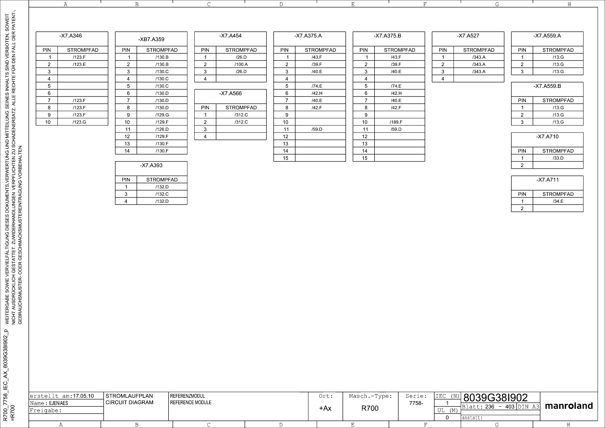

# +Ax — Sheet 236 of 403 — REFERENZMODUL

**REFERENCE MODULE**

> Part of the manroland **R700** printing press IEC/UL circuit diagrams.
> Drawing class: **Stromlaufplan / Circuit diagram** (DIN A3).
> Document `+Ax` covers the **Central control console** machine section.

## At a glance

| Field | Value |
|---|---|
| Document | `+Ax`  (8039G38I902) |
| Sheet | **236** of 403 |
| Section (DE) | REFERENZMODUL |
| Section (EN) | REFERENCE MODULE |
| Section type | REFERENCE_MODULE — Reference module |
| Machine type | `R700` |
| Series | `7758` |
| Created | 17.05.10 |
| Replaces | — |
| Columns used | A, B, C, D, E, F, G, H |
| Path numbers | — |
| Labels on sheet | 171 |
| Cross-refs out | 56 |
| Cross-refs in | 0 |

**Previous:** [+Ax sheet 235](SHEET_0235.md) · **Next:** [+Ax sheet 237](SHEET_0237.md) · **Document TOC:** [_TOC.md](_TOC.md)  (+Ax) · **Master TOC:** [all sheets](../_MASTER_TOC.md)

## Sheet image (300 DPI, exact vector render)



_Rendered directly from the PDF vector layer at 300 DPI (1-bit), no OCR and no resampling. Use it to confirm anything ambiguous in the text below._

## Cross-references on this sheet

Each entry is a wire leaving this sheet. The printed token is `/sheet.column`; the link resolves to that sheet inside the same document.

| Ref | Target sheet | Col | Path | Destination on target | Target section | From col |
|---|---|---|---|---|---|---|
| `/130.B` | [+Ax sheet 130](SHEET_0130.md) | B | — | — | REALTIMERECHNER ANLAGE | B |
| `/43.F` | [+Ax sheet 43](SHEET_0043.md) | F | — | — | HAUPTANTRIEB | E |
| `/43.F` | [+Ax sheet 43](SHEET_0043.md) | F | — | — | HAUPTANTRIEB | F |
| `/343.A` | [+Ax sheet 343](SHEET_0343.md) | A | — | — | OPTION: INLINESHEETER RS104 S | G |
| `/123.F` | [+Ax sheet 123](SHEET_0123.md) | F | — | — | REALTIMERECHNER FEHLBOGENKONTROLLE | A |
| `/13.G` | [+Ax sheet 13](SHEET_0013.md) | G | — | — | SPANNUNGSVERSORGUNG, SCHALTSCHRANKBELÜFTUNG | H |
| `/26.D` | [+Ax sheet 26](SHEET_0026.md) | D | — | — | SPANNUNGSVERSORGUNG, SCHALTSCHRANKBELÜFTUNG | C |
| `/123.E` | [+Ax sheet 123](SHEET_0123.md) | E | — | — | REALTIMERECHNER FEHLBOGENKONTROLLE | A |
| `/130.B` | [+Ax sheet 130](SHEET_0130.md) | B | — | — | REALTIMERECHNER ANLAGE | B |
| `/100.A` | [+Ax sheet 100](SHEET_0100.md) | A | — | — | ANLEGER | C |
| `/39.F` | [+Ax sheet 39](SHEET_0039.md) | F | — | — | HAUPTANTRIEB | E |
| `/39.F` | [+Ax sheet 39](SHEET_0039.md) | F | — | — | HAUPTANTRIEB | F |
| `/343.A` | [+Ax sheet 343](SHEET_0343.md) | A | — | — | OPTION: INLINESHEETER RS104 S | G |
| `/13.G` | [+Ax sheet 13](SHEET_0013.md) | G | — | — | SPANNUNGSVERSORGUNG, SCHALTSCHRANKBELÜFTUNG | H |
| `/40.E` | [+Ax sheet 40](SHEET_0040.md) | E | — | — | HAUPTANTRIEB | E |
| `/40.E` | [+Ax sheet 40](SHEET_0040.md) | E | — | — | HAUPTANTRIEB | F |
| `/343.A` | [+Ax sheet 343](SHEET_0343.md) | A | — | — | OPTION: INLINESHEETER RS104 S | G |
| `/13.G` | [+Ax sheet 13](SHEET_0013.md) | G | — | — | SPANNUNGSVERSORGUNG, SCHALTSCHRANKBELÜFTUNG | H |
| `/26.D` | [+Ax sheet 26](SHEET_0026.md) | D | — | — | SPANNUNGSVERSORGUNG, SCHALTSCHRANKBELÜFTUNG | C |
| `/130.C` | [+Ax sheet 130](SHEET_0130.md) | C | — | — | REALTIMERECHNER ANLAGE | B |
| `/130.C` | [+Ax sheet 130](SHEET_0130.md) | C | — | — | REALTIMERECHNER ANLAGE | B |
| `/74.E` | [+Ax sheet 74](SHEET_0074.md) | E | — | — | FEUCHTMITTELKÜHLGERÄT | E |
| `/74.E` | [+Ax sheet 74](SHEET_0074.md) | E | — | — | FEUCHTMITTELKÜHLGERÄT | F |
| `/130.C` | [+Ax sheet 130](SHEET_0130.md) | C | — | — | REALTIMERECHNER ANLAGE | B |
| `/42.H` | [+Ax sheet 42](SHEET_0042.md) | H | — | — | HAUPTANTRIEB | E |
| `/42.H` | [+Ax sheet 42](SHEET_0042.md) | H | — | — | HAUPTANTRIEB | F |
| `/130.D` | [+Ax sheet 130](SHEET_0130.md) | D | — | — | REALTIMERECHNER ANLAGE | B |
| `/40.E` | [+Ax sheet 40](SHEET_0040.md) | E | — | — | HAUPTANTRIEB | E |
| `/40.E` | [+Ax sheet 40](SHEET_0040.md) | E | — | — | HAUPTANTRIEB | F |
| `/123.F` | [+Ax sheet 123](SHEET_0123.md) | F | — | — | REALTIMERECHNER FEHLBOGENKONTROLLE | A |
| `/130.D` | [+Ax sheet 130](SHEET_0130.md) | D | — | — | REALTIMERECHNER ANLAGE | B |
| `/42.F` | [+Ax sheet 42](SHEET_0042.md) | F | — | — | HAUPTANTRIEB | E |
| `/42.F` | [+Ax sheet 42](SHEET_0042.md) | F | — | — | HAUPTANTRIEB | F |
| `/123.F` | [+Ax sheet 123](SHEET_0123.md) | F | — | — | REALTIMERECHNER FEHLBOGENKONTROLLE | A |
| `/13.G` | [+Ax sheet 13](SHEET_0013.md) | G | — | — | SPANNUNGSVERSORGUNG, SCHALTSCHRANKBELÜFTUNG | H |
| `/130.D` | [+Ax sheet 130](SHEET_0130.md) | D | — | — | REALTIMERECHNER ANLAGE | B |
| `/123.F` | [+Ax sheet 123](SHEET_0123.md) | F | — | — | REALTIMERECHNER FEHLBOGENKONTROLLE | A |
| `/13.G` | [+Ax sheet 13](SHEET_0013.md) | G | — | — | SPANNUNGSVERSORGUNG, SCHALTSCHRANKBELÜFTUNG | H |
| `/129.G` | [+Ax sheet 129](SHEET_0129.md) | G | — | — | REALTIMERECHNER ANLAGE | B |
| `/312.C` | [+Ax sheet 312](SHEET_0312.md) | C | — | — | OPTION: IR/UV ZWISCHENTROCKNER | C |
| `/13.G` | [+Ax sheet 13](SHEET_0013.md) | G | — | — | SPANNUNGSVERSORGUNG, SCHALTSCHRANKBELÜFTUNG | H |
| `/123.G` | [+Ax sheet 123](SHEET_0123.md) | G | — | — | REALTIMERECHNER FEHLBOGENKONTROLLE | A |
| `/129.F` | [+Ax sheet 129](SHEET_0129.md) | F | — | — | REALTIMERECHNER ANLAGE | B |
| `/189.F` | [+Ax sheet 189](SHEET_0189.md) | F | — | — | RESERVE | F |
| `/312.C` | [+Ax sheet 312](SHEET_0312.md) | C | — | — | OPTION: IR/UV ZWISCHENTROCKNER | C |
| `/59.D` | [+Ax sheet 59](SHEET_0059.md) | D | — | — | DRUCKLUFTANLAGE | E |
| `/59.D` | [+Ax sheet 59](SHEET_0059.md) | D | — | — | DRUCKLUFTANLAGE | F |
| `/126.D` | [+Ax sheet 126](SHEET_0126.md) | D | — | — | REALTIMERECHNER ANLEGER | B |
| `/129.F` | [+Ax sheet 129](SHEET_0129.md) | F | — | — | REALTIMERECHNER ANLAGE | B |
| `/130.F` | [+Ax sheet 130](SHEET_0130.md) | F | — | — | REALTIMERECHNER ANLAGE | B |
| `/33.D` | [+Ax sheet 33](SHEET_0033.md) | D | — | STROMPFAD PIN 1 2 | SPANNUNGSVERSORGUNG, SCHALTSCHRANKBELÜFTUNG | H |
| `/130.F` | [+Ax sheet 130](SHEET_0130.md) | F | — | — | REALTIMERECHNER ANLAGE | B |
| `/132.D` | [+Ax sheet 132](SHEET_0132.md) | D | — | — | REALTIMERECHNER ANLAGE | B |
| `/34.E` | [+Ax sheet 34](SHEET_0034.md) | E | — | STROMPFAD PIN 1 2 | SPANNUNGSVERSORGUNG, SCHALTSCHRANKBELÜFTUNG | H |
| `/132.C` | [+Ax sheet 132](SHEET_0132.md) | C | — | — | REALTIMERECHNER ANLAGE | B |
| `/132.D` | [+Ax sheet 132](SHEET_0132.md) | D | — | — | REALTIMERECHNER ANLAGE | B |

## Devices on this sheet

| Tag | Class | Class meaning (IEC) | Col | Sub | Terminal | Sign |
|---|---|---|---|---|---|---|
| `XB7.A359` | — | cross-device reference | B | — | — | — |
| `X7.A393` | — | cross-device reference | B | — | — | — |
| `X7.A454` | — | cross-device reference | C | — | — | — |
| `X7.A566` | — | cross-device reference | C | — | — | — |
| `X7.A375.A` | — | cross-device reference | D | — | — | — |
| `X7.A375.B` | — | cross-device reference | E | — | — | — |
| `X7.A527` | — | cross-device reference | G | — | — | — |
| `X7.A346` | — | cross-device reference | A | — | — | — |
| `X7.A559.A` | — | cross-device reference | H | — | — | — |
| `X7.A559.B` | — | cross-device reference | H | — | — | — |
| `X7.A710` | — | cross-device reference | H | — | — | — |
| `X7.A711` | — | cross-device reference | H | — | — | — |

## Potentials / nets

_No named potentials on this sheet._

## Wire-end annotations (grouped as printed)

A wire that continues elsewhere is annotated with a small cluster: the destination description, the path/line number `#NN`, and the `/sheet.column` cross reference. Each row below is one such cluster exactly as it is grouped on the drawing.

| Col | Y | Path | Cross-ref | Text on the wire |
|---|---|---|---|---|
| A | 65.5 | — | — | `X7.A346` |
| C | 65.5 | — | — | `X7.A454` |
| D | 65.5 | — | — | `X7.A375.A` |
| E | 65.5 | — | — | `X7.A375.B` |
| G | 65.5 | — | — | `X7.A527` |
| H | 65.5 | — | — | `X7.A559.A` |
| B | 72.6 | — | — | `XB7.A359` |
| A | 94.2 | — | — | `PIN 10 2 3 4 5 6 7 8 9 1 STROMPFAD` |
| B | 94.2 | — | — | `PIN STROMPFAD` |
| C | 94.2 | — | — | `PIN 2 3 4 1 STROMPFAD` |
| D | 94.2 | — | — | `PIN 10 12 13 14 15 11 2 3 4 5 6 7 8 9 1 STROMPFAD` |
| E | 94.2 | — | — | `PIN 10 12 13 14 15 11 2 3 4 5 6 7 8 9 1 STROMPFAD` |
| G | 94.2 | — | — | `PIN 2 3 4 1 STROMPFAD` |
| H | 94.2 | — | — | `PIN 2 3 1 STROMPFAD` |
| B | 108.4 | — | — | `2 3 4 5 6 7 8 9 1` |
| A | 108.7 | — | `/123.F` | — |
| B | 108.7 | — | `/130.B` | — |
| C | 108.7 | — | `/26.D` | — |
| E | 108.7 | — | `/43.F` | — |
| F | 108.7 | — | `/43.F` | — |
| G | 108.7 | — | `/343.A` | — |
| H | 108.7 | — | `/13.G` | — |
| A | 122.9 | — | `/123.E` | — |
| B | 122.9 | — | `/130.B` | — |
| C | 122.9 | — | `/100.A` | — |
| E | 122.9 | — | `/39.F` | — |
| F | 122.9 | — | `/39.F` | — |
| G | 122.9 | — | `/343.A` | — |
| H | 122.9 | — | `/13.G` | — |
| E | 137.0 | — | `/40.E` | — |
| F | 137.0 | — | `/40.E` | — |
| G | 137.0 | — | `/343.A` | — |
| H | 137.0 | — | `/13.G` | — |
| B | 137.1 | — | `/130.C` | — |
| C | 137.1 | — | `/26.D` | — |
| B | 151.2 | — | `/130.C` | — |
| H | 164.7 | — | — | `X7.A559.B` |
| B | 165.4 | — | `/130.C` | — |
| E | 165.4 | — | `/74.E` | — |
| F | 165.4 | — | `/74.E` | — |
| C | 178.9 | — | — | `X7.A566` |
| B | 179.6 | — | `/130.D` | — |
| E | 179.6 | — | `/42.H` | — |
| F | 179.6 | — | `/42.H` | — |
| H | 193.4 | — | — | `PIN 2 3 1 STROMPFAD` |
| A | 193.7 | — | `/123.F` | — |
| E | 193.7 | — | `/40.E` | — |
| F | 193.7 | — | `/40.E` | — |
| B | 193.8 | — | `/130.D` | — |
| C | 207.5 | — | — | `PIN 2 3 4 1 STROMPFAD` |
| A | 207.9 | — | `/123.F` | — |
| B | 207.9 | — | `/130.D` | — |
| E | 207.9 | — | `/42.F` | — |
| F | 207.9 | — | `/42.F` | — |
| H | 207.9 | — | `/13.G` | — |
| A | 222.1 | — | `/123.F` | — |
| B | 222.1 | — | `/129.G` | — |
| C | 222.1 | — | `/312.C` | — |
| H | 222.1 | — | `/13.G` | — |
| B | 235.9 | — | — | `10 12 13 14 11` |
| H | 236.2 | — | `/13.G` | — |
| A | 236.3 | — | `/123.G` | — |
| B | 236.3 | — | `/129.F` | — |
| C | 236.3 | — | `/312.C` | — |
| F | 236.3 | — | `/189.F` | — |
| B | 250.4 | — | `/126.D` | — |
| E | 250.4 | — | `/59.D` | — |
| F | 250.4 | — | `/59.D` | — |
| H | 263.9 | — | — | `X7.A710` |
| B | 264.6 | — | `/129.F` | — |
| B | 278.8 | — | `/130.F` | — |
| H | 292.6 | — | `/33.D` | `PIN 2 1 STROMPFAD` |
| B | 292.9 | — | `/130.F` | — |
| B | 320.6 | — | — | `X7.A393` |
| H | 349.0 | — | — | `X7.A711` |
| B | 349.3 | — | — | `PIN 3 4 1 STROMPFAD` |
| B | 363.8 | — | `/132.D` | — |
| H | 377.6 | — | `/34.E` | `PIN 2 1 STROMPFAD` |
| B | 378.0 | — | `/132.C` | — |
| B | 392.2 | — | `/132.D` | — |


## Reconstructed tables

This sheet carries tabular content (pin map / terminal assignment / index). The grid below was rebuilt from the drawing's own rule lines, so each row is exactly one physical row of the table.

### Table 1 — 10 data rows × 2 columns (at x=70.9, y=62.4) — **X7.A346**

| PIN | STROMPFAD |
|---|---|
| `1` | `/123.F` |
| `2` | `/123.E` |
| `3` |  |
| `4` |  |
| `5` |  |
| `6` |  |
| `7` | `/123.F` |
| `8` | `/123.F` |
| `9` | `/123.F` |
| `10` | `/123.G` |


### Table 2 — 19 data rows × 2 columns (at x=226.8, y=62.4) — **XB7.A359**

| PIN | STROMPFAD |
|---|---|
| `1` | `/130.B` |
| `2` | `/130.B` |
| `3` | `/130.C` |
| `4` | `/130.C` |
| `5` | `/130.C` |
| `6` | `/130.D` |
| `7` | `/130.D` |
| `8` | `/130.D` |
| `9` | `/129.G` |
| `10` | `/129.F` |
| `11` | `/126.D` |
| `12` | `/129.F` |
| `13` | `/130.F` |
| `14` | `/130.F` |
|  | `X7.A393` |
| `PIN` | `STROMPFAD` |
| `1` | `/132.D` |
| `3` | `/132.C` |
| `4` | `/132.D` |


### Table 3 — 10 data rows × 2 columns (at x=382.7, y=62.4) — **X7.A454**

| PIN | STROMPFAD |
|---|---|
| `1` | `/26.D` |
| `2` | `/100.A` |
| `3` | `/26.D` |
| `4` |  |
|  | `X7.A566` |
| `PIN` | `STROMPFAD` |
| `1` | `/312.C` |
| `2` | `/312.C` |
| `3` |  |
| `4` |  |


### Table 4 — 15 data rows × 2 columns (at x=538.6, y=62.4) — **X7.A375.A**

| PIN | STROMPFAD |
|---|---|
| `1` | `/43.F` |
| `2` | `/39.F` |
| `3` | `/40.E` |
| `4` |  |
| `5` | `/74.E` |
| `6` | `/42.H` |
| `7` | `/40.E` |
| `8` | `/42.F` |
| `9` |  |
| `10` |  |
| `11` | `/59.D` |
| `12` |  |
| `13` |  |
| `14` |  |
| `15` |  |


### Table 5 — 15 data rows × 2 columns (at x=694.5, y=62.4) — **X7.A375.B**

| PIN | STROMPFAD |
|---|---|
| `1` | `/43.F` |
| `2` | `/39.F` |
| `3` | `/40.E` |
| `4` |  |
| `5` | `/74.E` |
| `6` | `/42.H` |
| `7` | `/40.E` |
| `8` | `/42.F` |
| `9` |  |
| `10` | `/189.F` |
| `11` | `/59.D` |
| `12` |  |
| `13` |  |
| `14` |  |
| `15` |  |


### Table 6 — 4 data rows × 2 columns (at x=850.4, y=62.4) — **X7.A527**

| PIN | STROMPFAD |
|---|---|
| `1` | `/343.A` |
| `2` | `/343.A` |
| `3` | `/343.A` |
| `4` |  |


### Table 7 — 16 data rows × 2 columns (at x=1006.3, y=62.4) — **X7.A559.A**

| PIN | STROMPFAD |
|---|---|
| `1` | `/13.G` |
| `2` | `/13.G` |
| `3` | `/13.G` |
|  | `X7.A559.B` |
| `PIN` | `STROMPFAD` |
| `1` | `/13.G` |
| `2` | `/13.G` |
| `3` | `/13.G` |
|  | `X7.A710` |
| `PIN` | `STROMPFAD` |
| `1` | `/33.D` |
| `2` |  |
|  | `X7.A711` |
| `PIN` | `STROMPFAD` |
| `1` | `/34.E` |
| `2` |  |


## Notes and free text on this sheet

| Text | Col | Y (pt) |
|---|---|---|
| `PIN` | B | 94.2 |
| `STROMPFAD` | B | 94.15 |
| `PIN` | C | 94.2 |
| `STROMPFAD` | C | 94.15 |
| `PIN` | D | 94.2 |
| `STROMPFAD` | E | 94.15 |
| `PIN` | E | 94.2 |
| `STROMPFAD` | F | 94.15 |
| `PIN` | F | 94.2 |
| `STROMPFAD` | G | 94.15 |
| `PIN` | A | 94.2 |
| `STROMPFAD` | A | 94.15 |
| `PIN` | G | 94.2 |
| `STROMPFAD` | H | 94.15 |

## Complete label inventory (exact text from the drawing)

Every text object inside the drawing area of this sheet, in DIN reading order (column A→H, then top→bottom). This is the authoritative list: if a string is not here it is not printed on this sheet.

| Col | Y | X | Dir | Type | Text |
|---|---|---|---|---|---|
| A | 65.5 | 116.9 | → | device ref | `X7.A346` |
| A | 94.2 | 84.0 | → | text | `PIN` |
| A | 94.2 | 132.2 | → | text | `STROMPFAD` |
| A | 108.4 | 95.8 | → | number | `1` |
| A | 108.7 | 143.6 | → | cross-reference | `/123.F` |
| A | 122.5 | 94.1 | → | number | `2` |
| A | 122.9 | 143.4 | → | cross-reference | `/123.E` |
| A | 136.7 | 94.1 | → | number | `3` |
| A | 150.9 | 94.1 | → | number | `4` |
| A | 165.1 | 94.1 | → | number | `5` |
| A | 179.2 | 94.1 | → | number | `6` |
| A | 193.4 | 94.1 | → | number | `7` |
| A | 193.7 | 143.6 | → | cross-reference | `/123.F` |
| A | 207.6 | 94.1 | → | number | `8` |
| A | 207.9 | 143.6 | → | cross-reference | `/123.F` |
| A | 221.8 | 94.1 | → | number | `9` |
| A | 222.1 | 143.6 | → | cross-reference | `/123.F` |
| A | 235.9 | 88.7 | → | number | `10` |
| A | 236.3 | 143.0 | → | cross-reference | `/123.G` |
| B | 72.6 | 272.1 | → | device ref | `XB7.A359` |
| B | 94.2 | 240.0 | → | text | `PIN` |
| B | 94.2 | 288.1 | → | text | `STROMPFAD` |
| B | 108.4 | 251.7 | → | number | `1` |
| B | 108.7 | 306.3 | → | cross-reference | `/130.B` |
| B | 122.5 | 250.0 | → | number | `2` |
| B | 122.9 | 306.3 | → | cross-reference | `/130.B` |
| B | 136.7 | 250.0 | → | number | `3` |
| B | 137.1 | 306.1 | → | cross-reference | `/130.C` |
| B | 150.9 | 250.0 | → | number | `4` |
| B | 151.2 | 306.1 | → | cross-reference | `/130.C` |
| B | 165.1 | 250.0 | → | number | `5` |
| B | 165.4 | 306.1 | → | cross-reference | `/130.C` |
| B | 179.2 | 250.0 | → | number | `6` |
| B | 179.6 | 306.1 | → | cross-reference | `/130.D` |
| B | 193.4 | 250.0 | → | number | `7` |
| B | 193.8 | 306.1 | → | cross-reference | `/130.D` |
| B | 207.6 | 250.0 | → | number | `8` |
| B | 207.9 | 306.1 | → | cross-reference | `/130.D` |
| B | 221.8 | 250.0 | → | number | `9` |
| B | 222.1 | 306.0 | → | cross-reference | `/129.G` |
| B | 235.9 | 244.6 | → | number | `10` |
| B | 236.3 | 306.6 | → | cross-reference | `/129.F` |
| B | 250.1 | 246.3 | → | number | `11` |
| B | 250.4 | 306.1 | → | cross-reference | `/126.D` |
| B | 264.3 | 244.6 | → | number | `12` |
| B | 264.6 | 306.6 | → | cross-reference | `/129.F` |
| B | 278.5 | 244.6 | → | number | `13` |
| B | 278.8 | 306.6 | → | cross-reference | `/130.F` |
| B | 292.6 | 244.6 | → | number | `14` |
| B | 293.0 | 306.6 | → | cross-reference | `/130.F` |
| B | 320.6 | 275.7 | → | device ref | `X7.A393` |
| B | 349.3 | 240.0 | → | text | `PIN` |
| B | 349.3 | 288.1 | → | text | `STROMPFAD` |
| B | 363.5 | 245.9 | → | number | `1` |
| B | 363.8 | 306.1 | → | cross-reference | `/132.D` |
| B | 377.7 | 245.3 | → | number | `3` |
| B | 378.0 | 306.1 | → | cross-reference | `/132.C` |
| B | 391.8 | 245.3 | → | number | `4` |
| B | 392.2 | 306.1 | → | cross-reference | `/132.D` |
| C | 65.5 | 431.6 | → | device ref | `X7.A454` |
| C | 94.2 | 395.9 | → | text | `PIN` |
| C | 94.2 | 444.0 | → | text | `STROMPFAD` |
| C | 108.4 | 401.8 | → | number | `1` |
| C | 108.7 | 464.5 | → | cross-reference | `/26.D` |
| C | 122.5 | 401.2 | → | number | `2` |
| C | 122.9 | 462.0 | → | cross-reference | `/100.A` |
| C | 136.7 | 401.2 | → | number | `3` |
| C | 137.1 | 464.5 | → | cross-reference | `/26.D` |
| C | 150.9 | 401.2 | → | number | `4` |
| C | 178.9 | 431.6 | → | device ref | `X7.A566` |
| C | 207.5 | 444.0 | → | text | `STROMPFAD` |
| C | 207.6 | 395.9 | → | text | `PIN` |
| C | 221.8 | 401.8 | → | number | `1` |
| C | 222.1 | 462.0 | → | cross-reference | `/312.C` |
| C | 235.9 | 401.2 | → | number | `2` |
| C | 236.3 | 462.0 | → | cross-reference | `/312.C` |
| C | 250.1 | 401.2 | → | number | `3` |
| C | 264.3 | 401.2 | → | number | `4` |
| D | 65.5 | 579.3 | → | device ref | `X7.A375.A` |
| D | 94.2 | 551.8 | → | text | `PIN` |
| D | 108.4 | 563.5 | → | number | `1` |
| D | 122.5 | 561.8 | → | number | `2` |
| D | 136.7 | 561.8 | → | number | `3` |
| D | 150.9 | 561.8 | → | number | `4` |
| D | 165.1 | 561.8 | → | number | `5` |
| D | 179.2 | 561.8 | → | number | `6` |
| D | 193.4 | 561.8 | → | number | `7` |
| D | 207.6 | 561.8 | → | number | `8` |
| D | 221.8 | 561.8 | → | number | `9` |
| D | 235.9 | 556.4 | → | number | `10` |
| D | 250.1 | 558.1 | → | number | `11` |
| D | 264.3 | 556.4 | → | number | `12` |
| D | 278.5 | 556.4 | → | number | `13` |
| D | 292.6 | 556.4 | → | number | `14` |
| D | 306.8 | 556.4 | → | number | `15` |
| E | 65.5 | 735.6 | → | device ref | `X7.A375.B` |
| E | 94.2 | 600.0 | → | text | `STROMPFAD` |
| E | 94.2 | 707.7 | → | text | `PIN` |
| E | 108.4 | 719.4 | → | number | `1` |
| E | 108.7 | 613.7 | → | cross-reference | `/43.F` |
| E | 122.5 | 717.7 | → | number | `2` |
| E | 122.9 | 613.7 | → | cross-reference | `/39.F` |
| E | 136.7 | 717.7 | → | number | `3` |
| E | 137.0 | 613.6 | → | cross-reference | `/40.E` |
| E | 150.9 | 717.7 | → | number | `4` |
| E | 165.1 | 717.7 | → | number | `5` |
| E | 165.4 | 613.6 | → | cross-reference | `/74.E` |
| E | 179.2 | 717.7 | → | number | `6` |
| E | 179.6 | 613.6 | → | cross-reference | `/42.H` |
| E | 193.4 | 717.7 | → | number | `7` |
| E | 193.7 | 613.6 | → | cross-reference | `/40.E` |
| E | 207.6 | 717.7 | → | number | `8` |
| E | 207.9 | 613.7 | → | cross-reference | `/42.F` |
| E | 221.8 | 717.7 | → | number | `9` |
| E | 235.9 | 712.3 | → | number | `10` |
| E | 250.1 | 714.0 | → | number | `11` |
| E | 250.4 | 613.3 | → | cross-reference | `/59.D` |
| E | 264.3 | 712.3 | → | number | `12` |
| E | 278.5 | 712.3 | → | number | `13` |
| E | 292.6 | 712.3 | → | number | `14` |
| E | 306.8 | 712.3 | → | number | `15` |
| F | 94.2 | 755.9 | → | text | `STROMPFAD` |
| F | 94.2 | 863.6 | → | text | `PIN` |
| F | 108.4 | 869.5 | → | number | `1` |
| F | 108.7 | 769.6 | → | cross-reference | `/43.F` |
| F | 122.5 | 869.0 | → | number | `2` |
| F | 122.9 | 769.6 | → | cross-reference | `/39.F` |
| F | 136.7 | 869.0 | → | number | `3` |
| F | 137.0 | 769.5 | → | cross-reference | `/40.E` |
| F | 150.9 | 869.0 | → | number | `4` |
| F | 165.4 | 769.5 | → | cross-reference | `/74.E` |
| F | 179.6 | 769.5 | → | cross-reference | `/42.H` |
| F | 193.7 | 769.5 | → | cross-reference | `/40.E` |
| F | 207.9 | 769.6 | → | cross-reference | `/42.F` |
| F | 236.3 | 767.2 | → | cross-reference | `/189.F` |
| F | 250.4 | 769.2 | → | cross-reference | `/59.D` |
| G | 65.5 | 899.3 | → | device ref | `X7.A527` |
| G | 94.2 | 911.8 | → | text | `STROMPFAD` |
| G | 94.2 | 1019.5 | → | text | `PIN` |
| G | 108.4 | 1025.4 | → | number | `1` |
| G | 108.7 | 929.8 | → | cross-reference | `/343.A` |
| G | 122.5 | 1024.9 | → | number | `2` |
| G | 122.9 | 929.8 | → | cross-reference | `/343.A` |
| G | 136.7 | 1024.9 | → | number | `3` |
| G | 137.0 | 929.8 | → | cross-reference | `/343.A` |
| G | 193.4 | 1019.5 | → | text | `PIN` |
| G | 207.6 | 1025.4 | → | number | `1` |
| G | 221.8 | 1024.9 | → | number | `2` |
| G | 235.9 | 1024.9 | → | number | `3` |
| G | 292.6 | 1019.5 | → | text | `PIN` |
| G | 306.8 | 1025.4 | → | number | `1` |
| G | 321.0 | 1024.9 | → | number | `2` |
| G | 377.7 | 1019.5 | → | text | `PIN` |
| G | 391.8 | 1025.4 | → | number | `1` |
| G | 406.0 | 1024.9 | → | number | `2` |
| H | 65.5 | 1049.8 | → | device ref | `X7.A559.A` |
| H | 94.2 | 1067.7 | → | text | `STROMPFAD` |
| H | 108.7 | 1087.9 | → | cross-reference | `/13.G` |
| H | 122.9 | 1087.9 | → | cross-reference | `/13.G` |
| H | 137.0 | 1087.9 | → | cross-reference | `/13.G` |
| H | 164.7 | 1050.2 | → | device ref | `X7.A559.B` |
| H | 193.4 | 1067.7 | → | text | `STROMPFAD` |
| H | 207.9 | 1087.9 | → | cross-reference | `/13.G` |
| H | 222.1 | 1087.9 | → | cross-reference | `/13.G` |
| H | 236.3 | 1087.9 | → | cross-reference | `/13.G` |
| H | 263.9 | 1055.2 | → | device ref | `X7.A710` |
| H | 292.6 | 1067.7 | → | text | `STROMPFAD` |
| H | 307.1 | 1088.1 | → | cross-reference | `/33.D` |
| H | 349.0 | 1055.9 | → | device ref | `X7.A711` |
| H | 377.6 | 1067.7 | → | text | `STROMPFAD` |
| H | 392.1 | 1088.4 | → | cross-reference | `/34.E` |

## Reading-order text block

The same content as a plain block, grouped by DIN column — convenient to paste or to match against a visual description.

```text
=== Column A ===
  65.5  116.9  devref       X7.A346
  94.2   84.0  text         PIN
  94.2  132.2  text         STROMPFAD
 108.4   95.8  numeric      1
 108.7  143.6  xref         /123.F
 122.5   94.1  numeric      2
 122.9  143.4  xref         /123.E
 136.7   94.1  numeric      3
 150.9   94.1  numeric      4
 165.1   94.1  numeric      5
 179.2   94.1  numeric      6
 193.4   94.1  numeric      7
 193.7  143.6  xref         /123.F
 207.6   94.1  numeric      8
 207.9  143.6  xref         /123.F
 221.8   94.1  numeric      9
 222.1  143.6  xref         /123.F
 235.9   88.7  numeric      10
 236.3  143.0  xref         /123.G
=== Column B ===
  72.6  272.1  devref       XB7.A359
  94.2  240.0  text         PIN
  94.2  288.1  text         STROMPFAD
 108.4  251.7  numeric      1
 108.7  306.3  xref         /130.B
 122.5  250.0  numeric      2
 122.9  306.3  xref         /130.B
 136.7  250.0  numeric      3
 137.1  306.1  xref         /130.C
 150.9  250.0  numeric      4
 151.2  306.1  xref         /130.C
 165.1  250.0  numeric      5
 165.4  306.1  xref         /130.C
 179.2  250.0  numeric      6
 179.6  306.1  xref         /130.D
 193.4  250.0  numeric      7
 193.8  306.1  xref         /130.D
 207.6  250.0  numeric      8
 207.9  306.1  xref         /130.D
 221.8  250.0  numeric      9
 222.1  306.0  xref         /129.G
 235.9  244.6  numeric      10
 236.3  306.6  xref         /129.F
 250.1  246.3  numeric      11
 250.4  306.1  xref         /126.D
 264.3  244.6  numeric      12
 264.6  306.6  xref         /129.F
 278.5  244.6  numeric      13
 278.8  306.6  xref         /130.F
 292.6  244.6  numeric      14
 293.0  306.6  xref         /130.F
 320.6  275.7  devref       X7.A393
 349.3  240.0  text         PIN
 349.3  288.1  text         STROMPFAD
 363.5  245.9  numeric      1
 363.8  306.1  xref         /132.D
 377.7  245.3  numeric      3
 378.0  306.1  xref         /132.C
 391.8  245.3  numeric      4
 392.2  306.1  xref         /132.D
=== Column C ===
  65.5  431.6  devref       X7.A454
  94.2  395.9  text         PIN
  94.2  444.0  text         STROMPFAD
 108.4  401.8  numeric      1
 108.7  464.5  xref         /26.D
 122.5  401.2  numeric      2
 122.9  462.0  xref         /100.A
 136.7  401.2  numeric      3
 137.1  464.5  xref         /26.D
 150.9  401.2  numeric      4
 178.9  431.6  devref       X7.A566
 207.5  444.0  text         STROMPFAD
 207.6  395.9  text         PIN
 221.8  401.8  numeric      1
 222.1  462.0  xref         /312.C
 235.9  401.2  numeric      2
 236.3  462.0  xref         /312.C
 250.1  401.2  numeric      3
 264.3  401.2  numeric      4
=== Column D ===
  65.5  579.3  devref       X7.A375.A
  94.2  551.8  text         PIN
 108.4  563.5  numeric      1
 122.5  561.8  numeric      2
 136.7  561.8  numeric      3
 150.9  561.8  numeric      4
 165.1  561.8  numeric      5
 179.2  561.8  numeric      6
 193.4  561.8  numeric      7
 207.6  561.8  numeric      8
 221.8  561.8  numeric      9
 235.9  556.4  numeric      10
 250.1  558.1  numeric      11
 264.3  556.4  numeric      12
 278.5  556.4  numeric      13
 292.6  556.4  numeric      14
 306.8  556.4  numeric      15
=== Column E ===
  65.5  735.6  devref       X7.A375.B
  94.2  600.0  text         STROMPFAD
  94.2  707.7  text         PIN
 108.4  719.4  numeric      1
 108.7  613.7  xref         /43.F
 122.5  717.7  numeric      2
 122.9  613.7  xref         /39.F
 136.7  717.7  numeric      3
 137.0  613.6  xref         /40.E
 150.9  717.7  numeric      4
 165.1  717.7  numeric      5
 165.4  613.6  xref         /74.E
 179.2  717.7  numeric      6
 179.6  613.6  xref         /42.H
 193.4  717.7  numeric      7
 193.7  613.6  xref         /40.E
 207.6  717.7  numeric      8
 207.9  613.7  xref         /42.F
 221.8  717.7  numeric      9
 235.9  712.3  numeric      10
 250.1  714.0  numeric      11
 250.4  613.3  xref         /59.D
 264.3  712.3  numeric      12
 278.5  712.3  numeric      13
 292.6  712.3  numeric      14
 306.8  712.3  numeric      15
=== Column F ===
  94.2  755.9  text         STROMPFAD
  94.2  863.6  text         PIN
 108.4  869.5  numeric      1
 108.7  769.6  xref         /43.F
 122.5  869.0  numeric      2
 122.9  769.6  xref         /39.F
 136.7  869.0  numeric      3
 137.0  769.5  xref         /40.E
 150.9  869.0  numeric      4
 165.4  769.5  xref         /74.E
 179.6  769.5  xref         /42.H
 193.7  769.5  xref         /40.E
 207.9  769.6  xref         /42.F
 236.3  767.2  xref         /189.F
 250.4  769.2  xref         /59.D
=== Column G ===
  65.5  899.3  devref       X7.A527
  94.2  911.8  text         STROMPFAD
  94.2 1019.5  text         PIN
 108.4 1025.4  numeric      1
 108.7  929.8  xref         /343.A
 122.5 1024.9  numeric      2
 122.9  929.8  xref         /343.A
 136.7 1024.9  numeric      3
 137.0  929.8  xref         /343.A
 193.4 1019.5  text         PIN
 207.6 1025.4  numeric      1
 221.8 1024.9  numeric      2
 235.9 1024.9  numeric      3
 292.6 1019.5  text         PIN
 306.8 1025.4  numeric      1
 321.0 1024.9  numeric      2
 377.7 1019.5  text         PIN
 391.8 1025.4  numeric      1
 406.0 1024.9  numeric      2
=== Column H ===
  65.5 1049.8  devref       X7.A559.A
  94.2 1067.7  text         STROMPFAD
 108.7 1087.9  xref         /13.G
 122.9 1087.9  xref         /13.G
 137.0 1087.9  xref         /13.G
 164.7 1050.2  devref       X7.A559.B
 193.4 1067.7  text         STROMPFAD
 207.9 1087.9  xref         /13.G
 222.1 1087.9  xref         /13.G
 236.3 1087.9  xref         /13.G
 263.9 1055.2  devref       X7.A710
 292.6 1067.7  text         STROMPFAD
 307.1 1088.1  xref         /33.D
 349.0 1055.9  devref       X7.A711
 377.6 1067.7  text         STROMPFAD
 392.1 1088.4  xref         /34.E
```

---
_Generated from the PDF vector text layer; no OCR. Source: `R700_7758_IEC_AX_8039G38I902_p`, sheet 236._
