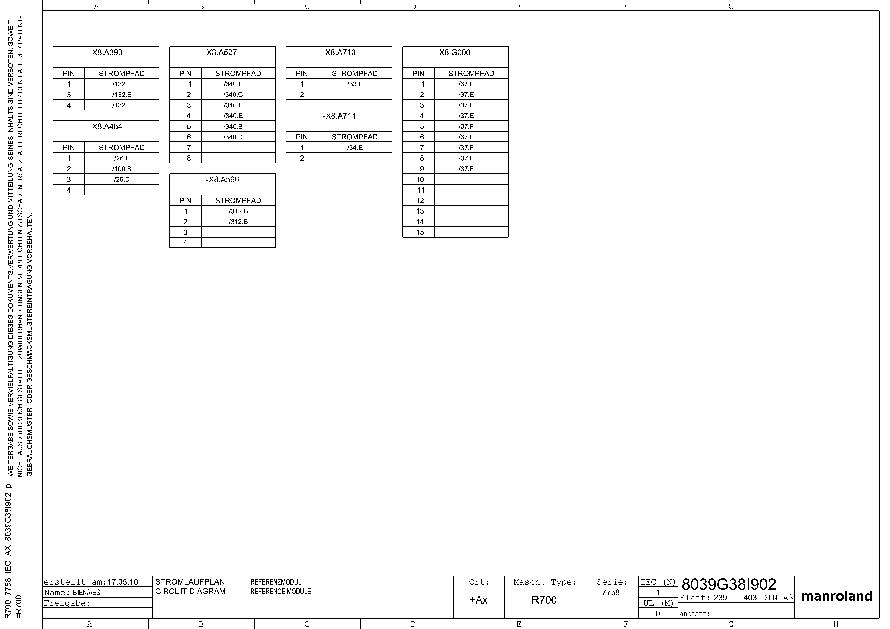

# +Ax — Sheet 239 of 403 — REFERENZMODUL

**REFERENCE MODULE**

> Part of the manroland **R700** printing press IEC/UL circuit diagrams.
> Drawing class: **Stromlaufplan / Circuit diagram** (DIN A3).
> Document `+Ax` covers the **Central control console** machine section.

## At a glance

| Field | Value |
|---|---|
| Document | `+Ax`  (8039G38I902) |
| Sheet | **239** of 403 |
| Section (DE) | REFERENZMODUL |
| Section (EN) | REFERENCE MODULE |
| Section type | REFERENCE_MODULE — Reference module |
| Machine type | `R700` |
| Series | `7758` |
| Created | 17.05.10 |
| Replaces | — |
| Columns used | A, B, C, D, E |
| Path numbers | — |
| Labels on sheet | 84 |
| Cross-refs out | 25 |
| Cross-refs in | 0 |

**Previous:** [+Ax sheet 238](SHEET_0238.md) · **Next:** [+Ax sheet 240](SHEET_0240.md) · **Document TOC:** [_TOC.md](_TOC.md)  (+Ax) · **Master TOC:** [all sheets](../_MASTER_TOC.md)

## Sheet image (300 DPI, exact vector render)



_Rendered directly from the PDF vector layer at 300 DPI (1-bit), no OCR and no resampling. Use it to confirm anything ambiguous in the text below._

## Cross-references on this sheet

Each entry is a wire leaving this sheet. The printed token is `/sheet.column`; the link resolves to that sheet inside the same document.

| Ref | Target sheet | Col | Path | Destination on target | Target section | From col |
|---|---|---|---|---|---|---|
| `/33.E` | [+Ax sheet 33](SHEET_0033.md) | E | — | STROMPFAD PIN 1 2 | SPANNUNGSVERSORGUNG, SCHALTSCHRANKBELÜFTUNG | C |
| `/37.E` | [+Ax sheet 37](SHEET_0037.md) | E | — | — | HAUPTANTRIEB | E |
| `/132.E` | [+Ax sheet 132](SHEET_0132.md) | E | — | — | REALTIMERECHNER ANLAGE | A |
| `/340.F` | [+Ax sheet 340](SHEET_0340.md) | F | — | — | OPTION: INLINESHEETER RS104 S | B |
| `/37.E` | [+Ax sheet 37](SHEET_0037.md) | E | — | — | HAUPTANTRIEB | E |
| `/132.E` | [+Ax sheet 132](SHEET_0132.md) | E | — | — | REALTIMERECHNER ANLAGE | A |
| `/340.C` | [+Ax sheet 340](SHEET_0340.md) | C | — | — | OPTION: INLINESHEETER RS104 S | B |
| `/37.E` | [+Ax sheet 37](SHEET_0037.md) | E | — | — | HAUPTANTRIEB | E |
| `/132.E` | [+Ax sheet 132](SHEET_0132.md) | E | — | — | REALTIMERECHNER ANLAGE | A |
| `/340.F` | [+Ax sheet 340](SHEET_0340.md) | F | — | — | OPTION: INLINESHEETER RS104 S | B |
| `/37.E` | [+Ax sheet 37](SHEET_0037.md) | E | — | — | HAUPTANTRIEB | E |
| `/340.E` | [+Ax sheet 340](SHEET_0340.md) | E | — | — | OPTION: INLINESHEETER RS104 S | B |
| `/340.B` | [+Ax sheet 340](SHEET_0340.md) | B | — | — | OPTION: INLINESHEETER RS104 S | B |
| `/37.F` | [+Ax sheet 37](SHEET_0037.md) | F | — | — | HAUPTANTRIEB | E |
| `/34.E` | [+Ax sheet 34](SHEET_0034.md) | E | — | STROMPFAD PIN 1 2 | SPANNUNGSVERSORGUNG, SCHALTSCHRANKBELÜFTUNG | C |
| `/37.F` | [+Ax sheet 37](SHEET_0037.md) | F | — | — | HAUPTANTRIEB | E |
| `/340.D` | [+Ax sheet 340](SHEET_0340.md) | D | — | — | OPTION: INLINESHEETER RS104 S | B |
| `/37.F` | [+Ax sheet 37](SHEET_0037.md) | F | — | — | HAUPTANTRIEB | E |
| `/26.E` | [+Ax sheet 26](SHEET_0026.md) | E | — | — | SPANNUNGSVERSORGUNG, SCHALTSCHRANKBELÜFTUNG | A |
| `/37.F` | [+Ax sheet 37](SHEET_0037.md) | F | — | — | HAUPTANTRIEB | E |
| `/100.B` | [+Ax sheet 100](SHEET_0100.md) | B | — | — | ANLEGER | A |
| `/37.F` | [+Ax sheet 37](SHEET_0037.md) | F | — | — | HAUPTANTRIEB | E |
| `/26.D` | [+Ax sheet 26](SHEET_0026.md) | D | — | — | SPANNUNGSVERSORGUNG, SCHALTSCHRANKBELÜFTUNG | A |
| `/312.B` | [+Ax sheet 312](SHEET_0312.md) | B | — | — | OPTION: IR/UV ZWISCHENTROCKNER | B |
| `/312.B` | [+Ax sheet 312](SHEET_0312.md) | B | — | — | OPTION: IR/UV ZWISCHENTROCKNER | B |

## Devices on this sheet

| Tag | Class | Class meaning (IEC) | Col | Sub | Terminal | Sign |
|---|---|---|---|---|---|---|
| `X8.A393` | — | cross-device reference | A | — | — | — |
| `X8.A454` | — | cross-device reference | A | — | — | — |
| `X8.A527` | — | cross-device reference | B | — | — | — |
| `X8.A566` | — | cross-device reference | B | — | — | — |
| `X8.G000` | — | cross-device reference | D | — | — | — |
| `X8.A710` | — | cross-device reference | C | — | — | — |
| `X8.A711` | — | cross-device reference | C | — | — | — |

## Potentials / nets

_No named potentials on this sheet._

## Wire-end annotations (grouped as printed)

A wire that continues elsewhere is annotated with a small cluster: the destination description, the path/line number `#NN`, and the `/sheet.column` cross reference. Each row below is one such cluster exactly as it is grouped on the drawing.

| Col | Y | Path | Cross-ref | Text on the wire |
|---|---|---|---|---|
| A | 65.5 | — | — | `X8.A393` |
| B | 65.5 | — | — | `X8.A527` |
| C | 65.5 | — | — | `X8.A710` |
| D | 65.5 | — | — | `X8.G000` |
| A | 94.2 | — | — | `PIN 3 4 1 STROMPFAD` |
| B | 94.2 | — | — | `PIN 2 3 4 5 6 7 8 1 STROMPFAD` |
| C | 94.2 | — | `/33.E` | `PIN 2 1 STROMPFAD` |
| D | 94.2 | — | — | `PIN 10 12 13 14 15 11 2 3 4 5 6 7 8 9 1 STROMPFAD` |
| A | 108.7 | — | `/132.E` | — |
| B | 108.7 | — | `/340.F` | — |
| E | 108.7 | — | `/37.E` | — |
| E | 122.8 | — | `/37.E` | — |
| A | 122.9 | — | `/132.E` | — |
| B | 122.9 | — | `/340.C` | — |
| A | 137.0 | — | `/132.E` | — |
| B | 137.0 | — | `/340.F` | — |
| E | 137.0 | — | `/37.E` | — |
| C | 150.6 | — | — | `X8.A711` |
| B | 151.2 | — | `/340.E` | — |
| E | 151.2 | — | `/37.E` | — |
| A | 164.7 | — | — | `X8.A454` |
| B | 165.4 | — | `/340.B` | — |
| E | 165.4 | — | `/37.F` | — |
| C | 179.2 | — | `/34.E` | `PIN 2 1 STROMPFAD` |
| B | 179.6 | — | `/340.D` | — |
| E | 179.6 | — | `/37.F` | — |
| A | 193.4 | — | — | `PIN 2 3 4 1 STROMPFAD` |
| E | 193.7 | — | `/37.F` | — |
| A | 207.9 | — | `/26.E` | — |
| E | 207.9 | — | `/37.F` | — |
| A | 222.1 | — | `/100.B` | — |
| E | 222.1 | — | `/37.F` | — |
| B | 235.6 | — | — | `X8.A566` |
| A | 236.3 | — | `/26.D` | — |
| B | 264.2 | — | — | `PIN 2 3 4 1 STROMPFAD` |
| B | 278.8 | — | `/312.B` | — |
| B | 292.9 | — | `/312.B` | — |


## Reconstructed tables

This sheet carries tabular content (pin map / terminal assignment / index). The grid below was rebuilt from the drawing's own rule lines, so each row is exactly one physical row of the table.

### Table 1 — 9 data rows × 2 columns (at x=70.9, y=62.4) — **X8.A393**

| PIN | STROMPFAD |
|---|---|
| `1` | `/132.E` |
| `3` | `/132.E` |
| `4` | `/132.E` |
|  | `X8.A454` |
| `PIN` | `STROMPFAD` |
| `1` | `/26.E` |
| `2` | `/100.B` |
| `3` | `/26.D` |
| `4` |  |


### Table 2 — 14 data rows × 2 columns (at x=226.8, y=62.4) — **X8.A527**

| PIN | STROMPFAD |
|---|---|
| `1` | `/340.F` |
| `2` | `/340.C` |
| `3` | `/340.F` |
| `4` | `/340.E` |
| `5` | `/340.B` |
| `6` | `/340.D` |
| `7` |  |
| `8` |  |
|  | `X8.A566` |
| `PIN` | `STROMPFAD` |
| `1` | `/312.B` |
| `2` | `/312.B` |
| `3` |  |
| `4` |  |


### Table 3 — 6 data rows × 2 columns (at x=382.7, y=62.4) — **X8.A710**

| PIN | STROMPFAD |
|---|---|
| `1` | `/33.E` |
| `2` |  |
|  | `X8.A711` |
| `PIN` | `STROMPFAD` |
| `1` | `/34.E` |
| `2` |  |


### Table 4 — 15 data rows × 2 columns (at x=538.6, y=62.4) — **X8.G000**

| PIN | STROMPFAD |
|---|---|
| `1` | `/37.E` |
| `2` | `/37.E` |
| `3` | `/37.E` |
| `4` | `/37.E` |
| `5` | `/37.F` |
| `6` | `/37.F` |
| `7` | `/37.F` |
| `8` | `/37.F` |
| `9` | `/37.F` |
| `10` |  |
| `11` |  |
| `12` |  |
| `13` |  |
| `14` |  |
| `15` |  |


## Notes and free text on this sheet

| Text | Col | Y (pt) |
|---|---|---|
| `PIN` | A | 94.2 |
| `STROMPFAD` | A | 94.15 |
| `PIN` | B | 94.2 |
| `STROMPFAD` | B | 94.15 |
| `PIN` | D | 94.2 |
| `STROMPFAD` | E | 94.15 |
| `PIN` | C | 94.2 |
| `STROMPFAD` | C | 94.15 |

## Complete label inventory (exact text from the drawing)

Every text object inside the drawing area of this sheet, in DIN reading order (column A→H, then top→bottom). This is the authoritative list: if a string is not here it is not printed on this sheet.

| Col | Y | X | Dir | Type | Text |
|---|---|---|---|---|---|
| A | 65.5 | 119.8 | → | device ref | `X8.A393` |
| A | 94.2 | 84.0 | → | text | `PIN` |
| A | 94.2 | 132.2 | → | text | `STROMPFAD` |
| A | 108.4 | 90.0 | → | number | `1` |
| A | 108.7 | 150.5 | → | cross-reference | `/132.E` |
| A | 122.5 | 89.4 | → | number | `3` |
| A | 122.9 | 150.5 | → | cross-reference | `/132.E` |
| A | 136.7 | 89.4 | → | number | `4` |
| A | 137.0 | 150.5 | → | cross-reference | `/132.E` |
| A | 164.7 | 119.8 | → | device ref | `X8.A454` |
| A | 193.4 | 84.0 | → | text | `PIN` |
| A | 193.4 | 132.2 | → | text | `STROMPFAD` |
| A | 207.6 | 90.0 | → | number | `1` |
| A | 207.9 | 152.9 | → | cross-reference | `/26.E` |
| A | 221.8 | 89.4 | → | number | `2` |
| A | 222.1 | 150.4 | → | cross-reference | `/100.B` |
| A | 235.9 | 89.4 | → | number | `3` |
| A | 236.3 | 152.6 | → | cross-reference | `/26.D` |
| A | 250.1 | 89.4 | → | number | `4` |
| B | 65.5 | 272.8 | → | device ref | `X8.A527` |
| B | 94.2 | 240.0 | → | text | `PIN` |
| B | 94.2 | 288.1 | → | text | `STROMPFAD` |
| B | 108.4 | 251.7 | → | number | `1` |
| B | 108.7 | 299.5 | → | cross-reference | `/340.F` |
| B | 122.5 | 250.0 | → | number | `2` |
| B | 122.9 | 299.1 | → | cross-reference | `/340.C` |
| B | 136.7 | 250.0 | → | number | `3` |
| B | 137.0 | 299.5 | → | cross-reference | `/340.F` |
| B | 150.9 | 250.0 | → | number | `4` |
| B | 151.2 | 299.3 | → | cross-reference | `/340.E` |
| B | 165.1 | 250.0 | → | number | `5` |
| B | 165.4 | 299.2 | → | cross-reference | `/340.B` |
| B | 179.2 | 250.0 | → | number | `6` |
| B | 179.6 | 299.1 | → | cross-reference | `/340.D` |
| B | 193.4 | 250.0 | → | number | `7` |
| B | 207.6 | 250.0 | → | number | `8` |
| B | 235.6 | 275.7 | → | device ref | `X8.A566` |
| B | 264.2 | 288.1 | → | text | `STROMPFAD` |
| B | 264.3 | 240.0 | → | text | `PIN` |
| B | 278.5 | 245.9 | → | number | `1` |
| B | 278.8 | 306.3 | → | cross-reference | `/312.B` |
| B | 292.6 | 245.3 | → | number | `2` |
| B | 292.9 | 306.3 | → | cross-reference | `/312.B` |
| B | 306.8 | 245.3 | → | number | `3` |
| B | 321.0 | 245.3 | → | number | `4` |
| C | 65.5 | 431.6 | → | device ref | `X8.A710` |
| C | 94.2 | 395.9 | → | text | `PIN` |
| C | 94.2 | 444.0 | → | text | `STROMPFAD` |
| C | 108.4 | 401.8 | → | number | `1` |
| C | 108.7 | 464.7 | → | cross-reference | `/33.E` |
| C | 122.5 | 401.2 | → | number | `2` |
| C | 150.5 | 432.3 | → | device ref | `X8.A711` |
| C | 179.2 | 395.9 | → | text | `PIN` |
| C | 179.2 | 444.0 | → | text | `STROMPFAD` |
| C | 193.4 | 401.8 | → | number | `1` |
| C | 193.7 | 464.7 | → | cross-reference | `/34.E` |
| C | 207.6 | 401.2 | → | number | `2` |
| D | 65.5 | 584.1 | → | device ref | `X8.G000` |
| D | 94.2 | 551.8 | → | text | `PIN` |
| D | 108.4 | 563.5 | → | number | `1` |
| D | 122.5 | 561.8 | → | number | `2` |
| D | 136.7 | 561.8 | → | number | `3` |
| D | 150.9 | 561.8 | → | number | `4` |
| D | 165.1 | 561.8 | → | number | `5` |
| D | 179.2 | 561.8 | → | number | `6` |
| D | 193.4 | 561.8 | → | number | `7` |
| D | 207.6 | 561.8 | → | number | `8` |
| D | 221.8 | 561.8 | → | number | `9` |
| D | 235.9 | 556.4 | → | number | `10` |
| D | 250.1 | 558.1 | → | number | `11` |
| D | 264.3 | 556.4 | → | number | `12` |
| D | 278.5 | 556.4 | → | number | `13` |
| D | 292.6 | 556.4 | → | number | `14` |
| D | 306.8 | 556.4 | → | number | `15` |
| E | 94.2 | 600.0 | → | text | `STROMPFAD` |
| E | 108.7 | 613.6 | → | cross-reference | `/37.E` |
| E | 122.8 | 613.6 | → | cross-reference | `/37.E` |
| E | 137.0 | 613.6 | → | cross-reference | `/37.E` |
| E | 151.2 | 613.6 | → | cross-reference | `/37.E` |
| E | 165.4 | 613.7 | → | cross-reference | `/37.F` |
| E | 179.6 | 613.7 | → | cross-reference | `/37.F` |
| E | 193.7 | 613.7 | → | cross-reference | `/37.F` |
| E | 207.9 | 613.7 | → | cross-reference | `/37.F` |
| E | 222.1 | 613.7 | → | cross-reference | `/37.F` |

## Reading-order text block

The same content as a plain block, grouped by DIN column — convenient to paste or to match against a visual description.

```text
=== Column A ===
  65.5  119.8  devref       X8.A393
  94.2   84.0  text         PIN
  94.2  132.2  text         STROMPFAD
 108.4   90.0  numeric      1
 108.7  150.5  xref         /132.E
 122.5   89.4  numeric      3
 122.9  150.5  xref         /132.E
 136.7   89.4  numeric      4
 137.0  150.5  xref         /132.E
 164.7  119.8  devref       X8.A454
 193.4   84.0  text         PIN
 193.4  132.2  text         STROMPFAD
 207.6   90.0  numeric      1
 207.9  152.9  xref         /26.E
 221.8   89.4  numeric      2
 222.1  150.4  xref         /100.B
 235.9   89.4  numeric      3
 236.3  152.6  xref         /26.D
 250.1   89.4  numeric      4
=== Column B ===
  65.5  272.8  devref       X8.A527
  94.2  240.0  text         PIN
  94.2  288.1  text         STROMPFAD
 108.4  251.7  numeric      1
 108.7  299.5  xref         /340.F
 122.5  250.0  numeric      2
 122.9  299.1  xref         /340.C
 136.7  250.0  numeric      3
 137.0  299.5  xref         /340.F
 150.9  250.0  numeric      4
 151.2  299.3  xref         /340.E
 165.1  250.0  numeric      5
 165.4  299.2  xref         /340.B
 179.2  250.0  numeric      6
 179.6  299.1  xref         /340.D
 193.4  250.0  numeric      7
 207.6  250.0  numeric      8
 235.6  275.7  devref       X8.A566
 264.2  288.1  text         STROMPFAD
 264.3  240.0  text         PIN
 278.5  245.9  numeric      1
 278.8  306.3  xref         /312.B
 292.6  245.3  numeric      2
 292.9  306.3  xref         /312.B
 306.8  245.3  numeric      3
 321.0  245.3  numeric      4
=== Column C ===
  65.5  431.6  devref       X8.A710
  94.2  395.9  text         PIN
  94.2  444.0  text         STROMPFAD
 108.4  401.8  numeric      1
 108.7  464.7  xref         /33.E
 122.5  401.2  numeric      2
 150.5  432.3  devref       X8.A711
 179.2  395.9  text         PIN
 179.2  444.0  text         STROMPFAD
 193.4  401.8  numeric      1
 193.7  464.7  xref         /34.E
 207.6  401.2  numeric      2
=== Column D ===
  65.5  584.1  devref       X8.G000
  94.2  551.8  text         PIN
 108.4  563.5  numeric      1
 122.5  561.8  numeric      2
 136.7  561.8  numeric      3
 150.9  561.8  numeric      4
 165.1  561.8  numeric      5
 179.2  561.8  numeric      6
 193.4  561.8  numeric      7
 207.6  561.8  numeric      8
 221.8  561.8  numeric      9
 235.9  556.4  numeric      10
 250.1  558.1  numeric      11
 264.3  556.4  numeric      12
 278.5  556.4  numeric      13
 292.6  556.4  numeric      14
 306.8  556.4  numeric      15
=== Column E ===
  94.2  600.0  text         STROMPFAD
 108.7  613.6  xref         /37.E
 122.8  613.6  xref         /37.E
 137.0  613.6  xref         /37.E
 151.2  613.6  xref         /37.E
 165.4  613.7  xref         /37.F
 179.6  613.7  xref         /37.F
 193.7  613.7  xref         /37.F
 207.9  613.7  xref         /37.F
 222.1  613.7  xref         /37.F
```

---
_Generated from the PDF vector text layer; no OCR. Source: `R700_7758_IEC_AX_8039G38I902_p`, sheet 239._
