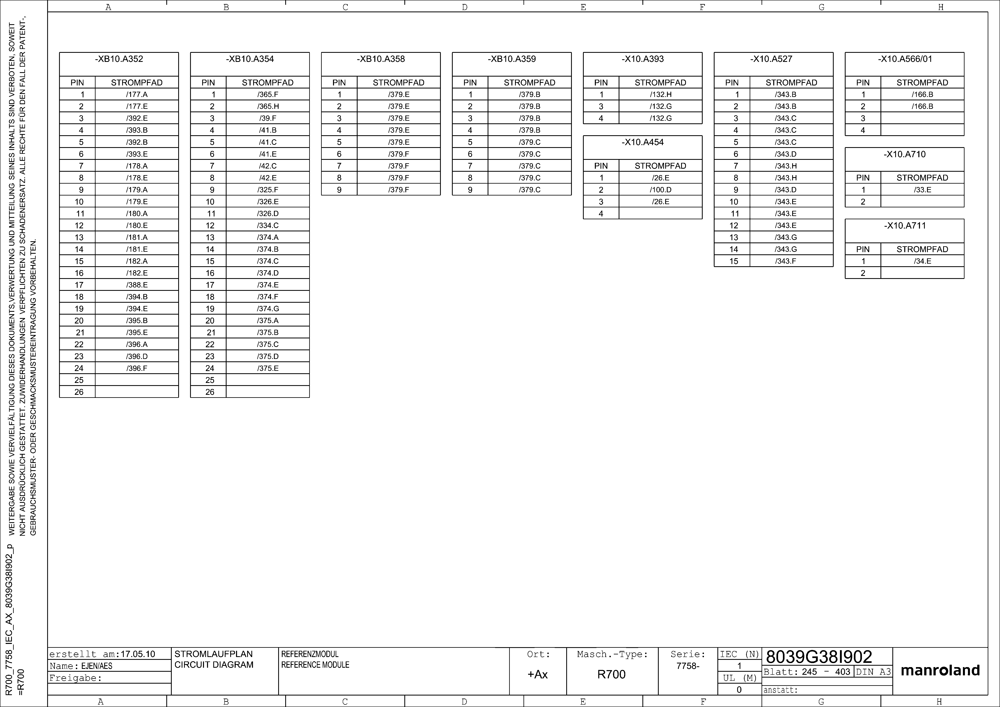

# +Ax — Sheet 245 of 403 — REFERENZMODUL

**REFERENCE MODULE**

> Part of the manroland **R700** printing press IEC/UL circuit diagrams.
> Drawing class: **Stromlaufplan / Circuit diagram** (DIN A3).
> Document `+Ax` covers the **Central control console** machine section.

## At a glance

| Field | Value |
|---|---|
| Document | `+Ax`  (8039G38I902) |
| Sheet | **245** of 403 |
| Section (DE) | REFERENZMODUL |
| Section (EN) | REFERENCE MODULE |
| Section type | REFERENCE_MODULE — Reference module |
| Machine type | `R700` |
| Series | `7758` |
| Created | 17.05.10 |
| Replaces | — |
| Columns used | A, B, C, D, E, F, G, H |
| Path numbers | — |
| Labels on sheet | 221 |
| Cross-refs out | 91 |
| Cross-refs in | 0 |

**Previous:** [+Ax sheet 244](SHEET_0244.md) · **Next:** [+Ax sheet 246](SHEET_0246.md) · **Document TOC:** [_TOC.md](_TOC.md)  (+Ax) · **Master TOC:** [all sheets](../_MASTER_TOC.md)

## Sheet image (300 DPI, exact vector render)



_Rendered directly from the PDF vector layer at 300 DPI (1-bit), no OCR and no resampling. Use it to confirm anything ambiguous in the text below._

## Cross-references on this sheet

Each entry is a wire leaving this sheet. The printed token is `/sheet.column`; the link resolves to that sheet inside the same document.

| Ref | Target sheet | Col | Path | Destination on target | Target section | From col |
|---|---|---|---|---|---|---|
| `/177.A` | [+Ax sheet 177](SHEET_0177.md) | A | — | — | RESERVE | A |
| `/379.E` | [+Ax sheet 379](SHEET_0379.md) | E | — | — | OPTION: TELEPRESENCE | C |
| `/379.B` | [+Ax sheet 379](SHEET_0379.md) | B | — | — | OPTION: TELEPRESENCE | E |
| `/343.B` | [+Ax sheet 343](SHEET_0343.md) | B | — | — | OPTION: INLINESHEETER RS104 S | G |
| `/166.B` | [+Ax sheet 166](SHEET_0166.md) | B | — | — | ÜBERWACHUNGSRECHNER/ANSTEUERUNG NOT AUS | H |
| `/365.F` | [+Ax sheet 365](SHEET_0365.md) | F | — | — | OPTION: LOGISTIK AUSLEGER | B |
| `/132.H` | [+Ax sheet 132](SHEET_0132.md) | H | — | — | REALTIMERECHNER ANLAGE | F |
| `/177.E` | [+Ax sheet 177](SHEET_0177.md) | E | — | — | RESERVE | A |
| `/379.E` | [+Ax sheet 379](SHEET_0379.md) | E | — | — | OPTION: TELEPRESENCE | C |
| `/379.B` | [+Ax sheet 379](SHEET_0379.md) | B | — | — | OPTION: TELEPRESENCE | E |
| `/343.B` | [+Ax sheet 343](SHEET_0343.md) | B | — | — | OPTION: INLINESHEETER RS104 S | G |
| `/166.B` | [+Ax sheet 166](SHEET_0166.md) | B | — | — | ÜBERWACHUNGSRECHNER/ANSTEUERUNG NOT AUS | H |
| `/132.G` | [+Ax sheet 132](SHEET_0132.md) | G | — | — | REALTIMERECHNER ANLAGE | F |
| `/365.H` | [+Ax sheet 365](SHEET_0365.md) | H | — | — | OPTION: LOGISTIK AUSLEGER | B |
| `/39.F` | [+Ax sheet 39](SHEET_0039.md) | F | — | — | HAUPTANTRIEB | B |
| `/392.E` | [+Ax sheet 392](SHEET_0392.md) | E | — | — | OPTION: WASCHVORRICHTUNG MIT TUCH | A |
| `/379.E` | [+Ax sheet 379](SHEET_0379.md) | E | — | — | OPTION: TELEPRESENCE | C |
| `/379.B` | [+Ax sheet 379](SHEET_0379.md) | B | — | — | OPTION: TELEPRESENCE | E |
| `/132.G` | [+Ax sheet 132](SHEET_0132.md) | G | — | — | REALTIMERECHNER ANLAGE | F |
| `/343.C` | [+Ax sheet 343](SHEET_0343.md) | C | — | — | OPTION: INLINESHEETER RS104 S | G |
| `/41.B` | [+Ax sheet 41](SHEET_0041.md) | B | — | — | HAUPTANTRIEB | B |
| `/393.B` | [+Ax sheet 393](SHEET_0393.md) | B | — | — | OPTION: WASCHVORRICHTUNG MIT TUCH | A |
| `/379.E` | [+Ax sheet 379](SHEET_0379.md) | E | — | — | OPTION: TELEPRESENCE | C |
| `/379.B` | [+Ax sheet 379](SHEET_0379.md) | B | — | — | OPTION: TELEPRESENCE | E |
| `/343.C` | [+Ax sheet 343](SHEET_0343.md) | C | — | — | OPTION: INLINESHEETER RS104 S | G |
| `/392.B` | [+Ax sheet 392](SHEET_0392.md) | B | — | — | OPTION: WASCHVORRICHTUNG MIT TUCH | A |
| `/379.E` | [+Ax sheet 379](SHEET_0379.md) | E | — | — | OPTION: TELEPRESENCE | C |
| `/41.C` | [+Ax sheet 41](SHEET_0041.md) | C | — | — | HAUPTANTRIEB | B |
| `/379.C` | [+Ax sheet 379](SHEET_0379.md) | C | — | — | OPTION: TELEPRESENCE | E |
| `/343.C` | [+Ax sheet 343](SHEET_0343.md) | C | — | — | OPTION: INLINESHEETER RS104 S | G |
| `/41.E` | [+Ax sheet 41](SHEET_0041.md) | E | — | — | HAUPTANTRIEB | B |
| `/393.E` | [+Ax sheet 393](SHEET_0393.md) | E | — | — | OPTION: WASCHVORRICHTUNG MIT TUCH | A |
| `/379.F` | [+Ax sheet 379](SHEET_0379.md) | F | — | — | OPTION: TELEPRESENCE | C |
| `/379.C` | [+Ax sheet 379](SHEET_0379.md) | C | — | — | OPTION: TELEPRESENCE | E |
| `/343.D` | [+Ax sheet 343](SHEET_0343.md) | D | — | — | OPTION: INLINESHEETER RS104 S | G |
| `/178.A` | [+Ax sheet 178](SHEET_0178.md) | A | — | — | RESERVE | A |
| `/379.F` | [+Ax sheet 379](SHEET_0379.md) | F | — | — | OPTION: TELEPRESENCE | C |
| `/42.C` | [+Ax sheet 42](SHEET_0042.md) | C | — | — | HAUPTANTRIEB | B |
| `/379.C` | [+Ax sheet 379](SHEET_0379.md) | C | — | — | OPTION: TELEPRESENCE | E |
| `/343.H` | [+Ax sheet 343](SHEET_0343.md) | H | — | — | OPTION: INLINESHEETER RS104 S | G |
| `/33.E` | [+Ax sheet 33](SHEET_0033.md) | E | — | STROMPFAD PIN 1 2 | SPANNUNGSVERSORGUNG, SCHALTSCHRANKBELÜFTUNG | H |
| `/42.E` | [+Ax sheet 42](SHEET_0042.md) | E | — | — | HAUPTANTRIEB | B |
| `/26.E` | [+Ax sheet 26](SHEET_0026.md) | E | — | — | SPANNUNGSVERSORGUNG, SCHALTSCHRANKBELÜFTUNG | F |
| `/178.E` | [+Ax sheet 178](SHEET_0178.md) | E | — | — | RESERVE | A |
| `/379.F` | [+Ax sheet 379](SHEET_0379.md) | F | — | — | OPTION: TELEPRESENCE | C |
| `/379.C` | [+Ax sheet 379](SHEET_0379.md) | C | — | — | OPTION: TELEPRESENCE | E |
| `/343.H` | [+Ax sheet 343](SHEET_0343.md) | H | — | — | OPTION: INLINESHEETER RS104 S | G |
| `/179.A` | [+Ax sheet 179](SHEET_0179.md) | A | — | — | RESERVE | A |
| `/325.F` | [+Ax sheet 325](SHEET_0325.md) | F | — | — | OPTION: AUTOMATISCHE FARBZUFÜHRUNG | B |
| `/379.F` | [+Ax sheet 379](SHEET_0379.md) | F | — | — | OPTION: TELEPRESENCE | C |
| `/379.C` | [+Ax sheet 379](SHEET_0379.md) | C | — | — | OPTION: TELEPRESENCE | E |
| `/100.D` | [+Ax sheet 100](SHEET_0100.md) | D | — | — | ANLEGER | F |
| `/343.D` | [+Ax sheet 343](SHEET_0343.md) | D | — | — | OPTION: INLINESHEETER RS104 S | G |
| `/26.E` | [+Ax sheet 26](SHEET_0026.md) | E | — | — | SPANNUNGSVERSORGUNG, SCHALTSCHRANKBELÜFTUNG | F |
| `/179.E` | [+Ax sheet 179](SHEET_0179.md) | E | — | — | RESERVE | A |
| `/326.E` | [+Ax sheet 326](SHEET_0326.md) | E | — | — | OPTION: AUTOMATISCHE FARBZUFÜHRUNG | B |
| `/343.E` | [+Ax sheet 343](SHEET_0343.md) | E | — | — | OPTION: INLINESHEETER RS104 S | G |
| `/180.A` | [+Ax sheet 180](SHEET_0180.md) | A | — | — | RESERVE | A |
| `/343.E` | [+Ax sheet 343](SHEET_0343.md) | E | — | — | OPTION: INLINESHEETER RS104 S | G |
| `/326.D` | [+Ax sheet 326](SHEET_0326.md) | D | — | — | OPTION: AUTOMATISCHE FARBZUFÜHRUNG | B |
| `/180.E` | [+Ax sheet 180](SHEET_0180.md) | E | — | — | RESERVE | A |
| `/343.E` | [+Ax sheet 343](SHEET_0343.md) | E | — | — | OPTION: INLINESHEETER RS104 S | G |
| `/334.C` | [+Ax sheet 334](SHEET_0334.md) | C | — | — | OPTION: INLINESORTER | B |
| `/181.A` | [+Ax sheet 181](SHEET_0181.md) | A | — | — | RESERVE | A |
| `/374.A` | [+Ax sheet 374](SHEET_0374.md) | A | — | — | OPTION: VORDERMARKENEINSTELLUNG | B |
| `/343.G` | [+Ax sheet 343](SHEET_0343.md) | G | — | — | OPTION: INLINESHEETER RS104 S | G |
| `/34.E` | [+Ax sheet 34](SHEET_0034.md) | E | — | STROMPFAD PIN 1 2 | SPANNUNGSVERSORGUNG, SCHALTSCHRANKBELÜFTUNG | H |
| `/181.E` | [+Ax sheet 181](SHEET_0181.md) | E | — | — | RESERVE | A |
| `/374.B` | [+Ax sheet 374](SHEET_0374.md) | B | — | — | OPTION: VORDERMARKENEINSTELLUNG | B |
| `/343.G` | [+Ax sheet 343](SHEET_0343.md) | G | — | — | OPTION: INLINESHEETER RS104 S | G |
| `/182.A` | [+Ax sheet 182](SHEET_0182.md) | A | — | — | RESERVE | A |
| `/343.F` | [+Ax sheet 343](SHEET_0343.md) | F | — | — | OPTION: INLINESHEETER RS104 S | G |
| `/374.C` | [+Ax sheet 374](SHEET_0374.md) | C | — | — | OPTION: VORDERMARKENEINSTELLUNG | B |
| `/182.E` | [+Ax sheet 182](SHEET_0182.md) | E | — | — | RESERVE | A |
| `/374.D` | [+Ax sheet 374](SHEET_0374.md) | D | — | — | OPTION: VORDERMARKENEINSTELLUNG | B |
| `/388.E` | [+Ax sheet 388](SHEET_0388.md) | E | — | — | OPTION: WASCHVORRICHTUNG MIT TUCH | A |
| `/374.E` | [+Ax sheet 374](SHEET_0374.md) | E | — | — | OPTION: VORDERMARKENEINSTELLUNG | B |
| `/394.B` | [+Ax sheet 394](SHEET_0394.md) | B | — | — | OPTION: WASCHVORRICHTUNG MIT TUCH | A |
| `/374.F` | [+Ax sheet 374](SHEET_0374.md) | F | — | — | OPTION: VORDERMARKENEINSTELLUNG | B |
| `/394.E` | [+Ax sheet 394](SHEET_0394.md) | E | — | — | OPTION: WASCHVORRICHTUNG MIT TUCH | A |
| `/374.G` | [+Ax sheet 374](SHEET_0374.md) | G | — | — | OPTION: VORDERMARKENEINSTELLUNG | B |
| `/395.B` | [+Ax sheet 395](SHEET_0395.md) | B | — | — | OPTION: WASCHVORRICHTUNG MIT TUCH | A |
| `/375.A` | [+Ax sheet 375](SHEET_0375.md) | A | — | — | OPTION: VORDERMARKENEINSTELLUNG | B |
| `/395.E` | [+Ax sheet 395](SHEET_0395.md) | E | — | — | OPTION: WASCHVORRICHTUNG MIT TUCH | A |
| `/375.B` | [+Ax sheet 375](SHEET_0375.md) | B | — | — | OPTION: VORDERMARKENEINSTELLUNG | B |
| `/396.A` | [+Ax sheet 396](SHEET_0396.md) | A | — | — | OPTION: WASCHVORRICHTUNG MIT TUCH | A |
| `/375.C` | [+Ax sheet 375](SHEET_0375.md) | C | — | — | OPTION: VORDERMARKENEINSTELLUNG | B |
| `/396.D` | [+Ax sheet 396](SHEET_0396.md) | D | — | — | OPTION: WASCHVORRICHTUNG MIT TUCH | A |
| `/375.D` | [+Ax sheet 375](SHEET_0375.md) | D | — | — | OPTION: VORDERMARKENEINSTELLUNG | B |
| `/375.E` | [+Ax sheet 375](SHEET_0375.md) | E | — | — | OPTION: VORDERMARKENEINSTELLUNG | B |
| `/396.F` | [+Ax sheet 396](SHEET_0396.md) | F | — | — | OPTION: WASCHVORRICHTUNG MIT TUCH | A |

## Devices on this sheet

| Tag | Class | Class meaning (IEC) | Col | Sub | Terminal | Sign |
|---|---|---|---|---|---|---|
| `XB10.A352` | — | cross-device reference | A | — | — | — |
| `XB10.A354` | — | cross-device reference | B | — | — | — |
| `XB10.A358` | — | cross-device reference | C | — | — | — |
| `XB10.A359` | — | cross-device reference | D | — | — | — |
| `X10.A527` | — | cross-device reference | G | — | — | — |
| `X10.A710` | — | cross-device reference | H | — | — | — |
| `X10.A711` | — | cross-device reference | H | — | — | — |
| `X10.A454` | — | cross-device reference | F | — | — | — |
| `X10.A393` | — | cross-device reference | F | — | — | — |

## Potentials / nets

_No named potentials on this sheet._

## Wire-end annotations (grouped as printed)

A wire that continues elsewhere is annotated with a small cluster: the destination description, the path/line number `#NN`, and the `/sheet.column` cross reference. Each row below is one such cluster exactly as it is grouped on the drawing.

| Col | Y | Path | Cross-ref | Text on the wire |
|---|---|---|---|---|
| A | 65.5 | — | — | `XB10.A352` |
| B | 65.5 | — | — | `XB10.A354` |
| C | 65.5 | — | — | `XB10.A358` |
| D | 65.5 | — | — | `XB10.A359` |
| F | 65.5 | — | — | `X10.A393` |
| G | 65.5 | — | — | `X10.A527` |
| H | 65.5 | — | — | `X10.A566/01` |
| A | 94.2 | — | — | `PIN STROMPFAD` |
| B | 94.2 | — | — | `PIN STROMPFAD` |
| C | 94.2 | — | — | `PIN 2 3 4 5 6 7 8 9 1 STROMPFAD` |
| D | 94.2 | — | — | `PIN 2 3 4 5 6 7 8 9 1 STROMPFAD` |
| E | 94.2 | — | — | `PIN 3 4 1 STROMPFAD` |
| G | 94.2 | — | — | `PIN 10 12 13 14 15 11 2 3 4 5 6 7 8 9 1 STROMPFAD` |
| H | 94.2 | — | — | `PIN 2 3 4 1 STROMPFAD` |
| A | 108.4 | — | — | `2 3 4 5 6 7 8 9 1` |
| B | 108.4 | — | — | `2 3 4 5 6 7 8 9 1` |
| A | 108.7 | — | `/177.A` | — |
| B | 108.7 | — | `/365.F` | — |
| C | 108.7 | — | `/379.E` | — |
| E | 108.7 | — | `/379.B` | — |
| F | 108.7 | — | `/132.H` | — |
| G | 108.7 | — | `/343.B` | — |
| H | 108.7 | — | `/166.B` | — |
| A | 122.9 | — | `/177.E` | — |
| B | 122.9 | — | `/365.H` | — |
| C | 122.9 | — | `/379.E` | — |
| E | 122.9 | — | `/379.B` | — |
| F | 122.9 | — | `/132.G` | — |
| G | 122.9 | — | `/343.B` | — |
| H | 122.9 | — | `/166.B` | — |
| A | 137.0 | — | `/392.E` | — |
| B | 137.0 | — | `/39.F` | — |
| C | 137.0 | — | `/379.E` | — |
| E | 137.0 | — | `/379.B` | — |
| F | 137.1 | — | `/132.G` | — |
| G | 137.1 | — | `/343.C` | — |
| A | 151.2 | — | `/393.B` | — |
| B | 151.2 | — | `/41.B` | — |
| C | 151.2 | — | `/379.E` | — |
| E | 151.2 | — | `/379.B` | — |
| G | 151.2 | — | `/343.C` | — |
| F | 164.7 | — | — | `X10.A454` |
| A | 165.4 | — | `/392.B` | — |
| B | 165.4 | — | `/41.C` | — |
| C | 165.4 | — | `/379.E` | — |
| E | 165.4 | — | `/379.C` | — |
| G | 165.4 | — | `/343.C` | — |
| H | 178.9 | — | — | `X10.A710` |
| B | 179.5 | — | `/41.E` | — |
| A | 179.6 | — | `/393.E` | — |
| C | 179.6 | — | `/379.F` | — |
| E | 179.6 | — | `/379.C` | — |
| G | 179.6 | — | `/343.D` | — |
| E | 193.4 | — | — | `PIN 2 3 4 1 STROMPFAD` |
| A | 193.7 | — | `/178.A` | — |
| C | 193.7 | — | `/379.F` | — |
| B | 193.8 | — | `/42.C` | — |
| E | 193.8 | — | `/379.C` | — |
| G | 193.8 | — | `/343.H` | — |
| H | 207.5 | — | `/33.E` | `PIN 2 1 STROMPFAD` |
| A | 207.9 | — | `/178.E` | — |
| B | 207.9 | — | `/42.E` | — |
| C | 207.9 | — | `/379.F` | — |
| E | 207.9 | — | `/379.C` | — |
| F | 207.9 | — | `/26.E` | — |
| G | 207.9 | — | `/343.H` | — |
| A | 222.1 | — | `/179.A` | — |
| B | 222.1 | — | `/325.F` | — |
| C | 222.1 | — | `/379.F` | — |
| E | 222.1 | — | `/379.C` | — |
| F | 222.1 | — | `/100.D` | — |
| G | 222.1 | — | `/343.D` | — |
| A | 235.9 | — | — | `10 12 13 14 15 16 17 18 19 20 11` |
| B | 235.9 | — | — | `10 12 13 14 15 16 17 18 19 20 11` |
| A | 236.2 | — | `/179.E` | — |
| B | 236.2 | — | `/326.E` | — |
| F | 236.2 | — | `/26.E` | — |
| G | 236.2 | — | `/343.E` | — |
| A | 250.4 | — | `/180.A` | — |
| B | 250.4 | — | `/326.D` | — |
| G | 250.4 | — | `/343.E` | — |
| H | 263.9 | — | — | `X10.A711` |
| A | 264.6 | — | `/180.E` | — |
| B | 264.6 | — | `/334.C` | — |
| G | 264.6 | — | `/343.E` | — |
| A | 278.8 | — | `/181.A` | — |
| B | 278.8 | — | `/374.A` | — |
| G | 278.8 | — | `/343.G` | — |
| H | 292.6 | — | `/34.E` | `PIN 2 1 STROMPFAD` |
| A | 292.9 | — | `/181.E` | — |
| B | 292.9 | — | `/374.B` | — |
| G | 293.0 | — | `/343.G` | — |
| A | 307.1 | — | `/182.A` | — |
| B | 307.1 | — | `/374.C` | — |
| G | 307.1 | — | `/343.F` | — |
| A | 321.3 | — | `/182.E` | — |
| B | 321.3 | — | `/374.D` | — |
| A | 335.5 | — | `/388.E` | — |
| B | 335.5 | — | `/374.E` | — |
| A | 349.6 | — | `/394.B` | — |
| B | 349.6 | — | `/374.F` | — |
| A | 363.8 | — | `/394.E` | — |
| B | 363.8 | — | `/374.G` | — |
| A | 378.0 | — | `/395.B` | — |
| B | 378.0 | — | `/375.A` | — |
| A | 391.8 | — | — | `22 23 24 25 26 21` |
| B | 391.8 | — | — | `22 23 24 25 26 21` |
| A | 392.1 | — | `/395.E` | — |
| B | 392.1 | — | `/375.B` | — |
| A | 406.3 | — | `/396.A` | — |
| B | 406.4 | — | `/375.C` | — |
| A | 420.5 | — | `/396.D` | — |
| B | 420.5 | — | `/375.D` | — |
| A | 434.7 | — | `/396.F` | — |
| B | 434.7 | — | `/375.E` | — |


## Reconstructed tables

This sheet carries tabular content (pin map / terminal assignment / index). The grid below was rebuilt from the drawing's own rule lines, so each row is exactly one physical row of the table.

### Table 1 — 26 data rows × 2 columns (at x=70.9, y=62.4) — **XB10.A352**

| PIN | STROMPFAD |
|---|---|
| `1` | `/177.A` |
| `2` | `/177.E` |
| `3` | `/392.E` |
| `4` | `/393.B` |
| `5` | `/392.B` |
| `6` | `/393.E` |
| `7` | `/178.A` |
| `8` | `/178.E` |
| `9` | `/179.A` |
| `10` | `/179.E` |
| `11` | `/180.A` |
| `12` | `/180.E` |
| `13` | `/181.A` |
| `14` | `/181.E` |
| `15` | `/182.A` |
| `16` | `/182.E` |
| `17` | `/388.E` |
| `18` | `/394.B` |
| `19` | `/394.E` |
| `20` | `/395.B` |
| `21` | `/395.E` |
| `22` | `/396.A` |
| `23` | `/396.D` |
| `24` | `/396.F` |
| `25` |  |
| `26` |  |


### Table 2 — 26 data rows × 2 columns (at x=226.8, y=62.4) — **XB10.A354**

| PIN | STROMPFAD |
|---|---|
| `1` | `/365.F` |
| `2` | `/365.H` |
| `3` | `/39.F` |
| `4` | `/41.B` |
| `5` | `/41.C` |
| `6` | `/41.E` |
| `7` | `/42.C` |
| `8` | `/42.E` |
| `9` | `/325.F` |
| `10` | `/326.E` |
| `11` | `/326.D` |
| `12` | `/334.C` |
| `13` | `/374.A` |
| `14` | `/374.B` |
| `15` | `/374.C` |
| `16` | `/374.D` |
| `17` | `/374.E` |
| `18` | `/374.F` |
| `19` | `/374.G` |
| `20` | `/375.A` |
| `21` | `/375.B` |
| `22` | `/375.C` |
| `23` | `/375.D` |
| `24` | `/375.E` |
| `25` |  |
| `26` |  |


### Table 3 — 9 data rows × 2 columns (at x=382.7, y=62.4) — **XB10.A358**

| PIN | STROMPFAD |
|---|---|
| `1` | `/379.E` |
| `2` | `/379.E` |
| `3` | `/379.E` |
| `4` | `/379.E` |
| `5` | `/379.E` |
| `6` | `/379.F` |
| `7` | `/379.F` |
| `8` | `/379.F` |
| `9` | `/379.F` |


### Table 4 — 9 data rows × 2 columns (at x=538.6, y=62.4) — **XB10.A359**

| PIN | STROMPFAD |
|---|---|
| `1` | `/379.B` |
| `2` | `/379.B` |
| `3` | `/379.B` |
| `4` | `/379.B` |
| `5` | `/379.C` |
| `6` | `/379.C` |
| `7` | `/379.C` |
| `8` | `/379.C` |
| `9` | `/379.C` |


### Table 5 — 9 data rows × 2 columns (at x=694.5, y=62.4) — **X10.A393**

| PIN | STROMPFAD |
|---|---|
| `1` | `/132.H` |
| `3` | `/132.G` |
| `4` | `/132.G` |
|  | `X10.A454` |
| `PIN` | `STROMPFAD` |
| `1` | `/26.E` |
| `2` | `/100.D` |
| `3` | `/26.E` |
| `4` |  |


### Table 6 — 15 data rows × 2 columns (at x=850.4, y=62.4) — **X10.A527**

| PIN | STROMPFAD |
|---|---|
| `1` | `/343.B` |
| `2` | `/343.B` |
| `3` | `/343.C` |
| `4` | `/343.C` |
| `5` | `/343.C` |
| `6` | `/343.D` |
| `7` | `/343.H` |
| `8` | `/343.H` |
| `9` | `/343.D` |
| `10` | `/343.E` |
| `11` | `/343.E` |
| `12` | `/343.E` |
| `13` | `/343.G` |
| `14` | `/343.G` |
| `15` | `/343.F` |


### Table 7 — 12 data rows × 2 columns (at x=1006.3, y=62.4) — **X10.A566/01**

| PIN | STROMPFAD |
|---|---|
| `1` | `/166.B` |
| `2` | `/166.B` |
| `3` |  |
| `4` |  |
|  | `X10.A710` |
| `PIN` | `STROMPFAD` |
| `1` | `/33.E` |
| `2` |  |
|  | `X10.A711` |
| `PIN` | `STROMPFAD` |
| `1` | `/34.E` |
| `2` |  |


## Notes and free text on this sheet

| Text | Col | Y (pt) |
|---|---|---|
| `PIN` | A | 94.2 |
| `STROMPFAD` | A | 94.15 |
| `PIN` | B | 94.2 |
| `STROMPFAD` | B | 94.15 |
| `PIN` | C | 94.2 |
| `STROMPFAD` | C | 94.15 |
| `PIN` | D | 94.2 |
| `STROMPFAD` | E | 94.15 |
| `PIN` | F | 94.2 |
| `STROMPFAD` | G | 94.15 |
| `PIN` | G | 94.2 |
| `STROMPFAD` | H | 94.15 |
| `X10.A566/01` | H | 65.5 |
| `PIN` | E | 193.41 |
| `STROMPFAD` | F | 193.37 |

## Complete label inventory (exact text from the drawing)

Every text object inside the drawing area of this sheet, in DIN reading order (column A→H, then top→bottom). This is the authoritative list: if a string is not here it is not printed on this sheet.

| Col | Y | X | Dir | Type | Text |
|---|---|---|---|---|---|
| A | 65.5 | 113.2 | → | device ref | `XB10.A352` |
| A | 94.2 | 84.0 | → | text | `PIN` |
| A | 94.2 | 132.2 | → | text | `STROMPFAD` |
| A | 108.4 | 95.8 | → | number | `1` |
| A | 108.7 | 150.2 | → | cross-reference | `/177.A` |
| A | 122.5 | 94.1 | → | number | `2` |
| A | 122.9 | 150.5 | → | cross-reference | `/177.E` |
| A | 136.7 | 94.1 | → | number | `3` |
| A | 137.0 | 150.5 | → | cross-reference | `/392.E` |
| A | 150.9 | 94.1 | → | number | `4` |
| A | 151.2 | 150.4 | → | cross-reference | `/393.B` |
| A | 165.1 | 94.1 | → | number | `5` |
| A | 165.4 | 150.4 | → | cross-reference | `/392.B` |
| A | 179.2 | 94.1 | → | number | `6` |
| A | 179.6 | 150.5 | → | cross-reference | `/393.E` |
| A | 193.4 | 94.1 | → | number | `7` |
| A | 193.7 | 150.2 | → | cross-reference | `/178.A` |
| A | 207.6 | 94.1 | → | number | `8` |
| A | 207.9 | 150.5 | → | cross-reference | `/178.E` |
| A | 221.8 | 94.1 | → | number | `9` |
| A | 222.1 | 150.2 | → | cross-reference | `/179.A` |
| A | 235.9 | 88.7 | → | number | `10` |
| A | 236.2 | 150.5 | → | cross-reference | `/179.E` |
| A | 250.1 | 90.4 | → | number | `11` |
| A | 250.4 | 150.2 | → | cross-reference | `/180.A` |
| A | 264.3 | 88.7 | → | number | `12` |
| A | 264.6 | 150.5 | → | cross-reference | `/180.E` |
| A | 278.5 | 88.7 | → | number | `13` |
| A | 278.8 | 150.2 | → | cross-reference | `/181.A` |
| A | 292.6 | 88.7 | → | number | `14` |
| A | 292.9 | 150.5 | → | cross-reference | `/181.E` |
| A | 306.8 | 88.7 | → | number | `15` |
| A | 307.1 | 150.2 | → | cross-reference | `/182.A` |
| A | 321.0 | 88.7 | → | number | `16` |
| A | 321.3 | 150.5 | → | cross-reference | `/182.E` |
| A | 335.1 | 88.7 | → | number | `17` |
| A | 335.5 | 150.5 | → | cross-reference | `/388.E` |
| A | 349.3 | 88.7 | → | number | `18` |
| A | 349.6 | 150.4 | → | cross-reference | `/394.B` |
| A | 363.5 | 88.7 | → | number | `19` |
| A | 363.8 | 150.5 | → | cross-reference | `/394.E` |
| A | 377.7 | 88.7 | → | number | `20` |
| A | 378.0 | 150.4 | → | cross-reference | `/395.B` |
| A | 391.8 | 90.4 | → | number | `21` |
| A | 392.2 | 150.5 | → | cross-reference | `/395.E` |
| A | 406.0 | 88.7 | → | number | `22` |
| A | 406.3 | 150.2 | → | cross-reference | `/396.A` |
| A | 420.2 | 88.7 | → | number | `23` |
| A | 420.5 | 150.2 | → | cross-reference | `/396.D` |
| A | 434.4 | 88.7 | → | number | `24` |
| A | 434.7 | 150.7 | → | cross-reference | `/396.F` |
| A | 448.5 | 88.7 | → | number | `25` |
| A | 462.7 | 88.7 | → | number | `26` |
| B | 65.5 | 269.1 | → | device ref | `XB10.A354` |
| B | 94.2 | 240.0 | → | text | `PIN` |
| B | 94.2 | 288.1 | → | text | `STROMPFAD` |
| B | 108.4 | 251.7 | → | number | `1` |
| B | 108.7 | 306.6 | → | cross-reference | `/365.F` |
| B | 122.5 | 250.0 | → | number | `2` |
| B | 122.9 | 306.4 | → | cross-reference | `/365.H` |
| B | 136.7 | 250.0 | → | number | `3` |
| B | 137.0 | 309.0 | → | cross-reference | `/39.F` |
| B | 150.9 | 250.0 | → | number | `4` |
| B | 151.2 | 308.7 | → | cross-reference | `/41.B` |
| B | 165.1 | 250.0 | → | number | `5` |
| B | 165.4 | 308.6 | → | cross-reference | `/41.C` |
| B | 179.2 | 250.0 | → | number | `6` |
| B | 179.5 | 308.8 | → | cross-reference | `/41.E` |
| B | 193.4 | 250.0 | → | number | `7` |
| B | 193.7 | 308.6 | → | cross-reference | `/42.C` |
| B | 207.6 | 250.0 | → | number | `8` |
| B | 207.9 | 308.8 | → | cross-reference | `/42.E` |
| B | 221.8 | 250.0 | → | number | `9` |
| B | 222.1 | 306.6 | → | cross-reference | `/325.F` |
| B | 235.9 | 244.6 | → | number | `10` |
| B | 236.2 | 306.4 | → | cross-reference | `/326.E` |
| B | 250.1 | 246.3 | → | number | `11` |
| B | 250.4 | 306.1 | → | cross-reference | `/326.D` |
| B | 264.3 | 244.6 | → | number | `12` |
| B | 264.6 | 306.1 | → | cross-reference | `/334.C` |
| B | 278.5 | 244.6 | → | number | `13` |
| B | 278.8 | 306.1 | → | cross-reference | `/374.A` |
| B | 292.6 | 244.6 | → | number | `14` |
| B | 292.9 | 306.3 | → | cross-reference | `/374.B` |
| B | 306.8 | 244.6 | → | number | `15` |
| B | 307.1 | 306.1 | → | cross-reference | `/374.C` |
| B | 321.0 | 244.6 | → | number | `16` |
| B | 321.3 | 306.1 | → | cross-reference | `/374.D` |
| B | 335.1 | 244.6 | → | number | `17` |
| B | 335.5 | 306.4 | → | cross-reference | `/374.E` |
| B | 349.3 | 244.6 | → | number | `18` |
| B | 349.6 | 306.6 | → | cross-reference | `/374.F` |
| B | 363.5 | 244.6 | → | number | `19` |
| B | 363.8 | 306.0 | → | cross-reference | `/374.G` |
| B | 377.7 | 244.6 | → | number | `20` |
| B | 378.0 | 306.1 | → | cross-reference | `/375.A` |
| B | 391.8 | 246.3 | → | number | `21` |
| B | 392.2 | 306.3 | → | cross-reference | `/375.B` |
| B | 406.0 | 244.6 | → | number | `22` |
| B | 406.4 | 306.1 | → | cross-reference | `/375.C` |
| B | 420.2 | 244.6 | → | number | `23` |
| B | 420.5 | 306.1 | → | cross-reference | `/375.D` |
| B | 434.4 | 244.6 | → | number | `24` |
| B | 434.7 | 306.4 | → | cross-reference | `/375.E` |
| B | 448.5 | 244.6 | → | number | `25` |
| B | 462.7 | 244.6 | → | number | `26` |
| C | 65.5 | 425.1 | → | device ref | `XB10.A358` |
| C | 94.2 | 395.9 | → | text | `PIN` |
| C | 94.2 | 444.0 | → | text | `STROMPFAD` |
| C | 108.4 | 401.8 | → | number | `1` |
| C | 108.7 | 462.3 | → | cross-reference | `/379.E` |
| C | 122.5 | 401.2 | → | number | `2` |
| C | 122.9 | 462.3 | → | cross-reference | `/379.E` |
| C | 136.7 | 401.2 | → | number | `3` |
| C | 137.0 | 462.3 | → | cross-reference | `/379.E` |
| C | 150.9 | 401.2 | → | number | `4` |
| C | 151.2 | 462.3 | → | cross-reference | `/379.E` |
| C | 165.1 | 401.2 | → | number | `5` |
| C | 165.4 | 462.3 | → | cross-reference | `/379.E` |
| C | 179.2 | 401.2 | → | number | `6` |
| C | 179.6 | 462.5 | → | cross-reference | `/379.F` |
| C | 193.4 | 401.2 | → | number | `7` |
| C | 193.7 | 462.5 | → | cross-reference | `/379.F` |
| C | 207.6 | 401.2 | → | number | `8` |
| C | 207.9 | 462.5 | → | cross-reference | `/379.F` |
| C | 221.8 | 401.2 | → | number | `9` |
| C | 222.1 | 462.5 | → | cross-reference | `/379.F` |
| D | 65.5 | 581.0 | → | device ref | `XB10.A359` |
| D | 94.2 | 551.8 | → | text | `PIN` |
| D | 108.4 | 557.7 | → | number | `1` |
| D | 122.5 | 557.1 | → | number | `2` |
| D | 136.7 | 557.1 | → | number | `3` |
| D | 150.9 | 557.1 | → | number | `4` |
| D | 165.1 | 557.1 | → | number | `5` |
| D | 179.2 | 557.1 | → | number | `6` |
| D | 193.4 | 557.1 | → | number | `7` |
| D | 207.6 | 557.1 | → | number | `8` |
| D | 221.8 | 557.1 | → | number | `9` |
| E | 94.2 | 600.0 | → | text | `STROMPFAD` |
| E | 94.2 | 707.7 | → | text | `PIN` |
| E | 108.4 | 713.6 | → | number | `1` |
| E | 108.7 | 618.1 | → | cross-reference | `/379.B` |
| E | 122.5 | 713.1 | → | number | `3` |
| E | 122.9 | 618.1 | → | cross-reference | `/379.B` |
| E | 136.7 | 713.1 | → | number | `4` |
| E | 137.0 | 618.1 | → | cross-reference | `/379.B` |
| E | 151.2 | 618.1 | → | cross-reference | `/379.B` |
| E | 165.4 | 618.0 | → | cross-reference | `/379.C` |
| E | 179.6 | 618.0 | → | cross-reference | `/379.C` |
| E | 193.4 | 707.7 | → | text | `PIN` |
| E | 193.8 | 618.0 | → | cross-reference | `/379.C` |
| E | 207.6 | 713.6 | → | number | `1` |
| E | 207.9 | 618.0 | → | cross-reference | `/379.C` |
| E | 221.8 | 713.1 | → | number | `2` |
| E | 222.1 | 618.0 | → | cross-reference | `/379.C` |
| E | 235.9 | 713.1 | → | number | `3` |
| E | 250.1 | 713.1 | → | number | `4` |
| F | 65.5 | 740.4 | → | device ref | `X10.A393` |
| F | 94.2 | 755.9 | → | text | `STROMPFAD` |
| F | 94.2 | 863.6 | → | text | `PIN` |
| F | 108.4 | 875.3 | → | number | `1` |
| F | 108.7 | 774.1 | → | cross-reference | `/132.H` |
| F | 122.5 | 873.6 | → | number | `2` |
| F | 122.9 | 773.7 | → | cross-reference | `/132.G` |
| F | 136.7 | 873.6 | → | number | `3` |
| F | 137.1 | 773.7 | → | cross-reference | `/132.G` |
| F | 150.9 | 873.6 | → | number | `4` |
| F | 164.7 | 740.4 | → | device ref | `X10.A454` |
| F | 165.1 | 873.6 | → | number | `5` |
| F | 179.2 | 873.6 | → | number | `6` |
| F | 193.4 | 755.9 | → | text | `STROMPFAD` |
| F | 193.4 | 873.6 | → | number | `7` |
| F | 207.6 | 873.6 | → | number | `8` |
| F | 207.9 | 776.6 | → | cross-reference | `/26.E` |
| F | 221.8 | 873.6 | → | number | `9` |
| F | 222.1 | 773.9 | → | cross-reference | `/100.D` |
| F | 235.9 | 868.3 | → | number | `10` |
| F | 236.2 | 776.6 | → | cross-reference | `/26.E` |
| F | 250.1 | 870.0 | → | number | `11` |
| F | 264.3 | 868.3 | → | number | `12` |
| F | 278.5 | 868.3 | → | number | `13` |
| F | 292.6 | 868.3 | → | number | `14` |
| F | 306.8 | 868.3 | → | number | `15` |
| G | 65.5 | 893.5 | → | device ref | `X10.A527` |
| G | 94.2 | 911.8 | → | text | `STROMPFAD` |
| G | 94.2 | 1019.5 | → | text | `PIN` |
| G | 108.4 | 1025.4 | → | number | `1` |
| G | 108.7 | 922.8 | → | cross-reference | `/343.B` |
| G | 122.5 | 1024.9 | → | number | `2` |
| G | 122.9 | 922.8 | → | cross-reference | `/343.B` |
| G | 136.7 | 1024.9 | → | number | `3` |
| G | 137.1 | 922.7 | → | cross-reference | `/343.C` |
| G | 150.9 | 1024.9 | → | number | `4` |
| G | 151.2 | 922.7 | → | cross-reference | `/343.C` |
| G | 165.4 | 922.7 | → | cross-reference | `/343.C` |
| G | 179.6 | 922.7 | → | cross-reference | `/343.D` |
| G | 193.8 | 923.0 | → | cross-reference | `/343.H` |
| G | 207.6 | 1019.5 | → | text | `PIN` |
| G | 207.9 | 923.0 | → | cross-reference | `/343.H` |
| G | 221.8 | 1025.4 | → | number | `1` |
| G | 222.1 | 922.7 | → | cross-reference | `/343.D` |
| G | 235.9 | 1024.9 | → | number | `2` |
| G | 236.2 | 923.0 | → | cross-reference | `/343.E` |
| G | 250.4 | 923.0 | → | cross-reference | `/343.E` |
| G | 264.6 | 923.0 | → | cross-reference | `/343.E` |
| G | 278.8 | 922.5 | → | cross-reference | `/343.G` |
| G | 292.6 | 1019.5 | → | text | `PIN` |
| G | 293.0 | 922.5 | → | cross-reference | `/343.G` |
| G | 306.8 | 1025.4 | → | number | `1` |
| G | 307.1 | 923.1 | → | cross-reference | `/343.F` |
| G | 321.0 | 1024.9 | → | number | `2` |
| H | 65.5 | 1045.6 | → | text | `X10.A566/01` |
| H | 94.2 | 1067.7 | → | text | `STROMPFAD` |
| H | 108.7 | 1085.8 | → | cross-reference | `/166.B` |
| H | 122.9 | 1085.8 | → | cross-reference | `/166.B` |
| H | 178.9 | 1052.2 | → | device ref | `X10.A710` |
| H | 207.5 | 1067.7 | → | text | `STROMPFAD` |
| H | 222.1 | 1088.4 | → | cross-reference | `/33.E` |
| H | 263.9 | 1052.9 | → | device ref | `X10.A711` |
| H | 292.6 | 1067.7 | → | text | `STROMPFAD` |
| H | 307.1 | 1088.4 | → | cross-reference | `/34.E` |

## Reading-order text block

The same content as a plain block, grouped by DIN column — convenient to paste or to match against a visual description.

```text
=== Column A ===
  65.5  113.2  devref       XB10.A352
  94.2   84.0  text         PIN
  94.2  132.2  text         STROMPFAD
 108.4   95.8  numeric      1
 108.7  150.2  xref         /177.A
 122.5   94.1  numeric      2
 122.9  150.5  xref         /177.E
 136.7   94.1  numeric      3
 137.0  150.5  xref         /392.E
 150.9   94.1  numeric      4
 151.2  150.4  xref         /393.B
 165.1   94.1  numeric      5
 165.4  150.4  xref         /392.B
 179.2   94.1  numeric      6
 179.6  150.5  xref         /393.E
 193.4   94.1  numeric      7
 193.7  150.2  xref         /178.A
 207.6   94.1  numeric      8
 207.9  150.5  xref         /178.E
 221.8   94.1  numeric      9
 222.1  150.2  xref         /179.A
 235.9   88.7  numeric      10
 236.2  150.5  xref         /179.E
 250.1   90.4  numeric      11
 250.4  150.2  xref         /180.A
 264.3   88.7  numeric      12
 264.6  150.5  xref         /180.E
 278.5   88.7  numeric      13
 278.8  150.2  xref         /181.A
 292.6   88.7  numeric      14
 292.9  150.5  xref         /181.E
 306.8   88.7  numeric      15
 307.1  150.2  xref         /182.A
 321.0   88.7  numeric      16
 321.3  150.5  xref         /182.E
 335.1   88.7  numeric      17
 335.5  150.5  xref         /388.E
 349.3   88.7  numeric      18
 349.6  150.4  xref         /394.B
 363.5   88.7  numeric      19
 363.8  150.5  xref         /394.E
 377.7   88.7  numeric      20
 378.0  150.4  xref         /395.B
 391.8   90.4  numeric      21
 392.2  150.5  xref         /395.E
 406.0   88.7  numeric      22
 406.3  150.2  xref         /396.A
 420.2   88.7  numeric      23
 420.5  150.2  xref         /396.D
 434.4   88.7  numeric      24
 434.7  150.7  xref         /396.F
 448.5   88.7  numeric      25
 462.7   88.7  numeric      26
=== Column B ===
  65.5  269.1  devref       XB10.A354
  94.2  240.0  text         PIN
  94.2  288.1  text         STROMPFAD
 108.4  251.7  numeric      1
 108.7  306.6  xref         /365.F
 122.5  250.0  numeric      2
 122.9  306.4  xref         /365.H
 136.7  250.0  numeric      3
 137.0  309.0  xref         /39.F
 150.9  250.0  numeric      4
 151.2  308.7  xref         /41.B
 165.1  250.0  numeric      5
 165.4  308.6  xref         /41.C
 179.2  250.0  numeric      6
 179.5  308.8  xref         /41.E
 193.4  250.0  numeric      7
 193.7  308.6  xref         /42.C
 207.6  250.0  numeric      8
 207.9  308.8  xref         /42.E
 221.8  250.0  numeric      9
 222.1  306.6  xref         /325.F
 235.9  244.6  numeric      10
 236.2  306.4  xref         /326.E
 250.1  246.3  numeric      11
 250.4  306.1  xref         /326.D
 264.3  244.6  numeric      12
 264.6  306.1  xref         /334.C
 278.5  244.6  numeric      13
 278.8  306.1  xref         /374.A
 292.6  244.6  numeric      14
 292.9  306.3  xref         /374.B
 306.8  244.6  numeric      15
 307.1  306.1  xref         /374.C
 321.0  244.6  numeric      16
 321.3  306.1  xref         /374.D
 335.1  244.6  numeric      17
 335.5  306.4  xref         /374.E
 349.3  244.6  numeric      18
 349.6  306.6  xref         /374.F
 363.5  244.6  numeric      19
 363.8  306.0  xref         /374.G
 377.7  244.6  numeric      20
 378.0  306.1  xref         /375.A
 391.8  246.3  numeric      21
 392.2  306.3  xref         /375.B
 406.0  244.6  numeric      22
 406.4  306.1  xref         /375.C
 420.2  244.6  numeric      23
 420.5  306.1  xref         /375.D
 434.4  244.6  numeric      24
 434.7  306.4  xref         /375.E
 448.5  244.6  numeric      25
 462.7  244.6  numeric      26
=== Column C ===
  65.5  425.1  devref       XB10.A358
  94.2  395.9  text         PIN
  94.2  444.0  text         STROMPFAD
 108.4  401.8  numeric      1
 108.7  462.3  xref         /379.E
 122.5  401.2  numeric      2
 122.9  462.3  xref         /379.E
 136.7  401.2  numeric      3
 137.0  462.3  xref         /379.E
 150.9  401.2  numeric      4
 151.2  462.3  xref         /379.E
 165.1  401.2  numeric      5
 165.4  462.3  xref         /379.E
 179.2  401.2  numeric      6
 179.6  462.5  xref         /379.F
 193.4  401.2  numeric      7
 193.7  462.5  xref         /379.F
 207.6  401.2  numeric      8
 207.9  462.5  xref         /379.F
 221.8  401.2  numeric      9
 222.1  462.5  xref         /379.F
=== Column D ===
  65.5  581.0  devref       XB10.A359
  94.2  551.8  text         PIN
 108.4  557.7  numeric      1
 122.5  557.1  numeric      2
 136.7  557.1  numeric      3
 150.9  557.1  numeric      4
 165.1  557.1  numeric      5
 179.2  557.1  numeric      6
 193.4  557.1  numeric      7
 207.6  557.1  numeric      8
 221.8  557.1  numeric      9
=== Column E ===
  94.2  600.0  text         STROMPFAD
  94.2  707.7  text         PIN
 108.4  713.6  numeric      1
 108.7  618.1  xref         /379.B
 122.5  713.1  numeric      3
 122.9  618.1  xref         /379.B
 136.7  713.1  numeric      4
 137.0  618.1  xref         /379.B
 151.2  618.1  xref         /379.B
 165.4  618.0  xref         /379.C
 179.6  618.0  xref         /379.C
 193.4  707.7  text         PIN
 193.8  618.0  xref         /379.C
 207.6  713.6  numeric      1
 207.9  618.0  xref         /379.C
 221.8  713.1  numeric      2
 222.1  618.0  xref         /379.C
 235.9  713.1  numeric      3
 250.1  713.1  numeric      4
=== Column F ===
  65.5  740.4  devref       X10.A393
  94.2  755.9  text         STROMPFAD
  94.2  863.6  text         PIN
 108.4  875.3  numeric      1
 108.7  774.1  xref         /132.H
 122.5  873.6  numeric      2
 122.9  773.7  xref         /132.G
 136.7  873.6  numeric      3
 137.1  773.7  xref         /132.G
 150.9  873.6  numeric      4
 164.7  740.4  devref       X10.A454
 165.1  873.6  numeric      5
 179.2  873.6  numeric      6
 193.4  755.9  text         STROMPFAD
 193.4  873.6  numeric      7
 207.6  873.6  numeric      8
 207.9  776.6  xref         /26.E
 221.8  873.6  numeric      9
 222.1  773.9  xref         /100.D
 235.9  868.3  numeric      10
 236.2  776.6  xref         /26.E
 250.1  870.0  numeric      11
 264.3  868.3  numeric      12
 278.5  868.3  numeric      13
 292.6  868.3  numeric      14
 306.8  868.3  numeric      15
=== Column G ===
  65.5  893.5  devref       X10.A527
  94.2  911.8  text         STROMPFAD
  94.2 1019.5  text         PIN
 108.4 1025.4  numeric      1
 108.7  922.8  xref         /343.B
 122.5 1024.9  numeric      2
 122.9  922.8  xref         /343.B
 136.7 1024.9  numeric      3
 137.1  922.7  xref         /343.C
 150.9 1024.9  numeric      4
 151.2  922.7  xref         /343.C
 165.4  922.7  xref         /343.C
 179.6  922.7  xref         /343.D
 193.8  923.0  xref         /343.H
 207.6 1019.5  text         PIN
 207.9  923.0  xref         /343.H
 221.8 1025.4  numeric      1
 222.1  922.7  xref         /343.D
 235.9 1024.9  numeric      2
 236.2  923.0  xref         /343.E
 250.4  923.0  xref         /343.E
 264.6  923.0  xref         /343.E
 278.8  922.5  xref         /343.G
 292.6 1019.5  text         PIN
 293.0  922.5  xref         /343.G
 306.8 1025.4  numeric      1
 307.1  923.1  xref         /343.F
 321.0 1024.9  numeric      2
=== Column H ===
  65.5 1045.6  text         X10.A566/01
  94.2 1067.7  text         STROMPFAD
 108.7 1085.8  xref         /166.B
 122.9 1085.8  xref         /166.B
 178.9 1052.2  devref       X10.A710
 207.5 1067.7  text         STROMPFAD
 222.1 1088.4  xref         /33.E
 263.9 1052.9  devref       X10.A711
 292.6 1067.7  text         STROMPFAD
 307.1 1088.4  xref         /34.E
```

---
_Generated from the PDF vector text layer; no OCR. Source: `R700_7758_IEC_AX_8039G38I902_p`, sheet 245._
