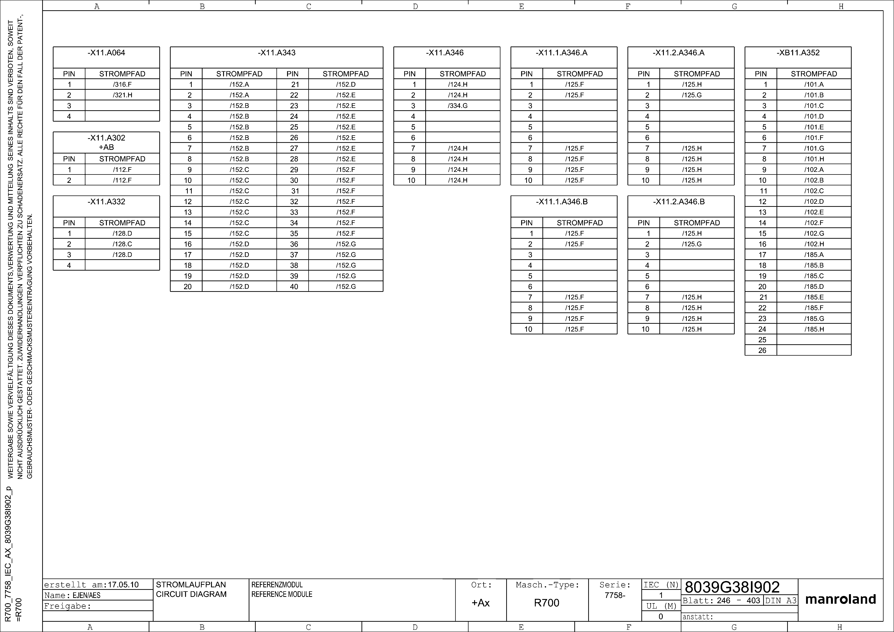

# +Ax — Sheet 246 of 403 — REFERENZMODUL

**REFERENCE MODULE**

> Part of the manroland **R700** printing press IEC/UL circuit diagrams.
> Drawing class: **Stromlaufplan / Circuit diagram** (DIN A3).
> Document `+Ax` covers the **Central control console** machine section.

## At a glance

| Field | Value |
|---|---|
| Document | `+Ax`  (8039G38I902) |
| Sheet | **246** of 403 |
| Section (DE) | REFERENZMODUL |
| Section (EN) | REFERENCE MODULE |
| Section type | REFERENCE_MODULE — Reference module |
| Machine type | `R700` |
| Series | `7758` |
| Created | 17.05.10 |
| Replaces | — |
| Columns used | A, B, C, D, E, F, G, H |
| Path numbers | — |
| Labels on sheet | 261 |
| Cross-refs out | 102 |
| Cross-refs in | 0 |

**Previous:** [+Ax sheet 245](SHEET_0245.md) · **Next:** [+Ax sheet 247](SHEET_0247.md) · **Document TOC:** [_TOC.md](_TOC.md)  (+Ax) · **Master TOC:** [all sheets](../_MASTER_TOC.md)

## Sheet image (300 DPI, exact vector render)



_Rendered directly from the PDF vector layer at 300 DPI (1-bit), no OCR and no resampling. Use it to confirm anything ambiguous in the text below._

## Cross-references on this sheet

Each entry is a wire leaving this sheet. The printed token is `/sheet.column`; the link resolves to that sheet inside the same document.

| Ref | Target sheet | Col | Path | Destination on target | Target section | From col |
|---|---|---|---|---|---|---|
| `/152.A` | [+Ax sheet 152](SHEET_0152.md) | A | — | — | ÜBERWACHUNGSRECHNER SICHERHEITSBUS | B |
| `/101.A` | [+Ax sheet 101](SHEET_0101.md) | A | — | — | ANLEGER | H |
| `/316.F` | [+Ax sheet 316](SHEET_0316.md) | F | — | — | OPTION: "EJEKTOR" ANLAGE / SELECT AIRSTATION / | A |
| `/125.F` | [+Ax sheet 125](SHEET_0125.md) | F | — | — | REALTIMERECHNER FEHLBOGENKONTROLLE | F |
| `/152.D` | [+Ax sheet 152](SHEET_0152.md) | D | — | — | ÜBERWACHUNGSRECHNER SICHERHEITSBUS | C |
| `/124.H` | [+Ax sheet 124](SHEET_0124.md) | H | — | — | REALTIMERECHNER FEHLBOGENKONTROLLE | D |
| `/125.H` | [+Ax sheet 125](SHEET_0125.md) | H | — | — | REALTIMERECHNER FEHLBOGENKONTROLLE | G |
| `/152.A` | [+Ax sheet 152](SHEET_0152.md) | A | — | — | ÜBERWACHUNGSRECHNER SICHERHEITSBUS | B |
| `/152.E` | [+Ax sheet 152](SHEET_0152.md) | E | — | — | ÜBERWACHUNGSRECHNER SICHERHEITSBUS | C |
| `/101.B` | [+Ax sheet 101](SHEET_0101.md) | B | — | — | ANLEGER | H |
| `/125.F` | [+Ax sheet 125](SHEET_0125.md) | F | — | — | REALTIMERECHNER FEHLBOGENKONTROLLE | F |
| `/125.G` | [+Ax sheet 125](SHEET_0125.md) | G | — | — | REALTIMERECHNER FEHLBOGENKONTROLLE | G |
| `/321.H` | [+Ax sheet 321](SHEET_0321.md) | H | — | — | OPTION: "EJEKTOR" ANLAGE / SELECT AIRSTATION / | A |
| `/124.H` | [+Ax sheet 124](SHEET_0124.md) | H | — | — | REALTIMERECHNER FEHLBOGENKONTROLLE | D |
| `/152.B` | [+Ax sheet 152](SHEET_0152.md) | B | — | — | ÜBERWACHUNGSRECHNER SICHERHEITSBUS | B |
| `/152.E` | [+Ax sheet 152](SHEET_0152.md) | E | — | — | ÜBERWACHUNGSRECHNER SICHERHEITSBUS | C |
| `/334.G` | [+Ax sheet 334](SHEET_0334.md) | G | — | — | OPTION: INLINESORTER | D |
| `/101.C` | [+Ax sheet 101](SHEET_0101.md) | C | — | — | ANLEGER | H |
| `/152.B` | [+Ax sheet 152](SHEET_0152.md) | B | — | — | ÜBERWACHUNGSRECHNER SICHERHEITSBUS | B |
| `/152.E` | [+Ax sheet 152](SHEET_0152.md) | E | — | — | ÜBERWACHUNGSRECHNER SICHERHEITSBUS | C |
| `/101.D` | [+Ax sheet 101](SHEET_0101.md) | D | — | — | ANLEGER | H |
| `/152.B` | [+Ax sheet 152](SHEET_0152.md) | B | — | — | ÜBERWACHUNGSRECHNER SICHERHEITSBUS | B |
| `/152.E` | [+Ax sheet 152](SHEET_0152.md) | E | — | — | ÜBERWACHUNGSRECHNER SICHERHEITSBUS | C |
| `/101.E` | [+Ax sheet 101](SHEET_0101.md) | E | — | — | ANLEGER | H |
| `/152.B` | [+Ax sheet 152](SHEET_0152.md) | B | — | — | ÜBERWACHUNGSRECHNER SICHERHEITSBUS | B |
| `/152.E` | [+Ax sheet 152](SHEET_0152.md) | E | — | — | ÜBERWACHUNGSRECHNER SICHERHEITSBUS | C |
| `/101.F` | [+Ax sheet 101](SHEET_0101.md) | F | — | — | ANLEGER | H |
| `/152.B` | [+Ax sheet 152](SHEET_0152.md) | B | — | — | ÜBERWACHUNGSRECHNER SICHERHEITSBUS | B |
| `/152.E` | [+Ax sheet 152](SHEET_0152.md) | E | — | — | ÜBERWACHUNGSRECHNER SICHERHEITSBUS | C |
| `/125.F` | [+Ax sheet 125](SHEET_0125.md) | F | — | — | REALTIMERECHNER FEHLBOGENKONTROLLE | F |
| `/101.G` | [+Ax sheet 101](SHEET_0101.md) | G | — | — | ANLEGER | H |
| `/124.H` | [+Ax sheet 124](SHEET_0124.md) | H | — | — | REALTIMERECHNER FEHLBOGENKONTROLLE | D |
| `/125.H` | [+Ax sheet 125](SHEET_0125.md) | H | — | — | REALTIMERECHNER FEHLBOGENKONTROLLE | G |
| `/152.B` | [+Ax sheet 152](SHEET_0152.md) | B | — | — | ÜBERWACHUNGSRECHNER SICHERHEITSBUS | B |
| `/152.E` | [+Ax sheet 152](SHEET_0152.md) | E | — | — | ÜBERWACHUNGSRECHNER SICHERHEITSBUS | C |
| `/125.F` | [+Ax sheet 125](SHEET_0125.md) | F | — | — | REALTIMERECHNER FEHLBOGENKONTROLLE | F |
| `/124.H` | [+Ax sheet 124](SHEET_0124.md) | H | — | — | REALTIMERECHNER FEHLBOGENKONTROLLE | D |
| `/125.H` | [+Ax sheet 125](SHEET_0125.md) | H | — | — | REALTIMERECHNER FEHLBOGENKONTROLLE | G |
| `/101.H` | [+Ax sheet 101](SHEET_0101.md) | H | — | — | ANLEGER | H |
| `/102.A` | [+Ax sheet 102](SHEET_0102.md) | A | — | — | ANLEGER | H |
| `/112.F` | [+Ax sheet 112](SHEET_0112.md) | F | — | — | FORMATEINSTELLUNG MOTORISCH, SEITLICHE | A |
| `/152.F` | [+Ax sheet 152](SHEET_0152.md) | F | — | — | ÜBERWACHUNGSRECHNER SICHERHEITSBUS | C |
| `/125.F` | [+Ax sheet 125](SHEET_0125.md) | F | — | — | REALTIMERECHNER FEHLBOGENKONTROLLE | F |
| `/152.C` | [+Ax sheet 152](SHEET_0152.md) | C | — | — | ÜBERWACHUNGSRECHNER SICHERHEITSBUS | B |
| `/124.H` | [+Ax sheet 124](SHEET_0124.md) | H | — | — | REALTIMERECHNER FEHLBOGENKONTROLLE | D |
| `/125.H` | [+Ax sheet 125](SHEET_0125.md) | H | — | — | REALTIMERECHNER FEHLBOGENKONTROLLE | G |
| `/102.B` | [+Ax sheet 102](SHEET_0102.md) | B | — | — | ANLEGER | H |
| `/112.F` | [+Ax sheet 112](SHEET_0112.md) | F | — | — | FORMATEINSTELLUNG MOTORISCH, SEITLICHE | A |
| `/152.F` | [+Ax sheet 152](SHEET_0152.md) | F | — | — | ÜBERWACHUNGSRECHNER SICHERHEITSBUS | C |
| `/125.F` | [+Ax sheet 125](SHEET_0125.md) | F | — | — | REALTIMERECHNER FEHLBOGENKONTROLLE | F |
| `/152.C` | [+Ax sheet 152](SHEET_0152.md) | C | — | — | ÜBERWACHUNGSRECHNER SICHERHEITSBUS | B |
| `/124.H` | [+Ax sheet 124](SHEET_0124.md) | H | — | — | REALTIMERECHNER FEHLBOGENKONTROLLE | D |
| `/125.H` | [+Ax sheet 125](SHEET_0125.md) | H | — | — | REALTIMERECHNER FEHLBOGENKONTROLLE | G |
| `/152.F` | [+Ax sheet 152](SHEET_0152.md) | F | — | — | ÜBERWACHUNGSRECHNER SICHERHEITSBUS | C |
| `/152.C` | [+Ax sheet 152](SHEET_0152.md) | C | — | — | ÜBERWACHUNGSRECHNER SICHERHEITSBUS | B |
| `/102.C` | [+Ax sheet 102](SHEET_0102.md) | C | — | — | ANLEGER | H |
| `/152.F` | [+Ax sheet 152](SHEET_0152.md) | F | — | — | ÜBERWACHUNGSRECHNER SICHERHEITSBUS | C |
| `/152.C` | [+Ax sheet 152](SHEET_0152.md) | C | — | — | ÜBERWACHUNGSRECHNER SICHERHEITSBUS | B |
| `/102.D` | [+Ax sheet 102](SHEET_0102.md) | D | — | — | ANLEGER | H |
| `/102.E` | [+Ax sheet 102](SHEET_0102.md) | E | — | — | ANLEGER | H |
| `/152.F` | [+Ax sheet 152](SHEET_0152.md) | F | — | — | ÜBERWACHUNGSRECHNER SICHERHEITSBUS | C |
| `/152.C` | [+Ax sheet 152](SHEET_0152.md) | C | — | — | ÜBERWACHUNGSRECHNER SICHERHEITSBUS | B |
| `/152.F` | [+Ax sheet 152](SHEET_0152.md) | F | — | — | ÜBERWACHUNGSRECHNER SICHERHEITSBUS | C |
| `/102.F` | [+Ax sheet 102](SHEET_0102.md) | F | — | — | ANLEGER | H |
| `/152.C` | [+Ax sheet 152](SHEET_0152.md) | C | — | — | ÜBERWACHUNGSRECHNER SICHERHEITSBUS | B |
| `/152.F` | [+Ax sheet 152](SHEET_0152.md) | F | — | — | ÜBERWACHUNGSRECHNER SICHERHEITSBUS | C |
| `/125.F` | [+Ax sheet 125](SHEET_0125.md) | F | — | — | REALTIMERECHNER FEHLBOGENKONTROLLE | F |
| `/102.G` | [+Ax sheet 102](SHEET_0102.md) | G | — | — | ANLEGER | H |
| `/128.D` | [+Ax sheet 128](SHEET_0128.md) | D | — | — | REALTIMERECHNER ANLEGER | A |
| `/152.C` | [+Ax sheet 152](SHEET_0152.md) | C | — | — | ÜBERWACHUNGSRECHNER SICHERHEITSBUS | B |
| `/125.H` | [+Ax sheet 125](SHEET_0125.md) | H | — | — | REALTIMERECHNER FEHLBOGENKONTROLLE | G |
| `/152.G` | [+Ax sheet 152](SHEET_0152.md) | G | — | — | ÜBERWACHUNGSRECHNER SICHERHEITSBUS | C |
| `/125.F` | [+Ax sheet 125](SHEET_0125.md) | F | — | — | REALTIMERECHNER FEHLBOGENKONTROLLE | F |
| `/125.G` | [+Ax sheet 125](SHEET_0125.md) | G | — | — | REALTIMERECHNER FEHLBOGENKONTROLLE | G |
| `/128.C` | [+Ax sheet 128](SHEET_0128.md) | C | — | — | REALTIMERECHNER ANLEGER | A |
| `/152.D` | [+Ax sheet 152](SHEET_0152.md) | D | — | — | ÜBERWACHUNGSRECHNER SICHERHEITSBUS | B |
| `/102.H` | [+Ax sheet 102](SHEET_0102.md) | H | — | — | ANLEGER | H |
| `/185.A` | [+Ax sheet 185](SHEET_0185.md) | A | — | — | RESERVE | H |
| `/152.G` | [+Ax sheet 152](SHEET_0152.md) | G | — | — | ÜBERWACHUNGSRECHNER SICHERHEITSBUS | C |
| `/128.D` | [+Ax sheet 128](SHEET_0128.md) | D | — | — | REALTIMERECHNER ANLEGER | A |
| `/152.D` | [+Ax sheet 152](SHEET_0152.md) | D | — | — | ÜBERWACHUNGSRECHNER SICHERHEITSBUS | B |
| `/185.B` | [+Ax sheet 185](SHEET_0185.md) | B | — | — | RESERVE | H |
| `/152.G` | [+Ax sheet 152](SHEET_0152.md) | G | — | — | ÜBERWACHUNGSRECHNER SICHERHEITSBUS | C |
| `/152.D` | [+Ax sheet 152](SHEET_0152.md) | D | — | — | ÜBERWACHUNGSRECHNER SICHERHEITSBUS | B |
| `/152.G` | [+Ax sheet 152](SHEET_0152.md) | G | — | — | ÜBERWACHUNGSRECHNER SICHERHEITSBUS | C |
| `/152.D` | [+Ax sheet 152](SHEET_0152.md) | D | — | — | ÜBERWACHUNGSRECHNER SICHERHEITSBUS | B |
| `/185.C` | [+Ax sheet 185](SHEET_0185.md) | C | — | — | RESERVE | H |
| `/152.G` | [+Ax sheet 152](SHEET_0152.md) | G | — | — | ÜBERWACHUNGSRECHNER SICHERHEITSBUS | C |
| `/152.D` | [+Ax sheet 152](SHEET_0152.md) | D | — | — | ÜBERWACHUNGSRECHNER SICHERHEITSBUS | B |
| `/185.D` | [+Ax sheet 185](SHEET_0185.md) | D | — | — | RESERVE | H |
| `/185.E` | [+Ax sheet 185](SHEET_0185.md) | E | — | — | RESERVE | H |
| `/125.F` | [+Ax sheet 125](SHEET_0125.md) | F | — | — | REALTIMERECHNER FEHLBOGENKONTROLLE | F |
| `/125.H` | [+Ax sheet 125](SHEET_0125.md) | H | — | — | REALTIMERECHNER FEHLBOGENKONTROLLE | G |
| `/125.F` | [+Ax sheet 125](SHEET_0125.md) | F | — | — | REALTIMERECHNER FEHLBOGENKONTROLLE | F |
| `/185.F` | [+Ax sheet 185](SHEET_0185.md) | F | — | — | RESERVE | H |
| `/125.H` | [+Ax sheet 125](SHEET_0125.md) | H | — | — | REALTIMERECHNER FEHLBOGENKONTROLLE | G |
| `/125.F` | [+Ax sheet 125](SHEET_0125.md) | F | — | — | REALTIMERECHNER FEHLBOGENKONTROLLE | F |
| `/185.G` | [+Ax sheet 185](SHEET_0185.md) | G | — | — | RESERVE | H |
| `/125.H` | [+Ax sheet 125](SHEET_0125.md) | H | — | — | REALTIMERECHNER FEHLBOGENKONTROLLE | G |
| `/125.F` | [+Ax sheet 125](SHEET_0125.md) | F | — | — | REALTIMERECHNER FEHLBOGENKONTROLLE | F |
| `/125.H` | [+Ax sheet 125](SHEET_0125.md) | H | — | — | REALTIMERECHNER FEHLBOGENKONTROLLE | G |
| `/185.H` | [+Ax sheet 185](SHEET_0185.md) | H | — | — | RESERVE | H |

## Devices on this sheet

| Tag | Class | Class meaning (IEC) | Col | Sub | Terminal | Sign |
|---|---|---|---|---|---|---|
| `X11.A064` | — | cross-device reference | A | — | — | — |
| `X11.A302` | — | cross-device reference | A | — | — | — |
| `X11.A332` | — | cross-device reference | A | — | — | — |
| `X11.A343` | — | cross-device reference | C | — | — | — |
| `X11.A346` | — | cross-device reference | D | — | — | — |
| `X11.1.A346.A` | — | cross-device reference | E | — | — | — |
| `X11.2.A346.A` | — | cross-device reference | F | — | — | — |
| `X11.2.A346.B` | — | cross-device reference | F | — | — | — |
| `X11.1.A346.B` | — | cross-device reference | E | — | — | — |
| `XB11.A352` | — | cross-device reference | H | — | — | — |

## Potentials / nets

_No named potentials on this sheet._

## Wire-end annotations (grouped as printed)

A wire that continues elsewhere is annotated with a small cluster: the destination description, the path/line number `#NN`, and the `/sheet.column` cross reference. Each row below is one such cluster exactly as it is grouped on the drawing.

| Col | Y | Path | Cross-ref | Text on the wire |
|---|---|---|---|---|
| A | 65.5 | — | — | `X11.A064` |
| C | 65.5 | — | — | `X11.A343` |
| D | 65.5 | — | — | `X11.A346` |
| E | 65.5 | — | — | `X11.1.A346.A` |
| F | 65.5 | — | — | `X11.2.A346.A` |
| H | 65.5 | — | — | `XB11.A352` |
| A | 94.2 | — | — | `PIN 2 3 4 1 STROMPFAD` |
| B | 94.2 | — | — | `PIN STROMPFAD` |
| C | 94.2 | — | — | `PIN STROMPFAD` |
| D | 94.2 | — | — | `PIN 10 2 3 4 5 6 7 8 9 1 STROMPFAD` |
| E | 94.2 | — | — | `PIN 10 2 3 4 5 6 7 8 9 1 STROMPFAD` |
| F | 94.2 | — | — | `PIN 10 2 3 4 5 6 7 8 9 1 STROMPFAD` |
| H | 94.2 | — | — | `PIN STROMPFAD` |
| B | 108.4 | — | — | `2 3 4 5 6 7 8 9 1` |
| C | 108.4 | — | — | `22 21` |
| G | 108.4 | — | — | `2 3 4 5 6 7 8 9 1` |
| A | 108.7 | — | `/316.F` | — |
| B | 108.7 | — | `/152.A` | — |
| C | 108.7 | — | `/152.D` | — |
| D | 108.7 | — | `/124.H` | — |
| F | 108.7 | — | `/125.F` | — |
| G | 108.7 | — | `/125.H` | — |
| H | 108.7 | — | `/101.A` | — |
| A | 122.9 | — | `/321.H` | — |
| B | 122.9 | — | `/152.A` | — |
| C | 122.9 | — | `/152.E` | — |
| D | 122.9 | — | `/124.H` | — |
| F | 122.9 | — | `/125.F` | — |
| G | 122.9 | — | `/125.G` | — |
| H | 122.9 | — | `/101.B` | — |
| C | 136.7 | — | — | `23 24 25 26 27 28 29 30 32 33 34 35 36 37 38 39 40 31` |
| B | 137.0 | — | `/152.B` | — |
| C | 137.0 | — | `/152.E` | — |
| D | 137.1 | — | `/334.G` | — |
| H | 137.1 | — | `/101.C` | — |
| B | 151.2 | — | `/152.B` | — |
| C | 151.2 | — | `/152.E` | — |
| H | 151.2 | — | `/101.D` | — |
| B | 165.4 | — | `/152.B` | — |
| C | 165.4 | — | `/152.E` | — |
| H | 165.4 | — | `/101.E` | — |
| A | 178.9 | — | — | `X11.A302` |
| B | 179.6 | — | `/152.B` | — |
| C | 179.6 | — | `/152.E` | — |
| H | 179.6 | — | `/101.F` | — |
| A | 191.6 | — | — | `+AB` |
| B | 193.7 | — | `/152.B` | — |
| C | 193.7 | — | `/152.E` | — |
| F | 193.7 | — | `/125.F` | — |
| H | 193.7 | — | `/101.G` | — |
| D | 193.8 | — | `/124.H` | — |
| G | 193.8 | — | `/125.H` | — |
| A | 207.5 | — | — | `PIN 2 1 STROMPFAD` |
| B | 207.9 | — | `/152.B` | — |
| C | 207.9 | — | `/152.E` | — |
| D | 207.9 | — | `/124.H` | — |
| F | 207.9 | — | `/125.F` | — |
| G | 207.9 | — | `/125.H` | — |
| H | 207.9 | — | `/101.H` | — |
| A | 222.1 | — | `/112.F` | — |
| B | 222.1 | — | `/152.C` | — |
| C | 222.1 | — | `/152.F` | — |
| D | 222.1 | — | `/124.H` | — |
| F | 222.1 | — | `/125.F` | — |
| G | 222.1 | — | `/125.H` | — |
| H | 222.1 | — | `/102.A` | — |
| B | 235.9 | — | — | `10 12 13 14 15 16 17 18 19 11` |
| G | 235.9 | — | — | `10 12 13 14 15 16 17 18 19 20 11` |
| H | 236.2 | — | `/102.B` | — |
| A | 236.3 | — | `/112.F` | — |
| B | 236.3 | — | `/152.C` | — |
| C | 236.3 | — | `/152.F` | — |
| D | 236.3 | — | `/124.H` | — |
| F | 236.3 | — | `/125.F` | — |
| G | 236.3 | — | `/125.H` | — |
| B | 250.4 | — | `/152.C` | — |
| C | 250.4 | — | `/152.F` | — |
| H | 250.4 | — | `/102.C` | — |
| A | 263.9 | — | — | `X11.A332` |
| E | 263.9 | — | — | `X11.1.A346.B` |
| F | 263.9 | — | — | `X11.2.A346.B` |
| B | 264.6 | — | `/152.C` | — |
| C | 264.6 | — | `/152.F` | — |
| H | 264.6 | — | `/102.D` | — |
| B | 278.8 | — | `/152.C` | — |
| C | 278.8 | — | `/152.F` | — |
| H | 278.8 | — | `/102.E` | — |
| A | 292.6 | — | — | `PIN 2 3 4 1 STROMPFAD` |
| E | 292.6 | — | — | `PIN 10 2 3 4 5 6 7 8 9 1 STROMPFAD` |
| F | 292.6 | — | — | `PIN 10 2 3 4 5 6 7 8 9 1 STROMPFAD` |
| C | 292.9 | — | `/152.F` | — |
| H | 292.9 | — | `/102.F` | — |
| B | 293.0 | — | `/152.C` | — |
| A | 307.1 | — | `/128.D` | — |
| B | 307.1 | — | `/152.C` | — |
| C | 307.1 | — | `/152.F` | — |
| F | 307.1 | — | `/125.F` | — |
| G | 307.1 | — | `/125.H` | — |
| H | 307.1 | — | `/102.G` | — |
| A | 321.3 | — | `/128.C` | — |
| B | 321.3 | — | `/152.D` | — |
| C | 321.3 | — | `/152.G` | — |
| F | 321.3 | — | `/125.F` | — |
| G | 321.3 | — | `/125.G` | — |
| H | 321.3 | — | `/102.H` | — |
| A | 335.5 | — | `/128.D` | — |
| B | 335.5 | — | `/152.D` | — |
| C | 335.5 | — | `/152.G` | — |
| H | 335.5 | — | `/185.A` | — |
| C | 349.6 | — | `/152.G` | — |
| H | 349.6 | — | `/185.B` | — |
| B | 349.7 | — | `/152.D` | — |
| B | 363.8 | — | `/152.D` | — |
| C | 363.8 | — | `/152.G` | — |
| H | 363.8 | — | `/185.C` | — |
| B | 377.7 | — | — | `20` |
| B | 378.0 | — | `/152.D` | — |
| C | 378.0 | — | `/152.G` | — |
| H | 378.0 | — | `/185.D` | — |
| G | 391.8 | — | — | `22 23 24 25 26 21` |
| H | 392.1 | — | `/185.E` | — |
| F | 392.2 | — | `/125.F` | — |
| G | 392.2 | — | `/125.H` | — |
| F | 406.3 | — | `/125.F` | — |
| H | 406.3 | — | `/185.F` | — |
| G | 406.4 | — | `/125.H` | — |
| F | 420.5 | — | `/125.F` | — |
| G | 420.5 | — | `/125.H` | — |
| H | 420.5 | — | `/185.G` | — |
| F | 434.7 | — | `/125.F` | — |
| G | 434.7 | — | `/125.H` | — |
| H | 434.7 | — | `/185.H` | — |


## Reconstructed tables

This sheet carries tabular content (pin map / terminal assignment / index). The grid below was rebuilt from the drawing's own rule lines, so each row is exactly one physical row of the table.

### Table 1 — 15 data rows × 2 columns (at x=70.9, y=62.4) — **X11.A064**

| PIN | STROMPFAD |
|---|---|
| `1` | `/316.F` |
| `2` | `/321.H` |
| `3` |  |
| `4` |  |
|  | `X11.A302` |
|  | `+AB` |
| `PIN` | `STROMPFAD` |
| `1` | `/112.F` |
| `2` | `/112.F` |
|  | `X11.A332` |
| `PIN` | `STROMPFAD` |
| `1` | `/128.D` |
| `2` | `/128.C` |
| `3` | `/128.D` |
| `4` |  |


### Table 2 — 20 data rows × 4 columns (at x=226.8, y=62.4) — **X11.A343**

| PIN | STROMPFAD | PIN | STROMPFAD |
|---|---|---|---|
| `1` | `/152.A` | `21` | `/152.D` |
| `2` | `/152.A` | `22` | `/152.E` |
| `3` | `/152.B` | `23` | `/152.E` |
| `4` | `/152.B` | `24` | `/152.E` |
| `5` | `/152.B` | `25` | `/152.E` |
| `6` | `/152.B` | `26` | `/152.E` |
| `7` | `/152.B` | `27` | `/152.E` |
| `8` | `/152.B` | `28` | `/152.E` |
| `9` | `/152.C` | `29` | `/152.F` |
| `10` | `/152.C` | `30` | `/152.F` |
| `11` | `/152.C` | `31` | `/152.F` |
| `12` | `/152.C` | `32` | `/152.F` |
| `13` | `/152.C` | `33` | `/152.F` |
| `14` | `/152.C` | `34` | `/152.F` |
| `15` | `/152.C` | `35` | `/152.F` |
| `16` | `/152.D` | `36` | `/152.G` |
| `17` | `/152.D` | `37` | `/152.G` |
| `18` | `/152.D` | `38` | `/152.G` |
| `19` | `/152.D` | `39` | `/152.G` |
| `20` | `/152.D` | `40` | `/152.G` |


### Table 3 — 10 data rows × 2 columns (at x=524.4, y=62.4) — **X11.A346**

| PIN | STROMPFAD |
|---|---|
| `1` | `/124.H` |
| `2` | `/124.H` |
| `3` | `/334.G` |
| `4` |  |
| `5` |  |
| `6` |  |
| `7` | `/124.H` |
| `8` | `/124.H` |
| `9` | `/124.H` |
| `10` | `/124.H` |


### Table 4 — 22 data rows × 2 columns (at x=680.3, y=62.4) — **X11.1.A346.A**

| PIN | STROMPFAD |
|---|---|
| `1` | `/125.F` |
| `2` | `/125.F` |
| `3` |  |
| `4` |  |
| `5` |  |
| `6` |  |
| `7` | `/125.F` |
| `8` | `/125.F` |
| `9` | `/125.F` |
| `10` | `/125.F` |
|  | `X11.1.A346.B` |
| `PIN` | `STROMPFAD` |
| `1` | `/125.F` |
| `2` | `/125.F` |
| `3` |  |
| `4` |  |
| `5` |  |
| `6` |  |
| `7` | `/125.F` |
| `8` | `/125.F` |
| `9` | `/125.F` |
| `10` | `/125.F` |


### Table 5 — 22 data rows × 2 columns (at x=836.2, y=62.4) — **X11.2.A346.A**

| PIN | STROMPFAD |
|---|---|
| `1` | `/125.H` |
| `2` | `/125.G` |
| `3` |  |
| `4` |  |
| `5` |  |
| `6` |  |
| `7` | `/125.H` |
| `8` | `/125.H` |
| `9` | `/125.H` |
| `10` | `/125.H` |
|  | `X11.2.A346.B` |
| `PIN` | `STROMPFAD` |
| `1` | `/125.H` |
| `2` | `/125.G` |
| `3` |  |
| `4` |  |
| `5` |  |
| `6` |  |
| `7` | `/125.H` |
| `8` | `/125.H` |
| `9` | `/125.H` |
| `10` | `/125.H` |


### Table 6 — 26 data rows × 2 columns (at x=992.1, y=62.4) — **XB11.A352**

| PIN | STROMPFAD |
|---|---|
| `1` | `/101.A` |
| `2` | `/101.B` |
| `3` | `/101.C` |
| `4` | `/101.D` |
| `5` | `/101.E` |
| `6` | `/101.F` |
| `7` | `/101.G` |
| `8` | `/101.H` |
| `9` | `/102.A` |
| `10` | `/102.B` |
| `11` | `/102.C` |
| `12` | `/102.D` |
| `13` | `/102.E` |
| `14` | `/102.F` |
| `15` | `/102.G` |
| `16` | `/102.H` |
| `17` | `/185.A` |
| `18` | `/185.B` |
| `19` | `/185.C` |
| `20` | `/185.D` |
| `21` | `/185.E` |
| `22` | `/185.F` |
| `23` | `/185.G` |
| `24` | `/185.H` |
| `25` |  |
| `26` |  |


## Notes and free text on this sheet

| Text | Col | Y (pt) |
|---|---|---|
| `PIN` | A | 94.2 |
| `STROMPFAD` | A | 94.15 |
| `+AB` | A | 191.57 |
| `PIN` | B | 94.2 |
| `STROMPFAD` | B | 94.15 |
| `PIN` | C | 94.2 |
| `STROMPFAD` | C | 94.15 |
| `PIN` | D | 94.2 |
| `STROMPFAD` | D | 94.15 |
| `PIN` | E | 94.2 |
| `STROMPFAD` | F | 94.15 |
| `PIN` | F | 94.2 |
| `STROMPFAD` | G | 94.15 |
| `PIN` | G | 94.2 |
| `STROMPFAD` | H | 94.15 |

## Complete label inventory (exact text from the drawing)

Every text object inside the drawing area of this sheet, in DIN reading order (column A→H, then top→bottom). This is the authoritative list: if a string is not here it is not printed on this sheet.

| Col | Y | X | Dir | Type | Text |
|---|---|---|---|---|---|
| A | 65.5 | 116.8 | → | device ref | `X11.A064` |
| A | 94.2 | 84.0 | → | text | `PIN` |
| A | 94.2 | 132.2 | → | text | `STROMPFAD` |
| A | 108.4 | 90.0 | → | number | `1` |
| A | 108.7 | 150.7 | → | cross-reference | `/316.F` |
| A | 122.5 | 89.4 | → | number | `2` |
| A | 122.9 | 150.5 | → | cross-reference | `/321.H` |
| A | 136.7 | 89.4 | → | number | `3` |
| A | 150.9 | 89.4 | → | number | `4` |
| A | 178.9 | 116.8 | → | device ref | `X11.A302` |
| A | 191.6 | 131.5 | → | text | `+AB` |
| A | 207.5 | 132.2 | → | text | `STROMPFAD` |
| A | 207.6 | 84.0 | → | text | `PIN` |
| A | 221.8 | 90.0 | → | number | `1` |
| A | 222.1 | 150.7 | → | cross-reference | `/112.F` |
| A | 235.9 | 89.4 | → | number | `2` |
| A | 236.3 | 150.7 | → | cross-reference | `/112.F` |
| A | 263.9 | 116.8 | → | device ref | `X11.A332` |
| A | 292.6 | 84.0 | → | text | `PIN` |
| A | 292.6 | 132.2 | → | text | `STROMPFAD` |
| A | 306.8 | 90.0 | → | number | `1` |
| A | 307.1 | 150.2 | → | cross-reference | `/128.D` |
| A | 321.0 | 89.4 | → | number | `2` |
| A | 321.3 | 150.2 | → | cross-reference | `/128.C` |
| A | 335.1 | 89.4 | → | number | `3` |
| A | 335.5 | 150.2 | → | cross-reference | `/128.D` |
| A | 349.3 | 89.4 | → | number | `4` |
| B | 94.2 | 240.0 | → | text | `PIN` |
| B | 94.2 | 288.1 | → | text | `STROMPFAD` |
| B | 108.4 | 251.7 | → | number | `1` |
| B | 108.7 | 306.1 | → | cross-reference | `/152.A` |
| B | 122.5 | 250.0 | → | number | `2` |
| B | 122.9 | 306.1 | → | cross-reference | `/152.A` |
| B | 136.7 | 250.0 | → | number | `3` |
| B | 137.0 | 306.3 | → | cross-reference | `/152.B` |
| B | 150.9 | 250.0 | → | number | `4` |
| B | 151.2 | 306.3 | → | cross-reference | `/152.B` |
| B | 165.1 | 250.0 | → | number | `5` |
| B | 165.4 | 306.3 | → | cross-reference | `/152.B` |
| B | 179.2 | 250.0 | → | number | `6` |
| B | 179.6 | 306.3 | → | cross-reference | `/152.B` |
| B | 193.4 | 250.0 | → | number | `7` |
| B | 193.7 | 306.3 | → | cross-reference | `/152.B` |
| B | 207.6 | 250.0 | → | number | `8` |
| B | 207.9 | 306.3 | → | cross-reference | `/152.B` |
| B | 221.8 | 250.0 | → | number | `9` |
| B | 222.1 | 306.1 | → | cross-reference | `/152.C` |
| B | 235.9 | 244.6 | → | number | `10` |
| B | 236.3 | 306.1 | → | cross-reference | `/152.C` |
| B | 250.1 | 246.3 | → | number | `11` |
| B | 250.4 | 306.1 | → | cross-reference | `/152.C` |
| B | 264.3 | 244.6 | → | number | `12` |
| B | 264.6 | 306.1 | → | cross-reference | `/152.C` |
| B | 278.5 | 244.6 | → | number | `13` |
| B | 278.8 | 306.1 | → | cross-reference | `/152.C` |
| B | 292.6 | 244.6 | → | number | `14` |
| B | 293.0 | 306.1 | → | cross-reference | `/152.C` |
| B | 306.8 | 244.6 | → | number | `15` |
| B | 307.1 | 306.1 | → | cross-reference | `/152.C` |
| B | 321.0 | 244.6 | → | number | `16` |
| B | 321.3 | 306.1 | → | cross-reference | `/152.D` |
| B | 335.1 | 244.6 | → | number | `17` |
| B | 335.5 | 306.1 | → | cross-reference | `/152.D` |
| B | 349.3 | 244.6 | → | number | `18` |
| B | 349.7 | 306.1 | → | cross-reference | `/152.D` |
| B | 363.5 | 244.6 | → | number | `19` |
| B | 363.8 | 306.1 | → | cross-reference | `/152.D` |
| B | 377.7 | 244.6 | → | number | `20` |
| B | 378.0 | 306.1 | → | cross-reference | `/152.D` |
| C | 65.5 | 343.6 | → | device ref | `X11.A343` |
| C | 94.2 | 381.7 | → | text | `PIN` |
| C | 94.2 | 429.9 | → | text | `STROMPFAD` |
| C | 108.4 | 388.1 | → | number | `21` |
| C | 108.7 | 447.9 | → | cross-reference | `/152.D` |
| C | 122.5 | 386.4 | → | number | `22` |
| C | 122.9 | 448.2 | → | cross-reference | `/152.E` |
| C | 136.7 | 386.4 | → | number | `23` |
| C | 137.0 | 448.2 | → | cross-reference | `/152.E` |
| C | 150.9 | 386.4 | → | number | `24` |
| C | 151.2 | 448.2 | → | cross-reference | `/152.E` |
| C | 165.1 | 386.4 | → | number | `25` |
| C | 165.4 | 448.2 | → | cross-reference | `/152.E` |
| C | 179.2 | 386.4 | → | number | `26` |
| C | 179.6 | 448.2 | → | cross-reference | `/152.E` |
| C | 193.4 | 386.4 | → | number | `27` |
| C | 193.7 | 448.2 | → | cross-reference | `/152.E` |
| C | 207.6 | 386.4 | → | number | `28` |
| C | 207.9 | 448.2 | → | cross-reference | `/152.E` |
| C | 221.8 | 386.4 | → | number | `29` |
| C | 222.1 | 448.3 | → | cross-reference | `/152.F` |
| C | 235.9 | 386.4 | → | number | `30` |
| C | 236.3 | 448.3 | → | cross-reference | `/152.F` |
| C | 250.1 | 388.1 | → | number | `31` |
| C | 250.4 | 448.3 | → | cross-reference | `/152.F` |
| C | 264.3 | 386.4 | → | number | `32` |
| C | 264.6 | 448.3 | → | cross-reference | `/152.F` |
| C | 278.5 | 386.4 | → | number | `33` |
| C | 278.8 | 448.3 | → | cross-reference | `/152.F` |
| C | 292.6 | 386.4 | → | number | `34` |
| C | 293.0 | 448.3 | → | cross-reference | `/152.F` |
| C | 306.8 | 386.4 | → | number | `35` |
| C | 307.1 | 448.3 | → | cross-reference | `/152.F` |
| C | 321.0 | 386.4 | → | number | `36` |
| C | 321.3 | 447.7 | → | cross-reference | `/152.G` |
| C | 335.1 | 386.4 | → | number | `37` |
| C | 335.5 | 447.7 | → | cross-reference | `/152.G` |
| C | 349.3 | 386.4 | → | number | `38` |
| C | 349.7 | 447.7 | → | cross-reference | `/152.G` |
| C | 363.5 | 386.4 | → | number | `39` |
| C | 363.8 | 447.7 | → | cross-reference | `/152.G` |
| C | 377.7 | 386.4 | → | number | `40` |
| C | 378.0 | 447.7 | → | cross-reference | `/152.G` |
| D | 65.5 | 567.5 | → | device ref | `X11.A346` |
| D | 94.2 | 537.6 | → | text | `PIN` |
| D | 94.2 | 585.8 | → | text | `STROMPFAD` |
| D | 108.4 | 549.4 | → | number | `1` |
| D | 108.7 | 597.0 | → | cross-reference | `/124.H` |
| D | 122.5 | 547.7 | → | number | `2` |
| D | 122.9 | 597.0 | → | cross-reference | `/124.H` |
| D | 136.7 | 547.7 | → | number | `3` |
| D | 137.1 | 596.6 | → | cross-reference | `/334.G` |
| D | 150.9 | 547.7 | → | number | `4` |
| D | 165.1 | 547.7 | → | number | `5` |
| D | 179.2 | 547.7 | → | number | `6` |
| D | 193.4 | 547.7 | → | number | `7` |
| D | 193.8 | 597.0 | → | cross-reference | `/124.H` |
| D | 207.6 | 547.7 | → | number | `8` |
| D | 207.9 | 597.0 | → | cross-reference | `/124.H` |
| D | 221.8 | 547.7 | → | number | `9` |
| D | 222.1 | 597.0 | → | cross-reference | `/124.H` |
| D | 235.9 | 542.3 | → | number | `10` |
| D | 236.3 | 597.0 | → | cross-reference | `/124.H` |
| E | 65.5 | 713.6 | → | device ref | `X11.1.A346.A` |
| E | 94.2 | 693.5 | → | text | `PIN` |
| E | 108.4 | 705.3 | → | number | `1` |
| E | 122.5 | 703.6 | → | number | `2` |
| E | 136.7 | 703.6 | → | number | `3` |
| E | 150.9 | 703.6 | → | number | `4` |
| E | 165.1 | 703.6 | → | number | `5` |
| E | 179.2 | 703.6 | → | number | `6` |
| E | 193.4 | 703.6 | → | number | `7` |
| E | 207.6 | 703.6 | → | number | `8` |
| E | 221.8 | 703.6 | → | number | `9` |
| E | 235.9 | 698.2 | → | number | `10` |
| E | 263.9 | 714.0 | → | device ref | `X11.1.A346.B` |
| E | 292.6 | 693.5 | → | text | `PIN` |
| E | 306.8 | 705.3 | → | number | `1` |
| E | 321.0 | 703.6 | → | number | `2` |
| E | 335.1 | 703.6 | → | number | `3` |
| E | 349.3 | 703.6 | → | number | `4` |
| E | 363.5 | 703.6 | → | number | `5` |
| E | 377.7 | 703.6 | → | number | `6` |
| E | 391.8 | 703.6 | → | number | `7` |
| E | 406.0 | 703.6 | → | number | `8` |
| E | 420.2 | 703.6 | → | number | `9` |
| E | 434.4 | 698.2 | → | number | `10` |
| F | 65.5 | 869.5 | → | device ref | `X11.2.A346.A` |
| F | 94.2 | 741.7 | → | text | `STROMPFAD` |
| F | 94.2 | 849.4 | → | text | `PIN` |
| F | 108.4 | 861.2 | → | number | `1` |
| F | 108.7 | 753.0 | → | cross-reference | `/125.F` |
| F | 122.5 | 859.5 | → | number | `2` |
| F | 122.9 | 753.0 | → | cross-reference | `/125.F` |
| F | 136.7 | 859.5 | → | number | `3` |
| F | 150.9 | 859.5 | → | number | `4` |
| F | 165.1 | 859.5 | → | number | `5` |
| F | 179.2 | 859.5 | → | number | `6` |
| F | 193.4 | 859.5 | → | number | `7` |
| F | 193.7 | 753.0 | → | cross-reference | `/125.F` |
| F | 207.6 | 859.5 | → | number | `8` |
| F | 207.9 | 753.0 | → | cross-reference | `/125.F` |
| F | 221.8 | 859.5 | → | number | `9` |
| F | 222.1 | 753.0 | → | cross-reference | `/125.F` |
| F | 235.9 | 854.1 | → | number | `10` |
| F | 236.3 | 753.0 | → | cross-reference | `/125.F` |
| F | 263.9 | 870.0 | → | device ref | `X11.2.A346.B` |
| F | 292.6 | 741.7 | → | text | `STROMPFAD` |
| F | 292.6 | 849.4 | → | text | `PIN` |
| F | 306.8 | 861.2 | → | number | `1` |
| F | 307.1 | 753.0 | → | cross-reference | `/125.F` |
| F | 321.0 | 859.5 | → | number | `2` |
| F | 321.3 | 753.0 | → | cross-reference | `/125.F` |
| F | 335.1 | 859.5 | → | number | `3` |
| F | 349.3 | 859.5 | → | number | `4` |
| F | 363.5 | 859.5 | → | number | `5` |
| F | 377.7 | 859.5 | → | number | `6` |
| F | 391.8 | 859.5 | → | number | `7` |
| F | 392.2 | 753.0 | → | cross-reference | `/125.F` |
| F | 406.0 | 859.5 | → | number | `8` |
| F | 406.3 | 753.0 | → | cross-reference | `/125.F` |
| F | 420.2 | 859.5 | → | number | `9` |
| F | 420.5 | 753.0 | → | cross-reference | `/125.F` |
| F | 434.4 | 854.1 | → | number | `10` |
| F | 434.7 | 753.0 | → | cross-reference | `/125.F` |
| G | 94.2 | 897.6 | → | text | `STROMPFAD` |
| G | 94.2 | 1005.3 | → | text | `PIN` |
| G | 108.4 | 1017.1 | → | number | `1` |
| G | 108.7 | 908.8 | → | cross-reference | `/125.H` |
| G | 122.5 | 1015.4 | → | number | `2` |
| G | 122.9 | 908.4 | → | cross-reference | `/125.G` |
| G | 136.7 | 1015.4 | → | number | `3` |
| G | 150.9 | 1015.4 | → | number | `4` |
| G | 165.1 | 1015.4 | → | number | `5` |
| G | 179.2 | 1015.4 | → | number | `6` |
| G | 193.4 | 1015.4 | → | number | `7` |
| G | 193.8 | 908.8 | → | cross-reference | `/125.H` |
| G | 207.6 | 1015.4 | → | number | `8` |
| G | 207.9 | 908.8 | → | cross-reference | `/125.H` |
| G | 221.8 | 1015.4 | → | number | `9` |
| G | 222.1 | 908.8 | → | cross-reference | `/125.H` |
| G | 235.9 | 1010.0 | → | number | `10` |
| G | 236.3 | 908.8 | → | cross-reference | `/125.H` |
| G | 250.1 | 1011.7 | → | number | `11` |
| G | 264.3 | 1010.0 | → | number | `12` |
| G | 278.5 | 1010.0 | → | number | `13` |
| G | 292.6 | 897.6 | → | text | `STROMPFAD` |
| G | 292.6 | 1010.0 | → | number | `14` |
| G | 306.8 | 1010.0 | → | number | `15` |
| G | 307.1 | 908.8 | → | cross-reference | `/125.H` |
| G | 321.0 | 1010.0 | → | number | `16` |
| G | 321.3 | 908.4 | → | cross-reference | `/125.G` |
| G | 335.1 | 1010.0 | → | number | `17` |
| G | 349.3 | 1010.0 | → | number | `18` |
| G | 363.5 | 1010.0 | → | number | `19` |
| G | 377.7 | 1010.0 | → | number | `20` |
| G | 391.8 | 1011.7 | → | number | `21` |
| G | 392.2 | 908.8 | → | cross-reference | `/125.H` |
| G | 406.0 | 1010.0 | → | number | `22` |
| G | 406.4 | 908.8 | → | cross-reference | `/125.H` |
| G | 420.2 | 1010.0 | → | number | `23` |
| G | 420.5 | 908.8 | → | cross-reference | `/125.H` |
| G | 434.4 | 1010.0 | → | number | `24` |
| G | 434.7 | 908.8 | → | cross-reference | `/125.H` |
| G | 448.5 | 1010.0 | → | number | `25` |
| G | 462.7 | 1010.0 | → | number | `26` |
| H | 65.5 | 1034.5 | → | device ref | `XB11.A352` |
| H | 94.2 | 1053.5 | → | text | `STROMPFAD` |
| H | 108.7 | 1071.5 | → | cross-reference | `/101.A` |
| H | 122.9 | 1071.6 | → | cross-reference | `/101.B` |
| H | 137.1 | 1071.5 | → | cross-reference | `/101.C` |
| H | 151.2 | 1071.5 | → | cross-reference | `/101.D` |
| H | 165.4 | 1071.8 | → | cross-reference | `/101.E` |
| H | 179.6 | 1071.9 | → | cross-reference | `/101.F` |
| H | 193.7 | 1071.4 | → | cross-reference | `/101.G` |
| H | 207.9 | 1071.8 | → | cross-reference | `/101.H` |
| H | 222.1 | 1071.5 | → | cross-reference | `/102.A` |
| H | 236.2 | 1071.6 | → | cross-reference | `/102.B` |
| H | 250.4 | 1071.5 | → | cross-reference | `/102.C` |
| H | 264.6 | 1071.5 | → | cross-reference | `/102.D` |
| H | 278.8 | 1071.8 | → | cross-reference | `/102.E` |
| H | 293.0 | 1071.9 | → | cross-reference | `/102.F` |
| H | 307.1 | 1071.4 | → | cross-reference | `/102.G` |
| H | 321.3 | 1071.8 | → | cross-reference | `/102.H` |
| H | 335.5 | 1071.5 | → | cross-reference | `/185.A` |
| H | 349.6 | 1071.6 | → | cross-reference | `/185.B` |
| H | 363.8 | 1071.5 | → | cross-reference | `/185.C` |
| H | 378.0 | 1071.5 | → | cross-reference | `/185.D` |
| H | 392.2 | 1071.8 | → | cross-reference | `/185.E` |
| H | 406.3 | 1071.9 | → | cross-reference | `/185.F` |
| H | 420.5 | 1071.4 | → | cross-reference | `/185.G` |
| H | 434.7 | 1071.8 | → | cross-reference | `/185.H` |

## Reading-order text block

The same content as a plain block, grouped by DIN column — convenient to paste or to match against a visual description.

```text
=== Column A ===
  65.5  116.8  devref       X11.A064
  94.2   84.0  text         PIN
  94.2  132.2  text         STROMPFAD
 108.4   90.0  numeric      1
 108.7  150.7  xref         /316.F
 122.5   89.4  numeric      2
 122.9  150.5  xref         /321.H
 136.7   89.4  numeric      3
 150.9   89.4  numeric      4
 178.9  116.8  devref       X11.A302
 191.6  131.5  text         +AB
 207.5  132.2  text         STROMPFAD
 207.6   84.0  text         PIN
 221.8   90.0  numeric      1
 222.1  150.7  xref         /112.F
 235.9   89.4  numeric      2
 236.3  150.7  xref         /112.F
 263.9  116.8  devref       X11.A332
 292.6   84.0  text         PIN
 292.6  132.2  text         STROMPFAD
 306.8   90.0  numeric      1
 307.1  150.2  xref         /128.D
 321.0   89.4  numeric      2
 321.3  150.2  xref         /128.C
 335.1   89.4  numeric      3
 335.5  150.2  xref         /128.D
 349.3   89.4  numeric      4
=== Column B ===
  94.2  240.0  text         PIN
  94.2  288.1  text         STROMPFAD
 108.4  251.7  numeric      1
 108.7  306.1  xref         /152.A
 122.5  250.0  numeric      2
 122.9  306.1  xref         /152.A
 136.7  250.0  numeric      3
 137.0  306.3  xref         /152.B
 150.9  250.0  numeric      4
 151.2  306.3  xref         /152.B
 165.1  250.0  numeric      5
 165.4  306.3  xref         /152.B
 179.2  250.0  numeric      6
 179.6  306.3  xref         /152.B
 193.4  250.0  numeric      7
 193.7  306.3  xref         /152.B
 207.6  250.0  numeric      8
 207.9  306.3  xref         /152.B
 221.8  250.0  numeric      9
 222.1  306.1  xref         /152.C
 235.9  244.6  numeric      10
 236.3  306.1  xref         /152.C
 250.1  246.3  numeric      11
 250.4  306.1  xref         /152.C
 264.3  244.6  numeric      12
 264.6  306.1  xref         /152.C
 278.5  244.6  numeric      13
 278.8  306.1  xref         /152.C
 292.6  244.6  numeric      14
 293.0  306.1  xref         /152.C
 306.8  244.6  numeric      15
 307.1  306.1  xref         /152.C
 321.0  244.6  numeric      16
 321.3  306.1  xref         /152.D
 335.1  244.6  numeric      17
 335.5  306.1  xref         /152.D
 349.3  244.6  numeric      18
 349.7  306.1  xref         /152.D
 363.5  244.6  numeric      19
 363.8  306.1  xref         /152.D
 377.7  244.6  numeric      20
 378.0  306.1  xref         /152.D
=== Column C ===
  65.5  343.6  devref       X11.A343
  94.2  381.7  text         PIN
  94.2  429.9  text         STROMPFAD
 108.4  388.1  numeric      21
 108.7  447.9  xref         /152.D
 122.5  386.4  numeric      22
 122.9  448.2  xref         /152.E
 136.7  386.4  numeric      23
 137.0  448.2  xref         /152.E
 150.9  386.4  numeric      24
 151.2  448.2  xref         /152.E
 165.1  386.4  numeric      25
 165.4  448.2  xref         /152.E
 179.2  386.4  numeric      26
 179.6  448.2  xref         /152.E
 193.4  386.4  numeric      27
 193.7  448.2  xref         /152.E
 207.6  386.4  numeric      28
 207.9  448.2  xref         /152.E
 221.8  386.4  numeric      29
 222.1  448.3  xref         /152.F
 235.9  386.4  numeric      30
 236.3  448.3  xref         /152.F
 250.1  388.1  numeric      31
 250.4  448.3  xref         /152.F
 264.3  386.4  numeric      32
 264.6  448.3  xref         /152.F
 278.5  386.4  numeric      33
 278.8  448.3  xref         /152.F
 292.6  386.4  numeric      34
 293.0  448.3  xref         /152.F
 306.8  386.4  numeric      35
 307.1  448.3  xref         /152.F
 321.0  386.4  numeric      36
 321.3  447.7  xref         /152.G
 335.1  386.4  numeric      37
 335.5  447.7  xref         /152.G
 349.3  386.4  numeric      38
 349.7  447.7  xref         /152.G
 363.5  386.4  numeric      39
 363.8  447.7  xref         /152.G
 377.7  386.4  numeric      40
 378.0  447.7  xref         /152.G
=== Column D ===
  65.5  567.5  devref       X11.A346
  94.2  537.6  text         PIN
  94.2  585.8  text         STROMPFAD
 108.4  549.4  numeric      1
 108.7  597.0  xref         /124.H
 122.5  547.7  numeric      2
 122.9  597.0  xref         /124.H
 136.7  547.7  numeric      3
 137.1  596.6  xref         /334.G
 150.9  547.7  numeric      4
 165.1  547.7  numeric      5
 179.2  547.7  numeric      6
 193.4  547.7  numeric      7
 193.8  597.0  xref         /124.H
 207.6  547.7  numeric      8
 207.9  597.0  xref         /124.H
 221.8  547.7  numeric      9
 222.1  597.0  xref         /124.H
 235.9  542.3  numeric      10
 236.3  597.0  xref         /124.H
=== Column E ===
  65.5  713.6  devref       X11.1.A346.A
  94.2  693.5  text         PIN
 108.4  705.3  numeric      1
 122.5  703.6  numeric      2
 136.7  703.6  numeric      3
 150.9  703.6  numeric      4
 165.1  703.6  numeric      5
 179.2  703.6  numeric      6
 193.4  703.6  numeric      7
 207.6  703.6  numeric      8
 221.8  703.6  numeric      9
 235.9  698.2  numeric      10
 263.9  714.0  devref       X11.1.A346.B
 292.6  693.5  text         PIN
 306.8  705.3  numeric      1
 321.0  703.6  numeric      2
 335.1  703.6  numeric      3
 349.3  703.6  numeric      4
 363.5  703.6  numeric      5
 377.7  703.6  numeric      6
 391.8  703.6  numeric      7
 406.0  703.6  numeric      8
 420.2  703.6  numeric      9
 434.4  698.2  numeric      10
=== Column F ===
  65.5  869.5  devref       X11.2.A346.A
  94.2  741.7  text         STROMPFAD
  94.2  849.4  text         PIN
 108.4  861.2  numeric      1
 108.7  753.0  xref         /125.F
 122.5  859.5  numeric      2
 122.9  753.0  xref         /125.F
 136.7  859.5  numeric      3
 150.9  859.5  numeric      4
 165.1  859.5  numeric      5
 179.2  859.5  numeric      6
 193.4  859.5  numeric      7
 193.7  753.0  xref         /125.F
 207.6  859.5  numeric      8
 207.9  753.0  xref         /125.F
 221.8  859.5  numeric      9
 222.1  753.0  xref         /125.F
 235.9  854.1  numeric      10
 236.3  753.0  xref         /125.F
 263.9  870.0  devref       X11.2.A346.B
 292.6  741.7  text         STROMPFAD
 292.6  849.4  text         PIN
 306.8  861.2  numeric      1
 307.1  753.0  xref         /125.F
 321.0  859.5  numeric      2
 321.3  753.0  xref         /125.F
 335.1  859.5  numeric      3
 349.3  859.5  numeric      4
 363.5  859.5  numeric      5
 377.7  859.5  numeric      6
 391.8  859.5  numeric      7
 392.2  753.0  xref         /125.F
 406.0  859.5  numeric      8
 406.3  753.0  xref         /125.F
 420.2  859.5  numeric      9
 420.5  753.0  xref         /125.F
 434.4  854.1  numeric      10
 434.7  753.0  xref         /125.F
=== Column G ===
  94.2  897.6  text         STROMPFAD
  94.2 1005.3  text         PIN
 108.4 1017.1  numeric      1
 108.7  908.8  xref         /125.H
 122.5 1015.4  numeric      2
 122.9  908.4  xref         /125.G
 136.7 1015.4  numeric      3
 150.9 1015.4  numeric      4
 165.1 1015.4  numeric      5
 179.2 1015.4  numeric      6
 193.4 1015.4  numeric      7
 193.8  908.8  xref         /125.H
 207.6 1015.4  numeric      8
 207.9  908.8  xref         /125.H
 221.8 1015.4  numeric      9
 222.1  908.8  xref         /125.H
 235.9 1010.0  numeric      10
 236.3  908.8  xref         /125.H
 250.1 1011.7  numeric      11
 264.3 1010.0  numeric      12
 278.5 1010.0  numeric      13
 292.6  897.6  text         STROMPFAD
 292.6 1010.0  numeric      14
 306.8 1010.0  numeric      15
 307.1  908.8  xref         /125.H
 321.0 1010.0  numeric      16
 321.3  908.4  xref         /125.G
 335.1 1010.0  numeric      17
 349.3 1010.0  numeric      18
 363.5 1010.0  numeric      19
 377.7 1010.0  numeric      20
 391.8 1011.7  numeric      21
 392.2  908.8  xref         /125.H
 406.0 1010.0  numeric      22
 406.4  908.8  xref         /125.H
 420.2 1010.0  numeric      23
 420.5  908.8  xref         /125.H
 434.4 1010.0  numeric      24
 434.7  908.8  xref         /125.H
 448.5 1010.0  numeric      25
 462.7 1010.0  numeric      26
=== Column H ===
  65.5 1034.5  devref       XB11.A352
  94.2 1053.5  text         STROMPFAD
 108.7 1071.5  xref         /101.A
 122.9 1071.6  xref         /101.B
 137.1 1071.5  xref         /101.C
 151.2 1071.5  xref         /101.D
 165.4 1071.8  xref         /101.E
 179.6 1071.9  xref         /101.F
 193.7 1071.4  xref         /101.G
 207.9 1071.8  xref         /101.H
 222.1 1071.5  xref         /102.A
 236.2 1071.6  xref         /102.B
 250.4 1071.5  xref         /102.C
 264.6 1071.5  xref         /102.D
 278.8 1071.8  xref         /102.E
 293.0 1071.9  xref         /102.F
 307.1 1071.4  xref         /102.G
 321.3 1071.8  xref         /102.H
 335.5 1071.5  xref         /185.A
 349.6 1071.6  xref         /185.B
 363.8 1071.5  xref         /185.C
 378.0 1071.5  xref         /185.D
 392.2 1071.8  xref         /185.E
 406.3 1071.9  xref         /185.F
 420.5 1071.4  xref         /185.G
 434.7 1071.8  xref         /185.H
```

---
_Generated from the PDF vector text layer; no OCR. Source: `R700_7758_IEC_AX_8039G38I902_p`, sheet 246._
