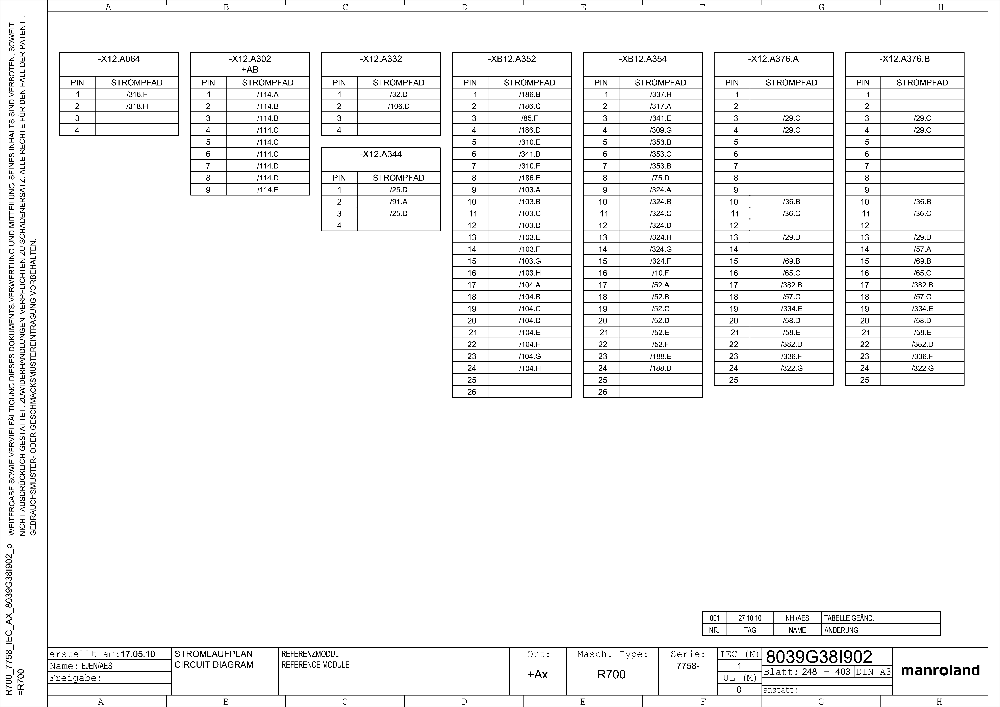

# +Ax — Sheet 248 of 403 — REFERENZMODUL

**REFERENCE MODULE**

> Part of the manroland **R700** printing press IEC/UL circuit diagrams.
> Drawing class: **Stromlaufplan / Circuit diagram** (DIN A3).
> Document `+Ax` covers the **Central control console** machine section.

## At a glance

| Field | Value |
|---|---|
| Document | `+Ax`  (8039G38I902) |
| Sheet | **248** of 403 |
| Section (DE) | REFERENZMODUL |
| Section (EN) | REFERENCE MODULE |
| Section type | REFERENCE_MODULE — Reference module |
| Machine type | `R700` |
| Series | `7758` |
| Created | 17.05.10 |
| Replaces | — |
| Columns used | A, B, C, D, E, F, G, H |
| Path numbers | — |
| Labels on sheet | 251 |
| Cross-refs out | 95 |
| Cross-refs in | 0 |

**Previous:** [+Ax sheet 247](SHEET_0247.md) · **Next:** [+Ax sheet 249](SHEET_0249.md) · **Document TOC:** [_TOC.md](_TOC.md)  (+Ax) · **Master TOC:** [all sheets](../_MASTER_TOC.md)

## Sheet image (300 DPI, exact vector render)



_Rendered directly from the PDF vector layer at 300 DPI (1-bit), no OCR and no resampling. Use it to confirm anything ambiguous in the text below._

## Cross-references on this sheet

Each entry is a wire leaving this sheet. The printed token is `/sheet.column`; the link resolves to that sheet inside the same document.

| Ref | Target sheet | Col | Path | Destination on target | Target section | From col |
|---|---|---|---|---|---|---|
| `/114.A` | [+Ax sheet 114](SHEET_0114.md) | A | — | — | STAPELTRAGPLATTENEINSTELLUNG | B |
| `/186.B` | [+Ax sheet 186](SHEET_0186.md) | B | — | — | RESERVE | E |
| `/316.F` | [+Ax sheet 316](SHEET_0316.md) | F | — | — | OPTION: "EJEKTOR" ANLAGE / SELECT AIRSTATION / | A |
| `/32.D` | [+Ax sheet 32](SHEET_0032.md) | D | — | — | SPANNUNGSVERSORGUNG, SCHALTSCHRANKBELÜFTUNG | C |
| `/337.H` | [+Ax sheet 337](SHEET_0337.md) | H | — | — | OPTION: INLINESHEETER RS104 S | F |
| `/114.B` | [+Ax sheet 114](SHEET_0114.md) | B | — | — | STAPELTRAGPLATTENEINSTELLUNG | B |
| `/317.A` | [+Ax sheet 317](SHEET_0317.md) | A | — | — | OPTION: "EJEKTOR" ANLAGE / SELECT AIRSTATION / | F |
| `/318.H` | [+Ax sheet 318](SHEET_0318.md) | H | — | — | OPTION: "EJEKTOR" ANLAGE / SELECT AIRSTATION / | A |
| `/106.D` | [+Ax sheet 106](SHEET_0106.md) | D | — | — | ANLEGER | C |
| `/186.C` | [+Ax sheet 186](SHEET_0186.md) | C | — | — | RESERVE | E |
| `/85.F` | [+Ax sheet 85](SHEET_0085.md) | F | — | — | ANLEGER | E |
| `/114.B` | [+Ax sheet 114](SHEET_0114.md) | B | — | — | STAPELTRAGPLATTENEINSTELLUNG | B |
| `/341.E` | [+Ax sheet 341](SHEET_0341.md) | E | — | — | OPTION: INLINESHEETER RS104 S | F |
| `/29.C` | [+Ax sheet 29](SHEET_0029.md) | C | — | — | SPANNUNGSVERSORGUNG, SCHALTSCHRANKBELÜFTUNG | G |
| `/29.C` | [+Ax sheet 29](SHEET_0029.md) | C | — | — | SPANNUNGSVERSORGUNG, SCHALTSCHRANKBELÜFTUNG | H |
| `/309.G` | [+Ax sheet 309](SHEET_0309.md) | G | — | — | OPTION: FARBWERKTEMPERIERUNG | F |
| `/114.C` | [+Ax sheet 114](SHEET_0114.md) | C | — | — | STAPELTRAGPLATTENEINSTELLUNG | B |
| `/186.D` | [+Ax sheet 186](SHEET_0186.md) | D | — | — | RESERVE | E |
| `/29.C` | [+Ax sheet 29](SHEET_0029.md) | C | — | — | SPANNUNGSVERSORGUNG, SCHALTSCHRANKBELÜFTUNG | G |
| `/29.C` | [+Ax sheet 29](SHEET_0029.md) | C | — | — | SPANNUNGSVERSORGUNG, SCHALTSCHRANKBELÜFTUNG | H |
| `/310.E` | [+Ax sheet 310](SHEET_0310.md) | E | — | — | OPTION: IONISATIONSANLAGE ANLEGER | E |
| `/353.B` | [+Ax sheet 353](SHEET_0353.md) | B | — | — | OPTION: LOGISTIK ANLEGER | F |
| `/114.C` | [+Ax sheet 114](SHEET_0114.md) | C | — | — | STAPELTRAGPLATTENEINSTELLUNG | B |
| `/341.B` | [+Ax sheet 341](SHEET_0341.md) | B | — | — | OPTION: INLINESHEETER RS104 S | E |
| `/114.C` | [+Ax sheet 114](SHEET_0114.md) | C | — | — | STAPELTRAGPLATTENEINSTELLUNG | B |
| `/353.C` | [+Ax sheet 353](SHEET_0353.md) | C | — | — | OPTION: LOGISTIK ANLEGER | F |
| `/353.B` | [+Ax sheet 353](SHEET_0353.md) | B | — | — | OPTION: LOGISTIK ANLEGER | F |
| `/310.F` | [+Ax sheet 310](SHEET_0310.md) | F | — | — | OPTION: IONISATIONSANLAGE ANLEGER | E |
| `/114.D` | [+Ax sheet 114](SHEET_0114.md) | D | — | — | STAPELTRAGPLATTENEINSTELLUNG | B |
| `/186.E` | [+Ax sheet 186](SHEET_0186.md) | E | — | — | RESERVE | E |
| `/75.D` | [+Ax sheet 75](SHEET_0075.md) | D | — | — | FEUCHTMITTELKÜHLGERÄT | F |
| `/114.D` | [+Ax sheet 114](SHEET_0114.md) | D | — | — | STAPELTRAGPLATTENEINSTELLUNG | B |
| `/114.E` | [+Ax sheet 114](SHEET_0114.md) | E | — | — | STAPELTRAGPLATTENEINSTELLUNG | B |
| `/103.A` | [+Ax sheet 103](SHEET_0103.md) | A | — | — | ANLEGER | E |
| `/324.A` | [+Ax sheet 324](SHEET_0324.md) | A | — | — | OPTION: "EJEKTOR" ANLAGE / SELECT AIRSTATION / | F |
| `/25.D` | [+Ax sheet 25](SHEET_0025.md) | D | — | — | SPANNUNGSVERSORGUNG, SCHALTSCHRANKBELÜFTUNG | C |
| `/91.A` | [+Ax sheet 91](SHEET_0091.md) | A | — | — | ANLEGER | C |
| `/36.B` | [+Ax sheet 36](SHEET_0036.md) | B | — | — | SCHMIERUNG | G |
| `/36.B` | [+Ax sheet 36](SHEET_0036.md) | B | — | — | SCHMIERUNG | H |
| `/103.B` | [+Ax sheet 103](SHEET_0103.md) | B | — | — | ANLEGER | E |
| `/324.B` | [+Ax sheet 324](SHEET_0324.md) | B | — | — | OPTION: "EJEKTOR" ANLAGE / SELECT AIRSTATION / | F |
| `/25.D` | [+Ax sheet 25](SHEET_0025.md) | D | — | — | SPANNUNGSVERSORGUNG, SCHALTSCHRANKBELÜFTUNG | C |
| `/36.C` | [+Ax sheet 36](SHEET_0036.md) | C | — | — | SCHMIERUNG | G |
| `/36.C` | [+Ax sheet 36](SHEET_0036.md) | C | — | — | SCHMIERUNG | H |
| `/103.C` | [+Ax sheet 103](SHEET_0103.md) | C | — | — | ANLEGER | E |
| `/324.C` | [+Ax sheet 324](SHEET_0324.md) | C | — | — | OPTION: "EJEKTOR" ANLAGE / SELECT AIRSTATION / | F |
| `/103.D` | [+Ax sheet 103](SHEET_0103.md) | D | — | — | ANLEGER | E |
| `/324.D` | [+Ax sheet 324](SHEET_0324.md) | D | — | — | OPTION: "EJEKTOR" ANLAGE / SELECT AIRSTATION / | F |
| `/103.E` | [+Ax sheet 103](SHEET_0103.md) | E | — | — | ANLEGER | E |
| `/324.H` | [+Ax sheet 324](SHEET_0324.md) | H | — | — | OPTION: "EJEKTOR" ANLAGE / SELECT AIRSTATION / | F |
| `/29.D` | [+Ax sheet 29](SHEET_0029.md) | D | — | — | SPANNUNGSVERSORGUNG, SCHALTSCHRANKBELÜFTUNG | G |
| `/29.D` | [+Ax sheet 29](SHEET_0029.md) | D | — | — | SPANNUNGSVERSORGUNG, SCHALTSCHRANKBELÜFTUNG | H |
| `/57.A` | [+Ax sheet 57](SHEET_0057.md) | A | — | — | LUFTVERSORGUNG | H |
| `/103.F` | [+Ax sheet 103](SHEET_0103.md) | F | — | — | ANLEGER | E |
| `/324.G` | [+Ax sheet 324](SHEET_0324.md) | G | — | — | OPTION: "EJEKTOR" ANLAGE / SELECT AIRSTATION / | F |
| `/69.B` | [+Ax sheet 69](SHEET_0069.md) | B | — | — | SAUGBÄNDERTISCH | G |
| `/69.B` | [+Ax sheet 69](SHEET_0069.md) | B | — | — | SAUGBÄNDERTISCH | H |
| `/324.F` | [+Ax sheet 324](SHEET_0324.md) | F | — | — | OPTION: "EJEKTOR" ANLAGE / SELECT AIRSTATION / | F |
| `/103.G` | [+Ax sheet 103](SHEET_0103.md) | G | — | — | ANLEGER | E |
| `/10.F` | [+Ax sheet 10](SHEET_0010.md) | F | — | — | SPANNUNGSVERSORGUNG, SCHALTSCHRANKBELÜFTUNG | F |
| `/103.H` | [+Ax sheet 103](SHEET_0103.md) | H | — | — | ANLEGER | E |
| `/65.C` | [+Ax sheet 65](SHEET_0065.md) | C | — | — | DRUCKLUFTANLAGE | G |
| `/65.C` | [+Ax sheet 65](SHEET_0065.md) | C | — | — | DRUCKLUFTANLAGE | H |
| `/52.A` | [+Ax sheet 52](SHEET_0052.md) | A | — | — | SIGNALGEBER: AKUSTISCHE WARNSIGNALE | F |
| `/104.A` | [+Ax sheet 104](SHEET_0104.md) | A | — | — | ANLEGER | E |
| `/382.B` | [+Ax sheet 382](SHEET_0382.md) | B | — | — | OPTION: INLINEFOILER PRINDOR | G |
| `/382.B` | [+Ax sheet 382](SHEET_0382.md) | B | — | — | OPTION: INLINEFOILER PRINDOR | H |
| `/52.B` | [+Ax sheet 52](SHEET_0052.md) | B | — | — | SIGNALGEBER: AKUSTISCHE WARNSIGNALE | F |
| `/104.B` | [+Ax sheet 104](SHEET_0104.md) | B | — | — | ANLEGER | E |
| `/57.C` | [+Ax sheet 57](SHEET_0057.md) | C | — | — | LUFTVERSORGUNG | G |
| `/57.C` | [+Ax sheet 57](SHEET_0057.md) | C | — | — | LUFTVERSORGUNG | H |
| `/334.E` | [+Ax sheet 334](SHEET_0334.md) | E | — | — | OPTION: INLINESORTER | G |
| `/334.E` | [+Ax sheet 334](SHEET_0334.md) | E | — | — | OPTION: INLINESORTER | H |
| `/104.C` | [+Ax sheet 104](SHEET_0104.md) | C | — | — | ANLEGER | E |
| `/52.C` | [+Ax sheet 52](SHEET_0052.md) | C | — | — | SIGNALGEBER: AKUSTISCHE WARNSIGNALE | F |
| `/52.D` | [+Ax sheet 52](SHEET_0052.md) | D | — | — | SIGNALGEBER: AKUSTISCHE WARNSIGNALE | F |
| `/58.D` | [+Ax sheet 58](SHEET_0058.md) | D | — | — | LUFTVERSORGUNG | G |
| `/58.D` | [+Ax sheet 58](SHEET_0058.md) | D | — | — | LUFTVERSORGUNG | H |
| `/104.D` | [+Ax sheet 104](SHEET_0104.md) | D | — | — | ANLEGER | E |
| `/52.E` | [+Ax sheet 52](SHEET_0052.md) | E | — | — | SIGNALGEBER: AKUSTISCHE WARNSIGNALE | F |
| `/58.E` | [+Ax sheet 58](SHEET_0058.md) | E | — | — | LUFTVERSORGUNG | G |
| `/58.E` | [+Ax sheet 58](SHEET_0058.md) | E | — | — | LUFTVERSORGUNG | H |
| `/104.E` | [+Ax sheet 104](SHEET_0104.md) | E | — | — | ANLEGER | E |
| `/52.F` | [+Ax sheet 52](SHEET_0052.md) | F | — | — | SIGNALGEBER: AKUSTISCHE WARNSIGNALE | F |
| `/104.F` | [+Ax sheet 104](SHEET_0104.md) | F | — | — | ANLEGER | E |
| `/382.D` | [+Ax sheet 382](SHEET_0382.md) | D | — | — | OPTION: INLINEFOILER PRINDOR | G |
| `/382.D` | [+Ax sheet 382](SHEET_0382.md) | D | — | — | OPTION: INLINEFOILER PRINDOR | H |
| `/188.E` | [+Ax sheet 188](SHEET_0188.md) | E | — | — | RESERVE | F |
| `/336.F` | [+Ax sheet 336](SHEET_0336.md) | F | — | — | OPTION: LOGISTIK ANLEGER / | G |
| `/336.F` | [+Ax sheet 336](SHEET_0336.md) | F | — | — | OPTION: LOGISTIK ANLEGER / | H |
| `/104.G` | [+Ax sheet 104](SHEET_0104.md) | G | — | — | ANLEGER | E |
| `/322.G` | [+Ax sheet 322](SHEET_0322.md) | G | — | — | OPTION: "EJEKTOR" ANLAGE / SELECT AIRSTATION / | G |
| `/322.G` | [+Ax sheet 322](SHEET_0322.md) | G | — | — | OPTION: "EJEKTOR" ANLAGE / SELECT AIRSTATION / | H |
| `/104.H` | [+Ax sheet 104](SHEET_0104.md) | H | — | — | ANLEGER | E |
| `/188.D` | [+Ax sheet 188](SHEET_0188.md) | D | — | — | RESERVE | F |

## Devices on this sheet

| Tag | Class | Class meaning (IEC) | Col | Sub | Terminal | Sign |
|---|---|---|---|---|---|---|
| `X12.A064` | — | cross-device reference | A | — | — | — |
| `X12.A302` | — | cross-device reference | B | — | — | — |
| `X12.A332` | — | cross-device reference | C | — | — | — |
| `X12.A344` | — | cross-device reference | C | — | — | — |
| `XB12.A352` | — | cross-device reference | D | — | — | — |
| `XB12.A354` | — | cross-device reference | F | — | — | — |
| `X12.A376.A` | — | cross-device reference | G | — | — | — |
| `X12.A376.B` | — | cross-device reference | H | — | — | — |
| `NR.` | — | cross-device reference | F | — | — | — |
| `27.10.10` | — | cross-device reference | F | — | — | — |

## Potentials / nets

_No named potentials on this sheet._

## Wire-end annotations (grouped as printed)

A wire that continues elsewhere is annotated with a small cluster: the destination description, the path/line number `#NN`, and the `/sheet.column` cross reference. Each row below is one such cluster exactly as it is grouped on the drawing.

| Col | Y | Path | Cross-ref | Text on the wire |
|---|---|---|---|---|
| A | 65.5 | — | — | `X12.A064` |
| B | 65.5 | — | — | `X12.A302` |
| C | 65.5 | — | — | `X12.A332` |
| D | 65.5 | — | — | `XB12.A352` |
| F | 65.5 | — | — | `XB12.A354` |
| G | 65.5 | — | — | `X12.A376.A` |
| H | 65.5 | — | — | `X12.A376.B` |
| B | 78.2 | — | — | `+AB` |
| A | 94.2 | — | — | `PIN 2 3 4 1 STROMPFAD` |
| B | 94.2 | — | — | `PIN 2 3 4 5 6 7 8 9 1 STROMPFAD` |
| C | 94.2 | — | — | `PIN 2 3 4 1 STROMPFAD` |
| D | 94.2 | — | — | `PIN STROMPFAD` |
| E | 94.2 | — | — | `PIN STROMPFAD` |
| G | 94.2 | — | — | `PIN STROMPFAD` |
| H | 94.2 | — | — | `PIN STROMPFAD` |
| D | 108.4 | — | — | `2 3 4 5 6 7 8 9 1` |
| E | 108.4 | — | — | `2 3 4 5 6 7 8 9 1` |
| F | 108.4 | — | — | `2 3 4 5 6 7 8 9 1` |
| G | 108.4 | — | — | `2 3 4 5 6 7 8 9 1` |
| A | 108.7 | — | `/316.F` | — |
| B | 108.7 | — | `/114.A` | — |
| C | 108.7 | — | `/32.D` | — |
| E | 108.7 | — | `/186.B` | — |
| F | 108.7 | — | `/337.H` | — |
| A | 122.9 | — | `/318.H` | — |
| B | 122.9 | — | `/114.B` | — |
| C | 122.9 | — | `/106.D` | — |
| E | 122.9 | — | `/186.C` | — |
| F | 122.9 | — | `/317.A` | — |
| B | 137.0 | — | `/114.B` | — |
| E | 137.0 | — | `/85.F` | — |
| F | 137.0 | — | `/341.E` | — |
| G | 137.1 | — | `/29.C` | — |
| H | 137.1 | — | `/29.C` | — |
| B | 151.2 | — | `/114.C` | — |
| E | 151.2 | — | `/186.D` | — |
| F | 151.2 | — | `/309.G` | — |
| G | 151.2 | — | `/29.C` | — |
| H | 151.2 | — | `/29.C` | — |
| B | 165.4 | — | `/114.C` | — |
| E | 165.4 | — | `/310.E` | — |
| F | 165.4 | — | `/353.B` | — |
| C | 178.9 | — | — | `X12.A344` |
| B | 179.6 | — | `/114.C` | — |
| E | 179.6 | — | `/341.B` | — |
| F | 179.6 | — | `/353.C` | — |
| E | 193.7 | — | `/310.F` | — |
| F | 193.7 | — | `/353.B` | — |
| B | 193.8 | — | `/114.D` | — |
| C | 207.5 | — | — | `PIN 2 3 4 1 STROMPFAD` |
| B | 207.9 | — | `/114.D` | — |
| E | 207.9 | — | `/186.E` | — |
| F | 207.9 | — | `/75.D` | — |
| B | 222.1 | — | `/114.E` | — |
| C | 222.1 | — | `/25.D` | — |
| E | 222.1 | — | `/103.A` | — |
| F | 222.1 | — | `/324.A` | — |
| D | 235.9 | — | — | `10 12 13 14 15 16 17 18 19 20 11` |
| E | 235.9 | — | — | `10 12 13 14 15 16 17 18 19 20 11` |
| F | 235.9 | — | — | `10 12 13 14 15 16 17 18 19 20 11` |
| G | 235.9 | — | — | `10 12 13 14 15 16 17 18 19 20 11` |
| C | 236.2 | — | `/91.A` | — |
| E | 236.2 | — | `/103.B` | — |
| F | 236.2 | — | `/324.B` | — |
| G | 236.2 | — | `/36.B` | — |
| H | 236.2 | — | `/36.B` | — |
| C | 250.4 | — | `/25.D` | — |
| E | 250.4 | — | `/103.C` | — |
| F | 250.4 | — | `/324.C` | — |
| G | 250.4 | — | `/36.C` | — |
| H | 250.4 | — | `/36.C` | — |
| E | 264.6 | — | `/103.D` | — |
| F | 264.6 | — | `/324.D` | — |
| E | 278.8 | — | `/103.E` | — |
| F | 278.8 | — | `/324.H` | — |
| G | 278.8 | — | `/29.D` | — |
| H | 278.8 | — | `/29.D` | — |
| E | 292.9 | — | `/103.F` | — |
| H | 292.9 | — | `/57.A` | — |
| F | 293.0 | — | `/324.G` | — |
| E | 307.1 | — | `/103.G` | — |
| F | 307.1 | — | `/324.F` | — |
| G | 307.1 | — | `/69.B` | — |
| H | 307.1 | — | `/69.B` | — |
| E | 321.3 | — | `/103.H` | — |
| F | 321.3 | — | `/10.F` | — |
| G | 321.3 | — | `/65.C` | — |
| H | 321.3 | — | `/65.C` | — |
| F | 335.4 | — | `/52.A` | — |
| E | 335.5 | — | `/104.A` | — |
| G | 335.5 | — | `/382.B` | — |
| H | 335.5 | — | `/382.B` | — |
| E | 349.6 | — | `/104.B` | — |
| F | 349.6 | — | `/52.B` | — |
| G | 349.6 | — | `/57.C` | — |
| H | 349.6 | — | `/57.C` | — |
| E | 363.8 | — | `/104.C` | — |
| F | 363.8 | — | `/52.C` | — |
| G | 363.8 | — | `/334.E` | — |
| H | 363.8 | — | `/334.E` | — |
| E | 378.0 | — | `/104.D` | — |
| F | 378.0 | — | `/52.D` | — |
| G | 378.0 | — | `/58.D` | — |
| H | 378.0 | — | `/58.D` | — |
| D | 391.8 | — | — | `22 23 24 25 26 21` |
| E | 391.8 | — | — | `22 23 24 25 26 21` |
| F | 391.8 | — | — | `22 23 24 25 21` |
| G | 391.8 | — | — | `22 23 24 25 21` |
| E | 392.1 | — | `/104.E` | — |
| F | 392.1 | — | `/52.E` | — |
| G | 392.1 | — | `/58.E` | — |
| H | 392.1 | — | `/58.E` | — |
| E | 406.3 | — | `/104.F` | — |
| F | 406.3 | — | `/52.F` | — |
| G | 406.4 | — | `/382.D` | — |
| H | 406.4 | — | `/382.D` | — |
| E | 420.5 | — | `/104.G` | — |
| F | 420.5 | — | `/188.E` | — |
| G | 420.5 | — | `/336.F` | — |
| H | 420.5 | — | `/336.F` | — |
| E | 434.7 | — | `/104.H` | — |
| F | 434.7 | — | `/188.D` | — |
| G | 434.7 | — | `/322.G` | — |
| H | 434.7 | — | `/322.G` | — |
| G | 733.0 | — | — | `001 27.10.10 NHI/AES TABELLE GEÄND.` |
| G | 747.1 | — | — | `NR. TAG NAME ÄNDERUNG` |


## Reconstructed tables

This sheet carries tabular content (pin map / terminal assignment / index). The grid below was rebuilt from the drawing's own rule lines, so each row is exactly one physical row of the table.

### Table 1 — 4 data rows × 2 columns (at x=70.9, y=62.4) — **X12.A064**

| PIN | STROMPFAD |
|---|---|
| `1` | `/316.F` |
| `2` | `/318.H` |
| `3` |  |
| `4` |  |


### Table 2 — 9 data rows × 2 columns (at x=226.8, y=62.4) — **X12.A302 +AB**

| PIN | STROMPFAD |
|---|---|
| `1` | `/114.A` |
| `2` | `/114.B` |
| `3` | `/114.B` |
| `4` | `/114.C` |
| `5` | `/114.C` |
| `6` | `/114.C` |
| `7` | `/114.D` |
| `8` | `/114.D` |
| `9` | `/114.E` |


### Table 3 — 10 data rows × 2 columns (at x=382.7, y=62.4) — **X12.A332**

| PIN | STROMPFAD |
|---|---|
| `1` | `/32.D` |
| `2` | `/106.D` |
| `3` |  |
| `4` |  |
|  | `X12.A344` |
| `PIN` | `STROMPFAD` |
| `1` | `/25.D` |
| `2` | `/91.A` |
| `3` | `/25.D` |
| `4` |  |


### Table 4 — 26 data rows × 2 columns (at x=538.6, y=62.4) — **XB12.A352**

| PIN | STROMPFAD |
|---|---|
| `1` | `/186.B` |
| `2` | `/186.C` |
| `3` | `/85.F` |
| `4` | `/186.D` |
| `5` | `/310.E` |
| `6` | `/341.B` |
| `7` | `/310.F` |
| `8` | `/186.E` |
| `9` | `/103.A` |
| `10` | `/103.B` |
| `11` | `/103.C` |
| `12` | `/103.D` |
| `13` | `/103.E` |
| `14` | `/103.F` |
| `15` | `/103.G` |
| `16` | `/103.H` |
| `17` | `/104.A` |
| `18` | `/104.B` |
| `19` | `/104.C` |
| `20` | `/104.D` |
| `21` | `/104.E` |
| `22` | `/104.F` |
| `23` | `/104.G` |
| `24` | `/104.H` |
| `25` |  |
| `26` |  |


### Table 5 — 26 data rows × 2 columns (at x=694.5, y=62.4) — **XB12.A354**

| PIN | STROMPFAD |
|---|---|
| `1` | `/337.H` |
| `2` | `/317.A` |
| `3` | `/341.E` |
| `4` | `/309.G` |
| `5` | `/353.B` |
| `6` | `/353.C` |
| `7` | `/353.B` |
| `8` | `/75.D` |
| `9` | `/324.A` |
| `10` | `/324.B` |
| `11` | `/324.C` |
| `12` | `/324.D` |
| `13` | `/324.H` |
| `14` | `/324.G` |
| `15` | `/324.F` |
| `16` | `/10.F` |
| `17` | `/52.A` |
| `18` | `/52.B` |
| `19` | `/52.C` |
| `20` | `/52.D` |
| `21` | `/52.E` |
| `22` | `/52.F` |
| `23` | `/188.E` |
| `24` | `/188.D` |
| `25` |  |
| `26` |  |


### Table 6 — 25 data rows × 2 columns (at x=850.4, y=62.4) — **X12.A376.A**

| PIN | STROMPFAD |
|---|---|
| `1` |  |
| `2` |  |
| `3` | `/29.C` |
| `4` | `/29.C` |
| `5` |  |
| `6` |  |
| `7` |  |
| `8` |  |
| `9` |  |
| `10` | `/36.B` |
| `11` | `/36.C` |
| `12` |  |
| `13` | `/29.D` |
| `14` |  |
| `15` | `/69.B` |
| `16` | `/65.C` |
| `17` | `/382.B` |
| `18` | `/57.C` |
| `19` | `/334.E` |
| `20` | `/58.D` |
| `21` | `/58.E` |
| `22` | `/382.D` |
| `23` | `/336.F` |
| `24` | `/322.G` |
| `25` |  |


### Table 7 — 25 data rows × 2 columns (at x=1006.3, y=62.4) — **X12.A376.B**

| PIN | STROMPFAD |
|---|---|
| `1` |  |
| `2` |  |
| `3` | `/29.C` |
| `4` | `/29.C` |
| `5` |  |
| `6` |  |
| `7` |  |
| `8` |  |
| `9` |  |
| `10` | `/36.B` |
| `11` | `/36.C` |
| `12` |  |
| `13` | `/29.D` |
| `14` | `/57.A` |
| `15` | `/69.B` |
| `16` | `/65.C` |
| `17` | `/382.B` |
| `18` | `/57.C` |
| `19` | `/334.E` |
| `20` | `/58.D` |
| `21` | `/58.E` |
| `22` | `/382.D` |
| `23` | `/336.F` |
| `24` | `/322.G` |
| `25` |  |


## Notes and free text on this sheet

| Text | Col | Y (pt) |
|---|---|---|
| `PIN` | A | 94.2 |
| `STROMPFAD` | A | 94.15 |
| `PIN` | B | 94.2 |
| `STROMPFAD` | B | 94.15 |
| `+AB` | B | 78.18 |
| `PIN` | C | 94.2 |
| `STROMPFAD` | C | 94.15 |
| `PIN` | D | 94.2 |
| `STROMPFAD` | E | 94.15 |
| `PIN` | E | 94.2 |
| `STROMPFAD` | F | 94.15 |
| `PIN` | F | 94.2 |
| `STROMPFAD` | G | 94.15 |
| `PIN` | G | 94.2 |
| `STROMPFAD` | H | 94.15 |
| `TAG` | F | 747.27 |
| `NAME` | G | 747.25 |
| `ÄNDERUNG` | G | 747.31 |
| `NHI/AES` | G | 733.11 |
| `TABELLE GEÄND.` | G | 733.12 |

## Complete label inventory (exact text from the drawing)

Every text object inside the drawing area of this sheet, in DIN reading order (column A→H, then top→bottom). This is the authoritative list: if a string is not here it is not printed on this sheet.

| Col | Y | X | Dir | Type | Text |
|---|---|---|---|---|---|
| A | 65.5 | 116.8 | → | device ref | `X12.A064` |
| A | 94.2 | 84.0 | → | text | `PIN` |
| A | 94.2 | 132.2 | → | text | `STROMPFAD` |
| A | 108.4 | 90.0 | → | number | `1` |
| A | 108.7 | 150.7 | → | cross-reference | `/316.F` |
| A | 122.5 | 89.4 | → | number | `2` |
| A | 122.9 | 150.5 | → | cross-reference | `/318.H` |
| A | 136.7 | 89.4 | → | number | `3` |
| A | 150.9 | 89.4 | → | number | `4` |
| B | 65.5 | 272.7 | → | device ref | `X12.A302` |
| B | 78.2 | 287.4 | → | text | `+AB` |
| B | 94.2 | 240.0 | → | text | `PIN` |
| B | 94.2 | 288.1 | → | text | `STROMPFAD` |
| B | 108.4 | 245.9 | → | number | `1` |
| B | 108.7 | 306.1 | → | cross-reference | `/114.A` |
| B | 122.5 | 245.3 | → | number | `2` |
| B | 122.9 | 306.3 | → | cross-reference | `/114.B` |
| B | 136.7 | 245.3 | → | number | `3` |
| B | 137.0 | 306.3 | → | cross-reference | `/114.B` |
| B | 150.9 | 245.3 | → | number | `4` |
| B | 151.2 | 306.1 | → | cross-reference | `/114.C` |
| B | 165.1 | 245.3 | → | number | `5` |
| B | 165.4 | 306.1 | → | cross-reference | `/114.C` |
| B | 179.2 | 245.3 | → | number | `6` |
| B | 179.6 | 306.1 | → | cross-reference | `/114.C` |
| B | 193.4 | 245.3 | → | number | `7` |
| B | 193.8 | 306.1 | → | cross-reference | `/114.D` |
| B | 207.6 | 245.3 | → | number | `8` |
| B | 207.9 | 306.1 | → | cross-reference | `/114.D` |
| B | 221.8 | 245.3 | → | number | `9` |
| B | 222.1 | 306.4 | → | cross-reference | `/114.E` |
| C | 65.5 | 428.6 | → | device ref | `X12.A332` |
| C | 94.2 | 395.9 | → | text | `PIN` |
| C | 94.2 | 444.0 | → | text | `STROMPFAD` |
| C | 108.4 | 401.8 | → | number | `1` |
| C | 108.7 | 464.5 | → | cross-reference | `/32.D` |
| C | 122.5 | 401.2 | → | number | `2` |
| C | 122.9 | 462.0 | → | cross-reference | `/106.D` |
| C | 136.7 | 401.2 | → | number | `3` |
| C | 150.9 | 401.2 | → | number | `4` |
| C | 178.9 | 428.6 | → | device ref | `X12.A344` |
| C | 207.5 | 444.0 | → | text | `STROMPFAD` |
| C | 207.6 | 395.9 | → | text | `PIN` |
| C | 221.8 | 401.8 | → | number | `1` |
| C | 222.1 | 464.5 | → | cross-reference | `/25.D` |
| C | 235.9 | 401.2 | → | number | `2` |
| C | 236.2 | 464.5 | → | cross-reference | `/91.A` |
| C | 250.1 | 401.2 | → | number | `3` |
| C | 250.4 | 464.5 | → | cross-reference | `/25.D` |
| C | 264.3 | 401.2 | → | number | `4` |
| D | 65.5 | 581.0 | → | device ref | `XB12.A352` |
| D | 94.2 | 551.8 | → | text | `PIN` |
| D | 108.4 | 563.5 | → | number | `1` |
| D | 122.5 | 561.8 | → | number | `2` |
| D | 136.7 | 561.8 | → | number | `3` |
| D | 150.9 | 561.8 | → | number | `4` |
| D | 165.1 | 561.8 | → | number | `5` |
| D | 179.2 | 561.8 | → | number | `6` |
| D | 193.4 | 561.8 | → | number | `7` |
| D | 207.6 | 561.8 | → | number | `8` |
| D | 221.8 | 561.8 | → | number | `9` |
| D | 235.9 | 556.4 | → | number | `10` |
| D | 250.1 | 558.1 | → | number | `11` |
| D | 264.3 | 556.4 | → | number | `12` |
| D | 278.5 | 556.4 | → | number | `13` |
| D | 292.6 | 556.4 | → | number | `14` |
| D | 306.8 | 556.4 | → | number | `15` |
| D | 321.0 | 556.4 | → | number | `16` |
| D | 335.1 | 556.4 | → | number | `17` |
| D | 349.3 | 556.4 | → | number | `18` |
| D | 363.5 | 556.4 | → | number | `19` |
| D | 377.7 | 556.4 | → | number | `20` |
| D | 391.8 | 558.1 | → | number | `21` |
| D | 406.0 | 556.4 | → | number | `22` |
| D | 420.2 | 556.4 | → | number | `23` |
| D | 434.4 | 556.4 | → | number | `24` |
| D | 448.5 | 556.4 | → | number | `25` |
| D | 462.7 | 556.4 | → | number | `26` |
| E | 94.2 | 600.0 | → | text | `STROMPFAD` |
| E | 94.2 | 707.7 | → | text | `PIN` |
| E | 108.4 | 719.4 | → | number | `1` |
| E | 108.7 | 618.1 | → | cross-reference | `/186.B` |
| E | 122.5 | 717.7 | → | number | `2` |
| E | 122.9 | 618.0 | → | cross-reference | `/186.C` |
| E | 136.7 | 717.7 | → | number | `3` |
| E | 137.0 | 620.8 | → | cross-reference | `/85.F` |
| E | 150.9 | 717.7 | → | number | `4` |
| E | 151.2 | 618.0 | → | cross-reference | `/186.D` |
| E | 165.1 | 717.7 | → | number | `5` |
| E | 165.4 | 618.2 | → | cross-reference | `/310.E` |
| E | 179.2 | 717.7 | → | number | `6` |
| E | 179.6 | 618.1 | → | cross-reference | `/341.B` |
| E | 193.4 | 717.7 | → | number | `7` |
| E | 193.7 | 618.4 | → | cross-reference | `/310.F` |
| E | 207.6 | 717.7 | → | number | `8` |
| E | 207.9 | 618.2 | → | cross-reference | `/186.E` |
| E | 221.8 | 717.7 | → | number | `9` |
| E | 222.1 | 618.0 | → | cross-reference | `/103.A` |
| E | 235.9 | 712.3 | → | number | `10` |
| E | 236.2 | 618.1 | → | cross-reference | `/103.B` |
| E | 250.1 | 714.0 | → | number | `11` |
| E | 250.4 | 618.0 | → | cross-reference | `/103.C` |
| E | 264.3 | 712.3 | → | number | `12` |
| E | 264.6 | 618.0 | → | cross-reference | `/103.D` |
| E | 278.5 | 712.3 | → | number | `13` |
| E | 278.8 | 618.2 | → | cross-reference | `/103.E` |
| E | 292.6 | 712.3 | → | number | `14` |
| E | 293.0 | 618.4 | → | cross-reference | `/103.F` |
| E | 306.8 | 712.3 | → | number | `15` |
| E | 307.1 | 617.8 | → | cross-reference | `/103.G` |
| E | 321.0 | 712.3 | → | number | `16` |
| E | 321.3 | 618.2 | → | cross-reference | `/103.H` |
| E | 335.1 | 712.3 | → | number | `17` |
| E | 335.5 | 618.0 | → | cross-reference | `/104.A` |
| E | 349.3 | 712.3 | → | number | `18` |
| E | 349.6 | 618.1 | → | cross-reference | `/104.B` |
| E | 363.5 | 712.3 | → | number | `19` |
| E | 363.8 | 618.0 | → | cross-reference | `/104.C` |
| E | 377.7 | 712.3 | → | number | `20` |
| E | 378.0 | 618.0 | → | cross-reference | `/104.D` |
| E | 391.8 | 714.0 | → | number | `21` |
| E | 392.2 | 618.2 | → | cross-reference | `/104.E` |
| E | 406.0 | 712.3 | → | number | `22` |
| E | 406.3 | 618.4 | → | cross-reference | `/104.F` |
| E | 420.2 | 712.3 | → | number | `23` |
| E | 420.5 | 617.8 | → | cross-reference | `/104.G` |
| E | 434.4 | 712.3 | → | number | `24` |
| E | 434.7 | 618.2 | → | cross-reference | `/104.H` |
| E | 448.5 | 712.3 | → | number | `25` |
| E | 462.7 | 712.3 | → | number | `26` |
| F | 65.5 | 736.9 | → | device ref | `XB12.A354` |
| F | 94.2 | 755.9 | → | text | `STROMPFAD` |
| F | 94.2 | 863.6 | → | text | `PIN` |
| F | 108.4 | 875.3 | → | number | `1` |
| F | 108.7 | 774.1 | → | cross-reference | `/337.H` |
| F | 122.5 | 873.6 | → | number | `2` |
| F | 122.9 | 773.9 | → | cross-reference | `/317.A` |
| F | 136.7 | 873.6 | → | number | `3` |
| F | 137.0 | 774.1 | → | cross-reference | `/341.E` |
| F | 150.9 | 873.6 | → | number | `4` |
| F | 151.2 | 773.7 | → | cross-reference | `/309.G` |
| F | 165.1 | 873.6 | → | number | `5` |
| F | 165.4 | 774.0 | → | cross-reference | `/353.B` |
| F | 179.2 | 873.6 | → | number | `6` |
| F | 179.6 | 773.9 | → | cross-reference | `/353.C` |
| F | 193.4 | 873.6 | → | number | `7` |
| F | 193.7 | 774.0 | → | cross-reference | `/353.B` |
| F | 207.6 | 873.6 | → | number | `8` |
| F | 207.9 | 776.3 | → | cross-reference | `/75.D` |
| F | 221.8 | 873.6 | → | number | `9` |
| F | 222.1 | 773.9 | → | cross-reference | `/324.A` |
| F | 235.9 | 868.3 | → | number | `10` |
| F | 236.2 | 774.0 | → | cross-reference | `/324.B` |
| F | 250.1 | 870.0 | → | number | `11` |
| F | 250.4 | 773.9 | → | cross-reference | `/324.C` |
| F | 264.3 | 868.3 | → | number | `12` |
| F | 264.6 | 773.9 | → | cross-reference | `/324.D` |
| F | 278.5 | 868.3 | → | number | `13` |
| F | 278.8 | 774.1 | → | cross-reference | `/324.H` |
| F | 292.6 | 868.3 | → | number | `14` |
| F | 293.0 | 773.7 | → | cross-reference | `/324.G` |
| F | 306.8 | 868.3 | → | number | `15` |
| F | 307.1 | 774.3 | → | cross-reference | `/324.F` |
| F | 321.0 | 868.3 | → | number | `16` |
| F | 321.3 | 776.7 | → | cross-reference | `/10.F` |
| F | 335.1 | 868.3 | → | number | `17` |
| F | 335.4 | 776.3 | → | cross-reference | `/52.A` |
| F | 349.3 | 868.3 | → | number | `18` |
| F | 349.6 | 776.4 | → | cross-reference | `/52.B` |
| F | 363.5 | 868.3 | → | number | `19` |
| F | 363.8 | 776.3 | → | cross-reference | `/52.C` |
| F | 377.7 | 868.3 | → | number | `20` |
| F | 378.0 | 776.3 | → | cross-reference | `/52.D` |
| F | 391.8 | 870.0 | → | number | `21` |
| F | 392.1 | 776.6 | → | cross-reference | `/52.E` |
| F | 406.0 | 868.3 | → | number | `22` |
| F | 406.3 | 776.7 | → | cross-reference | `/52.F` |
| F | 420.2 | 868.3 | → | number | `23` |
| F | 420.5 | 774.1 | → | cross-reference | `/188.E` |
| F | 434.4 | 868.3 | → | number | `24` |
| F | 434.7 | 773.9 | → | cross-reference | `/188.D` |
| F | 448.5 | 868.3 | → | number | `25` |
| F | 733.0 | 845.2 | → | number | `001` |
| F | 733.1 | 879.3 | → | device ref | `27.10.10` |
| F | 747.1 | 844.2 | → | device ref | `NR.` |
| F | 747.3 | 885.8 | → | text | `TAG` |
| G | 65.5 | 890.9 | → | device ref | `X12.A376.A` |
| G | 94.2 | 911.8 | → | text | `STROMPFAD` |
| G | 94.2 | 1019.5 | → | text | `PIN` |
| G | 108.4 | 1031.2 | → | number | `1` |
| G | 122.5 | 1029.5 | → | number | `2` |
| G | 136.7 | 1029.5 | → | number | `3` |
| G | 137.1 | 932.2 | → | cross-reference | `/29.C` |
| G | 150.9 | 1029.5 | → | number | `4` |
| G | 151.2 | 932.2 | → | cross-reference | `/29.C` |
| G | 165.1 | 1029.5 | → | number | `5` |
| G | 179.2 | 1029.5 | → | number | `6` |
| G | 193.4 | 1029.5 | → | number | `7` |
| G | 207.6 | 1029.5 | → | number | `8` |
| G | 221.8 | 1029.5 | → | number | `9` |
| G | 235.9 | 1024.2 | → | number | `10` |
| G | 236.2 | 932.3 | → | cross-reference | `/36.B` |
| G | 250.1 | 1025.9 | → | number | `11` |
| G | 250.4 | 932.2 | → | cross-reference | `/36.C` |
| G | 264.3 | 1024.2 | → | number | `12` |
| G | 278.5 | 1024.2 | → | number | `13` |
| G | 278.8 | 932.2 | → | cross-reference | `/29.D` |
| G | 292.6 | 1024.2 | → | number | `14` |
| G | 306.8 | 1024.2 | → | number | `15` |
| G | 307.1 | 932.3 | → | cross-reference | `/69.B` |
| G | 321.0 | 1024.2 | → | number | `16` |
| G | 321.3 | 932.2 | → | cross-reference | `/65.C` |
| G | 335.1 | 1024.2 | → | number | `17` |
| G | 335.5 | 929.9 | → | cross-reference | `/382.B` |
| G | 349.3 | 1024.2 | → | number | `18` |
| G | 349.7 | 932.2 | → | cross-reference | `/57.C` |
| G | 363.5 | 1024.2 | → | number | `19` |
| G | 363.8 | 930.0 | → | cross-reference | `/334.E` |
| G | 377.7 | 1024.2 | → | number | `20` |
| G | 378.0 | 932.2 | → | cross-reference | `/58.D` |
| G | 391.8 | 1025.9 | → | number | `21` |
| G | 392.1 | 932.5 | → | cross-reference | `/58.E` |
| G | 406.0 | 1024.2 | → | number | `22` |
| G | 406.4 | 929.8 | → | cross-reference | `/382.D` |
| G | 420.2 | 1024.2 | → | number | `23` |
| G | 420.5 | 930.2 | → | cross-reference | `/336.F` |
| G | 434.4 | 1024.2 | → | number | `24` |
| G | 434.7 | 929.6 | → | cross-reference | `/322.G` |
| G | 448.5 | 1024.2 | → | number | `25` |
| G | 733.1 | 935.4 | → | text | `NHI/AES` |
| G | 733.1 | 981.2 | → | text | `TABELLE GEÄND.` |
| G | 747.3 | 939.2 | → | text | `NAME` |
| G | 747.3 | 981.8 | → | text | `ÄNDERUNG` |
| H | 65.5 | 1047.3 | → | device ref | `X12.A376.B` |
| H | 94.2 | 1067.7 | → | text | `STROMPFAD` |
| H | 137.1 | 1088.1 | → | cross-reference | `/29.C` |
| H | 151.2 | 1088.1 | → | cross-reference | `/29.C` |
| H | 236.2 | 1088.2 | → | cross-reference | `/36.B` |
| H | 250.4 | 1088.1 | → | cross-reference | `/36.C` |
| H | 278.8 | 1088.1 | → | cross-reference | `/29.D` |
| H | 292.9 | 1088.1 | → | cross-reference | `/57.A` |
| H | 307.1 | 1088.2 | → | cross-reference | `/69.B` |
| H | 321.3 | 1088.1 | → | cross-reference | `/65.C` |
| H | 335.5 | 1085.8 | → | cross-reference | `/382.B` |
| H | 349.7 | 1088.1 | → | cross-reference | `/57.C` |
| H | 363.8 | 1086.0 | → | cross-reference | `/334.E` |
| H | 378.0 | 1088.1 | → | cross-reference | `/58.D` |
| H | 392.1 | 1088.4 | → | cross-reference | `/58.E` |
| H | 406.4 | 1085.7 | → | cross-reference | `/382.D` |
| H | 420.5 | 1086.1 | → | cross-reference | `/336.F` |
| H | 434.7 | 1085.5 | → | cross-reference | `/322.G` |

## Reading-order text block

The same content as a plain block, grouped by DIN column — convenient to paste or to match against a visual description.

```text
=== Column A ===
  65.5  116.8  devref       X12.A064
  94.2   84.0  text         PIN
  94.2  132.2  text         STROMPFAD
 108.4   90.0  numeric      1
 108.7  150.7  xref         /316.F
 122.5   89.4  numeric      2
 122.9  150.5  xref         /318.H
 136.7   89.4  numeric      3
 150.9   89.4  numeric      4
=== Column B ===
  65.5  272.7  devref       X12.A302
  78.2  287.4  text         +AB
  94.2  240.0  text         PIN
  94.2  288.1  text         STROMPFAD
 108.4  245.9  numeric      1
 108.7  306.1  xref         /114.A
 122.5  245.3  numeric      2
 122.9  306.3  xref         /114.B
 136.7  245.3  numeric      3
 137.0  306.3  xref         /114.B
 150.9  245.3  numeric      4
 151.2  306.1  xref         /114.C
 165.1  245.3  numeric      5
 165.4  306.1  xref         /114.C
 179.2  245.3  numeric      6
 179.6  306.1  xref         /114.C
 193.4  245.3  numeric      7
 193.8  306.1  xref         /114.D
 207.6  245.3  numeric      8
 207.9  306.1  xref         /114.D
 221.8  245.3  numeric      9
 222.1  306.4  xref         /114.E
=== Column C ===
  65.5  428.6  devref       X12.A332
  94.2  395.9  text         PIN
  94.2  444.0  text         STROMPFAD
 108.4  401.8  numeric      1
 108.7  464.5  xref         /32.D
 122.5  401.2  numeric      2
 122.9  462.0  xref         /106.D
 136.7  401.2  numeric      3
 150.9  401.2  numeric      4
 178.9  428.6  devref       X12.A344
 207.5  444.0  text         STROMPFAD
 207.6  395.9  text         PIN
 221.8  401.8  numeric      1
 222.1  464.5  xref         /25.D
 235.9  401.2  numeric      2
 236.2  464.5  xref         /91.A
 250.1  401.2  numeric      3
 250.4  464.5  xref         /25.D
 264.3  401.2  numeric      4
=== Column D ===
  65.5  581.0  devref       XB12.A352
  94.2  551.8  text         PIN
 108.4  563.5  numeric      1
 122.5  561.8  numeric      2
 136.7  561.8  numeric      3
 150.9  561.8  numeric      4
 165.1  561.8  numeric      5
 179.2  561.8  numeric      6
 193.4  561.8  numeric      7
 207.6  561.8  numeric      8
 221.8  561.8  numeric      9
 235.9  556.4  numeric      10
 250.1  558.1  numeric      11
 264.3  556.4  numeric      12
 278.5  556.4  numeric      13
 292.6  556.4  numeric      14
 306.8  556.4  numeric      15
 321.0  556.4  numeric      16
 335.1  556.4  numeric      17
 349.3  556.4  numeric      18
 363.5  556.4  numeric      19
 377.7  556.4  numeric      20
 391.8  558.1  numeric      21
 406.0  556.4  numeric      22
 420.2  556.4  numeric      23
 434.4  556.4  numeric      24
 448.5  556.4  numeric      25
 462.7  556.4  numeric      26
=== Column E ===
  94.2  600.0  text         STROMPFAD
  94.2  707.7  text         PIN
 108.4  719.4  numeric      1
 108.7  618.1  xref         /186.B
 122.5  717.7  numeric      2
 122.9  618.0  xref         /186.C
 136.7  717.7  numeric      3
 137.0  620.8  xref         /85.F
 150.9  717.7  numeric      4
 151.2  618.0  xref         /186.D
 165.1  717.7  numeric      5
 165.4  618.2  xref         /310.E
 179.2  717.7  numeric      6
 179.6  618.1  xref         /341.B
 193.4  717.7  numeric      7
 193.7  618.4  xref         /310.F
 207.6  717.7  numeric      8
 207.9  618.2  xref         /186.E
 221.8  717.7  numeric      9
 222.1  618.0  xref         /103.A
 235.9  712.3  numeric      10
 236.2  618.1  xref         /103.B
 250.1  714.0  numeric      11
 250.4  618.0  xref         /103.C
 264.3  712.3  numeric      12
 264.6  618.0  xref         /103.D
 278.5  712.3  numeric      13
 278.8  618.2  xref         /103.E
 292.6  712.3  numeric      14
 293.0  618.4  xref         /103.F
 306.8  712.3  numeric      15
 307.1  617.8  xref         /103.G
 321.0  712.3  numeric      16
 321.3  618.2  xref         /103.H
 335.1  712.3  numeric      17
 335.5  618.0  xref         /104.A
 349.3  712.3  numeric      18
 349.6  618.1  xref         /104.B
 363.5  712.3  numeric      19
 363.8  618.0  xref         /104.C
 377.7  712.3  numeric      20
 378.0  618.0  xref         /104.D
 391.8  714.0  numeric      21
 392.2  618.2  xref         /104.E
 406.0  712.3  numeric      22
 406.3  618.4  xref         /104.F
 420.2  712.3  numeric      23
 420.5  617.8  xref         /104.G
 434.4  712.3  numeric      24
 434.7  618.2  xref         /104.H
 448.5  712.3  numeric      25
 462.7  712.3  numeric      26
=== Column F ===
  65.5  736.9  devref       XB12.A354
  94.2  755.9  text         STROMPFAD
  94.2  863.6  text         PIN
 108.4  875.3  numeric      1
 108.7  774.1  xref         /337.H
 122.5  873.6  numeric      2
 122.9  773.9  xref         /317.A
 136.7  873.6  numeric      3
 137.0  774.1  xref         /341.E
 150.9  873.6  numeric      4
 151.2  773.7  xref         /309.G
 165.1  873.6  numeric      5
 165.4  774.0  xref         /353.B
 179.2  873.6  numeric      6
 179.6  773.9  xref         /353.C
 193.4  873.6  numeric      7
 193.7  774.0  xref         /353.B
 207.6  873.6  numeric      8
 207.9  776.3  xref         /75.D
 221.8  873.6  numeric      9
 222.1  773.9  xref         /324.A
 235.9  868.3  numeric      10
 236.2  774.0  xref         /324.B
 250.1  870.0  numeric      11
 250.4  773.9  xref         /324.C
 264.3  868.3  numeric      12
 264.6  773.9  xref         /324.D
 278.5  868.3  numeric      13
 278.8  774.1  xref         /324.H
 292.6  868.3  numeric      14
 293.0  773.7  xref         /324.G
 306.8  868.3  numeric      15
 307.1  774.3  xref         /324.F
 321.0  868.3  numeric      16
 321.3  776.7  xref         /10.F
 335.1  868.3  numeric      17
 335.4  776.3  xref         /52.A
 349.3  868.3  numeric      18
 349.6  776.4  xref         /52.B
 363.5  868.3  numeric      19
 363.8  776.3  xref         /52.C
 377.7  868.3  numeric      20
 378.0  776.3  xref         /52.D
 391.8  870.0  numeric      21
 392.1  776.6  xref         /52.E
 406.0  868.3  numeric      22
 406.3  776.7  xref         /52.F
 420.2  868.3  numeric      23
 420.5  774.1  xref         /188.E
 434.4  868.3  numeric      24
 434.7  773.9  xref         /188.D
 448.5  868.3  numeric      25
 733.0  845.2  numeric      001
 733.1  879.3  devref       27.10.10
 747.1  844.2  devref       NR.
 747.3  885.8  text         TAG
=== Column G ===
  65.5  890.9  devref       X12.A376.A
  94.2  911.8  text         STROMPFAD
  94.2 1019.5  text         PIN
 108.4 1031.2  numeric      1
 122.5 1029.5  numeric      2
 136.7 1029.5  numeric      3
 137.1  932.2  xref         /29.C
 150.9 1029.5  numeric      4
 151.2  932.2  xref         /29.C
 165.1 1029.5  numeric      5
 179.2 1029.5  numeric      6
 193.4 1029.5  numeric      7
 207.6 1029.5  numeric      8
 221.8 1029.5  numeric      9
 235.9 1024.2  numeric      10
 236.2  932.3  xref         /36.B
 250.1 1025.9  numeric      11
 250.4  932.2  xref         /36.C
 264.3 1024.2  numeric      12
 278.5 1024.2  numeric      13
 278.8  932.2  xref         /29.D
 292.6 1024.2  numeric      14
 306.8 1024.2  numeric      15
 307.1  932.3  xref         /69.B
 321.0 1024.2  numeric      16
 321.3  932.2  xref         /65.C
 335.1 1024.2  numeric      17
 335.5  929.9  xref         /382.B
 349.3 1024.2  numeric      18
 349.7  932.2  xref         /57.C
 363.5 1024.2  numeric      19
 363.8  930.0  xref         /334.E
 377.7 1024.2  numeric      20
 378.0  932.2  xref         /58.D
 391.8 1025.9  numeric      21
 392.1  932.5  xref         /58.E
 406.0 1024.2  numeric      22
 406.4  929.8  xref         /382.D
 420.2 1024.2  numeric      23
 420.5  930.2  xref         /336.F
 434.4 1024.2  numeric      24
 434.7  929.6  xref         /322.G
 448.5 1024.2  numeric      25
 733.1  935.4  text         NHI/AES
 733.1  981.2  text         TABELLE GEÄND.
 747.3  939.2  text         NAME
 747.3  981.8  text         ÄNDERUNG
=== Column H ===
  65.5 1047.3  devref       X12.A376.B
  94.2 1067.7  text         STROMPFAD
 137.1 1088.1  xref         /29.C
 151.2 1088.1  xref         /29.C
 236.2 1088.2  xref         /36.B
 250.4 1088.1  xref         /36.C
 278.8 1088.1  xref         /29.D
 292.9 1088.1  xref         /57.A
 307.1 1088.2  xref         /69.B
 321.3 1088.1  xref         /65.C
 335.5 1085.8  xref         /382.B
 349.7 1088.1  xref         /57.C
 363.8 1086.0  xref         /334.E
 378.0 1088.1  xref         /58.D
 392.1 1088.4  xref         /58.E
 406.4 1085.7  xref         /382.D
 420.5 1086.1  xref         /336.F
 434.7 1085.5  xref         /322.G
```

---
_Generated from the PDF vector text layer; no OCR. Source: `R700_7758_IEC_AX_8039G38I902_p`, sheet 248._
