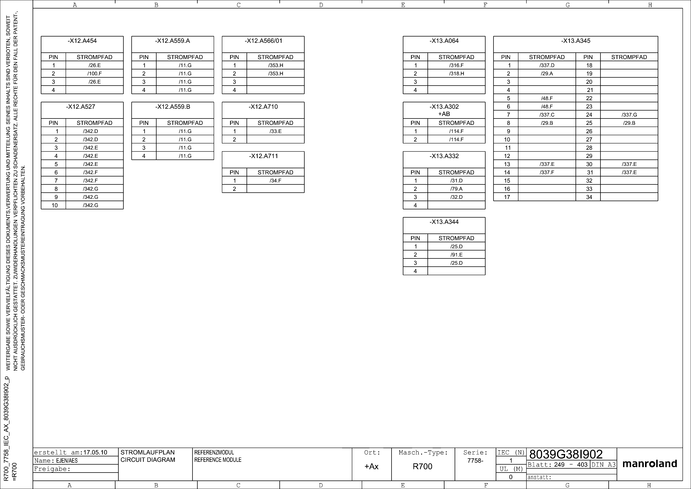

# +Ax — Sheet 249 of 403 — REFERENZMODUL

**REFERENCE MODULE**

> Part of the manroland **R700** printing press IEC/UL circuit diagrams.
> Drawing class: **Stromlaufplan / Circuit diagram** (DIN A3).
> Document `+Ax` covers the **Central control console** machine section.

## At a glance

| Field | Value |
|---|---|
| Document | `+Ax`  (8039G38I902) |
| Sheet | **249** of 403 |
| Section (DE) | REFERENZMODUL |
| Section (EN) | REFERENCE MODULE |
| Section type | REFERENCE_MODULE — Reference module |
| Machine type | `R700` |
| Series | `7758` |
| Created | 17.05.10 |
| Replaces | — |
| Columns used | A, B, C, E, F, G, H |
| Path numbers | — |
| Labels on sheet | 164 |
| Cross-refs out | 47 |
| Cross-refs in | 0 |

**Previous:** [+Ax sheet 248](SHEET_0248.md) · **Next:** [+Ax sheet 250](SHEET_0250.md) · **Document TOC:** [_TOC.md](_TOC.md)  (+Ax) · **Master TOC:** [all sheets](../_MASTER_TOC.md)

## Sheet image (300 DPI, exact vector render)



_Rendered directly from the PDF vector layer at 300 DPI (1-bit), no OCR and no resampling. Use it to confirm anything ambiguous in the text below._

## Cross-references on this sheet

Each entry is a wire leaving this sheet. The printed token is `/sheet.column`; the link resolves to that sheet inside the same document.

| Ref | Target sheet | Col | Path | Destination on target | Target section | From col |
|---|---|---|---|---|---|---|
| `/26.E` | [+Ax sheet 26](SHEET_0026.md) | E | — | — | SPANNUNGSVERSORGUNG, SCHALTSCHRANKBELÜFTUNG | A |
| `/11.G` | [+Ax sheet 11](SHEET_0011.md) | G | — | — | SPANNUNGSVERSORGUNG, SCHALTSCHRANKBELÜFTUNG | B |
| `/316.F` | [+Ax sheet 316](SHEET_0316.md) | F | — | — | OPTION: "EJEKTOR" ANLAGE / SELECT AIRSTATION / | F |
| `/353.H` | [+Ax sheet 353](SHEET_0353.md) | H | — | — | OPTION: LOGISTIK ANLEGER | C |
| `/337.D` | [+Ax sheet 337](SHEET_0337.md) | D | — | — | OPTION: INLINESHEETER RS104 S | G |
| `/29.A` | [+Ax sheet 29](SHEET_0029.md) | A | — | — | SPANNUNGSVERSORGUNG, SCHALTSCHRANKBELÜFTUNG | G |
| `/100.F` | [+Ax sheet 100](SHEET_0100.md) | F | — | — | ANLEGER | A |
| `/11.G` | [+Ax sheet 11](SHEET_0011.md) | G | — | — | SPANNUNGSVERSORGUNG, SCHALTSCHRANKBELÜFTUNG | B |
| `/353.H` | [+Ax sheet 353](SHEET_0353.md) | H | — | — | OPTION: LOGISTIK ANLEGER | C |
| `/318.H` | [+Ax sheet 318](SHEET_0318.md) | H | — | — | OPTION: "EJEKTOR" ANLAGE / SELECT AIRSTATION / | F |
| `/26.E` | [+Ax sheet 26](SHEET_0026.md) | E | — | — | SPANNUNGSVERSORGUNG, SCHALTSCHRANKBELÜFTUNG | A |
| `/11.G` | [+Ax sheet 11](SHEET_0011.md) | G | — | — | SPANNUNGSVERSORGUNG, SCHALTSCHRANKBELÜFTUNG | B |
| `/11.G` | [+Ax sheet 11](SHEET_0011.md) | G | — | — | SPANNUNGSVERSORGUNG, SCHALTSCHRANKBELÜFTUNG | B |
| `/48.F` | [+Ax sheet 48](SHEET_0048.md) | F | — | — | NOT AUS | G |
| `/48.F` | [+Ax sheet 48](SHEET_0048.md) | F | — | — | NOT AUS | G |
| `/337.G` | [+Ax sheet 337](SHEET_0337.md) | G | — | — | OPTION: INLINESHEETER RS104 S | H |
| `/337.C` | [+Ax sheet 337](SHEET_0337.md) | C | — | — | OPTION: INLINESHEETER RS104 S | G |
| `/33.E` | [+Ax sheet 33](SHEET_0033.md) | E | — | STROMPFAD PIN 1 2 | SPANNUNGSVERSORGUNG, SCHALTSCHRANKBELÜFTUNG | C |
| `/29.B` | [+Ax sheet 29](SHEET_0029.md) | B | — | — | SPANNUNGSVERSORGUNG, SCHALTSCHRANKBELÜFTUNG | G |
| `/29.B` | [+Ax sheet 29](SHEET_0029.md) | B | — | — | SPANNUNGSVERSORGUNG, SCHALTSCHRANKBELÜFTUNG | H |
| `/11.G` | [+Ax sheet 11](SHEET_0011.md) | G | — | — | SPANNUNGSVERSORGUNG, SCHALTSCHRANKBELÜFTUNG | B |
| `/114.F` | [+Ax sheet 114](SHEET_0114.md) | F | — | — | STAPELTRAGPLATTENEINSTELLUNG | F |
| `/342.D` | [+Ax sheet 342](SHEET_0342.md) | D | — | — | OPTION: INLINESHEETER RS104 S | A |
| `/11.G` | [+Ax sheet 11](SHEET_0011.md) | G | — | — | SPANNUNGSVERSORGUNG, SCHALTSCHRANKBELÜFTUNG | B |
| `/114.F` | [+Ax sheet 114](SHEET_0114.md) | F | — | — | STAPELTRAGPLATTENEINSTELLUNG | F |
| `/342.D` | [+Ax sheet 342](SHEET_0342.md) | D | — | — | OPTION: INLINESHEETER RS104 S | A |
| `/342.E` | [+Ax sheet 342](SHEET_0342.md) | E | — | — | OPTION: INLINESHEETER RS104 S | A |
| `/11.G` | [+Ax sheet 11](SHEET_0011.md) | G | — | — | SPANNUNGSVERSORGUNG, SCHALTSCHRANKBELÜFTUNG | B |
| `/342.E` | [+Ax sheet 342](SHEET_0342.md) | E | — | — | OPTION: INLINESHEETER RS104 S | A |
| `/11.G` | [+Ax sheet 11](SHEET_0011.md) | G | — | — | SPANNUNGSVERSORGUNG, SCHALTSCHRANKBELÜFTUNG | B |
| `/342.E` | [+Ax sheet 342](SHEET_0342.md) | E | — | — | OPTION: INLINESHEETER RS104 S | A |
| `/337.E` | [+Ax sheet 337](SHEET_0337.md) | E | — | — | OPTION: INLINESHEETER RS104 S | G |
| `/337.E` | [+Ax sheet 337](SHEET_0337.md) | E | — | — | OPTION: INLINESHEETER RS104 S | H |
| `/34.F` | [+Ax sheet 34](SHEET_0034.md) | F | — | STROMPFAD PIN 1 2 | SPANNUNGSVERSORGUNG, SCHALTSCHRANKBELÜFTUNG | C |
| `/337.E` | [+Ax sheet 337](SHEET_0337.md) | E | — | — | OPTION: INLINESHEETER RS104 S | H |
| `/342.F` | [+Ax sheet 342](SHEET_0342.md) | F | — | — | OPTION: INLINESHEETER RS104 S | A |
| `/337.F` | [+Ax sheet 337](SHEET_0337.md) | F | — | — | OPTION: INLINESHEETER RS104 S | G |
| `/342.F` | [+Ax sheet 342](SHEET_0342.md) | F | — | — | OPTION: INLINESHEETER RS104 S | A |
| `/31.D` | [+Ax sheet 31](SHEET_0031.md) | D | — | — | SPANNUNGSVERSORGUNG, SCHALTSCHRANKBELÜFTUNG | F |
| `/79.A` | [+Ax sheet 79](SHEET_0079.md) | A | — | — | ANLEGER | F |
| `/342.G` | [+Ax sheet 342](SHEET_0342.md) | G | — | — | OPTION: INLINESHEETER RS104 S | A |
| `/342.G` | [+Ax sheet 342](SHEET_0342.md) | G | — | — | OPTION: INLINESHEETER RS104 S | A |
| `/32.D` | [+Ax sheet 32](SHEET_0032.md) | D | — | — | SPANNUNGSVERSORGUNG, SCHALTSCHRANKBELÜFTUNG | F |
| `/342.G` | [+Ax sheet 342](SHEET_0342.md) | G | — | — | OPTION: INLINESHEETER RS104 S | A |
| `/25.D` | [+Ax sheet 25](SHEET_0025.md) | D | — | — | SPANNUNGSVERSORGUNG, SCHALTSCHRANKBELÜFTUNG | F |
| `/91.E` | [+Ax sheet 91](SHEET_0091.md) | E | — | — | ANLEGER | F |
| `/25.D` | [+Ax sheet 25](SHEET_0025.md) | D | — | — | SPANNUNGSVERSORGUNG, SCHALTSCHRANKBELÜFTUNG | F |

## Devices on this sheet

| Tag | Class | Class meaning (IEC) | Col | Sub | Terminal | Sign |
|---|---|---|---|---|---|---|
| `X12.A454` | — | cross-device reference | A | — | — | — |
| `X13.A064` | — | cross-device reference | F | — | — | — |
| `X13.A302` | — | cross-device reference | F | — | — | — |
| `X13.A332` | — | cross-device reference | F | — | — | — |
| `X13.A344` | — | cross-device reference | F | — | — | — |
| `X13.A345` | — | cross-device reference | G | — | — | — |
| `X12.A527` | — | cross-device reference | A | — | — | — |
| `X12.A559.A` | — | cross-device reference | B | — | — | — |
| `X12.A559.B` | — | cross-device reference | B | — | — | — |
| `X12.A710` | — | cross-device reference | C | — | — | — |
| `X12.A711` | — | cross-device reference | C | — | — | — |

## Potentials / nets

_No named potentials on this sheet._

## Wire-end annotations (grouped as printed)

A wire that continues elsewhere is annotated with a small cluster: the destination description, the path/line number `#NN`, and the `/sheet.column` cross reference. Each row below is one such cluster exactly as it is grouped on the drawing.

| Col | Y | Path | Cross-ref | Text on the wire |
|---|---|---|---|---|
| A | 65.5 | — | — | `X12.A454` |
| B | 65.5 | — | — | `X12.A559.A` |
| C | 65.5 | — | — | `X12.A566/01` |
| F | 65.5 | — | — | `X13.A064` |
| G | 65.5 | — | — | `X13.A345` |
| A | 94.2 | — | — | `PIN 2 3 4 1 STROMPFAD` |
| B | 94.2 | — | — | `PIN 2 3 4 1 STROMPFAD` |
| C | 94.2 | — | — | `PIN 2 3 4 1 STROMPFAD` |
| E | 94.2 | — | — | `PIN 2 3 4 1 STROMPFAD` |
| G | 94.2 | — | — | `PIN STROMPFAD` |
| H | 94.2 | — | — | `PIN 18 19 20 22 23 24 25 26 27 28 29 30 32 33 34 21 31 STROMPFAD` |
| F | 108.4 | — | — | `2 3 4 5 6 7 8 9 1` |
| A | 108.7 | — | `/26.E` | — |
| B | 108.7 | — | `/11.G` | — |
| C | 108.7 | — | `/353.H` | — |
| F | 108.7 | — | `/316.F` | — |
| G | 108.7 | — | `/337.D` | — |
| G | 122.8 | — | `/29.A` | — |
| A | 122.9 | — | `/100.F` | — |
| B | 122.9 | — | `/11.G` | — |
| C | 122.9 | — | `/353.H` | — |
| F | 122.9 | — | `/318.H` | — |
| A | 137.0 | — | `/26.E` | — |
| B | 137.0 | — | `/11.G` | — |
| B | 151.2 | — | `/11.G` | — |
| G | 165.4 | — | `/48.F` | — |
| A | 178.9 | — | — | `X12.A527` |
| B | 178.9 | — | — | `X12.A559.B` |
| C | 178.9 | — | — | `X12.A710` |
| F | 178.9 | — | — | `X13.A302` |
| G | 179.6 | — | `/48.F` | — |
| F | 191.6 | — | — | `+AB` |
| H | 193.7 | — | `/337.G` | — |
| G | 193.8 | — | `/337.C` | — |
| A | 207.5 | — | — | `PIN 10 2 3 4 5 6 7 8 9 1 STROMPFAD` |
| B | 207.5 | — | — | `PIN 2 3 4 1 STROMPFAD` |
| C | 207.5 | — | `/33.E` | `PIN 2 1 STROMPFAD` |
| E | 207.5 | — | — | `PIN 2 1 STROMPFAD` |
| G | 207.9 | — | `/29.B` | — |
| H | 207.9 | — | `/29.B` | — |
| A | 222.1 | — | `/342.D` | — |
| B | 222.1 | — | `/11.G` | — |
| F | 222.1 | — | `/114.F` | — |
| F | 235.9 | — | — | `10 12 13 14 15 16 17 11` |
| B | 236.2 | — | `/11.G` | — |
| A | 236.3 | — | `/342.D` | — |
| F | 236.3 | — | `/114.F` | — |
| A | 250.4 | — | `/342.E` | — |
| B | 250.4 | — | `/11.G` | — |
| C | 263.9 | — | — | `X12.A711` |
| F | 263.9 | — | — | `X13.A332` |
| A | 264.6 | — | `/342.E` | — |
| B | 264.6 | — | `/11.G` | — |
| A | 278.8 | — | `/342.E` | — |
| G | 278.8 | — | `/337.E` | — |
| H | 278.8 | — | `/337.E` | — |
| C | 292.6 | — | `/34.F` | `PIN 2 1 STROMPFAD` |
| E | 292.6 | — | — | `PIN 2 3 4 1 STROMPFAD` |
| A | 292.9 | — | `/342.F` | — |
| G | 292.9 | — | `/337.F` | — |
| H | 292.9 | — | `/337.E` | — |
| A | 307.1 | — | `/342.F` | — |
| F | 307.1 | — | `/31.D` | — |
| A | 321.3 | — | `/342.G` | — |
| F | 321.3 | — | `/79.A` | — |
| A | 335.5 | — | `/342.G` | — |
| F | 335.5 | — | `/32.D` | — |
| A | 349.6 | — | `/342.G` | — |
| F | 377.3 | — | — | `X13.A344` |
| E | 406.0 | — | — | `PIN 2 3 4 1 STROMPFAD` |
| F | 420.5 | — | `/25.D` | — |
| F | 434.7 | — | `/91.E` | — |
| F | 448.9 | — | `/25.D` | — |


## Reconstructed tables

This sheet carries tabular content (pin map / terminal assignment / index). The grid below was rebuilt from the drawing's own rule lines, so each row is exactly one physical row of the table.

### Table 1 — 16 data rows × 2 columns (at x=70.9, y=62.4) — **X12.A454**

| PIN | STROMPFAD |
|---|---|
| `1` | `/26.E` |
| `2` | `/100.F` |
| `3` | `/26.E` |
| `4` |  |
|  | `X12.A527` |
| `PIN` | `STROMPFAD` |
| `1` | `/342.D` |
| `2` | `/342.D` |
| `3` | `/342.E` |
| `4` | `/342.E` |
| `5` | `/342.E` |
| `6` | `/342.F` |
| `7` | `/342.F` |
| `8` | `/342.G` |
| `9` | `/342.G` |
| `10` | `/342.G` |


### Table 2 — 10 data rows × 2 columns (at x=226.8, y=62.4) — **X12.A559.A**

| PIN | STROMPFAD |
|---|---|
| `1` | `/11.G` |
| `2` | `/11.G` |
| `3` | `/11.G` |
| `4` | `/11.G` |
|  | `X12.A559.B` |
| `PIN` | `STROMPFAD` |
| `1` | `/11.G` |
| `2` | `/11.G` |
| `3` | `/11.G` |
| `4` | `/11.G` |


### Table 3 — 12 data rows × 2 columns (at x=382.7, y=62.4) — **X12.A566/01**

| PIN | STROMPFAD |
|---|---|
| `1` | `/353.H` |
| `2` | `/353.H` |
| `3` |  |
| `4` |  |
|  | `X12.A710` |
| `PIN` | `STROMPFAD` |
| `1` | `/33.E` |
| `2` |  |
|  | `X12.A711` |
| `PIN` | `STROMPFAD` |
| `1` | `/34.F` |
| `2` |  |


### Table 4 — 21 data rows × 2 columns (at x=694.5, y=62.4) — **X13.A064**

| PIN | STROMPFAD |
|---|---|
| `1` | `/316.F` |
| `2` | `/318.H` |
| `3` |  |
| `4` |  |
|  | `X13.A302` |
|  | `+AB` |
| `PIN` | `STROMPFAD` |
| `1` | `/114.F` |
| `2` | `/114.F` |
|  | `X13.A332` |
| `PIN` | `STROMPFAD` |
| `1` | `/31.D` |
| `2` | `/79.A` |
| `3` | `/32.D` |
| `4` |  |
|  | `X13.A344` |
| `PIN` | `STROMPFAD` |
| `1` | `/25.D` |
| `2` | `/91.E` |
| `3` | `/25.D` |
| `4` |  |


### Table 5 — 17 data rows × 4 columns (at x=850.4, y=62.4) — **X13.A345**

| PIN | STROMPFAD | PIN | STROMPFAD |
|---|---|---|---|
| `1` | `/337.D` | `18` |  |
| `2` | `/29.A` | `19` |  |
| `3` |  | `20` |  |
| `4` |  | `21` |  |
| `5` | `/48.F` | `22` |  |
| `6` | `/48.F` | `23` |  |
| `7` | `/337.C` | `24` | `/337.G` |
| `8` | `/29.B` | `25` | `/29.B` |
| `9` |  | `26` |  |
| `10` |  | `27` |  |
| `11` |  | `28` |  |
| `12` |  | `29` |  |
| `13` | `/337.E` | `30` | `/337.E` |
| `14` | `/337.F` | `31` | `/337.E` |
| `15` |  | `32` |  |
| `16` |  | `33` |  |
| `17` |  | `34` |  |


## Notes and free text on this sheet

| Text | Col | Y (pt) |
|---|---|---|
| `PIN` | A | 94.2 |
| `STROMPFAD` | A | 94.15 |
| `PIN` | E | 94.2 |
| `STROMPFAD` | F | 94.15 |
| `+AB` | F | 191.57 |
| `PIN` | F | 94.2 |
| `STROMPFAD` | G | 94.15 |
| `PIN` | G | 94.2 |
| `STROMPFAD` | H | 94.15 |
| `PIN` | B | 94.2 |
| `STROMPFAD` | B | 94.15 |
| `PIN` | C | 94.2 |
| `STROMPFAD` | C | 94.15 |
| `X12.A566/01` | C | 65.5 |

## Complete label inventory (exact text from the drawing)

Every text object inside the drawing area of this sheet, in DIN reading order (column A→H, then top→bottom). This is the authoritative list: if a string is not here it is not printed on this sheet.

| Col | Y | X | Dir | Type | Text |
|---|---|---|---|---|---|
| A | 65.5 | 116.8 | → | device ref | `X12.A454` |
| A | 94.2 | 84.0 | → | text | `PIN` |
| A | 94.2 | 132.2 | → | text | `STROMPFAD` |
| A | 108.4 | 90.0 | → | number | `1` |
| A | 108.7 | 152.9 | → | cross-reference | `/26.E` |
| A | 122.5 | 89.4 | → | number | `2` |
| A | 122.9 | 150.7 | → | cross-reference | `/100.F` |
| A | 136.7 | 89.4 | → | number | `3` |
| A | 137.0 | 152.9 | → | cross-reference | `/26.E` |
| A | 150.9 | 89.4 | → | number | `4` |
| A | 178.9 | 114.0 | → | device ref | `X12.A527` |
| A | 207.5 | 132.2 | → | text | `STROMPFAD` |
| A | 207.6 | 84.0 | → | text | `PIN` |
| A | 221.8 | 95.8 | → | number | `1` |
| A | 222.1 | 143.1 | → | cross-reference | `/342.D` |
| A | 235.9 | 94.1 | → | number | `2` |
| A | 236.3 | 143.1 | → | cross-reference | `/342.D` |
| A | 250.1 | 94.1 | → | number | `3` |
| A | 250.4 | 143.4 | → | cross-reference | `/342.E` |
| A | 264.3 | 94.1 | → | number | `4` |
| A | 264.6 | 143.4 | → | cross-reference | `/342.E` |
| A | 278.5 | 94.1 | → | number | `5` |
| A | 278.8 | 143.4 | → | cross-reference | `/342.E` |
| A | 292.6 | 94.1 | → | number | `6` |
| A | 293.0 | 143.6 | → | cross-reference | `/342.F` |
| A | 306.8 | 94.1 | → | number | `7` |
| A | 307.1 | 143.6 | → | cross-reference | `/342.F` |
| A | 321.0 | 94.1 | → | number | `8` |
| A | 321.3 | 143.0 | → | cross-reference | `/342.G` |
| A | 335.1 | 94.1 | → | number | `9` |
| A | 335.5 | 143.0 | → | cross-reference | `/342.G` |
| A | 349.3 | 88.7 | → | number | `10` |
| A | 349.7 | 143.0 | → | cross-reference | `/342.G` |
| B | 65.5 | 267.3 | → | device ref | `X12.A559.A` |
| B | 94.2 | 240.0 | → | text | `PIN` |
| B | 94.2 | 288.1 | → | text | `STROMPFAD` |
| B | 108.4 | 245.9 | → | number | `1` |
| B | 108.7 | 308.4 | → | cross-reference | `/11.G` |
| B | 122.5 | 245.3 | → | number | `2` |
| B | 122.9 | 308.4 | → | cross-reference | `/11.G` |
| B | 136.7 | 245.3 | → | number | `3` |
| B | 137.0 | 308.4 | → | cross-reference | `/11.G` |
| B | 150.9 | 245.3 | → | number | `4` |
| B | 151.2 | 308.4 | → | cross-reference | `/11.G` |
| B | 178.9 | 267.7 | → | device ref | `X12.A559.B` |
| B | 207.5 | 288.1 | → | text | `STROMPFAD` |
| B | 207.6 | 240.0 | → | text | `PIN` |
| B | 221.8 | 245.9 | → | number | `1` |
| B | 222.1 | 308.4 | → | cross-reference | `/11.G` |
| B | 235.9 | 245.3 | → | number | `2` |
| B | 236.3 | 308.4 | → | cross-reference | `/11.G` |
| B | 250.1 | 245.3 | → | number | `3` |
| B | 250.4 | 308.4 | → | cross-reference | `/11.G` |
| B | 264.3 | 245.3 | → | number | `4` |
| B | 264.6 | 308.4 | → | cross-reference | `/11.G` |
| C | 65.5 | 421.9 | → | text | `X12.A566/01` |
| C | 94.2 | 395.9 | → | text | `PIN` |
| C | 94.2 | 444.0 | → | text | `STROMPFAD` |
| C | 108.4 | 401.8 | → | number | `1` |
| C | 108.7 | 462.3 | → | cross-reference | `/353.H` |
| C | 122.5 | 401.2 | → | number | `2` |
| C | 122.9 | 462.3 | → | cross-reference | `/353.H` |
| C | 136.7 | 401.2 | → | number | `3` |
| C | 150.9 | 401.2 | → | number | `4` |
| C | 178.9 | 428.6 | → | device ref | `X12.A710` |
| C | 207.5 | 444.0 | → | text | `STROMPFAD` |
| C | 207.6 | 395.9 | → | text | `PIN` |
| C | 221.8 | 401.8 | → | number | `1` |
| C | 222.1 | 464.7 | → | cross-reference | `/33.E` |
| C | 235.9 | 401.2 | → | number | `2` |
| C | 263.9 | 429.3 | → | device ref | `X12.A711` |
| C | 292.6 | 395.9 | → | text | `PIN` |
| C | 292.6 | 444.0 | → | text | `STROMPFAD` |
| C | 306.8 | 401.8 | → | number | `1` |
| C | 307.1 | 464.9 | → | cross-reference | `/34.F` |
| C | 321.0 | 401.2 | → | number | `2` |
| E | 94.2 | 707.7 | → | text | `PIN` |
| E | 108.4 | 713.6 | → | number | `1` |
| E | 122.5 | 713.1 | → | number | `2` |
| E | 136.7 | 713.1 | → | number | `3` |
| E | 150.9 | 713.1 | → | number | `4` |
| E | 207.6 | 707.7 | → | text | `PIN` |
| E | 221.8 | 713.6 | → | number | `1` |
| E | 235.9 | 713.1 | → | number | `2` |
| E | 292.6 | 707.7 | → | text | `PIN` |
| E | 306.8 | 713.6 | → | number | `1` |
| E | 321.0 | 713.1 | → | number | `2` |
| E | 335.1 | 713.1 | → | number | `3` |
| E | 349.3 | 713.1 | → | number | `4` |
| E | 406.0 | 707.7 | → | text | `PIN` |
| E | 420.2 | 713.6 | → | number | `1` |
| E | 434.4 | 713.1 | → | number | `2` |
| E | 448.5 | 713.1 | → | number | `3` |
| E | 462.7 | 713.1 | → | number | `4` |
| F | 65.5 | 740.4 | → | device ref | `X13.A064` |
| F | 94.2 | 755.9 | → | text | `STROMPFAD` |
| F | 94.2 | 863.6 | → | text | `PIN` |
| F | 108.4 | 875.3 | → | number | `1` |
| F | 108.7 | 774.3 | → | cross-reference | `/316.F` |
| F | 122.5 | 873.6 | → | number | `2` |
| F | 122.9 | 774.1 | → | cross-reference | `/318.H` |
| F | 136.7 | 873.6 | → | number | `3` |
| F | 150.9 | 873.6 | → | number | `4` |
| F | 165.1 | 873.6 | → | number | `5` |
| F | 178.9 | 740.4 | → | device ref | `X13.A302` |
| F | 179.2 | 873.6 | → | number | `6` |
| F | 191.6 | 755.1 | → | text | `+AB` |
| F | 193.4 | 873.6 | → | number | `7` |
| F | 207.5 | 755.9 | → | text | `STROMPFAD` |
| F | 207.6 | 873.6 | → | number | `8` |
| F | 221.8 | 873.6 | → | number | `9` |
| F | 222.1 | 774.3 | → | cross-reference | `/114.F` |
| F | 235.9 | 868.3 | → | number | `10` |
| F | 236.3 | 774.3 | → | cross-reference | `/114.F` |
| F | 250.1 | 870.0 | → | number | `11` |
| F | 263.9 | 740.4 | → | device ref | `X13.A332` |
| F | 264.3 | 868.3 | → | number | `12` |
| F | 278.5 | 868.3 | → | number | `13` |
| F | 292.6 | 755.9 | → | text | `STROMPFAD` |
| F | 292.6 | 868.3 | → | number | `14` |
| F | 306.8 | 868.3 | → | number | `15` |
| F | 307.1 | 776.3 | → | cross-reference | `/31.D` |
| F | 321.0 | 868.3 | → | number | `16` |
| F | 321.3 | 776.3 | → | cross-reference | `/79.A` |
| F | 335.1 | 868.3 | → | number | `17` |
| F | 335.5 | 776.3 | → | cross-reference | `/32.D` |
| F | 377.3 | 740.4 | → | device ref | `X13.A344` |
| F | 406.0 | 755.9 | → | text | `STROMPFAD` |
| F | 420.5 | 776.3 | → | cross-reference | `/25.D` |
| F | 434.7 | 776.6 | → | cross-reference | `/91.E` |
| F | 448.9 | 776.3 | → | cross-reference | `/25.D` |
| G | 65.5 | 967.2 | → | device ref | `X13.A345` |
| G | 94.2 | 911.8 | → | text | `STROMPFAD` |
| G | 94.2 | 1005.3 | → | text | `PIN` |
| G | 108.4 | 1010.0 | → | number | `18` |
| G | 108.7 | 929.8 | → | cross-reference | `/337.D` |
| G | 122.5 | 1010.0 | → | number | `19` |
| G | 122.8 | 932.2 | → | cross-reference | `/29.A` |
| G | 136.7 | 1010.0 | → | number | `20` |
| G | 150.9 | 1011.7 | → | number | `21` |
| G | 165.1 | 1010.0 | → | number | `22` |
| G | 165.4 | 932.6 | → | cross-reference | `/48.F` |
| G | 179.2 | 1010.0 | → | number | `23` |
| G | 179.6 | 932.6 | → | cross-reference | `/48.F` |
| G | 193.4 | 1010.0 | → | number | `24` |
| G | 193.8 | 929.8 | → | cross-reference | `/337.C` |
| G | 207.6 | 1010.0 | → | number | `25` |
| G | 207.9 | 932.3 | → | cross-reference | `/29.B` |
| G | 221.8 | 1010.0 | → | number | `26` |
| G | 235.9 | 1010.0 | → | number | `27` |
| G | 250.1 | 1010.0 | → | number | `28` |
| G | 264.3 | 1010.0 | → | number | `29` |
| G | 278.5 | 1010.0 | → | number | `30` |
| G | 278.8 | 930.0 | → | cross-reference | `/337.E` |
| G | 292.6 | 1011.7 | → | number | `31` |
| G | 293.0 | 930.2 | → | cross-reference | `/337.F` |
| G | 306.8 | 1010.0 | → | number | `32` |
| G | 321.0 | 1010.0 | → | number | `33` |
| G | 335.1 | 1010.0 | → | number | `34` |
| H | 94.2 | 1053.5 | → | text | `STROMPFAD` |
| H | 193.7 | 1071.4 | → | cross-reference | `/337.G` |
| H | 207.9 | 1074.0 | → | cross-reference | `/29.B` |
| H | 278.8 | 1071.8 | → | cross-reference | `/337.E` |
| H | 292.9 | 1071.8 | → | cross-reference | `/337.E` |

## Reading-order text block

The same content as a plain block, grouped by DIN column — convenient to paste or to match against a visual description.

```text
=== Column A ===
  65.5  116.8  devref       X12.A454
  94.2   84.0  text         PIN
  94.2  132.2  text         STROMPFAD
 108.4   90.0  numeric      1
 108.7  152.9  xref         /26.E
 122.5   89.4  numeric      2
 122.9  150.7  xref         /100.F
 136.7   89.4  numeric      3
 137.0  152.9  xref         /26.E
 150.9   89.4  numeric      4
 178.9  114.0  devref       X12.A527
 207.5  132.2  text         STROMPFAD
 207.6   84.0  text         PIN
 221.8   95.8  numeric      1
 222.1  143.1  xref         /342.D
 235.9   94.1  numeric      2
 236.3  143.1  xref         /342.D
 250.1   94.1  numeric      3
 250.4  143.4  xref         /342.E
 264.3   94.1  numeric      4
 264.6  143.4  xref         /342.E
 278.5   94.1  numeric      5
 278.8  143.4  xref         /342.E
 292.6   94.1  numeric      6
 293.0  143.6  xref         /342.F
 306.8   94.1  numeric      7
 307.1  143.6  xref         /342.F
 321.0   94.1  numeric      8
 321.3  143.0  xref         /342.G
 335.1   94.1  numeric      9
 335.5  143.0  xref         /342.G
 349.3   88.7  numeric      10
 349.7  143.0  xref         /342.G
=== Column B ===
  65.5  267.3  devref       X12.A559.A
  94.2  240.0  text         PIN
  94.2  288.1  text         STROMPFAD
 108.4  245.9  numeric      1
 108.7  308.4  xref         /11.G
 122.5  245.3  numeric      2
 122.9  308.4  xref         /11.G
 136.7  245.3  numeric      3
 137.0  308.4  xref         /11.G
 150.9  245.3  numeric      4
 151.2  308.4  xref         /11.G
 178.9  267.7  devref       X12.A559.B
 207.5  288.1  text         STROMPFAD
 207.6  240.0  text         PIN
 221.8  245.9  numeric      1
 222.1  308.4  xref         /11.G
 235.9  245.3  numeric      2
 236.3  308.4  xref         /11.G
 250.1  245.3  numeric      3
 250.4  308.4  xref         /11.G
 264.3  245.3  numeric      4
 264.6  308.4  xref         /11.G
=== Column C ===
  65.5  421.9  text         X12.A566/01
  94.2  395.9  text         PIN
  94.2  444.0  text         STROMPFAD
 108.4  401.8  numeric      1
 108.7  462.3  xref         /353.H
 122.5  401.2  numeric      2
 122.9  462.3  xref         /353.H
 136.7  401.2  numeric      3
 150.9  401.2  numeric      4
 178.9  428.6  devref       X12.A710
 207.5  444.0  text         STROMPFAD
 207.6  395.9  text         PIN
 221.8  401.8  numeric      1
 222.1  464.7  xref         /33.E
 235.9  401.2  numeric      2
 263.9  429.3  devref       X12.A711
 292.6  395.9  text         PIN
 292.6  444.0  text         STROMPFAD
 306.8  401.8  numeric      1
 307.1  464.9  xref         /34.F
 321.0  401.2  numeric      2
=== Column E ===
  94.2  707.7  text         PIN
 108.4  713.6  numeric      1
 122.5  713.1  numeric      2
 136.7  713.1  numeric      3
 150.9  713.1  numeric      4
 207.6  707.7  text         PIN
 221.8  713.6  numeric      1
 235.9  713.1  numeric      2
 292.6  707.7  text         PIN
 306.8  713.6  numeric      1
 321.0  713.1  numeric      2
 335.1  713.1  numeric      3
 349.3  713.1  numeric      4
 406.0  707.7  text         PIN
 420.2  713.6  numeric      1
 434.4  713.1  numeric      2
 448.5  713.1  numeric      3
 462.7  713.1  numeric      4
=== Column F ===
  65.5  740.4  devref       X13.A064
  94.2  755.9  text         STROMPFAD
  94.2  863.6  text         PIN
 108.4  875.3  numeric      1
 108.7  774.3  xref         /316.F
 122.5  873.6  numeric      2
 122.9  774.1  xref         /318.H
 136.7  873.6  numeric      3
 150.9  873.6  numeric      4
 165.1  873.6  numeric      5
 178.9  740.4  devref       X13.A302
 179.2  873.6  numeric      6
 191.6  755.1  text         +AB
 193.4  873.6  numeric      7
 207.5  755.9  text         STROMPFAD
 207.6  873.6  numeric      8
 221.8  873.6  numeric      9
 222.1  774.3  xref         /114.F
 235.9  868.3  numeric      10
 236.3  774.3  xref         /114.F
 250.1  870.0  numeric      11
 263.9  740.4  devref       X13.A332
 264.3  868.3  numeric      12
 278.5  868.3  numeric      13
 292.6  755.9  text         STROMPFAD
 292.6  868.3  numeric      14
 306.8  868.3  numeric      15
 307.1  776.3  xref         /31.D
 321.0  868.3  numeric      16
 321.3  776.3  xref         /79.A
 335.1  868.3  numeric      17
 335.5  776.3  xref         /32.D
 377.3  740.4  devref       X13.A344
 406.0  755.9  text         STROMPFAD
 420.5  776.3  xref         /25.D
 434.7  776.6  xref         /91.E
 448.9  776.3  xref         /25.D
=== Column G ===
  65.5  967.2  devref       X13.A345
  94.2  911.8  text         STROMPFAD
  94.2 1005.3  text         PIN
 108.4 1010.0  numeric      18
 108.7  929.8  xref         /337.D
 122.5 1010.0  numeric      19
 122.8  932.2  xref         /29.A
 136.7 1010.0  numeric      20
 150.9 1011.7  numeric      21
 165.1 1010.0  numeric      22
 165.4  932.6  xref         /48.F
 179.2 1010.0  numeric      23
 179.6  932.6  xref         /48.F
 193.4 1010.0  numeric      24
 193.8  929.8  xref         /337.C
 207.6 1010.0  numeric      25
 207.9  932.3  xref         /29.B
 221.8 1010.0  numeric      26
 235.9 1010.0  numeric      27
 250.1 1010.0  numeric      28
 264.3 1010.0  numeric      29
 278.5 1010.0  numeric      30
 278.8  930.0  xref         /337.E
 292.6 1011.7  numeric      31
 293.0  930.2  xref         /337.F
 306.8 1010.0  numeric      32
 321.0 1010.0  numeric      33
 335.1 1010.0  numeric      34
=== Column H ===
  94.2 1053.5  text         STROMPFAD
 193.7 1071.4  xref         /337.G
 207.9 1074.0  xref         /29.B
 278.8 1071.8  xref         /337.E
 292.9 1071.8  xref         /337.E
```

---
_Generated from the PDF vector text layer; no OCR. Source: `R700_7758_IEC_AX_8039G38I902_p`, sheet 249._
