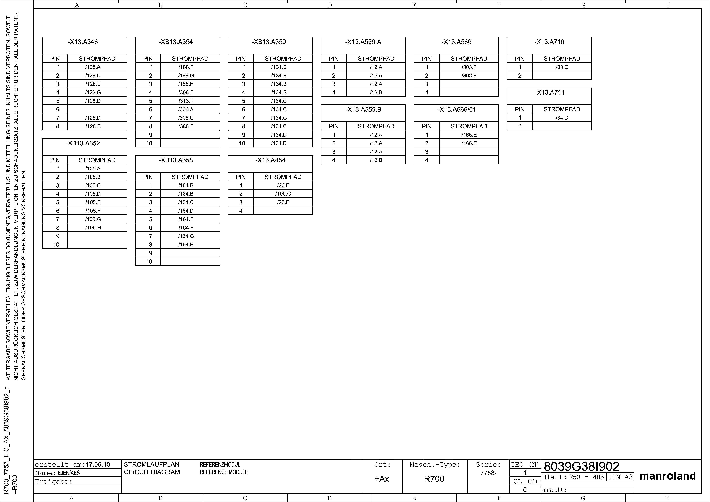

# +Ax — Sheet 250 of 403 — REFERENZMODUL

**REFERENCE MODULE**

> Part of the manroland **R700** printing press IEC/UL circuit diagrams.
> Drawing class: **Stromlaufplan / Circuit diagram** (DIN A3).
> Document `+Ax` covers the **Central control console** machine section.

## At a glance

| Field | Value |
|---|---|
| Document | `+Ax`  (8039G38I902) |
| Sheet | **250** of 403 |
| Section (DE) | REFERENZMODUL |
| Section (EN) | REFERENCE MODULE |
| Section type | REFERENCE_MODULE — Reference module |
| Machine type | `R700` |
| Series | `7758` |
| Created | 17.05.10 |
| Replaces | — |
| Columns used | A, B, C, D, E, F, G |
| Path numbers | — |
| Labels on sheet | 166 |
| Cross-refs out | 58 |
| Cross-refs in | 0 |

**Previous:** [+Ax sheet 249](SHEET_0249.md) · **Next:** [+Ax sheet 251](SHEET_0251.md) · **Document TOC:** [_TOC.md](_TOC.md)  (+Ax) · **Master TOC:** [all sheets](../_MASTER_TOC.md)

## Sheet image (300 DPI, exact vector render)



_Rendered directly from the PDF vector layer at 300 DPI (1-bit), no OCR and no resampling. Use it to confirm anything ambiguous in the text below._

## Cross-references on this sheet

Each entry is a wire leaving this sheet. The printed token is `/sheet.column`; the link resolves to that sheet inside the same document.

| Ref | Target sheet | Col | Path | Destination on target | Target section | From col |
|---|---|---|---|---|---|---|
| `/33.C` | [+Ax sheet 33](SHEET_0033.md) | C | — | STROMPFAD PIN 1 2 | SPANNUNGSVERSORGUNG, SCHALTSCHRANKBELÜFTUNG | G |
| `/12.A` | [+Ax sheet 12](SHEET_0012.md) | A | — | — | SPANNUNGSVERSORGUNG, SCHALTSCHRANKBELÜFTUNG | E |
| `/128.A` | [+Ax sheet 128](SHEET_0128.md) | A | — | — | REALTIMERECHNER ANLEGER | A |
| `/134.B` | [+Ax sheet 134](SHEET_0134.md) | B | — | — | REALTIMERECHNER ANSTEUERUNG DER SPS POWERKARTE | C |
| `/188.F` | [+Ax sheet 188](SHEET_0188.md) | F | — | — | RESERVE | B |
| `/303.F` | [+Ax sheet 303](SHEET_0303.md) | F | — | — | SPANNUNGSVERSORGUNG: LACKMODUL | F |
| `/12.A` | [+Ax sheet 12](SHEET_0012.md) | A | — | — | SPANNUNGSVERSORGUNG, SCHALTSCHRANKBELÜFTUNG | E |
| `/134.B` | [+Ax sheet 134](SHEET_0134.md) | B | — | — | REALTIMERECHNER ANSTEUERUNG DER SPS POWERKARTE | C |
| `/303.F` | [+Ax sheet 303](SHEET_0303.md) | F | — | — | SPANNUNGSVERSORGUNG: LACKMODUL | F |
| `/188.G` | [+Ax sheet 188](SHEET_0188.md) | G | — | — | RESERVE | B |
| `/128.D` | [+Ax sheet 128](SHEET_0128.md) | D | — | — | REALTIMERECHNER ANLEGER | A |
| `/12.A` | [+Ax sheet 12](SHEET_0012.md) | A | — | — | SPANNUNGSVERSORGUNG, SCHALTSCHRANKBELÜFTUNG | E |
| `/128.E` | [+Ax sheet 128](SHEET_0128.md) | E | — | — | REALTIMERECHNER ANLEGER | A |
| `/134.B` | [+Ax sheet 134](SHEET_0134.md) | B | — | — | REALTIMERECHNER ANSTEUERUNG DER SPS POWERKARTE | C |
| `/188.H` | [+Ax sheet 188](SHEET_0188.md) | H | — | — | RESERVE | B |
| `/12.B` | [+Ax sheet 12](SHEET_0012.md) | B | — | — | SPANNUNGSVERSORGUNG, SCHALTSCHRANKBELÜFTUNG | E |
| `/306.E` | [+Ax sheet 306](SHEET_0306.md) | E | — | — | SCHÖN & WIDERDRUCK HAUPTSCHALTSCHRANK | B |
| `/134.B` | [+Ax sheet 134](SHEET_0134.md) | B | — | — | REALTIMERECHNER ANSTEUERUNG DER SPS POWERKARTE | C |
| `/128.G` | [+Ax sheet 128](SHEET_0128.md) | G | — | — | REALTIMERECHNER ANLEGER | A |
| `/313.F` | [+Ax sheet 313](SHEET_0313.md) | F | — | — | OPTION: STAUBSAUGER MIT BÜRSTE | B |
| `/126.D` | [+Ax sheet 126](SHEET_0126.md) | D | — | — | REALTIMERECHNER ANLEGER | A |
| `/134.C` | [+Ax sheet 134](SHEET_0134.md) | C | — | — | REALTIMERECHNER ANSTEUERUNG DER SPS POWERKARTE | C |
| `/34.D` | [+Ax sheet 34](SHEET_0034.md) | D | — | STROMPFAD PIN 1 2 | SPANNUNGSVERSORGUNG, SCHALTSCHRANKBELÜFTUNG | G |
| `/306.A` | [+Ax sheet 306](SHEET_0306.md) | A | — | — | SCHÖN & WIDERDRUCK HAUPTSCHALTSCHRANK | B |
| `/134.C` | [+Ax sheet 134](SHEET_0134.md) | C | — | — | REALTIMERECHNER ANSTEUERUNG DER SPS POWERKARTE | C |
| `/126.D` | [+Ax sheet 126](SHEET_0126.md) | D | — | — | REALTIMERECHNER ANLEGER | A |
| `/306.C` | [+Ax sheet 306](SHEET_0306.md) | C | — | — | SCHÖN & WIDERDRUCK HAUPTSCHALTSCHRANK | B |
| `/134.C` | [+Ax sheet 134](SHEET_0134.md) | C | — | — | REALTIMERECHNER ANSTEUERUNG DER SPS POWERKARTE | C |
| `/126.E` | [+Ax sheet 126](SHEET_0126.md) | E | — | — | REALTIMERECHNER ANLEGER | A |
| `/386.F` | [+Ax sheet 386](SHEET_0386.md) | F | — | — | OPTION: INLINECOATER SMART | B |
| `/134.C` | [+Ax sheet 134](SHEET_0134.md) | C | — | — | REALTIMERECHNER ANSTEUERUNG DER SPS POWERKARTE | C |
| `/12.A` | [+Ax sheet 12](SHEET_0012.md) | A | — | — | SPANNUNGSVERSORGUNG, SCHALTSCHRANKBELÜFTUNG | E |
| `/166.E` | [+Ax sheet 166](SHEET_0166.md) | E | — | — | ÜBERWACHUNGSRECHNER/ANSTEUERUNG NOT AUS | F |
| `/134.D` | [+Ax sheet 134](SHEET_0134.md) | D | — | — | REALTIMERECHNER ANSTEUERUNG DER SPS POWERKARTE | C |
| `/12.A` | [+Ax sheet 12](SHEET_0012.md) | A | — | — | SPANNUNGSVERSORGUNG, SCHALTSCHRANKBELÜFTUNG | E |
| `/166.E` | [+Ax sheet 166](SHEET_0166.md) | E | — | — | ÜBERWACHUNGSRECHNER/ANSTEUERUNG NOT AUS | F |
| `/134.D` | [+Ax sheet 134](SHEET_0134.md) | D | — | — | REALTIMERECHNER ANSTEUERUNG DER SPS POWERKARTE | C |
| `/12.A` | [+Ax sheet 12](SHEET_0012.md) | A | — | — | SPANNUNGSVERSORGUNG, SCHALTSCHRANKBELÜFTUNG | E |
| `/12.B` | [+Ax sheet 12](SHEET_0012.md) | B | — | — | SPANNUNGSVERSORGUNG, SCHALTSCHRANKBELÜFTUNG | E |
| `/105.A` | [+Ax sheet 105](SHEET_0105.md) | A | — | — | ANLEGER | A |
| `/105.B` | [+Ax sheet 105](SHEET_0105.md) | B | — | — | ANLEGER | A |
| `/164.B` | [+Ax sheet 164](SHEET_0164.md) | B | — | — | ÜBERWACHUNGSRECHNER/ANSTEUERUNG NOT AUS | B |
| `/26.F` | [+Ax sheet 26](SHEET_0026.md) | F | — | — | SPANNUNGSVERSORGUNG, SCHALTSCHRANKBELÜFTUNG | C |
| `/105.C` | [+Ax sheet 105](SHEET_0105.md) | C | — | — | ANLEGER | A |
| `/164.B` | [+Ax sheet 164](SHEET_0164.md) | B | — | — | ÜBERWACHUNGSRECHNER/ANSTEUERUNG NOT AUS | B |
| `/100.G` | [+Ax sheet 100](SHEET_0100.md) | G | — | — | ANLEGER | C |
| `/105.D` | [+Ax sheet 105](SHEET_0105.md) | D | — | — | ANLEGER | A |
| `/105.E` | [+Ax sheet 105](SHEET_0105.md) | E | — | — | ANLEGER | A |
| `/26.F` | [+Ax sheet 26](SHEET_0026.md) | F | — | — | SPANNUNGSVERSORGUNG, SCHALTSCHRANKBELÜFTUNG | C |
| `/164.C` | [+Ax sheet 164](SHEET_0164.md) | C | — | — | ÜBERWACHUNGSRECHNER/ANSTEUERUNG NOT AUS | B |
| `/105.F` | [+Ax sheet 105](SHEET_0105.md) | F | — | — | ANLEGER | A |
| `/164.D` | [+Ax sheet 164](SHEET_0164.md) | D | — | — | ÜBERWACHUNGSRECHNER/ANSTEUERUNG NOT AUS | B |
| `/164.E` | [+Ax sheet 164](SHEET_0164.md) | E | — | — | ÜBERWACHUNGSRECHNER/ANSTEUERUNG NOT AUS | B |
| `/105.G` | [+Ax sheet 105](SHEET_0105.md) | G | — | — | ANLEGER | A |
| `/164.F` | [+Ax sheet 164](SHEET_0164.md) | F | — | — | ÜBERWACHUNGSRECHNER/ANSTEUERUNG NOT AUS | B |
| `/105.H` | [+Ax sheet 105](SHEET_0105.md) | H | — | — | ANLEGER | A |
| `/164.G` | [+Ax sheet 164](SHEET_0164.md) | G | — | — | ÜBERWACHUNGSRECHNER/ANSTEUERUNG NOT AUS | B |
| `/164.H` | [+Ax sheet 164](SHEET_0164.md) | H | — | — | ÜBERWACHUNGSRECHNER/ANSTEUERUNG NOT AUS | B |

## Devices on this sheet

| Tag | Class | Class meaning (IEC) | Col | Sub | Terminal | Sign |
|---|---|---|---|---|---|---|
| `X13.A346` | — | cross-device reference | A | — | — | — |
| `XB13.A352` | — | cross-device reference | A | — | — | — |
| `XB13.A354` | — | cross-device reference | B | — | — | — |
| `XB13.A358` | — | cross-device reference | B | — | — | — |
| `XB13.A359` | — | cross-device reference | C | — | — | — |
| `X13.A454` | — | cross-device reference | C | — | — | — |
| `X13.A559.A` | — | cross-device reference | D | — | — | — |
| `X13.A559.B` | — | cross-device reference | D | — | — | — |
| `X13.A566` | — | cross-device reference | F | — | — | — |
| `X13.A710` | — | cross-device reference | G | — | — | — |
| `X13.A711` | — | cross-device reference | G | — | — | — |

## Potentials / nets

_No named potentials on this sheet._

## Wire-end annotations (grouped as printed)

A wire that continues elsewhere is annotated with a small cluster: the destination description, the path/line number `#NN`, and the `/sheet.column` cross reference. Each row below is one such cluster exactly as it is grouped on the drawing.

| Col | Y | Path | Cross-ref | Text on the wire |
|---|---|---|---|---|
| A | 65.5 | — | — | `X13.A346` |
| B | 65.5 | — | — | `XB13.A354` |
| C | 65.5 | — | — | `XB13.A359` |
| D | 65.5 | — | — | `X13.A559.A` |
| F | 65.5 | — | — | `X13.A566` |
| G | 65.5 | — | — | `X13.A710` |
| A | 94.2 | — | — | `PIN 2 3 4 5 6 7 8 1 STROMPFAD` |
| B | 94.2 | — | — | `PIN 10 2 3 4 5 6 7 8 9 1 STROMPFAD` |
| C | 94.2 | — | — | `PIN 10 2 3 4 5 6 7 8 9 1 STROMPFAD` |
| D | 94.2 | — | — | `PIN 2 3 4 1 STROMPFAD` |
| E | 94.2 | — | — | `PIN 2 3 4 1 STROMPFAD` |
| G | 94.2 | — | `/33.C` | `PIN 2 1 STROMPFAD` |
| A | 108.7 | — | `/128.A` | — |
| B | 108.7 | — | `/188.F` | — |
| C | 108.7 | — | `/134.B` | — |
| E | 108.7 | — | `/12.A` | — |
| F | 108.7 | — | `/303.F` | — |
| E | 122.8 | — | `/12.A` | — |
| A | 122.9 | — | `/128.D` | — |
| B | 122.9 | — | `/188.G` | — |
| C | 122.9 | — | `/134.B` | — |
| F | 122.9 | — | `/303.F` | — |
| A | 137.0 | — | `/128.E` | — |
| C | 137.0 | — | `/134.B` | — |
| E | 137.0 | — | `/12.A` | — |
| B | 137.1 | — | `/188.H` | — |
| G | 150.5 | — | — | `X13.A711` |
| A | 151.2 | — | `/128.G` | — |
| B | 151.2 | — | `/306.E` | — |
| C | 151.2 | — | `/134.B` | — |
| E | 151.2 | — | `/12.B` | — |
| A | 165.4 | — | `/126.D` | — |
| B | 165.4 | — | `/313.F` | — |
| C | 165.4 | — | `/134.C` | — |
| D | 178.9 | — | — | `X13.A559.B` |
| F | 178.9 | — | — | `X13.A566/01` |
| G | 179.2 | — | `/34.D` | `PIN 2 1 STROMPFAD` |
| B | 179.6 | — | `/306.A` | — |
| C | 179.6 | — | `/134.C` | — |
| A | 193.8 | — | `/126.D` | — |
| B | 193.8 | — | `/306.C` | — |
| C | 193.8 | — | `/134.C` | — |
| D | 207.5 | — | — | `PIN 2 3 4 1 STROMPFAD` |
| E | 207.5 | — | — | `PIN 2 3 4 1 STROMPFAD` |
| A | 207.9 | — | `/126.E` | — |
| B | 207.9 | — | `/386.F` | — |
| C | 207.9 | — | `/134.C` | — |
| C | 222.1 | — | `/134.D` | — |
| E | 222.1 | — | `/12.A` | — |
| F | 222.1 | — | `/166.E` | — |
| A | 235.6 | — | — | `XB13.A352` |
| E | 236.2 | — | `/12.A` | — |
| F | 236.2 | — | `/166.E` | — |
| C | 236.3 | — | `/134.D` | — |
| E | 250.4 | — | `/12.A` | — |
| B | 263.9 | — | — | `XB13.A358` |
| C | 263.9 | — | — | `X13.A454` |
| A | 264.2 | — | — | `PIN 10 2 3 4 5 6 7 8 9 1 STROMPFAD` |
| E | 264.6 | — | `/12.B` | — |
| A | 278.8 | — | `/105.A` | — |
| B | 292.6 | — | — | `PIN 10 2 3 4 5 6 7 8 9 1 STROMPFAD` |
| C | 292.6 | — | — | `PIN 2 3 4 1 STROMPFAD` |
| A | 292.9 | — | `/105.B` | — |
| A | 307.1 | — | `/105.C` | — |
| B | 307.1 | — | `/164.B` | — |
| C | 307.1 | — | `/26.F` | — |
| A | 321.3 | — | `/105.D` | — |
| B | 321.3 | — | `/164.B` | — |
| C | 321.3 | — | `/100.G` | — |
| A | 335.5 | — | `/105.E` | — |
| B | 335.5 | — | `/164.C` | — |
| C | 335.5 | — | `/26.F` | — |
| A | 349.6 | — | `/105.F` | — |
| B | 349.7 | — | `/164.D` | — |
| A | 363.8 | — | `/105.G` | — |
| B | 363.8 | — | `/164.E` | — |
| A | 378.0 | — | `/105.H` | — |
| B | 378.0 | — | `/164.F` | — |
| B | 392.2 | — | `/164.G` | — |
| B | 406.4 | — | `/164.H` | — |


## Reconstructed tables

This sheet carries tabular content (pin map / terminal assignment / index). The grid below was rebuilt from the drawing's own rule lines, so each row is exactly one physical row of the table.

### Table 1 — 20 data rows × 2 columns (at x=70.9, y=62.4) — **X13.A346**

| PIN | STROMPFAD |
|---|---|
| `1` | `/128.A` |
| `2` | `/128.D` |
| `3` | `/128.E` |
| `4` | `/128.G` |
| `5` | `/126.D` |
| `6` |  |
| `7` | `/126.D` |
| `8` | `/126.E` |
|  | `XB13.A352` |
| `PIN` | `STROMPFAD` |
| `1` | `/105.A` |
| `2` | `/105.B` |
| `3` | `/105.C` |
| `4` | `/105.D` |
| `5` | `/105.E` |
| `6` | `/105.F` |
| `7` | `/105.G` |
| `8` | `/105.H` |
| `9` |  |
| `10` |  |


### Table 2 — 22 data rows × 2 columns (at x=226.8, y=62.4) — **XB13.A354**

| PIN | STROMPFAD |
|---|---|
| `1` | `/188.F` |
| `2` | `/188.G` |
| `3` | `/188.H` |
| `4` | `/306.E` |
| `5` | `/313.F` |
| `6` | `/306.A` |
| `7` | `/306.C` |
| `8` | `/386.F` |
| `9` |  |
| `10` |  |
|  | `XB13.A358` |
| `PIN` | `STROMPFAD` |
| `1` | `/164.B` |
| `2` | `/164.B` |
| `3` | `/164.C` |
| `4` | `/164.D` |
| `5` | `/164.E` |
| `6` | `/164.F` |
| `7` | `/164.G` |
| `8` | `/164.H` |
| `9` |  |
| `10` |  |


### Table 3 — 16 data rows × 2 columns (at x=382.7, y=62.4) — **XB13.A359**

| PIN | STROMPFAD |
|---|---|
| `1` | `/134.B` |
| `2` | `/134.B` |
| `3` | `/134.B` |
| `4` | `/134.B` |
| `5` | `/134.C` |
| `6` | `/134.C` |
| `7` | `/134.C` |
| `8` | `/134.C` |
| `9` | `/134.D` |
| `10` | `/134.D` |
|  | `X13.A454` |
| `PIN` | `STROMPFAD` |
| `1` | `/26.F` |
| `2` | `/100.G` |
| `3` | `/26.F` |
| `4` |  |


### Table 4 — 10 data rows × 2 columns (at x=538.6, y=62.4) — **X13.A559.A**

| PIN | STROMPFAD |
|---|---|
| `1` | `/12.A` |
| `2` | `/12.A` |
| `3` | `/12.A` |
| `4` | `/12.B` |
|  | `X13.A559.B` |
| `PIN` | `STROMPFAD` |
| `1` | `/12.A` |
| `2` | `/12.A` |
| `3` | `/12.A` |
| `4` | `/12.B` |


### Table 5 — 10 data rows × 2 columns (at x=694.5, y=62.4) — **X13.A566**

| PIN | STROMPFAD |
|---|---|
| `1` | `/303.F` |
| `2` | `/303.F` |
| `3` |  |
| `4` |  |
|  | `X13.A566/01` |
| `PIN` | `STROMPFAD` |
| `1` | `/166.E` |
| `2` | `/166.E` |
| `3` |  |
| `4` |  |


### Table 6 — 6 data rows × 2 columns (at x=850.4, y=62.4) — **X13.A710**

| PIN | STROMPFAD |
|---|---|
| `1` | `/33.C` |
| `2` |  |
|  | `X13.A711` |
| `PIN` | `STROMPFAD` |
| `1` | `/34.D` |
| `2` |  |


## Notes and free text on this sheet

| Text | Col | Y (pt) |
|---|---|---|
| `PIN` | A | 94.2 |
| `STROMPFAD` | A | 94.15 |
| `PIN` | B | 94.2 |
| `STROMPFAD` | B | 94.15 |
| `PIN` | C | 94.2 |
| `STROMPFAD` | C | 94.15 |
| `PIN` | D | 94.2 |
| `STROMPFAD` | E | 94.15 |
| `PIN` | E | 94.2 |
| `STROMPFAD` | F | 94.15 |
| `X13.A566/01` | F | 178.89 |
| `PIN` | F | 94.2 |
| `STROMPFAD` | G | 94.15 |

## Complete label inventory (exact text from the drawing)

Every text object inside the drawing area of this sheet, in DIN reading order (column A→H, then top→bottom). This is the authoritative list: if a string is not here it is not printed on this sheet.

| Col | Y | X | Dir | Type | Text |
|---|---|---|---|---|---|
| A | 65.5 | 114.0 | → | device ref | `X13.A346` |
| A | 94.2 | 84.0 | → | text | `PIN` |
| A | 94.2 | 132.2 | → | text | `STROMPFAD` |
| A | 108.4 | 95.8 | → | number | `1` |
| A | 108.7 | 143.1 | → | cross-reference | `/128.A` |
| A | 122.5 | 94.1 | → | number | `2` |
| A | 122.9 | 143.1 | → | cross-reference | `/128.D` |
| A | 136.7 | 94.1 | → | number | `3` |
| A | 137.0 | 143.4 | → | cross-reference | `/128.E` |
| A | 150.9 | 94.1 | → | number | `4` |
| A | 151.2 | 143.0 | → | cross-reference | `/128.G` |
| A | 165.1 | 94.1 | → | number | `5` |
| A | 165.4 | 143.1 | → | cross-reference | `/126.D` |
| A | 179.2 | 94.1 | → | number | `6` |
| A | 193.4 | 94.1 | → | number | `7` |
| A | 193.8 | 143.1 | → | cross-reference | `/126.D` |
| A | 207.6 | 94.1 | → | number | `8` |
| A | 207.9 | 143.4 | → | cross-reference | `/126.E` |
| A | 235.6 | 110.4 | → | device ref | `XB13.A352` |
| A | 264.2 | 132.2 | → | text | `STROMPFAD` |
| A | 264.3 | 84.0 | → | text | `PIN` |
| A | 278.5 | 95.8 | → | number | `1` |
| A | 278.8 | 143.1 | → | cross-reference | `/105.A` |
| A | 292.6 | 94.1 | → | number | `2` |
| A | 292.9 | 143.3 | → | cross-reference | `/105.B` |
| A | 306.8 | 94.1 | → | number | `3` |
| A | 307.1 | 143.1 | → | cross-reference | `/105.C` |
| A | 321.0 | 94.1 | → | number | `4` |
| A | 321.3 | 143.1 | → | cross-reference | `/105.D` |
| A | 335.1 | 94.1 | → | number | `5` |
| A | 335.5 | 143.4 | → | cross-reference | `/105.E` |
| A | 349.3 | 94.1 | → | number | `6` |
| A | 349.6 | 143.6 | → | cross-reference | `/105.F` |
| A | 363.5 | 94.1 | → | number | `7` |
| A | 363.8 | 143.0 | → | cross-reference | `/105.G` |
| A | 377.7 | 94.1 | → | number | `8` |
| A | 378.0 | 143.4 | → | cross-reference | `/105.H` |
| A | 391.8 | 94.1 | → | number | `9` |
| A | 406.0 | 88.7 | → | number | `10` |
| B | 65.5 | 266.3 | → | device ref | `XB13.A354` |
| B | 94.2 | 240.0 | → | text | `PIN` |
| B | 94.2 | 288.1 | → | text | `STROMPFAD` |
| B | 108.4 | 251.7 | → | number | `1` |
| B | 108.7 | 299.5 | → | cross-reference | `/188.F` |
| B | 122.5 | 250.0 | → | number | `2` |
| B | 122.9 | 298.9 | → | cross-reference | `/188.G` |
| B | 136.7 | 250.0 | → | number | `3` |
| B | 137.1 | 299.3 | → | cross-reference | `/188.H` |
| B | 150.9 | 250.0 | → | number | `4` |
| B | 151.2 | 299.3 | → | cross-reference | `/306.E` |
| B | 165.1 | 250.0 | → | number | `5` |
| B | 165.4 | 299.5 | → | cross-reference | `/313.F` |
| B | 179.2 | 250.0 | → | number | `6` |
| B | 179.6 | 299.1 | → | cross-reference | `/306.A` |
| B | 193.4 | 250.0 | → | number | `7` |
| B | 193.8 | 299.1 | → | cross-reference | `/306.C` |
| B | 207.6 | 250.0 | → | number | `8` |
| B | 207.9 | 299.5 | → | cross-reference | `/386.F` |
| B | 221.8 | 250.0 | → | number | `9` |
| B | 235.9 | 244.6 | → | number | `10` |
| B | 263.9 | 266.3 | → | device ref | `XB13.A358` |
| B | 292.6 | 240.0 | → | text | `PIN` |
| B | 292.6 | 288.1 | → | text | `STROMPFAD` |
| B | 306.8 | 251.7 | → | number | `1` |
| B | 307.1 | 299.2 | → | cross-reference | `/164.B` |
| B | 321.0 | 250.0 | → | number | `2` |
| B | 321.3 | 299.2 | → | cross-reference | `/164.B` |
| B | 335.1 | 250.0 | → | number | `3` |
| B | 335.5 | 299.1 | → | cross-reference | `/164.C` |
| B | 349.3 | 250.0 | → | number | `4` |
| B | 349.7 | 299.1 | → | cross-reference | `/164.D` |
| B | 363.5 | 250.0 | → | number | `5` |
| B | 363.8 | 299.3 | → | cross-reference | `/164.E` |
| B | 377.7 | 250.0 | → | number | `6` |
| B | 378.0 | 299.5 | → | cross-reference | `/164.F` |
| B | 391.8 | 250.0 | → | number | `7` |
| B | 392.2 | 298.9 | → | cross-reference | `/164.G` |
| B | 406.0 | 250.0 | → | number | `8` |
| B | 406.4 | 299.3 | → | cross-reference | `/164.H` |
| B | 420.2 | 250.0 | → | number | `9` |
| B | 434.4 | 244.6 | → | number | `10` |
| C | 65.5 | 422.2 | → | device ref | `XB13.A359` |
| C | 94.2 | 395.9 | → | text | `PIN` |
| C | 94.2 | 444.0 | → | text | `STROMPFAD` |
| C | 108.4 | 407.6 | → | number | `1` |
| C | 108.7 | 455.1 | → | cross-reference | `/134.B` |
| C | 122.5 | 405.9 | → | number | `2` |
| C | 122.9 | 455.1 | → | cross-reference | `/134.B` |
| C | 136.7 | 405.9 | → | number | `3` |
| C | 137.0 | 455.1 | → | cross-reference | `/134.B` |
| C | 150.9 | 405.9 | → | number | `4` |
| C | 151.2 | 455.1 | → | cross-reference | `/134.B` |
| C | 165.1 | 405.9 | → | number | `5` |
| C | 165.4 | 455.0 | → | cross-reference | `/134.C` |
| C | 179.2 | 405.9 | → | number | `6` |
| C | 179.6 | 455.0 | → | cross-reference | `/134.C` |
| C | 193.4 | 405.9 | → | number | `7` |
| C | 193.8 | 455.0 | → | cross-reference | `/134.C` |
| C | 207.6 | 405.9 | → | number | `8` |
| C | 207.9 | 455.0 | → | cross-reference | `/134.C` |
| C | 221.8 | 405.9 | → | number | `9` |
| C | 222.1 | 455.0 | → | cross-reference | `/134.D` |
| C | 235.9 | 400.5 | → | number | `10` |
| C | 236.3 | 455.0 | → | cross-reference | `/134.D` |
| C | 263.9 | 428.6 | → | device ref | `X13.A454` |
| C | 292.6 | 395.9 | → | text | `PIN` |
| C | 292.6 | 444.0 | → | text | `STROMPFAD` |
| C | 306.8 | 401.8 | → | number | `1` |
| C | 307.1 | 464.9 | → | cross-reference | `/26.F` |
| C | 321.0 | 401.2 | → | number | `2` |
| C | 321.3 | 461.9 | → | cross-reference | `/100.G` |
| C | 335.1 | 401.2 | → | number | `3` |
| C | 335.5 | 464.9 | → | cross-reference | `/26.F` |
| C | 349.3 | 401.2 | → | number | `4` |
| D | 65.5 | 579.1 | → | device ref | `X13.A559.A` |
| D | 94.2 | 551.8 | → | text | `PIN` |
| D | 108.4 | 557.7 | → | number | `1` |
| D | 122.5 | 557.1 | → | number | `2` |
| D | 136.7 | 557.1 | → | number | `3` |
| D | 150.9 | 557.1 | → | number | `4` |
| D | 178.9 | 579.5 | → | device ref | `X13.A559.B` |
| D | 207.6 | 551.8 | → | text | `PIN` |
| D | 221.8 | 557.7 | → | number | `1` |
| D | 235.9 | 557.1 | → | number | `2` |
| D | 250.1 | 557.1 | → | number | `3` |
| D | 264.3 | 557.1 | → | number | `4` |
| E | 94.2 | 600.0 | → | text | `STROMPFAD` |
| E | 94.2 | 707.7 | → | text | `PIN` |
| E | 108.4 | 713.6 | → | number | `1` |
| E | 108.7 | 620.4 | → | cross-reference | `/12.A` |
| E | 122.5 | 713.1 | → | number | `2` |
| E | 122.8 | 620.4 | → | cross-reference | `/12.A` |
| E | 136.7 | 713.1 | → | number | `3` |
| E | 137.0 | 620.4 | → | cross-reference | `/12.A` |
| E | 150.9 | 713.1 | → | number | `4` |
| E | 151.2 | 620.5 | → | cross-reference | `/12.B` |
| E | 207.5 | 600.0 | → | text | `STROMPFAD` |
| E | 207.6 | 707.7 | → | text | `PIN` |
| E | 221.8 | 713.6 | → | number | `1` |
| E | 222.1 | 620.4 | → | cross-reference | `/12.A` |
| E | 235.9 | 713.1 | → | number | `2` |
| E | 236.2 | 620.4 | → | cross-reference | `/12.A` |
| E | 250.1 | 713.1 | → | number | `3` |
| E | 250.4 | 620.4 | → | cross-reference | `/12.A` |
| E | 264.3 | 713.1 | → | number | `4` |
| E | 264.6 | 620.5 | → | cross-reference | `/12.B` |
| F | 65.5 | 740.4 | → | device ref | `X13.A566` |
| F | 94.2 | 755.9 | → | text | `STROMPFAD` |
| F | 94.2 | 863.6 | → | text | `PIN` |
| F | 108.4 | 869.5 | → | number | `1` |
| F | 108.7 | 774.3 | → | cross-reference | `/303.F` |
| F | 122.5 | 869.0 | → | number | `2` |
| F | 122.9 | 774.3 | → | cross-reference | `/303.F` |
| F | 178.9 | 733.7 | → | text | `X13.A566/01` |
| F | 179.2 | 863.6 | → | text | `PIN` |
| F | 193.4 | 869.5 | → | number | `1` |
| F | 207.5 | 755.9 | → | text | `STROMPFAD` |
| F | 207.6 | 869.0 | → | number | `2` |
| F | 222.1 | 774.1 | → | cross-reference | `/166.E` |
| F | 236.2 | 774.1 | → | cross-reference | `/166.E` |
| G | 65.5 | 896.3 | → | device ref | `X13.A710` |
| G | 94.2 | 911.8 | → | text | `STROMPFAD` |
| G | 108.7 | 932.2 | → | cross-reference | `/33.C` |
| G | 150.5 | 897.0 | → | device ref | `X13.A711` |
| G | 179.2 | 911.8 | → | text | `STROMPFAD` |
| G | 193.7 | 932.2 | → | cross-reference | `/34.D` |

## Reading-order text block

The same content as a plain block, grouped by DIN column — convenient to paste or to match against a visual description.

```text
=== Column A ===
  65.5  114.0  devref       X13.A346
  94.2   84.0  text         PIN
  94.2  132.2  text         STROMPFAD
 108.4   95.8  numeric      1
 108.7  143.1  xref         /128.A
 122.5   94.1  numeric      2
 122.9  143.1  xref         /128.D
 136.7   94.1  numeric      3
 137.0  143.4  xref         /128.E
 150.9   94.1  numeric      4
 151.2  143.0  xref         /128.G
 165.1   94.1  numeric      5
 165.4  143.1  xref         /126.D
 179.2   94.1  numeric      6
 193.4   94.1  numeric      7
 193.8  143.1  xref         /126.D
 207.6   94.1  numeric      8
 207.9  143.4  xref         /126.E
 235.6  110.4  devref       XB13.A352
 264.2  132.2  text         STROMPFAD
 264.3   84.0  text         PIN
 278.5   95.8  numeric      1
 278.8  143.1  xref         /105.A
 292.6   94.1  numeric      2
 292.9  143.3  xref         /105.B
 306.8   94.1  numeric      3
 307.1  143.1  xref         /105.C
 321.0   94.1  numeric      4
 321.3  143.1  xref         /105.D
 335.1   94.1  numeric      5
 335.5  143.4  xref         /105.E
 349.3   94.1  numeric      6
 349.6  143.6  xref         /105.F
 363.5   94.1  numeric      7
 363.8  143.0  xref         /105.G
 377.7   94.1  numeric      8
 378.0  143.4  xref         /105.H
 391.8   94.1  numeric      9
 406.0   88.7  numeric      10
=== Column B ===
  65.5  266.3  devref       XB13.A354
  94.2  240.0  text         PIN
  94.2  288.1  text         STROMPFAD
 108.4  251.7  numeric      1
 108.7  299.5  xref         /188.F
 122.5  250.0  numeric      2
 122.9  298.9  xref         /188.G
 136.7  250.0  numeric      3
 137.1  299.3  xref         /188.H
 150.9  250.0  numeric      4
 151.2  299.3  xref         /306.E
 165.1  250.0  numeric      5
 165.4  299.5  xref         /313.F
 179.2  250.0  numeric      6
 179.6  299.1  xref         /306.A
 193.4  250.0  numeric      7
 193.8  299.1  xref         /306.C
 207.6  250.0  numeric      8
 207.9  299.5  xref         /386.F
 221.8  250.0  numeric      9
 235.9  244.6  numeric      10
 263.9  266.3  devref       XB13.A358
 292.6  240.0  text         PIN
 292.6  288.1  text         STROMPFAD
 306.8  251.7  numeric      1
 307.1  299.2  xref         /164.B
 321.0  250.0  numeric      2
 321.3  299.2  xref         /164.B
 335.1  250.0  numeric      3
 335.5  299.1  xref         /164.C
 349.3  250.0  numeric      4
 349.7  299.1  xref         /164.D
 363.5  250.0  numeric      5
 363.8  299.3  xref         /164.E
 377.7  250.0  numeric      6
 378.0  299.5  xref         /164.F
 391.8  250.0  numeric      7
 392.2  298.9  xref         /164.G
 406.0  250.0  numeric      8
 406.4  299.3  xref         /164.H
 420.2  250.0  numeric      9
 434.4  244.6  numeric      10
=== Column C ===
  65.5  422.2  devref       XB13.A359
  94.2  395.9  text         PIN
  94.2  444.0  text         STROMPFAD
 108.4  407.6  numeric      1
 108.7  455.1  xref         /134.B
 122.5  405.9  numeric      2
 122.9  455.1  xref         /134.B
 136.7  405.9  numeric      3
 137.0  455.1  xref         /134.B
 150.9  405.9  numeric      4
 151.2  455.1  xref         /134.B
 165.1  405.9  numeric      5
 165.4  455.0  xref         /134.C
 179.2  405.9  numeric      6
 179.6  455.0  xref         /134.C
 193.4  405.9  numeric      7
 193.8  455.0  xref         /134.C
 207.6  405.9  numeric      8
 207.9  455.0  xref         /134.C
 221.8  405.9  numeric      9
 222.1  455.0  xref         /134.D
 235.9  400.5  numeric      10
 236.3  455.0  xref         /134.D
 263.9  428.6  devref       X13.A454
 292.6  395.9  text         PIN
 292.6  444.0  text         STROMPFAD
 306.8  401.8  numeric      1
 307.1  464.9  xref         /26.F
 321.0  401.2  numeric      2
 321.3  461.9  xref         /100.G
 335.1  401.2  numeric      3
 335.5  464.9  xref         /26.F
 349.3  401.2  numeric      4
=== Column D ===
  65.5  579.1  devref       X13.A559.A
  94.2  551.8  text         PIN
 108.4  557.7  numeric      1
 122.5  557.1  numeric      2
 136.7  557.1  numeric      3
 150.9  557.1  numeric      4
 178.9  579.5  devref       X13.A559.B
 207.6  551.8  text         PIN
 221.8  557.7  numeric      1
 235.9  557.1  numeric      2
 250.1  557.1  numeric      3
 264.3  557.1  numeric      4
=== Column E ===
  94.2  600.0  text         STROMPFAD
  94.2  707.7  text         PIN
 108.4  713.6  numeric      1
 108.7  620.4  xref         /12.A
 122.5  713.1  numeric      2
 122.8  620.4  xref         /12.A
 136.7  713.1  numeric      3
 137.0  620.4  xref         /12.A
 150.9  713.1  numeric      4
 151.2  620.5  xref         /12.B
 207.5  600.0  text         STROMPFAD
 207.6  707.7  text         PIN
 221.8  713.6  numeric      1
 222.1  620.4  xref         /12.A
 235.9  713.1  numeric      2
 236.2  620.4  xref         /12.A
 250.1  713.1  numeric      3
 250.4  620.4  xref         /12.A
 264.3  713.1  numeric      4
 264.6  620.5  xref         /12.B
=== Column F ===
  65.5  740.4  devref       X13.A566
  94.2  755.9  text         STROMPFAD
  94.2  863.6  text         PIN
 108.4  869.5  numeric      1
 108.7  774.3  xref         /303.F
 122.5  869.0  numeric      2
 122.9  774.3  xref         /303.F
 178.9  733.7  text         X13.A566/01
 179.2  863.6  text         PIN
 193.4  869.5  numeric      1
 207.5  755.9  text         STROMPFAD
 207.6  869.0  numeric      2
 222.1  774.1  xref         /166.E
 236.2  774.1  xref         /166.E
=== Column G ===
  65.5  896.3  devref       X13.A710
  94.2  911.8  text         STROMPFAD
 108.7  932.2  xref         /33.C
 150.5  897.0  devref       X13.A711
 179.2  911.8  text         STROMPFAD
 193.7  932.2  xref         /34.D
```

---
_Generated from the PDF vector text layer; no OCR. Source: `R700_7758_IEC_AX_8039G38I902_p`, sheet 250._
