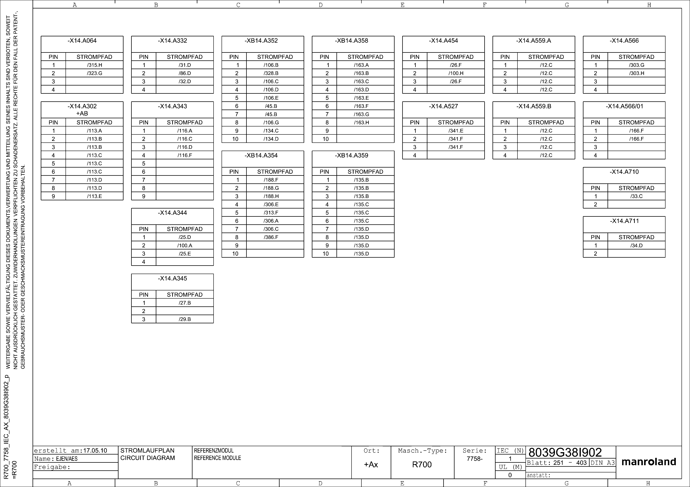

# +Ax — Sheet 251 of 403 — REFERENZMODUL

**REFERENCE MODULE**

> Part of the manroland **R700** printing press IEC/UL circuit diagrams.
> Drawing class: **Stromlaufplan / Circuit diagram** (DIN A3).
> Document `+Ax` covers the **Central control console** machine section.

## At a glance

| Field | Value |
|---|---|
| Document | `+Ax`  (8039G38I902) |
| Sheet | **251** of 403 |
| Section (DE) | REFERENZMODUL |
| Section (EN) | REFERENCE MODULE |
| Section type | REFERENCE_MODULE — Reference module |
| Machine type | `R700` |
| Series | `7758` |
| Created | 17.05.10 |
| Replaces | — |
| Columns used | A, B, C, D, E, F, G, H |
| Path numbers | — |
| Labels on sheet | 235 |
| Cross-refs out | 79 |
| Cross-refs in | 0 |

**Previous:** [+Ax sheet 250](SHEET_0250.md) · **Next:** [+Ax sheet 252](SHEET_0252.md) · **Document TOC:** [_TOC.md](_TOC.md)  (+Ax) · **Master TOC:** [all sheets](../_MASTER_TOC.md)

## Sheet image (300 DPI, exact vector render)



_Rendered directly from the PDF vector layer at 300 DPI (1-bit), no OCR and no resampling. Use it to confirm anything ambiguous in the text below._

## Cross-references on this sheet

Each entry is a wire leaving this sheet. The printed token is `/sheet.column`; the link resolves to that sheet inside the same document.

| Ref | Target sheet | Col | Path | Destination on target | Target section | From col |
|---|---|---|---|---|---|---|
| `/106.B` | [+Ax sheet 106](SHEET_0106.md) | B | — | — | ANLEGER | C |
| `/163.A` | [+Ax sheet 163](SHEET_0163.md) | A | — | — | ÜBERWACHUNGSRECHNER/ANSTEUERUNG NOT AUS | D |
| `/26.F` | [+Ax sheet 26](SHEET_0026.md) | F | — | — | SPANNUNGSVERSORGUNG, SCHALTSCHRANKBELÜFTUNG | F |
| `/31.D` | [+Ax sheet 31](SHEET_0031.md) | D | — | — | SPANNUNGSVERSORGUNG, SCHALTSCHRANKBELÜFTUNG | B |
| `/12.C` | [+Ax sheet 12](SHEET_0012.md) | C | — | — | SPANNUNGSVERSORGUNG, SCHALTSCHRANKBELÜFTUNG | G |
| `/303.G` | [+Ax sheet 303](SHEET_0303.md) | G | — | — | SPANNUNGSVERSORGUNG: LACKMODUL | H |
| `/315.H` | [+Ax sheet 315](SHEET_0315.md) | H | — | — | OPTION: "EJEKTOR" ANLAGE / SELECT AIRSTATION / | A |
| `/328.B` | [+Ax sheet 328](SHEET_0328.md) | B | — | — | OPTION: NONSTOP EINRICHTUNG MANUELL, ANLEGER | C |
| `/163.B` | [+Ax sheet 163](SHEET_0163.md) | B | — | — | ÜBERWACHUNGSRECHNER/ANSTEUERUNG NOT AUS | E |
| `/323.G` | [+Ax sheet 323](SHEET_0323.md) | G | — | — | OPTION: "EJEKTOR" ANLAGE / SELECT AIRSTATION / | A |
| `/86.D` | [+Ax sheet 86](SHEET_0086.md) | D | — | — | ANLEGER | B |
| `/12.C` | [+Ax sheet 12](SHEET_0012.md) | C | — | — | SPANNUNGSVERSORGUNG, SCHALTSCHRANKBELÜFTUNG | G |
| `/100.H` | [+Ax sheet 100](SHEET_0100.md) | H | — | — | ANLEGER | F |
| `/303.H` | [+Ax sheet 303](SHEET_0303.md) | H | — | — | SPANNUNGSVERSORGUNG: LACKMODUL | H |
| `/26.F` | [+Ax sheet 26](SHEET_0026.md) | F | — | — | SPANNUNGSVERSORGUNG, SCHALTSCHRANKBELÜFTUNG | F |
| `/32.D` | [+Ax sheet 32](SHEET_0032.md) | D | — | — | SPANNUNGSVERSORGUNG, SCHALTSCHRANKBELÜFTUNG | B |
| `/12.C` | [+Ax sheet 12](SHEET_0012.md) | C | — | — | SPANNUNGSVERSORGUNG, SCHALTSCHRANKBELÜFTUNG | G |
| `/106.C` | [+Ax sheet 106](SHEET_0106.md) | C | — | — | ANLEGER | C |
| `/163.C` | [+Ax sheet 163](SHEET_0163.md) | C | — | — | ÜBERWACHUNGSRECHNER/ANSTEUERUNG NOT AUS | E |
| `/106.D` | [+Ax sheet 106](SHEET_0106.md) | D | — | — | ANLEGER | C |
| `/163.D` | [+Ax sheet 163](SHEET_0163.md) | D | — | — | ÜBERWACHUNGSRECHNER/ANSTEUERUNG NOT AUS | E |
| `/12.C` | [+Ax sheet 12](SHEET_0012.md) | C | — | — | SPANNUNGSVERSORGUNG, SCHALTSCHRANKBELÜFTUNG | G |
| `/106.E` | [+Ax sheet 106](SHEET_0106.md) | E | — | — | ANLEGER | C |
| `/163.E` | [+Ax sheet 163](SHEET_0163.md) | E | — | — | ÜBERWACHUNGSRECHNER/ANSTEUERUNG NOT AUS | E |
| `/45.B` | [+Ax sheet 45](SHEET_0045.md) | B | — | — | HAUPTANTRIEB | C |
| `/163.F` | [+Ax sheet 163](SHEET_0163.md) | F | — | — | ÜBERWACHUNGSRECHNER/ANSTEUERUNG NOT AUS | E |
| `/45.B` | [+Ax sheet 45](SHEET_0045.md) | B | — | — | HAUPTANTRIEB | C |
| `/163.G` | [+Ax sheet 163](SHEET_0163.md) | G | — | — | ÜBERWACHUNGSRECHNER/ANSTEUERUNG NOT AUS | E |
| `/106.G` | [+Ax sheet 106](SHEET_0106.md) | G | — | — | ANLEGER | C |
| `/163.H` | [+Ax sheet 163](SHEET_0163.md) | H | — | — | ÜBERWACHUNGSRECHNER/ANSTEUERUNG NOT AUS | E |
| `/113.A` | [+Ax sheet 113](SHEET_0113.md) | A | — | — | FORMATEINSTELLUNG MOTORISCH, SEITLICHE | A |
| `/116.A` | [+Ax sheet 116](SHEET_0116.md) | A | — | — | REALTIMERECHNER 20mA SCHLEIFE | B |
| `/341.E` | [+Ax sheet 341](SHEET_0341.md) | E | — | — | OPTION: INLINESHEETER RS104 S | F |
| `/166.F` | [+Ax sheet 166](SHEET_0166.md) | F | — | — | ÜBERWACHUNGSRECHNER/ANSTEUERUNG NOT AUS | H |
| `/12.C` | [+Ax sheet 12](SHEET_0012.md) | C | — | — | SPANNUNGSVERSORGUNG, SCHALTSCHRANKBELÜFTUNG | G |
| `/134.C` | [+Ax sheet 134](SHEET_0134.md) | C | — | — | REALTIMERECHNER ANSTEUERUNG DER SPS POWERKARTE | C |
| `/113.B` | [+Ax sheet 113](SHEET_0113.md) | B | — | — | FORMATEINSTELLUNG MOTORISCH, SEITLICHE | A |
| `/341.F` | [+Ax sheet 341](SHEET_0341.md) | F | — | — | OPTION: INLINESHEETER RS104 S | F |
| `/166.F` | [+Ax sheet 166](SHEET_0166.md) | F | — | — | ÜBERWACHUNGSRECHNER/ANSTEUERUNG NOT AUS | H |
| `/116.C` | [+Ax sheet 116](SHEET_0116.md) | C | — | — | REALTIMERECHNER 20mA SCHLEIFE | B |
| `/134.D` | [+Ax sheet 134](SHEET_0134.md) | D | — | — | REALTIMERECHNER ANSTEUERUNG DER SPS POWERKARTE | C |
| `/12.C` | [+Ax sheet 12](SHEET_0012.md) | C | — | — | SPANNUNGSVERSORGUNG, SCHALTSCHRANKBELÜFTUNG | G |
| `/113.B` | [+Ax sheet 113](SHEET_0113.md) | B | — | — | FORMATEINSTELLUNG MOTORISCH, SEITLICHE | A |
| `/341.F` | [+Ax sheet 341](SHEET_0341.md) | F | — | — | OPTION: INLINESHEETER RS104 S | F |
| `/12.C` | [+Ax sheet 12](SHEET_0012.md) | C | — | — | SPANNUNGSVERSORGUNG, SCHALTSCHRANKBELÜFTUNG | G |
| `/116.D` | [+Ax sheet 116](SHEET_0116.md) | D | — | — | REALTIMERECHNER 20mA SCHLEIFE | B |
| `/116.F` | [+Ax sheet 116](SHEET_0116.md) | F | — | — | REALTIMERECHNER 20mA SCHLEIFE | B |
| `/12.C` | [+Ax sheet 12](SHEET_0012.md) | C | — | — | SPANNUNGSVERSORGUNG, SCHALTSCHRANKBELÜFTUNG | G |
| `/113.C` | [+Ax sheet 113](SHEET_0113.md) | C | — | — | FORMATEINSTELLUNG MOTORISCH, SEITLICHE | A |
| `/113.C` | [+Ax sheet 113](SHEET_0113.md) | C | — | — | FORMATEINSTELLUNG MOTORISCH, SEITLICHE | A |
| `/113.C` | [+Ax sheet 113](SHEET_0113.md) | C | — | — | FORMATEINSTELLUNG MOTORISCH, SEITLICHE | A |
| `/135.B` | [+Ax sheet 135](SHEET_0135.md) | B | — | — | REALTIMERECHNER ANSTEUERUNG DER SPS POWERKARTE | E |
| `/188.F` | [+Ax sheet 188](SHEET_0188.md) | F | — | — | RESERVE | C |
| `/113.D` | [+Ax sheet 113](SHEET_0113.md) | D | — | — | FORMATEINSTELLUNG MOTORISCH, SEITLICHE | A |
| `/33.C` | [+Ax sheet 33](SHEET_0033.md) | C | — | STROMPFAD PIN 1 2 | SPANNUNGSVERSORGUNG, SCHALTSCHRANKBELÜFTUNG | H |
| `/135.B` | [+Ax sheet 135](SHEET_0135.md) | B | — | — | REALTIMERECHNER ANSTEUERUNG DER SPS POWERKARTE | E |
| `/188.G` | [+Ax sheet 188](SHEET_0188.md) | G | — | — | RESERVE | C |
| `/113.D` | [+Ax sheet 113](SHEET_0113.md) | D | — | — | FORMATEINSTELLUNG MOTORISCH, SEITLICHE | A |
| `/113.E` | [+Ax sheet 113](SHEET_0113.md) | E | — | — | FORMATEINSTELLUNG MOTORISCH, SEITLICHE | A |
| `/135.B` | [+Ax sheet 135](SHEET_0135.md) | B | — | — | REALTIMERECHNER ANSTEUERUNG DER SPS POWERKARTE | E |
| `/188.H` | [+Ax sheet 188](SHEET_0188.md) | H | — | — | RESERVE | C |
| `/306.E` | [+Ax sheet 306](SHEET_0306.md) | E | — | — | SCHÖN & WIDERDRUCK HAUPTSCHALTSCHRANK | C |
| `/135.C` | [+Ax sheet 135](SHEET_0135.md) | C | — | — | REALTIMERECHNER ANSTEUERUNG DER SPS POWERKARTE | E |
| `/313.F` | [+Ax sheet 313](SHEET_0313.md) | F | — | — | OPTION: STAUBSAUGER MIT BÜRSTE | C |
| `/135.C` | [+Ax sheet 135](SHEET_0135.md) | C | — | — | REALTIMERECHNER ANSTEUERUNG DER SPS POWERKARTE | E |
| `/306.A` | [+Ax sheet 306](SHEET_0306.md) | A | — | — | SCHÖN & WIDERDRUCK HAUPTSCHALTSCHRANK | C |
| `/135.C` | [+Ax sheet 135](SHEET_0135.md) | C | — | — | REALTIMERECHNER ANSTEUERUNG DER SPS POWERKARTE | E |
| `/306.C` | [+Ax sheet 306](SHEET_0306.md) | C | — | — | SCHÖN & WIDERDRUCK HAUPTSCHALTSCHRANK | C |
| `/135.D` | [+Ax sheet 135](SHEET_0135.md) | D | — | — | REALTIMERECHNER ANSTEUERUNG DER SPS POWERKARTE | E |
| `/34.D` | [+Ax sheet 34](SHEET_0034.md) | D | — | STROMPFAD PIN 1 2 | SPANNUNGSVERSORGUNG, SCHALTSCHRANKBELÜFTUNG | H |
| `/25.D` | [+Ax sheet 25](SHEET_0025.md) | D | — | — | SPANNUNGSVERSORGUNG, SCHALTSCHRANKBELÜFTUNG | B |
| `/386.F` | [+Ax sheet 386](SHEET_0386.md) | F | — | — | OPTION: INLINECOATER SMART | C |
| `/135.D` | [+Ax sheet 135](SHEET_0135.md) | D | — | — | REALTIMERECHNER ANSTEUERUNG DER SPS POWERKARTE | E |
| `/100.A` | [+Ax sheet 100](SHEET_0100.md) | A | — | — | ANLEGER | B |
| `/135.D` | [+Ax sheet 135](SHEET_0135.md) | D | — | — | REALTIMERECHNER ANSTEUERUNG DER SPS POWERKARTE | E |
| `/25.E` | [+Ax sheet 25](SHEET_0025.md) | E | — | — | SPANNUNGSVERSORGUNG, SCHALTSCHRANKBELÜFTUNG | B |
| `/135.D` | [+Ax sheet 135](SHEET_0135.md) | D | — | — | REALTIMERECHNER ANSTEUERUNG DER SPS POWERKARTE | E |
| `/27.B` | [+Ax sheet 27](SHEET_0027.md) | B | — | — | SPANNUNGSVERSORGUNG, SCHALTSCHRANKBELÜFTUNG | B |
| `/29.B` | [+Ax sheet 29](SHEET_0029.md) | B | — | — | SPANNUNGSVERSORGUNG, SCHALTSCHRANKBELÜFTUNG | B |

## Devices on this sheet

| Tag | Class | Class meaning (IEC) | Col | Sub | Terminal | Sign |
|---|---|---|---|---|---|---|
| `X14.A064` | — | cross-device reference | A | — | — | — |
| `X14.A343` | — | cross-device reference | B | — | — | — |
| `X14.A332` | — | cross-device reference | B | — | — | — |
| `X14.A302` | — | cross-device reference | A | — | — | — |
| `X14.A344` | — | cross-device reference | B | — | — | — |
| `X14.A345` | — | cross-device reference | B | — | — | — |
| `XB14.A352` | — | cross-device reference | C | — | — | — |
| `XB14.A354` | — | cross-device reference | C | — | — | — |
| `X14.A454` | — | cross-device reference | F | — | — | — |
| `X14.A527` | — | cross-device reference | F | — | — | — |
| `XB14.A359` | — | cross-device reference | D | — | — | — |
| `XB14.A358` | — | cross-device reference | D | — | — | — |
| `X14.A559.A` | — | cross-device reference | G | — | — | — |
| `X14.A559.B` | — | cross-device reference | G | — | — | — |
| `X14.A566` | — | cross-device reference | H | — | — | — |
| `X14.A710` | — | cross-device reference | H | — | — | — |
| `X14.A711` | — | cross-device reference | H | — | — | — |

## Potentials / nets

_No named potentials on this sheet._

## Wire-end annotations (grouped as printed)

A wire that continues elsewhere is annotated with a small cluster: the destination description, the path/line number `#NN`, and the `/sheet.column` cross reference. Each row below is one such cluster exactly as it is grouped on the drawing.

| Col | Y | Path | Cross-ref | Text on the wire |
|---|---|---|---|---|
| A | 65.5 | — | — | `X14.A064` |
| B | 65.5 | — | — | `X14.A332` |
| C | 65.5 | — | — | `XB14.A352` |
| D | 65.5 | — | — | `XB14.A358` |
| F | 65.5 | — | — | `X14.A454` |
| G | 65.5 | — | — | `X14.A559.A` |
| H | 65.5 | — | — | `X14.A566` |
| A | 94.2 | — | — | `PIN 2 3 4 1 STROMPFAD` |
| B | 94.2 | — | — | `PIN 2 3 4 1 STROMPFAD` |
| C | 94.2 | — | — | `PIN 10 2 3 4 5 6 7 8 9 1 STROMPFAD` |
| D | 94.2 | — | — | `PIN 10 2 3 4 5 6 7 8 9 1 STROMPFAD` |
| E | 94.2 | — | — | `PIN 2 3 4 1 STROMPFAD` |
| G | 94.2 | — | — | `PIN 2 3 4 1 STROMPFAD` |
| H | 94.2 | — | — | `PIN 2 3 4 1 STROMPFAD` |
| A | 108.7 | — | `/315.H` | — |
| B | 108.7 | — | `/31.D` | — |
| C | 108.7 | — | `/106.B` | — |
| D | 108.7 | — | `/163.A` | — |
| F | 108.7 | — | `/26.F` | — |
| G | 108.7 | — | `/12.C` | — |
| H | 108.7 | — | `/303.G` | — |
| A | 122.9 | — | `/323.G` | — |
| B | 122.9 | — | `/86.D` | — |
| C | 122.9 | — | `/328.B` | — |
| E | 122.9 | — | `/163.B` | — |
| F | 122.9 | — | `/100.H` | — |
| G | 122.9 | — | `/12.C` | — |
| H | 122.9 | — | `/303.H` | — |
| F | 137.0 | — | `/26.F` | — |
| B | 137.1 | — | `/32.D` | — |
| C | 137.1 | — | `/106.C` | — |
| E | 137.1 | — | `/163.C` | — |
| G | 137.1 | — | `/12.C` | — |
| C | 151.2 | — | `/106.D` | — |
| E | 151.2 | — | `/163.D` | — |
| G | 151.2 | — | `/12.C` | — |
| C | 165.4 | — | `/106.E` | — |
| E | 165.4 | — | `/163.E` | — |
| A | 178.9 | — | — | `X14.A302` |
| B | 178.9 | — | — | `X14.A343` |
| F | 178.9 | — | — | `X14.A527` |
| G | 178.9 | — | — | `X14.A559.B` |
| H | 178.9 | — | — | `X14.A566/01` |
| C | 179.5 | — | `/45.B` | — |
| E | 179.6 | — | `/163.F` | — |
| A | 191.6 | — | — | `+AB` |
| C | 193.7 | — | `/45.B` | — |
| E | 193.7 | — | `/163.G` | — |
| A | 207.5 | — | — | `PIN 2 3 4 5 6 7 8 9 1 STROMPFAD` |
| B | 207.5 | — | — | `PIN 2 3 4 5 6 7 8 9 1 STROMPFAD` |
| E | 207.5 | — | — | `PIN 2 3 4 1 STROMPFAD` |
| G | 207.5 | — | — | `PIN 2 3 4 1 STROMPFAD` |
| H | 207.5 | — | — | `PIN 2 3 4 1 STROMPFAD` |
| C | 207.9 | — | `/106.G` | — |
| E | 207.9 | — | `/163.H` | — |
| A | 222.1 | — | `/113.A` | — |
| B | 222.1 | — | `/116.A` | — |
| C | 222.1 | — | `/134.C` | — |
| F | 222.1 | — | `/341.E` | — |
| G | 222.1 | — | `/12.C` | — |
| H | 222.1 | — | `/166.F` | — |
| A | 236.2 | — | `/113.B` | — |
| B | 236.3 | — | `/116.C` | — |
| C | 236.3 | — | `/134.D` | — |
| F | 236.3 | — | `/341.F` | — |
| G | 236.3 | — | `/12.C` | — |
| H | 236.3 | — | `/166.F` | — |
| A | 250.4 | — | `/113.B` | — |
| B | 250.4 | — | `/116.D` | — |
| F | 250.4 | — | `/341.F` | — |
| G | 250.4 | — | `/12.C` | — |
| C | 263.9 | — | — | `XB14.A354` |
| D | 263.9 | — | — | `XB14.A359` |
| A | 264.6 | — | `/113.C` | — |
| B | 264.6 | — | `/116.F` | — |
| G | 264.6 | — | `/12.C` | — |
| A | 278.8 | — | `/113.C` | — |
| H | 292.3 | — | — | `X14.A710` |
| C | 292.6 | — | — | `PIN 10 2 3 4 5 6 7 8 9 1 STROMPFAD` |
| D | 292.6 | — | — | `PIN 10 2 3 4 5 6 7 8 9 1 STROMPFAD` |
| A | 293.0 | — | `/113.C` | — |
| A | 307.1 | — | `/113.D` | — |
| C | 307.1 | — | `/188.F` | — |
| E | 307.1 | — | `/135.B` | — |
| H | 320.9 | — | `/33.C` | `PIN 2 1 STROMPFAD` |
| A | 321.3 | — | `/113.D` | — |
| C | 321.3 | — | `/188.G` | — |
| E | 321.3 | — | `/135.B` | — |
| A | 335.5 | — | `/113.E` | — |
| C | 335.5 | — | `/188.H` | — |
| E | 335.5 | — | `/135.B` | — |
| C | 349.6 | — | `/306.E` | — |
| E | 349.7 | — | `/135.C` | — |
| B | 363.1 | — | — | `X14.A344` |
| C | 363.8 | — | `/313.F` | — |
| E | 363.8 | — | `/135.C` | — |
| H | 377.3 | — | — | `X14.A711` |
| C | 378.0 | — | `/306.A` | — |
| E | 378.0 | — | `/135.C` | — |
| B | 391.8 | — | — | `PIN 2 3 4 1 STROMPFAD` |
| C | 392.2 | — | `/306.C` | — |
| E | 392.2 | — | `/135.D` | — |
| H | 406.0 | — | `/34.D` | `PIN 2 1 STROMPFAD` |
| B | 406.3 | — | `/25.D` | — |
| C | 406.3 | — | `/386.F` | — |
| E | 406.4 | — | `/135.D` | — |
| B | 420.5 | — | `/100.A` | — |
| E | 420.5 | — | `/135.D` | — |
| B | 434.7 | — | `/25.E` | — |
| E | 434.7 | — | `/135.D` | — |
| B | 476.5 | — | — | `X14.A345` |
| B | 505.2 | — | — | `PIN 2 3 1 STROMPFAD` |
| B | 519.7 | — | `/27.B` | — |
| B | 548.0 | — | `/29.B` | — |


## Reconstructed tables

This sheet carries tabular content (pin map / terminal assignment / index). The grid below was rebuilt from the drawing's own rule lines, so each row is exactly one physical row of the table.

### Table 1 — 16 data rows × 2 columns (at x=70.9, y=62.4) — **X14.A064**

| PIN | STROMPFAD |
|---|---|
| `1` | `/315.H` |
| `2` | `/323.G` |
| `3` |  |
| `4` |  |
|  | `X14.A302` |
|  | `+AB` |
| `PIN` | `STROMPFAD` |
| `1` | `/113.A` |
| `2` | `/113.B` |
| `3` | `/113.B` |
| `4` | `/113.C` |
| `5` | `/113.C` |
| `6` | `/113.C` |
| `7` | `/113.D` |
| `8` | `/113.D` |
| `9` | `/113.E` |


### Table 2 — 26 data rows × 2 columns (at x=226.8, y=62.4) — **X14.A332**

| PIN | STROMPFAD |
|---|---|
| `1` | `/31.D` |
| `2` | `/86.D` |
| `3` | `/32.D` |
| `4` |  |
|  | `X14.A343` |
| `PIN` | `STROMPFAD` |
| `1` | `/116.A` |
| `2` | `/116.C` |
| `3` | `/116.D` |
| `4` | `/116.F` |
| `5` |  |
| `6` |  |
| `7` |  |
| `8` |  |
| `9` |  |
|  | `X14.A344` |
| `PIN` | `STROMPFAD` |
| `1` | `/25.D` |
| `2` | `/100.A` |
| `3` | `/25.E` |
| `4` |  |
|  | `X14.A345` |
| `PIN` | `STROMPFAD` |
| `1` | `/27.B` |
| `2` |  |
| `3` | `/29.B` |


### Table 3 — 22 data rows × 2 columns (at x=382.7, y=62.4) — **XB14.A352**

| PIN | STROMPFAD |
|---|---|
| `1` | `/106.B` |
| `2` | `/328.B` |
| `3` | `/106.C` |
| `4` | `/106.D` |
| `5` | `/106.E` |
| `6` | `/45.B` |
| `7` | `/45.B` |
| `8` | `/106.G` |
| `9` | `/134.C` |
| `10` | `/134.D` |
|  | `XB14.A354` |
| `PIN` | `STROMPFAD` |
| `1` | `/188.F` |
| `2` | `/188.G` |
| `3` | `/188.H` |
| `4` | `/306.E` |
| `5` | `/313.F` |
| `6` | `/306.A` |
| `7` | `/306.C` |
| `8` | `/386.F` |
| `9` |  |
| `10` |  |


### Table 4 — 22 data rows × 2 columns (at x=538.6, y=62.4) — **XB14.A358**

| PIN | STROMPFAD |
|---|---|
| `1` | `/163.A` |
| `2` | `/163.B` |
| `3` | `/163.C` |
| `4` | `/163.D` |
| `5` | `/163.E` |
| `6` | `/163.F` |
| `7` | `/163.G` |
| `8` | `/163.H` |
| `9` |  |
| `10` |  |
|  | `XB14.A359` |
| `PIN` | `STROMPFAD` |
| `1` | `/135.B` |
| `2` | `/135.B` |
| `3` | `/135.B` |
| `4` | `/135.C` |
| `5` | `/135.C` |
| `6` | `/135.C` |
| `7` | `/135.D` |
| `8` | `/135.D` |
| `9` | `/135.D` |
| `10` | `/135.D` |


### Table 5 — 10 data rows × 2 columns (at x=694.5, y=62.4) — **X14.A454**

| PIN | STROMPFAD |
|---|---|
| `1` | `/26.F` |
| `2` | `/100.H` |
| `3` | `/26.F` |
| `4` |  |
|  | `X14.A527` |
| `PIN` | `STROMPFAD` |
| `1` | `/341.E` |
| `2` | `/341.F` |
| `3` | `/341.F` |
| `4` |  |


### Table 6 — 10 data rows × 2 columns (at x=850.4, y=62.4) — **X14.A559.A**

| PIN | STROMPFAD |
|---|---|
| `1` | `/12.C` |
| `2` | `/12.C` |
| `3` | `/12.C` |
| `4` | `/12.C` |
|  | `X14.A559.B` |
| `PIN` | `STROMPFAD` |
| `1` | `/12.C` |
| `2` | `/12.C` |
| `3` | `/12.C` |
| `4` | `/12.C` |


### Table 7 — 18 data rows × 2 columns (at x=1006.3, y=62.4) — **X14.A566**

| PIN | STROMPFAD |
|---|---|
| `1` | `/303.G` |
| `2` | `/303.H` |
| `3` |  |
| `4` |  |
|  | `X14.A566/01` |
| `PIN` | `STROMPFAD` |
| `1` | `/166.F` |
| `2` | `/166.F` |
| `3` |  |
| `4` |  |
|  | `X14.A710` |
| `PIN` | `STROMPFAD` |
| `1` | `/33.C` |
| `2` |  |
|  | `X14.A711` |
| `PIN` | `STROMPFAD` |
| `1` | `/34.D` |
| `2` |  |


## Notes and free text on this sheet

| Text | Col | Y (pt) |
|---|---|---|
| `PIN` | A | 94.2 |
| `STROMPFAD` | A | 94.15 |
| `PIN` | B | 207.58 |
| `STROMPFAD` | B | 207.54 |
| `+AB` | A | 191.57 |
| `PIN` | C | 94.2 |
| `STROMPFAD` | C | 94.15 |
| `PIN` | E | 94.2 |
| `STROMPFAD` | F | 94.15 |
| `PIN` | D | 292.62 |
| `STROMPFAD` | E | 292.58 |
| `PIN` | F | 94.2 |
| `STROMPFAD` | G | 94.15 |
| `PIN` | G | 94.2 |
| `STROMPFAD` | H | 94.15 |
| `X14.A566/01` | H | 178.89 |

## Complete label inventory (exact text from the drawing)

Every text object inside the drawing area of this sheet, in DIN reading order (column A→H, then top→bottom). This is the authoritative list: if a string is not here it is not printed on this sheet.

| Col | Y | X | Dir | Type | Text |
|---|---|---|---|---|---|
| A | 65.5 | 116.8 | → | device ref | `X14.A064` |
| A | 94.2 | 84.0 | → | text | `PIN` |
| A | 94.2 | 132.2 | → | text | `STROMPFAD` |
| A | 108.4 | 90.0 | → | number | `1` |
| A | 108.7 | 150.5 | → | cross-reference | `/315.H` |
| A | 122.5 | 89.4 | → | number | `2` |
| A | 122.9 | 150.1 | → | cross-reference | `/323.G` |
| A | 136.7 | 89.4 | → | number | `3` |
| A | 150.9 | 89.4 | → | number | `4` |
| A | 178.9 | 116.8 | → | device ref | `X14.A302` |
| A | 191.6 | 131.5 | → | text | `+AB` |
| A | 207.5 | 132.2 | → | text | `STROMPFAD` |
| A | 207.6 | 84.0 | → | text | `PIN` |
| A | 221.8 | 90.0 | → | number | `1` |
| A | 222.1 | 150.2 | → | cross-reference | `/113.A` |
| A | 235.9 | 89.4 | → | number | `2` |
| A | 236.2 | 150.4 | → | cross-reference | `/113.B` |
| A | 250.1 | 89.4 | → | number | `3` |
| A | 250.4 | 150.4 | → | cross-reference | `/113.B` |
| A | 264.3 | 89.4 | → | number | `4` |
| A | 264.6 | 150.2 | → | cross-reference | `/113.C` |
| A | 278.5 | 89.4 | → | number | `5` |
| A | 278.8 | 150.2 | → | cross-reference | `/113.C` |
| A | 292.6 | 89.4 | → | number | `6` |
| A | 293.0 | 150.2 | → | cross-reference | `/113.C` |
| A | 306.8 | 89.4 | → | number | `7` |
| A | 307.1 | 150.2 | → | cross-reference | `/113.D` |
| A | 321.0 | 89.4 | → | number | `8` |
| A | 321.3 | 150.2 | → | cross-reference | `/113.D` |
| A | 335.1 | 89.4 | → | number | `9` |
| A | 335.5 | 150.5 | → | cross-reference | `/113.E` |
| B | 65.5 | 272.7 | → | device ref | `X14.A332` |
| B | 94.2 | 240.0 | → | text | `PIN` |
| B | 94.2 | 288.1 | → | text | `STROMPFAD` |
| B | 108.4 | 245.9 | → | number | `1` |
| B | 108.7 | 308.6 | → | cross-reference | `/31.D` |
| B | 122.5 | 245.3 | → | number | `2` |
| B | 122.9 | 308.6 | → | cross-reference | `/86.D` |
| B | 136.7 | 245.3 | → | number | `3` |
| B | 137.1 | 308.6 | → | cross-reference | `/32.D` |
| B | 150.9 | 245.3 | → | number | `4` |
| B | 178.9 | 272.7 | → | device ref | `X14.A343` |
| B | 207.5 | 288.1 | → | text | `STROMPFAD` |
| B | 207.6 | 240.0 | → | text | `PIN` |
| B | 221.8 | 245.9 | → | number | `1` |
| B | 222.1 | 306.1 | → | cross-reference | `/116.A` |
| B | 235.9 | 245.3 | → | number | `2` |
| B | 236.3 | 306.1 | → | cross-reference | `/116.C` |
| B | 250.1 | 245.3 | → | number | `3` |
| B | 250.4 | 306.1 | → | cross-reference | `/116.D` |
| B | 264.3 | 245.3 | → | number | `4` |
| B | 264.6 | 306.6 | → | cross-reference | `/116.F` |
| B | 278.5 | 245.3 | → | number | `5` |
| B | 292.6 | 245.3 | → | number | `6` |
| B | 306.8 | 245.3 | → | number | `7` |
| B | 321.0 | 245.3 | → | number | `8` |
| B | 335.1 | 245.3 | → | number | `9` |
| B | 363.1 | 272.7 | → | device ref | `X14.A344` |
| B | 391.8 | 240.0 | → | text | `PIN` |
| B | 391.8 | 288.1 | → | text | `STROMPFAD` |
| B | 406.0 | 245.9 | → | number | `1` |
| B | 406.3 | 308.6 | → | cross-reference | `/25.D` |
| B | 420.2 | 245.3 | → | number | `2` |
| B | 420.5 | 306.1 | → | cross-reference | `/100.A` |
| B | 434.4 | 245.3 | → | number | `3` |
| B | 434.7 | 308.8 | → | cross-reference | `/25.E` |
| B | 448.5 | 245.3 | → | number | `4` |
| B | 476.5 | 272.7 | → | device ref | `X14.A345` |
| B | 505.2 | 240.0 | → | text | `PIN` |
| B | 505.2 | 288.1 | → | text | `STROMPFAD` |
| B | 519.4 | 245.9 | → | number | `1` |
| B | 519.7 | 308.7 | → | cross-reference | `/27.B` |
| B | 533.6 | 245.3 | → | number | `2` |
| B | 547.7 | 245.3 | → | number | `3` |
| B | 548.0 | 308.7 | → | cross-reference | `/29.B` |
| C | 65.5 | 422.2 | → | device ref | `XB14.A352` |
| C | 94.2 | 395.9 | → | text | `PIN` |
| C | 94.2 | 444.0 | → | text | `STROMPFAD` |
| C | 108.4 | 407.6 | → | number | `1` |
| C | 108.7 | 455.1 | → | cross-reference | `/106.B` |
| C | 122.5 | 405.9 | → | number | `2` |
| C | 122.9 | 455.1 | → | cross-reference | `/328.B` |
| C | 136.7 | 405.9 | → | number | `3` |
| C | 137.1 | 455.0 | → | cross-reference | `/106.C` |
| C | 150.9 | 405.9 | → | number | `4` |
| C | 151.2 | 455.0 | → | cross-reference | `/106.D` |
| C | 165.1 | 405.9 | → | number | `5` |
| C | 165.4 | 455.2 | → | cross-reference | `/106.E` |
| C | 179.2 | 405.9 | → | number | `6` |
| C | 179.5 | 457.5 | → | cross-reference | `/45.B` |
| C | 193.4 | 405.9 | → | number | `7` |
| C | 193.7 | 457.5 | → | cross-reference | `/45.B` |
| C | 207.6 | 405.9 | → | number | `8` |
| C | 207.9 | 454.8 | → | cross-reference | `/106.G` |
| C | 221.8 | 405.9 | → | number | `9` |
| C | 222.1 | 455.0 | → | cross-reference | `/134.C` |
| C | 235.9 | 400.5 | → | number | `10` |
| C | 236.3 | 455.0 | → | cross-reference | `/134.D` |
| C | 263.9 | 422.2 | → | device ref | `XB14.A354` |
| C | 292.6 | 395.9 | → | text | `PIN` |
| C | 292.6 | 444.0 | → | text | `STROMPFAD` |
| C | 306.8 | 407.6 | → | number | `1` |
| C | 307.1 | 455.4 | → | cross-reference | `/188.F` |
| C | 321.0 | 405.9 | → | number | `2` |
| C | 321.3 | 454.8 | → | cross-reference | `/188.G` |
| C | 335.1 | 405.9 | → | number | `3` |
| C | 335.5 | 455.2 | → | cross-reference | `/188.H` |
| C | 349.3 | 405.9 | → | number | `4` |
| C | 349.6 | 455.2 | → | cross-reference | `/306.E` |
| C | 363.5 | 405.9 | → | number | `5` |
| C | 363.8 | 455.4 | → | cross-reference | `/313.F` |
| C | 377.7 | 405.9 | → | number | `6` |
| C | 378.0 | 455.0 | → | cross-reference | `/306.A` |
| C | 391.8 | 405.9 | → | number | `7` |
| C | 392.2 | 455.0 | → | cross-reference | `/306.C` |
| C | 406.0 | 405.9 | → | number | `8` |
| C | 406.3 | 455.4 | → | cross-reference | `/386.F` |
| C | 420.2 | 405.9 | → | number | `9` |
| C | 434.4 | 400.5 | → | number | `10` |
| D | 65.5 | 578.1 | → | device ref | `XB14.A358` |
| D | 94.2 | 551.8 | → | text | `PIN` |
| D | 108.4 | 563.5 | → | number | `1` |
| D | 108.7 | 610.9 | → | cross-reference | `/163.A` |
| D | 122.5 | 561.8 | → | number | `2` |
| D | 136.7 | 561.8 | → | number | `3` |
| D | 150.9 | 561.8 | → | number | `4` |
| D | 165.1 | 561.8 | → | number | `5` |
| D | 179.2 | 561.8 | → | number | `6` |
| D | 193.4 | 561.8 | → | number | `7` |
| D | 207.6 | 561.8 | → | number | `8` |
| D | 221.8 | 561.8 | → | number | `9` |
| D | 235.9 | 556.4 | → | number | `10` |
| D | 263.9 | 578.1 | → | device ref | `XB14.A359` |
| D | 292.6 | 551.8 | → | text | `PIN` |
| D | 306.8 | 563.5 | → | number | `1` |
| D | 321.0 | 561.8 | → | number | `2` |
| D | 335.1 | 561.8 | → | number | `3` |
| D | 349.3 | 561.8 | → | number | `4` |
| D | 363.5 | 561.8 | → | number | `5` |
| D | 377.7 | 561.8 | → | number | `6` |
| D | 391.8 | 561.8 | → | number | `7` |
| D | 406.0 | 561.8 | → | number | `8` |
| D | 420.2 | 561.8 | → | number | `9` |
| D | 434.4 | 556.4 | → | number | `10` |
| E | 94.2 | 600.0 | → | text | `STROMPFAD` |
| E | 94.2 | 707.7 | → | text | `PIN` |
| E | 108.4 | 713.6 | → | number | `1` |
| E | 122.5 | 713.1 | → | number | `2` |
| E | 122.9 | 611.0 | → | cross-reference | `/163.B` |
| E | 136.7 | 713.1 | → | number | `3` |
| E | 137.1 | 610.9 | → | cross-reference | `/163.C` |
| E | 150.9 | 713.1 | → | number | `4` |
| E | 151.2 | 610.9 | → | cross-reference | `/163.D` |
| E | 165.4 | 611.1 | → | cross-reference | `/163.E` |
| E | 179.6 | 611.3 | → | cross-reference | `/163.F` |
| E | 193.7 | 610.7 | → | cross-reference | `/163.G` |
| E | 207.6 | 707.7 | → | text | `PIN` |
| E | 207.9 | 611.1 | → | cross-reference | `/163.H` |
| E | 221.8 | 713.6 | → | number | `1` |
| E | 235.9 | 713.1 | → | number | `2` |
| E | 250.1 | 713.1 | → | number | `3` |
| E | 264.3 | 713.1 | → | number | `4` |
| E | 292.6 | 600.0 | → | text | `STROMPFAD` |
| E | 307.1 | 611.0 | → | cross-reference | `/135.B` |
| E | 321.3 | 611.0 | → | cross-reference | `/135.B` |
| E | 335.5 | 611.0 | → | cross-reference | `/135.B` |
| E | 349.7 | 610.9 | → | cross-reference | `/135.C` |
| E | 363.8 | 610.9 | → | cross-reference | `/135.C` |
| E | 378.0 | 610.9 | → | cross-reference | `/135.C` |
| E | 392.2 | 610.9 | → | cross-reference | `/135.D` |
| E | 406.4 | 610.9 | → | cross-reference | `/135.D` |
| E | 420.5 | 610.9 | → | cross-reference | `/135.D` |
| E | 434.7 | 610.9 | → | cross-reference | `/135.D` |
| F | 65.5 | 740.4 | → | device ref | `X14.A454` |
| F | 94.2 | 755.9 | → | text | `STROMPFAD` |
| F | 94.2 | 863.6 | → | text | `PIN` |
| F | 108.4 | 869.5 | → | number | `1` |
| F | 108.7 | 776.7 | → | cross-reference | `/26.F` |
| F | 122.5 | 869.0 | → | number | `2` |
| F | 122.9 | 774.1 | → | cross-reference | `/100.H` |
| F | 136.7 | 869.0 | → | number | `3` |
| F | 137.0 | 776.7 | → | cross-reference | `/26.F` |
| F | 150.9 | 869.0 | → | number | `4` |
| F | 178.9 | 740.4 | → | device ref | `X14.A527` |
| F | 207.5 | 755.9 | → | text | `STROMPFAD` |
| F | 207.6 | 863.6 | → | text | `PIN` |
| F | 221.8 | 869.5 | → | number | `1` |
| F | 222.1 | 774.1 | → | cross-reference | `/341.E` |
| F | 235.9 | 869.0 | → | number | `2` |
| F | 236.3 | 774.3 | → | cross-reference | `/341.F` |
| F | 250.1 | 869.0 | → | number | `3` |
| F | 250.4 | 774.3 | → | cross-reference | `/341.F` |
| F | 264.3 | 869.0 | → | number | `4` |
| G | 65.5 | 890.9 | → | device ref | `X14.A559.A` |
| G | 94.2 | 911.8 | → | text | `STROMPFAD` |
| G | 94.2 | 1019.5 | → | text | `PIN` |
| G | 108.4 | 1025.4 | → | number | `1` |
| G | 108.7 | 932.2 | → | cross-reference | `/12.C` |
| G | 122.5 | 1024.9 | → | number | `2` |
| G | 122.9 | 932.2 | → | cross-reference | `/12.C` |
| G | 136.7 | 1024.9 | → | number | `3` |
| G | 137.1 | 932.2 | → | cross-reference | `/12.C` |
| G | 150.9 | 1024.9 | → | number | `4` |
| G | 151.2 | 932.2 | → | cross-reference | `/12.C` |
| G | 178.9 | 891.4 | → | device ref | `X14.A559.B` |
| G | 207.5 | 911.8 | → | text | `STROMPFAD` |
| G | 207.6 | 1019.5 | → | text | `PIN` |
| G | 221.8 | 1025.4 | → | number | `1` |
| G | 222.1 | 932.2 | → | cross-reference | `/12.C` |
| G | 235.9 | 1024.9 | → | number | `2` |
| G | 236.3 | 932.2 | → | cross-reference | `/12.C` |
| G | 250.1 | 1024.9 | → | number | `3` |
| G | 250.4 | 932.2 | → | cross-reference | `/12.C` |
| G | 264.3 | 1024.9 | → | number | `4` |
| G | 264.6 | 932.2 | → | cross-reference | `/12.C` |
| G | 321.0 | 1019.5 | → | text | `PIN` |
| G | 335.1 | 1025.4 | → | number | `1` |
| G | 349.3 | 1024.9 | → | number | `2` |
| G | 406.0 | 1019.5 | → | text | `PIN` |
| G | 420.2 | 1025.4 | → | number | `1` |
| G | 434.4 | 1024.9 | → | number | `2` |
| H | 65.5 | 1052.2 | → | device ref | `X14.A566` |
| H | 94.2 | 1067.7 | → | text | `STROMPFAD` |
| H | 108.7 | 1085.5 | → | cross-reference | `/303.G` |
| H | 122.9 | 1086.0 | → | cross-reference | `/303.H` |
| H | 178.9 | 1045.6 | → | text | `X14.A566/01` |
| H | 207.5 | 1067.7 | → | text | `STROMPFAD` |
| H | 222.1 | 1086.1 | → | cross-reference | `/166.F` |
| H | 236.3 | 1086.1 | → | cross-reference | `/166.F` |
| H | 292.3 | 1052.2 | → | device ref | `X14.A710` |
| H | 320.9 | 1067.7 | → | text | `STROMPFAD` |
| H | 335.5 | 1088.1 | → | cross-reference | `/33.C` |
| H | 377.3 | 1052.9 | → | device ref | `X14.A711` |
| H | 406.0 | 1067.7 | → | text | `STROMPFAD` |
| H | 420.5 | 1088.1 | → | cross-reference | `/34.D` |

## Reading-order text block

The same content as a plain block, grouped by DIN column — convenient to paste or to match against a visual description.

```text
=== Column A ===
  65.5  116.8  devref       X14.A064
  94.2   84.0  text         PIN
  94.2  132.2  text         STROMPFAD
 108.4   90.0  numeric      1
 108.7  150.5  xref         /315.H
 122.5   89.4  numeric      2
 122.9  150.1  xref         /323.G
 136.7   89.4  numeric      3
 150.9   89.4  numeric      4
 178.9  116.8  devref       X14.A302
 191.6  131.5  text         +AB
 207.5  132.2  text         STROMPFAD
 207.6   84.0  text         PIN
 221.8   90.0  numeric      1
 222.1  150.2  xref         /113.A
 235.9   89.4  numeric      2
 236.2  150.4  xref         /113.B
 250.1   89.4  numeric      3
 250.4  150.4  xref         /113.B
 264.3   89.4  numeric      4
 264.6  150.2  xref         /113.C
 278.5   89.4  numeric      5
 278.8  150.2  xref         /113.C
 292.6   89.4  numeric      6
 293.0  150.2  xref         /113.C
 306.8   89.4  numeric      7
 307.1  150.2  xref         /113.D
 321.0   89.4  numeric      8
 321.3  150.2  xref         /113.D
 335.1   89.4  numeric      9
 335.5  150.5  xref         /113.E
=== Column B ===
  65.5  272.7  devref       X14.A332
  94.2  240.0  text         PIN
  94.2  288.1  text         STROMPFAD
 108.4  245.9  numeric      1
 108.7  308.6  xref         /31.D
 122.5  245.3  numeric      2
 122.9  308.6  xref         /86.D
 136.7  245.3  numeric      3
 137.1  308.6  xref         /32.D
 150.9  245.3  numeric      4
 178.9  272.7  devref       X14.A343
 207.5  288.1  text         STROMPFAD
 207.6  240.0  text         PIN
 221.8  245.9  numeric      1
 222.1  306.1  xref         /116.A
 235.9  245.3  numeric      2
 236.3  306.1  xref         /116.C
 250.1  245.3  numeric      3
 250.4  306.1  xref         /116.D
 264.3  245.3  numeric      4
 264.6  306.6  xref         /116.F
 278.5  245.3  numeric      5
 292.6  245.3  numeric      6
 306.8  245.3  numeric      7
 321.0  245.3  numeric      8
 335.1  245.3  numeric      9
 363.1  272.7  devref       X14.A344
 391.8  240.0  text         PIN
 391.8  288.1  text         STROMPFAD
 406.0  245.9  numeric      1
 406.3  308.6  xref         /25.D
 420.2  245.3  numeric      2
 420.5  306.1  xref         /100.A
 434.4  245.3  numeric      3
 434.7  308.8  xref         /25.E
 448.5  245.3  numeric      4
 476.5  272.7  devref       X14.A345
 505.2  240.0  text         PIN
 505.2  288.1  text         STROMPFAD
 519.4  245.9  numeric      1
 519.7  308.7  xref         /27.B
 533.6  245.3  numeric      2
 547.7  245.3  numeric      3
 548.0  308.7  xref         /29.B
=== Column C ===
  65.5  422.2  devref       XB14.A352
  94.2  395.9  text         PIN
  94.2  444.0  text         STROMPFAD
 108.4  407.6  numeric      1
 108.7  455.1  xref         /106.B
 122.5  405.9  numeric      2
 122.9  455.1  xref         /328.B
 136.7  405.9  numeric      3
 137.1  455.0  xref         /106.C
 150.9  405.9  numeric      4
 151.2  455.0  xref         /106.D
 165.1  405.9  numeric      5
 165.4  455.2  xref         /106.E
 179.2  405.9  numeric      6
 179.5  457.5  xref         /45.B
 193.4  405.9  numeric      7
 193.7  457.5  xref         /45.B
 207.6  405.9  numeric      8
 207.9  454.8  xref         /106.G
 221.8  405.9  numeric      9
 222.1  455.0  xref         /134.C
 235.9  400.5  numeric      10
 236.3  455.0  xref         /134.D
 263.9  422.2  devref       XB14.A354
 292.6  395.9  text         PIN
 292.6  444.0  text         STROMPFAD
 306.8  407.6  numeric      1
 307.1  455.4  xref         /188.F
 321.0  405.9  numeric      2
 321.3  454.8  xref         /188.G
 335.1  405.9  numeric      3
 335.5  455.2  xref         /188.H
 349.3  405.9  numeric      4
 349.6  455.2  xref         /306.E
 363.5  405.9  numeric      5
 363.8  455.4  xref         /313.F
 377.7  405.9  numeric      6
 378.0  455.0  xref         /306.A
 391.8  405.9  numeric      7
 392.2  455.0  xref         /306.C
 406.0  405.9  numeric      8
 406.3  455.4  xref         /386.F
 420.2  405.9  numeric      9
 434.4  400.5  numeric      10
=== Column D ===
  65.5  578.1  devref       XB14.A358
  94.2  551.8  text         PIN
 108.4  563.5  numeric      1
 108.7  610.9  xref         /163.A
 122.5  561.8  numeric      2
 136.7  561.8  numeric      3
 150.9  561.8  numeric      4
 165.1  561.8  numeric      5
 179.2  561.8  numeric      6
 193.4  561.8  numeric      7
 207.6  561.8  numeric      8
 221.8  561.8  numeric      9
 235.9  556.4  numeric      10
 263.9  578.1  devref       XB14.A359
 292.6  551.8  text         PIN
 306.8  563.5  numeric      1
 321.0  561.8  numeric      2
 335.1  561.8  numeric      3
 349.3  561.8  numeric      4
 363.5  561.8  numeric      5
 377.7  561.8  numeric      6
 391.8  561.8  numeric      7
 406.0  561.8  numeric      8
 420.2  561.8  numeric      9
 434.4  556.4  numeric      10
=== Column E ===
  94.2  600.0  text         STROMPFAD
  94.2  707.7  text         PIN
 108.4  713.6  numeric      1
 122.5  713.1  numeric      2
 122.9  611.0  xref         /163.B
 136.7  713.1  numeric      3
 137.1  610.9  xref         /163.C
 150.9  713.1  numeric      4
 151.2  610.9  xref         /163.D
 165.4  611.1  xref         /163.E
 179.6  611.3  xref         /163.F
 193.7  610.7  xref         /163.G
 207.6  707.7  text         PIN
 207.9  611.1  xref         /163.H
 221.8  713.6  numeric      1
 235.9  713.1  numeric      2
 250.1  713.1  numeric      3
 264.3  713.1  numeric      4
 292.6  600.0  text         STROMPFAD
 307.1  611.0  xref         /135.B
 321.3  611.0  xref         /135.B
 335.5  611.0  xref         /135.B
 349.7  610.9  xref         /135.C
 363.8  610.9  xref         /135.C
 378.0  610.9  xref         /135.C
 392.2  610.9  xref         /135.D
 406.4  610.9  xref         /135.D
 420.5  610.9  xref         /135.D
 434.7  610.9  xref         /135.D
=== Column F ===
  65.5  740.4  devref       X14.A454
  94.2  755.9  text         STROMPFAD
  94.2  863.6  text         PIN
 108.4  869.5  numeric      1
 108.7  776.7  xref         /26.F
 122.5  869.0  numeric      2
 122.9  774.1  xref         /100.H
 136.7  869.0  numeric      3
 137.0  776.7  xref         /26.F
 150.9  869.0  numeric      4
 178.9  740.4  devref       X14.A527
 207.5  755.9  text         STROMPFAD
 207.6  863.6  text         PIN
 221.8  869.5  numeric      1
 222.1  774.1  xref         /341.E
 235.9  869.0  numeric      2
 236.3  774.3  xref         /341.F
 250.1  869.0  numeric      3
 250.4  774.3  xref         /341.F
 264.3  869.0  numeric      4
=== Column G ===
  65.5  890.9  devref       X14.A559.A
  94.2  911.8  text         STROMPFAD
  94.2 1019.5  text         PIN
 108.4 1025.4  numeric      1
 108.7  932.2  xref         /12.C
 122.5 1024.9  numeric      2
 122.9  932.2  xref         /12.C
 136.7 1024.9  numeric      3
 137.1  932.2  xref         /12.C
 150.9 1024.9  numeric      4
 151.2  932.2  xref         /12.C
 178.9  891.4  devref       X14.A559.B
 207.5  911.8  text         STROMPFAD
 207.6 1019.5  text         PIN
 221.8 1025.4  numeric      1
 222.1  932.2  xref         /12.C
 235.9 1024.9  numeric      2
 236.3  932.2  xref         /12.C
 250.1 1024.9  numeric      3
 250.4  932.2  xref         /12.C
 264.3 1024.9  numeric      4
 264.6  932.2  xref         /12.C
 321.0 1019.5  text         PIN
 335.1 1025.4  numeric      1
 349.3 1024.9  numeric      2
 406.0 1019.5  text         PIN
 420.2 1025.4  numeric      1
 434.4 1024.9  numeric      2
=== Column H ===
  65.5 1052.2  devref       X14.A566
  94.2 1067.7  text         STROMPFAD
 108.7 1085.5  xref         /303.G
 122.9 1086.0  xref         /303.H
 178.9 1045.6  text         X14.A566/01
 207.5 1067.7  text         STROMPFAD
 222.1 1086.1  xref         /166.F
 236.3 1086.1  xref         /166.F
 292.3 1052.2  devref       X14.A710
 320.9 1067.7  text         STROMPFAD
 335.5 1088.1  xref         /33.C
 377.3 1052.9  devref       X14.A711
 406.0 1067.7  text         STROMPFAD
 420.5 1088.1  xref         /34.D
```

---
_Generated from the PDF vector text layer; no OCR. Source: `R700_7758_IEC_AX_8039G38I902_p`, sheet 251._
