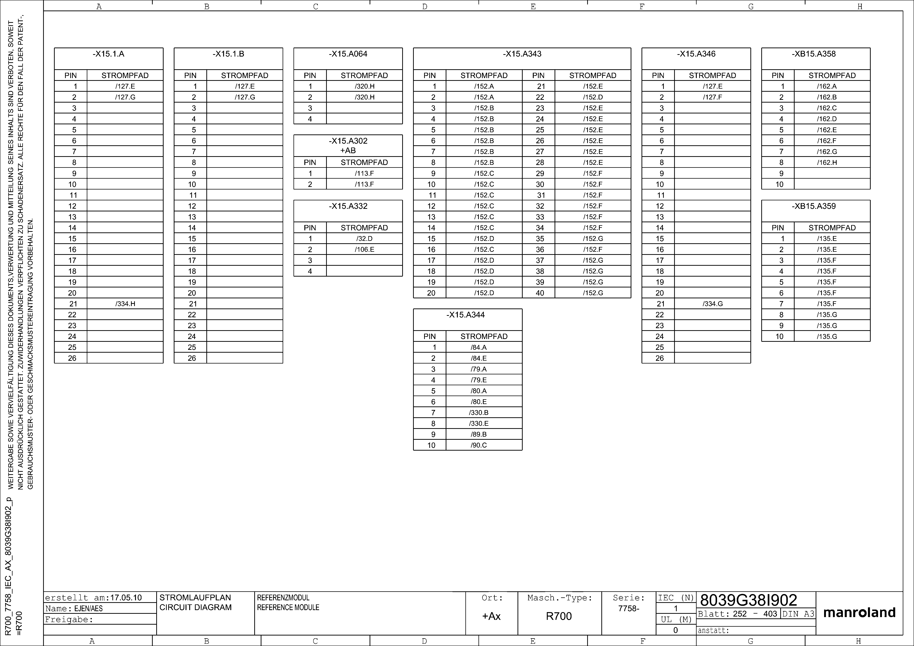

# +Ax — Sheet 252 of 403 — REFERENZMODUL

**REFERENCE MODULE**

> Part of the manroland **R700** printing press IEC/UL circuit diagrams.
> Drawing class: **Stromlaufplan / Circuit diagram** (DIN A3).
> Document `+Ax` covers the **Central control console** machine section.

## At a glance

| Field | Value |
|---|---|
| Document | `+Ax`  (8039G38I902) |
| Sheet | **252** of 403 |
| Section (DE) | REFERENZMODUL |
| Section (EN) | REFERENCE MODULE |
| Section type | REFERENCE_MODULE — Reference module |
| Machine type | `R700` |
| Series | `7758` |
| Created | 17.05.10 |
| Replaces | — |
| Columns used | A, B, C, D, E, F, G, H |
| Path numbers | — |
| Labels on sheet | 273 |
| Cross-refs out | 82 |
| Cross-refs in | 0 |

**Previous:** [+Ax sheet 251](SHEET_0251.md) · **Next:** [+Ax sheet 253](SHEET_0253.md) · **Document TOC:** [_TOC.md](_TOC.md)  (+Ax) · **Master TOC:** [all sheets](../_MASTER_TOC.md)

## Sheet image (300 DPI, exact vector render)



_Rendered directly from the PDF vector layer at 300 DPI (1-bit), no OCR and no resampling. Use it to confirm anything ambiguous in the text below._

## Cross-references on this sheet

Each entry is a wire leaving this sheet. The printed token is `/sheet.column`; the link resolves to that sheet inside the same document.

| Ref | Target sheet | Col | Path | Destination on target | Target section | From col |
|---|---|---|---|---|---|---|
| `/127.E` | [+Ax sheet 127](SHEET_0127.md) | E | — | — | REALTIMERECHNER ANLEGER | A |
| `/127.E` | [+Ax sheet 127](SHEET_0127.md) | E | — | — | REALTIMERECHNER ANLEGER | B |
| `/152.A` | [+Ax sheet 152](SHEET_0152.md) | A | — | — | ÜBERWACHUNGSRECHNER SICHERHEITSBUS | E |
| `/152.E` | [+Ax sheet 152](SHEET_0152.md) | E | — | — | ÜBERWACHUNGSRECHNER SICHERHEITSBUS | F |
| `/127.E` | [+Ax sheet 127](SHEET_0127.md) | E | — | — | REALTIMERECHNER ANLEGER | G |
| `/162.A` | [+Ax sheet 162](SHEET_0162.md) | A | — | — | ÜBERWACHUNGSRECHNER/ANSTEUERUNG NOT AUS | H |
| `/320.H` | [+Ax sheet 320](SHEET_0320.md) | H | — | — | OPTION: "EJEKTOR" ANLAGE / SELECT AIRSTATION / | C |
| `/152.A` | [+Ax sheet 152](SHEET_0152.md) | A | — | — | ÜBERWACHUNGSRECHNER SICHERHEITSBUS | E |
| `/162.B` | [+Ax sheet 162](SHEET_0162.md) | B | — | — | ÜBERWACHUNGSRECHNER/ANSTEUERUNG NOT AUS | H |
| `/127.F` | [+Ax sheet 127](SHEET_0127.md) | F | — | — | REALTIMERECHNER ANLEGER | G |
| `/127.G` | [+Ax sheet 127](SHEET_0127.md) | G | — | — | REALTIMERECHNER ANLEGER | A |
| `/127.G` | [+Ax sheet 127](SHEET_0127.md) | G | — | — | REALTIMERECHNER ANLEGER | B |
| `/320.H` | [+Ax sheet 320](SHEET_0320.md) | H | — | — | OPTION: "EJEKTOR" ANLAGE / SELECT AIRSTATION / | C |
| `/152.D` | [+Ax sheet 152](SHEET_0152.md) | D | — | — | ÜBERWACHUNGSRECHNER SICHERHEITSBUS | F |
| `/152.B` | [+Ax sheet 152](SHEET_0152.md) | B | — | — | ÜBERWACHUNGSRECHNER SICHERHEITSBUS | E |
| `/152.E` | [+Ax sheet 152](SHEET_0152.md) | E | — | — | ÜBERWACHUNGSRECHNER SICHERHEITSBUS | F |
| `/162.C` | [+Ax sheet 162](SHEET_0162.md) | C | — | — | ÜBERWACHUNGSRECHNER/ANSTEUERUNG NOT AUS | H |
| `/152.B` | [+Ax sheet 152](SHEET_0152.md) | B | — | — | ÜBERWACHUNGSRECHNER SICHERHEITSBUS | E |
| `/152.E` | [+Ax sheet 152](SHEET_0152.md) | E | — | — | ÜBERWACHUNGSRECHNER SICHERHEITSBUS | F |
| `/162.D` | [+Ax sheet 162](SHEET_0162.md) | D | — | — | ÜBERWACHUNGSRECHNER/ANSTEUERUNG NOT AUS | H |
| `/152.B` | [+Ax sheet 152](SHEET_0152.md) | B | — | — | ÜBERWACHUNGSRECHNER SICHERHEITSBUS | E |
| `/152.E` | [+Ax sheet 152](SHEET_0152.md) | E | — | — | ÜBERWACHUNGSRECHNER SICHERHEITSBUS | F |
| `/162.E` | [+Ax sheet 162](SHEET_0162.md) | E | — | — | ÜBERWACHUNGSRECHNER/ANSTEUERUNG NOT AUS | H |
| `/152.B` | [+Ax sheet 152](SHEET_0152.md) | B | — | — | ÜBERWACHUNGSRECHNER SICHERHEITSBUS | E |
| `/152.E` | [+Ax sheet 152](SHEET_0152.md) | E | — | — | ÜBERWACHUNGSRECHNER SICHERHEITSBUS | F |
| `/162.F` | [+Ax sheet 162](SHEET_0162.md) | F | — | — | ÜBERWACHUNGSRECHNER/ANSTEUERUNG NOT AUS | H |
| `/152.B` | [+Ax sheet 152](SHEET_0152.md) | B | — | — | ÜBERWACHUNGSRECHNER SICHERHEITSBUS | E |
| `/152.E` | [+Ax sheet 152](SHEET_0152.md) | E | — | — | ÜBERWACHUNGSRECHNER SICHERHEITSBUS | F |
| `/162.G` | [+Ax sheet 162](SHEET_0162.md) | G | — | — | ÜBERWACHUNGSRECHNER/ANSTEUERUNG NOT AUS | H |
| `/152.B` | [+Ax sheet 152](SHEET_0152.md) | B | — | — | ÜBERWACHUNGSRECHNER SICHERHEITSBUS | E |
| `/152.E` | [+Ax sheet 152](SHEET_0152.md) | E | — | — | ÜBERWACHUNGSRECHNER SICHERHEITSBUS | F |
| `/162.H` | [+Ax sheet 162](SHEET_0162.md) | H | — | — | ÜBERWACHUNGSRECHNER/ANSTEUERUNG NOT AUS | H |
| `/113.F` | [+Ax sheet 113](SHEET_0113.md) | F | — | — | FORMATEINSTELLUNG MOTORISCH, SEITLICHE | C |
| `/152.F` | [+Ax sheet 152](SHEET_0152.md) | F | — | — | ÜBERWACHUNGSRECHNER SICHERHEITSBUS | F |
| `/152.C` | [+Ax sheet 152](SHEET_0152.md) | C | — | — | ÜBERWACHUNGSRECHNER SICHERHEITSBUS | E |
| `/113.F` | [+Ax sheet 113](SHEET_0113.md) | F | — | — | FORMATEINSTELLUNG MOTORISCH, SEITLICHE | C |
| `/152.F` | [+Ax sheet 152](SHEET_0152.md) | F | — | — | ÜBERWACHUNGSRECHNER SICHERHEITSBUS | F |
| `/152.C` | [+Ax sheet 152](SHEET_0152.md) | C | — | — | ÜBERWACHUNGSRECHNER SICHERHEITSBUS | E |
| `/152.F` | [+Ax sheet 152](SHEET_0152.md) | F | — | — | ÜBERWACHUNGSRECHNER SICHERHEITSBUS | F |
| `/152.C` | [+Ax sheet 152](SHEET_0152.md) | C | — | — | ÜBERWACHUNGSRECHNER SICHERHEITSBUS | E |
| `/152.F` | [+Ax sheet 152](SHEET_0152.md) | F | — | — | ÜBERWACHUNGSRECHNER SICHERHEITSBUS | F |
| `/152.C` | [+Ax sheet 152](SHEET_0152.md) | C | — | — | ÜBERWACHUNGSRECHNER SICHERHEITSBUS | E |
| `/152.F` | [+Ax sheet 152](SHEET_0152.md) | F | — | — | ÜBERWACHUNGSRECHNER SICHERHEITSBUS | F |
| `/152.C` | [+Ax sheet 152](SHEET_0152.md) | C | — | — | ÜBERWACHUNGSRECHNER SICHERHEITSBUS | E |
| `/152.F` | [+Ax sheet 152](SHEET_0152.md) | F | — | — | ÜBERWACHUNGSRECHNER SICHERHEITSBUS | F |
| `/152.C` | [+Ax sheet 152](SHEET_0152.md) | C | — | — | ÜBERWACHUNGSRECHNER SICHERHEITSBUS | E |
| `/135.E` | [+Ax sheet 135](SHEET_0135.md) | E | — | — | REALTIMERECHNER ANSTEUERUNG DER SPS POWERKARTE | H |
| `/32.D` | [+Ax sheet 32](SHEET_0032.md) | D | — | — | SPANNUNGSVERSORGUNG, SCHALTSCHRANKBELÜFTUNG | C |
| `/152.G` | [+Ax sheet 152](SHEET_0152.md) | G | — | — | ÜBERWACHUNGSRECHNER SICHERHEITSBUS | F |
| `/152.D` | [+Ax sheet 152](SHEET_0152.md) | D | — | — | ÜBERWACHUNGSRECHNER SICHERHEITSBUS | E |
| `/106.E` | [+Ax sheet 106](SHEET_0106.md) | E | — | — | ANLEGER | C |
| `/135.E` | [+Ax sheet 135](SHEET_0135.md) | E | — | — | REALTIMERECHNER ANSTEUERUNG DER SPS POWERKARTE | H |
| `/152.F` | [+Ax sheet 152](SHEET_0152.md) | F | — | — | ÜBERWACHUNGSRECHNER SICHERHEITSBUS | F |
| `/152.C` | [+Ax sheet 152](SHEET_0152.md) | C | — | — | ÜBERWACHUNGSRECHNER SICHERHEITSBUS | E |
| `/135.F` | [+Ax sheet 135](SHEET_0135.md) | F | — | — | REALTIMERECHNER ANSTEUERUNG DER SPS POWERKARTE | H |
| `/152.G` | [+Ax sheet 152](SHEET_0152.md) | G | — | — | ÜBERWACHUNGSRECHNER SICHERHEITSBUS | F |
| `/152.D` | [+Ax sheet 152](SHEET_0152.md) | D | — | — | ÜBERWACHUNGSRECHNER SICHERHEITSBUS | E |
| `/135.F` | [+Ax sheet 135](SHEET_0135.md) | F | — | — | REALTIMERECHNER ANSTEUERUNG DER SPS POWERKARTE | H |
| `/152.G` | [+Ax sheet 152](SHEET_0152.md) | G | — | — | ÜBERWACHUNGSRECHNER SICHERHEITSBUS | F |
| `/152.D` | [+Ax sheet 152](SHEET_0152.md) | D | — | — | ÜBERWACHUNGSRECHNER SICHERHEITSBUS | E |
| `/152.G` | [+Ax sheet 152](SHEET_0152.md) | G | — | — | ÜBERWACHUNGSRECHNER SICHERHEITSBUS | F |
| `/135.F` | [+Ax sheet 135](SHEET_0135.md) | F | — | — | REALTIMERECHNER ANSTEUERUNG DER SPS POWERKARTE | H |
| `/152.D` | [+Ax sheet 152](SHEET_0152.md) | D | — | — | ÜBERWACHUNGSRECHNER SICHERHEITSBUS | E |
| `/135.F` | [+Ax sheet 135](SHEET_0135.md) | F | — | — | REALTIMERECHNER ANSTEUERUNG DER SPS POWERKARTE | H |
| `/152.G` | [+Ax sheet 152](SHEET_0152.md) | G | — | — | ÜBERWACHUNGSRECHNER SICHERHEITSBUS | F |
| `/152.D` | [+Ax sheet 152](SHEET_0152.md) | D | — | — | ÜBERWACHUNGSRECHNER SICHERHEITSBUS | E |
| `/135.F` | [+Ax sheet 135](SHEET_0135.md) | F | — | — | REALTIMERECHNER ANSTEUERUNG DER SPS POWERKARTE | H |
| `/334.G` | [+Ax sheet 334](SHEET_0334.md) | G | — | — | OPTION: INLINESORTER | G |
| `/334.H` | [+Ax sheet 334](SHEET_0334.md) | H | — | — | OPTION: INLINESORTER | A |
| `/135.G` | [+Ax sheet 135](SHEET_0135.md) | G | — | — | REALTIMERECHNER ANSTEUERUNG DER SPS POWERKARTE | H |
| `/135.G` | [+Ax sheet 135](SHEET_0135.md) | G | — | — | REALTIMERECHNER ANSTEUERUNG DER SPS POWERKARTE | H |
| `/135.G` | [+Ax sheet 135](SHEET_0135.md) | G | — | — | REALTIMERECHNER ANSTEUERUNG DER SPS POWERKARTE | H |
| `/84.A` | [+Ax sheet 84](SHEET_0084.md) | A | — | — | ANLEGER | D |
| `/84.E` | [+Ax sheet 84](SHEET_0084.md) | E | — | — | ANLEGER | E |
| `/79.A` | [+Ax sheet 79](SHEET_0079.md) | A | — | — | ANLEGER | D |
| `/79.E` | [+Ax sheet 79](SHEET_0079.md) | E | — | — | ANLEGER | E |
| `/80.A` | [+Ax sheet 80](SHEET_0080.md) | A | — | — | ANLEGER | D |
| `/80.E` | [+Ax sheet 80](SHEET_0080.md) | E | — | — | ANLEGER | E |
| `/330.B` | [+Ax sheet 330](SHEET_0330.md) | B | — | — | OPTION: NONSTOP EINRICHTUNG MANUELL, ANLEGER | E |
| `/330.E` | [+Ax sheet 330](SHEET_0330.md) | E | — | — | OPTION: NONSTOP EINRICHTUNG MANUELL, ANLEGER | E |
| `/89.B` | [+Ax sheet 89](SHEET_0089.md) | B | — | — | ANLEGER | E |
| `/90.C` | [+Ax sheet 90](SHEET_0090.md) | C | — | — | ANLEGER | E |

## Devices on this sheet

| Tag | Class | Class meaning (IEC) | Col | Sub | Terminal | Sign |
|---|---|---|---|---|---|---|
| `X15.A346` | — | cross-device reference | G | — | — | — |
| `XB15.A358` | — | cross-device reference | H | — | — | — |
| `XB15.A359` | — | cross-device reference | H | — | — | — |
| `X15.A064` | — | cross-device reference | C | — | — | — |
| `X15.A343` | — | cross-device reference | E | — | — | — |
| `X15.A302` | — | cross-device reference | C | — | — | — |
| `X15.A332` | — | cross-device reference | C | — | — | — |
| `X15.A344` | — | cross-device reference | D | — | — | — |
| `X15.1.A` | — | cross-device reference | A | — | — | — |
| `X15.1.B` | — | cross-device reference | B | — | — | — |

## Potentials / nets

_No named potentials on this sheet._

## Wire-end annotations (grouped as printed)

A wire that continues elsewhere is annotated with a small cluster: the destination description, the path/line number `#NN`, and the `/sheet.column` cross reference. Each row below is one such cluster exactly as it is grouped on the drawing.

| Col | Y | Path | Cross-ref | Text on the wire |
|---|---|---|---|---|
| A | 65.5 | — | — | `X15.1.A` |
| B | 65.5 | — | — | `X15.1.B` |
| C | 65.5 | — | — | `X15.A064` |
| E | 65.5 | — | — | `X15.A343` |
| G | 65.5 | — | — | `X15.A346` |
| H | 65.5 | — | — | `XB15.A358` |
| A | 94.2 | — | — | `PIN STROMPFAD` |
| B | 94.2 | — | — | `PIN STROMPFAD` |
| C | 94.2 | — | — | `PIN 2 3 4 1 STROMPFAD` |
| D | 94.2 | — | — | `PIN STROMPFAD` |
| E | 94.2 | — | — | `PIN STROMPFAD` |
| F | 94.2 | — | — | `PIN STROMPFAD` |
| H | 94.2 | — | — | `PIN 10 2 3 4 5 6 7 8 9 1 STROMPFAD` |
| A | 108.4 | — | — | `2 3 4 5 6 7 8 9 1` |
| B | 108.4 | — | — | `2 3 4 5 6 7 8 9 1` |
| D | 108.4 | — | — | `2 3 4 5 6 7 8 9 1` |
| E | 108.4 | — | — | `22 21` |
| F | 108.4 | — | — | `2 3 4 5 6 7 8 9 1` |
| A | 108.7 | — | `/127.E` | — |
| B | 108.7 | — | `/127.E` | — |
| C | 108.7 | — | `/320.H` | — |
| E | 108.7 | — | `/152.A` | — |
| F | 108.7 | — | `/152.E` | — |
| G | 108.7 | — | `/127.E` | — |
| H | 108.7 | — | `/162.A` | — |
| A | 122.9 | — | `/127.G` | — |
| B | 122.9 | — | `/127.G` | — |
| C | 122.9 | — | `/320.H` | — |
| E | 122.9 | — | `/152.A` | — |
| F | 122.9 | — | `/152.D` | — |
| G | 122.9 | — | `/127.F` | — |
| H | 122.9 | — | `/162.B` | — |
| E | 136.7 | — | — | `23 24 25 26 27 28 29 30 32 33 34 35 36 37 38 39 40 31` |
| E | 137.0 | — | `/152.B` | — |
| F | 137.0 | — | `/152.E` | — |
| H | 137.1 | — | `/162.C` | — |
| E | 151.2 | — | `/152.B` | — |
| F | 151.2 | — | `/152.E` | — |
| H | 151.2 | — | `/162.D` | — |
| E | 165.4 | — | `/152.B` | — |
| F | 165.4 | — | `/152.E` | — |
| H | 165.4 | — | `/162.E` | — |
| C | 178.9 | — | — | `X15.A302` |
| E | 179.6 | — | `/152.B` | — |
| F | 179.6 | — | `/152.E` | — |
| H | 179.6 | — | `/162.F` | — |
| C | 191.6 | — | — | `+AB` |
| E | 193.7 | — | `/152.B` | — |
| F | 193.7 | — | `/152.E` | — |
| H | 193.7 | — | `/162.G` | — |
| C | 207.5 | — | — | `PIN 2 1 STROMPFAD` |
| E | 207.9 | — | `/152.B` | — |
| F | 207.9 | — | `/152.E` | — |
| H | 207.9 | — | `/162.H` | — |
| C | 222.1 | — | `/113.F` | — |
| E | 222.1 | — | `/152.C` | — |
| F | 222.1 | — | `/152.F` | — |
| A | 235.9 | — | — | `10 12 13 14 15 16 17 18 19 20 11` |
| B | 235.9 | — | — | `10 12 13 14 15 16 17 18 19 20 11` |
| D | 235.9 | — | — | `10 12 13 14 15 16 17 18 19 11` |
| F | 235.9 | — | — | `10 12 13 14 15 16 17 18 19 20 11` |
| C | 236.3 | — | `/113.F` | — |
| E | 236.3 | — | `/152.C` | — |
| F | 236.3 | — | `/152.F` | — |
| E | 250.4 | — | `/152.C` | — |
| F | 250.4 | — | `/152.F` | — |
| C | 263.9 | — | — | `X15.A332` |
| H | 263.9 | — | — | `XB15.A359` |
| E | 264.6 | — | `/152.C` | — |
| F | 264.6 | — | `/152.F` | — |
| E | 278.8 | — | `/152.C` | — |
| F | 278.8 | — | `/152.F` | — |
| C | 292.6 | — | — | `PIN 2 3 4 1 STROMPFAD` |
| H | 292.6 | — | — | `PIN 10 2 3 4 5 6 7 8 9 1 STROMPFAD` |
| F | 292.9 | — | `/152.F` | — |
| E | 293.0 | — | `/152.C` | — |
| C | 307.1 | — | `/32.D` | — |
| E | 307.1 | — | `/152.D` | — |
| F | 307.1 | — | `/152.G` | — |
| H | 307.1 | — | `/135.E` | — |
| C | 321.3 | — | `/106.E` | — |
| E | 321.3 | — | `/152.C` | — |
| F | 321.3 | — | `/152.F` | — |
| H | 321.3 | — | `/135.E` | — |
| E | 335.5 | — | `/152.D` | — |
| F | 335.5 | — | `/152.G` | — |
| H | 335.5 | — | `/135.F` | — |
| F | 349.6 | — | `/152.G` | — |
| H | 349.6 | — | `/135.F` | — |
| E | 349.7 | — | `/152.D` | — |
| E | 363.8 | — | `/152.D` | — |
| F | 363.8 | — | `/152.G` | — |
| H | 363.8 | — | `/135.F` | — |
| D | 377.7 | — | — | `20` |
| E | 378.0 | — | `/152.D` | — |
| F | 378.0 | — | `/152.G` | — |
| H | 378.0 | — | `/135.F` | — |
| A | 391.8 | — | — | `22 23 24 25 26 21` |
| B | 391.8 | — | — | `22 23 24 25 26 21` |
| F | 391.8 | — | — | `22 23 24 25 26 21` |
| A | 392.2 | — | `/334.H` | — |
| G | 392.2 | — | `/334.G` | — |
| H | 392.2 | — | `/135.F` | — |
| D | 405.7 | — | — | `X15.A344` |
| H | 406.3 | — | `/135.G` | — |
| H | 420.5 | — | `/135.G` | — |
| D | 434.3 | — | — | `PIN 10 2 3 4 5 6 7 8 9 1 STROMPFAD` |
| H | 434.7 | — | `/135.G` | — |
| D | 448.8 | — | `/84.A` | — |
| E | 463.0 | — | `/84.E` | — |
| D | 477.2 | — | `/79.A` | — |
| E | 491.4 | — | `/79.E` | — |
| D | 505.5 | — | `/80.A` | — |
| E | 519.7 | — | `/80.E` | — |
| E | 533.9 | — | `/330.B` | — |
| E | 548.1 | — | `/330.E` | — |
| E | 562.2 | — | `/89.B` | — |
| E | 576.4 | — | `/90.C` | — |


## Reconstructed tables

This sheet carries tabular content (pin map / terminal assignment / index). The grid below was rebuilt from the drawing's own rule lines, so each row is exactly one physical row of the table.

### Table 1 — 26 data rows × 2 columns (at x=70.9, y=62.4) — **X15.1.A**

| PIN | STROMPFAD |
|---|---|
| `1` | `/127.E` |
| `2` | `/127.G` |
| `3` |  |
| `4` |  |
| `5` |  |
| `6` |  |
| `7` |  |
| `8` |  |
| `9` |  |
| `10` |  |
| `11` |  |
| `12` |  |
| `13` |  |
| `14` |  |
| `15` |  |
| `16` |  |
| `17` |  |
| `18` |  |
| `19` |  |
| `20` |  |
| `21` | `/334.H` |
| `22` |  |
| `23` |  |
| `24` |  |
| `25` |  |
| `26` |  |


### Table 2 — 26 data rows × 2 columns (at x=226.8, y=62.4) — **X15.1.B**

| PIN | STROMPFAD |
|---|---|
| `1` | `/127.E` |
| `2` | `/127.G` |
| `3` |  |
| `4` |  |
| `5` |  |
| `6` |  |
| `7` |  |
| `8` |  |
| `9` |  |
| `10` |  |
| `11` |  |
| `12` |  |
| `13` |  |
| `14` |  |
| `15` |  |
| `16` |  |
| `17` |  |
| `18` |  |
| `19` |  |
| `20` |  |
| `21` |  |
| `22` |  |
| `23` |  |
| `24` |  |
| `25` |  |
| `26` |  |


### Table 3 — 15 data rows × 2 columns (at x=382.7, y=62.4) — **X15.A064**

| PIN | STROMPFAD |
|---|---|
| `1` | `/320.H` |
| `2` | `/320.H` |
| `3` |  |
| `4` |  |
|  | `X15.A302` |
|  | `+AB` |
| `PIN` | `STROMPFAD` |
| `1` | `/113.F` |
| `2` | `/113.F` |
|  | `X15.A332` |
| `PIN` | `STROMPFAD` |
| `1` | `/32.D` |
| `2` | `/106.E` |
| `3` |  |
| `4` |  |


### Table 4 — 32 data rows × 4 columns (at x=538.6, y=62.4) — **X15.A343**

| PIN | STROMPFAD | PIN | STROMPFAD |
|---|---|---|---|
| `1` | `/152.A` | `21` | `/152.E` |
| `2` | `/152.A` | `22` | `/152.D` |
| `3` | `/152.B` | `23` | `/152.E` |
| `4` | `/152.B` | `24` | `/152.E` |
| `5` | `/152.B` | `25` | `/152.E` |
| `6` | `/152.B` | `26` | `/152.E` |
| `7` | `/152.B` | `27` | `/152.E` |
| `8` | `/152.B` | `28` | `/152.E` |
| `9` | `/152.C` | `29` | `/152.F` |
| `10` | `/152.C` | `30` | `/152.F` |
| `11` | `/152.C` | `31` | `/152.F` |
| `12` | `/152.C` | `32` | `/152.F` |
| `13` | `/152.C` | `33` | `/152.F` |
| `14` | `/152.C` | `34` | `/152.F` |
| `15` | `/152.D` | `35` | `/152.G` |
| `16` | `/152.C` | `36` | `/152.F` |
| `17` | `/152.D` | `37` | `/152.G` |
| `18` | `/152.D` | `38` | `/152.G` |
| `19` | `/152.D` | `39` | `/152.G` |
| `20` | `/152.D` | `40` | `/152.G` |
|  | `X15.A344` |  |  |
| `PIN` | `STROMPFAD` |  |  |
| `1` | `/84.A` |  |  |
| `2` | `/84.E` |  |  |
| `3` | `/79.A` |  |  |
| `4` | `/79.E` |  |  |
| `5` | `/80.A` |  |  |
| `6` | `/80.E` |  |  |
| `7` | `/330.B` |  |  |
| `8` | `/330.E` |  |  |
| `9` | `/89.B` |  |  |
| `10` | `/90.C` |  |  |


### Table 5 — 26 data rows × 2 columns (at x=836.2, y=62.4) — **X15.A346**

| PIN | STROMPFAD |
|---|---|
| `1` | `/127.E` |
| `2` | `/127.F` |
| `3` |  |
| `4` |  |
| `5` |  |
| `6` |  |
| `7` |  |
| `8` |  |
| `9` |  |
| `10` |  |
| `11` |  |
| `12` |  |
| `13` |  |
| `14` |  |
| `15` |  |
| `16` |  |
| `17` |  |
| `18` |  |
| `19` |  |
| `20` |  |
| `21` | `/334.G` |
| `22` |  |
| `23` |  |
| `24` |  |
| `25` |  |
| `26` |  |


### Table 6 — 22 data rows × 2 columns (at x=992.1, y=62.4) — **XB15.A358**

| PIN | STROMPFAD |
|---|---|
| `1` | `/162.A` |
| `2` | `/162.B` |
| `3` | `/162.C` |
| `4` | `/162.D` |
| `5` | `/162.E` |
| `6` | `/162.F` |
| `7` | `/162.G` |
| `8` | `/162.H` |
| `9` |  |
| `10` |  |
|  | `XB15.A359` |
| `PIN` | `STROMPFAD` |
| `1` | `/135.E` |
| `2` | `/135.E` |
| `3` | `/135.F` |
| `4` | `/135.F` |
| `5` | `/135.F` |
| `6` | `/135.F` |
| `7` | `/135.F` |
| `8` | `/135.G` |
| `9` | `/135.G` |
| `10` | `/135.G` |


## Notes and free text on this sheet

| Text | Col | Y (pt) |
|---|---|---|
| `PIN` | F | 94.2 |
| `STROMPFAD` | G | 94.15 |
| `PIN` | G | 94.2 |
| `STROMPFAD` | H | 94.15 |
| `PIN` | C | 94.2 |
| `STROMPFAD` | C | 94.15 |
| `PIN` | D | 94.2 |
| `STROMPFAD` | E | 94.15 |
| `PIN` | E | 94.2 |
| `STROMPFAD` | F | 94.15 |
| `+AB` | C | 191.57 |
| `PIN` | A | 94.2 |
| `STROMPFAD` | A | 94.15 |
| `PIN` | B | 94.2 |
| `STROMPFAD` | B | 94.15 |

## Complete label inventory (exact text from the drawing)

Every text object inside the drawing area of this sheet, in DIN reading order (column A→H, then top→bottom). This is the authoritative list: if a string is not here it is not printed on this sheet.

| Col | Y | X | Dir | Type | Text |
|---|---|---|---|---|---|
| A | 65.5 | 120.9 | → | device ref | `X15.1.A` |
| A | 94.2 | 84.0 | → | text | `PIN` |
| A | 94.2 | 132.2 | → | text | `STROMPFAD` |
| A | 108.4 | 95.8 | → | number | `1` |
| A | 108.7 | 150.5 | → | cross-reference | `/127.E` |
| A | 122.5 | 94.1 | → | number | `2` |
| A | 122.9 | 150.1 | → | cross-reference | `/127.G` |
| A | 136.7 | 94.1 | → | number | `3` |
| A | 150.9 | 94.1 | → | number | `4` |
| A | 165.1 | 94.1 | → | number | `5` |
| A | 179.2 | 94.1 | → | number | `6` |
| A | 193.4 | 94.1 | → | number | `7` |
| A | 207.6 | 94.1 | → | number | `8` |
| A | 221.8 | 94.1 | → | number | `9` |
| A | 235.9 | 88.7 | → | number | `10` |
| A | 250.1 | 90.4 | → | number | `11` |
| A | 264.3 | 88.7 | → | number | `12` |
| A | 278.5 | 88.7 | → | number | `13` |
| A | 292.6 | 88.7 | → | number | `14` |
| A | 306.8 | 88.7 | → | number | `15` |
| A | 321.0 | 88.7 | → | number | `16` |
| A | 335.1 | 88.7 | → | number | `17` |
| A | 349.3 | 88.7 | → | number | `18` |
| A | 363.5 | 88.7 | → | number | `19` |
| A | 377.7 | 88.7 | → | number | `20` |
| A | 391.8 | 90.4 | → | number | `21` |
| A | 392.2 | 150.5 | → | cross-reference | `/334.H` |
| A | 406.0 | 88.7 | → | number | `22` |
| A | 420.2 | 88.7 | → | number | `23` |
| A | 434.4 | 88.7 | → | number | `24` |
| A | 448.5 | 88.7 | → | number | `25` |
| A | 462.7 | 88.7 | → | number | `26` |
| B | 65.5 | 277.2 | → | device ref | `X15.1.B` |
| B | 94.2 | 240.0 | → | text | `PIN` |
| B | 94.2 | 288.1 | → | text | `STROMPFAD` |
| B | 108.4 | 251.7 | → | number | `1` |
| B | 108.7 | 306.4 | → | cross-reference | `/127.E` |
| B | 122.5 | 250.0 | → | number | `2` |
| B | 122.9 | 306.0 | → | cross-reference | `/127.G` |
| B | 136.7 | 250.0 | → | number | `3` |
| B | 150.9 | 250.0 | → | number | `4` |
| B | 165.1 | 250.0 | → | number | `5` |
| B | 179.2 | 250.0 | → | number | `6` |
| B | 193.4 | 250.0 | → | number | `7` |
| B | 207.6 | 250.0 | → | number | `8` |
| B | 221.8 | 250.0 | → | number | `9` |
| B | 235.9 | 244.6 | → | number | `10` |
| B | 250.1 | 246.3 | → | number | `11` |
| B | 264.3 | 244.6 | → | number | `12` |
| B | 278.5 | 244.6 | → | number | `13` |
| B | 292.6 | 244.6 | → | number | `14` |
| B | 306.8 | 244.6 | → | number | `15` |
| B | 321.0 | 244.6 | → | number | `16` |
| B | 335.1 | 244.6 | → | number | `17` |
| B | 349.3 | 244.6 | → | number | `18` |
| B | 363.5 | 244.6 | → | number | `19` |
| B | 377.7 | 244.6 | → | number | `20` |
| B | 391.8 | 246.3 | → | number | `21` |
| B | 406.0 | 244.6 | → | number | `22` |
| B | 420.2 | 244.6 | → | number | `23` |
| B | 434.4 | 244.6 | → | number | `24` |
| B | 448.5 | 244.6 | → | number | `25` |
| B | 462.7 | 244.6 | → | number | `26` |
| C | 65.5 | 428.6 | → | device ref | `X15.A064` |
| C | 94.2 | 395.9 | → | text | `PIN` |
| C | 94.2 | 444.0 | → | text | `STROMPFAD` |
| C | 108.4 | 401.8 | → | number | `1` |
| C | 108.7 | 462.3 | → | cross-reference | `/320.H` |
| C | 122.5 | 401.2 | → | number | `2` |
| C | 122.9 | 462.3 | → | cross-reference | `/320.H` |
| C | 136.7 | 401.2 | → | number | `3` |
| C | 150.9 | 401.2 | → | number | `4` |
| C | 178.9 | 428.6 | → | device ref | `X15.A302` |
| C | 191.6 | 443.3 | → | text | `+AB` |
| C | 207.5 | 444.0 | → | text | `STROMPFAD` |
| C | 207.6 | 395.9 | → | text | `PIN` |
| C | 221.8 | 401.8 | → | number | `1` |
| C | 222.1 | 462.5 | → | cross-reference | `/113.F` |
| C | 235.9 | 401.2 | → | number | `2` |
| C | 236.3 | 462.5 | → | cross-reference | `/113.F` |
| C | 263.9 | 428.6 | → | device ref | `X15.A332` |
| C | 292.6 | 395.9 | → | text | `PIN` |
| C | 292.6 | 444.0 | → | text | `STROMPFAD` |
| C | 306.8 | 401.8 | → | number | `1` |
| C | 307.1 | 464.5 | → | cross-reference | `/32.D` |
| C | 321.0 | 401.2 | → | number | `2` |
| C | 321.3 | 462.3 | → | cross-reference | `/106.E` |
| C | 335.1 | 401.2 | → | number | `3` |
| C | 349.3 | 401.2 | → | number | `4` |
| D | 94.2 | 551.8 | → | text | `PIN` |
| D | 108.4 | 563.5 | → | number | `1` |
| D | 122.5 | 561.8 | → | number | `2` |
| D | 136.7 | 561.8 | → | number | `3` |
| D | 150.9 | 561.8 | → | number | `4` |
| D | 165.1 | 561.8 | → | number | `5` |
| D | 179.2 | 561.8 | → | number | `6` |
| D | 193.4 | 561.8 | → | number | `7` |
| D | 207.6 | 561.8 | → | number | `8` |
| D | 221.8 | 561.8 | → | number | `9` |
| D | 235.9 | 556.4 | → | number | `10` |
| D | 250.1 | 558.1 | → | number | `11` |
| D | 264.3 | 556.4 | → | number | `12` |
| D | 278.5 | 556.4 | → | number | `13` |
| D | 292.6 | 556.4 | → | number | `14` |
| D | 306.8 | 556.4 | → | number | `15` |
| D | 321.0 | 556.4 | → | number | `16` |
| D | 335.1 | 556.4 | → | number | `17` |
| D | 349.3 | 556.4 | → | number | `18` |
| D | 363.5 | 556.4 | → | number | `19` |
| D | 377.7 | 556.4 | → | number | `20` |
| D | 405.7 | 581.7 | → | device ref | `X15.A344` |
| D | 434.4 | 551.8 | → | text | `PIN` |
| D | 448.5 | 563.5 | → | number | `1` |
| D | 448.8 | 613.3 | → | cross-reference | `/84.A` |
| D | 462.7 | 561.8 | → | number | `2` |
| D | 476.9 | 561.8 | → | number | `3` |
| D | 477.2 | 613.3 | → | cross-reference | `/79.A` |
| D | 491.0 | 561.8 | → | number | `4` |
| D | 505.2 | 561.8 | → | number | `5` |
| D | 505.5 | 613.3 | → | cross-reference | `/80.A` |
| D | 519.4 | 561.8 | → | number | `6` |
| D | 533.6 | 561.8 | → | number | `7` |
| D | 547.7 | 561.8 | → | number | `8` |
| D | 561.9 | 561.8 | → | number | `9` |
| D | 576.1 | 556.4 | → | number | `10` |
| E | 65.5 | 655.4 | → | device ref | `X15.A343` |
| E | 94.2 | 600.0 | → | text | `STROMPFAD` |
| E | 94.2 | 693.5 | → | text | `PIN` |
| E | 108.4 | 699.9 | → | number | `21` |
| E | 108.7 | 618.0 | → | cross-reference | `/152.A` |
| E | 122.5 | 698.2 | → | number | `22` |
| E | 122.9 | 618.0 | → | cross-reference | `/152.A` |
| E | 136.7 | 698.2 | → | number | `23` |
| E | 137.0 | 618.1 | → | cross-reference | `/152.B` |
| E | 150.9 | 698.2 | → | number | `24` |
| E | 151.2 | 618.1 | → | cross-reference | `/152.B` |
| E | 165.1 | 698.2 | → | number | `25` |
| E | 165.4 | 618.1 | → | cross-reference | `/152.B` |
| E | 179.2 | 698.2 | → | number | `26` |
| E | 179.6 | 618.1 | → | cross-reference | `/152.B` |
| E | 193.4 | 698.2 | → | number | `27` |
| E | 193.7 | 618.1 | → | cross-reference | `/152.B` |
| E | 207.6 | 698.2 | → | number | `28` |
| E | 207.9 | 618.1 | → | cross-reference | `/152.B` |
| E | 221.8 | 698.2 | → | number | `29` |
| E | 222.1 | 618.0 | → | cross-reference | `/152.C` |
| E | 235.9 | 698.2 | → | number | `30` |
| E | 236.3 | 618.0 | → | cross-reference | `/152.C` |
| E | 250.1 | 699.9 | → | number | `31` |
| E | 250.4 | 618.0 | → | cross-reference | `/152.C` |
| E | 264.3 | 698.2 | → | number | `32` |
| E | 264.6 | 618.0 | → | cross-reference | `/152.C` |
| E | 278.5 | 698.2 | → | number | `33` |
| E | 278.8 | 618.0 | → | cross-reference | `/152.C` |
| E | 292.6 | 698.2 | → | number | `34` |
| E | 293.0 | 618.0 | → | cross-reference | `/152.C` |
| E | 306.8 | 698.2 | → | number | `35` |
| E | 307.1 | 618.0 | → | cross-reference | `/152.D` |
| E | 321.0 | 698.2 | → | number | `36` |
| E | 321.3 | 618.0 | → | cross-reference | `/152.C` |
| E | 335.1 | 698.2 | → | number | `37` |
| E | 335.5 | 618.0 | → | cross-reference | `/152.D` |
| E | 349.3 | 698.2 | → | number | `38` |
| E | 349.7 | 618.0 | → | cross-reference | `/152.D` |
| E | 363.5 | 698.2 | → | number | `39` |
| E | 363.8 | 618.0 | → | cross-reference | `/152.D` |
| E | 377.7 | 698.2 | → | number | `40` |
| E | 378.0 | 618.0 | → | cross-reference | `/152.D` |
| E | 434.3 | 600.0 | → | text | `STROMPFAD` |
| E | 463.0 | 613.6 | → | cross-reference | `/84.E` |
| E | 491.4 | 613.6 | → | cross-reference | `/79.E` |
| E | 519.7 | 613.6 | → | cross-reference | `/80.E` |
| E | 533.9 | 611.0 | → | cross-reference | `/330.B` |
| E | 548.1 | 611.1 | → | cross-reference | `/330.E` |
| E | 562.2 | 613.4 | → | cross-reference | `/89.B` |
| E | 576.4 | 613.3 | → | cross-reference | `/90.C` |
| F | 94.2 | 741.7 | → | text | `STROMPFAD` |
| F | 94.2 | 849.4 | → | text | `PIN` |
| F | 108.4 | 861.2 | → | number | `1` |
| F | 108.7 | 760.0 | → | cross-reference | `/152.E` |
| F | 122.5 | 859.5 | → | number | `2` |
| F | 122.9 | 759.7 | → | cross-reference | `/152.D` |
| F | 136.7 | 859.5 | → | number | `3` |
| F | 137.0 | 760.0 | → | cross-reference | `/152.E` |
| F | 150.9 | 859.5 | → | number | `4` |
| F | 151.2 | 760.0 | → | cross-reference | `/152.E` |
| F | 165.1 | 859.5 | → | number | `5` |
| F | 165.4 | 760.0 | → | cross-reference | `/152.E` |
| F | 179.2 | 859.5 | → | number | `6` |
| F | 179.6 | 760.0 | → | cross-reference | `/152.E` |
| F | 193.4 | 859.5 | → | number | `7` |
| F | 193.7 | 760.0 | → | cross-reference | `/152.E` |
| F | 207.6 | 859.5 | → | number | `8` |
| F | 207.9 | 760.0 | → | cross-reference | `/152.E` |
| F | 221.8 | 859.5 | → | number | `9` |
| F | 222.1 | 760.1 | → | cross-reference | `/152.F` |
| F | 235.9 | 854.1 | → | number | `10` |
| F | 236.3 | 760.1 | → | cross-reference | `/152.F` |
| F | 250.1 | 855.8 | → | number | `11` |
| F | 250.4 | 760.1 | → | cross-reference | `/152.F` |
| F | 264.3 | 854.1 | → | number | `12` |
| F | 264.6 | 760.1 | → | cross-reference | `/152.F` |
| F | 278.5 | 854.1 | → | number | `13` |
| F | 278.8 | 760.1 | → | cross-reference | `/152.F` |
| F | 292.6 | 854.1 | → | number | `14` |
| F | 293.0 | 760.1 | → | cross-reference | `/152.F` |
| F | 306.8 | 854.1 | → | number | `15` |
| F | 307.1 | 759.5 | → | cross-reference | `/152.G` |
| F | 321.0 | 854.1 | → | number | `16` |
| F | 321.3 | 760.1 | → | cross-reference | `/152.F` |
| F | 335.1 | 854.1 | → | number | `17` |
| F | 335.5 | 759.5 | → | cross-reference | `/152.G` |
| F | 349.3 | 854.1 | → | number | `18` |
| F | 349.7 | 759.5 | → | cross-reference | `/152.G` |
| F | 363.5 | 854.1 | → | number | `19` |
| F | 363.8 | 759.5 | → | cross-reference | `/152.G` |
| F | 377.7 | 854.1 | → | number | `20` |
| F | 378.0 | 759.5 | → | cross-reference | `/152.G` |
| F | 391.8 | 855.8 | → | number | `21` |
| F | 406.0 | 854.1 | → | number | `22` |
| F | 420.2 | 854.1 | → | number | `23` |
| F | 434.4 | 854.1 | → | number | `24` |
| F | 448.5 | 854.1 | → | number | `25` |
| F | 462.7 | 854.1 | → | number | `26` |
| G | 65.5 | 882.1 | → | device ref | `X15.A346` |
| G | 94.2 | 897.6 | → | text | `STROMPFAD` |
| G | 94.2 | 1005.3 | → | text | `PIN` |
| G | 108.4 | 1017.1 | → | number | `1` |
| G | 108.7 | 915.9 | → | cross-reference | `/127.E` |
| G | 122.5 | 1015.4 | → | number | `2` |
| G | 122.9 | 916.0 | → | cross-reference | `/127.F` |
| G | 136.7 | 1015.4 | → | number | `3` |
| G | 150.9 | 1015.4 | → | number | `4` |
| G | 165.1 | 1015.4 | → | number | `5` |
| G | 179.2 | 1015.4 | → | number | `6` |
| G | 193.4 | 1015.4 | → | number | `7` |
| G | 207.6 | 1015.4 | → | number | `8` |
| G | 221.8 | 1015.4 | → | number | `9` |
| G | 235.9 | 1010.0 | → | number | `10` |
| G | 292.6 | 1005.3 | → | text | `PIN` |
| G | 306.8 | 1017.1 | → | number | `1` |
| G | 321.0 | 1015.4 | → | number | `2` |
| G | 335.1 | 1015.4 | → | number | `3` |
| G | 349.3 | 1015.4 | → | number | `4` |
| G | 363.5 | 1015.4 | → | number | `5` |
| G | 377.7 | 1015.4 | → | number | `6` |
| G | 391.8 | 1015.4 | → | number | `7` |
| G | 392.2 | 915.4 | → | cross-reference | `/334.G` |
| G | 406.0 | 1015.4 | → | number | `8` |
| G | 420.2 | 1015.4 | → | number | `9` |
| G | 434.4 | 1010.0 | → | number | `10` |
| H | 65.5 | 1031.7 | → | device ref | `XB15.A358` |
| H | 94.2 | 1053.5 | → | text | `STROMPFAD` |
| H | 108.7 | 1064.4 | → | cross-reference | `/162.A` |
| H | 122.9 | 1064.6 | → | cross-reference | `/162.B` |
| H | 137.1 | 1064.4 | → | cross-reference | `/162.C` |
| H | 151.2 | 1064.4 | → | cross-reference | `/162.D` |
| H | 165.4 | 1064.7 | → | cross-reference | `/162.E` |
| H | 179.6 | 1064.8 | → | cross-reference | `/162.F` |
| H | 193.7 | 1064.3 | → | cross-reference | `/162.G` |
| H | 207.9 | 1064.7 | → | cross-reference | `/162.H` |
| H | 263.9 | 1031.7 | → | device ref | `XB15.A359` |
| H | 292.6 | 1053.5 | → | text | `STROMPFAD` |
| H | 307.1 | 1064.7 | → | cross-reference | `/135.E` |
| H | 321.3 | 1064.7 | → | cross-reference | `/135.E` |
| H | 335.5 | 1064.8 | → | cross-reference | `/135.F` |
| H | 349.6 | 1064.8 | → | cross-reference | `/135.F` |
| H | 363.8 | 1064.8 | → | cross-reference | `/135.F` |
| H | 378.0 | 1064.8 | → | cross-reference | `/135.F` |
| H | 392.2 | 1064.8 | → | cross-reference | `/135.F` |
| H | 406.3 | 1064.3 | → | cross-reference | `/135.G` |
| H | 420.5 | 1064.3 | → | cross-reference | `/135.G` |
| H | 434.7 | 1064.3 | → | cross-reference | `/135.G` |

## Reading-order text block

The same content as a plain block, grouped by DIN column — convenient to paste or to match against a visual description.

```text
=== Column A ===
  65.5  120.9  devref       X15.1.A
  94.2   84.0  text         PIN
  94.2  132.2  text         STROMPFAD
 108.4   95.8  numeric      1
 108.7  150.5  xref         /127.E
 122.5   94.1  numeric      2
 122.9  150.1  xref         /127.G
 136.7   94.1  numeric      3
 150.9   94.1  numeric      4
 165.1   94.1  numeric      5
 179.2   94.1  numeric      6
 193.4   94.1  numeric      7
 207.6   94.1  numeric      8
 221.8   94.1  numeric      9
 235.9   88.7  numeric      10
 250.1   90.4  numeric      11
 264.3   88.7  numeric      12
 278.5   88.7  numeric      13
 292.6   88.7  numeric      14
 306.8   88.7  numeric      15
 321.0   88.7  numeric      16
 335.1   88.7  numeric      17
 349.3   88.7  numeric      18
 363.5   88.7  numeric      19
 377.7   88.7  numeric      20
 391.8   90.4  numeric      21
 392.2  150.5  xref         /334.H
 406.0   88.7  numeric      22
 420.2   88.7  numeric      23
 434.4   88.7  numeric      24
 448.5   88.7  numeric      25
 462.7   88.7  numeric      26
=== Column B ===
  65.5  277.2  devref       X15.1.B
  94.2  240.0  text         PIN
  94.2  288.1  text         STROMPFAD
 108.4  251.7  numeric      1
 108.7  306.4  xref         /127.E
 122.5  250.0  numeric      2
 122.9  306.0  xref         /127.G
 136.7  250.0  numeric      3
 150.9  250.0  numeric      4
 165.1  250.0  numeric      5
 179.2  250.0  numeric      6
 193.4  250.0  numeric      7
 207.6  250.0  numeric      8
 221.8  250.0  numeric      9
 235.9  244.6  numeric      10
 250.1  246.3  numeric      11
 264.3  244.6  numeric      12
 278.5  244.6  numeric      13
 292.6  244.6  numeric      14
 306.8  244.6  numeric      15
 321.0  244.6  numeric      16
 335.1  244.6  numeric      17
 349.3  244.6  numeric      18
 363.5  244.6  numeric      19
 377.7  244.6  numeric      20
 391.8  246.3  numeric      21
 406.0  244.6  numeric      22
 420.2  244.6  numeric      23
 434.4  244.6  numeric      24
 448.5  244.6  numeric      25
 462.7  244.6  numeric      26
=== Column C ===
  65.5  428.6  devref       X15.A064
  94.2  395.9  text         PIN
  94.2  444.0  text         STROMPFAD
 108.4  401.8  numeric      1
 108.7  462.3  xref         /320.H
 122.5  401.2  numeric      2
 122.9  462.3  xref         /320.H
 136.7  401.2  numeric      3
 150.9  401.2  numeric      4
 178.9  428.6  devref       X15.A302
 191.6  443.3  text         +AB
 207.5  444.0  text         STROMPFAD
 207.6  395.9  text         PIN
 221.8  401.8  numeric      1
 222.1  462.5  xref         /113.F
 235.9  401.2  numeric      2
 236.3  462.5  xref         /113.F
 263.9  428.6  devref       X15.A332
 292.6  395.9  text         PIN
 292.6  444.0  text         STROMPFAD
 306.8  401.8  numeric      1
 307.1  464.5  xref         /32.D
 321.0  401.2  numeric      2
 321.3  462.3  xref         /106.E
 335.1  401.2  numeric      3
 349.3  401.2  numeric      4
=== Column D ===
  94.2  551.8  text         PIN
 108.4  563.5  numeric      1
 122.5  561.8  numeric      2
 136.7  561.8  numeric      3
 150.9  561.8  numeric      4
 165.1  561.8  numeric      5
 179.2  561.8  numeric      6
 193.4  561.8  numeric      7
 207.6  561.8  numeric      8
 221.8  561.8  numeric      9
 235.9  556.4  numeric      10
 250.1  558.1  numeric      11
 264.3  556.4  numeric      12
 278.5  556.4  numeric      13
 292.6  556.4  numeric      14
 306.8  556.4  numeric      15
 321.0  556.4  numeric      16
 335.1  556.4  numeric      17
 349.3  556.4  numeric      18
 363.5  556.4  numeric      19
 377.7  556.4  numeric      20
 405.7  581.7  devref       X15.A344
 434.4  551.8  text         PIN
 448.5  563.5  numeric      1
 448.8  613.3  xref         /84.A
 462.7  561.8  numeric      2
 476.9  561.8  numeric      3
 477.2  613.3  xref         /79.A
 491.0  561.8  numeric      4
 505.2  561.8  numeric      5
 505.5  613.3  xref         /80.A
 519.4  561.8  numeric      6
 533.6  561.8  numeric      7
 547.7  561.8  numeric      8
 561.9  561.8  numeric      9
 576.1  556.4  numeric      10
=== Column E ===
  65.5  655.4  devref       X15.A343
  94.2  600.0  text         STROMPFAD
  94.2  693.5  text         PIN
 108.4  699.9  numeric      21
 108.7  618.0  xref         /152.A
 122.5  698.2  numeric      22
 122.9  618.0  xref         /152.A
 136.7  698.2  numeric      23
 137.0  618.1  xref         /152.B
 150.9  698.2  numeric      24
 151.2  618.1  xref         /152.B
 165.1  698.2  numeric      25
 165.4  618.1  xref         /152.B
 179.2  698.2  numeric      26
 179.6  618.1  xref         /152.B
 193.4  698.2  numeric      27
 193.7  618.1  xref         /152.B
 207.6  698.2  numeric      28
 207.9  618.1  xref         /152.B
 221.8  698.2  numeric      29
 222.1  618.0  xref         /152.C
 235.9  698.2  numeric      30
 236.3  618.0  xref         /152.C
 250.1  699.9  numeric      31
 250.4  618.0  xref         /152.C
 264.3  698.2  numeric      32
 264.6  618.0  xref         /152.C
 278.5  698.2  numeric      33
 278.8  618.0  xref         /152.C
 292.6  698.2  numeric      34
 293.0  618.0  xref         /152.C
 306.8  698.2  numeric      35
 307.1  618.0  xref         /152.D
 321.0  698.2  numeric      36
 321.3  618.0  xref         /152.C
 335.1  698.2  numeric      37
 335.5  618.0  xref         /152.D
 349.3  698.2  numeric      38
 349.7  618.0  xref         /152.D
 363.5  698.2  numeric      39
 363.8  618.0  xref         /152.D
 377.7  698.2  numeric      40
 378.0  618.0  xref         /152.D
 434.3  600.0  text         STROMPFAD
 463.0  613.6  xref         /84.E
 491.4  613.6  xref         /79.E
 519.7  613.6  xref         /80.E
 533.9  611.0  xref         /330.B
 548.1  611.1  xref         /330.E
 562.2  613.4  xref         /89.B
 576.4  613.3  xref         /90.C
=== Column F ===
  94.2  741.7  text         STROMPFAD
  94.2  849.4  text         PIN
 108.4  861.2  numeric      1
 108.7  760.0  xref         /152.E
 122.5  859.5  numeric      2
 122.9  759.7  xref         /152.D
 136.7  859.5  numeric      3
 137.0  760.0  xref         /152.E
 150.9  859.5  numeric      4
 151.2  760.0  xref         /152.E
 165.1  859.5  numeric      5
 165.4  760.0  xref         /152.E
 179.2  859.5  numeric      6
 179.6  760.0  xref         /152.E
 193.4  859.5  numeric      7
 193.7  760.0  xref         /152.E
 207.6  859.5  numeric      8
 207.9  760.0  xref         /152.E
 221.8  859.5  numeric      9
 222.1  760.1  xref         /152.F
 235.9  854.1  numeric      10
 236.3  760.1  xref         /152.F
 250.1  855.8  numeric      11
 250.4  760.1  xref         /152.F
 264.3  854.1  numeric      12
 264.6  760.1  xref         /152.F
 278.5  854.1  numeric      13
 278.8  760.1  xref         /152.F
 292.6  854.1  numeric      14
 293.0  760.1  xref         /152.F
 306.8  854.1  numeric      15
 307.1  759.5  xref         /152.G
 321.0  854.1  numeric      16
 321.3  760.1  xref         /152.F
 335.1  854.1  numeric      17
 335.5  759.5  xref         /152.G
 349.3  854.1  numeric      18
 349.7  759.5  xref         /152.G
 363.5  854.1  numeric      19
 363.8  759.5  xref         /152.G
 377.7  854.1  numeric      20
 378.0  759.5  xref         /152.G
 391.8  855.8  numeric      21
 406.0  854.1  numeric      22
 420.2  854.1  numeric      23
 434.4  854.1  numeric      24
 448.5  854.1  numeric      25
 462.7  854.1  numeric      26
=== Column G ===
  65.5  882.1  devref       X15.A346
  94.2  897.6  text         STROMPFAD
  94.2 1005.3  text         PIN
 108.4 1017.1  numeric      1
 108.7  915.9  xref         /127.E
 122.5 1015.4  numeric      2
 122.9  916.0  xref         /127.F
 136.7 1015.4  numeric      3
 150.9 1015.4  numeric      4
 165.1 1015.4  numeric      5
 179.2 1015.4  numeric      6
 193.4 1015.4  numeric      7
 207.6 1015.4  numeric      8
 221.8 1015.4  numeric      9
 235.9 1010.0  numeric      10
 292.6 1005.3  text         PIN
 306.8 1017.1  numeric      1
 321.0 1015.4  numeric      2
 335.1 1015.4  numeric      3
 349.3 1015.4  numeric      4
 363.5 1015.4  numeric      5
 377.7 1015.4  numeric      6
 391.8 1015.4  numeric      7
 392.2  915.4  xref         /334.G
 406.0 1015.4  numeric      8
 420.2 1015.4  numeric      9
 434.4 1010.0  numeric      10
=== Column H ===
  65.5 1031.7  devref       XB15.A358
  94.2 1053.5  text         STROMPFAD
 108.7 1064.4  xref         /162.A
 122.9 1064.6  xref         /162.B
 137.1 1064.4  xref         /162.C
 151.2 1064.4  xref         /162.D
 165.4 1064.7  xref         /162.E
 179.6 1064.8  xref         /162.F
 193.7 1064.3  xref         /162.G
 207.9 1064.7  xref         /162.H
 263.9 1031.7  devref       XB15.A359
 292.6 1053.5  text         STROMPFAD
 307.1 1064.7  xref         /135.E
 321.3 1064.7  xref         /135.E
 335.5 1064.8  xref         /135.F
 349.6 1064.8  xref         /135.F
 363.8 1064.8  xref         /135.F
 378.0 1064.8  xref         /135.F
 392.2 1064.8  xref         /135.F
 406.3 1064.3  xref         /135.G
 420.5 1064.3  xref         /135.G
 434.7 1064.3  xref         /135.G
```

---
_Generated from the PDF vector text layer; no OCR. Source: `R700_7758_IEC_AX_8039G38I902_p`, sheet 252._
