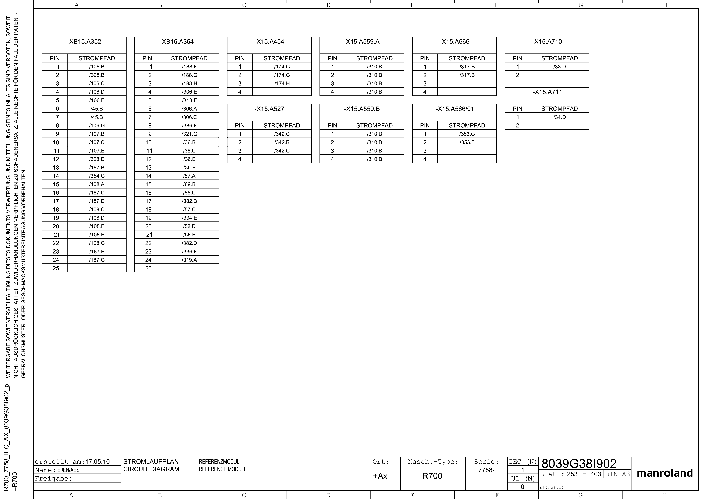

# +Ax — Sheet 253 of 403 — REFERENZMODUL

**REFERENCE MODULE**

> Part of the manroland **R700** printing press IEC/UL circuit diagrams.
> Drawing class: **Stromlaufplan / Circuit diagram** (DIN A3).
> Document `+Ax` covers the **Central control console** machine section.

## At a glance

| Field | Value |
|---|---|
| Document | `+Ax`  (8039G38I902) |
| Sheet | **253** of 403 |
| Section (DE) | REFERENZMODUL |
| Section (EN) | REFERENCE MODULE |
| Section type | REFERENCE_MODULE — Reference module |
| Machine type | `R700` |
| Series | `7758` |
| Created | 17.05.10 |
| Replaces | — |
| Columns used | A, B, C, D, E, F, G |
| Path numbers | — |
| Labels on sheet | 176 |
| Cross-refs out | 68 |
| Cross-refs in | 0 |

**Previous:** [+Ax sheet 252](SHEET_0252.md) · **Next:** [+Ax sheet 254](SHEET_0254.md) · **Document TOC:** [_TOC.md](_TOC.md)  (+Ax) · **Master TOC:** [all sheets](../_MASTER_TOC.md)

## Sheet image (300 DPI, exact vector render)



_Rendered directly from the PDF vector layer at 300 DPI (1-bit), no OCR and no resampling. Use it to confirm anything ambiguous in the text below._

## Cross-references on this sheet

Each entry is a wire leaving this sheet. The printed token is `/sheet.column`; the link resolves to that sheet inside the same document.

| Ref | Target sheet | Col | Path | Destination on target | Target section | From col |
|---|---|---|---|---|---|---|
| `/33.D` | [+Ax sheet 33](SHEET_0033.md) | D | — | STROMPFAD PIN 1 2 | SPANNUNGSVERSORGUNG, SCHALTSCHRANKBELÜFTUNG | G |
| `/106.B` | [+Ax sheet 106](SHEET_0106.md) | B | — | — | ANLEGER | A |
| `/310.B` | [+Ax sheet 310](SHEET_0310.md) | B | — | — | OPTION: IONISATIONSANLAGE ANLEGER | E |
| `/317.B` | [+Ax sheet 317](SHEET_0317.md) | B | — | — | OPTION: "EJEKTOR" ANLAGE / SELECT AIRSTATION / | F |
| `/188.F` | [+Ax sheet 188](SHEET_0188.md) | F | — | — | RESERVE | B |
| `/174.G` | [+Ax sheet 174](SHEET_0174.md) | G | — | — | RESERVE | C |
| `/328.B` | [+Ax sheet 328](SHEET_0328.md) | B | — | — | OPTION: NONSTOP EINRICHTUNG MANUELL, ANLEGER | A |
| `/310.B` | [+Ax sheet 310](SHEET_0310.md) | B | — | — | OPTION: IONISATIONSANLAGE ANLEGER | E |
| `/317.B` | [+Ax sheet 317](SHEET_0317.md) | B | — | — | OPTION: "EJEKTOR" ANLAGE / SELECT AIRSTATION / | F |
| `/188.G` | [+Ax sheet 188](SHEET_0188.md) | G | — | — | RESERVE | B |
| `/174.G` | [+Ax sheet 174](SHEET_0174.md) | G | — | — | RESERVE | C |
| `/310.B` | [+Ax sheet 310](SHEET_0310.md) | B | — | — | OPTION: IONISATIONSANLAGE ANLEGER | E |
| `/106.C` | [+Ax sheet 106](SHEET_0106.md) | C | — | — | ANLEGER | A |
| `/188.H` | [+Ax sheet 188](SHEET_0188.md) | H | — | — | RESERVE | B |
| `/174.H` | [+Ax sheet 174](SHEET_0174.md) | H | — | — | RESERVE | C |
| `/306.E` | [+Ax sheet 306](SHEET_0306.md) | E | — | — | SCHÖN & WIDERDRUCK HAUPTSCHALTSCHRANK | B |
| `/310.B` | [+Ax sheet 310](SHEET_0310.md) | B | — | — | OPTION: IONISATIONSANLAGE ANLEGER | E |
| `/106.D` | [+Ax sheet 106](SHEET_0106.md) | D | — | — | ANLEGER | A |
| `/106.E` | [+Ax sheet 106](SHEET_0106.md) | E | — | — | ANLEGER | A |
| `/313.F` | [+Ax sheet 313](SHEET_0313.md) | F | — | — | OPTION: STAUBSAUGER MIT BÜRSTE | B |
| `/34.D` | [+Ax sheet 34](SHEET_0034.md) | D | — | STROMPFAD PIN 1 2 | SPANNUNGSVERSORGUNG, SCHALTSCHRANKBELÜFTUNG | G |
| `/45.B` | [+Ax sheet 45](SHEET_0045.md) | B | — | — | HAUPTANTRIEB | A |
| `/306.A` | [+Ax sheet 306](SHEET_0306.md) | A | — | — | SCHÖN & WIDERDRUCK HAUPTSCHALTSCHRANK | B |
| `/45.B` | [+Ax sheet 45](SHEET_0045.md) | B | — | — | HAUPTANTRIEB | A |
| `/306.C` | [+Ax sheet 306](SHEET_0306.md) | C | — | — | SCHÖN & WIDERDRUCK HAUPTSCHALTSCHRANK | B |
| `/386.F` | [+Ax sheet 386](SHEET_0386.md) | F | — | — | OPTION: INLINECOATER SMART | B |
| `/106.G` | [+Ax sheet 106](SHEET_0106.md) | G | — | — | ANLEGER | A |
| `/107.B` | [+Ax sheet 107](SHEET_0107.md) | B | — | — | ANLEGER | A |
| `/310.B` | [+Ax sheet 310](SHEET_0310.md) | B | — | — | OPTION: IONISATIONSANLAGE ANLEGER | E |
| `/321.G` | [+Ax sheet 321](SHEET_0321.md) | G | — | — | OPTION: "EJEKTOR" ANLAGE / SELECT AIRSTATION / | B |
| `/353.G` | [+Ax sheet 353](SHEET_0353.md) | G | — | — | OPTION: LOGISTIK ANLEGER | F |
| `/342.C` | [+Ax sheet 342](SHEET_0342.md) | C | — | — | OPTION: INLINESHEETER RS104 S | C |
| `/36.B` | [+Ax sheet 36](SHEET_0036.md) | B | — | — | SCHMIERUNG | B |
| `/342.B` | [+Ax sheet 342](SHEET_0342.md) | B | — | — | OPTION: INLINESHEETER RS104 S | C |
| `/310.B` | [+Ax sheet 310](SHEET_0310.md) | B | — | — | OPTION: IONISATIONSANLAGE ANLEGER | E |
| `/353.F` | [+Ax sheet 353](SHEET_0353.md) | F | — | — | OPTION: LOGISTIK ANLEGER | F |
| `/107.C` | [+Ax sheet 107](SHEET_0107.md) | C | — | — | ANLEGER | A |
| `/107.E` | [+Ax sheet 107](SHEET_0107.md) | E | — | — | ANLEGER | A |
| `/310.B` | [+Ax sheet 310](SHEET_0310.md) | B | — | — | OPTION: IONISATIONSANLAGE ANLEGER | E |
| `/36.C` | [+Ax sheet 36](SHEET_0036.md) | C | — | — | SCHMIERUNG | B |
| `/342.C` | [+Ax sheet 342](SHEET_0342.md) | C | — | — | OPTION: INLINESHEETER RS104 S | C |
| `/36.E` | [+Ax sheet 36](SHEET_0036.md) | E | — | — | SCHMIERUNG | B |
| `/310.B` | [+Ax sheet 310](SHEET_0310.md) | B | — | — | OPTION: IONISATIONSANLAGE ANLEGER | E |
| `/328.D` | [+Ax sheet 328](SHEET_0328.md) | D | — | — | OPTION: NONSTOP EINRICHTUNG MANUELL, ANLEGER | A |
| `/36.F` | [+Ax sheet 36](SHEET_0036.md) | F | — | — | SCHMIERUNG | B |
| `/187.B` | [+Ax sheet 187](SHEET_0187.md) | B | — | — | RESERVE | A |
| `/57.A` | [+Ax sheet 57](SHEET_0057.md) | A | — | — | LUFTVERSORGUNG | B |
| `/354.G` | [+Ax sheet 354](SHEET_0354.md) | G | — | — | OPTION: LOGISTIK ANLEGER | A |
| `/69.B` | [+Ax sheet 69](SHEET_0069.md) | B | — | — | SAUGBÄNDERTISCH | B |
| `/108.A` | [+Ax sheet 108](SHEET_0108.md) | A | — | — | ANLEGER | A |
| `/187.C` | [+Ax sheet 187](SHEET_0187.md) | C | — | — | RESERVE | A |
| `/65.C` | [+Ax sheet 65](SHEET_0065.md) | C | — | — | DRUCKLUFTANLAGE | B |
| `/382.B` | [+Ax sheet 382](SHEET_0382.md) | B | — | — | OPTION: INLINEFOILER PRINDOR | B |
| `/187.D` | [+Ax sheet 187](SHEET_0187.md) | D | — | — | RESERVE | A |
| `/57.C` | [+Ax sheet 57](SHEET_0057.md) | C | — | — | LUFTVERSORGUNG | B |
| `/108.C` | [+Ax sheet 108](SHEET_0108.md) | C | — | — | ANLEGER | A |
| `/334.E` | [+Ax sheet 334](SHEET_0334.md) | E | — | — | OPTION: INLINESORTER | B |
| `/108.D` | [+Ax sheet 108](SHEET_0108.md) | D | — | — | ANLEGER | A |
| `/108.E` | [+Ax sheet 108](SHEET_0108.md) | E | — | — | ANLEGER | A |
| `/58.D` | [+Ax sheet 58](SHEET_0058.md) | D | — | — | LUFTVERSORGUNG | B |
| `/58.E` | [+Ax sheet 58](SHEET_0058.md) | E | — | — | LUFTVERSORGUNG | B |
| `/108.F` | [+Ax sheet 108](SHEET_0108.md) | F | — | — | ANLEGER | A |
| `/108.G` | [+Ax sheet 108](SHEET_0108.md) | G | — | — | ANLEGER | A |
| `/382.D` | [+Ax sheet 382](SHEET_0382.md) | D | — | — | OPTION: INLINEFOILER PRINDOR | B |
| `/187.F` | [+Ax sheet 187](SHEET_0187.md) | F | — | — | RESERVE | A |
| `/336.F` | [+Ax sheet 336](SHEET_0336.md) | F | — | — | OPTION: LOGISTIK ANLEGER / | B |
| `/319.A` | [+Ax sheet 319](SHEET_0319.md) | A | — | — | OPTION: "EJEKTOR" ANLAGE / SELECT AIRSTATION / | B |
| `/187.G` | [+Ax sheet 187](SHEET_0187.md) | G | — | — | RESERVE | A |

## Devices on this sheet

| Tag | Class | Class meaning (IEC) | Col | Sub | Terminal | Sign |
|---|---|---|---|---|---|---|
| `XB15.A352` | — | cross-device reference | A | — | — | — |
| `XB15.A354` | — | cross-device reference | B | — | — | — |
| `X15.A454` | — | cross-device reference | C | — | — | — |
| `X15.A527` | — | cross-device reference | C | — | — | — |
| `X15.A559.A` | — | cross-device reference | D | — | — | — |
| `X15.A559.B` | — | cross-device reference | D | — | — | — |
| `X15.A566` | — | cross-device reference | F | — | — | — |
| `X15.A710` | — | cross-device reference | G | — | — | — |
| `X15.A711` | — | cross-device reference | G | — | — | — |

## Potentials / nets

_No named potentials on this sheet._

## Wire-end annotations (grouped as printed)

A wire that continues elsewhere is annotated with a small cluster: the destination description, the path/line number `#NN`, and the `/sheet.column` cross reference. Each row below is one such cluster exactly as it is grouped on the drawing.

| Col | Y | Path | Cross-ref | Text on the wire |
|---|---|---|---|---|
| A | 65.5 | — | — | `XB15.A352` |
| B | 65.5 | — | — | `XB15.A354` |
| C | 65.5 | — | — | `X15.A454` |
| D | 65.5 | — | — | `X15.A559.A` |
| F | 65.5 | — | — | `X15.A566` |
| G | 65.5 | — | — | `X15.A710` |
| A | 94.2 | — | — | `PIN STROMPFAD` |
| B | 94.2 | — | — | `PIN STROMPFAD` |
| C | 94.2 | — | — | `PIN 2 3 4 1 STROMPFAD` |
| D | 94.2 | — | — | `PIN 2 3 4 1 STROMPFAD` |
| E | 94.2 | — | — | `PIN 2 3 4 1 STROMPFAD` |
| G | 94.2 | — | `/33.D` | `PIN 2 1 STROMPFAD` |
| A | 108.4 | — | — | `2 3 4 5 6 7 8 9 1` |
| B | 108.4 | — | — | `2 3 4 5 6 7 8 9 1` |
| A | 108.7 | — | `/106.B` | — |
| B | 108.7 | — | `/188.F` | — |
| C | 108.7 | — | `/174.G` | — |
| E | 108.7 | — | `/310.B` | — |
| F | 108.7 | — | `/317.B` | — |
| A | 122.9 | — | `/328.B` | — |
| B | 122.9 | — | `/188.G` | — |
| C | 122.9 | — | `/174.G` | — |
| E | 122.9 | — | `/310.B` | — |
| F | 122.9 | — | `/317.B` | — |
| E | 137.0 | — | `/310.B` | — |
| A | 137.1 | — | `/106.C` | — |
| B | 137.1 | — | `/188.H` | — |
| C | 137.1 | — | `/174.H` | — |
| G | 150.5 | — | — | `X15.A711` |
| A | 151.2 | — | `/106.D` | — |
| B | 151.2 | — | `/306.E` | — |
| E | 151.2 | — | `/310.B` | — |
| A | 165.4 | — | `/106.E` | — |
| B | 165.4 | — | `/313.F` | — |
| C | 178.9 | — | — | `X15.A527` |
| D | 178.9 | — | — | `X15.A559.B` |
| F | 178.9 | — | — | `X15.A566/01` |
| G | 179.2 | — | `/34.D` | `PIN 2 1 STROMPFAD` |
| A | 179.5 | — | `/45.B` | — |
| B | 179.6 | — | `/306.A` | — |
| A | 193.7 | — | `/45.B` | — |
| B | 193.8 | — | `/306.C` | — |
| C | 207.5 | — | — | `PIN 2 3 4 1 STROMPFAD` |
| D | 207.5 | — | — | `PIN 2 3 4 1 STROMPFAD` |
| E | 207.5 | — | — | `PIN 2 3 4 1 STROMPFAD` |
| A | 207.9 | — | `/106.G` | — |
| B | 207.9 | — | `/386.F` | — |
| A | 222.1 | — | `/107.B` | — |
| B | 222.1 | — | `/321.G` | — |
| C | 222.1 | — | `/342.C` | — |
| E | 222.1 | — | `/310.B` | — |
| F | 222.1 | — | `/353.G` | — |
| A | 235.9 | — | — | `10 12 13 14 15 16 17 18 19 20 11` |
| B | 235.9 | — | — | `10 12 13 14 15 16 17 18 19 20 11` |
| B | 236.2 | — | `/36.B` | — |
| C | 236.2 | — | `/342.B` | — |
| E | 236.2 | — | `/310.B` | — |
| A | 236.3 | — | `/107.C` | — |
| F | 236.3 | — | `/353.F` | — |
| A | 250.4 | — | `/107.E` | — |
| B | 250.4 | — | `/36.C` | — |
| C | 250.4 | — | `/342.C` | — |
| E | 250.4 | — | `/310.B` | — |
| A | 264.6 | — | `/328.D` | — |
| B | 264.6 | — | `/36.E` | — |
| E | 264.6 | — | `/310.B` | — |
| A | 278.8 | — | `/187.B` | — |
| B | 278.8 | — | `/36.F` | — |
| B | 292.9 | — | `/57.A` | — |
| A | 293.0 | — | `/354.G` | — |
| A | 307.1 | — | `/108.A` | — |
| B | 307.1 | — | `/69.B` | — |
| A | 321.3 | — | `/187.C` | — |
| B | 321.3 | — | `/65.C` | — |
| A | 335.5 | — | `/187.D` | — |
| B | 335.5 | — | `/382.B` | — |
| B | 349.6 | — | `/57.C` | — |
| A | 349.7 | — | `/108.C` | — |
| A | 363.8 | — | `/108.D` | — |
| B | 363.8 | — | `/334.E` | — |
| A | 378.0 | — | `/108.E` | — |
| B | 378.0 | — | `/58.D` | — |
| A | 391.8 | — | — | `22 23 24 25 21` |
| B | 391.8 | — | — | `22 23 24 25 21` |
| B | 392.1 | — | `/58.E` | — |
| A | 392.2 | — | `/108.F` | — |
| A | 406.3 | — | `/108.G` | — |
| B | 406.4 | — | `/382.D` | — |
| A | 420.5 | — | `/187.F` | — |
| B | 420.5 | — | `/336.F` | — |
| A | 434.7 | — | `/187.G` | — |
| B | 434.7 | — | `/319.A` | — |


## Reconstructed tables

This sheet carries tabular content (pin map / terminal assignment / index). The grid below was rebuilt from the drawing's own rule lines, so each row is exactly one physical row of the table.

### Table 1 — 25 data rows × 2 columns (at x=70.9, y=62.4) — **XB15.A352**

| PIN | STROMPFAD |
|---|---|
| `1` | `/106.B` |
| `2` | `/328.B` |
| `3` | `/106.C` |
| `4` | `/106.D` |
| `5` | `/106.E` |
| `6` | `/45.B` |
| `7` | `/45.B` |
| `8` | `/106.G` |
| `9` | `/107.B` |
| `10` | `/107.C` |
| `11` | `/107.E` |
| `12` | `/328.D` |
| `13` | `/187.B` |
| `14` | `/354.G` |
| `15` | `/108.A` |
| `16` | `/187.C` |
| `17` | `/187.D` |
| `18` | `/108.C` |
| `19` | `/108.D` |
| `20` | `/108.E` |
| `21` | `/108.F` |
| `22` | `/108.G` |
| `23` | `/187.F` |
| `24` | `/187.G` |
| `25` |  |


### Table 2 — 25 data rows × 2 columns (at x=226.8, y=62.4) — **XB15.A354**

| PIN | STROMPFAD |
|---|---|
| `1` | `/188.F` |
| `2` | `/188.G` |
| `3` | `/188.H` |
| `4` | `/306.E` |
| `5` | `/313.F` |
| `6` | `/306.A` |
| `7` | `/306.C` |
| `8` | `/386.F` |
| `9` | `/321.G` |
| `10` | `/36.B` |
| `11` | `/36.C` |
| `12` | `/36.E` |
| `13` | `/36.F` |
| `14` | `/57.A` |
| `15` | `/69.B` |
| `16` | `/65.C` |
| `17` | `/382.B` |
| `18` | `/57.C` |
| `19` | `/334.E` |
| `20` | `/58.D` |
| `21` | `/58.E` |
| `22` | `/382.D` |
| `23` | `/336.F` |
| `24` | `/319.A` |
| `25` |  |


### Table 3 — 10 data rows × 2 columns (at x=382.7, y=62.4) — **X15.A454**

| PIN | STROMPFAD |
|---|---|
| `1` | `/174.G` |
| `2` | `/174.G` |
| `3` | `/174.H` |
| `4` |  |
|  | `X15.A527` |
| `PIN` | `STROMPFAD` |
| `1` | `/342.C` |
| `2` | `/342.B` |
| `3` | `/342.C` |
| `4` |  |


### Table 4 — 10 data rows × 2 columns (at x=538.6, y=62.4) — **X15.A559.A**

| PIN | STROMPFAD |
|---|---|
| `1` | `/310.B` |
| `2` | `/310.B` |
| `3` | `/310.B` |
| `4` | `/310.B` |
|  | `X15.A559.B` |
| `PIN` | `STROMPFAD` |
| `1` | `/310.B` |
| `2` | `/310.B` |
| `3` | `/310.B` |
| `4` | `/310.B` |


### Table 5 — 10 data rows × 2 columns (at x=694.5, y=62.4) — **X15.A566**

| PIN | STROMPFAD |
|---|---|
| `1` | `/317.B` |
| `2` | `/317.B` |
| `3` |  |
| `4` |  |
|  | `X15.A566/01` |
| `PIN` | `STROMPFAD` |
| `1` | `/353.G` |
| `2` | `/353.F` |
| `3` |  |
| `4` |  |


### Table 6 — 6 data rows × 2 columns (at x=850.4, y=62.4) — **X15.A710**

| PIN | STROMPFAD |
|---|---|
| `1` | `/33.D` |
| `2` |  |
|  | `X15.A711` |
| `PIN` | `STROMPFAD` |
| `1` | `/34.D` |
| `2` |  |


## Notes and free text on this sheet

| Text | Col | Y (pt) |
|---|---|---|
| `PIN` | A | 94.2 |
| `STROMPFAD` | A | 94.15 |
| `PIN` | B | 94.2 |
| `STROMPFAD` | B | 94.15 |
| `PIN` | C | 94.2 |
| `STROMPFAD` | C | 94.15 |
| `PIN` | D | 94.2 |
| `STROMPFAD` | E | 94.15 |
| `PIN` | E | 94.2 |
| `STROMPFAD` | F | 94.15 |
| `X15.A566/01` | F | 178.89 |
| `PIN` | F | 94.2 |
| `STROMPFAD` | G | 94.15 |

## Complete label inventory (exact text from the drawing)

Every text object inside the drawing area of this sheet, in DIN reading order (column A→H, then top→bottom). This is the authoritative list: if a string is not here it is not printed on this sheet.

| Col | Y | X | Dir | Type | Text |
|---|---|---|---|---|---|
| A | 65.5 | 113.2 | → | device ref | `XB15.A352` |
| A | 94.2 | 84.0 | → | text | `PIN` |
| A | 94.2 | 132.2 | → | text | `STROMPFAD` |
| A | 108.4 | 95.8 | → | number | `1` |
| A | 108.7 | 150.4 | → | cross-reference | `/106.B` |
| A | 122.5 | 94.1 | → | number | `2` |
| A | 122.9 | 150.4 | → | cross-reference | `/328.B` |
| A | 136.7 | 94.1 | → | number | `3` |
| A | 137.1 | 150.2 | → | cross-reference | `/106.C` |
| A | 150.9 | 94.1 | → | number | `4` |
| A | 151.2 | 150.2 | → | cross-reference | `/106.D` |
| A | 165.1 | 94.1 | → | number | `5` |
| A | 165.4 | 150.5 | → | cross-reference | `/106.E` |
| A | 179.2 | 94.1 | → | number | `6` |
| A | 179.5 | 152.8 | → | cross-reference | `/45.B` |
| A | 193.4 | 94.1 | → | number | `7` |
| A | 193.7 | 152.8 | → | cross-reference | `/45.B` |
| A | 207.6 | 94.1 | → | number | `8` |
| A | 207.9 | 150.1 | → | cross-reference | `/106.G` |
| A | 221.8 | 94.1 | → | number | `9` |
| A | 222.1 | 150.4 | → | cross-reference | `/107.B` |
| A | 235.9 | 88.7 | → | number | `10` |
| A | 236.3 | 150.2 | → | cross-reference | `/107.C` |
| A | 250.1 | 90.4 | → | number | `11` |
| A | 250.4 | 150.5 | → | cross-reference | `/107.E` |
| A | 264.3 | 88.7 | → | number | `12` |
| A | 264.6 | 150.2 | → | cross-reference | `/328.D` |
| A | 278.5 | 88.7 | → | number | `13` |
| A | 278.8 | 150.4 | → | cross-reference | `/187.B` |
| A | 292.6 | 88.7 | → | number | `14` |
| A | 293.0 | 150.1 | → | cross-reference | `/354.G` |
| A | 306.8 | 88.7 | → | number | `15` |
| A | 307.1 | 150.2 | → | cross-reference | `/108.A` |
| A | 321.0 | 88.7 | → | number | `16` |
| A | 321.3 | 150.2 | → | cross-reference | `/187.C` |
| A | 335.1 | 88.7 | → | number | `17` |
| A | 335.5 | 150.2 | → | cross-reference | `/187.D` |
| A | 349.3 | 88.7 | → | number | `18` |
| A | 349.7 | 150.2 | → | cross-reference | `/108.C` |
| A | 363.5 | 88.7 | → | number | `19` |
| A | 363.8 | 150.2 | → | cross-reference | `/108.D` |
| A | 377.7 | 88.7 | → | number | `20` |
| A | 378.0 | 150.5 | → | cross-reference | `/108.E` |
| A | 391.8 | 90.4 | → | number | `21` |
| A | 392.2 | 150.7 | → | cross-reference | `/108.F` |
| A | 406.0 | 88.7 | → | number | `22` |
| A | 406.3 | 150.1 | → | cross-reference | `/108.G` |
| A | 420.2 | 88.7 | → | number | `23` |
| A | 420.5 | 150.7 | → | cross-reference | `/187.F` |
| A | 434.4 | 88.7 | → | number | `24` |
| A | 434.7 | 150.1 | → | cross-reference | `/187.G` |
| A | 448.5 | 88.7 | → | number | `25` |
| B | 65.5 | 269.1 | → | device ref | `XB15.A354` |
| B | 94.2 | 240.0 | → | text | `PIN` |
| B | 94.2 | 288.1 | → | text | `STROMPFAD` |
| B | 108.4 | 251.7 | → | number | `1` |
| B | 108.7 | 306.6 | → | cross-reference | `/188.F` |
| B | 122.5 | 250.0 | → | number | `2` |
| B | 122.9 | 306.0 | → | cross-reference | `/188.G` |
| B | 136.7 | 250.0 | → | number | `3` |
| B | 137.1 | 306.4 | → | cross-reference | `/188.H` |
| B | 150.9 | 250.0 | → | number | `4` |
| B | 151.2 | 306.4 | → | cross-reference | `/306.E` |
| B | 165.1 | 250.0 | → | number | `5` |
| B | 165.4 | 306.6 | → | cross-reference | `/313.F` |
| B | 179.2 | 250.0 | → | number | `6` |
| B | 179.6 | 306.1 | → | cross-reference | `/306.A` |
| B | 193.4 | 250.0 | → | number | `7` |
| B | 193.8 | 306.1 | → | cross-reference | `/306.C` |
| B | 207.6 | 250.0 | → | number | `8` |
| B | 207.9 | 306.6 | → | cross-reference | `/386.F` |
| B | 221.8 | 250.0 | → | number | `9` |
| B | 222.1 | 306.0 | → | cross-reference | `/321.G` |
| B | 235.9 | 244.6 | → | number | `10` |
| B | 236.2 | 308.7 | → | cross-reference | `/36.B` |
| B | 250.1 | 246.3 | → | number | `11` |
| B | 250.4 | 308.6 | → | cross-reference | `/36.C` |
| B | 264.3 | 244.6 | → | number | `12` |
| B | 264.6 | 308.8 | → | cross-reference | `/36.E` |
| B | 278.5 | 244.6 | → | number | `13` |
| B | 278.8 | 309.0 | → | cross-reference | `/36.F` |
| B | 292.6 | 244.6 | → | number | `14` |
| B | 292.9 | 308.6 | → | cross-reference | `/57.A` |
| B | 306.8 | 244.6 | → | number | `15` |
| B | 307.1 | 308.7 | → | cross-reference | `/69.B` |
| B | 321.0 | 244.6 | → | number | `16` |
| B | 321.3 | 308.6 | → | cross-reference | `/65.C` |
| B | 335.1 | 244.6 | → | number | `17` |
| B | 335.5 | 306.3 | → | cross-reference | `/382.B` |
| B | 349.3 | 244.6 | → | number | `18` |
| B | 349.7 | 308.6 | → | cross-reference | `/57.C` |
| B | 363.5 | 244.6 | → | number | `19` |
| B | 363.8 | 306.4 | → | cross-reference | `/334.E` |
| B | 377.7 | 244.6 | → | number | `20` |
| B | 378.0 | 308.6 | → | cross-reference | `/58.D` |
| B | 391.8 | 246.3 | → | number | `21` |
| B | 392.1 | 308.8 | → | cross-reference | `/58.E` |
| B | 406.0 | 244.6 | → | number | `22` |
| B | 406.4 | 306.1 | → | cross-reference | `/382.D` |
| B | 420.2 | 244.6 | → | number | `23` |
| B | 420.5 | 306.6 | → | cross-reference | `/336.F` |
| B | 434.4 | 244.6 | → | number | `24` |
| B | 434.7 | 306.1 | → | cross-reference | `/319.A` |
| B | 448.5 | 244.6 | → | number | `25` |
| C | 65.5 | 428.6 | → | device ref | `X15.A454` |
| C | 94.2 | 395.9 | → | text | `PIN` |
| C | 94.2 | 444.0 | → | text | `STROMPFAD` |
| C | 108.4 | 401.8 | → | number | `1` |
| C | 108.7 | 461.9 | → | cross-reference | `/174.G` |
| C | 122.5 | 401.2 | → | number | `2` |
| C | 122.9 | 461.9 | → | cross-reference | `/174.G` |
| C | 136.7 | 401.2 | → | number | `3` |
| C | 137.1 | 462.3 | → | cross-reference | `/174.H` |
| C | 150.9 | 401.2 | → | number | `4` |
| C | 178.9 | 428.6 | → | device ref | `X15.A527` |
| C | 207.5 | 444.0 | → | text | `STROMPFAD` |
| C | 207.6 | 395.9 | → | text | `PIN` |
| C | 221.8 | 401.8 | → | number | `1` |
| C | 222.1 | 462.0 | → | cross-reference | `/342.C` |
| C | 235.9 | 401.2 | → | number | `2` |
| C | 236.2 | 462.2 | → | cross-reference | `/342.B` |
| C | 250.1 | 401.2 | → | number | `3` |
| C | 250.4 | 462.0 | → | cross-reference | `/342.C` |
| C | 264.3 | 401.2 | → | number | `4` |
| D | 65.5 | 579.1 | → | device ref | `X15.A559.A` |
| D | 94.2 | 551.8 | → | text | `PIN` |
| D | 108.4 | 557.7 | → | number | `1` |
| D | 122.5 | 557.1 | → | number | `2` |
| D | 136.7 | 557.1 | → | number | `3` |
| D | 150.9 | 557.1 | → | number | `4` |
| D | 178.9 | 579.5 | → | device ref | `X15.A559.B` |
| D | 207.6 | 551.8 | → | text | `PIN` |
| D | 221.8 | 557.7 | → | number | `1` |
| D | 235.9 | 557.1 | → | number | `2` |
| D | 250.1 | 557.1 | → | number | `3` |
| D | 264.3 | 557.1 | → | number | `4` |
| E | 94.2 | 600.0 | → | text | `STROMPFAD` |
| E | 94.2 | 707.7 | → | text | `PIN` |
| E | 108.4 | 713.6 | → | number | `1` |
| E | 108.7 | 618.1 | → | cross-reference | `/310.B` |
| E | 122.5 | 713.1 | → | number | `2` |
| E | 122.9 | 618.1 | → | cross-reference | `/310.B` |
| E | 136.7 | 713.1 | → | number | `3` |
| E | 137.0 | 618.1 | → | cross-reference | `/310.B` |
| E | 150.9 | 713.1 | → | number | `4` |
| E | 151.2 | 618.1 | → | cross-reference | `/310.B` |
| E | 207.5 | 600.0 | → | text | `STROMPFAD` |
| E | 207.6 | 707.7 | → | text | `PIN` |
| E | 221.8 | 713.6 | → | number | `1` |
| E | 222.1 | 618.1 | → | cross-reference | `/310.B` |
| E | 235.9 | 713.1 | → | number | `2` |
| E | 236.2 | 618.1 | → | cross-reference | `/310.B` |
| E | 250.1 | 713.1 | → | number | `3` |
| E | 250.4 | 618.1 | → | cross-reference | `/310.B` |
| E | 264.3 | 713.1 | → | number | `4` |
| E | 264.6 | 618.1 | → | cross-reference | `/310.B` |
| F | 65.5 | 740.4 | → | device ref | `X15.A566` |
| F | 94.2 | 755.9 | → | text | `STROMPFAD` |
| F | 94.2 | 863.6 | → | text | `PIN` |
| F | 108.4 | 869.5 | → | number | `1` |
| F | 108.7 | 774.0 | → | cross-reference | `/317.B` |
| F | 122.5 | 869.0 | → | number | `2` |
| F | 122.9 | 774.0 | → | cross-reference | `/317.B` |
| F | 178.9 | 733.7 | → | text | `X15.A566/01` |
| F | 179.2 | 863.6 | → | text | `PIN` |
| F | 193.4 | 869.5 | → | number | `1` |
| F | 207.5 | 755.9 | → | text | `STROMPFAD` |
| F | 207.6 | 869.0 | → | number | `2` |
| F | 222.1 | 773.7 | → | cross-reference | `/353.G` |
| F | 236.3 | 774.3 | → | cross-reference | `/353.F` |
| G | 65.5 | 896.3 | → | device ref | `X15.A710` |
| G | 94.2 | 911.8 | → | text | `STROMPFAD` |
| G | 108.7 | 932.2 | → | cross-reference | `/33.D` |
| G | 150.5 | 897.0 | → | device ref | `X15.A711` |
| G | 179.2 | 911.8 | → | text | `STROMPFAD` |
| G | 193.7 | 932.2 | → | cross-reference | `/34.D` |

## Reading-order text block

The same content as a plain block, grouped by DIN column — convenient to paste or to match against a visual description.

```text
=== Column A ===
  65.5  113.2  devref       XB15.A352
  94.2   84.0  text         PIN
  94.2  132.2  text         STROMPFAD
 108.4   95.8  numeric      1
 108.7  150.4  xref         /106.B
 122.5   94.1  numeric      2
 122.9  150.4  xref         /328.B
 136.7   94.1  numeric      3
 137.1  150.2  xref         /106.C
 150.9   94.1  numeric      4
 151.2  150.2  xref         /106.D
 165.1   94.1  numeric      5
 165.4  150.5  xref         /106.E
 179.2   94.1  numeric      6
 179.5  152.8  xref         /45.B
 193.4   94.1  numeric      7
 193.7  152.8  xref         /45.B
 207.6   94.1  numeric      8
 207.9  150.1  xref         /106.G
 221.8   94.1  numeric      9
 222.1  150.4  xref         /107.B
 235.9   88.7  numeric      10
 236.3  150.2  xref         /107.C
 250.1   90.4  numeric      11
 250.4  150.5  xref         /107.E
 264.3   88.7  numeric      12
 264.6  150.2  xref         /328.D
 278.5   88.7  numeric      13
 278.8  150.4  xref         /187.B
 292.6   88.7  numeric      14
 293.0  150.1  xref         /354.G
 306.8   88.7  numeric      15
 307.1  150.2  xref         /108.A
 321.0   88.7  numeric      16
 321.3  150.2  xref         /187.C
 335.1   88.7  numeric      17
 335.5  150.2  xref         /187.D
 349.3   88.7  numeric      18
 349.7  150.2  xref         /108.C
 363.5   88.7  numeric      19
 363.8  150.2  xref         /108.D
 377.7   88.7  numeric      20
 378.0  150.5  xref         /108.E
 391.8   90.4  numeric      21
 392.2  150.7  xref         /108.F
 406.0   88.7  numeric      22
 406.3  150.1  xref         /108.G
 420.2   88.7  numeric      23
 420.5  150.7  xref         /187.F
 434.4   88.7  numeric      24
 434.7  150.1  xref         /187.G
 448.5   88.7  numeric      25
=== Column B ===
  65.5  269.1  devref       XB15.A354
  94.2  240.0  text         PIN
  94.2  288.1  text         STROMPFAD
 108.4  251.7  numeric      1
 108.7  306.6  xref         /188.F
 122.5  250.0  numeric      2
 122.9  306.0  xref         /188.G
 136.7  250.0  numeric      3
 137.1  306.4  xref         /188.H
 150.9  250.0  numeric      4
 151.2  306.4  xref         /306.E
 165.1  250.0  numeric      5
 165.4  306.6  xref         /313.F
 179.2  250.0  numeric      6
 179.6  306.1  xref         /306.A
 193.4  250.0  numeric      7
 193.8  306.1  xref         /306.C
 207.6  250.0  numeric      8
 207.9  306.6  xref         /386.F
 221.8  250.0  numeric      9
 222.1  306.0  xref         /321.G
 235.9  244.6  numeric      10
 236.2  308.7  xref         /36.B
 250.1  246.3  numeric      11
 250.4  308.6  xref         /36.C
 264.3  244.6  numeric      12
 264.6  308.8  xref         /36.E
 278.5  244.6  numeric      13
 278.8  309.0  xref         /36.F
 292.6  244.6  numeric      14
 292.9  308.6  xref         /57.A
 306.8  244.6  numeric      15
 307.1  308.7  xref         /69.B
 321.0  244.6  numeric      16
 321.3  308.6  xref         /65.C
 335.1  244.6  numeric      17
 335.5  306.3  xref         /382.B
 349.3  244.6  numeric      18
 349.7  308.6  xref         /57.C
 363.5  244.6  numeric      19
 363.8  306.4  xref         /334.E
 377.7  244.6  numeric      20
 378.0  308.6  xref         /58.D
 391.8  246.3  numeric      21
 392.1  308.8  xref         /58.E
 406.0  244.6  numeric      22
 406.4  306.1  xref         /382.D
 420.2  244.6  numeric      23
 420.5  306.6  xref         /336.F
 434.4  244.6  numeric      24
 434.7  306.1  xref         /319.A
 448.5  244.6  numeric      25
=== Column C ===
  65.5  428.6  devref       X15.A454
  94.2  395.9  text         PIN
  94.2  444.0  text         STROMPFAD
 108.4  401.8  numeric      1
 108.7  461.9  xref         /174.G
 122.5  401.2  numeric      2
 122.9  461.9  xref         /174.G
 136.7  401.2  numeric      3
 137.1  462.3  xref         /174.H
 150.9  401.2  numeric      4
 178.9  428.6  devref       X15.A527
 207.5  444.0  text         STROMPFAD
 207.6  395.9  text         PIN
 221.8  401.8  numeric      1
 222.1  462.0  xref         /342.C
 235.9  401.2  numeric      2
 236.2  462.2  xref         /342.B
 250.1  401.2  numeric      3
 250.4  462.0  xref         /342.C
 264.3  401.2  numeric      4
=== Column D ===
  65.5  579.1  devref       X15.A559.A
  94.2  551.8  text         PIN
 108.4  557.7  numeric      1
 122.5  557.1  numeric      2
 136.7  557.1  numeric      3
 150.9  557.1  numeric      4
 178.9  579.5  devref       X15.A559.B
 207.6  551.8  text         PIN
 221.8  557.7  numeric      1
 235.9  557.1  numeric      2
 250.1  557.1  numeric      3
 264.3  557.1  numeric      4
=== Column E ===
  94.2  600.0  text         STROMPFAD
  94.2  707.7  text         PIN
 108.4  713.6  numeric      1
 108.7  618.1  xref         /310.B
 122.5  713.1  numeric      2
 122.9  618.1  xref         /310.B
 136.7  713.1  numeric      3
 137.0  618.1  xref         /310.B
 150.9  713.1  numeric      4
 151.2  618.1  xref         /310.B
 207.5  600.0  text         STROMPFAD
 207.6  707.7  text         PIN
 221.8  713.6  numeric      1
 222.1  618.1  xref         /310.B
 235.9  713.1  numeric      2
 236.2  618.1  xref         /310.B
 250.1  713.1  numeric      3
 250.4  618.1  xref         /310.B
 264.3  713.1  numeric      4
 264.6  618.1  xref         /310.B
=== Column F ===
  65.5  740.4  devref       X15.A566
  94.2  755.9  text         STROMPFAD
  94.2  863.6  text         PIN
 108.4  869.5  numeric      1
 108.7  774.0  xref         /317.B
 122.5  869.0  numeric      2
 122.9  774.0  xref         /317.B
 178.9  733.7  text         X15.A566/01
 179.2  863.6  text         PIN
 193.4  869.5  numeric      1
 207.5  755.9  text         STROMPFAD
 207.6  869.0  numeric      2
 222.1  773.7  xref         /353.G
 236.3  774.3  xref         /353.F
=== Column G ===
  65.5  896.3  devref       X15.A710
  94.2  911.8  text         STROMPFAD
 108.7  932.2  xref         /33.D
 150.5  897.0  devref       X15.A711
 179.2  911.8  text         STROMPFAD
 193.7  932.2  xref         /34.D
```

---
_Generated from the PDF vector text layer; no OCR. Source: `R700_7758_IEC_AX_8039G38I902_p`, sheet 253._
