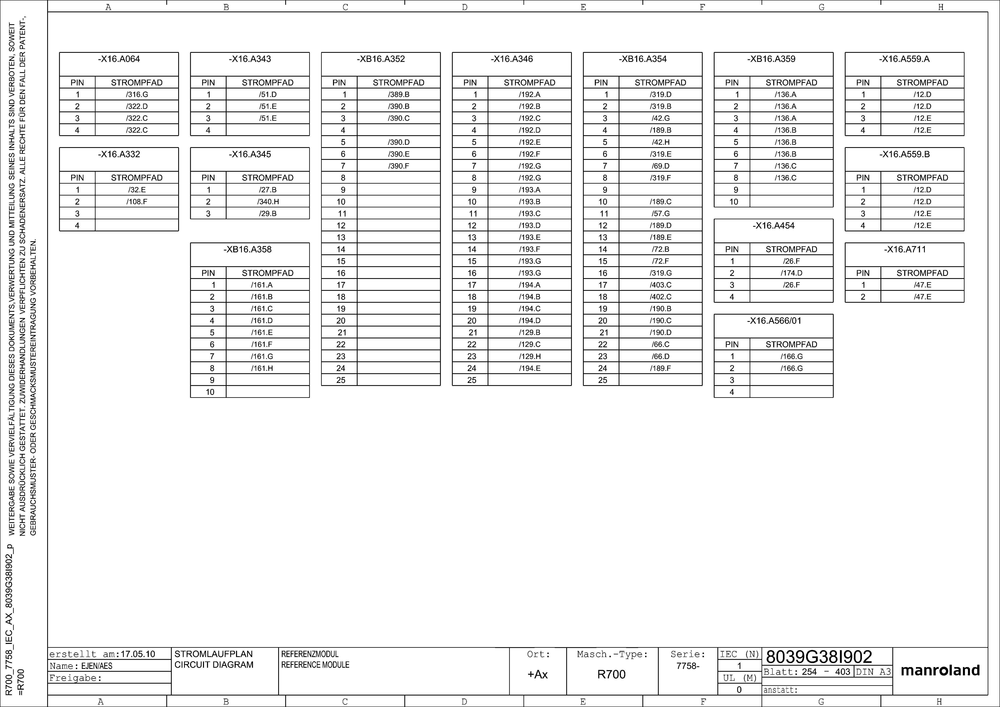

# +Ax — Sheet 254 of 403 — REFERENZMODUL

**REFERENCE MODULE**

> Part of the manroland **R700** printing press IEC/UL circuit diagrams.
> Drawing class: **Stromlaufplan / Circuit diagram** (DIN A3).
> Document `+Ax` covers the **Central control console** machine section.

## At a glance

| Field | Value |
|---|---|
| Document | `+Ax`  (8039G38I902) |
| Sheet | **254** of 403 |
| Section (DE) | REFERENZMODUL |
| Section (EN) | REFERENCE MODULE |
| Section type | REFERENCE_MODULE — Reference module |
| Machine type | `R700` |
| Series | `7758` |
| Created | 17.05.10 |
| Replaces | — |
| Columns used | A, B, C, D, E, F, G, H |
| Path numbers | — |
| Labels on sheet | 266 |
| Cross-refs out | 96 |
| Cross-refs in | 0 |

**Previous:** [+Ax sheet 253](SHEET_0253.md) · **Next:** [+Ax sheet 255](SHEET_0255.md) · **Document TOC:** [_TOC.md](_TOC.md)  (+Ax) · **Master TOC:** [all sheets](../_MASTER_TOC.md)

## Sheet image (300 DPI, exact vector render)



_Rendered directly from the PDF vector layer at 300 DPI (1-bit), no OCR and no resampling. Use it to confirm anything ambiguous in the text below._

## Cross-references on this sheet

Each entry is a wire leaving this sheet. The printed token is `/sheet.column`; the link resolves to that sheet inside the same document.

| Ref | Target sheet | Col | Path | Destination on target | Target section | From col |
|---|---|---|---|---|---|---|
| `/389.B` | [+Ax sheet 389](SHEET_0389.md) | B | — | — | OPTION: WASCHVORRICHTUNG MIT TUCH | C |
| `/192.A` | [+Ax sheet 192](SHEET_0192.md) | A | — | — | RESERVE | E |
| `/136.A` | [+Ax sheet 136](SHEET_0136.md) | A | — | — | REALTIMERECHNER ANSTEUERUNG DER SPS POWERKARTE | G |
| `/316.G` | [+Ax sheet 316](SHEET_0316.md) | G | — | — | OPTION: "EJEKTOR" ANLAGE / SELECT AIRSTATION / | A |
| `/51.D` | [+Ax sheet 51](SHEET_0051.md) | D | — | — | SIGNALGEBER: AKUSTISCHE WARNSIGNALE | B |
| `/12.D` | [+Ax sheet 12](SHEET_0012.md) | D | — | — | SPANNUNGSVERSORGUNG, SCHALTSCHRANKBELÜFTUNG | H |
| `/319.D` | [+Ax sheet 319](SHEET_0319.md) | D | — | — | OPTION: "EJEKTOR" ANLAGE / SELECT AIRSTATION / | F |
| `/51.E` | [+Ax sheet 51](SHEET_0051.md) | E | — | — | SIGNALGEBER: AKUSTISCHE WARNSIGNALE | B |
| `/390.B` | [+Ax sheet 390](SHEET_0390.md) | B | — | — | OPTION: WASCHVORRICHTUNG MIT TUCH | C |
| `/192.B` | [+Ax sheet 192](SHEET_0192.md) | B | — | — | RESERVE | E |
| `/319.B` | [+Ax sheet 319](SHEET_0319.md) | B | — | — | OPTION: "EJEKTOR" ANLAGE / SELECT AIRSTATION / | F |
| `/136.A` | [+Ax sheet 136](SHEET_0136.md) | A | — | — | REALTIMERECHNER ANSTEUERUNG DER SPS POWERKARTE | G |
| `/12.D` | [+Ax sheet 12](SHEET_0012.md) | D | — | — | SPANNUNGSVERSORGUNG, SCHALTSCHRANKBELÜFTUNG | H |
| `/322.D` | [+Ax sheet 322](SHEET_0322.md) | D | — | — | OPTION: "EJEKTOR" ANLAGE / SELECT AIRSTATION / | A |
| `/51.E` | [+Ax sheet 51](SHEET_0051.md) | E | — | — | SIGNALGEBER: AKUSTISCHE WARNSIGNALE | B |
| `/12.E` | [+Ax sheet 12](SHEET_0012.md) | E | — | — | SPANNUNGSVERSORGUNG, SCHALTSCHRANKBELÜFTUNG | H |
| `/42.G` | [+Ax sheet 42](SHEET_0042.md) | G | — | — | HAUPTANTRIEB | F |
| `/136.A` | [+Ax sheet 136](SHEET_0136.md) | A | — | — | REALTIMERECHNER ANSTEUERUNG DER SPS POWERKARTE | G |
| `/322.C` | [+Ax sheet 322](SHEET_0322.md) | C | — | — | OPTION: "EJEKTOR" ANLAGE / SELECT AIRSTATION / | A |
| `/390.C` | [+Ax sheet 390](SHEET_0390.md) | C | — | — | OPTION: WASCHVORRICHTUNG MIT TUCH | C |
| `/192.C` | [+Ax sheet 192](SHEET_0192.md) | C | — | — | RESERVE | E |
| `/12.E` | [+Ax sheet 12](SHEET_0012.md) | E | — | — | SPANNUNGSVERSORGUNG, SCHALTSCHRANKBELÜFTUNG | H |
| `/189.B` | [+Ax sheet 189](SHEET_0189.md) | B | — | — | RESERVE | F |
| `/136.B` | [+Ax sheet 136](SHEET_0136.md) | B | — | — | REALTIMERECHNER ANSTEUERUNG DER SPS POWERKARTE | G |
| `/322.C` | [+Ax sheet 322](SHEET_0322.md) | C | — | — | OPTION: "EJEKTOR" ANLAGE / SELECT AIRSTATION / | A |
| `/192.D` | [+Ax sheet 192](SHEET_0192.md) | D | — | — | RESERVE | E |
| `/192.E` | [+Ax sheet 192](SHEET_0192.md) | E | — | — | RESERVE | E |
| `/136.B` | [+Ax sheet 136](SHEET_0136.md) | B | — | — | REALTIMERECHNER ANSTEUERUNG DER SPS POWERKARTE | G |
| `/42.H` | [+Ax sheet 42](SHEET_0042.md) | H | — | — | HAUPTANTRIEB | F |
| `/390.D` | [+Ax sheet 390](SHEET_0390.md) | D | — | — | OPTION: WASCHVORRICHTUNG MIT TUCH | C |
| `/390.E` | [+Ax sheet 390](SHEET_0390.md) | E | — | — | OPTION: WASCHVORRICHTUNG MIT TUCH | C |
| `/319.E` | [+Ax sheet 319](SHEET_0319.md) | E | — | — | OPTION: "EJEKTOR" ANLAGE / SELECT AIRSTATION / | F |
| `/136.B` | [+Ax sheet 136](SHEET_0136.md) | B | — | — | REALTIMERECHNER ANSTEUERUNG DER SPS POWERKARTE | G |
| `/192.F` | [+Ax sheet 192](SHEET_0192.md) | F | — | — | RESERVE | E |
| `/390.F` | [+Ax sheet 390](SHEET_0390.md) | F | — | — | OPTION: WASCHVORRICHTUNG MIT TUCH | C |
| `/192.G` | [+Ax sheet 192](SHEET_0192.md) | G | — | — | RESERVE | E |
| `/69.D` | [+Ax sheet 69](SHEET_0069.md) | D | — | — | SAUGBÄNDERTISCH | F |
| `/136.C` | [+Ax sheet 136](SHEET_0136.md) | C | — | — | REALTIMERECHNER ANSTEUERUNG DER SPS POWERKARTE | G |
| `/319.F` | [+Ax sheet 319](SHEET_0319.md) | F | — | — | OPTION: "EJEKTOR" ANLAGE / SELECT AIRSTATION / | F |
| `/192.G` | [+Ax sheet 192](SHEET_0192.md) | G | — | — | RESERVE | E |
| `/136.C` | [+Ax sheet 136](SHEET_0136.md) | C | — | — | REALTIMERECHNER ANSTEUERUNG DER SPS POWERKARTE | G |
| `/32.E` | [+Ax sheet 32](SHEET_0032.md) | E | — | — | SPANNUNGSVERSORGUNG, SCHALTSCHRANKBELÜFTUNG | A |
| `/27.B` | [+Ax sheet 27](SHEET_0027.md) | B | — | — | SPANNUNGSVERSORGUNG, SCHALTSCHRANKBELÜFTUNG | B |
| `/193.A` | [+Ax sheet 193](SHEET_0193.md) | A | — | — | RESERVE | E |
| `/12.D` | [+Ax sheet 12](SHEET_0012.md) | D | — | — | SPANNUNGSVERSORGUNG, SCHALTSCHRANKBELÜFTUNG | H |
| `/193.B` | [+Ax sheet 193](SHEET_0193.md) | B | — | — | RESERVE | E |
| `/108.F` | [+Ax sheet 108](SHEET_0108.md) | F | — | — | ANLEGER | A |
| `/340.H` | [+Ax sheet 340](SHEET_0340.md) | H | — | — | OPTION: INLINESHEETER RS104 S | B |
| `/189.C` | [+Ax sheet 189](SHEET_0189.md) | C | — | — | RESERVE | F |
| `/12.D` | [+Ax sheet 12](SHEET_0012.md) | D | — | — | SPANNUNGSVERSORGUNG, SCHALTSCHRANKBELÜFTUNG | H |
| `/29.B` | [+Ax sheet 29](SHEET_0029.md) | B | — | — | SPANNUNGSVERSORGUNG, SCHALTSCHRANKBELÜFTUNG | B |
| `/12.E` | [+Ax sheet 12](SHEET_0012.md) | E | — | — | SPANNUNGSVERSORGUNG, SCHALTSCHRANKBELÜFTUNG | H |
| `/57.G` | [+Ax sheet 57](SHEET_0057.md) | G | — | — | LUFTVERSORGUNG | F |
| `/193.C` | [+Ax sheet 193](SHEET_0193.md) | C | — | — | RESERVE | E |
| `/12.E` | [+Ax sheet 12](SHEET_0012.md) | E | — | — | SPANNUNGSVERSORGUNG, SCHALTSCHRANKBELÜFTUNG | H |
| `/193.D` | [+Ax sheet 193](SHEET_0193.md) | D | — | — | RESERVE | E |
| `/189.D` | [+Ax sheet 189](SHEET_0189.md) | D | — | — | RESERVE | F |
| `/193.E` | [+Ax sheet 193](SHEET_0193.md) | E | — | — | RESERVE | E |
| `/189.E` | [+Ax sheet 189](SHEET_0189.md) | E | — | — | RESERVE | F |
| `/72.B` | [+Ax sheet 72](SHEET_0072.md) | B | — | — | WASCHVORRICHTUNGEN DRUCKWERKE | F |
| `/193.F` | [+Ax sheet 193](SHEET_0193.md) | F | — | — | RESERVE | E |
| `/72.F` | [+Ax sheet 72](SHEET_0072.md) | F | — | — | WASCHVORRICHTUNGEN DRUCKWERKE | F |
| `/26.F` | [+Ax sheet 26](SHEET_0026.md) | F | — | — | SPANNUNGSVERSORGUNG, SCHALTSCHRANKBELÜFTUNG | G |
| `/193.G` | [+Ax sheet 193](SHEET_0193.md) | G | — | — | RESERVE | E |
| `/193.G` | [+Ax sheet 193](SHEET_0193.md) | G | — | — | RESERVE | E |
| `/319.G` | [+Ax sheet 319](SHEET_0319.md) | G | — | — | OPTION: "EJEKTOR" ANLAGE / SELECT AIRSTATION / | F |
| `/174.D` | [+Ax sheet 174](SHEET_0174.md) | D | — | — | RESERVE | G |
| `/47.E` | [+Ax sheet 47](SHEET_0047.md) | E | — | — | NOT AUS | H |
| `/161.A` | [+Ax sheet 161](SHEET_0161.md) | A | — | — | ÜBERWACHUNGSRECHNER/ANSTEUERUNG NOT AUS | B |
| `/194.A` | [+Ax sheet 194](SHEET_0194.md) | A | — | — | RESERVE | E |
| `/26.F` | [+Ax sheet 26](SHEET_0026.md) | F | — | — | SPANNUNGSVERSORGUNG, SCHALTSCHRANKBELÜFTUNG | G |
| `/403.C` | [+Ax sheet 403](SHEET_0403.md) | C | — | — | OPTION: INLINE COLORPILOT | F |
| `/47.E` | [+Ax sheet 47](SHEET_0047.md) | E | — | — | NOT AUS | H |
| `/161.B` | [+Ax sheet 161](SHEET_0161.md) | B | — | — | ÜBERWACHUNGSRECHNER/ANSTEUERUNG NOT AUS | B |
| `/194.B` | [+Ax sheet 194](SHEET_0194.md) | B | — | — | RESERVE | E |
| `/402.C` | [+Ax sheet 402](SHEET_0402.md) | C | — | — | OPTION: INLINE COLORPILOT | F |
| `/190.B` | [+Ax sheet 190](SHEET_0190.md) | B | — | — | RESERVE | F |
| `/161.C` | [+Ax sheet 161](SHEET_0161.md) | C | — | — | ÜBERWACHUNGSRECHNER/ANSTEUERUNG NOT AUS | B |
| `/194.C` | [+Ax sheet 194](SHEET_0194.md) | C | — | — | RESERVE | E |
| `/161.D` | [+Ax sheet 161](SHEET_0161.md) | D | — | — | ÜBERWACHUNGSRECHNER/ANSTEUERUNG NOT AUS | B |
| `/194.D` | [+Ax sheet 194](SHEET_0194.md) | D | — | — | RESERVE | E |
| `/190.C` | [+Ax sheet 190](SHEET_0190.md) | C | — | — | RESERVE | F |
| `/161.E` | [+Ax sheet 161](SHEET_0161.md) | E | — | — | ÜBERWACHUNGSRECHNER/ANSTEUERUNG NOT AUS | B |
| `/129.B` | [+Ax sheet 129](SHEET_0129.md) | B | — | — | REALTIMERECHNER ANLAGE | E |
| `/190.D` | [+Ax sheet 190](SHEET_0190.md) | D | — | — | RESERVE | F |
| `/161.F` | [+Ax sheet 161](SHEET_0161.md) | F | — | — | ÜBERWACHUNGSRECHNER/ANSTEUERUNG NOT AUS | B |
| `/66.C` | [+Ax sheet 66](SHEET_0066.md) | C | — | — | DRUCKLUFTANLAGE | F |
| `/129.C` | [+Ax sheet 129](SHEET_0129.md) | C | — | — | REALTIMERECHNER ANLAGE | E |
| `/161.G` | [+Ax sheet 161](SHEET_0161.md) | G | — | — | ÜBERWACHUNGSRECHNER/ANSTEUERUNG NOT AUS | B |
| `/66.D` | [+Ax sheet 66](SHEET_0066.md) | D | — | — | DRUCKLUFTANLAGE | F |
| `/166.G` | [+Ax sheet 166](SHEET_0166.md) | G | — | — | ÜBERWACHUNGSRECHNER/ANSTEUERUNG NOT AUS | G |
| `/129.H` | [+Ax sheet 129](SHEET_0129.md) | H | — | — | REALTIMERECHNER ANLAGE | E |
| `/194.E` | [+Ax sheet 194](SHEET_0194.md) | E | — | — | RESERVE | E |
| `/189.F` | [+Ax sheet 189](SHEET_0189.md) | F | — | — | RESERVE | F |
| `/166.G` | [+Ax sheet 166](SHEET_0166.md) | G | — | — | ÜBERWACHUNGSRECHNER/ANSTEUERUNG NOT AUS | G |
| `/161.H` | [+Ax sheet 161](SHEET_0161.md) | H | — | — | ÜBERWACHUNGSRECHNER/ANSTEUERUNG NOT AUS | B |

## Devices on this sheet

| Tag | Class | Class meaning (IEC) | Col | Sub | Terminal | Sign |
|---|---|---|---|---|---|---|
| `X16.A332` | — | cross-device reference | A | — | — | — |
| `X16.A064` | — | cross-device reference | A | — | — | — |
| `X16.A345` | — | cross-device reference | B | — | — | — |
| `X16.A343` | — | cross-device reference | B | — | — | — |
| `X16.A346` | — | cross-device reference | D | — | — | — |
| `XB16.A354` | — | cross-device reference | F | — | — | — |
| `XB16.A359` | — | cross-device reference | G | — | — | — |
| `X16.A454` | — | cross-device reference | G | — | — | — |
| `X16.A559.A` | — | cross-device reference | H | — | — | — |
| `X16.A559.B` | — | cross-device reference | H | — | — | — |
| `XB16.A358` | — | cross-device reference | B | — | — | — |
| `XB16.A352` | — | cross-device reference | C | — | — | — |
| `X16.A711` | — | cross-device reference | H | — | — | — |

## Potentials / nets

_No named potentials on this sheet._

## Wire-end annotations (grouped as printed)

A wire that continues elsewhere is annotated with a small cluster: the destination description, the path/line number `#NN`, and the `/sheet.column` cross reference. Each row below is one such cluster exactly as it is grouped on the drawing.

| Col | Y | Path | Cross-ref | Text on the wire |
|---|---|---|---|---|
| A | 65.5 | — | — | `X16.A064` |
| B | 65.5 | — | — | `X16.A343` |
| C | 65.5 | — | — | `XB16.A352` |
| D | 65.5 | — | — | `X16.A346` |
| F | 65.5 | — | — | `XB16.A354` |
| G | 65.5 | — | — | `XB16.A359` |
| H | 65.5 | — | — | `X16.A559.A` |
| A | 94.2 | — | — | `PIN 2 3 4 1 STROMPFAD` |
| B | 94.2 | — | — | `PIN 2 3 4 1 STROMPFAD` |
| C | 94.2 | — | — | `PIN STROMPFAD` |
| D | 94.2 | — | — | `PIN STROMPFAD` |
| E | 94.2 | — | — | `PIN STROMPFAD` |
| G | 94.2 | — | — | `PIN 10 2 3 4 5 6 7 8 9 1 STROMPFAD` |
| H | 94.2 | — | — | `PIN 2 3 4 1 STROMPFAD` |
| C | 108.4 | — | — | `2 3 4 5 6 7 8 9 1` |
| D | 108.4 | — | — | `2 3 4 5 6 7 8 9 1` |
| E | 108.4 | — | — | `2 3 4 5 6 7 8 9 1` |
| A | 108.7 | — | `/316.G` | — |
| B | 108.7 | — | `/51.D` | — |
| C | 108.7 | — | `/389.B` | — |
| E | 108.7 | — | `/192.A` | — |
| F | 108.7 | — | `/319.D` | — |
| G | 108.7 | — | `/136.A` | — |
| H | 108.7 | — | `/12.D` | — |
| B | 122.8 | — | `/51.E` | — |
| A | 122.9 | — | `/322.D` | — |
| C | 122.9 | — | `/390.B` | — |
| E | 122.9 | — | `/192.B` | — |
| F | 122.9 | — | `/319.B` | — |
| G | 122.9 | — | `/136.A` | — |
| H | 122.9 | — | `/12.D` | — |
| B | 137.0 | — | `/51.E` | — |
| F | 137.0 | — | `/42.G` | — |
| G | 137.0 | — | `/136.A` | — |
| H | 137.0 | — | `/12.E` | — |
| A | 137.1 | — | `/322.C` | — |
| C | 137.1 | — | `/390.C` | — |
| E | 137.1 | — | `/192.C` | — |
| A | 151.2 | — | `/322.C` | — |
| E | 151.2 | — | `/192.D` | — |
| F | 151.2 | — | `/189.B` | — |
| G | 151.2 | — | `/136.B` | — |
| H | 151.2 | — | `/12.E` | — |
| C | 165.4 | — | `/390.D` | — |
| E | 165.4 | — | `/192.E` | — |
| F | 165.4 | — | `/42.H` | — |
| G | 165.4 | — | `/136.B` | — |
| A | 178.9 | — | — | `X16.A332` |
| B | 178.9 | — | — | `X16.A345` |
| H | 178.9 | — | — | `X16.A559.B` |
| C | 179.6 | — | `/390.E` | — |
| E | 179.6 | — | `/192.F` | — |
| F | 179.6 | — | `/319.E` | — |
| G | 179.6 | — | `/136.B` | — |
| C | 193.7 | — | `/390.F` | — |
| E | 193.7 | — | `/192.G` | — |
| F | 193.8 | — | `/69.D` | — |
| G | 193.8 | — | `/136.C` | — |
| A | 207.5 | — | — | `PIN 2 3 4 1 STROMPFAD` |
| B | 207.5 | — | — | `PIN 2 3 1 STROMPFAD` |
| H | 207.5 | — | — | `PIN 2 3 4 1 STROMPFAD` |
| E | 207.9 | — | `/192.G` | — |
| F | 207.9 | — | `/319.F` | — |
| G | 207.9 | — | `/136.C` | — |
| A | 222.1 | — | `/32.E` | — |
| B | 222.1 | — | `/27.B` | — |
| E | 222.1 | — | `/193.A` | — |
| H | 222.1 | — | `/12.D` | — |
| C | 235.9 | — | — | `10 12 13 14 15 16 17 18 19 20 11` |
| D | 235.9 | — | — | `10 12 13 14 15 16 17 18 19 20 11` |
| E | 235.9 | — | — | `10 12 13 14 15 16 17 18 19 20 11` |
| E | 236.2 | — | `/193.B` | — |
| A | 236.3 | — | `/108.F` | — |
| B | 236.3 | — | `/340.H` | — |
| F | 236.3 | — | `/189.C` | — |
| H | 236.3 | — | `/12.D` | — |
| B | 250.4 | — | `/29.B` | — |
| E | 250.4 | — | `/193.C` | — |
| F | 250.4 | — | `/57.G` | — |
| H | 250.4 | — | `/12.E` | — |
| G | 263.9 | — | — | `X16.A454` |
| E | 264.6 | — | `/193.D` | — |
| F | 264.6 | — | `/189.D` | — |
| H | 264.6 | — | `/12.E` | — |
| E | 278.8 | — | `/193.E` | — |
| F | 278.8 | — | `/189.E` | — |
| B | 292.3 | — | — | `XB16.A358` |
| H | 292.3 | — | — | `X16.A711` |
| G | 292.6 | — | — | `PIN 2 3 4 1 STROMPFAD` |
| E | 292.9 | — | `/193.F` | — |
| F | 292.9 | — | `/72.B` | — |
| E | 307.1 | — | `/193.G` | — |
| F | 307.1 | — | `/72.F` | — |
| G | 307.1 | — | `/26.F` | — |
| B | 320.9 | — | — | `PIN 10 2 3 4 5 6 7 8 9 1 STROMPFAD` |
| H | 320.9 | — | — | `PIN 2 1 STROMPFAD` |
| E | 321.3 | — | `/193.G` | — |
| F | 321.3 | — | `/319.G` | — |
| G | 321.3 | — | `/174.D` | — |
| H | 335.4 | — | `/47.E` | — |
| B | 335.5 | — | `/161.A` | — |
| E | 335.5 | — | `/194.A` | — |
| F | 335.5 | — | `/403.C` | — |
| G | 335.5 | — | `/26.F` | — |
| B | 349.6 | — | `/161.B` | — |
| E | 349.6 | — | `/194.B` | — |
| H | 349.6 | — | `/47.E` | — |
| F | 349.7 | — | `/402.C` | — |
| B | 363.8 | — | `/161.C` | — |
| E | 363.8 | — | `/194.C` | — |
| F | 363.8 | — | `/190.B` | — |
| G | 377.3 | — | — | `X16.A566/01` |
| B | 378.0 | — | `/161.D` | — |
| E | 378.0 | — | `/194.D` | — |
| F | 378.0 | — | `/190.C` | — |
| C | 391.8 | — | — | `22 23 24 25 21` |
| D | 391.8 | — | — | `22 23 24 25 21` |
| E | 391.8 | — | — | `22 23 24 25 21` |
| B | 392.1 | — | `/161.E` | — |
| E | 392.1 | — | `/129.B` | — |
| F | 392.2 | — | `/190.D` | — |
| G | 406.0 | — | — | `PIN 2 3 4 1 STROMPFAD` |
| B | 406.3 | — | `/161.F` | — |
| F | 406.3 | — | `/66.C` | — |
| E | 406.4 | — | `/129.C` | — |
| B | 420.5 | — | `/161.G` | — |
| E | 420.5 | — | `/129.H` | — |
| F | 420.5 | — | `/66.D` | — |
| G | 420.5 | — | `/166.G` | — |
| B | 434.7 | — | `/161.H` | — |
| E | 434.7 | — | `/194.E` | — |
| F | 434.7 | — | `/189.F` | — |
| G | 434.7 | — | `/166.G` | — |


## Reconstructed tables

This sheet carries tabular content (pin map / terminal assignment / index). The grid below was rebuilt from the drawing's own rule lines, so each row is exactly one physical row of the table.

### Table 1 — 10 data rows × 2 columns (at x=70.9, y=62.4) — **X16.A064**

| PIN | STROMPFAD |
|---|---|
| `1` | `/316.G` |
| `2` | `/322.D` |
| `3` | `/322.C` |
| `4` | `/322.C` |
|  | `X16.A332` |
| `PIN` | `STROMPFAD` |
| `1` | `/32.E` |
| `2` | `/108.F` |
| `3` |  |
| `4` |  |


### Table 2 — 21 data rows × 2 columns (at x=226.8, y=62.4) — **X16.A343**

| PIN | STROMPFAD |
|---|---|
| `1` | `/51.D` |
| `2` | `/51.E` |
| `3` | `/51.E` |
| `4` |  |
|  | `X16.A345` |
| `PIN` | `STROMPFAD` |
| `1` | `/27.B` |
| `2` | `/340.H` |
| `3` | `/29.B` |
|  | `XB16.A358` |
| `PIN` | `STROMPFAD` |
| `1` | `/161.A` |
| `2` | `/161.B` |
| `3` | `/161.C` |
| `4` | `/161.D` |
| `5` | `/161.E` |
| `6` | `/161.F` |
| `7` | `/161.G` |
| `8` | `/161.H` |
| `9` |  |
| `10` |  |


### Table 3 — 25 data rows × 2 columns (at x=382.7, y=62.4) — **XB16.A352**

| PIN | STROMPFAD |
|---|---|
| `1` | `/389.B` |
| `2` | `/390.B` |
| `3` | `/390.C` |
| `4` |  |
| `5` | `/390.D` |
| `6` | `/390.E` |
| `7` | `/390.F` |
| `8` |  |
| `9` |  |
| `10` |  |
| `11` |  |
| `12` |  |
| `13` |  |
| `14` |  |
| `15` |  |
| `16` |  |
| `17` |  |
| `18` |  |
| `19` |  |
| `20` |  |
| `21` |  |
| `22` |  |
| `23` |  |
| `24` |  |
| `25` |  |


### Table 4 — 25 data rows × 2 columns (at x=538.6, y=62.4) — **X16.A346**

| PIN | STROMPFAD |
|---|---|
| `1` | `/192.A` |
| `2` | `/192.B` |
| `3` | `/192.C` |
| `4` | `/192.D` |
| `5` | `/192.E` |
| `6` | `/192.F` |
| `7` | `/192.G` |
| `8` | `/192.G` |
| `9` | `/193.A` |
| `10` | `/193.B` |
| `11` | `/193.C` |
| `12` | `/193.D` |
| `13` | `/193.E` |
| `14` | `/193.F` |
| `15` | `/193.G` |
| `16` | `/193.G` |
| `17` | `/194.A` |
| `18` | `/194.B` |
| `19` | `/194.C` |
| `20` | `/194.D` |
| `21` | `/129.B` |
| `22` | `/129.C` |
| `23` | `/129.H` |
| `24` | `/194.E` |
| `25` |  |


### Table 5 — 25 data rows × 2 columns (at x=694.5, y=62.4) — **XB16.A354**

| PIN | STROMPFAD |
|---|---|
| `1` | `/319.D` |
| `2` | `/319.B` |
| `3` | `/42.G` |
| `4` | `/189.B` |
| `5` | `/42.H` |
| `6` | `/319.E` |
| `7` | `/69.D` |
| `8` | `/319.F` |
| `9` |  |
| `10` | `/189.C` |
| `11` | `/57.G` |
| `12` | `/189.D` |
| `13` | `/189.E` |
| `14` | `/72.B` |
| `15` | `/72.F` |
| `16` | `/319.G` |
| `17` | `/403.C` |
| `18` | `/402.C` |
| `19` | `/190.B` |
| `20` | `/190.C` |
| `21` | `/190.D` |
| `22` | `/66.C` |
| `23` | `/66.D` |
| `24` | `/189.F` |
| `25` |  |


### Table 6 — 22 data rows × 2 columns (at x=850.4, y=62.4) — **XB16.A359**

| PIN | STROMPFAD |
|---|---|
| `1` | `/136.A` |
| `2` | `/136.A` |
| `3` | `/136.A` |
| `4` | `/136.B` |
| `5` | `/136.B` |
| `6` | `/136.B` |
| `7` | `/136.C` |
| `8` | `/136.C` |
| `9` |  |
| `10` |  |
|  | `X16.A454` |
| `PIN` | `STROMPFAD` |
| `1` | `/26.F` |
| `2` | `/174.D` |
| `3` | `/26.F` |
| `4` |  |
|  | `X16.A566/01` |
| `PIN` | `STROMPFAD` |
| `1` | `/166.G` |
| `2` | `/166.G` |
| `3` |  |
| `4` |  |


### Table 7 — 14 data rows × 2 columns (at x=1006.3, y=62.4) — **X16.A559.A**

| PIN | STROMPFAD |
|---|---|
| `1` | `/12.D` |
| `2` | `/12.D` |
| `3` | `/12.E` |
| `4` | `/12.E` |
|  | `X16.A559.B` |
| `PIN` | `STROMPFAD` |
| `1` | `/12.D` |
| `2` | `/12.D` |
| `3` | `/12.E` |
| `4` | `/12.E` |
|  | `X16.A711` |
| `PIN` | `STROMPFAD` |
| `1` | `/47.E` |
| `2` | `/47.E` |


## Notes and free text on this sheet

| Text | Col | Y (pt) |
|---|---|---|
| `PIN` | A | 207.58 |
| `STROMPFAD` | A | 207.54 |
| `PIN` | B | 207.58 |
| `STROMPFAD` | B | 207.54 |
| `PIN` | D | 94.2 |
| `STROMPFAD` | E | 94.15 |
| `PIN` | E | 94.2 |
| `STROMPFAD` | F | 94.15 |
| `PIN` | F | 94.2 |
| `STROMPFAD` | G | 94.15 |
| `X16.A566/01` | G | 377.31 |
| `PIN` | G | 94.2 |
| `STROMPFAD` | H | 94.15 |
| `PIN` | C | 94.2 |
| `STROMPFAD` | C | 94.15 |

## Complete label inventory (exact text from the drawing)

Every text object inside the drawing area of this sheet, in DIN reading order (column A→H, then top→bottom). This is the authoritative list: if a string is not here it is not printed on this sheet.

| Col | Y | X | Dir | Type | Text |
|---|---|---|---|---|---|
| A | 65.5 | 116.8 | → | device ref | `X16.A064` |
| A | 94.2 | 84.0 | → | text | `PIN` |
| A | 94.2 | 132.2 | → | text | `STROMPFAD` |
| A | 108.4 | 90.0 | → | number | `1` |
| A | 108.7 | 150.1 | → | cross-reference | `/316.G` |
| A | 122.5 | 89.4 | → | number | `2` |
| A | 122.9 | 150.2 | → | cross-reference | `/322.D` |
| A | 136.7 | 89.4 | → | number | `3` |
| A | 137.1 | 150.2 | → | cross-reference | `/322.C` |
| A | 150.9 | 89.4 | → | number | `4` |
| A | 151.2 | 150.2 | → | cross-reference | `/322.C` |
| A | 178.9 | 116.8 | → | device ref | `X16.A332` |
| A | 207.5 | 132.2 | → | text | `STROMPFAD` |
| A | 207.6 | 84.0 | → | text | `PIN` |
| A | 221.8 | 90.0 | → | number | `1` |
| A | 222.1 | 152.9 | → | cross-reference | `/32.E` |
| A | 235.9 | 89.4 | → | number | `2` |
| A | 236.3 | 150.7 | → | cross-reference | `/108.F` |
| A | 250.1 | 89.4 | → | number | `3` |
| A | 264.3 | 89.4 | → | number | `4` |
| B | 65.5 | 272.7 | → | device ref | `X16.A343` |
| B | 94.2 | 240.0 | → | text | `PIN` |
| B | 94.2 | 288.1 | → | text | `STROMPFAD` |
| B | 108.4 | 245.9 | → | number | `1` |
| B | 108.7 | 308.6 | → | cross-reference | `/51.D` |
| B | 122.5 | 245.3 | → | number | `2` |
| B | 122.8 | 308.8 | → | cross-reference | `/51.E` |
| B | 136.7 | 245.3 | → | number | `3` |
| B | 137.0 | 308.8 | → | cross-reference | `/51.E` |
| B | 150.9 | 245.3 | → | number | `4` |
| B | 178.9 | 272.7 | → | device ref | `X16.A345` |
| B | 207.5 | 288.1 | → | text | `STROMPFAD` |
| B | 207.6 | 240.0 | → | text | `PIN` |
| B | 221.8 | 245.9 | → | number | `1` |
| B | 222.1 | 308.7 | → | cross-reference | `/27.B` |
| B | 235.9 | 245.3 | → | number | `2` |
| B | 236.3 | 306.4 | → | cross-reference | `/340.H` |
| B | 250.1 | 245.3 | → | number | `3` |
| B | 250.4 | 308.7 | → | cross-reference | `/29.B` |
| B | 292.3 | 266.3 | → | device ref | `XB16.A358` |
| B | 320.9 | 288.1 | → | text | `STROMPFAD` |
| B | 321.0 | 240.0 | → | text | `PIN` |
| B | 335.1 | 251.7 | → | number | `1` |
| B | 335.5 | 299.1 | → | cross-reference | `/161.A` |
| B | 349.3 | 250.0 | → | number | `2` |
| B | 349.6 | 299.2 | → | cross-reference | `/161.B` |
| B | 363.5 | 250.0 | → | number | `3` |
| B | 363.8 | 299.1 | → | cross-reference | `/161.C` |
| B | 377.7 | 250.0 | → | number | `4` |
| B | 378.0 | 299.1 | → | cross-reference | `/161.D` |
| B | 391.8 | 250.0 | → | number | `5` |
| B | 392.2 | 299.3 | → | cross-reference | `/161.E` |
| B | 406.0 | 250.0 | → | number | `6` |
| B | 406.3 | 299.5 | → | cross-reference | `/161.F` |
| B | 420.2 | 250.0 | → | number | `7` |
| B | 420.5 | 298.9 | → | cross-reference | `/161.G` |
| B | 434.4 | 250.0 | → | number | `8` |
| B | 434.7 | 299.3 | → | cross-reference | `/161.H` |
| B | 448.5 | 250.0 | → | number | `9` |
| B | 462.7 | 244.6 | → | number | `10` |
| C | 65.5 | 425.1 | → | device ref | `XB16.A352` |
| C | 94.2 | 395.9 | → | text | `PIN` |
| C | 94.2 | 444.0 | → | text | `STROMPFAD` |
| C | 108.4 | 407.6 | → | number | `1` |
| C | 108.7 | 462.2 | → | cross-reference | `/389.B` |
| C | 122.5 | 405.9 | → | number | `2` |
| C | 122.9 | 462.2 | → | cross-reference | `/390.B` |
| C | 136.7 | 405.9 | → | number | `3` |
| C | 137.1 | 462.0 | → | cross-reference | `/390.C` |
| C | 150.9 | 405.9 | → | number | `4` |
| C | 165.1 | 405.9 | → | number | `5` |
| C | 165.4 | 462.0 | → | cross-reference | `/390.D` |
| C | 179.2 | 405.9 | → | number | `6` |
| C | 179.6 | 462.3 | → | cross-reference | `/390.E` |
| C | 193.4 | 405.9 | → | number | `7` |
| C | 193.7 | 462.5 | → | cross-reference | `/390.F` |
| C | 207.6 | 405.9 | → | number | `8` |
| C | 221.8 | 405.9 | → | number | `9` |
| C | 235.9 | 400.5 | → | number | `10` |
| C | 250.1 | 402.2 | → | number | `11` |
| C | 264.3 | 400.5 | → | number | `12` |
| C | 278.5 | 400.5 | → | number | `13` |
| C | 292.6 | 400.5 | → | number | `14` |
| C | 306.8 | 400.5 | → | number | `15` |
| C | 321.0 | 400.5 | → | number | `16` |
| C | 335.1 | 400.5 | → | number | `17` |
| C | 349.3 | 400.5 | → | number | `18` |
| C | 363.5 | 400.5 | → | number | `19` |
| C | 377.7 | 400.5 | → | number | `20` |
| C | 391.8 | 402.2 | → | number | `21` |
| C | 406.0 | 400.5 | → | number | `22` |
| C | 420.2 | 400.5 | → | number | `23` |
| C | 434.4 | 400.5 | → | number | `24` |
| C | 448.5 | 400.5 | → | number | `25` |
| D | 65.5 | 584.5 | → | device ref | `X16.A346` |
| D | 94.2 | 551.8 | → | text | `PIN` |
| D | 108.4 | 563.5 | → | number | `1` |
| D | 122.5 | 561.8 | → | number | `2` |
| D | 136.7 | 561.8 | → | number | `3` |
| D | 150.9 | 561.8 | → | number | `4` |
| D | 165.1 | 561.8 | → | number | `5` |
| D | 179.2 | 561.8 | → | number | `6` |
| D | 193.4 | 561.8 | → | number | `7` |
| D | 207.6 | 561.8 | → | number | `8` |
| D | 221.8 | 561.8 | → | number | `9` |
| D | 235.9 | 556.4 | → | number | `10` |
| D | 250.1 | 558.1 | → | number | `11` |
| D | 264.3 | 556.4 | → | number | `12` |
| D | 278.5 | 556.4 | → | number | `13` |
| D | 292.6 | 556.4 | → | number | `14` |
| D | 306.8 | 556.4 | → | number | `15` |
| D | 321.0 | 556.4 | → | number | `16` |
| D | 335.1 | 556.4 | → | number | `17` |
| D | 349.3 | 556.4 | → | number | `18` |
| D | 363.5 | 556.4 | → | number | `19` |
| D | 377.7 | 556.4 | → | number | `20` |
| D | 391.8 | 558.1 | → | number | `21` |
| D | 406.0 | 556.4 | → | number | `22` |
| D | 420.2 | 556.4 | → | number | `23` |
| D | 434.4 | 556.4 | → | number | `24` |
| D | 448.5 | 556.4 | → | number | `25` |
| E | 94.2 | 600.0 | → | text | `STROMPFAD` |
| E | 94.2 | 707.7 | → | text | `PIN` |
| E | 108.4 | 719.4 | → | number | `1` |
| E | 108.7 | 618.0 | → | cross-reference | `/192.A` |
| E | 122.5 | 717.7 | → | number | `2` |
| E | 122.9 | 618.1 | → | cross-reference | `/192.B` |
| E | 136.7 | 717.7 | → | number | `3` |
| E | 137.1 | 618.0 | → | cross-reference | `/192.C` |
| E | 150.9 | 717.7 | → | number | `4` |
| E | 151.2 | 618.0 | → | cross-reference | `/192.D` |
| E | 165.1 | 717.7 | → | number | `5` |
| E | 165.4 | 618.2 | → | cross-reference | `/192.E` |
| E | 179.2 | 717.7 | → | number | `6` |
| E | 179.6 | 618.4 | → | cross-reference | `/192.F` |
| E | 193.4 | 717.7 | → | number | `7` |
| E | 193.7 | 617.8 | → | cross-reference | `/192.G` |
| E | 207.6 | 717.7 | → | number | `8` |
| E | 207.9 | 617.8 | → | cross-reference | `/192.G` |
| E | 221.8 | 717.7 | → | number | `9` |
| E | 222.1 | 618.0 | → | cross-reference | `/193.A` |
| E | 235.9 | 712.3 | → | number | `10` |
| E | 236.2 | 618.1 | → | cross-reference | `/193.B` |
| E | 250.1 | 714.0 | → | number | `11` |
| E | 250.4 | 618.0 | → | cross-reference | `/193.C` |
| E | 264.3 | 712.3 | → | number | `12` |
| E | 264.6 | 618.0 | → | cross-reference | `/193.D` |
| E | 278.5 | 712.3 | → | number | `13` |
| E | 278.8 | 618.2 | → | cross-reference | `/193.E` |
| E | 292.6 | 712.3 | → | number | `14` |
| E | 293.0 | 618.4 | → | cross-reference | `/193.F` |
| E | 306.8 | 712.3 | → | number | `15` |
| E | 307.1 | 617.8 | → | cross-reference | `/193.G` |
| E | 321.0 | 712.3 | → | number | `16` |
| E | 321.3 | 617.8 | → | cross-reference | `/193.G` |
| E | 335.1 | 712.3 | → | number | `17` |
| E | 335.5 | 618.0 | → | cross-reference | `/194.A` |
| E | 349.3 | 712.3 | → | number | `18` |
| E | 349.6 | 618.1 | → | cross-reference | `/194.B` |
| E | 363.5 | 712.3 | → | number | `19` |
| E | 363.8 | 618.0 | → | cross-reference | `/194.C` |
| E | 377.7 | 712.3 | → | number | `20` |
| E | 378.0 | 618.0 | → | cross-reference | `/194.D` |
| E | 391.8 | 714.0 | → | number | `21` |
| E | 392.2 | 618.1 | → | cross-reference | `/129.B` |
| E | 406.0 | 712.3 | → | number | `22` |
| E | 406.4 | 618.0 | → | cross-reference | `/129.C` |
| E | 420.2 | 712.3 | → | number | `23` |
| E | 420.5 | 618.2 | → | cross-reference | `/129.H` |
| E | 434.4 | 712.3 | → | number | `24` |
| E | 434.7 | 618.2 | → | cross-reference | `/194.E` |
| E | 448.5 | 712.3 | → | number | `25` |
| F | 65.5 | 736.9 | → | device ref | `XB16.A354` |
| F | 94.2 | 755.9 | → | text | `STROMPFAD` |
| F | 94.2 | 863.6 | → | text | `PIN` |
| F | 108.4 | 875.3 | → | number | `1` |
| F | 108.7 | 773.9 | → | cross-reference | `/319.D` |
| F | 122.5 | 873.6 | → | number | `2` |
| F | 122.9 | 774.0 | → | cross-reference | `/319.B` |
| F | 136.7 | 873.6 | → | number | `3` |
| F | 137.0 | 776.1 | → | cross-reference | `/42.G` |
| F | 150.9 | 873.6 | → | number | `4` |
| F | 151.2 | 774.0 | → | cross-reference | `/189.B` |
| F | 165.1 | 873.6 | → | number | `5` |
| F | 165.4 | 776.6 | → | cross-reference | `/42.H` |
| F | 179.2 | 873.6 | → | number | `6` |
| F | 179.6 | 774.1 | → | cross-reference | `/319.E` |
| F | 193.4 | 873.6 | → | number | `7` |
| F | 193.7 | 776.3 | → | cross-reference | `/69.D` |
| F | 207.6 | 873.6 | → | number | `8` |
| F | 207.9 | 774.3 | → | cross-reference | `/319.F` |
| F | 221.8 | 873.6 | → | number | `9` |
| F | 235.9 | 868.3 | → | number | `10` |
| F | 236.3 | 773.9 | → | cross-reference | `/189.C` |
| F | 250.4 | 776.1 | → | cross-reference | `/57.G` |
| F | 264.6 | 773.9 | → | cross-reference | `/189.D` |
| F | 278.8 | 774.1 | → | cross-reference | `/189.E` |
| F | 292.6 | 863.6 | → | text | `PIN` |
| F | 292.9 | 776.4 | → | cross-reference | `/72.B` |
| F | 306.8 | 869.5 | → | number | `1` |
| F | 307.1 | 776.7 | → | cross-reference | `/72.F` |
| F | 321.0 | 869.0 | → | number | `2` |
| F | 321.3 | 773.7 | → | cross-reference | `/319.G` |
| F | 335.1 | 869.0 | → | number | `3` |
| F | 335.5 | 773.9 | → | cross-reference | `/403.C` |
| F | 349.3 | 869.0 | → | number | `4` |
| F | 349.7 | 773.9 | → | cross-reference | `/402.C` |
| F | 363.8 | 774.0 | → | cross-reference | `/190.B` |
| F | 378.0 | 773.9 | → | cross-reference | `/190.C` |
| F | 392.2 | 773.9 | → | cross-reference | `/190.D` |
| F | 406.0 | 863.6 | → | text | `PIN` |
| F | 406.3 | 776.3 | → | cross-reference | `/66.C` |
| F | 420.2 | 869.5 | → | number | `1` |
| F | 420.5 | 776.3 | → | cross-reference | `/66.D` |
| F | 434.4 | 869.0 | → | number | `2` |
| F | 434.7 | 774.3 | → | cross-reference | `/189.F` |
| F | 448.5 | 869.0 | → | number | `3` |
| F | 462.7 | 869.0 | → | number | `4` |
| G | 65.5 | 889.9 | → | device ref | `XB16.A359` |
| G | 94.2 | 911.8 | → | text | `STROMPFAD` |
| G | 94.2 | 1019.5 | → | text | `PIN` |
| G | 108.4 | 1025.4 | → | number | `1` |
| G | 108.7 | 922.7 | → | cross-reference | `/136.A` |
| G | 122.5 | 1024.9 | → | number | `2` |
| G | 122.9 | 922.7 | → | cross-reference | `/136.A` |
| G | 136.7 | 1024.9 | → | number | `3` |
| G | 137.0 | 922.7 | → | cross-reference | `/136.A` |
| G | 150.9 | 1024.9 | → | number | `4` |
| G | 151.2 | 922.8 | → | cross-reference | `/136.B` |
| G | 165.4 | 922.8 | → | cross-reference | `/136.B` |
| G | 179.6 | 922.8 | → | cross-reference | `/136.B` |
| G | 193.8 | 922.7 | → | cross-reference | `/136.C` |
| G | 207.6 | 1019.5 | → | text | `PIN` |
| G | 207.9 | 922.7 | → | cross-reference | `/136.C` |
| G | 221.8 | 1025.4 | → | number | `1` |
| G | 235.9 | 1024.9 | → | number | `2` |
| G | 250.1 | 1024.9 | → | number | `3` |
| G | 263.9 | 896.3 | → | device ref | `X16.A454` |
| G | 264.3 | 1024.9 | → | number | `4` |
| G | 292.6 | 911.8 | → | text | `STROMPFAD` |
| G | 307.1 | 932.6 | → | cross-reference | `/26.F` |
| G | 321.0 | 1019.5 | → | text | `PIN` |
| G | 321.3 | 929.8 | → | cross-reference | `/174.D` |
| G | 335.1 | 1025.4 | → | number | `1` |
| G | 335.5 | 932.6 | → | cross-reference | `/26.F` |
| G | 349.3 | 1024.9 | → | number | `2` |
| G | 377.3 | 889.7 | → | text | `X16.A566/01` |
| G | 406.0 | 911.8 | → | text | `STROMPFAD` |
| G | 420.5 | 929.6 | → | cross-reference | `/166.G` |
| G | 434.7 | 929.6 | → | cross-reference | `/166.G` |
| H | 65.5 | 1046.8 | → | device ref | `X16.A559.A` |
| H | 94.2 | 1067.7 | → | text | `STROMPFAD` |
| H | 108.7 | 1088.1 | → | cross-reference | `/12.D` |
| H | 122.9 | 1088.1 | → | cross-reference | `/12.D` |
| H | 137.0 | 1088.4 | → | cross-reference | `/12.E` |
| H | 151.2 | 1088.4 | → | cross-reference | `/12.E` |
| H | 178.9 | 1047.3 | → | device ref | `X16.A559.B` |
| H | 207.5 | 1067.7 | → | text | `STROMPFAD` |
| H | 222.1 | 1088.1 | → | cross-reference | `/12.D` |
| H | 236.3 | 1088.1 | → | cross-reference | `/12.D` |
| H | 250.4 | 1088.4 | → | cross-reference | `/12.E` |
| H | 264.6 | 1088.4 | → | cross-reference | `/12.E` |
| H | 292.3 | 1052.9 | → | device ref | `X16.A711` |
| H | 320.9 | 1067.7 | → | text | `STROMPFAD` |
| H | 335.4 | 1088.4 | → | cross-reference | `/47.E` |
| H | 349.6 | 1088.4 | → | cross-reference | `/47.E` |

## Reading-order text block

The same content as a plain block, grouped by DIN column — convenient to paste or to match against a visual description.

```text
=== Column A ===
  65.5  116.8  devref       X16.A064
  94.2   84.0  text         PIN
  94.2  132.2  text         STROMPFAD
 108.4   90.0  numeric      1
 108.7  150.1  xref         /316.G
 122.5   89.4  numeric      2
 122.9  150.2  xref         /322.D
 136.7   89.4  numeric      3
 137.1  150.2  xref         /322.C
 150.9   89.4  numeric      4
 151.2  150.2  xref         /322.C
 178.9  116.8  devref       X16.A332
 207.5  132.2  text         STROMPFAD
 207.6   84.0  text         PIN
 221.8   90.0  numeric      1
 222.1  152.9  xref         /32.E
 235.9   89.4  numeric      2
 236.3  150.7  xref         /108.F
 250.1   89.4  numeric      3
 264.3   89.4  numeric      4
=== Column B ===
  65.5  272.7  devref       X16.A343
  94.2  240.0  text         PIN
  94.2  288.1  text         STROMPFAD
 108.4  245.9  numeric      1
 108.7  308.6  xref         /51.D
 122.5  245.3  numeric      2
 122.8  308.8  xref         /51.E
 136.7  245.3  numeric      3
 137.0  308.8  xref         /51.E
 150.9  245.3  numeric      4
 178.9  272.7  devref       X16.A345
 207.5  288.1  text         STROMPFAD
 207.6  240.0  text         PIN
 221.8  245.9  numeric      1
 222.1  308.7  xref         /27.B
 235.9  245.3  numeric      2
 236.3  306.4  xref         /340.H
 250.1  245.3  numeric      3
 250.4  308.7  xref         /29.B
 292.3  266.3  devref       XB16.A358
 320.9  288.1  text         STROMPFAD
 321.0  240.0  text         PIN
 335.1  251.7  numeric      1
 335.5  299.1  xref         /161.A
 349.3  250.0  numeric      2
 349.6  299.2  xref         /161.B
 363.5  250.0  numeric      3
 363.8  299.1  xref         /161.C
 377.7  250.0  numeric      4
 378.0  299.1  xref         /161.D
 391.8  250.0  numeric      5
 392.2  299.3  xref         /161.E
 406.0  250.0  numeric      6
 406.3  299.5  xref         /161.F
 420.2  250.0  numeric      7
 420.5  298.9  xref         /161.G
 434.4  250.0  numeric      8
 434.7  299.3  xref         /161.H
 448.5  250.0  numeric      9
 462.7  244.6  numeric      10
=== Column C ===
  65.5  425.1  devref       XB16.A352
  94.2  395.9  text         PIN
  94.2  444.0  text         STROMPFAD
 108.4  407.6  numeric      1
 108.7  462.2  xref         /389.B
 122.5  405.9  numeric      2
 122.9  462.2  xref         /390.B
 136.7  405.9  numeric      3
 137.1  462.0  xref         /390.C
 150.9  405.9  numeric      4
 165.1  405.9  numeric      5
 165.4  462.0  xref         /390.D
 179.2  405.9  numeric      6
 179.6  462.3  xref         /390.E
 193.4  405.9  numeric      7
 193.7  462.5  xref         /390.F
 207.6  405.9  numeric      8
 221.8  405.9  numeric      9
 235.9  400.5  numeric      10
 250.1  402.2  numeric      11
 264.3  400.5  numeric      12
 278.5  400.5  numeric      13
 292.6  400.5  numeric      14
 306.8  400.5  numeric      15
 321.0  400.5  numeric      16
 335.1  400.5  numeric      17
 349.3  400.5  numeric      18
 363.5  400.5  numeric      19
 377.7  400.5  numeric      20
 391.8  402.2  numeric      21
 406.0  400.5  numeric      22
 420.2  400.5  numeric      23
 434.4  400.5  numeric      24
 448.5  400.5  numeric      25
=== Column D ===
  65.5  584.5  devref       X16.A346
  94.2  551.8  text         PIN
 108.4  563.5  numeric      1
 122.5  561.8  numeric      2
 136.7  561.8  numeric      3
 150.9  561.8  numeric      4
 165.1  561.8  numeric      5
 179.2  561.8  numeric      6
 193.4  561.8  numeric      7
 207.6  561.8  numeric      8
 221.8  561.8  numeric      9
 235.9  556.4  numeric      10
 250.1  558.1  numeric      11
 264.3  556.4  numeric      12
 278.5  556.4  numeric      13
 292.6  556.4  numeric      14
 306.8  556.4  numeric      15
 321.0  556.4  numeric      16
 335.1  556.4  numeric      17
 349.3  556.4  numeric      18
 363.5  556.4  numeric      19
 377.7  556.4  numeric      20
 391.8  558.1  numeric      21
 406.0  556.4  numeric      22
 420.2  556.4  numeric      23
 434.4  556.4  numeric      24
 448.5  556.4  numeric      25
=== Column E ===
  94.2  600.0  text         STROMPFAD
  94.2  707.7  text         PIN
 108.4  719.4  numeric      1
 108.7  618.0  xref         /192.A
 122.5  717.7  numeric      2
 122.9  618.1  xref         /192.B
 136.7  717.7  numeric      3
 137.1  618.0  xref         /192.C
 150.9  717.7  numeric      4
 151.2  618.0  xref         /192.D
 165.1  717.7  numeric      5
 165.4  618.2  xref         /192.E
 179.2  717.7  numeric      6
 179.6  618.4  xref         /192.F
 193.4  717.7  numeric      7
 193.7  617.8  xref         /192.G
 207.6  717.7  numeric      8
 207.9  617.8  xref         /192.G
 221.8  717.7  numeric      9
 222.1  618.0  xref         /193.A
 235.9  712.3  numeric      10
 236.2  618.1  xref         /193.B
 250.1  714.0  numeric      11
 250.4  618.0  xref         /193.C
 264.3  712.3  numeric      12
 264.6  618.0  xref         /193.D
 278.5  712.3  numeric      13
 278.8  618.2  xref         /193.E
 292.6  712.3  numeric      14
 293.0  618.4  xref         /193.F
 306.8  712.3  numeric      15
 307.1  617.8  xref         /193.G
 321.0  712.3  numeric      16
 321.3  617.8  xref         /193.G
 335.1  712.3  numeric      17
 335.5  618.0  xref         /194.A
 349.3  712.3  numeric      18
 349.6  618.1  xref         /194.B
 363.5  712.3  numeric      19
 363.8  618.0  xref         /194.C
 377.7  712.3  numeric      20
 378.0  618.0  xref         /194.D
 391.8  714.0  numeric      21
 392.2  618.1  xref         /129.B
 406.0  712.3  numeric      22
 406.4  618.0  xref         /129.C
 420.2  712.3  numeric      23
 420.5  618.2  xref         /129.H
 434.4  712.3  numeric      24
 434.7  618.2  xref         /194.E
 448.5  712.3  numeric      25
=== Column F ===
  65.5  736.9  devref       XB16.A354
  94.2  755.9  text         STROMPFAD
  94.2  863.6  text         PIN
 108.4  875.3  numeric      1
 108.7  773.9  xref         /319.D
 122.5  873.6  numeric      2
 122.9  774.0  xref         /319.B
 136.7  873.6  numeric      3
 137.0  776.1  xref         /42.G
 150.9  873.6  numeric      4
 151.2  774.0  xref         /189.B
 165.1  873.6  numeric      5
 165.4  776.6  xref         /42.H
 179.2  873.6  numeric      6
 179.6  774.1  xref         /319.E
 193.4  873.6  numeric      7
 193.7  776.3  xref         /69.D
 207.6  873.6  numeric      8
 207.9  774.3  xref         /319.F
 221.8  873.6  numeric      9
 235.9  868.3  numeric      10
 236.3  773.9  xref         /189.C
 250.4  776.1  xref         /57.G
 264.6  773.9  xref         /189.D
 278.8  774.1  xref         /189.E
 292.6  863.6  text         PIN
 292.9  776.4  xref         /72.B
 306.8  869.5  numeric      1
 307.1  776.7  xref         /72.F
 321.0  869.0  numeric      2
 321.3  773.7  xref         /319.G
 335.1  869.0  numeric      3
 335.5  773.9  xref         /403.C
 349.3  869.0  numeric      4
 349.7  773.9  xref         /402.C
 363.8  774.0  xref         /190.B
 378.0  773.9  xref         /190.C
 392.2  773.9  xref         /190.D
 406.0  863.6  text         PIN
 406.3  776.3  xref         /66.C
 420.2  869.5  numeric      1
 420.5  776.3  xref         /66.D
 434.4  869.0  numeric      2
 434.7  774.3  xref         /189.F
 448.5  869.0  numeric      3
 462.7  869.0  numeric      4
=== Column G ===
  65.5  889.9  devref       XB16.A359
  94.2  911.8  text         STROMPFAD
  94.2 1019.5  text         PIN
 108.4 1025.4  numeric      1
 108.7  922.7  xref         /136.A
 122.5 1024.9  numeric      2
 122.9  922.7  xref         /136.A
 136.7 1024.9  numeric      3
 137.0  922.7  xref         /136.A
 150.9 1024.9  numeric      4
 151.2  922.8  xref         /136.B
 165.4  922.8  xref         /136.B
 179.6  922.8  xref         /136.B
 193.8  922.7  xref         /136.C
 207.6 1019.5  text         PIN
 207.9  922.7  xref         /136.C
 221.8 1025.4  numeric      1
 235.9 1024.9  numeric      2
 250.1 1024.9  numeric      3
 263.9  896.3  devref       X16.A454
 264.3 1024.9  numeric      4
 292.6  911.8  text         STROMPFAD
 307.1  932.6  xref         /26.F
 321.0 1019.5  text         PIN
 321.3  929.8  xref         /174.D
 335.1 1025.4  numeric      1
 335.5  932.6  xref         /26.F
 349.3 1024.9  numeric      2
 377.3  889.7  text         X16.A566/01
 406.0  911.8  text         STROMPFAD
 420.5  929.6  xref         /166.G
 434.7  929.6  xref         /166.G
=== Column H ===
  65.5 1046.8  devref       X16.A559.A
  94.2 1067.7  text         STROMPFAD
 108.7 1088.1  xref         /12.D
 122.9 1088.1  xref         /12.D
 137.0 1088.4  xref         /12.E
 151.2 1088.4  xref         /12.E
 178.9 1047.3  devref       X16.A559.B
 207.5 1067.7  text         STROMPFAD
 222.1 1088.1  xref         /12.D
 236.3 1088.1  xref         /12.D
 250.4 1088.4  xref         /12.E
 264.6 1088.4  xref         /12.E
 292.3 1052.9  devref       X16.A711
 320.9 1067.7  text         STROMPFAD
 335.4 1088.4  xref         /47.E
 349.6 1088.4  xref         /47.E
```

---
_Generated from the PDF vector text layer; no OCR. Source: `R700_7758_IEC_AX_8039G38I902_p`, sheet 254._
