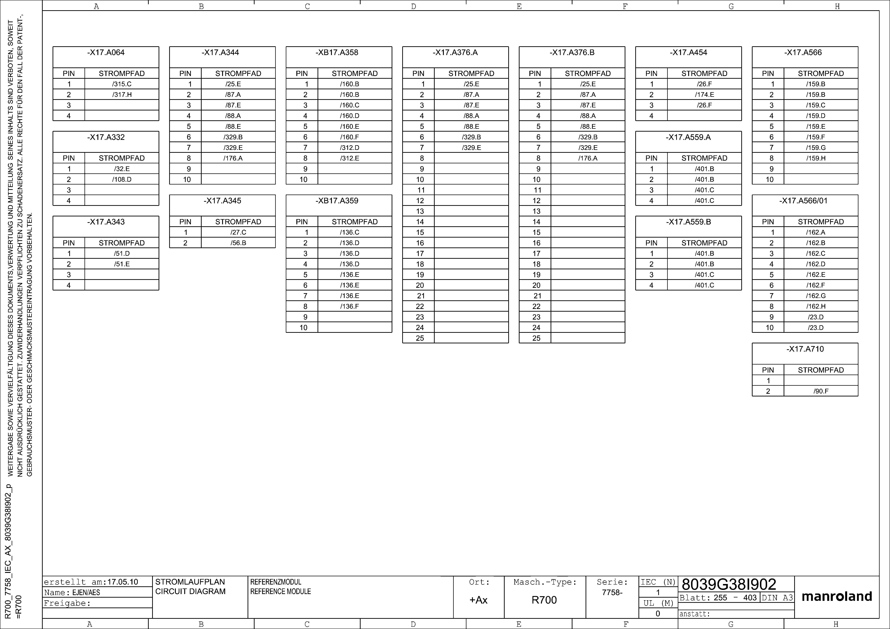

# +Ax — Sheet 255 of 403 — REFERENZMODUL

**REFERENCE MODULE**

> Part of the manroland **R700** printing press IEC/UL circuit diagrams.
> Drawing class: **Stromlaufplan / Circuit diagram** (DIN A3).
> Document `+Ax` covers the **Central control console** machine section.

## At a glance

| Field | Value |
|---|---|
| Document | `+Ax`  (8039G38I902) |
| Sheet | **255** of 403 |
| Section (DE) | REFERENZMODUL |
| Section (EN) | REFERENCE MODULE |
| Section type | REFERENCE_MODULE — Reference module |
| Machine type | `R700` |
| Series | `7758` |
| Created | 17.05.10 |
| Replaces | — |
| Columns used | A, B, C, D, E, F, G, H |
| Path numbers | — |
| Labels on sheet | 250 |
| Cross-refs out | 77 |
| Cross-refs in | 0 |

**Previous:** [+Ax sheet 254](SHEET_0254.md) · **Next:** [+Ax sheet 256](SHEET_0256.md) · **Document TOC:** [_TOC.md](_TOC.md)  (+Ax) · **Master TOC:** [all sheets](../_MASTER_TOC.md)

## Sheet image (300 DPI, exact vector render)



_Rendered directly from the PDF vector layer at 300 DPI (1-bit), no OCR and no resampling. Use it to confirm anything ambiguous in the text below._

## Cross-references on this sheet

Each entry is a wire leaving this sheet. The printed token is `/sheet.column`; the link resolves to that sheet inside the same document.

| Ref | Target sheet | Col | Path | Destination on target | Target section | From col |
|---|---|---|---|---|---|---|
| `/25.E` | [+Ax sheet 25](SHEET_0025.md) | E | — | — | SPANNUNGSVERSORGUNG, SCHALTSCHRANKBELÜFTUNG | B |
| `/25.E` | [+Ax sheet 25](SHEET_0025.md) | E | — | — | SPANNUNGSVERSORGUNG, SCHALTSCHRANKBELÜFTUNG | E |
| `/25.E` | [+Ax sheet 25](SHEET_0025.md) | E | — | — | SPANNUNGSVERSORGUNG, SCHALTSCHRANKBELÜFTUNG | F |
| `/160.B` | [+Ax sheet 160](SHEET_0160.md) | B | — | — | ÜBERWACHUNGSRECHNER/ANSTEUERUNG NOT AUS | C |
| `/26.F` | [+Ax sheet 26](SHEET_0026.md) | F | — | — | SPANNUNGSVERSORGUNG, SCHALTSCHRANKBELÜFTUNG | G |
| `/159.B` | [+Ax sheet 159](SHEET_0159.md) | B | — | — | ÜBERWACHUNGSRECHNER/ANSTEUERUNG NOT AUS | H |
| `/315.C` | [+Ax sheet 315](SHEET_0315.md) | C | — | — | OPTION: "EJEKTOR" ANLAGE / SELECT AIRSTATION / | A |
| `/87.A` | [+Ax sheet 87](SHEET_0087.md) | A | — | — | ANLEGER | B |
| `/87.A` | [+Ax sheet 87](SHEET_0087.md) | A | — | — | ANLEGER | E |
| `/87.A` | [+Ax sheet 87](SHEET_0087.md) | A | — | — | ANLEGER | F |
| `/160.B` | [+Ax sheet 160](SHEET_0160.md) | B | — | — | ÜBERWACHUNGSRECHNER/ANSTEUERUNG NOT AUS | C |
| `/174.E` | [+Ax sheet 174](SHEET_0174.md) | E | — | — | RESERVE | G |
| `/159.B` | [+Ax sheet 159](SHEET_0159.md) | B | — | — | ÜBERWACHUNGSRECHNER/ANSTEUERUNG NOT AUS | H |
| `/317.H` | [+Ax sheet 317](SHEET_0317.md) | H | — | — | OPTION: "EJEKTOR" ANLAGE / SELECT AIRSTATION / | A |
| `/87.E` | [+Ax sheet 87](SHEET_0087.md) | E | — | — | ANLEGER | B |
| `/87.E` | [+Ax sheet 87](SHEET_0087.md) | E | — | — | ANLEGER | E |
| `/87.E` | [+Ax sheet 87](SHEET_0087.md) | E | — | — | ANLEGER | F |
| `/26.F` | [+Ax sheet 26](SHEET_0026.md) | F | — | — | SPANNUNGSVERSORGUNG, SCHALTSCHRANKBELÜFTUNG | G |
| `/160.C` | [+Ax sheet 160](SHEET_0160.md) | C | — | — | ÜBERWACHUNGSRECHNER/ANSTEUERUNG NOT AUS | C |
| `/159.C` | [+Ax sheet 159](SHEET_0159.md) | C | — | — | ÜBERWACHUNGSRECHNER/ANSTEUERUNG NOT AUS | H |
| `/88.A` | [+Ax sheet 88](SHEET_0088.md) | A | — | — | ANLEGER | B |
| `/88.A` | [+Ax sheet 88](SHEET_0088.md) | A | — | — | ANLEGER | E |
| `/88.A` | [+Ax sheet 88](SHEET_0088.md) | A | — | — | ANLEGER | F |
| `/160.D` | [+Ax sheet 160](SHEET_0160.md) | D | — | — | ÜBERWACHUNGSRECHNER/ANSTEUERUNG NOT AUS | C |
| `/159.D` | [+Ax sheet 159](SHEET_0159.md) | D | — | — | ÜBERWACHUNGSRECHNER/ANSTEUERUNG NOT AUS | H |
| `/88.E` | [+Ax sheet 88](SHEET_0088.md) | E | — | — | ANLEGER | B |
| `/88.E` | [+Ax sheet 88](SHEET_0088.md) | E | — | — | ANLEGER | E |
| `/88.E` | [+Ax sheet 88](SHEET_0088.md) | E | — | — | ANLEGER | F |
| `/160.E` | [+Ax sheet 160](SHEET_0160.md) | E | — | — | ÜBERWACHUNGSRECHNER/ANSTEUERUNG NOT AUS | C |
| `/159.E` | [+Ax sheet 159](SHEET_0159.md) | E | — | — | ÜBERWACHUNGSRECHNER/ANSTEUERUNG NOT AUS | H |
| `/329.B` | [+Ax sheet 329](SHEET_0329.md) | B | — | — | OPTION: NONSTOP EINRICHTUNG MANUELL, ANLEGER | B |
| `/329.B` | [+Ax sheet 329](SHEET_0329.md) | B | — | — | OPTION: NONSTOP EINRICHTUNG MANUELL, ANLEGER | E |
| `/329.B` | [+Ax sheet 329](SHEET_0329.md) | B | — | — | OPTION: NONSTOP EINRICHTUNG MANUELL, ANLEGER | F |
| `/160.F` | [+Ax sheet 160](SHEET_0160.md) | F | — | — | ÜBERWACHUNGSRECHNER/ANSTEUERUNG NOT AUS | C |
| `/159.F` | [+Ax sheet 159](SHEET_0159.md) | F | — | — | ÜBERWACHUNGSRECHNER/ANSTEUERUNG NOT AUS | H |
| `/329.E` | [+Ax sheet 329](SHEET_0329.md) | E | — | — | OPTION: NONSTOP EINRICHTUNG MANUELL, ANLEGER | B |
| `/329.E` | [+Ax sheet 329](SHEET_0329.md) | E | — | — | OPTION: NONSTOP EINRICHTUNG MANUELL, ANLEGER | E |
| `/329.E` | [+Ax sheet 329](SHEET_0329.md) | E | — | — | OPTION: NONSTOP EINRICHTUNG MANUELL, ANLEGER | F |
| `/159.G` | [+Ax sheet 159](SHEET_0159.md) | G | — | — | ÜBERWACHUNGSRECHNER/ANSTEUERUNG NOT AUS | H |
| `/312.D` | [+Ax sheet 312](SHEET_0312.md) | D | — | — | OPTION: IR/UV ZWISCHENTROCKNER | C |
| `/176.A` | [+Ax sheet 176](SHEET_0176.md) | A | — | — | RESERVE | B |
| `/312.E` | [+Ax sheet 312](SHEET_0312.md) | E | — | — | OPTION: IR/UV ZWISCHENTROCKNER | C |
| `/176.A` | [+Ax sheet 176](SHEET_0176.md) | A | — | — | RESERVE | F |
| `/159.H` | [+Ax sheet 159](SHEET_0159.md) | H | — | — | ÜBERWACHUNGSRECHNER/ANSTEUERUNG NOT AUS | H |
| `/32.E` | [+Ax sheet 32](SHEET_0032.md) | E | — | — | SPANNUNGSVERSORGUNG, SCHALTSCHRANKBELÜFTUNG | A |
| `/401.B` | [+Ax sheet 401](SHEET_0401.md) | B | — | — | OPTION: INLINE COLORPILOT | G |
| `/401.B` | [+Ax sheet 401](SHEET_0401.md) | B | — | — | OPTION: INLINE COLORPILOT | G |
| `/108.D` | [+Ax sheet 108](SHEET_0108.md) | D | — | — | ANLEGER | A |
| `/401.C` | [+Ax sheet 401](SHEET_0401.md) | C | — | — | OPTION: INLINE COLORPILOT | G |
| `/401.C` | [+Ax sheet 401](SHEET_0401.md) | C | — | — | OPTION: INLINE COLORPILOT | G |
| `/162.A` | [+Ax sheet 162](SHEET_0162.md) | A | — | — | ÜBERWACHUNGSRECHNER/ANSTEUERUNG NOT AUS | H |
| `/27.C` | [+Ax sheet 27](SHEET_0027.md) | C | — | — | SPANNUNGSVERSORGUNG, SCHALTSCHRANKBELÜFTUNG | B |
| `/136.C` | [+Ax sheet 136](SHEET_0136.md) | C | — | — | REALTIMERECHNER ANSTEUERUNG DER SPS POWERKARTE | C |
| `/56.B` | [+Ax sheet 56](SHEET_0056.md) | B | — | — | LUFTVERSORGUNG | B |
| `/162.B` | [+Ax sheet 162](SHEET_0162.md) | B | — | — | ÜBERWACHUNGSRECHNER/ANSTEUERUNG NOT AUS | H |
| `/136.D` | [+Ax sheet 136](SHEET_0136.md) | D | — | — | REALTIMERECHNER ANSTEUERUNG DER SPS POWERKARTE | C |
| `/401.B` | [+Ax sheet 401](SHEET_0401.md) | B | — | — | OPTION: INLINE COLORPILOT | G |
| `/51.D` | [+Ax sheet 51](SHEET_0051.md) | D | — | — | SIGNALGEBER: AKUSTISCHE WARNSIGNALE | A |
| `/136.D` | [+Ax sheet 136](SHEET_0136.md) | D | — | — | REALTIMERECHNER ANSTEUERUNG DER SPS POWERKARTE | C |
| `/162.C` | [+Ax sheet 162](SHEET_0162.md) | C | — | — | ÜBERWACHUNGSRECHNER/ANSTEUERUNG NOT AUS | H |
| `/51.E` | [+Ax sheet 51](SHEET_0051.md) | E | — | — | SIGNALGEBER: AKUSTISCHE WARNSIGNALE | A |
| `/401.B` | [+Ax sheet 401](SHEET_0401.md) | B | — | — | OPTION: INLINE COLORPILOT | G |
| `/136.D` | [+Ax sheet 136](SHEET_0136.md) | D | — | — | REALTIMERECHNER ANSTEUERUNG DER SPS POWERKARTE | C |
| `/162.D` | [+Ax sheet 162](SHEET_0162.md) | D | — | — | ÜBERWACHUNGSRECHNER/ANSTEUERUNG NOT AUS | H |
| `/136.E` | [+Ax sheet 136](SHEET_0136.md) | E | — | — | REALTIMERECHNER ANSTEUERUNG DER SPS POWERKARTE | C |
| `/162.E` | [+Ax sheet 162](SHEET_0162.md) | E | — | — | ÜBERWACHUNGSRECHNER/ANSTEUERUNG NOT AUS | H |
| `/401.C` | [+Ax sheet 401](SHEET_0401.md) | C | — | — | OPTION: INLINE COLORPILOT | G |
| `/136.E` | [+Ax sheet 136](SHEET_0136.md) | E | — | — | REALTIMERECHNER ANSTEUERUNG DER SPS POWERKARTE | C |
| `/162.F` | [+Ax sheet 162](SHEET_0162.md) | F | — | — | ÜBERWACHUNGSRECHNER/ANSTEUERUNG NOT AUS | H |
| `/401.C` | [+Ax sheet 401](SHEET_0401.md) | C | — | — | OPTION: INLINE COLORPILOT | G |
| `/136.E` | [+Ax sheet 136](SHEET_0136.md) | E | — | — | REALTIMERECHNER ANSTEUERUNG DER SPS POWERKARTE | C |
| `/162.G` | [+Ax sheet 162](SHEET_0162.md) | G | — | — | ÜBERWACHUNGSRECHNER/ANSTEUERUNG NOT AUS | H |
| `/136.F` | [+Ax sheet 136](SHEET_0136.md) | F | — | — | REALTIMERECHNER ANSTEUERUNG DER SPS POWERKARTE | C |
| `/162.H` | [+Ax sheet 162](SHEET_0162.md) | H | — | — | ÜBERWACHUNGSRECHNER/ANSTEUERUNG NOT AUS | H |
| `/23.D` | [+Ax sheet 23](SHEET_0023.md) | D | — | — | SPANNUNGSVERSORGUNG, SCHALTSCHRANKBELÜFTUNG | H |
| `/23.D` | [+Ax sheet 23](SHEET_0023.md) | D | — | — | SPANNUNGSVERSORGUNG, SCHALTSCHRANKBELÜFTUNG | H |
| `/90.F` | [+Ax sheet 90](SHEET_0090.md) | F | — | — | ANLEGER | H |

## Devices on this sheet

| Tag | Class | Class meaning (IEC) | Col | Sub | Terminal | Sign |
|---|---|---|---|---|---|---|
| `X17.A064` | — | cross-device reference | A | — | — | — |
| `X17.A332` | — | cross-device reference | A | — | — | — |
| `X17.A344` | — | cross-device reference | B | — | — | — |
| `X17.A345` | — | cross-device reference | B | — | — | — |
| `X17.A343` | — | cross-device reference | A | — | — | — |
| `XB17.A358` | — | cross-device reference | C | — | — | — |
| `XB17.A359` | — | cross-device reference | C | — | — | — |
| `X17.A376.A` | — | cross-device reference | D | — | — | — |
| `X17.A376.B` | — | cross-device reference | F | — | — | — |
| `X17.A454` | — | cross-device reference | G | — | — | — |
| `X17.A566` | — | cross-device reference | H | — | — | — |
| `X17.A710` | — | cross-device reference | H | — | — | — |
| `X17.A559.A` | — | cross-device reference | G | — | — | — |
| `X17.A559.B` | — | cross-device reference | G | — | — | — |

## Potentials / nets

_No named potentials on this sheet._

## Wire-end annotations (grouped as printed)

A wire that continues elsewhere is annotated with a small cluster: the destination description, the path/line number `#NN`, and the `/sheet.column` cross reference. Each row below is one such cluster exactly as it is grouped on the drawing.

| Col | Y | Path | Cross-ref | Text on the wire |
|---|---|---|---|---|
| A | 65.5 | — | — | `X17.A064` |
| B | 65.5 | — | — | `X17.A344` |
| C | 65.5 | — | — | `XB17.A358` |
| D | 65.5 | — | — | `X17.A376.A` |
| F | 65.5 | — | — | `X17.A376.B` |
| G | 65.5 | — | — | `X17.A454` |
| H | 65.5 | — | — | `X17.A566` |
| A | 94.2 | — | — | `PIN 2 3 4 1 STROMPFAD` |
| B | 94.2 | — | — | `PIN 10 2 3 4 5 6 7 8 9 1 STROMPFAD` |
| C | 94.2 | — | — | `PIN 10 2 3 4 5 6 7 8 9 1 STROMPFAD` |
| D | 94.2 | — | — | `PIN STROMPFAD` |
| E | 94.2 | — | — | `PIN STROMPFAD` |
| G | 94.2 | — | — | `PIN 2 3 4 1 STROMPFAD` |
| H | 94.2 | — | — | `PIN 10 2 3 4 5 6 7 8 9 1 STROMPFAD` |
| D | 108.4 | — | — | `2 3 4 5 6 7 8 9 1` |
| E | 108.4 | — | — | `2 3 4 5 6 7 8 9 1` |
| A | 108.7 | — | `/315.C` | — |
| B | 108.7 | — | `/25.E` | — |
| C | 108.7 | — | `/160.B` | — |
| E | 108.7 | — | `/25.E` | — |
| F | 108.7 | — | `/25.E` | — |
| G | 108.7 | — | `/26.F` | — |
| H | 108.7 | — | `/159.B` | — |
| B | 122.8 | — | `/87.A` | — |
| E | 122.8 | — | `/87.A` | — |
| F | 122.8 | — | `/87.A` | — |
| A | 122.9 | — | `/317.H` | — |
| C | 122.9 | — | `/160.B` | — |
| G | 122.9 | — | `/174.E` | — |
| H | 122.9 | — | `/159.B` | — |
| B | 137.0 | — | `/87.E` | — |
| E | 137.0 | — | `/87.E` | — |
| F | 137.0 | — | `/87.E` | — |
| G | 137.0 | — | `/26.F` | — |
| C | 137.1 | — | `/160.C` | — |
| H | 137.1 | — | `/159.C` | — |
| B | 151.2 | — | `/88.A` | — |
| C | 151.2 | — | `/160.D` | — |
| E | 151.2 | — | `/88.A` | — |
| F | 151.2 | — | `/88.A` | — |
| H | 151.2 | — | `/159.D` | — |
| B | 165.4 | — | `/88.E` | — |
| C | 165.4 | — | `/160.E` | — |
| E | 165.4 | — | `/88.E` | — |
| F | 165.4 | — | `/88.E` | — |
| H | 165.4 | — | `/159.E` | — |
| A | 178.9 | — | — | `X17.A332` |
| G | 178.9 | — | — | `X17.A559.A` |
| B | 179.6 | — | `/329.B` | — |
| C | 179.6 | — | `/160.F` | — |
| E | 179.6 | — | `/329.B` | — |
| F | 179.6 | — | `/329.B` | — |
| H | 179.6 | — | `/159.F` | — |
| B | 193.7 | — | `/329.E` | — |
| E | 193.7 | — | `/329.E` | — |
| F | 193.7 | — | `/329.E` | — |
| H | 193.7 | — | `/159.G` | — |
| C | 193.8 | — | `/312.D` | — |
| A | 207.5 | — | — | `PIN 2 3 4 1 STROMPFAD` |
| G | 207.5 | — | — | `PIN 2 3 4 1 STROMPFAD` |
| B | 207.9 | — | `/176.A` | — |
| C | 207.9 | — | `/312.E` | — |
| F | 207.9 | — | `/176.A` | — |
| H | 207.9 | — | `/159.H` | — |
| A | 222.1 | — | `/32.E` | — |
| G | 222.1 | — | `/401.B` | — |
| D | 235.9 | — | — | `10 12 13 14 15 16 17 18 19 20 11` |
| E | 235.9 | — | — | `10 12 13 14 15 16 17 18 19 20 11` |
| G | 236.2 | — | `/401.B` | — |
| A | 236.3 | — | `/108.D` | — |
| G | 250.4 | — | `/401.C` | — |
| B | 263.9 | — | — | `X17.A345` |
| C | 263.9 | — | — | `XB17.A359` |
| H | 263.9 | — | — | `X17.A566/01` |
| G | 264.6 | — | `/401.C` | — |
| A | 292.3 | — | — | `X17.A343` |
| G | 292.3 | — | — | `X17.A559.B` |
| B | 292.6 | — | — | `PIN 2 1 STROMPFAD` |
| C | 292.6 | — | — | `PIN 10 2 3 4 5 6 7 8 9 1 STROMPFAD` |
| H | 292.6 | — | — | `PIN 10 2 3 4 5 6 7 8 9 1 STROMPFAD` |
| B | 307.1 | — | `/27.C` | — |
| C | 307.1 | — | `/136.C` | — |
| H | 307.1 | — | `/162.A` | — |
| A | 320.9 | — | — | `PIN 2 3 4 1 STROMPFAD` |
| G | 320.9 | — | — | `PIN 2 3 4 1 STROMPFAD` |
| B | 321.3 | — | `/56.B` | — |
| C | 321.3 | — | `/136.D` | — |
| H | 321.3 | — | `/162.B` | — |
| A | 335.5 | — | `/51.D` | — |
| C | 335.5 | — | `/136.D` | — |
| G | 335.5 | — | `/401.B` | — |
| H | 335.5 | — | `/162.C` | — |
| A | 349.6 | — | `/51.E` | — |
| G | 349.6 | — | `/401.B` | — |
| C | 349.7 | — | `/136.D` | — |
| H | 349.7 | — | `/162.D` | — |
| C | 363.8 | — | `/136.E` | — |
| G | 363.8 | — | `/401.C` | — |
| H | 363.8 | — | `/162.E` | — |
| C | 378.0 | — | `/136.E` | — |
| G | 378.0 | — | `/401.C` | — |
| H | 378.0 | — | `/162.F` | — |
| D | 391.8 | — | — | `22 23 24 25 21` |
| E | 391.8 | — | — | `22 23 24 25 21` |
| C | 392.1 | — | `/136.E` | — |
| H | 392.2 | — | `/162.G` | — |
| C | 406.3 | — | `/136.F` | — |
| H | 406.4 | — | `/162.H` | — |
| H | 420.5 | — | `/23.D` | — |
| H | 434.7 | — | `/23.D` | — |
| H | 462.4 | — | — | `X17.A710` |
| H | 491.0 | — | — | `PIN 2 1 STROMPFAD` |
| H | 519.7 | — | `/90.F` | — |


## Reconstructed tables

This sheet carries tabular content (pin map / terminal assignment / index). The grid below was rebuilt from the drawing's own rule lines, so each row is exactly one physical row of the table.

### Table 1 — 16 data rows × 2 columns (at x=70.9, y=62.4) — **X17.A064**

| PIN | STROMPFAD |
|---|---|
| `1` | `/315.C` |
| `2` | `/317.H` |
| `3` |  |
| `4` |  |
|  | `X17.A332` |
| `PIN` | `STROMPFAD` |
| `1` | `/32.E` |
| `2` | `/108.D` |
| `3` |  |
| `4` |  |
|  | `X17.A343` |
| `PIN` | `STROMPFAD` |
| `1` | `/51.D` |
| `2` | `/51.E` |
| `3` |  |
| `4` |  |


### Table 2 — 14 data rows × 2 columns (at x=226.8, y=62.4) — **X17.A344**

| PIN | STROMPFAD |
|---|---|
| `1` | `/25.E` |
| `2` | `/87.A` |
| `3` | `/87.E` |
| `4` | `/88.A` |
| `5` | `/88.E` |
| `6` | `/329.B` |
| `7` | `/329.E` |
| `8` | `/176.A` |
| `9` |  |
| `10` |  |
|  | `X17.A345` |
| `PIN` | `STROMPFAD` |
| `1` | `/27.C` |
| `2` | `/56.B` |


### Table 3 — 22 data rows × 2 columns (at x=382.7, y=62.4) — **XB17.A358**

| PIN | STROMPFAD |
|---|---|
| `1` | `/160.B` |
| `2` | `/160.B` |
| `3` | `/160.C` |
| `4` | `/160.D` |
| `5` | `/160.E` |
| `6` | `/160.F` |
| `7` | `/312.D` |
| `8` | `/312.E` |
| `9` |  |
| `10` |  |
|  | `XB17.A359` |
| `PIN` | `STROMPFAD` |
| `1` | `/136.C` |
| `2` | `/136.D` |
| `3` | `/136.D` |
| `4` | `/136.D` |
| `5` | `/136.E` |
| `6` | `/136.E` |
| `7` | `/136.E` |
| `8` | `/136.F` |
| `9` |  |
| `10` |  |


### Table 4 — 25 data rows × 2 columns (at x=538.6, y=62.4) — **X17.A376.A**

| PIN | STROMPFAD |
|---|---|
| `1` | `/25.E` |
| `2` | `/87.A` |
| `3` | `/87.E` |
| `4` | `/88.A` |
| `5` | `/88.E` |
| `6` | `/329.B` |
| `7` | `/329.E` |
| `8` |  |
| `9` |  |
| `10` |  |
| `11` |  |
| `12` |  |
| `13` |  |
| `14` |  |
| `15` |  |
| `16` |  |
| `17` |  |
| `18` |  |
| `19` |  |
| `20` |  |
| `21` |  |
| `22` |  |
| `23` |  |
| `24` |  |
| `25` |  |


### Table 5 — 25 data rows × 2 columns (at x=694.5, y=62.4) — **X17.A376.B**

| PIN | STROMPFAD |
|---|---|
| `1` | `/25.E` |
| `2` | `/87.A` |
| `3` | `/87.E` |
| `4` | `/88.A` |
| `5` | `/88.E` |
| `6` | `/329.B` |
| `7` | `/329.E` |
| `8` | `/176.A` |
| `9` |  |
| `10` |  |
| `11` |  |
| `12` |  |
| `13` |  |
| `14` |  |
| `15` |  |
| `16` |  |
| `17` |  |
| `18` |  |
| `19` |  |
| `20` |  |
| `21` |  |
| `22` |  |
| `23` |  |
| `24` |  |
| `25` |  |


### Table 6 — 16 data rows × 2 columns (at x=850.4, y=62.4) — **X17.A454**

| PIN | STROMPFAD |
|---|---|
| `1` | `/26.F` |
| `2` | `/174.E` |
| `3` | `/26.F` |
| `4` |  |
|  | `X17.A559.A` |
| `PIN` | `STROMPFAD` |
| `1` | `/401.B` |
| `2` | `/401.B` |
| `3` | `/401.C` |
| `4` | `/401.C` |
|  | `X17.A559.B` |
| `PIN` | `STROMPFAD` |
| `1` | `/401.B` |
| `2` | `/401.B` |
| `3` | `/401.C` |
| `4` | `/401.C` |


### Table 7 — 26 data rows × 2 columns (at x=1006.3, y=62.4) — **X17.A566**

| PIN | STROMPFAD |
|---|---|
| `1` | `/159.B` |
| `2` | `/159.B` |
| `3` | `/159.C` |
| `4` | `/159.D` |
| `5` | `/159.E` |
| `6` | `/159.F` |
| `7` | `/159.G` |
| `8` | `/159.H` |
| `9` |  |
| `10` |  |
|  | `X17.A566/01` |
| `PIN` | `STROMPFAD` |
| `1` | `/162.A` |
| `2` | `/162.B` |
| `3` | `/162.C` |
| `4` | `/162.D` |
| `5` | `/162.E` |
| `6` | `/162.F` |
| `7` | `/162.G` |
| `8` | `/162.H` |
| `9` | `/23.D` |
| `10` | `/23.D` |
|  | `X17.A710` |
| `PIN` | `STROMPFAD` |
| `1` |  |
| `2` | `/90.F` |


## Notes and free text on this sheet

| Text | Col | Y (pt) |
|---|---|---|
| `PIN` | A | 94.2 |
| `STROMPFAD` | A | 94.15 |
| `PIN` | B | 94.2 |
| `STROMPFAD` | B | 94.15 |
| `PIN` | C | 94.2 |
| `STROMPFAD` | C | 94.15 |
| `PIN` | D | 94.2 |
| `STROMPFAD` | E | 94.15 |
| `PIN` | E | 94.2 |
| `STROMPFAD` | F | 94.15 |
| `PIN` | F | 94.2 |
| `STROMPFAD` | G | 94.15 |
| `PIN` | G | 94.2 |
| `STROMPFAD` | H | 94.15 |
| `X17.A566/01` | H | 263.93 |

## Complete label inventory (exact text from the drawing)

Every text object inside the drawing area of this sheet, in DIN reading order (column A→H, then top→bottom). This is the authoritative list: if a string is not here it is not printed on this sheet.

| Col | Y | X | Dir | Type | Text |
|---|---|---|---|---|---|
| A | 65.5 | 116.8 | → | device ref | `X17.A064` |
| A | 94.2 | 84.0 | → | text | `PIN` |
| A | 94.2 | 132.2 | → | text | `STROMPFAD` |
| A | 108.4 | 90.0 | → | number | `1` |
| A | 108.7 | 150.2 | → | cross-reference | `/315.C` |
| A | 122.5 | 89.4 | → | number | `2` |
| A | 122.9 | 150.5 | → | cross-reference | `/317.H` |
| A | 136.7 | 89.4 | → | number | `3` |
| A | 150.9 | 89.4 | → | number | `4` |
| A | 178.9 | 116.8 | → | device ref | `X17.A332` |
| A | 207.5 | 132.2 | → | text | `STROMPFAD` |
| A | 207.6 | 84.0 | → | text | `PIN` |
| A | 221.8 | 90.0 | → | number | `1` |
| A | 222.1 | 152.9 | → | cross-reference | `/32.E` |
| A | 235.9 | 89.4 | → | number | `2` |
| A | 236.3 | 150.2 | → | cross-reference | `/108.D` |
| A | 250.1 | 89.4 | → | number | `3` |
| A | 264.3 | 89.4 | → | number | `4` |
| A | 292.3 | 116.8 | → | device ref | `X17.A343` |
| A | 320.9 | 132.2 | → | text | `STROMPFAD` |
| A | 321.0 | 84.0 | → | text | `PIN` |
| A | 335.1 | 90.0 | → | number | `1` |
| A | 335.5 | 152.6 | → | cross-reference | `/51.D` |
| A | 349.3 | 89.4 | → | number | `2` |
| A | 349.6 | 152.9 | → | cross-reference | `/51.E` |
| A | 363.5 | 89.4 | → | number | `3` |
| A | 377.7 | 89.4 | → | number | `4` |
| B | 65.5 | 269.9 | → | device ref | `X17.A344` |
| B | 94.2 | 240.0 | → | text | `PIN` |
| B | 94.2 | 288.1 | → | text | `STROMPFAD` |
| B | 108.4 | 251.7 | → | number | `1` |
| B | 108.7 | 301.7 | → | cross-reference | `/25.E` |
| B | 122.5 | 250.0 | → | number | `2` |
| B | 122.8 | 301.5 | → | cross-reference | `/87.A` |
| B | 136.7 | 250.0 | → | number | `3` |
| B | 137.0 | 301.7 | → | cross-reference | `/87.E` |
| B | 150.9 | 250.0 | → | number | `4` |
| B | 151.2 | 301.5 | → | cross-reference | `/88.A` |
| B | 165.1 | 250.0 | → | number | `5` |
| B | 165.4 | 301.7 | → | cross-reference | `/88.E` |
| B | 179.2 | 250.0 | → | number | `6` |
| B | 179.6 | 299.2 | → | cross-reference | `/329.B` |
| B | 193.4 | 250.0 | → | number | `7` |
| B | 193.7 | 299.3 | → | cross-reference | `/329.E` |
| B | 207.6 | 250.0 | → | number | `8` |
| B | 207.9 | 299.1 | → | cross-reference | `/176.A` |
| B | 221.8 | 250.0 | → | number | `9` |
| B | 235.9 | 244.6 | → | number | `10` |
| B | 263.9 | 272.7 | → | device ref | `X17.A345` |
| B | 292.6 | 240.0 | → | text | `PIN` |
| B | 292.6 | 288.1 | → | text | `STROMPFAD` |
| B | 306.8 | 245.9 | → | number | `1` |
| B | 307.1 | 308.6 | → | cross-reference | `/27.C` |
| B | 321.0 | 245.3 | → | number | `2` |
| B | 321.3 | 308.7 | → | cross-reference | `/56.B` |
| C | 65.5 | 422.2 | → | device ref | `XB17.A358` |
| C | 94.2 | 395.9 | → | text | `PIN` |
| C | 94.2 | 444.0 | → | text | `STROMPFAD` |
| C | 108.4 | 407.6 | → | number | `1` |
| C | 108.7 | 455.1 | → | cross-reference | `/160.B` |
| C | 122.5 | 405.9 | → | number | `2` |
| C | 122.9 | 455.1 | → | cross-reference | `/160.B` |
| C | 136.7 | 405.9 | → | number | `3` |
| C | 137.1 | 455.0 | → | cross-reference | `/160.C` |
| C | 150.9 | 405.9 | → | number | `4` |
| C | 151.2 | 455.0 | → | cross-reference | `/160.D` |
| C | 165.1 | 405.9 | → | number | `5` |
| C | 165.4 | 455.2 | → | cross-reference | `/160.E` |
| C | 179.2 | 405.9 | → | number | `6` |
| C | 179.6 | 455.4 | → | cross-reference | `/160.F` |
| C | 193.4 | 405.9 | → | number | `7` |
| C | 193.8 | 455.0 | → | cross-reference | `/312.D` |
| C | 207.6 | 405.9 | → | number | `8` |
| C | 207.9 | 455.2 | → | cross-reference | `/312.E` |
| C | 221.8 | 405.9 | → | number | `9` |
| C | 235.9 | 400.5 | → | number | `10` |
| C | 263.9 | 422.2 | → | device ref | `XB17.A359` |
| C | 292.6 | 395.9 | → | text | `PIN` |
| C | 292.6 | 444.0 | → | text | `STROMPFAD` |
| C | 306.8 | 407.6 | → | number | `1` |
| C | 307.1 | 455.0 | → | cross-reference | `/136.C` |
| C | 321.0 | 405.9 | → | number | `2` |
| C | 321.3 | 455.0 | → | cross-reference | `/136.D` |
| C | 335.1 | 405.9 | → | number | `3` |
| C | 335.5 | 455.0 | → | cross-reference | `/136.D` |
| C | 349.3 | 405.9 | → | number | `4` |
| C | 349.7 | 455.0 | → | cross-reference | `/136.D` |
| C | 363.5 | 405.9 | → | number | `5` |
| C | 363.8 | 455.2 | → | cross-reference | `/136.E` |
| C | 377.7 | 405.9 | → | number | `6` |
| C | 378.0 | 455.2 | → | cross-reference | `/136.E` |
| C | 391.8 | 405.9 | → | number | `7` |
| C | 392.2 | 455.2 | → | cross-reference | `/136.E` |
| C | 406.0 | 405.9 | → | number | `8` |
| C | 406.3 | 455.4 | → | cross-reference | `/136.F` |
| C | 420.2 | 405.9 | → | number | `9` |
| C | 434.4 | 400.5 | → | number | `10` |
| D | 65.5 | 579.1 | → | device ref | `X17.A376.A` |
| D | 94.2 | 551.8 | → | text | `PIN` |
| D | 108.4 | 563.5 | → | number | `1` |
| D | 122.5 | 561.8 | → | number | `2` |
| D | 136.7 | 561.8 | → | number | `3` |
| D | 150.9 | 561.8 | → | number | `4` |
| D | 165.1 | 561.8 | → | number | `5` |
| D | 179.2 | 561.8 | → | number | `6` |
| D | 193.4 | 561.8 | → | number | `7` |
| D | 207.6 | 561.8 | → | number | `8` |
| D | 221.8 | 561.8 | → | number | `9` |
| D | 235.9 | 556.4 | → | number | `10` |
| D | 250.1 | 558.1 | → | number | `11` |
| D | 264.3 | 556.4 | → | number | `12` |
| D | 278.5 | 556.4 | → | number | `13` |
| D | 292.6 | 556.4 | → | number | `14` |
| D | 306.8 | 556.4 | → | number | `15` |
| D | 321.0 | 556.4 | → | number | `16` |
| D | 335.1 | 556.4 | → | number | `17` |
| D | 349.3 | 556.4 | → | number | `18` |
| D | 363.5 | 556.4 | → | number | `19` |
| D | 377.7 | 556.4 | → | number | `20` |
| D | 391.8 | 558.1 | → | number | `21` |
| D | 406.0 | 556.4 | → | number | `22` |
| D | 420.2 | 556.4 | → | number | `23` |
| D | 434.4 | 556.4 | → | number | `24` |
| D | 448.5 | 556.4 | → | number | `25` |
| E | 94.2 | 600.0 | → | text | `STROMPFAD` |
| E | 94.2 | 707.7 | → | text | `PIN` |
| E | 108.4 | 719.4 | → | number | `1` |
| E | 108.7 | 620.6 | → | cross-reference | `/25.E` |
| E | 122.5 | 717.7 | → | number | `2` |
| E | 122.8 | 620.4 | → | cross-reference | `/87.A` |
| E | 136.7 | 717.7 | → | number | `3` |
| E | 137.0 | 620.6 | → | cross-reference | `/87.E` |
| E | 150.9 | 717.7 | → | number | `4` |
| E | 151.2 | 620.4 | → | cross-reference | `/88.A` |
| E | 165.1 | 717.7 | → | number | `5` |
| E | 165.4 | 620.6 | → | cross-reference | `/88.E` |
| E | 179.2 | 717.7 | → | number | `6` |
| E | 179.6 | 618.1 | → | cross-reference | `/329.B` |
| E | 193.4 | 717.7 | → | number | `7` |
| E | 193.7 | 618.2 | → | cross-reference | `/329.E` |
| E | 207.6 | 717.7 | → | number | `8` |
| E | 221.8 | 717.7 | → | number | `9` |
| E | 235.9 | 712.3 | → | number | `10` |
| E | 250.1 | 714.0 | → | number | `11` |
| E | 264.3 | 712.3 | → | number | `12` |
| E | 278.5 | 712.3 | → | number | `13` |
| E | 292.6 | 712.3 | → | number | `14` |
| E | 306.8 | 712.3 | → | number | `15` |
| E | 321.0 | 712.3 | → | number | `16` |
| E | 335.1 | 712.3 | → | number | `17` |
| E | 349.3 | 712.3 | → | number | `18` |
| E | 363.5 | 712.3 | → | number | `19` |
| E | 377.7 | 712.3 | → | number | `20` |
| E | 391.8 | 714.0 | → | number | `21` |
| E | 406.0 | 712.3 | → | number | `22` |
| E | 420.2 | 712.3 | → | number | `23` |
| E | 434.4 | 712.3 | → | number | `24` |
| E | 448.5 | 712.3 | → | number | `25` |
| F | 65.5 | 735.4 | → | device ref | `X17.A376.B` |
| F | 94.2 | 755.9 | → | text | `STROMPFAD` |
| F | 94.2 | 863.6 | → | text | `PIN` |
| F | 108.4 | 869.5 | → | number | `1` |
| F | 108.7 | 776.6 | → | cross-reference | `/25.E` |
| F | 122.5 | 869.0 | → | number | `2` |
| F | 122.8 | 776.3 | → | cross-reference | `/87.A` |
| F | 136.7 | 869.0 | → | number | `3` |
| F | 137.0 | 776.6 | → | cross-reference | `/87.E` |
| F | 150.9 | 869.0 | → | number | `4` |
| F | 151.2 | 776.3 | → | cross-reference | `/88.A` |
| F | 165.4 | 776.6 | → | cross-reference | `/88.E` |
| F | 179.6 | 774.0 | → | cross-reference | `/329.B` |
| F | 193.7 | 774.1 | → | cross-reference | `/329.E` |
| F | 207.6 | 863.6 | → | text | `PIN` |
| F | 207.9 | 773.9 | → | cross-reference | `/176.A` |
| F | 221.8 | 869.5 | → | number | `1` |
| F | 235.9 | 869.0 | → | number | `2` |
| F | 250.1 | 869.0 | → | number | `3` |
| F | 264.3 | 869.0 | → | number | `4` |
| F | 321.0 | 863.6 | → | text | `PIN` |
| F | 335.1 | 869.5 | → | number | `1` |
| F | 349.3 | 869.0 | → | number | `2` |
| F | 363.5 | 869.0 | → | number | `3` |
| F | 377.7 | 869.0 | → | number | `4` |
| G | 65.5 | 896.3 | → | device ref | `X17.A454` |
| G | 94.2 | 911.8 | → | text | `STROMPFAD` |
| G | 94.2 | 1019.5 | → | text | `PIN` |
| G | 108.4 | 1031.2 | → | number | `1` |
| G | 108.7 | 932.6 | → | cross-reference | `/26.F` |
| G | 122.5 | 1029.5 | → | number | `2` |
| G | 122.9 | 930.0 | → | cross-reference | `/174.E` |
| G | 136.7 | 1029.5 | → | number | `3` |
| G | 137.0 | 932.6 | → | cross-reference | `/26.F` |
| G | 150.9 | 1029.5 | → | number | `4` |
| G | 165.1 | 1029.5 | → | number | `5` |
| G | 178.9 | 890.9 | → | device ref | `X17.A559.A` |
| G | 179.2 | 1029.5 | → | number | `6` |
| G | 193.4 | 1029.5 | → | number | `7` |
| G | 207.5 | 911.8 | → | text | `STROMPFAD` |
| G | 207.6 | 1029.5 | → | number | `8` |
| G | 221.8 | 1029.5 | → | number | `9` |
| G | 222.1 | 929.9 | → | cross-reference | `/401.B` |
| G | 235.9 | 1024.2 | → | number | `10` |
| G | 236.2 | 929.9 | → | cross-reference | `/401.B` |
| G | 250.4 | 929.8 | → | cross-reference | `/401.C` |
| G | 264.6 | 929.8 | → | cross-reference | `/401.C` |
| G | 292.3 | 891.4 | → | device ref | `X17.A559.B` |
| G | 292.6 | 1019.5 | → | text | `PIN` |
| G | 306.8 | 1031.2 | → | number | `1` |
| G | 320.9 | 911.8 | → | text | `STROMPFAD` |
| G | 321.0 | 1029.5 | → | number | `2` |
| G | 335.1 | 1029.5 | → | number | `3` |
| G | 335.5 | 929.9 | → | cross-reference | `/401.B` |
| G | 349.3 | 1029.5 | → | number | `4` |
| G | 349.6 | 929.9 | → | cross-reference | `/401.B` |
| G | 363.5 | 1029.5 | → | number | `5` |
| G | 363.8 | 929.8 | → | cross-reference | `/401.C` |
| G | 377.7 | 1029.5 | → | number | `6` |
| G | 378.0 | 929.8 | → | cross-reference | `/401.C` |
| G | 391.8 | 1029.5 | → | number | `7` |
| G | 406.0 | 1029.5 | → | number | `8` |
| G | 420.2 | 1029.5 | → | number | `9` |
| G | 434.4 | 1024.2 | → | number | `10` |
| G | 491.0 | 1019.5 | → | text | `PIN` |
| G | 505.2 | 1025.4 | → | number | `1` |
| G | 519.4 | 1024.9 | → | number | `2` |
| H | 65.5 | 1049.4 | → | device ref | `X17.A566` |
| H | 94.2 | 1067.7 | → | text | `STROMPFAD` |
| H | 108.7 | 1078.7 | → | cross-reference | `/159.B` |
| H | 122.9 | 1078.7 | → | cross-reference | `/159.B` |
| H | 137.1 | 1078.6 | → | cross-reference | `/159.C` |
| H | 151.2 | 1078.6 | → | cross-reference | `/159.D` |
| H | 165.4 | 1078.9 | → | cross-reference | `/159.E` |
| H | 179.6 | 1079.0 | → | cross-reference | `/159.F` |
| H | 193.7 | 1078.4 | → | cross-reference | `/159.G` |
| H | 207.9 | 1078.9 | → | cross-reference | `/159.H` |
| H | 263.9 | 1042.7 | → | text | `X17.A566/01` |
| H | 292.6 | 1067.7 | → | text | `STROMPFAD` |
| H | 307.1 | 1078.6 | → | cross-reference | `/162.A` |
| H | 321.3 | 1078.7 | → | cross-reference | `/162.B` |
| H | 335.5 | 1078.6 | → | cross-reference | `/162.C` |
| H | 349.7 | 1078.6 | → | cross-reference | `/162.D` |
| H | 363.8 | 1078.9 | → | cross-reference | `/162.E` |
| H | 378.0 | 1079.0 | → | cross-reference | `/162.F` |
| H | 392.2 | 1078.4 | → | cross-reference | `/162.G` |
| H | 406.4 | 1078.9 | → | cross-reference | `/162.H` |
| H | 420.5 | 1081.0 | → | cross-reference | `/23.D` |
| H | 434.7 | 1081.0 | → | cross-reference | `/23.D` |
| H | 462.4 | 1052.2 | → | device ref | `X17.A710` |
| H | 491.0 | 1067.7 | → | text | `STROMPFAD` |
| H | 519.7 | 1088.5 | → | cross-reference | `/90.F` |

## Reading-order text block

The same content as a plain block, grouped by DIN column — convenient to paste or to match against a visual description.

```text
=== Column A ===
  65.5  116.8  devref       X17.A064
  94.2   84.0  text         PIN
  94.2  132.2  text         STROMPFAD
 108.4   90.0  numeric      1
 108.7  150.2  xref         /315.C
 122.5   89.4  numeric      2
 122.9  150.5  xref         /317.H
 136.7   89.4  numeric      3
 150.9   89.4  numeric      4
 178.9  116.8  devref       X17.A332
 207.5  132.2  text         STROMPFAD
 207.6   84.0  text         PIN
 221.8   90.0  numeric      1
 222.1  152.9  xref         /32.E
 235.9   89.4  numeric      2
 236.3  150.2  xref         /108.D
 250.1   89.4  numeric      3
 264.3   89.4  numeric      4
 292.3  116.8  devref       X17.A343
 320.9  132.2  text         STROMPFAD
 321.0   84.0  text         PIN
 335.1   90.0  numeric      1
 335.5  152.6  xref         /51.D
 349.3   89.4  numeric      2
 349.6  152.9  xref         /51.E
 363.5   89.4  numeric      3
 377.7   89.4  numeric      4
=== Column B ===
  65.5  269.9  devref       X17.A344
  94.2  240.0  text         PIN
  94.2  288.1  text         STROMPFAD
 108.4  251.7  numeric      1
 108.7  301.7  xref         /25.E
 122.5  250.0  numeric      2
 122.8  301.5  xref         /87.A
 136.7  250.0  numeric      3
 137.0  301.7  xref         /87.E
 150.9  250.0  numeric      4
 151.2  301.5  xref         /88.A
 165.1  250.0  numeric      5
 165.4  301.7  xref         /88.E
 179.2  250.0  numeric      6
 179.6  299.2  xref         /329.B
 193.4  250.0  numeric      7
 193.7  299.3  xref         /329.E
 207.6  250.0  numeric      8
 207.9  299.1  xref         /176.A
 221.8  250.0  numeric      9
 235.9  244.6  numeric      10
 263.9  272.7  devref       X17.A345
 292.6  240.0  text         PIN
 292.6  288.1  text         STROMPFAD
 306.8  245.9  numeric      1
 307.1  308.6  xref         /27.C
 321.0  245.3  numeric      2
 321.3  308.7  xref         /56.B
=== Column C ===
  65.5  422.2  devref       XB17.A358
  94.2  395.9  text         PIN
  94.2  444.0  text         STROMPFAD
 108.4  407.6  numeric      1
 108.7  455.1  xref         /160.B
 122.5  405.9  numeric      2
 122.9  455.1  xref         /160.B
 136.7  405.9  numeric      3
 137.1  455.0  xref         /160.C
 150.9  405.9  numeric      4
 151.2  455.0  xref         /160.D
 165.1  405.9  numeric      5
 165.4  455.2  xref         /160.E
 179.2  405.9  numeric      6
 179.6  455.4  xref         /160.F
 193.4  405.9  numeric      7
 193.8  455.0  xref         /312.D
 207.6  405.9  numeric      8
 207.9  455.2  xref         /312.E
 221.8  405.9  numeric      9
 235.9  400.5  numeric      10
 263.9  422.2  devref       XB17.A359
 292.6  395.9  text         PIN
 292.6  444.0  text         STROMPFAD
 306.8  407.6  numeric      1
 307.1  455.0  xref         /136.C
 321.0  405.9  numeric      2
 321.3  455.0  xref         /136.D
 335.1  405.9  numeric      3
 335.5  455.0  xref         /136.D
 349.3  405.9  numeric      4
 349.7  455.0  xref         /136.D
 363.5  405.9  numeric      5
 363.8  455.2  xref         /136.E
 377.7  405.9  numeric      6
 378.0  455.2  xref         /136.E
 391.8  405.9  numeric      7
 392.2  455.2  xref         /136.E
 406.0  405.9  numeric      8
 406.3  455.4  xref         /136.F
 420.2  405.9  numeric      9
 434.4  400.5  numeric      10
=== Column D ===
  65.5  579.1  devref       X17.A376.A
  94.2  551.8  text         PIN
 108.4  563.5  numeric      1
 122.5  561.8  numeric      2
 136.7  561.8  numeric      3
 150.9  561.8  numeric      4
 165.1  561.8  numeric      5
 179.2  561.8  numeric      6
 193.4  561.8  numeric      7
 207.6  561.8  numeric      8
 221.8  561.8  numeric      9
 235.9  556.4  numeric      10
 250.1  558.1  numeric      11
 264.3  556.4  numeric      12
 278.5  556.4  numeric      13
 292.6  556.4  numeric      14
 306.8  556.4  numeric      15
 321.0  556.4  numeric      16
 335.1  556.4  numeric      17
 349.3  556.4  numeric      18
 363.5  556.4  numeric      19
 377.7  556.4  numeric      20
 391.8  558.1  numeric      21
 406.0  556.4  numeric      22
 420.2  556.4  numeric      23
 434.4  556.4  numeric      24
 448.5  556.4  numeric      25
=== Column E ===
  94.2  600.0  text         STROMPFAD
  94.2  707.7  text         PIN
 108.4  719.4  numeric      1
 108.7  620.6  xref         /25.E
 122.5  717.7  numeric      2
 122.8  620.4  xref         /87.A
 136.7  717.7  numeric      3
 137.0  620.6  xref         /87.E
 150.9  717.7  numeric      4
 151.2  620.4  xref         /88.A
 165.1  717.7  numeric      5
 165.4  620.6  xref         /88.E
 179.2  717.7  numeric      6
 179.6  618.1  xref         /329.B
 193.4  717.7  numeric      7
 193.7  618.2  xref         /329.E
 207.6  717.7  numeric      8
 221.8  717.7  numeric      9
 235.9  712.3  numeric      10
 250.1  714.0  numeric      11
 264.3  712.3  numeric      12
 278.5  712.3  numeric      13
 292.6  712.3  numeric      14
 306.8  712.3  numeric      15
 321.0  712.3  numeric      16
 335.1  712.3  numeric      17
 349.3  712.3  numeric      18
 363.5  712.3  numeric      19
 377.7  712.3  numeric      20
 391.8  714.0  numeric      21
 406.0  712.3  numeric      22
 420.2  712.3  numeric      23
 434.4  712.3  numeric      24
 448.5  712.3  numeric      25
=== Column F ===
  65.5  735.4  devref       X17.A376.B
  94.2  755.9  text         STROMPFAD
  94.2  863.6  text         PIN
 108.4  869.5  numeric      1
 108.7  776.6  xref         /25.E
 122.5  869.0  numeric      2
 122.8  776.3  xref         /87.A
 136.7  869.0  numeric      3
 137.0  776.6  xref         /87.E
 150.9  869.0  numeric      4
 151.2  776.3  xref         /88.A
 165.4  776.6  xref         /88.E
 179.6  774.0  xref         /329.B
 193.7  774.1  xref         /329.E
 207.6  863.6  text         PIN
 207.9  773.9  xref         /176.A
 221.8  869.5  numeric      1
 235.9  869.0  numeric      2
 250.1  869.0  numeric      3
 264.3  869.0  numeric      4
 321.0  863.6  text         PIN
 335.1  869.5  numeric      1
 349.3  869.0  numeric      2
 363.5  869.0  numeric      3
 377.7  869.0  numeric      4
=== Column G ===
  65.5  896.3  devref       X17.A454
  94.2  911.8  text         STROMPFAD
  94.2 1019.5  text         PIN
 108.4 1031.2  numeric      1
 108.7  932.6  xref         /26.F
 122.5 1029.5  numeric      2
 122.9  930.0  xref         /174.E
 136.7 1029.5  numeric      3
 137.0  932.6  xref         /26.F
 150.9 1029.5  numeric      4
 165.1 1029.5  numeric      5
 178.9  890.9  devref       X17.A559.A
 179.2 1029.5  numeric      6
 193.4 1029.5  numeric      7
 207.5  911.8  text         STROMPFAD
 207.6 1029.5  numeric      8
 221.8 1029.5  numeric      9
 222.1  929.9  xref         /401.B
 235.9 1024.2  numeric      10
 236.2  929.9  xref         /401.B
 250.4  929.8  xref         /401.C
 264.6  929.8  xref         /401.C
 292.3  891.4  devref       X17.A559.B
 292.6 1019.5  text         PIN
 306.8 1031.2  numeric      1
 320.9  911.8  text         STROMPFAD
 321.0 1029.5  numeric      2
 335.1 1029.5  numeric      3
 335.5  929.9  xref         /401.B
 349.3 1029.5  numeric      4
 349.6  929.9  xref         /401.B
 363.5 1029.5  numeric      5
 363.8  929.8  xref         /401.C
 377.7 1029.5  numeric      6
 378.0  929.8  xref         /401.C
 391.8 1029.5  numeric      7
 406.0 1029.5  numeric      8
 420.2 1029.5  numeric      9
 434.4 1024.2  numeric      10
 491.0 1019.5  text         PIN
 505.2 1025.4  numeric      1
 519.4 1024.9  numeric      2
=== Column H ===
  65.5 1049.4  devref       X17.A566
  94.2 1067.7  text         STROMPFAD
 108.7 1078.7  xref         /159.B
 122.9 1078.7  xref         /159.B
 137.1 1078.6  xref         /159.C
 151.2 1078.6  xref         /159.D
 165.4 1078.9  xref         /159.E
 179.6 1079.0  xref         /159.F
 193.7 1078.4  xref         /159.G
 207.9 1078.9  xref         /159.H
 263.9 1042.7  text         X17.A566/01
 292.6 1067.7  text         STROMPFAD
 307.1 1078.6  xref         /162.A
 321.3 1078.7  xref         /162.B
 335.5 1078.6  xref         /162.C
 349.7 1078.6  xref         /162.D
 363.8 1078.9  xref         /162.E
 378.0 1079.0  xref         /162.F
 392.2 1078.4  xref         /162.G
 406.4 1078.9  xref         /162.H
 420.5 1081.0  xref         /23.D
 434.7 1081.0  xref         /23.D
 462.4 1052.2  devref       X17.A710
 491.0 1067.7  text         STROMPFAD
 519.7 1088.5  xref         /90.F
```

---
_Generated from the PDF vector text layer; no OCR. Source: `R700_7758_IEC_AX_8039G38I902_p`, sheet 255._
