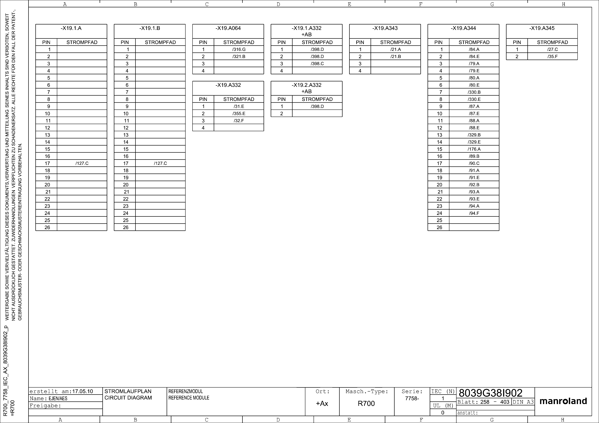

# +Ax — Sheet 258 of 403 — REFERENZMODUL

**REFERENCE MODULE**

> Part of the manroland **R700** printing press IEC/UL circuit diagrams.
> Drawing class: **Stromlaufplan / Circuit diagram** (DIN A3).
> Document `+Ax` covers the **Central control console** machine section.

## At a glance

| Field | Value |
|---|---|
| Document | `+Ax`  (8039G38I902) |
| Sheet | **258** of 403 |
| Section (DE) | REFERENZMODUL |
| Section (EN) | REFERENCE MODULE |
| Section type | REFERENCE_MODULE — Reference module |
| Machine type | `R700` |
| Series | `7758` |
| Created | 17.05.10 |
| Replaces | — |
| Columns used | A, B, C, D, E, F, G, H |
| Path numbers | — |
| Labels on sheet | 166 |
| Cross-refs out | 39 |
| Cross-refs in | 0 |

**Previous:** [+Ax sheet 257](SHEET_0257.md) · **Next:** [+Ax sheet 259](SHEET_0259.md) · **Document TOC:** [_TOC.md](_TOC.md)  (+Ax) · **Master TOC:** [all sheets](../_MASTER_TOC.md)

## Sheet image (300 DPI, exact vector render)



_Rendered directly from the PDF vector layer at 300 DPI (1-bit), no OCR and no resampling. Use it to confirm anything ambiguous in the text below._

## Cross-references on this sheet

Each entry is a wire leaving this sheet. The printed token is `/sheet.column`; the link resolves to that sheet inside the same document.

| Ref | Target sheet | Col | Path | Destination on target | Target section | From col |
|---|---|---|---|---|---|---|
| `/21.A` | [+Ax sheet 21](SHEET_0021.md) | A | — | — | SPANNUNGSVERSORGUNG, SCHALTSCHRANKBELÜFTUNG | F |
| `/84.A` | [+Ax sheet 84](SHEET_0084.md) | A | — | — | ANLEGER | G |
| `/316.G` | [+Ax sheet 316](SHEET_0316.md) | G | — | — | OPTION: "EJEKTOR" ANLAGE / SELECT AIRSTATION / | C |
| `/27.C` | [+Ax sheet 27](SHEET_0027.md) | C | — | — | SPANNUNGSVERSORGUNG, SCHALTSCHRANKBELÜFTUNG | H |
| `/398.D` | [+Ax sheet 398](SHEET_0398.md) | D | — | — | OPTION: BOGENSTOPPEINRICHTUNG | E |
| `/21.B` | [+Ax sheet 21](SHEET_0021.md) | B | — | — | SPANNUNGSVERSORGUNG, SCHALTSCHRANKBELÜFTUNG | F |
| `/84.E` | [+Ax sheet 84](SHEET_0084.md) | E | — | — | ANLEGER | G |
| `/321.B` | [+Ax sheet 321](SHEET_0321.md) | B | — | — | OPTION: "EJEKTOR" ANLAGE / SELECT AIRSTATION / | C |
| `/35.F` | [+Ax sheet 35](SHEET_0035.md) | F | — | — | SCHMIERUNG | H |
| `/398.D` | [+Ax sheet 398](SHEET_0398.md) | D | — | — | OPTION: BOGENSTOPPEINRICHTUNG | E |
| `/79.A` | [+Ax sheet 79](SHEET_0079.md) | A | — | — | ANLEGER | G |
| `/398.C` | [+Ax sheet 398](SHEET_0398.md) | C | — | — | OPTION: BOGENSTOPPEINRICHTUNG | E |
| `/79.E` | [+Ax sheet 79](SHEET_0079.md) | E | — | — | ANLEGER | G |
| `/80.A` | [+Ax sheet 80](SHEET_0080.md) | A | — | — | ANLEGER | G |
| `/80.E` | [+Ax sheet 80](SHEET_0080.md) | E | — | — | ANLEGER | G |
| `/330.B` | [+Ax sheet 330](SHEET_0330.md) | B | — | — | OPTION: NONSTOP EINRICHTUNG MANUELL, ANLEGER | G |
| `/398.D` | [+Ax sheet 398](SHEET_0398.md) | D | — | STROMPFAD PIN 1 2 | OPTION: BOGENSTOPPEINRICHTUNG | D |
| `/330.E` | [+Ax sheet 330](SHEET_0330.md) | E | — | — | OPTION: NONSTOP EINRICHTUNG MANUELL, ANLEGER | G |
| `/31.E` | [+Ax sheet 31](SHEET_0031.md) | E | — | — | SPANNUNGSVERSORGUNG, SCHALTSCHRANKBELÜFTUNG | C |
| `/87.A` | [+Ax sheet 87](SHEET_0087.md) | A | — | — | ANLEGER | G |
| `/87.E` | [+Ax sheet 87](SHEET_0087.md) | E | — | — | ANLEGER | G |
| `/355.E` | [+Ax sheet 355](SHEET_0355.md) | E | — | — | OPTION: LOGISTIK ANLEGER | C |
| `/88.A` | [+Ax sheet 88](SHEET_0088.md) | A | — | — | ANLEGER | G |
| `/32.F` | [+Ax sheet 32](SHEET_0032.md) | F | — | — | SPANNUNGSVERSORGUNG, SCHALTSCHRANKBELÜFTUNG | C |
| `/88.E` | [+Ax sheet 88](SHEET_0088.md) | E | — | — | ANLEGER | G |
| `/329.B` | [+Ax sheet 329](SHEET_0329.md) | B | — | — | OPTION: NONSTOP EINRICHTUNG MANUELL, ANLEGER | G |
| `/329.E` | [+Ax sheet 329](SHEET_0329.md) | E | — | — | OPTION: NONSTOP EINRICHTUNG MANUELL, ANLEGER | G |
| `/176.A` | [+Ax sheet 176](SHEET_0176.md) | A | — | — | RESERVE | G |
| `/89.B` | [+Ax sheet 89](SHEET_0089.md) | B | — | — | ANLEGER | G |
| `/127.C` | [+Ax sheet 127](SHEET_0127.md) | C | — | — | REALTIMERECHNER ANLEGER | A |
| `/127.C` | [+Ax sheet 127](SHEET_0127.md) | C | — | — | REALTIMERECHNER ANLEGER | B |
| `/90.C` | [+Ax sheet 90](SHEET_0090.md) | C | — | — | ANLEGER | G |
| `/91.A` | [+Ax sheet 91](SHEET_0091.md) | A | — | — | ANLEGER | G |
| `/91.E` | [+Ax sheet 91](SHEET_0091.md) | E | — | — | ANLEGER | G |
| `/92.B` | [+Ax sheet 92](SHEET_0092.md) | B | — | — | ANLEGER | G |
| `/93.A` | [+Ax sheet 93](SHEET_0093.md) | A | — | — | ANLEGER | G |
| `/93.E` | [+Ax sheet 93](SHEET_0093.md) | E | — | — | ANLEGER | G |
| `/94.A` | [+Ax sheet 94](SHEET_0094.md) | A | — | — | ANLEGER | G |
| `/94.F` | [+Ax sheet 94](SHEET_0094.md) | F | — | — | ANLEGER | G |

## Devices on this sheet

| Tag | Class | Class meaning (IEC) | Col | Sub | Terminal | Sign |
|---|---|---|---|---|---|---|
| `X19.1.A` | — | cross-device reference | A | — | — | — |
| `X19.A064` | — | cross-device reference | C | — | — | — |
| `X19.1.B` | — | cross-device reference | B | — | — | — |
| `X19.A332` | — | cross-device reference | C | — | — | — |
| `X19.1.A332` | — | cross-device reference | D | — | — | — |
| `X19.2.A332` | — | cross-device reference | D | — | — | — |
| `X19.A343` | — | cross-device reference | F | — | — | — |
| `X19.A344` | — | cross-device reference | G | — | — | — |
| `X19.A345` | — | cross-device reference | H | — | — | — |

## Potentials / nets

_No named potentials on this sheet._

## Wire-end annotations (grouped as printed)

A wire that continues elsewhere is annotated with a small cluster: the destination description, the path/line number `#NN`, and the `/sheet.column` cross reference. Each row below is one such cluster exactly as it is grouped on the drawing.

| Col | Y | Path | Cross-ref | Text on the wire |
|---|---|---|---|---|
| C | 51.3 | — | — | `X19.A064` |
| D | 51.3 | — | — | `X19.1.A332` |
| F | 51.3 | — | — | `X19.A343` |
| G | 51.3 | — | — | `X19.A344` |
| H | 51.3 | — | — | `X19.A345` |
| A | 51.4 | — | — | `X19.1.A` |
| B | 51.4 | — | — | `X19.1.B` |
| D | 64.0 | — | — | `+AB` |
| A | 80.0 | — | — | `PIN STROMPFAD` |
| B | 80.0 | — | — | `PIN STROMPFAD` |
| C | 80.0 | — | — | `PIN 2 3 4 1 STROMPFAD` |
| D | 80.0 | — | — | `PIN 2 3 4 1 STROMPFAD` |
| E | 80.0 | — | — | `PIN 2 3 4 1 STROMPFAD` |
| G | 80.0 | — | — | `PIN STROMPFAD` |
| H | 80.0 | — | — | `PIN 2 1 STROMPFAD` |
| A | 94.2 | — | — | `2 3 4 5 6 7 8 9 1` |
| B | 94.2 | — | — | `2 3 4 5 6 7 8 9 1` |
| F | 94.2 | — | — | `2 3 4 5 6 7 8 9 1` |
| C | 94.5 | — | `/316.G` | — |
| E | 94.5 | — | `/398.D` | — |
| F | 94.5 | — | `/21.A` | — |
| G | 94.5 | — | `/84.A` | — |
| H | 94.5 | — | `/27.C` | — |
| C | 108.7 | — | `/321.B` | — |
| E | 108.7 | — | `/398.D` | — |
| F | 108.7 | — | `/21.B` | — |
| G | 108.7 | — | `/84.E` | — |
| H | 108.7 | — | `/35.F` | — |
| G | 122.8 | — | `/79.A` | — |
| E | 122.9 | — | `/398.C` | — |
| G | 137.0 | — | `/79.E` | — |
| G | 151.2 | — | `/80.A` | — |
| C | 164.7 | — | — | `X19.A332` |
| D | 164.7 | — | — | `X19.2.A332` |
| G | 165.4 | — | `/80.E` | — |
| D | 177.4 | — | — | `+AB` |
| G | 179.6 | — | `/330.B` | — |
| C | 193.4 | — | — | `PIN 2 3 4 1 STROMPFAD` |
| D | 193.4 | — | `/398.D` | `PIN 2 1 STROMPFAD` |
| G | 193.7 | — | `/330.E` | — |
| C | 207.9 | — | `/31.E` | — |
| G | 207.9 | — | `/87.A` | — |
| A | 221.8 | — | — | `10 12 13 14 15 16 17 18 19 20 11` |
| B | 221.8 | — | — | `10 12 13 14 15 16 17 18 19 20 11` |
| F | 221.8 | — | — | `10 12 13 14 15 16 17 18 19 20 11` |
| C | 222.1 | — | `/355.E` | — |
| G | 222.1 | — | `/87.E` | — |
| C | 236.2 | — | `/32.F` | — |
| G | 236.2 | — | `/88.A` | — |
| G | 250.4 | — | `/88.E` | — |
| G | 264.6 | — | `/329.B` | — |
| G | 278.8 | — | `/329.E` | — |
| G | 292.9 | — | `/176.A` | — |
| G | 307.1 | — | `/89.B` | — |
| A | 321.3 | — | `/127.C` | — |
| B | 321.3 | — | `/127.C` | — |
| G | 321.3 | — | `/90.C` | — |
| G | 335.4 | — | `/91.A` | — |
| G | 349.6 | — | `/91.E` | — |
| G | 363.8 | — | `/92.B` | — |
| A | 377.7 | — | — | `22 23 24 25 26 21` |
| B | 377.7 | — | — | `22 23 24 25 26 21` |
| F | 377.7 | — | — | `22 23 24 25 26 21` |
| G | 378.0 | — | `/93.A` | — |
| G | 392.1 | — | `/93.E` | — |
| G | 406.3 | — | `/94.A` | — |
| G | 420.5 | — | `/94.F` | — |


## Reconstructed tables

This sheet carries tabular content (pin map / terminal assignment / index). The grid below was rebuilt from the drawing's own rule lines, so each row is exactly one physical row of the table.

### Table 1 — 26 data rows × 2 columns (at x=70.9, y=48.2) — **X19.1.A**

| PIN | STROMPFAD |
|---|---|
| `1` |  |
| `2` |  |
| `3` |  |
| `4` |  |
| `5` |  |
| `6` |  |
| `7` |  |
| `8` |  |
| `9` |  |
| `10` |  |
| `11` |  |
| `12` |  |
| `13` |  |
| `14` |  |
| `15` |  |
| `16` |  |
| `17` | `/127.C` |
| `18` |  |
| `19` |  |
| `20` |  |
| `21` |  |
| `22` |  |
| `23` |  |
| `24` |  |
| `25` |  |
| `26` |  |


### Table 2 — 26 data rows × 2 columns (at x=226.8, y=48.2) — **X19.1.B**

| PIN | STROMPFAD |
|---|---|
| `1` |  |
| `2` |  |
| `3` |  |
| `4` |  |
| `5` |  |
| `6` |  |
| `7` |  |
| `8` |  |
| `9` |  |
| `10` |  |
| `11` |  |
| `12` |  |
| `13` |  |
| `14` |  |
| `15` |  |
| `16` |  |
| `17` | `/127.C` |
| `18` |  |
| `19` |  |
| `20` |  |
| `21` |  |
| `22` |  |
| `23` |  |
| `24` |  |
| `25` |  |
| `26` |  |


### Table 3 — 10 data rows × 2 columns (at x=382.7, y=48.2) — **X19.A064**

| PIN | STROMPFAD |
|---|---|
| `1` | `/316.G` |
| `2` | `/321.B` |
| `3` |  |
| `4` |  |
|  | `X19.A332` |
| `PIN` | `STROMPFAD` |
| `1` | `/31.E` |
| `2` | `/355.E` |
| `3` | `/32.F` |
| `4` |  |


### Table 4 — 9 data rows × 2 columns (at x=538.6, y=48.2) — **X19.1.A332 +AB**

| PIN | STROMPFAD |
|---|---|
| `1` | `/398.D` |
| `2` | `/398.D` |
| `3` | `/398.C` |
| `4` |  |
|  | `X19.2.A332` |
|  | `+AB` |
| `PIN` | `STROMPFAD` |
| `1` | `/398.D` |
| `2` |  |


### Table 5 — 4 data rows × 2 columns (at x=694.5, y=48.2) — **X19.A343**

| PIN | STROMPFAD |
|---|---|
| `1` | `/21.A` |
| `2` | `/21.B` |
| `3` |  |
| `4` |  |


### Table 6 — 26 data rows × 2 columns (at x=850.4, y=48.2) — **X19.A344**

| PIN | STROMPFAD |
|---|---|
| `1` | `/84.A` |
| `2` | `/84.E` |
| `3` | `/79.A` |
| `4` | `/79.E` |
| `5` | `/80.A` |
| `6` | `/80.E` |
| `7` | `/330.B` |
| `8` | `/330.E` |
| `9` | `/87.A` |
| `10` | `/87.E` |
| `11` | `/88.A` |
| `12` | `/88.E` |
| `13` | `/329.B` |
| `14` | `/329.E` |
| `15` | `/176.A` |
| `16` | `/89.B` |
| `17` | `/90.C` |
| `18` | `/91.A` |
| `19` | `/91.E` |
| `20` | `/92.B` |
| `21` | `/93.A` |
| `22` | `/93.E` |
| `23` | `/94.A` |
| `24` | `/94.F` |
| `25` |  |
| `26` |  |


### Table 7 — 2 data rows × 2 columns (at x=1006.3, y=48.2) — **X19.A345**

| PIN | STROMPFAD |
|---|---|
| `1` | `/27.C` |
| `2` | `/35.F` |


## Notes and free text on this sheet

| Text | Col | Y (pt) |
|---|---|---|
| `PIN` | A | 80.02 |
| `STROMPFAD` | A | 79.98 |
| `PIN` | C | 80.02 |
| `STROMPFAD` | C | 79.98 |
| `PIN` | B | 80.02 |
| `STROMPFAD` | B | 79.98 |
| `PIN` | D | 80.02 |
| `STROMPFAD` | E | 79.98 |
| `+AB` | D | 64.01 |
| `PIN` | E | 80.02 |
| `STROMPFAD` | F | 79.98 |
| `PIN` | F | 80.02 |
| `STROMPFAD` | G | 79.98 |
| `PIN` | G | 80.02 |
| `STROMPFAD` | H | 79.98 |

## Complete label inventory (exact text from the drawing)

Every text object inside the drawing area of this sheet, in DIN reading order (column A→H, then top→bottom). This is the authoritative list: if a string is not here it is not printed on this sheet.

| Col | Y | X | Dir | Type | Text |
|---|---|---|---|---|---|
| A | 51.3 | 120.9 | → | device ref | `X19.1.A` |
| A | 80.0 | 84.0 | → | text | `PIN` |
| A | 80.0 | 132.2 | → | text | `STROMPFAD` |
| A | 94.2 | 95.8 | → | number | `1` |
| A | 108.4 | 94.1 | → | number | `2` |
| A | 122.5 | 94.1 | → | number | `3` |
| A | 136.7 | 94.1 | → | number | `4` |
| A | 150.9 | 94.1 | → | number | `5` |
| A | 165.1 | 94.1 | → | number | `6` |
| A | 179.2 | 94.1 | → | number | `7` |
| A | 193.4 | 94.1 | → | number | `8` |
| A | 207.6 | 94.1 | → | number | `9` |
| A | 221.8 | 88.7 | → | number | `10` |
| A | 235.9 | 90.4 | → | number | `11` |
| A | 250.1 | 88.7 | → | number | `12` |
| A | 264.3 | 88.7 | → | number | `13` |
| A | 278.5 | 88.7 | → | number | `14` |
| A | 292.6 | 88.7 | → | number | `15` |
| A | 306.8 | 88.7 | → | number | `16` |
| A | 321.0 | 88.7 | → | number | `17` |
| A | 321.3 | 150.2 | → | cross-reference | `/127.C` |
| A | 335.1 | 88.7 | → | number | `18` |
| A | 349.3 | 88.7 | → | number | `19` |
| A | 363.5 | 88.7 | → | number | `20` |
| A | 377.7 | 90.4 | → | number | `21` |
| A | 391.8 | 88.7 | → | number | `22` |
| A | 406.0 | 88.7 | → | number | `23` |
| A | 420.2 | 88.7 | → | number | `24` |
| A | 434.4 | 88.7 | → | number | `25` |
| A | 448.5 | 88.7 | → | number | `26` |
| B | 51.3 | 277.2 | → | device ref | `X19.1.B` |
| B | 80.0 | 240.0 | → | text | `PIN` |
| B | 80.0 | 288.1 | → | text | `STROMPFAD` |
| B | 94.2 | 251.7 | → | number | `1` |
| B | 108.4 | 250.0 | → | number | `2` |
| B | 122.5 | 250.0 | → | number | `3` |
| B | 136.7 | 250.0 | → | number | `4` |
| B | 150.9 | 250.0 | → | number | `5` |
| B | 165.1 | 250.0 | → | number | `6` |
| B | 179.2 | 250.0 | → | number | `7` |
| B | 193.4 | 250.0 | → | number | `8` |
| B | 207.6 | 250.0 | → | number | `9` |
| B | 221.8 | 244.6 | → | number | `10` |
| B | 235.9 | 246.3 | → | number | `11` |
| B | 250.1 | 244.6 | → | number | `12` |
| B | 264.3 | 244.6 | → | number | `13` |
| B | 278.5 | 244.6 | → | number | `14` |
| B | 292.6 | 244.6 | → | number | `15` |
| B | 306.8 | 244.6 | → | number | `16` |
| B | 321.0 | 244.6 | → | number | `17` |
| B | 321.3 | 306.1 | → | cross-reference | `/127.C` |
| B | 335.1 | 244.6 | → | number | `18` |
| B | 349.3 | 244.6 | → | number | `19` |
| B | 363.5 | 244.6 | → | number | `20` |
| B | 377.7 | 246.3 | → | number | `21` |
| B | 391.8 | 244.6 | → | number | `22` |
| B | 406.0 | 244.6 | → | number | `23` |
| B | 420.2 | 244.6 | → | number | `24` |
| B | 434.4 | 244.6 | → | number | `25` |
| B | 448.5 | 244.6 | → | number | `26` |
| C | 51.3 | 428.6 | → | device ref | `X19.A064` |
| C | 80.0 | 395.9 | → | text | `PIN` |
| C | 80.0 | 444.0 | → | text | `STROMPFAD` |
| C | 94.2 | 401.8 | → | number | `1` |
| C | 94.5 | 461.9 | → | cross-reference | `/316.G` |
| C | 108.4 | 401.2 | → | number | `2` |
| C | 108.7 | 462.2 | → | cross-reference | `/321.B` |
| C | 122.5 | 401.2 | → | number | `3` |
| C | 136.7 | 401.2 | → | number | `4` |
| C | 164.7 | 428.6 | → | device ref | `X19.A332` |
| C | 193.4 | 395.9 | → | text | `PIN` |
| C | 193.4 | 444.0 | → | text | `STROMPFAD` |
| C | 207.6 | 401.8 | → | number | `1` |
| C | 207.9 | 464.7 | → | cross-reference | `/31.E` |
| C | 221.8 | 401.2 | → | number | `2` |
| C | 222.1 | 462.3 | → | cross-reference | `/355.E` |
| C | 235.9 | 401.2 | → | number | `3` |
| C | 236.2 | 464.9 | → | cross-reference | `/32.F` |
| C | 250.1 | 401.2 | → | number | `4` |
| D | 51.3 | 580.1 | → | device ref | `X19.1.A332` |
| D | 64.0 | 599.2 | → | text | `+AB` |
| D | 80.0 | 551.8 | → | text | `PIN` |
| D | 94.2 | 557.7 | → | number | `1` |
| D | 108.4 | 557.1 | → | number | `2` |
| D | 122.5 | 557.1 | → | number | `3` |
| D | 136.7 | 557.1 | → | number | `4` |
| D | 164.7 | 580.1 | → | device ref | `X19.2.A332` |
| D | 177.4 | 599.2 | → | text | `+AB` |
| D | 193.4 | 551.8 | → | text | `PIN` |
| D | 207.6 | 557.7 | → | number | `1` |
| D | 221.8 | 557.1 | → | number | `2` |
| E | 80.0 | 600.0 | → | text | `STROMPFAD` |
| E | 80.0 | 707.7 | → | text | `PIN` |
| E | 94.2 | 713.6 | → | number | `1` |
| E | 94.5 | 618.0 | → | cross-reference | `/398.D` |
| E | 108.4 | 713.1 | → | number | `2` |
| E | 108.7 | 618.0 | → | cross-reference | `/398.D` |
| E | 122.5 | 713.1 | → | number | `3` |
| E | 122.9 | 618.0 | → | cross-reference | `/398.C` |
| E | 136.7 | 713.1 | → | number | `4` |
| E | 193.4 | 600.0 | → | text | `STROMPFAD` |
| E | 207.9 | 618.0 | → | cross-reference | `/398.D` |
| F | 51.3 | 740.4 | → | device ref | `X19.A343` |
| F | 80.0 | 755.9 | → | text | `STROMPFAD` |
| F | 80.0 | 863.6 | → | text | `PIN` |
| F | 94.2 | 875.3 | → | number | `1` |
| F | 94.5 | 776.3 | → | cross-reference | `/21.A` |
| F | 108.4 | 873.6 | → | number | `2` |
| F | 108.7 | 776.4 | → | cross-reference | `/21.B` |
| F | 122.5 | 873.6 | → | number | `3` |
| F | 136.7 | 873.6 | → | number | `4` |
| F | 150.9 | 873.6 | → | number | `5` |
| F | 165.1 | 873.6 | → | number | `6` |
| F | 179.2 | 873.6 | → | number | `7` |
| F | 193.4 | 873.6 | → | number | `8` |
| F | 207.6 | 873.6 | → | number | `9` |
| F | 221.8 | 868.3 | → | number | `10` |
| F | 235.9 | 870.0 | → | number | `11` |
| F | 250.1 | 868.3 | → | number | `12` |
| F | 264.3 | 868.3 | → | number | `13` |
| F | 278.5 | 868.3 | → | number | `14` |
| F | 292.6 | 868.3 | → | number | `15` |
| F | 306.8 | 868.3 | → | number | `16` |
| F | 321.0 | 868.3 | → | number | `17` |
| F | 335.1 | 868.3 | → | number | `18` |
| F | 349.3 | 868.3 | → | number | `19` |
| F | 363.5 | 868.3 | → | number | `20` |
| F | 377.7 | 870.0 | → | number | `21` |
| F | 391.8 | 868.3 | → | number | `22` |
| F | 406.0 | 868.3 | → | number | `23` |
| F | 420.2 | 868.3 | → | number | `24` |
| F | 434.4 | 868.3 | → | number | `25` |
| F | 448.5 | 868.3 | → | number | `26` |
| G | 51.3 | 896.3 | → | device ref | `X19.A344` |
| G | 80.0 | 911.8 | → | text | `STROMPFAD` |
| G | 80.0 | 1019.5 | → | text | `PIN` |
| G | 94.2 | 1025.4 | → | number | `1` |
| G | 94.5 | 932.2 | → | cross-reference | `/84.A` |
| G | 108.4 | 1024.9 | → | number | `2` |
| G | 108.7 | 932.5 | → | cross-reference | `/84.E` |
| G | 122.8 | 932.2 | → | cross-reference | `/79.A` |
| G | 137.0 | 932.5 | → | cross-reference | `/79.E` |
| G | 151.2 | 932.2 | → | cross-reference | `/80.A` |
| G | 165.4 | 932.5 | → | cross-reference | `/80.E` |
| G | 179.6 | 929.9 | → | cross-reference | `/330.B` |
| G | 193.7 | 930.0 | → | cross-reference | `/330.E` |
| G | 207.9 | 932.2 | → | cross-reference | `/87.A` |
| G | 222.1 | 932.5 | → | cross-reference | `/87.E` |
| G | 236.2 | 932.2 | → | cross-reference | `/88.A` |
| G | 250.4 | 932.5 | → | cross-reference | `/88.E` |
| G | 264.6 | 929.9 | → | cross-reference | `/329.B` |
| G | 278.8 | 930.0 | → | cross-reference | `/329.E` |
| G | 292.9 | 929.8 | → | cross-reference | `/176.A` |
| G | 307.1 | 932.3 | → | cross-reference | `/89.B` |
| G | 321.3 | 932.2 | → | cross-reference | `/90.C` |
| G | 335.4 | 932.2 | → | cross-reference | `/91.A` |
| G | 349.6 | 932.5 | → | cross-reference | `/91.E` |
| G | 363.8 | 932.3 | → | cross-reference | `/92.B` |
| G | 378.0 | 932.2 | → | cross-reference | `/93.A` |
| G | 392.1 | 932.5 | → | cross-reference | `/93.E` |
| G | 406.3 | 932.2 | → | cross-reference | `/94.A` |
| G | 420.5 | 932.6 | → | cross-reference | `/94.F` |
| H | 51.3 | 1052.2 | → | device ref | `X19.A345` |
| H | 80.0 | 1067.7 | → | text | `STROMPFAD` |
| H | 94.5 | 1088.1 | → | cross-reference | `/27.C` |
| H | 108.7 | 1088.5 | → | cross-reference | `/35.F` |

## Reading-order text block

The same content as a plain block, grouped by DIN column — convenient to paste or to match against a visual description.

```text
=== Column A ===
  51.3  120.9  devref       X19.1.A
  80.0   84.0  text         PIN
  80.0  132.2  text         STROMPFAD
  94.2   95.8  numeric      1
 108.4   94.1  numeric      2
 122.5   94.1  numeric      3
 136.7   94.1  numeric      4
 150.9   94.1  numeric      5
 165.1   94.1  numeric      6
 179.2   94.1  numeric      7
 193.4   94.1  numeric      8
 207.6   94.1  numeric      9
 221.8   88.7  numeric      10
 235.9   90.4  numeric      11
 250.1   88.7  numeric      12
 264.3   88.7  numeric      13
 278.5   88.7  numeric      14
 292.6   88.7  numeric      15
 306.8   88.7  numeric      16
 321.0   88.7  numeric      17
 321.3  150.2  xref         /127.C
 335.1   88.7  numeric      18
 349.3   88.7  numeric      19
 363.5   88.7  numeric      20
 377.7   90.4  numeric      21
 391.8   88.7  numeric      22
 406.0   88.7  numeric      23
 420.2   88.7  numeric      24
 434.4   88.7  numeric      25
 448.5   88.7  numeric      26
=== Column B ===
  51.3  277.2  devref       X19.1.B
  80.0  240.0  text         PIN
  80.0  288.1  text         STROMPFAD
  94.2  251.7  numeric      1
 108.4  250.0  numeric      2
 122.5  250.0  numeric      3
 136.7  250.0  numeric      4
 150.9  250.0  numeric      5
 165.1  250.0  numeric      6
 179.2  250.0  numeric      7
 193.4  250.0  numeric      8
 207.6  250.0  numeric      9
 221.8  244.6  numeric      10
 235.9  246.3  numeric      11
 250.1  244.6  numeric      12
 264.3  244.6  numeric      13
 278.5  244.6  numeric      14
 292.6  244.6  numeric      15
 306.8  244.6  numeric      16
 321.0  244.6  numeric      17
 321.3  306.1  xref         /127.C
 335.1  244.6  numeric      18
 349.3  244.6  numeric      19
 363.5  244.6  numeric      20
 377.7  246.3  numeric      21
 391.8  244.6  numeric      22
 406.0  244.6  numeric      23
 420.2  244.6  numeric      24
 434.4  244.6  numeric      25
 448.5  244.6  numeric      26
=== Column C ===
  51.3  428.6  devref       X19.A064
  80.0  395.9  text         PIN
  80.0  444.0  text         STROMPFAD
  94.2  401.8  numeric      1
  94.5  461.9  xref         /316.G
 108.4  401.2  numeric      2
 108.7  462.2  xref         /321.B
 122.5  401.2  numeric      3
 136.7  401.2  numeric      4
 164.7  428.6  devref       X19.A332
 193.4  395.9  text         PIN
 193.4  444.0  text         STROMPFAD
 207.6  401.8  numeric      1
 207.9  464.7  xref         /31.E
 221.8  401.2  numeric      2
 222.1  462.3  xref         /355.E
 235.9  401.2  numeric      3
 236.2  464.9  xref         /32.F
 250.1  401.2  numeric      4
=== Column D ===
  51.3  580.1  devref       X19.1.A332
  64.0  599.2  text         +AB
  80.0  551.8  text         PIN
  94.2  557.7  numeric      1
 108.4  557.1  numeric      2
 122.5  557.1  numeric      3
 136.7  557.1  numeric      4
 164.7  580.1  devref       X19.2.A332
 177.4  599.2  text         +AB
 193.4  551.8  text         PIN
 207.6  557.7  numeric      1
 221.8  557.1  numeric      2
=== Column E ===
  80.0  600.0  text         STROMPFAD
  80.0  707.7  text         PIN
  94.2  713.6  numeric      1
  94.5  618.0  xref         /398.D
 108.4  713.1  numeric      2
 108.7  618.0  xref         /398.D
 122.5  713.1  numeric      3
 122.9  618.0  xref         /398.C
 136.7  713.1  numeric      4
 193.4  600.0  text         STROMPFAD
 207.9  618.0  xref         /398.D
=== Column F ===
  51.3  740.4  devref       X19.A343
  80.0  755.9  text         STROMPFAD
  80.0  863.6  text         PIN
  94.2  875.3  numeric      1
  94.5  776.3  xref         /21.A
 108.4  873.6  numeric      2
 108.7  776.4  xref         /21.B
 122.5  873.6  numeric      3
 136.7  873.6  numeric      4
 150.9  873.6  numeric      5
 165.1  873.6  numeric      6
 179.2  873.6  numeric      7
 193.4  873.6  numeric      8
 207.6  873.6  numeric      9
 221.8  868.3  numeric      10
 235.9  870.0  numeric      11
 250.1  868.3  numeric      12
 264.3  868.3  numeric      13
 278.5  868.3  numeric      14
 292.6  868.3  numeric      15
 306.8  868.3  numeric      16
 321.0  868.3  numeric      17
 335.1  868.3  numeric      18
 349.3  868.3  numeric      19
 363.5  868.3  numeric      20
 377.7  870.0  numeric      21
 391.8  868.3  numeric      22
 406.0  868.3  numeric      23
 420.2  868.3  numeric      24
 434.4  868.3  numeric      25
 448.5  868.3  numeric      26
=== Column G ===
  51.3  896.3  devref       X19.A344
  80.0  911.8  text         STROMPFAD
  80.0 1019.5  text         PIN
  94.2 1025.4  numeric      1
  94.5  932.2  xref         /84.A
 108.4 1024.9  numeric      2
 108.7  932.5  xref         /84.E
 122.8  932.2  xref         /79.A
 137.0  932.5  xref         /79.E
 151.2  932.2  xref         /80.A
 165.4  932.5  xref         /80.E
 179.6  929.9  xref         /330.B
 193.7  930.0  xref         /330.E
 207.9  932.2  xref         /87.A
 222.1  932.5  xref         /87.E
 236.2  932.2  xref         /88.A
 250.4  932.5  xref         /88.E
 264.6  929.9  xref         /329.B
 278.8  930.0  xref         /329.E
 292.9  929.8  xref         /176.A
 307.1  932.3  xref         /89.B
 321.3  932.2  xref         /90.C
 335.4  932.2  xref         /91.A
 349.6  932.5  xref         /91.E
 363.8  932.3  xref         /92.B
 378.0  932.2  xref         /93.A
 392.1  932.5  xref         /93.E
 406.3  932.2  xref         /94.A
 420.5  932.6  xref         /94.F
=== Column H ===
  51.3 1052.2  devref       X19.A345
  80.0 1067.7  text         STROMPFAD
  94.5 1088.1  xref         /27.C
 108.7 1088.5  xref         /35.F
```

---
_Generated from the PDF vector text layer; no OCR. Source: `R700_7758_IEC_AX_8039G38I902_p`, sheet 258._
