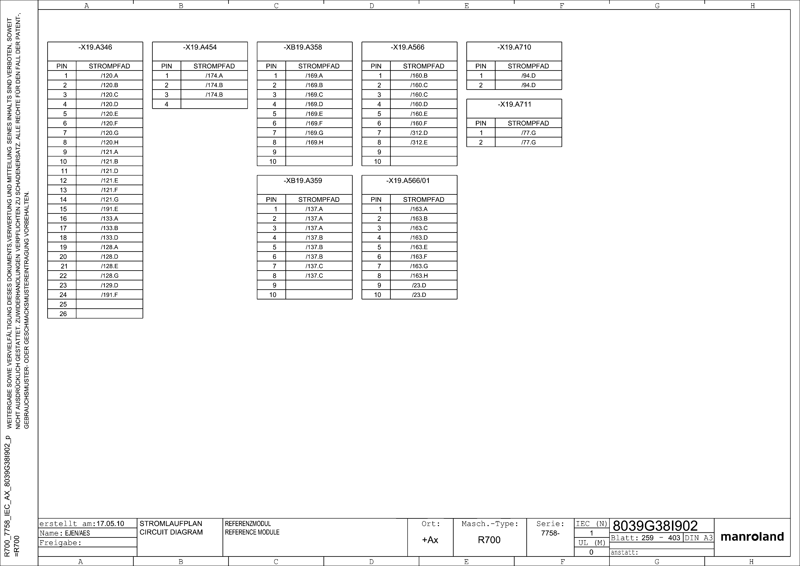

# +Ax — Sheet 259 of 403 — REFERENZMODUL

**REFERENCE MODULE**

> Part of the manroland **R700** printing press IEC/UL circuit diagrams.
> Drawing class: **Stromlaufplan / Circuit diagram** (DIN A3).
> Document `+Ax` covers the **Central control console** machine section.

## At a glance

| Field | Value |
|---|---|
| Document | `+Ax`  (8039G38I902) |
| Sheet | **259** of 403 |
| Section (DE) | REFERENZMODUL |
| Section (EN) | REFERENCE MODULE |
| Section type | REFERENCE_MODULE — Reference module |
| Machine type | `R700` |
| Series | `7758` |
| Created | 17.05.10 |
| Replaces | — |
| Columns used | A, B, C, D, E, F |
| Path numbers | — |
| Labels on sheet | 163 |
| Cross-refs out | 65 |
| Cross-refs in | 0 |

**Previous:** [+Ax sheet 258](SHEET_0258.md) · **Next:** [+Ax sheet 260](SHEET_0260.md) · **Document TOC:** [_TOC.md](_TOC.md)  (+Ax) · **Master TOC:** [all sheets](../_MASTER_TOC.md)

## Sheet image (300 DPI, exact vector render)



_Rendered directly from the PDF vector layer at 300 DPI (1-bit), no OCR and no resampling. Use it to confirm anything ambiguous in the text below._

## Cross-references on this sheet

Each entry is a wire leaving this sheet. The printed token is `/sheet.column`; the link resolves to that sheet inside the same document.

| Ref | Target sheet | Col | Path | Destination on target | Target section | From col |
|---|---|---|---|---|---|---|
| `/120.A` | [+Ax sheet 120](SHEET_0120.md) | A | — | — | REALTIMERECHNER FEHLBOGENKONTROLLE | A |
| `/174.A` | [+Ax sheet 174](SHEET_0174.md) | A | — | — | RESERVE | B |
| `/169.A` | [+Ax sheet 169](SHEET_0169.md) | A | — | — | ÜBERWACHUNGSRECHNER/RÜCKMELDUNG NOT AUS | C |
| `/160.B` | [+Ax sheet 160](SHEET_0160.md) | B | — | — | ÜBERWACHUNGSRECHNER/ANSTEUERUNG NOT AUS | E |
| `/94.D` | [+Ax sheet 94](SHEET_0094.md) | D | — | — | ANLEGER | F |
| `/120.B` | [+Ax sheet 120](SHEET_0120.md) | B | — | — | REALTIMERECHNER FEHLBOGENKONTROLLE | A |
| `/174.B` | [+Ax sheet 174](SHEET_0174.md) | B | — | — | RESERVE | B |
| `/169.B` | [+Ax sheet 169](SHEET_0169.md) | B | — | — | ÜBERWACHUNGSRECHNER/RÜCKMELDUNG NOT AUS | C |
| `/94.D` | [+Ax sheet 94](SHEET_0094.md) | D | — | — | ANLEGER | F |
| `/160.C` | [+Ax sheet 160](SHEET_0160.md) | C | — | — | ÜBERWACHUNGSRECHNER/ANSTEUERUNG NOT AUS | E |
| `/174.B` | [+Ax sheet 174](SHEET_0174.md) | B | — | — | RESERVE | B |
| `/120.C` | [+Ax sheet 120](SHEET_0120.md) | C | — | — | REALTIMERECHNER FEHLBOGENKONTROLLE | A |
| `/169.C` | [+Ax sheet 169](SHEET_0169.md) | C | — | — | ÜBERWACHUNGSRECHNER/RÜCKMELDUNG NOT AUS | C |
| `/160.C` | [+Ax sheet 160](SHEET_0160.md) | C | — | — | ÜBERWACHUNGSRECHNER/ANSTEUERUNG NOT AUS | E |
| `/120.D` | [+Ax sheet 120](SHEET_0120.md) | D | — | — | REALTIMERECHNER FEHLBOGENKONTROLLE | A |
| `/169.D` | [+Ax sheet 169](SHEET_0169.md) | D | — | — | ÜBERWACHUNGSRECHNER/RÜCKMELDUNG NOT AUS | C |
| `/160.D` | [+Ax sheet 160](SHEET_0160.md) | D | — | — | ÜBERWACHUNGSRECHNER/ANSTEUERUNG NOT AUS | E |
| `/120.E` | [+Ax sheet 120](SHEET_0120.md) | E | — | — | REALTIMERECHNER FEHLBOGENKONTROLLE | A |
| `/169.E` | [+Ax sheet 169](SHEET_0169.md) | E | — | — | ÜBERWACHUNGSRECHNER/RÜCKMELDUNG NOT AUS | C |
| `/160.E` | [+Ax sheet 160](SHEET_0160.md) | E | — | — | ÜBERWACHUNGSRECHNER/ANSTEUERUNG NOT AUS | E |
| `/120.F` | [+Ax sheet 120](SHEET_0120.md) | F | — | — | REALTIMERECHNER FEHLBOGENKONTROLLE | A |
| `/169.F` | [+Ax sheet 169](SHEET_0169.md) | F | — | — | ÜBERWACHUNGSRECHNER/RÜCKMELDUNG NOT AUS | C |
| `/160.F` | [+Ax sheet 160](SHEET_0160.md) | F | — | — | ÜBERWACHUNGSRECHNER/ANSTEUERUNG NOT AUS | E |
| `/77.G` | [+Ax sheet 77](SHEET_0077.md) | G | — | — | ANLEGER | F |
| `/120.G` | [+Ax sheet 120](SHEET_0120.md) | G | — | — | REALTIMERECHNER FEHLBOGENKONTROLLE | A |
| `/169.G` | [+Ax sheet 169](SHEET_0169.md) | G | — | — | ÜBERWACHUNGSRECHNER/RÜCKMELDUNG NOT AUS | C |
| `/312.D` | [+Ax sheet 312](SHEET_0312.md) | D | — | — | OPTION: IR/UV ZWISCHENTROCKNER | E |
| `/312.E` | [+Ax sheet 312](SHEET_0312.md) | E | — | — | OPTION: IR/UV ZWISCHENTROCKNER | E |
| `/77.G` | [+Ax sheet 77](SHEET_0077.md) | G | — | — | ANLEGER | F |
| `/120.H` | [+Ax sheet 120](SHEET_0120.md) | H | — | — | REALTIMERECHNER FEHLBOGENKONTROLLE | A |
| `/169.H` | [+Ax sheet 169](SHEET_0169.md) | H | — | — | ÜBERWACHUNGSRECHNER/RÜCKMELDUNG NOT AUS | C |
| `/121.A` | [+Ax sheet 121](SHEET_0121.md) | A | — | — | REALTIMERECHNER FEHLBOGENKONTROLLE | A |
| `/121.B` | [+Ax sheet 121](SHEET_0121.md) | B | — | — | REALTIMERECHNER FEHLBOGENKONTROLLE | A |
| `/121.D` | [+Ax sheet 121](SHEET_0121.md) | D | — | — | REALTIMERECHNER FEHLBOGENKONTROLLE | A |
| `/121.E` | [+Ax sheet 121](SHEET_0121.md) | E | — | — | REALTIMERECHNER FEHLBOGENKONTROLLE | A |
| `/121.F` | [+Ax sheet 121](SHEET_0121.md) | F | — | — | REALTIMERECHNER FEHLBOGENKONTROLLE | A |
| `/121.G` | [+Ax sheet 121](SHEET_0121.md) | G | — | — | REALTIMERECHNER FEHLBOGENKONTROLLE | A |
| `/191.E` | [+Ax sheet 191](SHEET_0191.md) | E | — | — | RESERVE | A |
| `/137.A` | [+Ax sheet 137](SHEET_0137.md) | A | — | — | REALTIMERECHNER ANSTEUERUNG DER SPS POWERKARTE | C |
| `/163.A` | [+Ax sheet 163](SHEET_0163.md) | A | — | — | ÜBERWACHUNGSRECHNER/ANSTEUERUNG NOT AUS | D |
| `/133.A` | [+Ax sheet 133](SHEET_0133.md) | A | — | — | REALTIMERECHNER DRUCKWERK | A |
| `/137.A` | [+Ax sheet 137](SHEET_0137.md) | A | — | — | REALTIMERECHNER ANSTEUERUNG DER SPS POWERKARTE | C |
| `/163.B` | [+Ax sheet 163](SHEET_0163.md) | B | — | — | ÜBERWACHUNGSRECHNER/ANSTEUERUNG NOT AUS | E |
| `/133.B` | [+Ax sheet 133](SHEET_0133.md) | B | — | — | REALTIMERECHNER DRUCKWERK | A |
| `/137.A` | [+Ax sheet 137](SHEET_0137.md) | A | — | — | REALTIMERECHNER ANSTEUERUNG DER SPS POWERKARTE | C |
| `/163.C` | [+Ax sheet 163](SHEET_0163.md) | C | — | — | ÜBERWACHUNGSRECHNER/ANSTEUERUNG NOT AUS | E |
| `/137.B` | [+Ax sheet 137](SHEET_0137.md) | B | — | — | REALTIMERECHNER ANSTEUERUNG DER SPS POWERKARTE | C |
| `/133.D` | [+Ax sheet 133](SHEET_0133.md) | D | — | — | REALTIMERECHNER DRUCKWERK | A |
| `/163.D` | [+Ax sheet 163](SHEET_0163.md) | D | — | — | ÜBERWACHUNGSRECHNER/ANSTEUERUNG NOT AUS | E |
| `/128.A` | [+Ax sheet 128](SHEET_0128.md) | A | — | — | REALTIMERECHNER ANLEGER | A |
| `/137.B` | [+Ax sheet 137](SHEET_0137.md) | B | — | — | REALTIMERECHNER ANSTEUERUNG DER SPS POWERKARTE | C |
| `/163.E` | [+Ax sheet 163](SHEET_0163.md) | E | — | — | ÜBERWACHUNGSRECHNER/ANSTEUERUNG NOT AUS | E |
| `/137.B` | [+Ax sheet 137](SHEET_0137.md) | B | — | — | REALTIMERECHNER ANSTEUERUNG DER SPS POWERKARTE | C |
| `/163.F` | [+Ax sheet 163](SHEET_0163.md) | F | — | — | ÜBERWACHUNGSRECHNER/ANSTEUERUNG NOT AUS | E |
| `/128.D` | [+Ax sheet 128](SHEET_0128.md) | D | — | — | REALTIMERECHNER ANLEGER | A |
| `/128.E` | [+Ax sheet 128](SHEET_0128.md) | E | — | — | REALTIMERECHNER ANLEGER | A |
| `/163.G` | [+Ax sheet 163](SHEET_0163.md) | G | — | — | ÜBERWACHUNGSRECHNER/ANSTEUERUNG NOT AUS | E |
| `/137.C` | [+Ax sheet 137](SHEET_0137.md) | C | — | — | REALTIMERECHNER ANSTEUERUNG DER SPS POWERKARTE | C |
| `/128.G` | [+Ax sheet 128](SHEET_0128.md) | G | — | — | REALTIMERECHNER ANLEGER | A |
| `/137.C` | [+Ax sheet 137](SHEET_0137.md) | C | — | — | REALTIMERECHNER ANSTEUERUNG DER SPS POWERKARTE | C |
| `/163.H` | [+Ax sheet 163](SHEET_0163.md) | H | — | — | ÜBERWACHUNGSRECHNER/ANSTEUERUNG NOT AUS | E |
| `/23.D` | [+Ax sheet 23](SHEET_0023.md) | D | — | — | SPANNUNGSVERSORGUNG, SCHALTSCHRANKBELÜFTUNG | E |
| `/129.D` | [+Ax sheet 129](SHEET_0129.md) | D | — | — | REALTIMERECHNER ANLAGE | A |
| `/191.F` | [+Ax sheet 191](SHEET_0191.md) | F | — | — | RESERVE | A |
| `/23.D` | [+Ax sheet 23](SHEET_0023.md) | D | — | — | SPANNUNGSVERSORGUNG, SCHALTSCHRANKBELÜFTUNG | E |

## Devices on this sheet

| Tag | Class | Class meaning (IEC) | Col | Sub | Terminal | Sign |
|---|---|---|---|---|---|---|
| `X19.A346` | — | cross-device reference | A | — | — | — |
| `XB19.A358` | — | cross-device reference | C | — | — | — |
| `XB19.A359` | — | cross-device reference | C | — | — | — |
| `X19.A566` | — | cross-device reference | D | — | — | — |
| `X19.A454` | — | cross-device reference | B | — | — | — |
| `X19.A710` | — | cross-device reference | F | — | — | — |
| `X19.A711` | — | cross-device reference | F | — | — | — |

## Potentials / nets

_No named potentials on this sheet._

## Wire-end annotations (grouped as printed)

A wire that continues elsewhere is annotated with a small cluster: the destination description, the path/line number `#NN`, and the `/sheet.column` cross reference. Each row below is one such cluster exactly as it is grouped on the drawing.

| Col | Y | Path | Cross-ref | Text on the wire |
|---|---|---|---|---|
| A | 65.5 | — | — | `X19.A346` |
| B | 65.5 | — | — | `X19.A454` |
| C | 65.5 | — | — | `XB19.A358` |
| D | 65.5 | — | — | `X19.A566` |
| F | 65.5 | — | — | `X19.A710` |
| A | 94.2 | — | — | `PIN STROMPFAD` |
| B | 94.2 | — | — | `PIN 2 3 4 1 STROMPFAD` |
| C | 94.2 | — | — | `PIN 10 2 3 4 5 6 7 8 9 1 STROMPFAD` |
| D | 94.2 | — | — | `PIN 10 2 3 4 5 6 7 8 9 1 STROMPFAD` |
| E | 94.2 | — | — | `PIN 2 1 STROMPFAD` |
| A | 108.4 | — | — | `2 3 4 5 6 7 8 9 1` |
| A | 108.7 | — | `/120.A` | — |
| B | 108.7 | — | `/174.A` | — |
| C | 108.7 | — | `/169.A` | — |
| E | 108.7 | — | `/160.B` | — |
| F | 108.7 | — | `/94.D` | — |
| A | 122.9 | — | `/120.B` | — |
| B | 122.9 | — | `/174.B` | — |
| C | 122.9 | — | `/169.B` | — |
| E | 122.9 | — | `/160.C` | — |
| F | 122.9 | — | `/94.D` | — |
| B | 137.0 | — | `/174.B` | — |
| A | 137.1 | — | `/120.C` | — |
| C | 137.1 | — | `/169.C` | — |
| E | 137.1 | — | `/160.C` | — |
| F | 150.5 | — | — | `X19.A711` |
| A | 151.2 | — | `/120.D` | — |
| C | 151.2 | — | `/169.D` | — |
| E | 151.2 | — | `/160.D` | — |
| A | 165.4 | — | `/120.E` | — |
| C | 165.4 | — | `/169.E` | — |
| E | 165.4 | — | `/160.E` | — |
| E | 179.2 | — | — | `PIN 2 1 STROMPFAD` |
| A | 179.6 | — | `/120.F` | — |
| C | 179.6 | — | `/169.F` | — |
| E | 179.6 | — | `/160.F` | — |
| A | 193.7 | — | `/120.G` | — |
| C | 193.7 | — | `/169.G` | — |
| F | 193.7 | — | `/77.G` | — |
| E | 193.8 | — | `/312.D` | — |
| A | 207.9 | — | `/120.H` | — |
| C | 207.9 | — | `/169.H` | — |
| E | 207.9 | — | `/312.E` | — |
| F | 207.9 | — | `/77.G` | — |
| A | 222.1 | — | `/121.A` | — |
| A | 235.9 | — | — | `10 12 13 14 15 16 17 18 19 20 11` |
| A | 236.2 | — | `/121.B` | — |
| A | 250.4 | — | `/121.D` | — |
| C | 263.9 | — | — | `XB19.A359` |
| D | 263.9 | — | — | `X19.A566/01` |
| A | 264.6 | — | `/121.E` | — |
| A | 278.8 | — | `/121.F` | — |
| C | 292.6 | — | — | `PIN 10 2 3 4 5 6 7 8 9 1 STROMPFAD` |
| D | 292.6 | — | — | `PIN 10 2 3 4 5 6 7 8 9 1 STROMPFAD` |
| A | 293.0 | — | `/121.G` | — |
| A | 307.1 | — | `/191.E` | — |
| C | 307.1 | — | `/137.A` | — |
| D | 307.1 | — | `/163.A` | — |
| A | 321.3 | — | `/133.A` | — |
| C | 321.3 | — | `/137.A` | — |
| E | 321.3 | — | `/163.B` | — |
| A | 335.5 | — | `/133.B` | — |
| C | 335.5 | — | `/137.A` | — |
| E | 335.5 | — | `/163.C` | — |
| C | 349.6 | — | `/137.B` | — |
| A | 349.7 | — | `/133.D` | — |
| E | 349.7 | — | `/163.D` | — |
| A | 363.8 | — | `/128.A` | — |
| C | 363.8 | — | `/137.B` | — |
| E | 363.8 | — | `/163.E` | — |
| A | 378.0 | — | `/128.D` | — |
| C | 378.0 | — | `/137.B` | — |
| E | 378.0 | — | `/163.F` | — |
| A | 391.8 | — | — | `22 23 24 25 26 21` |
| A | 392.1 | — | `/128.E` | — |
| C | 392.2 | — | `/137.C` | — |
| E | 392.2 | — | `/163.G` | — |
| A | 406.3 | — | `/128.G` | — |
| C | 406.4 | — | `/137.C` | — |
| E | 406.4 | — | `/163.H` | — |
| A | 420.5 | — | `/129.D` | — |
| E | 420.5 | — | `/23.D` | — |
| A | 434.7 | — | `/191.F` | — |
| E | 434.7 | — | `/23.D` | — |


## Reconstructed tables

This sheet carries tabular content (pin map / terminal assignment / index). The grid below was rebuilt from the drawing's own rule lines, so each row is exactly one physical row of the table.

### Table 1 — 26 data rows × 2 columns (at x=70.9, y=62.4) — **X19.A346**

| PIN | STROMPFAD |
|---|---|
| `1` | `/120.A` |
| `2` | `/120.B` |
| `3` | `/120.C` |
| `4` | `/120.D` |
| `5` | `/120.E` |
| `6` | `/120.F` |
| `7` | `/120.G` |
| `8` | `/120.H` |
| `9` | `/121.A` |
| `10` | `/121.B` |
| `11` | `/121.D` |
| `12` | `/121.E` |
| `13` | `/121.F` |
| `14` | `/121.G` |
| `15` | `/191.E` |
| `16` | `/133.A` |
| `17` | `/133.B` |
| `18` | `/133.D` |
| `19` | `/128.A` |
| `20` | `/128.D` |
| `21` | `/128.E` |
| `22` | `/128.G` |
| `23` | `/129.D` |
| `24` | `/191.F` |
| `25` |  |
| `26` |  |


### Table 2 — 4 data rows × 2 columns (at x=226.8, y=62.4) — **X19.A454**

| PIN | STROMPFAD |
|---|---|
| `1` | `/174.A` |
| `2` | `/174.B` |
| `3` | `/174.B` |
| `4` |  |


### Table 3 — 22 data rows × 2 columns (at x=382.7, y=62.4) — **XB19.A358**

| PIN | STROMPFAD |
|---|---|
| `1` | `/169.A` |
| `2` | `/169.B` |
| `3` | `/169.C` |
| `4` | `/169.D` |
| `5` | `/169.E` |
| `6` | `/169.F` |
| `7` | `/169.G` |
| `8` | `/169.H` |
| `9` |  |
| `10` |  |
|  | `XB19.A359` |
| `PIN` | `STROMPFAD` |
| `1` | `/137.A` |
| `2` | `/137.A` |
| `3` | `/137.A` |
| `4` | `/137.B` |
| `5` | `/137.B` |
| `6` | `/137.B` |
| `7` | `/137.C` |
| `8` | `/137.C` |
| `9` |  |
| `10` |  |


### Table 4 — 22 data rows × 2 columns (at x=538.6, y=62.4) — **X19.A566**

| PIN | STROMPFAD |
|---|---|
| `1` | `/160.B` |
| `2` | `/160.C` |
| `3` | `/160.C` |
| `4` | `/160.D` |
| `5` | `/160.E` |
| `6` | `/160.F` |
| `7` | `/312.D` |
| `8` | `/312.E` |
| `9` |  |
| `10` |  |
|  | `X19.A566/01` |
| `PIN` | `STROMPFAD` |
| `1` | `/163.A` |
| `2` | `/163.B` |
| `3` | `/163.C` |
| `4` | `/163.D` |
| `5` | `/163.E` |
| `6` | `/163.F` |
| `7` | `/163.G` |
| `8` | `/163.H` |
| `9` | `/23.D` |
| `10` | `/23.D` |


### Table 5 — 6 data rows × 2 columns (at x=694.5, y=62.4) — **X19.A710**

| PIN | STROMPFAD |
|---|---|
| `1` | `/94.D` |
| `2` | `/94.D` |
|  | `X19.A711` |
| `PIN` | `STROMPFAD` |
| `1` | `/77.G` |
| `2` | `/77.G` |


## Notes and free text on this sheet

| Text | Col | Y (pt) |
|---|---|---|
| `PIN` | A | 94.2 |
| `STROMPFAD` | A | 94.15 |
| `PIN` | C | 94.2 |
| `STROMPFAD` | C | 94.15 |
| `PIN` | D | 94.2 |
| `STROMPFAD` | E | 94.15 |
| `X19.A566/01` | D | 263.93 |
| `PIN` | B | 94.2 |
| `STROMPFAD` | B | 94.15 |
| `PIN` | E | 94.2 |
| `STROMPFAD` | F | 94.15 |

## Complete label inventory (exact text from the drawing)

Every text object inside the drawing area of this sheet, in DIN reading order (column A→H, then top→bottom). This is the authoritative list: if a string is not here it is not printed on this sheet.

| Col | Y | X | Dir | Type | Text |
|---|---|---|---|---|---|
| A | 65.5 | 116.8 | → | device ref | `X19.A346` |
| A | 94.2 | 84.0 | → | text | `PIN` |
| A | 94.2 | 132.2 | → | text | `STROMPFAD` |
| A | 108.4 | 95.8 | → | number | `1` |
| A | 108.7 | 150.2 | → | cross-reference | `/120.A` |
| A | 122.5 | 94.1 | → | number | `2` |
| A | 122.9 | 150.4 | → | cross-reference | `/120.B` |
| A | 136.7 | 94.1 | → | number | `3` |
| A | 137.1 | 150.2 | → | cross-reference | `/120.C` |
| A | 150.9 | 94.1 | → | number | `4` |
| A | 151.2 | 150.2 | → | cross-reference | `/120.D` |
| A | 165.1 | 94.1 | → | number | `5` |
| A | 165.4 | 150.5 | → | cross-reference | `/120.E` |
| A | 179.2 | 94.1 | → | number | `6` |
| A | 179.6 | 150.7 | → | cross-reference | `/120.F` |
| A | 193.4 | 94.1 | → | number | `7` |
| A | 193.7 | 150.1 | → | cross-reference | `/120.G` |
| A | 207.6 | 94.1 | → | number | `8` |
| A | 207.9 | 150.5 | → | cross-reference | `/120.H` |
| A | 221.8 | 94.1 | → | number | `9` |
| A | 222.1 | 150.2 | → | cross-reference | `/121.A` |
| A | 235.9 | 88.7 | → | number | `10` |
| A | 236.2 | 150.4 | → | cross-reference | `/121.B` |
| A | 250.1 | 90.4 | → | number | `11` |
| A | 250.4 | 150.2 | → | cross-reference | `/121.D` |
| A | 264.3 | 88.7 | → | number | `12` |
| A | 264.6 | 150.5 | → | cross-reference | `/121.E` |
| A | 278.5 | 88.7 | → | number | `13` |
| A | 278.8 | 150.7 | → | cross-reference | `/121.F` |
| A | 292.6 | 88.7 | → | number | `14` |
| A | 293.0 | 150.1 | → | cross-reference | `/121.G` |
| A | 306.8 | 88.7 | → | number | `15` |
| A | 307.1 | 150.5 | → | cross-reference | `/191.E` |
| A | 321.0 | 88.7 | → | number | `16` |
| A | 321.3 | 150.2 | → | cross-reference | `/133.A` |
| A | 335.1 | 88.7 | → | number | `17` |
| A | 335.5 | 150.4 | → | cross-reference | `/133.B` |
| A | 349.3 | 88.7 | → | number | `18` |
| A | 349.7 | 150.2 | → | cross-reference | `/133.D` |
| A | 363.5 | 88.7 | → | number | `19` |
| A | 363.8 | 150.2 | → | cross-reference | `/128.A` |
| A | 377.7 | 88.7 | → | number | `20` |
| A | 378.0 | 150.2 | → | cross-reference | `/128.D` |
| A | 391.8 | 90.4 | → | number | `21` |
| A | 392.2 | 150.5 | → | cross-reference | `/128.E` |
| A | 406.0 | 88.7 | → | number | `22` |
| A | 406.3 | 150.1 | → | cross-reference | `/128.G` |
| A | 420.2 | 88.7 | → | number | `23` |
| A | 420.5 | 150.2 | → | cross-reference | `/129.D` |
| A | 434.4 | 88.7 | → | number | `24` |
| A | 434.7 | 150.7 | → | cross-reference | `/191.F` |
| A | 448.5 | 88.7 | → | number | `25` |
| A | 462.7 | 88.7 | → | number | `26` |
| B | 65.5 | 272.7 | → | device ref | `X19.A454` |
| B | 94.2 | 240.0 | → | text | `PIN` |
| B | 94.2 | 288.1 | → | text | `STROMPFAD` |
| B | 108.4 | 245.9 | → | number | `1` |
| B | 108.7 | 306.1 | → | cross-reference | `/174.A` |
| B | 122.5 | 245.3 | → | number | `2` |
| B | 122.9 | 306.3 | → | cross-reference | `/174.B` |
| B | 136.7 | 245.3 | → | number | `3` |
| B | 137.0 | 306.3 | → | cross-reference | `/174.B` |
| B | 150.9 | 245.3 | → | number | `4` |
| C | 65.5 | 422.2 | → | device ref | `XB19.A358` |
| C | 94.2 | 395.9 | → | text | `PIN` |
| C | 94.2 | 444.0 | → | text | `STROMPFAD` |
| C | 108.4 | 407.6 | → | number | `1` |
| C | 108.7 | 455.0 | → | cross-reference | `/169.A` |
| C | 122.5 | 405.9 | → | number | `2` |
| C | 122.9 | 455.1 | → | cross-reference | `/169.B` |
| C | 136.7 | 405.9 | → | number | `3` |
| C | 137.1 | 455.0 | → | cross-reference | `/169.C` |
| C | 150.9 | 405.9 | → | number | `4` |
| C | 151.2 | 455.0 | → | cross-reference | `/169.D` |
| C | 165.1 | 405.9 | → | number | `5` |
| C | 165.4 | 455.2 | → | cross-reference | `/169.E` |
| C | 179.2 | 405.9 | → | number | `6` |
| C | 179.6 | 455.4 | → | cross-reference | `/169.F` |
| C | 193.4 | 405.9 | → | number | `7` |
| C | 193.7 | 454.8 | → | cross-reference | `/169.G` |
| C | 207.6 | 405.9 | → | number | `8` |
| C | 207.9 | 455.2 | → | cross-reference | `/169.H` |
| C | 221.8 | 405.9 | → | number | `9` |
| C | 235.9 | 400.5 | → | number | `10` |
| C | 263.9 | 422.2 | → | device ref | `XB19.A359` |
| C | 292.6 | 395.9 | → | text | `PIN` |
| C | 292.6 | 444.0 | → | text | `STROMPFAD` |
| C | 306.8 | 407.6 | → | number | `1` |
| C | 307.1 | 455.0 | → | cross-reference | `/137.A` |
| C | 321.0 | 405.9 | → | number | `2` |
| C | 321.3 | 455.0 | → | cross-reference | `/137.A` |
| C | 335.1 | 405.9 | → | number | `3` |
| C | 335.5 | 455.0 | → | cross-reference | `/137.A` |
| C | 349.3 | 405.9 | → | number | `4` |
| C | 349.6 | 455.1 | → | cross-reference | `/137.B` |
| C | 363.5 | 405.9 | → | number | `5` |
| C | 363.8 | 455.1 | → | cross-reference | `/137.B` |
| C | 377.7 | 405.9 | → | number | `6` |
| C | 378.0 | 455.1 | → | cross-reference | `/137.B` |
| C | 391.8 | 405.9 | → | number | `7` |
| C | 392.2 | 455.0 | → | cross-reference | `/137.C` |
| C | 406.0 | 405.9 | → | number | `8` |
| C | 406.4 | 455.0 | → | cross-reference | `/137.C` |
| C | 420.2 | 405.9 | → | number | `9` |
| C | 434.4 | 400.5 | → | number | `10` |
| D | 65.5 | 581.7 | → | device ref | `X19.A566` |
| D | 94.2 | 551.8 | → | text | `PIN` |
| D | 108.4 | 563.5 | → | number | `1` |
| D | 122.5 | 561.8 | → | number | `2` |
| D | 136.7 | 561.8 | → | number | `3` |
| D | 150.9 | 561.8 | → | number | `4` |
| D | 165.1 | 561.8 | → | number | `5` |
| D | 179.2 | 561.8 | → | number | `6` |
| D | 193.4 | 561.8 | → | number | `7` |
| D | 207.6 | 561.8 | → | number | `8` |
| D | 221.8 | 561.8 | → | number | `9` |
| D | 235.9 | 556.4 | → | number | `10` |
| D | 263.9 | 575.0 | → | text | `X19.A566/01` |
| D | 292.6 | 551.8 | → | text | `PIN` |
| D | 306.8 | 563.5 | → | number | `1` |
| D | 307.1 | 610.9 | → | cross-reference | `/163.A` |
| D | 321.0 | 561.8 | → | number | `2` |
| D | 335.1 | 561.8 | → | number | `3` |
| D | 349.3 | 561.8 | → | number | `4` |
| D | 363.5 | 561.8 | → | number | `5` |
| D | 377.7 | 561.8 | → | number | `6` |
| D | 391.8 | 561.8 | → | number | `7` |
| D | 406.0 | 561.8 | → | number | `8` |
| D | 420.2 | 561.8 | → | number | `9` |
| D | 434.4 | 556.4 | → | number | `10` |
| E | 94.2 | 600.0 | → | text | `STROMPFAD` |
| E | 94.2 | 707.7 | → | text | `PIN` |
| E | 108.4 | 713.6 | → | number | `1` |
| E | 108.7 | 611.0 | → | cross-reference | `/160.B` |
| E | 122.5 | 713.1 | → | number | `2` |
| E | 122.9 | 610.9 | → | cross-reference | `/160.C` |
| E | 137.1 | 610.9 | → | cross-reference | `/160.C` |
| E | 151.2 | 610.9 | → | cross-reference | `/160.D` |
| E | 165.4 | 611.1 | → | cross-reference | `/160.E` |
| E | 179.2 | 707.7 | → | text | `PIN` |
| E | 179.6 | 611.3 | → | cross-reference | `/160.F` |
| E | 193.4 | 713.6 | → | number | `1` |
| E | 193.8 | 610.9 | → | cross-reference | `/312.D` |
| E | 207.6 | 713.1 | → | number | `2` |
| E | 207.9 | 611.1 | → | cross-reference | `/312.E` |
| E | 292.6 | 600.0 | → | text | `STROMPFAD` |
| E | 321.3 | 611.0 | → | cross-reference | `/163.B` |
| E | 335.5 | 610.9 | → | cross-reference | `/163.C` |
| E | 349.7 | 610.9 | → | cross-reference | `/163.D` |
| E | 363.8 | 611.1 | → | cross-reference | `/163.E` |
| E | 378.0 | 611.3 | → | cross-reference | `/163.F` |
| E | 392.2 | 610.7 | → | cross-reference | `/163.G` |
| E | 406.4 | 611.1 | → | cross-reference | `/163.H` |
| E | 420.5 | 613.3 | → | cross-reference | `/23.D` |
| E | 434.7 | 613.3 | → | cross-reference | `/23.D` |
| F | 65.5 | 740.4 | → | device ref | `X19.A710` |
| F | 94.2 | 755.9 | → | text | `STROMPFAD` |
| F | 108.7 | 776.3 | → | cross-reference | `/94.D` |
| F | 122.9 | 776.3 | → | cross-reference | `/94.D` |
| F | 150.5 | 741.1 | → | device ref | `X19.A711` |
| F | 179.2 | 755.9 | → | text | `STROMPFAD` |
| F | 193.7 | 776.1 | → | cross-reference | `/77.G` |
| F | 207.9 | 776.1 | → | cross-reference | `/77.G` |

## Reading-order text block

The same content as a plain block, grouped by DIN column — convenient to paste or to match against a visual description.

```text
=== Column A ===
  65.5  116.8  devref       X19.A346
  94.2   84.0  text         PIN
  94.2  132.2  text         STROMPFAD
 108.4   95.8  numeric      1
 108.7  150.2  xref         /120.A
 122.5   94.1  numeric      2
 122.9  150.4  xref         /120.B
 136.7   94.1  numeric      3
 137.1  150.2  xref         /120.C
 150.9   94.1  numeric      4
 151.2  150.2  xref         /120.D
 165.1   94.1  numeric      5
 165.4  150.5  xref         /120.E
 179.2   94.1  numeric      6
 179.6  150.7  xref         /120.F
 193.4   94.1  numeric      7
 193.7  150.1  xref         /120.G
 207.6   94.1  numeric      8
 207.9  150.5  xref         /120.H
 221.8   94.1  numeric      9
 222.1  150.2  xref         /121.A
 235.9   88.7  numeric      10
 236.2  150.4  xref         /121.B
 250.1   90.4  numeric      11
 250.4  150.2  xref         /121.D
 264.3   88.7  numeric      12
 264.6  150.5  xref         /121.E
 278.5   88.7  numeric      13
 278.8  150.7  xref         /121.F
 292.6   88.7  numeric      14
 293.0  150.1  xref         /121.G
 306.8   88.7  numeric      15
 307.1  150.5  xref         /191.E
 321.0   88.7  numeric      16
 321.3  150.2  xref         /133.A
 335.1   88.7  numeric      17
 335.5  150.4  xref         /133.B
 349.3   88.7  numeric      18
 349.7  150.2  xref         /133.D
 363.5   88.7  numeric      19
 363.8  150.2  xref         /128.A
 377.7   88.7  numeric      20
 378.0  150.2  xref         /128.D
 391.8   90.4  numeric      21
 392.2  150.5  xref         /128.E
 406.0   88.7  numeric      22
 406.3  150.1  xref         /128.G
 420.2   88.7  numeric      23
 420.5  150.2  xref         /129.D
 434.4   88.7  numeric      24
 434.7  150.7  xref         /191.F
 448.5   88.7  numeric      25
 462.7   88.7  numeric      26
=== Column B ===
  65.5  272.7  devref       X19.A454
  94.2  240.0  text         PIN
  94.2  288.1  text         STROMPFAD
 108.4  245.9  numeric      1
 108.7  306.1  xref         /174.A
 122.5  245.3  numeric      2
 122.9  306.3  xref         /174.B
 136.7  245.3  numeric      3
 137.0  306.3  xref         /174.B
 150.9  245.3  numeric      4
=== Column C ===
  65.5  422.2  devref       XB19.A358
  94.2  395.9  text         PIN
  94.2  444.0  text         STROMPFAD
 108.4  407.6  numeric      1
 108.7  455.0  xref         /169.A
 122.5  405.9  numeric      2
 122.9  455.1  xref         /169.B
 136.7  405.9  numeric      3
 137.1  455.0  xref         /169.C
 150.9  405.9  numeric      4
 151.2  455.0  xref         /169.D
 165.1  405.9  numeric      5
 165.4  455.2  xref         /169.E
 179.2  405.9  numeric      6
 179.6  455.4  xref         /169.F
 193.4  405.9  numeric      7
 193.7  454.8  xref         /169.G
 207.6  405.9  numeric      8
 207.9  455.2  xref         /169.H
 221.8  405.9  numeric      9
 235.9  400.5  numeric      10
 263.9  422.2  devref       XB19.A359
 292.6  395.9  text         PIN
 292.6  444.0  text         STROMPFAD
 306.8  407.6  numeric      1
 307.1  455.0  xref         /137.A
 321.0  405.9  numeric      2
 321.3  455.0  xref         /137.A
 335.1  405.9  numeric      3
 335.5  455.0  xref         /137.A
 349.3  405.9  numeric      4
 349.6  455.1  xref         /137.B
 363.5  405.9  numeric      5
 363.8  455.1  xref         /137.B
 377.7  405.9  numeric      6
 378.0  455.1  xref         /137.B
 391.8  405.9  numeric      7
 392.2  455.0  xref         /137.C
 406.0  405.9  numeric      8
 406.4  455.0  xref         /137.C
 420.2  405.9  numeric      9
 434.4  400.5  numeric      10
=== Column D ===
  65.5  581.7  devref       X19.A566
  94.2  551.8  text         PIN
 108.4  563.5  numeric      1
 122.5  561.8  numeric      2
 136.7  561.8  numeric      3
 150.9  561.8  numeric      4
 165.1  561.8  numeric      5
 179.2  561.8  numeric      6
 193.4  561.8  numeric      7
 207.6  561.8  numeric      8
 221.8  561.8  numeric      9
 235.9  556.4  numeric      10
 263.9  575.0  text         X19.A566/01
 292.6  551.8  text         PIN
 306.8  563.5  numeric      1
 307.1  610.9  xref         /163.A
 321.0  561.8  numeric      2
 335.1  561.8  numeric      3
 349.3  561.8  numeric      4
 363.5  561.8  numeric      5
 377.7  561.8  numeric      6
 391.8  561.8  numeric      7
 406.0  561.8  numeric      8
 420.2  561.8  numeric      9
 434.4  556.4  numeric      10
=== Column E ===
  94.2  600.0  text         STROMPFAD
  94.2  707.7  text         PIN
 108.4  713.6  numeric      1
 108.7  611.0  xref         /160.B
 122.5  713.1  numeric      2
 122.9  610.9  xref         /160.C
 137.1  610.9  xref         /160.C
 151.2  610.9  xref         /160.D
 165.4  611.1  xref         /160.E
 179.2  707.7  text         PIN
 179.6  611.3  xref         /160.F
 193.4  713.6  numeric      1
 193.8  610.9  xref         /312.D
 207.6  713.1  numeric      2
 207.9  611.1  xref         /312.E
 292.6  600.0  text         STROMPFAD
 321.3  611.0  xref         /163.B
 335.5  610.9  xref         /163.C
 349.7  610.9  xref         /163.D
 363.8  611.1  xref         /163.E
 378.0  611.3  xref         /163.F
 392.2  610.7  xref         /163.G
 406.4  611.1  xref         /163.H
 420.5  613.3  xref         /23.D
 434.7  613.3  xref         /23.D
=== Column F ===
  65.5  740.4  devref       X19.A710
  94.2  755.9  text         STROMPFAD
 108.7  776.3  xref         /94.D
 122.9  776.3  xref         /94.D
 150.5  741.1  devref       X19.A711
 179.2  755.9  text         STROMPFAD
 193.7  776.1  xref         /77.G
 207.9  776.1  xref         /77.G
```

---
_Generated from the PDF vector text layer; no OCR. Source: `R700_7758_IEC_AX_8039G38I902_p`, sheet 259._
