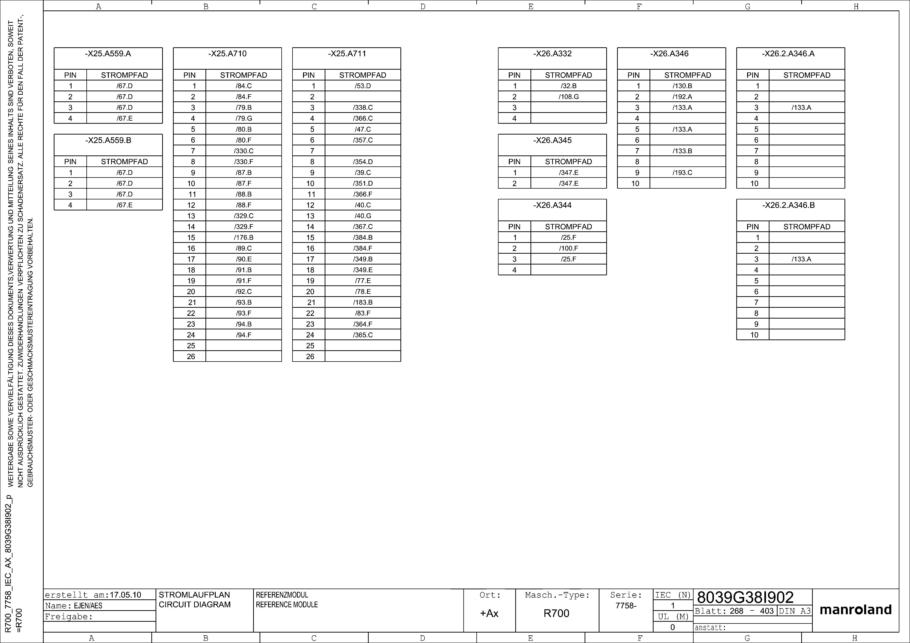

# +Ax — Sheet 268 of 403 — REFERENZMODUL

**REFERENCE MODULE**

> Part of the manroland **R700** printing press IEC/UL circuit diagrams.
> Drawing class: **Stromlaufplan / Circuit diagram** (DIN A3).
> Document `+Ax` covers the **Central control console** machine section.

## At a glance

| Field | Value |
|---|---|
| Document | `+Ax`  (8039G38I902) |
| Sheet | **268** of 403 |
| Section (DE) | REFERENZMODUL |
| Section (EN) | REFERENCE MODULE |
| Section type | REFERENCE_MODULE — Reference module |
| Machine type | `R700` |
| Series | `7758` |
| Created | 17.05.10 |
| Replaces | — |
| Columns used | A, B, C, E, F, G, H |
| Path numbers | — |
| Labels on sheet | 199 |
| Cross-refs out | 69 |
| Cross-refs in | 0 |

**Previous:** [+Ax sheet 267](SHEET_0267.md) · **Next:** [+Ax sheet 269](SHEET_0269.md) · **Document TOC:** [_TOC.md](_TOC.md)  (+Ax) · **Master TOC:** [all sheets](../_MASTER_TOC.md)

## Sheet image (300 DPI, exact vector render)



_Rendered directly from the PDF vector layer at 300 DPI (1-bit), no OCR and no resampling. Use it to confirm anything ambiguous in the text below._

## Cross-references on this sheet

Each entry is a wire leaving this sheet. The printed token is `/sheet.column`; the link resolves to that sheet inside the same document.

| Ref | Target sheet | Col | Path | Destination on target | Target section | From col |
|---|---|---|---|---|---|---|
| `/32.B` | [+Ax sheet 32](SHEET_0032.md) | B | — | — | SPANNUNGSVERSORGUNG, SCHALTSCHRANKBELÜFTUNG | E |
| `/130.B` | [+Ax sheet 130](SHEET_0130.md) | B | — | — | REALTIMERECHNER ANLAGE | F |
| `/67.D` | [+Ax sheet 67](SHEET_0067.md) | D | — | — | SAUGBÄNDERTISCH | A |
| `/84.C` | [+Ax sheet 84](SHEET_0084.md) | C | — | — | ANLEGER | B |
| `/53.D` | [+Ax sheet 53](SHEET_0053.md) | D | — | — | SIGNALGEBER: AKUSTISCHE WARNSIGNALE | C |
| `/84.F` | [+Ax sheet 84](SHEET_0084.md) | F | — | — | ANLEGER | B |
| `/192.A` | [+Ax sheet 192](SHEET_0192.md) | A | — | — | RESERVE | F |
| `/67.D` | [+Ax sheet 67](SHEET_0067.md) | D | — | — | SAUGBÄNDERTISCH | A |
| `/108.G` | [+Ax sheet 108](SHEET_0108.md) | G | — | — | ANLEGER | E |
| `/79.B` | [+Ax sheet 79](SHEET_0079.md) | B | — | — | ANLEGER | B |
| `/133.A` | [+Ax sheet 133](SHEET_0133.md) | A | — | — | REALTIMERECHNER DRUCKWERK | F |
| `/133.A` | [+Ax sheet 133](SHEET_0133.md) | A | — | — | REALTIMERECHNER DRUCKWERK | G |
| `/67.D` | [+Ax sheet 67](SHEET_0067.md) | D | — | — | SAUGBÄNDERTISCH | A |
| `/338.C` | [+Ax sheet 338](SHEET_0338.md) | C | — | — | OPTION: INLINESHEETER RS104 S | C |
| `/67.E` | [+Ax sheet 67](SHEET_0067.md) | E | — | — | SAUGBÄNDERTISCH | A |
| `/79.G` | [+Ax sheet 79](SHEET_0079.md) | G | — | — | ANLEGER | B |
| `/366.C` | [+Ax sheet 366](SHEET_0366.md) | C | — | — | OPTION: LOGISTIK AUSLEGER | C |
| `/80.B` | [+Ax sheet 80](SHEET_0080.md) | B | — | — | ANLEGER | B |
| `/133.A` | [+Ax sheet 133](SHEET_0133.md) | A | — | — | REALTIMERECHNER DRUCKWERK | F |
| `/47.C` | [+Ax sheet 47](SHEET_0047.md) | C | — | — | NOT AUS | C |
| `/80.F` | [+Ax sheet 80](SHEET_0080.md) | F | — | — | ANLEGER | B |
| `/357.C` | [+Ax sheet 357](SHEET_0357.md) | C | — | — | OPTION: LOGISTIK ANLEGER | C |
| `/133.B` | [+Ax sheet 133](SHEET_0133.md) | B | — | — | REALTIMERECHNER DRUCKWERK | F |
| `/330.C` | [+Ax sheet 330](SHEET_0330.md) | C | — | — | OPTION: NONSTOP EINRICHTUNG MANUELL, ANLEGER | B |
| `/330.F` | [+Ax sheet 330](SHEET_0330.md) | F | — | — | OPTION: NONSTOP EINRICHTUNG MANUELL, ANLEGER | B |
| `/354.D` | [+Ax sheet 354](SHEET_0354.md) | D | — | — | OPTION: LOGISTIK ANLEGER | C |
| `/87.B` | [+Ax sheet 87](SHEET_0087.md) | B | — | — | ANLEGER | B |
| `/347.E` | [+Ax sheet 347](SHEET_0347.md) | E | — | — | OPTION: LOGISTIK ANLEGER | E |
| `/67.D` | [+Ax sheet 67](SHEET_0067.md) | D | — | — | SAUGBÄNDERTISCH | A |
| `/39.C` | [+Ax sheet 39](SHEET_0039.md) | C | — | — | HAUPTANTRIEB | C |
| `/193.C` | [+Ax sheet 193](SHEET_0193.md) | C | — | — | RESERVE | F |
| `/87.F` | [+Ax sheet 87](SHEET_0087.md) | F | — | — | ANLEGER | B |
| `/347.E` | [+Ax sheet 347](SHEET_0347.md) | E | — | — | OPTION: LOGISTIK ANLEGER | E |
| `/67.D` | [+Ax sheet 67](SHEET_0067.md) | D | — | — | SAUGBÄNDERTISCH | A |
| `/351.D` | [+Ax sheet 351](SHEET_0351.md) | D | — | — | OPTION: LOGISTIK ANLEGER | C |
| `/88.B` | [+Ax sheet 88](SHEET_0088.md) | B | — | — | ANLEGER | B |
| `/366.F` | [+Ax sheet 366](SHEET_0366.md) | F | — | — | OPTION: LOGISTIK AUSLEGER | C |
| `/67.D` | [+Ax sheet 67](SHEET_0067.md) | D | — | — | SAUGBÄNDERTISCH | A |
| `/67.E` | [+Ax sheet 67](SHEET_0067.md) | E | — | — | SAUGBÄNDERTISCH | A |
| `/88.F` | [+Ax sheet 88](SHEET_0088.md) | F | — | — | ANLEGER | B |
| `/40.C` | [+Ax sheet 40](SHEET_0040.md) | C | — | — | HAUPTANTRIEB | C |
| `/40.G` | [+Ax sheet 40](SHEET_0040.md) | G | — | — | HAUPTANTRIEB | C |
| `/329.C` | [+Ax sheet 329](SHEET_0329.md) | C | — | — | OPTION: NONSTOP EINRICHTUNG MANUELL, ANLEGER | B |
| `/329.F` | [+Ax sheet 329](SHEET_0329.md) | F | — | — | OPTION: NONSTOP EINRICHTUNG MANUELL, ANLEGER | B |
| `/367.C` | [+Ax sheet 367](SHEET_0367.md) | C | — | — | OPTION: LOGISTIK AUSLEGER | C |
| `/176.B` | [+Ax sheet 176](SHEET_0176.md) | B | — | — | RESERVE | B |
| `/384.B` | [+Ax sheet 384](SHEET_0384.md) | B | — | — | OPTION: INLINEFOILER PRINDOR | C |
| `/25.F` | [+Ax sheet 25](SHEET_0025.md) | F | — | — | SPANNUNGSVERSORGUNG, SCHALTSCHRANKBELÜFTUNG | E |
| `/384.F` | [+Ax sheet 384](SHEET_0384.md) | F | — | — | OPTION: INLINEFOILER PRINDOR | C |
| `/100.F` | [+Ax sheet 100](SHEET_0100.md) | F | — | — | ANLEGER | E |
| `/89.C` | [+Ax sheet 89](SHEET_0089.md) | C | — | — | ANLEGER | B |
| `/90.E` | [+Ax sheet 90](SHEET_0090.md) | E | — | — | ANLEGER | B |
| `/349.B` | [+Ax sheet 349](SHEET_0349.md) | B | — | — | OPTION: LOGISTIK ANLEGER | C |
| `/25.F` | [+Ax sheet 25](SHEET_0025.md) | F | — | — | SPANNUNGSVERSORGUNG, SCHALTSCHRANKBELÜFTUNG | E |
| `/133.A` | [+Ax sheet 133](SHEET_0133.md) | A | — | — | REALTIMERECHNER DRUCKWERK | G |
| `/91.B` | [+Ax sheet 91](SHEET_0091.md) | B | — | — | ANLEGER | B |
| `/349.E` | [+Ax sheet 349](SHEET_0349.md) | E | — | — | OPTION: LOGISTIK ANLEGER | C |
| `/77.E` | [+Ax sheet 77](SHEET_0077.md) | E | — | — | ANLEGER | C |
| `/91.F` | [+Ax sheet 91](SHEET_0091.md) | F | — | — | ANLEGER | B |
| `/78.E` | [+Ax sheet 78](SHEET_0078.md) | E | — | — | ANLEGER | C |
| `/92.C` | [+Ax sheet 92](SHEET_0092.md) | C | — | — | ANLEGER | B |
| `/93.B` | [+Ax sheet 93](SHEET_0093.md) | B | — | — | ANLEGER | B |
| `/183.B` | [+Ax sheet 183](SHEET_0183.md) | B | — | — | RESERVE | C |
| `/93.F` | [+Ax sheet 93](SHEET_0093.md) | F | — | — | ANLEGER | B |
| `/83.F` | [+Ax sheet 83](SHEET_0083.md) | F | — | — | ANLEGER | C |
| `/94.B` | [+Ax sheet 94](SHEET_0094.md) | B | — | — | ANLEGER | B |
| `/364.F` | [+Ax sheet 364](SHEET_0364.md) | F | — | — | OPTION: LOGISTIK AUSLEGER | C |
| `/94.F` | [+Ax sheet 94](SHEET_0094.md) | F | — | — | ANLEGER | B |
| `/365.C` | [+Ax sheet 365](SHEET_0365.md) | C | — | — | OPTION: LOGISTIK AUSLEGER | C |

## Devices on this sheet

| Tag | Class | Class meaning (IEC) | Col | Sub | Terminal | Sign |
|---|---|---|---|---|---|---|
| `X25.A559.A` | — | cross-device reference | A | — | — | — |
| `X25.A559.B` | — | cross-device reference | A | — | — | — |
| `X25.A710` | — | cross-device reference | B | — | — | — |
| `X25.A711` | — | cross-device reference | C | — | — | — |
| `X26.A332` | — | cross-device reference | E | — | — | — |
| `X26.A345` | — | cross-device reference | E | — | — | — |
| `X26.A344` | — | cross-device reference | E | — | — | — |
| `X26.A346` | — | cross-device reference | F | — | — | — |
| `X26.2.A346.A` | — | cross-device reference | G | — | — | — |
| `X26.2.A346.B` | — | cross-device reference | G | — | — | — |

## Potentials / nets

_No named potentials on this sheet._

## Wire-end annotations (grouped as printed)

A wire that continues elsewhere is annotated with a small cluster: the destination description, the path/line number `#NN`, and the `/sheet.column` cross reference. Each row below is one such cluster exactly as it is grouped on the drawing.

| Col | Y | Path | Cross-ref | Text on the wire |
|---|---|---|---|---|
| A | 65.5 | — | — | `X25.A559.A` |
| B | 65.5 | — | — | `X25.A710` |
| C | 65.5 | — | — | `X25.A711` |
| E | 65.5 | — | — | `X26.A332` |
| F | 65.5 | — | — | `X26.A346` |
| G | 65.5 | — | — | `X26.2.A346.A` |
| A | 94.2 | — | — | `PIN 2 3 4 1 STROMPFAD` |
| B | 94.2 | — | — | `PIN STROMPFAD` |
| C | 94.2 | — | — | `PIN STROMPFAD` |
| E | 94.2 | — | — | `PIN 2 3 4 1 STROMPFAD` |
| F | 94.2 | — | — | `PIN 10 2 3 4 5 6 7 8 9 1 STROMPFAD` |
| G | 94.2 | — | — | `PIN 10 2 3 4 5 6 7 8 9 1 STROMPFAD` |
| B | 108.4 | — | — | `2 3 4 5 6 7 8 9 1` |
| C | 108.4 | — | — | `2 3 4 5 6 7 8 9 1` |
| A | 108.7 | — | `/67.D` | — |
| B | 108.7 | — | `/84.C` | — |
| C | 108.7 | — | `/53.D` | — |
| E | 108.7 | — | `/32.B` | — |
| F | 108.7 | — | `/130.B` | — |
| A | 122.9 | — | `/67.D` | — |
| B | 122.9 | — | `/84.F` | — |
| E | 122.9 | — | `/108.G` | — |
| F | 122.9 | — | `/192.A` | — |
| B | 137.0 | — | `/79.B` | — |
| F | 137.0 | — | `/133.A` | — |
| G | 137.0 | — | `/133.A` | — |
| A | 137.1 | — | `/67.D` | — |
| C | 137.1 | — | `/338.C` | — |
| A | 151.2 | — | `/67.E` | — |
| B | 151.2 | — | `/79.G` | — |
| C | 151.2 | — | `/366.C` | — |
| B | 165.4 | — | `/80.B` | — |
| C | 165.4 | — | `/47.C` | — |
| F | 165.4 | — | `/133.A` | — |
| A | 178.9 | — | — | `X25.A559.B` |
| E | 178.9 | — | — | `X26.A345` |
| B | 179.6 | — | `/80.F` | — |
| C | 179.6 | — | `/357.C` | — |
| F | 193.7 | — | `/133.B` | — |
| B | 193.8 | — | `/330.C` | — |
| A | 207.5 | — | — | `PIN 2 3 4 1 STROMPFAD` |
| E | 207.5 | — | — | `PIN 2 1 STROMPFAD` |
| B | 207.9 | — | `/330.F` | — |
| C | 207.9 | — | `/354.D` | — |
| A | 222.1 | — | `/67.D` | — |
| B | 222.1 | — | `/87.B` | — |
| C | 222.1 | — | `/39.C` | — |
| E | 222.1 | — | `/347.E` | — |
| F | 222.1 | — | `/193.C` | — |
| B | 235.9 | — | — | `10 12 13 14 15 16 17 18 19 20 11` |
| C | 235.9 | — | — | `10 12 13 14 15 16 17 18 19 20 11` |
| B | 236.2 | — | `/87.F` | — |
| E | 236.2 | — | `/347.E` | — |
| A | 236.3 | — | `/67.D` | — |
| C | 236.3 | — | `/351.D` | — |
| A | 250.4 | — | `/67.D` | — |
| B | 250.4 | — | `/88.B` | — |
| C | 250.4 | — | `/366.F` | — |
| E | 263.9 | — | — | `X26.A344` |
| G | 263.9 | — | — | `X26.2.A346.B` |
| A | 264.6 | — | `/67.E` | — |
| B | 264.6 | — | `/88.F` | — |
| C | 264.6 | — | `/40.C` | — |
| B | 278.8 | — | `/329.C` | — |
| C | 278.8 | — | `/40.G` | — |
| E | 292.6 | — | — | `PIN 2 3 4 1 STROMPFAD` |
| G | 292.6 | — | — | `PIN 10 2 3 4 5 6 7 8 9 1 STROMPFAD` |
| B | 292.9 | — | `/329.F` | — |
| C | 293.0 | — | `/367.C` | — |
| B | 307.1 | — | `/176.B` | — |
| C | 307.1 | — | `/384.B` | — |
| E | 307.1 | — | `/25.F` | — |
| B | 321.3 | — | `/89.C` | — |
| C | 321.3 | — | `/384.F` | — |
| E | 321.3 | — | `/100.F` | — |
| B | 335.4 | — | `/90.E` | — |
| C | 335.5 | — | `/349.B` | — |
| E | 335.5 | — | `/25.F` | — |
| G | 335.5 | — | `/133.A` | — |
| B | 349.6 | — | `/91.B` | — |
| C | 349.6 | — | `/349.E` | — |
| B | 363.8 | — | `/91.F` | — |
| C | 363.8 | — | `/77.E` | — |
| B | 378.0 | — | `/92.C` | — |
| C | 378.0 | — | `/78.E` | — |
| B | 391.8 | — | — | `22 23 24 25 26 21` |
| C | 391.8 | — | — | `22 23 24 25 26 21` |
| B | 392.1 | — | `/93.B` | — |
| C | 392.1 | — | `/183.B` | — |
| B | 406.3 | — | `/93.F` | — |
| C | 406.3 | — | `/83.F` | — |
| B | 420.5 | — | `/94.B` | — |
| C | 420.5 | — | `/364.F` | — |
| B | 434.7 | — | `/94.F` | — |
| C | 434.7 | — | `/365.C` | — |


## Reconstructed tables

This sheet carries tabular content (pin map / terminal assignment / index). The grid below was rebuilt from the drawing's own rule lines, so each row is exactly one physical row of the table.

### Table 1 — 10 data rows × 2 columns (at x=70.9, y=62.4) — **X25.A559.A**

| PIN | STROMPFAD |
|---|---|
| `1` | `/67.D` |
| `2` | `/67.D` |
| `3` | `/67.D` |
| `4` | `/67.E` |
|  | `X25.A559.B` |
| `PIN` | `STROMPFAD` |
| `1` | `/67.D` |
| `2` | `/67.D` |
| `3` | `/67.D` |
| `4` | `/67.E` |


### Table 2 — 26 data rows × 2 columns (at x=226.8, y=62.4) — **X25.A710**

| PIN | STROMPFAD |
|---|---|
| `1` | `/84.C` |
| `2` | `/84.F` |
| `3` | `/79.B` |
| `4` | `/79.G` |
| `5` | `/80.B` |
| `6` | `/80.F` |
| `7` | `/330.C` |
| `8` | `/330.F` |
| `9` | `/87.B` |
| `10` | `/87.F` |
| `11` | `/88.B` |
| `12` | `/88.F` |
| `13` | `/329.C` |
| `14` | `/329.F` |
| `15` | `/176.B` |
| `16` | `/89.C` |
| `17` | `/90.E` |
| `18` | `/91.B` |
| `19` | `/91.F` |
| `20` | `/92.C` |
| `21` | `/93.B` |
| `22` | `/93.F` |
| `23` | `/94.B` |
| `24` | `/94.F` |
| `25` |  |
| `26` |  |


### Table 3 — 26 data rows × 2 columns (at x=382.7, y=62.4) — **X25.A711**

| PIN | STROMPFAD |
|---|---|
| `1` | `/53.D` |
| `2` |  |
| `3` | `/338.C` |
| `4` | `/366.C` |
| `5` | `/47.C` |
| `6` | `/357.C` |
| `7` |  |
| `8` | `/354.D` |
| `9` | `/39.C` |
| `10` | `/351.D` |
| `11` | `/366.F` |
| `12` | `/40.C` |
| `13` | `/40.G` |
| `14` | `/367.C` |
| `15` | `/384.B` |
| `16` | `/384.F` |
| `17` | `/349.B` |
| `18` | `/349.E` |
| `19` | `/77.E` |
| `20` | `/78.E` |
| `21` | `/183.B` |
| `22` | `/83.F` |
| `23` | `/364.F` |
| `24` | `/365.C` |
| `25` |  |
| `26` |  |


### Table 4 — 14 data rows × 2 columns (at x=652.0, y=62.4) — **X26.A332**

| PIN | STROMPFAD |
|---|---|
| `1` | `/32.B` |
| `2` | `/108.G` |
| `3` |  |
| `4` |  |
|  | `X26.A345` |
| `PIN` | `STROMPFAD` |
| `1` | `/347.E` |
| `2` | `/347.E` |
|  | `X26.A344` |
| `PIN` | `STROMPFAD` |
| `1` | `/25.F` |
| `2` | `/100.F` |
| `3` | `/25.F` |
| `4` |  |


### Table 5 — 10 data rows × 2 columns (at x=807.9, y=62.4) — **X26.A346**

| PIN | STROMPFAD |
|---|---|
| `1` | `/130.B` |
| `2` | `/192.A` |
| `3` | `/133.A` |
| `4` |  |
| `5` | `/133.A` |
| `6` |  |
| `7` | `/133.B` |
| `8` |  |
| `9` | `/193.C` |
| `10` |  |


### Table 6 — 22 data rows × 2 columns (at x=963.8, y=62.4) — **X26.2.A346.A**

| PIN | STROMPFAD |
|---|---|
| `1` |  |
| `2` |  |
| `3` | `/133.A` |
| `4` |  |
| `5` |  |
| `6` |  |
| `7` |  |
| `8` |  |
| `9` |  |
| `10` |  |
|  | `X26.2.A346.B` |
| `PIN` | `STROMPFAD` |
| `1` |  |
| `2` |  |
| `3` | `/133.A` |
| `4` |  |
| `5` |  |
| `6` |  |
| `7` |  |
| `8` |  |
| `9` |  |
| `10` |  |


## Notes and free text on this sheet

| Text | Col | Y (pt) |
|---|---|---|
| `PIN` | A | 94.2 |
| `STROMPFAD` | A | 94.15 |
| `PIN` | B | 94.2 |
| `STROMPFAD` | B | 94.15 |
| `PIN` | C | 94.2 |
| `STROMPFAD` | C | 94.15 |
| `PIN` | E | 94.2 |
| `STROMPFAD` | E | 94.15 |
| `PIN` | F | 94.2 |
| `STROMPFAD` | F | 94.15 |
| `PIN` | G | 94.2 |
| `STROMPFAD` | H | 94.15 |

## Complete label inventory (exact text from the drawing)

Every text object inside the drawing area of this sheet, in DIN reading order (column A→H, then top→bottom). This is the authoritative list: if a string is not here it is not printed on this sheet.

| Col | Y | X | Dir | Type | Text |
|---|---|---|---|---|---|
| A | 65.5 | 111.4 | → | device ref | `X25.A559.A` |
| A | 94.2 | 84.0 | → | text | `PIN` |
| A | 94.2 | 132.2 | → | text | `STROMPFAD` |
| A | 108.4 | 90.0 | → | number | `1` |
| A | 108.7 | 152.6 | → | cross-reference | `/67.D` |
| A | 122.5 | 89.4 | → | number | `2` |
| A | 122.9 | 152.6 | → | cross-reference | `/67.D` |
| A | 136.7 | 89.4 | → | number | `3` |
| A | 137.1 | 152.6 | → | cross-reference | `/67.D` |
| A | 150.9 | 89.4 | → | number | `4` |
| A | 151.2 | 152.9 | → | cross-reference | `/67.E` |
| A | 178.9 | 111.8 | → | device ref | `X25.A559.B` |
| A | 207.5 | 132.2 | → | text | `STROMPFAD` |
| A | 207.6 | 84.0 | → | text | `PIN` |
| A | 221.8 | 90.0 | → | number | `1` |
| A | 222.1 | 152.6 | → | cross-reference | `/67.D` |
| A | 235.9 | 89.4 | → | number | `2` |
| A | 236.3 | 152.6 | → | cross-reference | `/67.D` |
| A | 250.1 | 89.4 | → | number | `3` |
| A | 250.4 | 152.6 | → | cross-reference | `/67.D` |
| A | 264.3 | 89.4 | → | number | `4` |
| A | 264.6 | 152.9 | → | cross-reference | `/67.E` |
| B | 65.5 | 272.7 | → | device ref | `X25.A710` |
| B | 94.2 | 240.0 | → | text | `PIN` |
| B | 94.2 | 288.1 | → | text | `STROMPFAD` |
| B | 108.4 | 251.7 | → | number | `1` |
| B | 108.7 | 308.6 | → | cross-reference | `/84.C` |
| B | 122.5 | 250.0 | → | number | `2` |
| B | 122.9 | 309.0 | → | cross-reference | `/84.F` |
| B | 136.7 | 250.0 | → | number | `3` |
| B | 137.0 | 308.7 | → | cross-reference | `/79.B` |
| B | 150.9 | 250.0 | → | number | `4` |
| B | 151.2 | 308.4 | → | cross-reference | `/79.G` |
| B | 165.1 | 250.0 | → | number | `5` |
| B | 165.4 | 308.7 | → | cross-reference | `/80.B` |
| B | 179.2 | 250.0 | → | number | `6` |
| B | 179.6 | 309.0 | → | cross-reference | `/80.F` |
| B | 193.4 | 250.0 | → | number | `7` |
| B | 193.8 | 306.1 | → | cross-reference | `/330.C` |
| B | 207.6 | 250.0 | → | number | `8` |
| B | 207.9 | 306.6 | → | cross-reference | `/330.F` |
| B | 221.8 | 250.0 | → | number | `9` |
| B | 222.1 | 308.7 | → | cross-reference | `/87.B` |
| B | 235.9 | 244.6 | → | number | `10` |
| B | 236.2 | 309.0 | → | cross-reference | `/87.F` |
| B | 250.1 | 246.3 | → | number | `11` |
| B | 250.4 | 308.7 | → | cross-reference | `/88.B` |
| B | 264.3 | 244.6 | → | number | `12` |
| B | 264.6 | 309.0 | → | cross-reference | `/88.F` |
| B | 278.5 | 244.6 | → | number | `13` |
| B | 278.8 | 306.1 | → | cross-reference | `/329.C` |
| B | 292.6 | 244.6 | → | number | `14` |
| B | 293.0 | 306.6 | → | cross-reference | `/329.F` |
| B | 306.8 | 244.6 | → | number | `15` |
| B | 307.1 | 306.3 | → | cross-reference | `/176.B` |
| B | 321.0 | 244.6 | → | number | `16` |
| B | 321.3 | 308.6 | → | cross-reference | `/89.C` |
| B | 335.1 | 244.6 | → | number | `17` |
| B | 335.4 | 308.8 | → | cross-reference | `/90.E` |
| B | 349.3 | 244.6 | → | number | `18` |
| B | 349.6 | 308.7 | → | cross-reference | `/91.B` |
| B | 363.5 | 244.6 | → | number | `19` |
| B | 363.8 | 309.0 | → | cross-reference | `/91.F` |
| B | 377.7 | 244.6 | → | number | `20` |
| B | 378.0 | 308.6 | → | cross-reference | `/92.C` |
| B | 391.8 | 246.3 | → | number | `21` |
| B | 392.1 | 308.7 | → | cross-reference | `/93.B` |
| B | 406.0 | 244.6 | → | number | `22` |
| B | 406.3 | 309.0 | → | cross-reference | `/93.F` |
| B | 420.2 | 244.6 | → | number | `23` |
| B | 420.5 | 308.7 | → | cross-reference | `/94.B` |
| B | 434.4 | 244.6 | → | number | `24` |
| B | 434.7 | 309.0 | → | cross-reference | `/94.F` |
| B | 448.5 | 244.6 | → | number | `25` |
| B | 462.7 | 244.6 | → | number | `26` |
| C | 65.5 | 429.3 | → | device ref | `X25.A711` |
| C | 94.2 | 395.9 | → | text | `PIN` |
| C | 94.2 | 444.0 | → | text | `STROMPFAD` |
| C | 108.4 | 407.6 | → | number | `1` |
| C | 108.7 | 464.5 | → | cross-reference | `/53.D` |
| C | 122.5 | 405.9 | → | number | `2` |
| C | 136.7 | 405.9 | → | number | `3` |
| C | 137.1 | 462.0 | → | cross-reference | `/338.C` |
| C | 150.9 | 405.9 | → | number | `4` |
| C | 151.2 | 462.0 | → | cross-reference | `/366.C` |
| C | 165.1 | 405.9 | → | number | `5` |
| C | 165.4 | 464.5 | → | cross-reference | `/47.C` |
| C | 179.2 | 405.9 | → | number | `6` |
| C | 179.6 | 462.0 | → | cross-reference | `/357.C` |
| C | 193.4 | 405.9 | → | number | `7` |
| C | 207.6 | 405.9 | → | number | `8` |
| C | 207.9 | 462.0 | → | cross-reference | `/354.D` |
| C | 221.8 | 405.9 | → | number | `9` |
| C | 222.1 | 464.5 | → | cross-reference | `/39.C` |
| C | 235.9 | 400.5 | → | number | `10` |
| C | 236.3 | 462.0 | → | cross-reference | `/351.D` |
| C | 250.1 | 402.2 | → | number | `11` |
| C | 250.4 | 462.5 | → | cross-reference | `/366.F` |
| C | 264.3 | 400.5 | → | number | `12` |
| C | 264.6 | 464.5 | → | cross-reference | `/40.C` |
| C | 278.5 | 400.5 | → | number | `13` |
| C | 278.8 | 464.3 | → | cross-reference | `/40.G` |
| C | 292.6 | 400.5 | → | number | `14` |
| C | 293.0 | 462.0 | → | cross-reference | `/367.C` |
| C | 306.8 | 400.5 | → | number | `15` |
| C | 307.1 | 462.2 | → | cross-reference | `/384.B` |
| C | 321.0 | 400.5 | → | number | `16` |
| C | 321.3 | 462.5 | → | cross-reference | `/384.F` |
| C | 335.1 | 400.5 | → | number | `17` |
| C | 335.5 | 462.2 | → | cross-reference | `/349.B` |
| C | 349.3 | 400.5 | → | number | `18` |
| C | 349.6 | 462.3 | → | cross-reference | `/349.E` |
| C | 363.5 | 400.5 | → | number | `19` |
| C | 363.8 | 464.7 | → | cross-reference | `/77.E` |
| C | 377.7 | 400.5 | → | number | `20` |
| C | 378.0 | 464.7 | → | cross-reference | `/78.E` |
| C | 391.8 | 402.2 | → | number | `21` |
| C | 392.2 | 462.2 | → | cross-reference | `/183.B` |
| C | 406.0 | 400.5 | → | number | `22` |
| C | 406.3 | 464.9 | → | cross-reference | `/83.F` |
| C | 420.2 | 400.5 | → | number | `23` |
| C | 420.5 | 462.5 | → | cross-reference | `/364.F` |
| C | 434.4 | 400.5 | → | number | `24` |
| C | 434.7 | 462.0 | → | cross-reference | `/365.C` |
| C | 448.5 | 400.5 | → | number | `25` |
| C | 462.7 | 400.5 | → | number | `26` |
| E | 65.5 | 697.9 | → | device ref | `X26.A332` |
| E | 94.2 | 665.1 | → | text | `PIN` |
| E | 94.2 | 713.3 | → | text | `STROMPFAD` |
| E | 108.4 | 671.1 | → | number | `1` |
| E | 108.7 | 733.9 | → | cross-reference | `/32.B` |
| E | 122.5 | 670.5 | → | number | `2` |
| E | 122.9 | 731.2 | → | cross-reference | `/108.G` |
| E | 136.7 | 670.5 | → | number | `3` |
| E | 150.9 | 670.5 | → | number | `4` |
| E | 178.9 | 697.9 | → | device ref | `X26.A345` |
| E | 207.5 | 713.3 | → | text | `STROMPFAD` |
| E | 207.6 | 665.1 | → | text | `PIN` |
| E | 221.8 | 671.1 | → | number | `1` |
| E | 222.1 | 731.6 | → | cross-reference | `/347.E` |
| E | 235.9 | 670.5 | → | number | `2` |
| E | 236.2 | 731.6 | → | cross-reference | `/347.E` |
| E | 263.9 | 697.9 | → | device ref | `X26.A344` |
| E | 292.6 | 665.1 | → | text | `PIN` |
| E | 292.6 | 713.3 | → | text | `STROMPFAD` |
| E | 306.8 | 671.1 | → | number | `1` |
| E | 307.1 | 734.2 | → | cross-reference | `/25.F` |
| E | 321.0 | 670.5 | → | number | `2` |
| E | 321.3 | 731.8 | → | cross-reference | `/100.F` |
| E | 335.1 | 670.5 | → | number | `3` |
| E | 335.5 | 734.2 | → | cross-reference | `/25.F` |
| E | 349.3 | 670.5 | → | number | `4` |
| F | 65.5 | 851.0 | → | device ref | `X26.A346` |
| F | 94.2 | 821.1 | → | text | `PIN` |
| F | 94.2 | 869.2 | → | text | `STROMPFAD` |
| F | 108.4 | 832.8 | → | number | `1` |
| F | 108.7 | 880.3 | → | cross-reference | `/130.B` |
| F | 122.5 | 831.1 | → | number | `2` |
| F | 122.9 | 880.2 | → | cross-reference | `/192.A` |
| F | 136.7 | 831.1 | → | number | `3` |
| F | 137.0 | 880.2 | → | cross-reference | `/133.A` |
| F | 150.9 | 831.1 | → | number | `4` |
| F | 165.1 | 831.1 | → | number | `5` |
| F | 165.4 | 880.2 | → | cross-reference | `/133.A` |
| F | 179.2 | 831.1 | → | number | `6` |
| F | 193.4 | 831.1 | → | number | `7` |
| F | 193.7 | 880.3 | → | cross-reference | `/133.B` |
| F | 207.6 | 831.1 | → | number | `8` |
| F | 221.8 | 831.1 | → | number | `9` |
| F | 222.1 | 880.2 | → | cross-reference | `/193.C` |
| F | 235.9 | 825.7 | → | number | `10` |
| G | 65.5 | 997.1 | → | device ref | `X26.2.A346.A` |
| G | 94.2 | 977.0 | → | text | `PIN` |
| G | 108.4 | 988.7 | → | number | `1` |
| G | 122.5 | 987.0 | → | number | `2` |
| G | 136.7 | 987.0 | → | number | `3` |
| G | 137.0 | 1036.1 | → | cross-reference | `/133.A` |
| G | 150.9 | 987.0 | → | number | `4` |
| G | 165.1 | 987.0 | → | number | `5` |
| G | 179.2 | 987.0 | → | number | `6` |
| G | 193.4 | 987.0 | → | number | `7` |
| G | 207.6 | 987.0 | → | number | `8` |
| G | 221.8 | 987.0 | → | number | `9` |
| G | 235.9 | 981.6 | → | number | `10` |
| G | 263.9 | 997.5 | → | device ref | `X26.2.A346.B` |
| G | 292.6 | 977.0 | → | text | `PIN` |
| G | 306.8 | 988.7 | → | number | `1` |
| G | 321.0 | 987.0 | → | number | `2` |
| G | 335.1 | 987.0 | → | number | `3` |
| G | 335.5 | 1036.1 | → | cross-reference | `/133.A` |
| G | 349.3 | 987.0 | → | number | `4` |
| G | 363.5 | 987.0 | → | number | `5` |
| G | 377.7 | 987.0 | → | number | `6` |
| G | 391.8 | 987.0 | → | number | `7` |
| G | 406.0 | 987.0 | → | number | `8` |
| G | 420.2 | 987.0 | → | number | `9` |
| G | 434.4 | 981.6 | → | number | `10` |
| H | 94.2 | 1025.1 | → | text | `STROMPFAD` |
| H | 292.6 | 1025.1 | → | text | `STROMPFAD` |

## Reading-order text block

The same content as a plain block, grouped by DIN column — convenient to paste or to match against a visual description.

```text
=== Column A ===
  65.5  111.4  devref       X25.A559.A
  94.2   84.0  text         PIN
  94.2  132.2  text         STROMPFAD
 108.4   90.0  numeric      1
 108.7  152.6  xref         /67.D
 122.5   89.4  numeric      2
 122.9  152.6  xref         /67.D
 136.7   89.4  numeric      3
 137.1  152.6  xref         /67.D
 150.9   89.4  numeric      4
 151.2  152.9  xref         /67.E
 178.9  111.8  devref       X25.A559.B
 207.5  132.2  text         STROMPFAD
 207.6   84.0  text         PIN
 221.8   90.0  numeric      1
 222.1  152.6  xref         /67.D
 235.9   89.4  numeric      2
 236.3  152.6  xref         /67.D
 250.1   89.4  numeric      3
 250.4  152.6  xref         /67.D
 264.3   89.4  numeric      4
 264.6  152.9  xref         /67.E
=== Column B ===
  65.5  272.7  devref       X25.A710
  94.2  240.0  text         PIN
  94.2  288.1  text         STROMPFAD
 108.4  251.7  numeric      1
 108.7  308.6  xref         /84.C
 122.5  250.0  numeric      2
 122.9  309.0  xref         /84.F
 136.7  250.0  numeric      3
 137.0  308.7  xref         /79.B
 150.9  250.0  numeric      4
 151.2  308.4  xref         /79.G
 165.1  250.0  numeric      5
 165.4  308.7  xref         /80.B
 179.2  250.0  numeric      6
 179.6  309.0  xref         /80.F
 193.4  250.0  numeric      7
 193.8  306.1  xref         /330.C
 207.6  250.0  numeric      8
 207.9  306.6  xref         /330.F
 221.8  250.0  numeric      9
 222.1  308.7  xref         /87.B
 235.9  244.6  numeric      10
 236.2  309.0  xref         /87.F
 250.1  246.3  numeric      11
 250.4  308.7  xref         /88.B
 264.3  244.6  numeric      12
 264.6  309.0  xref         /88.F
 278.5  244.6  numeric      13
 278.8  306.1  xref         /329.C
 292.6  244.6  numeric      14
 293.0  306.6  xref         /329.F
 306.8  244.6  numeric      15
 307.1  306.3  xref         /176.B
 321.0  244.6  numeric      16
 321.3  308.6  xref         /89.C
 335.1  244.6  numeric      17
 335.4  308.8  xref         /90.E
 349.3  244.6  numeric      18
 349.6  308.7  xref         /91.B
 363.5  244.6  numeric      19
 363.8  309.0  xref         /91.F
 377.7  244.6  numeric      20
 378.0  308.6  xref         /92.C
 391.8  246.3  numeric      21
 392.1  308.7  xref         /93.B
 406.0  244.6  numeric      22
 406.3  309.0  xref         /93.F
 420.2  244.6  numeric      23
 420.5  308.7  xref         /94.B
 434.4  244.6  numeric      24
 434.7  309.0  xref         /94.F
 448.5  244.6  numeric      25
 462.7  244.6  numeric      26
=== Column C ===
  65.5  429.3  devref       X25.A711
  94.2  395.9  text         PIN
  94.2  444.0  text         STROMPFAD
 108.4  407.6  numeric      1
 108.7  464.5  xref         /53.D
 122.5  405.9  numeric      2
 136.7  405.9  numeric      3
 137.1  462.0  xref         /338.C
 150.9  405.9  numeric      4
 151.2  462.0  xref         /366.C
 165.1  405.9  numeric      5
 165.4  464.5  xref         /47.C
 179.2  405.9  numeric      6
 179.6  462.0  xref         /357.C
 193.4  405.9  numeric      7
 207.6  405.9  numeric      8
 207.9  462.0  xref         /354.D
 221.8  405.9  numeric      9
 222.1  464.5  xref         /39.C
 235.9  400.5  numeric      10
 236.3  462.0  xref         /351.D
 250.1  402.2  numeric      11
 250.4  462.5  xref         /366.F
 264.3  400.5  numeric      12
 264.6  464.5  xref         /40.C
 278.5  400.5  numeric      13
 278.8  464.3  xref         /40.G
 292.6  400.5  numeric      14
 293.0  462.0  xref         /367.C
 306.8  400.5  numeric      15
 307.1  462.2  xref         /384.B
 321.0  400.5  numeric      16
 321.3  462.5  xref         /384.F
 335.1  400.5  numeric      17
 335.5  462.2  xref         /349.B
 349.3  400.5  numeric      18
 349.6  462.3  xref         /349.E
 363.5  400.5  numeric      19
 363.8  464.7  xref         /77.E
 377.7  400.5  numeric      20
 378.0  464.7  xref         /78.E
 391.8  402.2  numeric      21
 392.2  462.2  xref         /183.B
 406.0  400.5  numeric      22
 406.3  464.9  xref         /83.F
 420.2  400.5  numeric      23
 420.5  462.5  xref         /364.F
 434.4  400.5  numeric      24
 434.7  462.0  xref         /365.C
 448.5  400.5  numeric      25
 462.7  400.5  numeric      26
=== Column E ===
  65.5  697.9  devref       X26.A332
  94.2  665.1  text         PIN
  94.2  713.3  text         STROMPFAD
 108.4  671.1  numeric      1
 108.7  733.9  xref         /32.B
 122.5  670.5  numeric      2
 122.9  731.2  xref         /108.G
 136.7  670.5  numeric      3
 150.9  670.5  numeric      4
 178.9  697.9  devref       X26.A345
 207.5  713.3  text         STROMPFAD
 207.6  665.1  text         PIN
 221.8  671.1  numeric      1
 222.1  731.6  xref         /347.E
 235.9  670.5  numeric      2
 236.2  731.6  xref         /347.E
 263.9  697.9  devref       X26.A344
 292.6  665.1  text         PIN
 292.6  713.3  text         STROMPFAD
 306.8  671.1  numeric      1
 307.1  734.2  xref         /25.F
 321.0  670.5  numeric      2
 321.3  731.8  xref         /100.F
 335.1  670.5  numeric      3
 335.5  734.2  xref         /25.F
 349.3  670.5  numeric      4
=== Column F ===
  65.5  851.0  devref       X26.A346
  94.2  821.1  text         PIN
  94.2  869.2  text         STROMPFAD
 108.4  832.8  numeric      1
 108.7  880.3  xref         /130.B
 122.5  831.1  numeric      2
 122.9  880.2  xref         /192.A
 136.7  831.1  numeric      3
 137.0  880.2  xref         /133.A
 150.9  831.1  numeric      4
 165.1  831.1  numeric      5
 165.4  880.2  xref         /133.A
 179.2  831.1  numeric      6
 193.4  831.1  numeric      7
 193.7  880.3  xref         /133.B
 207.6  831.1  numeric      8
 221.8  831.1  numeric      9
 222.1  880.2  xref         /193.C
 235.9  825.7  numeric      10
=== Column G ===
  65.5  997.1  devref       X26.2.A346.A
  94.2  977.0  text         PIN
 108.4  988.7  numeric      1
 122.5  987.0  numeric      2
 136.7  987.0  numeric      3
 137.0 1036.1  xref         /133.A
 150.9  987.0  numeric      4
 165.1  987.0  numeric      5
 179.2  987.0  numeric      6
 193.4  987.0  numeric      7
 207.6  987.0  numeric      8
 221.8  987.0  numeric      9
 235.9  981.6  numeric      10
 263.9  997.5  devref       X26.2.A346.B
 292.6  977.0  text         PIN
 306.8  988.7  numeric      1
 321.0  987.0  numeric      2
 335.1  987.0  numeric      3
 335.5 1036.1  xref         /133.A
 349.3  987.0  numeric      4
 363.5  987.0  numeric      5
 377.7  987.0  numeric      6
 391.8  987.0  numeric      7
 406.0  987.0  numeric      8
 420.2  987.0  numeric      9
 434.4  981.6  numeric      10
=== Column H ===
  94.2 1025.1  text         STROMPFAD
 292.6 1025.1  text         STROMPFAD
```

---
_Generated from the PDF vector text layer; no OCR. Source: `R700_7758_IEC_AX_8039G38I902_p`, sheet 268._
