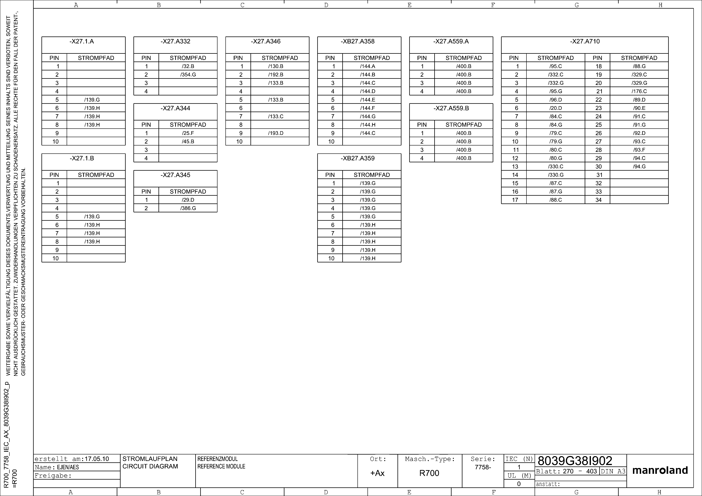

# +Ax — Sheet 270 of 403 — REFERENZMODUL

**REFERENCE MODULE**

> Part of the manroland **R700** printing press IEC/UL circuit diagrams.
> Drawing class: **Stromlaufplan / Circuit diagram** (DIN A3).
> Document `+Ax` covers the **Central control console** machine section.

## At a glance

| Field | Value |
|---|---|
| Document | `+Ax`  (8039G38I902) |
| Sheet | **270** of 403 |
| Section (DE) | REFERENZMODUL |
| Section (EN) | REFERENCE MODULE |
| Section type | REFERENCE_MODULE — Reference module |
| Machine type | `R700` |
| Series | `7758` |
| Created | 17.05.10 |
| Replaces | — |
| Columns used | A, B, C, D, E, F, G, H |
| Path numbers | — |
| Labels on sheet | 214 |
| Cross-refs out | 77 |
| Cross-refs in | 0 |

**Previous:** [+Ax sheet 269](SHEET_0269.md) · **Next:** [+Ax sheet 271](SHEET_0271.md) · **Document TOC:** [_TOC.md](_TOC.md)  (+Ax) · **Master TOC:** [all sheets](../_MASTER_TOC.md)

## Sheet image (300 DPI, exact vector render)



_Rendered directly from the PDF vector layer at 300 DPI (1-bit), no OCR and no resampling. Use it to confirm anything ambiguous in the text below._

## Cross-references on this sheet

Each entry is a wire leaving this sheet. The printed token is `/sheet.column`; the link resolves to that sheet inside the same document.

| Ref | Target sheet | Col | Path | Destination on target | Target section | From col |
|---|---|---|---|---|---|---|
| `/32.B` | [+Ax sheet 32](SHEET_0032.md) | B | — | — | SPANNUNGSVERSORGUNG, SCHALTSCHRANKBELÜFTUNG | B |
| `/130.B` | [+Ax sheet 130](SHEET_0130.md) | B | — | — | REALTIMERECHNER ANLAGE | C |
| `/144.A` | [+Ax sheet 144](SHEET_0144.md) | A | — | — | ÜBERWACHUNGSRECHNER SICHERHEITSBUS | D |
| `/400.B` | [+Ax sheet 400](SHEET_0400.md) | B | — | — | OPTION: DÜNNDRUCKEINRICHTUNG | F |
| `/88.G` | [+Ax sheet 88](SHEET_0088.md) | G | — | — | ANLEGER | H |
| `/95.C` | [+Ax sheet 95](SHEET_0095.md) | C | — | — | ANLEGER | G |
| `/192.B` | [+Ax sheet 192](SHEET_0192.md) | B | — | — | RESERVE | C |
| `/144.B` | [+Ax sheet 144](SHEET_0144.md) | B | — | — | ÜBERWACHUNGSRECHNER SICHERHEITSBUS | E |
| `/400.B` | [+Ax sheet 400](SHEET_0400.md) | B | — | — | OPTION: DÜNNDRUCKEINRICHTUNG | F |
| `/354.G` | [+Ax sheet 354](SHEET_0354.md) | G | — | — | OPTION: LOGISTIK ANLEGER | B |
| `/332.C` | [+Ax sheet 332](SHEET_0332.md) | C | — | — | OPTION: NONSTOP EINRICHTUNG MANUELL, ANLEGER | G |
| `/329.C` | [+Ax sheet 329](SHEET_0329.md) | C | — | — | OPTION: NONSTOP EINRICHTUNG MANUELL, ANLEGER | H |
| `/133.B` | [+Ax sheet 133](SHEET_0133.md) | B | — | — | REALTIMERECHNER DRUCKWERK | C |
| `/400.B` | [+Ax sheet 400](SHEET_0400.md) | B | — | — | OPTION: DÜNNDRUCKEINRICHTUNG | F |
| `/332.G` | [+Ax sheet 332](SHEET_0332.md) | G | — | — | OPTION: NONSTOP EINRICHTUNG MANUELL, ANLEGER | G |
| `/329.G` | [+Ax sheet 329](SHEET_0329.md) | G | — | — | OPTION: NONSTOP EINRICHTUNG MANUELL, ANLEGER | H |
| `/144.C` | [+Ax sheet 144](SHEET_0144.md) | C | — | — | ÜBERWACHUNGSRECHNER SICHERHEITSBUS | E |
| `/400.B` | [+Ax sheet 400](SHEET_0400.md) | B | — | — | OPTION: DÜNNDRUCKEINRICHTUNG | F |
| `/95.G` | [+Ax sheet 95](SHEET_0095.md) | G | — | — | ANLEGER | G |
| `/144.D` | [+Ax sheet 144](SHEET_0144.md) | D | — | — | ÜBERWACHUNGSRECHNER SICHERHEITSBUS | E |
| `/176.C` | [+Ax sheet 176](SHEET_0176.md) | C | — | — | RESERVE | H |
| `/133.B` | [+Ax sheet 133](SHEET_0133.md) | B | — | — | REALTIMERECHNER DRUCKWERK | C |
| `/144.E` | [+Ax sheet 144](SHEET_0144.md) | E | — | — | ÜBERWACHUNGSRECHNER SICHERHEITSBUS | E |
| `/139.G` | [+Ax sheet 139](SHEET_0139.md) | G | — | — | REALTIMERECHNER ANSTEUERUNG DER SPS POWERKARTE | A |
| `/96.D` | [+Ax sheet 96](SHEET_0096.md) | D | — | — | ANLEGER | G |
| `/89.D` | [+Ax sheet 89](SHEET_0089.md) | D | — | — | ANLEGER | H |
| `/90.E` | [+Ax sheet 90](SHEET_0090.md) | E | — | — | ANLEGER | H |
| `/144.F` | [+Ax sheet 144](SHEET_0144.md) | F | — | — | ÜBERWACHUNGSRECHNER SICHERHEITSBUS | E |
| `/20.D` | [+Ax sheet 20](SHEET_0020.md) | D | — | — | SPANNUNGSVERSORGUNG, SCHALTSCHRANKBELÜFTUNG | G |
| `/139.H` | [+Ax sheet 139](SHEET_0139.md) | H | — | — | REALTIMERECHNER ANSTEUERUNG DER SPS POWERKARTE | A |
| `/144.G` | [+Ax sheet 144](SHEET_0144.md) | G | — | — | ÜBERWACHUNGSRECHNER SICHERHEITSBUS | E |
| `/139.H` | [+Ax sheet 139](SHEET_0139.md) | H | — | — | REALTIMERECHNER ANSTEUERUNG DER SPS POWERKARTE | A |
| `/133.C` | [+Ax sheet 133](SHEET_0133.md) | C | — | — | REALTIMERECHNER DRUCKWERK | C |
| `/84.C` | [+Ax sheet 84](SHEET_0084.md) | C | — | — | ANLEGER | G |
| `/91.C` | [+Ax sheet 91](SHEET_0091.md) | C | — | — | ANLEGER | H |
| `/84.G` | [+Ax sheet 84](SHEET_0084.md) | G | — | — | ANLEGER | G |
| `/91.G` | [+Ax sheet 91](SHEET_0091.md) | G | — | — | ANLEGER | H |
| `/139.H` | [+Ax sheet 139](SHEET_0139.md) | H | — | — | REALTIMERECHNER ANSTEUERUNG DER SPS POWERKARTE | A |
| `/144.H` | [+Ax sheet 144](SHEET_0144.md) | H | — | — | ÜBERWACHUNGSRECHNER SICHERHEITSBUS | E |
| `/25.F` | [+Ax sheet 25](SHEET_0025.md) | F | — | — | SPANNUNGSVERSORGUNG, SCHALTSCHRANKBELÜFTUNG | B |
| `/400.B` | [+Ax sheet 400](SHEET_0400.md) | B | — | — | OPTION: DÜNNDRUCKEINRICHTUNG | F |
| `/79.C` | [+Ax sheet 79](SHEET_0079.md) | C | — | — | ANLEGER | G |
| `/92.D` | [+Ax sheet 92](SHEET_0092.md) | D | — | — | ANLEGER | H |
| `/193.D` | [+Ax sheet 193](SHEET_0193.md) | D | — | — | RESERVE | C |
| `/144.C` | [+Ax sheet 144](SHEET_0144.md) | C | — | — | ÜBERWACHUNGSRECHNER SICHERHEITSBUS | E |
| `/45.B` | [+Ax sheet 45](SHEET_0045.md) | B | — | — | HAUPTANTRIEB | B |
| `/400.B` | [+Ax sheet 400](SHEET_0400.md) | B | — | — | OPTION: DÜNNDRUCKEINRICHTUNG | F |
| `/79.G` | [+Ax sheet 79](SHEET_0079.md) | G | — | — | ANLEGER | G |
| `/93.C` | [+Ax sheet 93](SHEET_0093.md) | C | — | — | ANLEGER | H |
| `/400.B` | [+Ax sheet 400](SHEET_0400.md) | B | — | — | OPTION: DÜNNDRUCKEINRICHTUNG | F |
| `/93.F` | [+Ax sheet 93](SHEET_0093.md) | F | — | — | ANLEGER | H |
| `/80.C` | [+Ax sheet 80](SHEET_0080.md) | C | — | — | ANLEGER | G |
| `/400.B` | [+Ax sheet 400](SHEET_0400.md) | B | — | — | OPTION: DÜNNDRUCKEINRICHTUNG | F |
| `/80.G` | [+Ax sheet 80](SHEET_0080.md) | G | — | — | ANLEGER | G |
| `/94.C` | [+Ax sheet 94](SHEET_0094.md) | C | — | — | ANLEGER | H |
| `/94.G` | [+Ax sheet 94](SHEET_0094.md) | G | — | — | ANLEGER | H |
| `/330.C` | [+Ax sheet 330](SHEET_0330.md) | C | — | — | OPTION: NONSTOP EINRICHTUNG MANUELL, ANLEGER | G |
| `/330.G` | [+Ax sheet 330](SHEET_0330.md) | G | — | — | OPTION: NONSTOP EINRICHTUNG MANUELL, ANLEGER | G |
| `/139.G` | [+Ax sheet 139](SHEET_0139.md) | G | — | — | REALTIMERECHNER ANSTEUERUNG DER SPS POWERKARTE | E |
| `/87.C` | [+Ax sheet 87](SHEET_0087.md) | C | — | — | ANLEGER | G |
| `/87.G` | [+Ax sheet 87](SHEET_0087.md) | G | — | — | ANLEGER | G |
| `/139.G` | [+Ax sheet 139](SHEET_0139.md) | G | — | — | REALTIMERECHNER ANSTEUERUNG DER SPS POWERKARTE | E |
| `/29.D` | [+Ax sheet 29](SHEET_0029.md) | D | — | — | SPANNUNGSVERSORGUNG, SCHALTSCHRANKBELÜFTUNG | B |
| `/139.G` | [+Ax sheet 139](SHEET_0139.md) | G | — | — | REALTIMERECHNER ANSTEUERUNG DER SPS POWERKARTE | E |
| `/88.C` | [+Ax sheet 88](SHEET_0088.md) | C | — | — | ANLEGER | G |
| `/386.G` | [+Ax sheet 386](SHEET_0386.md) | G | — | — | OPTION: INLINECOATER SMART | B |
| `/139.G` | [+Ax sheet 139](SHEET_0139.md) | G | — | — | REALTIMERECHNER ANSTEUERUNG DER SPS POWERKARTE | E |
| `/139.G` | [+Ax sheet 139](SHEET_0139.md) | G | — | — | REALTIMERECHNER ANSTEUERUNG DER SPS POWERKARTE | A |
| `/139.G` | [+Ax sheet 139](SHEET_0139.md) | G | — | — | REALTIMERECHNER ANSTEUERUNG DER SPS POWERKARTE | E |
| `/139.H` | [+Ax sheet 139](SHEET_0139.md) | H | — | — | REALTIMERECHNER ANSTEUERUNG DER SPS POWERKARTE | A |
| `/139.H` | [+Ax sheet 139](SHEET_0139.md) | H | — | — | REALTIMERECHNER ANSTEUERUNG DER SPS POWERKARTE | E |
| `/139.H` | [+Ax sheet 139](SHEET_0139.md) | H | — | — | REALTIMERECHNER ANSTEUERUNG DER SPS POWERKARTE | A |
| `/139.H` | [+Ax sheet 139](SHEET_0139.md) | H | — | — | REALTIMERECHNER ANSTEUERUNG DER SPS POWERKARTE | E |
| `/139.H` | [+Ax sheet 139](SHEET_0139.md) | H | — | — | REALTIMERECHNER ANSTEUERUNG DER SPS POWERKARTE | A |
| `/139.H` | [+Ax sheet 139](SHEET_0139.md) | H | — | — | REALTIMERECHNER ANSTEUERUNG DER SPS POWERKARTE | E |
| `/139.H` | [+Ax sheet 139](SHEET_0139.md) | H | — | — | REALTIMERECHNER ANSTEUERUNG DER SPS POWERKARTE | E |
| `/139.H` | [+Ax sheet 139](SHEET_0139.md) | H | — | — | REALTIMERECHNER ANSTEUERUNG DER SPS POWERKARTE | E |

## Devices on this sheet

| Tag | Class | Class meaning (IEC) | Col | Sub | Terminal | Sign |
|---|---|---|---|---|---|---|
| `X27.1.A` | — | cross-device reference | A | — | — | — |
| `X27.1.B` | — | cross-device reference | A | — | — | — |
| `X27.A332` | — | cross-device reference | B | — | — | — |
| `X27.A344` | — | cross-device reference | B | — | — | — |
| `X27.A345` | — | cross-device reference | B | — | — | — |
| `X27.A346` | — | cross-device reference | C | — | — | — |
| `XB27.A358` | — | cross-device reference | D | — | — | — |
| `XB27.A359` | — | cross-device reference | D | — | — | — |
| `X27.A559.A` | — | cross-device reference | E | — | — | — |
| `X27.A559.B` | — | cross-device reference | F | — | — | — |
| `X27.A710` | — | cross-device reference | G | — | — | — |

## Potentials / nets

_No named potentials on this sheet._

## Wire-end annotations (grouped as printed)

A wire that continues elsewhere is annotated with a small cluster: the destination description, the path/line number `#NN`, and the `/sheet.column` cross reference. Each row below is one such cluster exactly as it is grouped on the drawing.

| Col | Y | Path | Cross-ref | Text on the wire |
|---|---|---|---|---|
| A | 65.5 | — | — | `X27.1.A` |
| B | 65.5 | — | — | `X27.A332` |
| C | 65.5 | — | — | `X27.A346` |
| D | 65.5 | — | — | `XB27.A358` |
| E | 65.5 | — | — | `X27.A559.A` |
| G | 65.5 | — | — | `X27.A710` |
| A | 94.2 | — | — | `PIN 10 2 3 4 5 6 7 8 9 1 STROMPFAD` |
| B | 94.2 | — | — | `PIN 2 3 4 1 STROMPFAD` |
| C | 94.2 | — | — | `PIN 10 2 3 4 5 6 7 8 9 1 STROMPFAD` |
| D | 94.2 | — | — | `PIN 10 2 3 4 5 6 7 8 9 1 STROMPFAD` |
| E | 94.2 | — | — | `PIN 2 3 4 1 STROMPFAD` |
| G | 94.2 | — | — | `PIN STROMPFAD` |
| H | 94.2 | — | — | `PIN 18 19 20 22 23 24 25 26 27 28 29 30 32 33 34 21 31 STROMPFAD` |
| F | 108.4 | — | — | `2 3 4 5 6 7 8 9 1` |
| B | 108.7 | — | `/32.B` | — |
| C | 108.7 | — | `/130.B` | — |
| D | 108.7 | — | `/144.A` | — |
| F | 108.7 | — | `/400.B` | — |
| G | 108.7 | — | `/95.C` | — |
| H | 108.7 | — | `/88.G` | — |
| B | 122.9 | — | `/354.G` | — |
| C | 122.9 | — | `/192.B` | — |
| E | 122.9 | — | `/144.B` | — |
| F | 122.9 | — | `/400.B` | — |
| G | 122.9 | — | `/332.C` | — |
| H | 122.9 | — | `/329.C` | — |
| C | 137.0 | — | `/133.B` | — |
| F | 137.0 | — | `/400.B` | — |
| E | 137.1 | — | `/144.C` | — |
| G | 137.1 | — | `/332.G` | — |
| H | 137.1 | — | `/329.G` | — |
| E | 151.2 | — | `/144.D` | — |
| F | 151.2 | — | `/400.B` | — |
| G | 151.2 | — | `/95.G` | — |
| H | 151.2 | — | `/176.C` | — |
| A | 165.4 | — | `/139.G` | — |
| C | 165.4 | — | `/133.B` | — |
| E | 165.4 | — | `/144.E` | — |
| G | 165.4 | — | `/96.D` | — |
| H | 165.4 | — | `/89.D` | — |
| B | 178.9 | — | — | `X27.A344` |
| F | 178.9 | — | — | `X27.A559.B` |
| H | 179.5 | — | `/90.E` | — |
| A | 179.6 | — | `/139.H` | — |
| E | 179.6 | — | `/144.F` | — |
| G | 179.6 | — | `/20.D` | — |
| E | 193.7 | — | `/144.G` | — |
| A | 193.8 | — | `/139.H` | — |
| C | 193.8 | — | `/133.C` | — |
| G | 193.8 | — | `/84.C` | — |
| H | 193.8 | — | `/91.C` | — |
| B | 207.5 | — | — | `PIN 2 3 4 1 STROMPFAD` |
| E | 207.5 | — | — | `PIN 2 3 4 1 STROMPFAD` |
| A | 207.9 | — | `/139.H` | — |
| E | 207.9 | — | `/144.H` | — |
| G | 207.9 | — | `/84.G` | — |
| H | 207.9 | — | `/91.G` | — |
| B | 222.1 | — | `/25.F` | — |
| C | 222.1 | — | `/193.D` | — |
| E | 222.1 | — | `/144.C` | — |
| F | 222.1 | — | `/400.B` | — |
| G | 222.1 | — | `/79.C` | — |
| H | 222.1 | — | `/92.D` | — |
| F | 235.9 | — | — | `10 12 13 14 15 16 17 11` |
| B | 236.2 | — | `/45.B` | — |
| F | 236.2 | — | `/400.B` | — |
| G | 236.2 | — | `/79.G` | — |
| H | 236.3 | — | `/93.C` | — |
| F | 250.4 | — | `/400.B` | — |
| G | 250.4 | — | `/80.C` | — |
| H | 250.4 | — | `/93.F` | — |
| A | 263.9 | — | — | `X27.1.B` |
| D | 263.9 | — | — | `XB27.A359` |
| F | 264.6 | — | `/400.B` | — |
| G | 264.6 | — | `/80.G` | — |
| H | 264.6 | — | `/94.C` | — |
| G | 278.8 | — | `/330.C` | — |
| H | 278.8 | — | `/94.G` | — |
| B | 292.3 | — | — | `X27.A345` |
| A | 292.6 | — | — | `PIN 10 2 3 4 5 6 7 8 9 1 STROMPFAD` |
| D | 292.6 | — | — | `PIN 10 2 3 4 5 6 7 8 9 1 STROMPFAD` |
| G | 293.0 | — | `/330.G` | — |
| E | 307.1 | — | `/139.G` | — |
| G | 307.1 | — | `/87.C` | — |
| B | 320.9 | — | — | `PIN 2 1 STROMPFAD` |
| E | 321.3 | — | `/139.G` | — |
| G | 321.3 | — | `/87.G` | — |
| B | 335.5 | — | `/29.D` | — |
| E | 335.5 | — | `/139.G` | — |
| G | 335.5 | — | `/88.C` | — |
| B | 349.6 | — | `/386.G` | — |
| E | 349.6 | — | `/139.G` | — |
| A | 363.8 | — | `/139.G` | — |
| E | 363.8 | — | `/139.G` | — |
| A | 378.0 | — | `/139.H` | — |
| E | 378.0 | — | `/139.H` | — |
| A | 392.2 | — | `/139.H` | — |
| E | 392.2 | — | `/139.H` | — |
| A | 406.4 | — | `/139.H` | — |
| E | 406.4 | — | `/139.H` | — |
| E | 420.5 | — | `/139.H` | — |
| E | 434.7 | — | `/139.H` | — |


## Reconstructed tables

This sheet carries tabular content (pin map / terminal assignment / index). The grid below was rebuilt from the drawing's own rule lines, so each row is exactly one physical row of the table.

### Table 1 — 22 data rows × 2 columns (at x=70.9, y=62.4) — **X27.1.A**

| PIN | STROMPFAD |
|---|---|
| `1` |  |
| `2` |  |
| `3` |  |
| `4` |  |
| `5` | `/139.G` |
| `6` | `/139.H` |
| `7` | `/139.H` |
| `8` | `/139.H` |
| `9` |  |
| `10` |  |
|  | `X27.1.B` |
| `PIN` | `STROMPFAD` |
| `1` |  |
| `2` |  |
| `3` |  |
| `4` |  |
| `5` | `/139.G` |
| `6` | `/139.H` |
| `7` | `/139.H` |
| `8` | `/139.H` |
| `9` |  |
| `10` |  |


### Table 2 — 14 data rows × 2 columns (at x=226.8, y=62.4) — **X27.A332**

| PIN | STROMPFAD |
|---|---|
| `1` | `/32.B` |
| `2` | `/354.G` |
| `3` |  |
| `4` |  |
|  | `X27.A344` |
| `PIN` | `STROMPFAD` |
| `1` | `/25.F` |
| `2` | `/45.B` |
| `3` |  |
| `4` |  |
|  | `X27.A345` |
| `PIN` | `STROMPFAD` |
| `1` | `/29.D` |
| `2` | `/386.G` |


### Table 3 — 10 data rows × 2 columns (at x=382.7, y=62.4) — **X27.A346**

| PIN | STROMPFAD |
|---|---|
| `1` | `/130.B` |
| `2` | `/192.B` |
| `3` | `/133.B` |
| `4` |  |
| `5` | `/133.B` |
| `6` |  |
| `7` | `/133.C` |
| `8` |  |
| `9` | `/193.D` |
| `10` |  |


### Table 4 — 22 data rows × 2 columns (at x=538.6, y=62.4) — **XB27.A358**

| PIN | STROMPFAD |
|---|---|
| `1` | `/144.A` |
| `2` | `/144.B` |
| `3` | `/144.C` |
| `4` | `/144.D` |
| `5` | `/144.E` |
| `6` | `/144.F` |
| `7` | `/144.G` |
| `8` | `/144.H` |
| `9` | `/144.C` |
| `10` |  |
|  | `XB27.A359` |
| `PIN` | `STROMPFAD` |
| `1` | `/139.G` |
| `2` | `/139.G` |
| `3` | `/139.G` |
| `4` | `/139.G` |
| `5` | `/139.G` |
| `6` | `/139.H` |
| `7` | `/139.H` |
| `8` | `/139.H` |
| `9` | `/139.H` |
| `10` | `/139.H` |


### Table 5 — 10 data rows × 2 columns (at x=694.5, y=62.4) — **X27.A559.A**

| PIN | STROMPFAD |
|---|---|
| `1` | `/400.B` |
| `2` | `/400.B` |
| `3` | `/400.B` |
| `4` | `/400.B` |
|  | `X27.A559.B` |
| `PIN` | `STROMPFAD` |
| `1` | `/400.B` |
| `2` | `/400.B` |
| `3` | `/400.B` |
| `4` | `/400.B` |


### Table 6 — 17 data rows × 4 columns (at x=850.4, y=62.4) — **X27.A710**

| PIN | STROMPFAD | PIN | STROMPFAD |
|---|---|---|---|
| `1` | `/95.C` | `18` | `/88.G` |
| `2` | `/332.C` | `19` | `/329.C` |
| `3` | `/332.G` | `20` | `/329.G` |
| `4` | `/95.G` | `21` | `/176.C` |
| `5` | `/96.D` | `22` | `/89.D` |
| `6` | `/20.D` | `23` | `/90.E` |
| `7` | `/84.C` | `24` | `/91.C` |
| `8` | `/84.G` | `25` | `/91.G` |
| `9` | `/79.C` | `26` | `/92.D` |
| `10` | `/79.G` | `27` | `/93.C` |
| `11` | `/80.C` | `28` | `/93.F` |
| `12` | `/80.G` | `29` | `/94.C` |
| `13` | `/330.C` | `30` | `/94.G` |
| `14` | `/330.G` | `31` |  |
| `15` | `/87.C` | `32` |  |
| `16` | `/87.G` | `33` |  |
| `17` | `/88.C` | `34` |  |


## Notes and free text on this sheet

| Text | Col | Y (pt) |
|---|---|---|
| `PIN` | A | 94.2 |
| `STROMPFAD` | A | 94.15 |
| `PIN` | B | 94.2 |
| `STROMPFAD` | B | 94.15 |
| `PIN` | C | 94.2 |
| `STROMPFAD` | C | 94.15 |
| `PIN` | D | 94.2 |
| `STROMPFAD` | E | 94.15 |
| `PIN` | E | 94.2 |
| `STROMPFAD` | F | 94.15 |
| `PIN` | F | 94.2 |
| `STROMPFAD` | G | 94.15 |
| `PIN` | G | 94.2 |
| `STROMPFAD` | H | 94.15 |

## Complete label inventory (exact text from the drawing)

Every text object inside the drawing area of this sheet, in DIN reading order (column A→H, then top→bottom). This is the authoritative list: if a string is not here it is not printed on this sheet.

| Col | Y | X | Dir | Type | Text |
|---|---|---|---|---|---|
| A | 65.5 | 118.1 | → | device ref | `X27.1.A` |
| A | 94.2 | 84.0 | → | text | `PIN` |
| A | 94.2 | 132.2 | → | text | `STROMPFAD` |
| A | 108.4 | 95.8 | → | number | `1` |
| A | 122.5 | 94.1 | → | number | `2` |
| A | 136.7 | 94.1 | → | number | `3` |
| A | 150.9 | 94.1 | → | number | `4` |
| A | 165.1 | 94.1 | → | number | `5` |
| A | 165.4 | 143.0 | → | cross-reference | `/139.G` |
| A | 179.2 | 94.1 | → | number | `6` |
| A | 179.6 | 143.4 | → | cross-reference | `/139.H` |
| A | 193.4 | 94.1 | → | number | `7` |
| A | 193.8 | 143.4 | → | cross-reference | `/139.H` |
| A | 207.6 | 94.1 | → | number | `8` |
| A | 207.9 | 143.4 | → | cross-reference | `/139.H` |
| A | 221.8 | 94.1 | → | number | `9` |
| A | 235.9 | 88.7 | → | number | `10` |
| A | 263.9 | 118.5 | → | device ref | `X27.1.B` |
| A | 292.6 | 84.0 | → | text | `PIN` |
| A | 292.6 | 132.2 | → | text | `STROMPFAD` |
| A | 306.8 | 95.8 | → | number | `1` |
| A | 321.0 | 94.1 | → | number | `2` |
| A | 335.1 | 94.1 | → | number | `3` |
| A | 349.3 | 94.1 | → | number | `4` |
| A | 363.5 | 94.1 | → | number | `5` |
| A | 363.8 | 143.0 | → | cross-reference | `/139.G` |
| A | 377.7 | 94.1 | → | number | `6` |
| A | 378.0 | 143.4 | → | cross-reference | `/139.H` |
| A | 391.8 | 94.1 | → | number | `7` |
| A | 392.2 | 143.4 | → | cross-reference | `/139.H` |
| A | 406.0 | 94.1 | → | number | `8` |
| A | 406.4 | 143.4 | → | cross-reference | `/139.H` |
| A | 420.2 | 94.1 | → | number | `9` |
| A | 434.4 | 88.7 | → | number | `10` |
| B | 65.5 | 272.7 | → | device ref | `X27.A332` |
| B | 94.2 | 240.0 | → | text | `PIN` |
| B | 94.2 | 288.1 | → | text | `STROMPFAD` |
| B | 108.4 | 245.9 | → | number | `1` |
| B | 108.7 | 308.7 | → | cross-reference | `/32.B` |
| B | 122.5 | 245.3 | → | number | `2` |
| B | 122.9 | 306.0 | → | cross-reference | `/354.G` |
| B | 136.7 | 245.3 | → | number | `3` |
| B | 150.9 | 245.3 | → | number | `4` |
| B | 178.9 | 272.7 | → | device ref | `X27.A344` |
| B | 207.5 | 288.1 | → | text | `STROMPFAD` |
| B | 207.6 | 240.0 | → | text | `PIN` |
| B | 221.8 | 245.9 | → | number | `1` |
| B | 222.1 | 309.0 | → | cross-reference | `/25.F` |
| B | 235.9 | 245.3 | → | number | `2` |
| B | 236.2 | 308.7 | → | cross-reference | `/45.B` |
| B | 250.1 | 245.3 | → | number | `3` |
| B | 264.3 | 245.3 | → | number | `4` |
| B | 292.3 | 272.7 | → | device ref | `X27.A345` |
| B | 320.9 | 288.1 | → | text | `STROMPFAD` |
| B | 321.0 | 240.0 | → | text | `PIN` |
| B | 335.1 | 245.9 | → | number | `1` |
| B | 335.5 | 308.6 | → | cross-reference | `/29.D` |
| B | 349.3 | 245.3 | → | number | `2` |
| B | 349.7 | 306.0 | → | cross-reference | `/386.G` |
| C | 65.5 | 425.8 | → | device ref | `X27.A346` |
| C | 94.2 | 395.9 | → | text | `PIN` |
| C | 94.2 | 444.0 | → | text | `STROMPFAD` |
| C | 108.4 | 407.6 | → | number | `1` |
| C | 108.7 | 455.1 | → | cross-reference | `/130.B` |
| C | 122.5 | 405.9 | → | number | `2` |
| C | 122.9 | 455.1 | → | cross-reference | `/192.B` |
| C | 136.7 | 405.9 | → | number | `3` |
| C | 137.0 | 455.1 | → | cross-reference | `/133.B` |
| C | 150.9 | 405.9 | → | number | `4` |
| C | 165.1 | 405.9 | → | number | `5` |
| C | 165.4 | 455.1 | → | cross-reference | `/133.B` |
| C | 179.2 | 405.9 | → | number | `6` |
| C | 193.4 | 405.9 | → | number | `7` |
| C | 193.8 | 455.0 | → | cross-reference | `/133.C` |
| C | 207.6 | 405.9 | → | number | `8` |
| C | 221.8 | 405.9 | → | number | `9` |
| C | 222.1 | 455.0 | → | cross-reference | `/193.D` |
| C | 235.9 | 400.5 | → | number | `10` |
| D | 65.5 | 578.1 | → | device ref | `XB27.A358` |
| D | 94.2 | 551.8 | → | text | `PIN` |
| D | 108.4 | 563.5 | → | number | `1` |
| D | 108.7 | 610.9 | → | cross-reference | `/144.A` |
| D | 122.5 | 561.8 | → | number | `2` |
| D | 136.7 | 561.8 | → | number | `3` |
| D | 150.9 | 561.8 | → | number | `4` |
| D | 165.1 | 561.8 | → | number | `5` |
| D | 179.2 | 561.8 | → | number | `6` |
| D | 193.4 | 561.8 | → | number | `7` |
| D | 207.6 | 561.8 | → | number | `8` |
| D | 221.8 | 561.8 | → | number | `9` |
| D | 235.9 | 556.4 | → | number | `10` |
| D | 263.9 | 578.1 | → | device ref | `XB27.A359` |
| D | 292.6 | 551.8 | → | text | `PIN` |
| D | 306.8 | 563.5 | → | number | `1` |
| D | 321.0 | 561.8 | → | number | `2` |
| D | 335.1 | 561.8 | → | number | `3` |
| D | 349.3 | 561.8 | → | number | `4` |
| D | 363.5 | 561.8 | → | number | `5` |
| D | 377.7 | 561.8 | → | number | `6` |
| D | 391.8 | 561.8 | → | number | `7` |
| D | 406.0 | 561.8 | → | number | `8` |
| D | 420.2 | 561.8 | → | number | `9` |
| D | 434.4 | 556.4 | → | number | `10` |
| E | 65.5 | 735.0 | → | device ref | `X27.A559.A` |
| E | 94.2 | 600.0 | → | text | `STROMPFAD` |
| E | 94.2 | 707.7 | → | text | `PIN` |
| E | 108.4 | 713.6 | → | number | `1` |
| E | 122.5 | 713.1 | → | number | `2` |
| E | 122.9 | 611.0 | → | cross-reference | `/144.B` |
| E | 136.7 | 713.1 | → | number | `3` |
| E | 137.1 | 610.9 | → | cross-reference | `/144.C` |
| E | 150.9 | 713.1 | → | number | `4` |
| E | 151.2 | 610.9 | → | cross-reference | `/144.D` |
| E | 165.4 | 611.1 | → | cross-reference | `/144.E` |
| E | 179.6 | 611.3 | → | cross-reference | `/144.F` |
| E | 193.7 | 610.7 | → | cross-reference | `/144.G` |
| E | 207.6 | 707.7 | → | text | `PIN` |
| E | 207.9 | 611.1 | → | cross-reference | `/144.H` |
| E | 221.8 | 713.6 | → | number | `1` |
| E | 222.1 | 610.9 | → | cross-reference | `/144.C` |
| E | 235.9 | 713.1 | → | number | `2` |
| E | 250.1 | 713.1 | → | number | `3` |
| E | 264.3 | 713.1 | → | number | `4` |
| E | 292.6 | 600.0 | → | text | `STROMPFAD` |
| E | 307.1 | 610.7 | → | cross-reference | `/139.G` |
| E | 321.3 | 610.7 | → | cross-reference | `/139.G` |
| E | 335.5 | 610.7 | → | cross-reference | `/139.G` |
| E | 349.7 | 610.7 | → | cross-reference | `/139.G` |
| E | 363.8 | 610.7 | → | cross-reference | `/139.G` |
| E | 378.0 | 611.1 | → | cross-reference | `/139.H` |
| E | 392.2 | 611.1 | → | cross-reference | `/139.H` |
| E | 406.4 | 611.1 | → | cross-reference | `/139.H` |
| E | 420.5 | 611.1 | → | cross-reference | `/139.H` |
| E | 434.7 | 611.1 | → | cross-reference | `/139.H` |
| F | 94.2 | 755.9 | → | text | `STROMPFAD` |
| F | 94.2 | 863.6 | → | text | `PIN` |
| F | 108.4 | 875.3 | → | number | `1` |
| F | 108.7 | 774.0 | → | cross-reference | `/400.B` |
| F | 122.5 | 873.6 | → | number | `2` |
| F | 122.9 | 774.0 | → | cross-reference | `/400.B` |
| F | 136.7 | 873.6 | → | number | `3` |
| F | 137.0 | 774.0 | → | cross-reference | `/400.B` |
| F | 150.9 | 873.6 | → | number | `4` |
| F | 151.2 | 774.0 | → | cross-reference | `/400.B` |
| F | 165.1 | 873.6 | → | number | `5` |
| F | 178.9 | 735.4 | → | device ref | `X27.A559.B` |
| F | 179.2 | 873.6 | → | number | `6` |
| F | 193.4 | 873.6 | → | number | `7` |
| F | 207.5 | 755.9 | → | text | `STROMPFAD` |
| F | 207.6 | 873.6 | → | number | `8` |
| F | 221.8 | 873.6 | → | number | `9` |
| F | 222.1 | 774.0 | → | cross-reference | `/400.B` |
| F | 235.9 | 868.3 | → | number | `10` |
| F | 236.2 | 774.0 | → | cross-reference | `/400.B` |
| F | 250.1 | 870.0 | → | number | `11` |
| F | 250.4 | 774.0 | → | cross-reference | `/400.B` |
| F | 264.3 | 868.3 | → | number | `12` |
| F | 264.6 | 774.0 | → | cross-reference | `/400.B` |
| F | 278.5 | 868.3 | → | number | `13` |
| F | 292.6 | 868.3 | → | number | `14` |
| F | 306.8 | 868.3 | → | number | `15` |
| F | 321.0 | 868.3 | → | number | `16` |
| F | 335.1 | 868.3 | → | number | `17` |
| G | 65.5 | 967.2 | → | device ref | `X27.A710` |
| G | 94.2 | 911.8 | → | text | `STROMPFAD` |
| G | 94.2 | 1005.3 | → | text | `PIN` |
| G | 108.4 | 1010.0 | → | number | `18` |
| G | 108.7 | 932.2 | → | cross-reference | `/95.C` |
| G | 122.5 | 1010.0 | → | number | `19` |
| G | 122.9 | 929.8 | → | cross-reference | `/332.C` |
| G | 136.7 | 1010.0 | → | number | `20` |
| G | 137.1 | 929.6 | → | cross-reference | `/332.G` |
| G | 150.9 | 1011.7 | → | number | `21` |
| G | 151.2 | 932.0 | → | cross-reference | `/95.G` |
| G | 165.1 | 1010.0 | → | number | `22` |
| G | 165.4 | 932.2 | → | cross-reference | `/96.D` |
| G | 179.2 | 1010.0 | → | number | `23` |
| G | 179.6 | 932.2 | → | cross-reference | `/20.D` |
| G | 193.4 | 1010.0 | → | number | `24` |
| G | 193.7 | 932.2 | → | cross-reference | `/84.C` |
| G | 207.6 | 1010.0 | → | number | `25` |
| G | 207.9 | 932.0 | → | cross-reference | `/84.G` |
| G | 221.8 | 1010.0 | → | number | `26` |
| G | 222.1 | 932.2 | → | cross-reference | `/79.C` |
| G | 235.9 | 1010.0 | → | number | `27` |
| G | 236.3 | 932.0 | → | cross-reference | `/79.G` |
| G | 250.1 | 1010.0 | → | number | `28` |
| G | 250.4 | 932.2 | → | cross-reference | `/80.C` |
| G | 264.3 | 1010.0 | → | number | `29` |
| G | 264.6 | 932.0 | → | cross-reference | `/80.G` |
| G | 278.5 | 1010.0 | → | number | `30` |
| G | 278.8 | 929.8 | → | cross-reference | `/330.C` |
| G | 292.6 | 1011.7 | → | number | `31` |
| G | 293.0 | 929.6 | → | cross-reference | `/330.G` |
| G | 306.8 | 1010.0 | → | number | `32` |
| G | 307.1 | 932.2 | → | cross-reference | `/87.C` |
| G | 321.0 | 1010.0 | → | number | `33` |
| G | 321.3 | 932.0 | → | cross-reference | `/87.G` |
| G | 335.1 | 1010.0 | → | number | `34` |
| G | 335.5 | 932.2 | → | cross-reference | `/88.C` |
| H | 94.2 | 1053.5 | → | text | `STROMPFAD` |
| H | 108.7 | 1073.8 | → | cross-reference | `/88.G` |
| H | 122.9 | 1071.5 | → | cross-reference | `/329.C` |
| H | 137.1 | 1071.4 | → | cross-reference | `/329.G` |
| H | 151.2 | 1071.5 | → | cross-reference | `/176.C` |
| H | 165.4 | 1073.9 | → | cross-reference | `/89.D` |
| H | 179.5 | 1074.2 | → | cross-reference | `/90.E` |
| H | 193.7 | 1073.9 | → | cross-reference | `/91.C` |
| H | 207.9 | 1073.8 | → | cross-reference | `/91.G` |
| H | 222.1 | 1073.9 | → | cross-reference | `/92.D` |
| H | 236.3 | 1073.9 | → | cross-reference | `/93.C` |
| H | 250.4 | 1074.3 | → | cross-reference | `/93.F` |
| H | 264.6 | 1073.9 | → | cross-reference | `/94.C` |
| H | 278.8 | 1073.8 | → | cross-reference | `/94.G` |

## Reading-order text block

The same content as a plain block, grouped by DIN column — convenient to paste or to match against a visual description.

```text
=== Column A ===
  65.5  118.1  devref       X27.1.A
  94.2   84.0  text         PIN
  94.2  132.2  text         STROMPFAD
 108.4   95.8  numeric      1
 122.5   94.1  numeric      2
 136.7   94.1  numeric      3
 150.9   94.1  numeric      4
 165.1   94.1  numeric      5
 165.4  143.0  xref         /139.G
 179.2   94.1  numeric      6
 179.6  143.4  xref         /139.H
 193.4   94.1  numeric      7
 193.8  143.4  xref         /139.H
 207.6   94.1  numeric      8
 207.9  143.4  xref         /139.H
 221.8   94.1  numeric      9
 235.9   88.7  numeric      10
 263.9  118.5  devref       X27.1.B
 292.6   84.0  text         PIN
 292.6  132.2  text         STROMPFAD
 306.8   95.8  numeric      1
 321.0   94.1  numeric      2
 335.1   94.1  numeric      3
 349.3   94.1  numeric      4
 363.5   94.1  numeric      5
 363.8  143.0  xref         /139.G
 377.7   94.1  numeric      6
 378.0  143.4  xref         /139.H
 391.8   94.1  numeric      7
 392.2  143.4  xref         /139.H
 406.0   94.1  numeric      8
 406.4  143.4  xref         /139.H
 420.2   94.1  numeric      9
 434.4   88.7  numeric      10
=== Column B ===
  65.5  272.7  devref       X27.A332
  94.2  240.0  text         PIN
  94.2  288.1  text         STROMPFAD
 108.4  245.9  numeric      1
 108.7  308.7  xref         /32.B
 122.5  245.3  numeric      2
 122.9  306.0  xref         /354.G
 136.7  245.3  numeric      3
 150.9  245.3  numeric      4
 178.9  272.7  devref       X27.A344
 207.5  288.1  text         STROMPFAD
 207.6  240.0  text         PIN
 221.8  245.9  numeric      1
 222.1  309.0  xref         /25.F
 235.9  245.3  numeric      2
 236.2  308.7  xref         /45.B
 250.1  245.3  numeric      3
 264.3  245.3  numeric      4
 292.3  272.7  devref       X27.A345
 320.9  288.1  text         STROMPFAD
 321.0  240.0  text         PIN
 335.1  245.9  numeric      1
 335.5  308.6  xref         /29.D
 349.3  245.3  numeric      2
 349.7  306.0  xref         /386.G
=== Column C ===
  65.5  425.8  devref       X27.A346
  94.2  395.9  text         PIN
  94.2  444.0  text         STROMPFAD
 108.4  407.6  numeric      1
 108.7  455.1  xref         /130.B
 122.5  405.9  numeric      2
 122.9  455.1  xref         /192.B
 136.7  405.9  numeric      3
 137.0  455.1  xref         /133.B
 150.9  405.9  numeric      4
 165.1  405.9  numeric      5
 165.4  455.1  xref         /133.B
 179.2  405.9  numeric      6
 193.4  405.9  numeric      7
 193.8  455.0  xref         /133.C
 207.6  405.9  numeric      8
 221.8  405.9  numeric      9
 222.1  455.0  xref         /193.D
 235.9  400.5  numeric      10
=== Column D ===
  65.5  578.1  devref       XB27.A358
  94.2  551.8  text         PIN
 108.4  563.5  numeric      1
 108.7  610.9  xref         /144.A
 122.5  561.8  numeric      2
 136.7  561.8  numeric      3
 150.9  561.8  numeric      4
 165.1  561.8  numeric      5
 179.2  561.8  numeric      6
 193.4  561.8  numeric      7
 207.6  561.8  numeric      8
 221.8  561.8  numeric      9
 235.9  556.4  numeric      10
 263.9  578.1  devref       XB27.A359
 292.6  551.8  text         PIN
 306.8  563.5  numeric      1
 321.0  561.8  numeric      2
 335.1  561.8  numeric      3
 349.3  561.8  numeric      4
 363.5  561.8  numeric      5
 377.7  561.8  numeric      6
 391.8  561.8  numeric      7
 406.0  561.8  numeric      8
 420.2  561.8  numeric      9
 434.4  556.4  numeric      10
=== Column E ===
  65.5  735.0  devref       X27.A559.A
  94.2  600.0  text         STROMPFAD
  94.2  707.7  text         PIN
 108.4  713.6  numeric      1
 122.5  713.1  numeric      2
 122.9  611.0  xref         /144.B
 136.7  713.1  numeric      3
 137.1  610.9  xref         /144.C
 150.9  713.1  numeric      4
 151.2  610.9  xref         /144.D
 165.4  611.1  xref         /144.E
 179.6  611.3  xref         /144.F
 193.7  610.7  xref         /144.G
 207.6  707.7  text         PIN
 207.9  611.1  xref         /144.H
 221.8  713.6  numeric      1
 222.1  610.9  xref         /144.C
 235.9  713.1  numeric      2
 250.1  713.1  numeric      3
 264.3  713.1  numeric      4
 292.6  600.0  text         STROMPFAD
 307.1  610.7  xref         /139.G
 321.3  610.7  xref         /139.G
 335.5  610.7  xref         /139.G
 349.7  610.7  xref         /139.G
 363.8  610.7  xref         /139.G
 378.0  611.1  xref         /139.H
 392.2  611.1  xref         /139.H
 406.4  611.1  xref         /139.H
 420.5  611.1  xref         /139.H
 434.7  611.1  xref         /139.H
=== Column F ===
  94.2  755.9  text         STROMPFAD
  94.2  863.6  text         PIN
 108.4  875.3  numeric      1
 108.7  774.0  xref         /400.B
 122.5  873.6  numeric      2
 122.9  774.0  xref         /400.B
 136.7  873.6  numeric      3
 137.0  774.0  xref         /400.B
 150.9  873.6  numeric      4
 151.2  774.0  xref         /400.B
 165.1  873.6  numeric      5
 178.9  735.4  devref       X27.A559.B
 179.2  873.6  numeric      6
 193.4  873.6  numeric      7
 207.5  755.9  text         STROMPFAD
 207.6  873.6  numeric      8
 221.8  873.6  numeric      9
 222.1  774.0  xref         /400.B
 235.9  868.3  numeric      10
 236.2  774.0  xref         /400.B
 250.1  870.0  numeric      11
 250.4  774.0  xref         /400.B
 264.3  868.3  numeric      12
 264.6  774.0  xref         /400.B
 278.5  868.3  numeric      13
 292.6  868.3  numeric      14
 306.8  868.3  numeric      15
 321.0  868.3  numeric      16
 335.1  868.3  numeric      17
=== Column G ===
  65.5  967.2  devref       X27.A710
  94.2  911.8  text         STROMPFAD
  94.2 1005.3  text         PIN
 108.4 1010.0  numeric      18
 108.7  932.2  xref         /95.C
 122.5 1010.0  numeric      19
 122.9  929.8  xref         /332.C
 136.7 1010.0  numeric      20
 137.1  929.6  xref         /332.G
 150.9 1011.7  numeric      21
 151.2  932.0  xref         /95.G
 165.1 1010.0  numeric      22
 165.4  932.2  xref         /96.D
 179.2 1010.0  numeric      23
 179.6  932.2  xref         /20.D
 193.4 1010.0  numeric      24
 193.7  932.2  xref         /84.C
 207.6 1010.0  numeric      25
 207.9  932.0  xref         /84.G
 221.8 1010.0  numeric      26
 222.1  932.2  xref         /79.C
 235.9 1010.0  numeric      27
 236.3  932.0  xref         /79.G
 250.1 1010.0  numeric      28
 250.4  932.2  xref         /80.C
 264.3 1010.0  numeric      29
 264.6  932.0  xref         /80.G
 278.5 1010.0  numeric      30
 278.8  929.8  xref         /330.C
 292.6 1011.7  numeric      31
 293.0  929.6  xref         /330.G
 306.8 1010.0  numeric      32
 307.1  932.2  xref         /87.C
 321.0 1010.0  numeric      33
 321.3  932.0  xref         /87.G
 335.1 1010.0  numeric      34
 335.5  932.2  xref         /88.C
=== Column H ===
  94.2 1053.5  text         STROMPFAD
 108.7 1073.8  xref         /88.G
 122.9 1071.5  xref         /329.C
 137.1 1071.4  xref         /329.G
 151.2 1071.5  xref         /176.C
 165.4 1073.9  xref         /89.D
 179.5 1074.2  xref         /90.E
 193.7 1073.9  xref         /91.C
 207.9 1073.8  xref         /91.G
 222.1 1073.9  xref         /92.D
 236.3 1073.9  xref         /93.C
 250.4 1074.3  xref         /93.F
 264.6 1073.9  xref         /94.C
 278.8 1073.8  xref         /94.G
```

---
_Generated from the PDF vector text layer; no OCR. Source: `R700_7758_IEC_AX_8039G38I902_p`, sheet 270._
