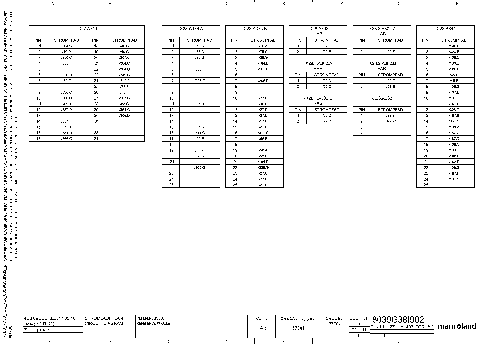

# +Ax — Sheet 271 of 403 — REFERENZMODUL

**REFERENCE MODULE**

> Part of the manroland **R700** printing press IEC/UL circuit diagrams.
> Drawing class: **Stromlaufplan / Circuit diagram** (DIN A3).
> Document `+Ax` covers the **Central control console** machine section.

## At a glance

| Field | Value |
|---|---|
| Document | `+Ax`  (8039G38I902) |
| Sheet | **271** of 403 |
| Section (DE) | REFERENZMODUL |
| Section (EN) | REFERENCE MODULE |
| Section type | REFERENCE_MODULE — Reference module |
| Machine type | `R700` |
| Series | `7758` |
| Created | 17.05.10 |
| Replaces | — |
| Columns used | A, B, C, D, E, F, G, H |
| Path numbers | — |
| Labels on sheet | 256 |
| Cross-refs out | 96 |
| Cross-refs in | 0 |

**Previous:** [+Ax sheet 270](SHEET_0270.md) · **Next:** [+Ax sheet 272](SHEET_0272.md) · **Document TOC:** [_TOC.md](_TOC.md)  (+Ax) · **Master TOC:** [all sheets](../_MASTER_TOC.md)

## Sheet image (300 DPI, exact vector render)



_Rendered directly from the PDF vector layer at 300 DPI (1-bit), no OCR and no resampling. Use it to confirm anything ambiguous in the text below._

## Cross-references on this sheet

Each entry is a wire leaving this sheet. The printed token is `/sheet.column`; the link resolves to that sheet inside the same document.

| Ref | Target sheet | Col | Path | Destination on target | Target section | From col |
|---|---|---|---|---|---|---|
| `/75.A` | [+Ax sheet 75](SHEET_0075.md) | A | — | — | FEUCHTMITTELKÜHLGERÄT | D |
| `/75.A` | [+Ax sheet 75](SHEET_0075.md) | A | — | — | FEUCHTMITTELKÜHLGERÄT | E |
| `/22.F` | [+Ax sheet 22](SHEET_0022.md) | F | — | — | SPANNUNGSVERSORGUNG, SCHALTSCHRANKBELÜFTUNG | G |
| `/106.B` | [+Ax sheet 106](SHEET_0106.md) | B | — | — | ANLEGER | H |
| `/40.C` | [+Ax sheet 40](SHEET_0040.md) | C | — | — | HAUPTANTRIEB | B |
| `/22.D` | [+Ax sheet 22](SHEET_0022.md) | D | — | — | SPANNUNGSVERSORGUNG, SCHALTSCHRANKBELÜFTUNG | F |
| `/364.C` | [+Ax sheet 364](SHEET_0364.md) | C | — | — | OPTION: LOGISTIK AUSLEGER | A |
| `/22.E` | [+Ax sheet 22](SHEET_0022.md) | E | — | — | SPANNUNGSVERSORGUNG, SCHALTSCHRANKBELÜFTUNG | F |
| `/22.F` | [+Ax sheet 22](SHEET_0022.md) | F | — | — | SPANNUNGSVERSORGUNG, SCHALTSCHRANKBELÜFTUNG | G |
| `/328.B` | [+Ax sheet 328](SHEET_0328.md) | B | — | — | OPTION: NONSTOP EINRICHTUNG MANUELL, ANLEGER | H |
| `/40.G` | [+Ax sheet 40](SHEET_0040.md) | G | — | — | HAUPTANTRIEB | B |
| `/49.D` | [+Ax sheet 49](SHEET_0049.md) | D | — | — | NOT AUS | A |
| `/75.C` | [+Ax sheet 75](SHEET_0075.md) | C | — | — | FEUCHTMITTELKÜHLGERÄT | D |
| `/75.C` | [+Ax sheet 75](SHEET_0075.md) | C | — | — | FEUCHTMITTELKÜHLGERÄT | E |
| `/39.G` | [+Ax sheet 39](SHEET_0039.md) | G | — | — | HAUPTANTRIEB | D |
| `/39.G` | [+Ax sheet 39](SHEET_0039.md) | G | — | — | HAUPTANTRIEB | E |
| `/350.C` | [+Ax sheet 350](SHEET_0350.md) | C | — | — | OPTION: LOGISTIK ANLEGER | A |
| `/367.C` | [+Ax sheet 367](SHEET_0367.md) | C | — | — | OPTION: LOGISTIK AUSLEGER | B |
| `/106.C` | [+Ax sheet 106](SHEET_0106.md) | C | — | — | ANLEGER | H |
| `/184.B` | [+Ax sheet 184](SHEET_0184.md) | B | — | — | RESERVE | E |
| `/350.F` | [+Ax sheet 350](SHEET_0350.md) | F | — | — | OPTION: LOGISTIK ANLEGER | A |
| `/384.C` | [+Ax sheet 384](SHEET_0384.md) | C | — | — | OPTION: INLINEFOILER PRINDOR | B |
| `/106.D` | [+Ax sheet 106](SHEET_0106.md) | D | — | — | ANLEGER | H |
| `/106.E` | [+Ax sheet 106](SHEET_0106.md) | E | — | — | ANLEGER | H |
| `/305.F` | [+Ax sheet 305](SHEET_0305.md) | F | — | — | SCHÖN & WIDERDRUCK HAUPTSCHALTSCHRANK | D |
| `/305.F` | [+Ax sheet 305](SHEET_0305.md) | F | — | — | SCHÖN & WIDERDRUCK HAUPTSCHALTSCHRANK | E |
| `/384.G` | [+Ax sheet 384](SHEET_0384.md) | G | — | — | OPTION: INLINEFOILER PRINDOR | B |
| `/45.B` | [+Ax sheet 45](SHEET_0045.md) | B | — | — | HAUPTANTRIEB | H |
| `/356.D` | [+Ax sheet 356](SHEET_0356.md) | D | — | — | OPTION: LOGISTIK ANLEGER | A |
| `/349.C` | [+Ax sheet 349](SHEET_0349.md) | C | — | — | OPTION: LOGISTIK ANLEGER | B |
| `/53.E` | [+Ax sheet 53](SHEET_0053.md) | E | — | — | SIGNALGEBER: AKUSTISCHE WARNSIGNALE | A |
| `/22.E` | [+Ax sheet 22](SHEET_0022.md) | E | — | — | SPANNUNGSVERSORGUNG, SCHALTSCHRANKBELÜFTUNG | G |
| `/45.B` | [+Ax sheet 45](SHEET_0045.md) | B | — | — | HAUPTANTRIEB | H |
| `/305.E` | [+Ax sheet 305](SHEET_0305.md) | E | — | — | SCHÖN & WIDERDRUCK HAUPTSCHALTSCHRANK | D |
| `/305.E` | [+Ax sheet 305](SHEET_0305.md) | E | — | — | SCHÖN & WIDERDRUCK HAUPTSCHALTSCHRANK | E |
| `/349.F` | [+Ax sheet 349](SHEET_0349.md) | F | — | — | OPTION: LOGISTIK ANLEGER | B |
| `/22.D` | [+Ax sheet 22](SHEET_0022.md) | D | — | — | SPANNUNGSVERSORGUNG, SCHALTSCHRANKBELÜFTUNG | F |
| `/22.E` | [+Ax sheet 22](SHEET_0022.md) | E | — | — | SPANNUNGSVERSORGUNG, SCHALTSCHRANKBELÜFTUNG | G |
| `/77.F` | [+Ax sheet 77](SHEET_0077.md) | F | — | — | ANLEGER | B |
| `/22.D` | [+Ax sheet 22](SHEET_0022.md) | D | — | — | SPANNUNGSVERSORGUNG, SCHALTSCHRANKBELÜFTUNG | F |
| `/106.G` | [+Ax sheet 106](SHEET_0106.md) | G | — | — | ANLEGER | H |
| `/78.F` | [+Ax sheet 78](SHEET_0078.md) | F | — | — | ANLEGER | B |
| `/107.B` | [+Ax sheet 107](SHEET_0107.md) | B | — | — | ANLEGER | H |
| `/338.C` | [+Ax sheet 338](SHEET_0338.md) | C | — | — | OPTION: INLINESHEETER RS104 S | A |
| `/366.C` | [+Ax sheet 366](SHEET_0366.md) | C | — | — | OPTION: LOGISTIK AUSLEGER | A |
| `/183.C` | [+Ax sheet 183](SHEET_0183.md) | C | — | — | RESERVE | B |
| `/27.C` | [+Ax sheet 27](SHEET_0027.md) | C | — | — | SPANNUNGSVERSORGUNG, SCHALTSCHRANKBELÜFTUNG | E |
| `/107.C` | [+Ax sheet 107](SHEET_0107.md) | C | — | — | ANLEGER | H |
| `/107.E` | [+Ax sheet 107](SHEET_0107.md) | E | — | — | ANLEGER | H |
| `/83.G` | [+Ax sheet 83](SHEET_0083.md) | G | — | — | ANLEGER | B |
| `/47.D` | [+Ax sheet 47](SHEET_0047.md) | D | — | — | NOT AUS | A |
| `/35.D` | [+Ax sheet 35](SHEET_0035.md) | D | — | — | SCHMIERUNG | D |
| `/35.D` | [+Ax sheet 35](SHEET_0035.md) | D | — | — | SCHMIERUNG | E |
| `/364.G` | [+Ax sheet 364](SHEET_0364.md) | G | — | — | OPTION: LOGISTIK AUSLEGER | B |
| `/27.D` | [+Ax sheet 27](SHEET_0027.md) | D | — | — | SPANNUNGSVERSORGUNG, SCHALTSCHRANKBELÜFTUNG | E |
| `/357.D` | [+Ax sheet 357](SHEET_0357.md) | D | — | — | OPTION: LOGISTIK ANLEGER | A |
| `/328.D` | [+Ax sheet 328](SHEET_0328.md) | D | — | — | OPTION: NONSTOP EINRICHTUNG MANUELL, ANLEGER | H |
| `/32.B` | [+Ax sheet 32](SHEET_0032.md) | B | — | — | SPANNUNGSVERSORGUNG, SCHALTSCHRANKBELÜFTUNG | G |
| `/187.B` | [+Ax sheet 187](SHEET_0187.md) | B | — | — | RESERVE | H |
| `/365.D` | [+Ax sheet 365](SHEET_0365.md) | D | — | — | OPTION: LOGISTIK AUSLEGER | B |
| `/27.D` | [+Ax sheet 27](SHEET_0027.md) | D | — | — | SPANNUNGSVERSORGUNG, SCHALTSCHRANKBELÜFTUNG | E |
| `/22.D` | [+Ax sheet 22](SHEET_0022.md) | D | — | — | SPANNUNGSVERSORGUNG, SCHALTSCHRANKBELÜFTUNG | F |
| `/27.B` | [+Ax sheet 27](SHEET_0027.md) | B | — | — | SPANNUNGSVERSORGUNG, SCHALTSCHRANKBELÜFTUNG | E |
| `/354.E` | [+Ax sheet 354](SHEET_0354.md) | E | — | — | OPTION: LOGISTIK ANLEGER | A |
| `/22.D` | [+Ax sheet 22](SHEET_0022.md) | D | — | — | SPANNUNGSVERSORGUNG, SCHALTSCHRANKBELÜFTUNG | F |
| `/354.G` | [+Ax sheet 354](SHEET_0354.md) | G | — | — | OPTION: LOGISTIK ANLEGER | H |
| `/106.C` | [+Ax sheet 106](SHEET_0106.md) | C | — | — | ANLEGER | G |
| `/108.A` | [+Ax sheet 108](SHEET_0108.md) | A | — | — | ANLEGER | H |
| `/39.D` | [+Ax sheet 39](SHEET_0039.md) | D | — | — | HAUPTANTRIEB | A |
| `/27.C` | [+Ax sheet 27](SHEET_0027.md) | C | — | — | SPANNUNGSVERSORGUNG, SCHALTSCHRANKBELÜFTUNG | D |
| `/27.C` | [+Ax sheet 27](SHEET_0027.md) | C | — | — | SPANNUNGSVERSORGUNG, SCHALTSCHRANKBELÜFTUNG | E |
| `/351.D` | [+Ax sheet 351](SHEET_0351.md) | D | — | — | OPTION: LOGISTIK ANLEGER | A |
| `/311.C` | [+Ax sheet 311](SHEET_0311.md) | C | — | — | OPTION: IONISATIONSANLAGE ANLEGER | D |
| `/311.C` | [+Ax sheet 311](SHEET_0311.md) | C | — | — | OPTION: IONISATIONSANLAGE ANLEGER | E |
| `/187.C` | [+Ax sheet 187](SHEET_0187.md) | C | — | — | RESERVE | H |
| `/56.E` | [+Ax sheet 56](SHEET_0056.md) | E | — | — | LUFTVERSORGUNG | D |
| `/56.E` | [+Ax sheet 56](SHEET_0056.md) | E | — | — | LUFTVERSORGUNG | E |
| `/366.G` | [+Ax sheet 366](SHEET_0366.md) | G | — | — | OPTION: LOGISTIK AUSLEGER | A |
| `/187.D` | [+Ax sheet 187](SHEET_0187.md) | D | — | — | RESERVE | H |
| `/108.C` | [+Ax sheet 108](SHEET_0108.md) | C | — | — | ANLEGER | H |
| `/58.A` | [+Ax sheet 58](SHEET_0058.md) | A | — | — | LUFTVERSORGUNG | D |
| `/58.A` | [+Ax sheet 58](SHEET_0058.md) | A | — | — | LUFTVERSORGUNG | E |
| `/108.D` | [+Ax sheet 108](SHEET_0108.md) | D | — | — | ANLEGER | H |
| `/108.E` | [+Ax sheet 108](SHEET_0108.md) | E | — | — | ANLEGER | H |
| `/58.C` | [+Ax sheet 58](SHEET_0058.md) | C | — | — | LUFTVERSORGUNG | D |
| `/58.C` | [+Ax sheet 58](SHEET_0058.md) | C | — | — | LUFTVERSORGUNG | E |
| `/108.F` | [+Ax sheet 108](SHEET_0108.md) | F | — | — | ANLEGER | H |
| `/184.D` | [+Ax sheet 184](SHEET_0184.md) | D | — | — | RESERVE | E |
| `/305.G` | [+Ax sheet 305](SHEET_0305.md) | G | — | — | SCHÖN & WIDERDRUCK HAUPTSCHALTSCHRANK | D |
| `/305.G` | [+Ax sheet 305](SHEET_0305.md) | G | — | — | SCHÖN & WIDERDRUCK HAUPTSCHALTSCHRANK | E |
| `/108.G` | [+Ax sheet 108](SHEET_0108.md) | G | — | — | ANLEGER | H |
| `/187.F` | [+Ax sheet 187](SHEET_0187.md) | F | — | — | RESERVE | H |
| `/27.C` | [+Ax sheet 27](SHEET_0027.md) | C | — | — | SPANNUNGSVERSORGUNG, SCHALTSCHRANKBELÜFTUNG | E |
| `/27.C` | [+Ax sheet 27](SHEET_0027.md) | C | — | — | SPANNUNGSVERSORGUNG, SCHALTSCHRANKBELÜFTUNG | E |
| `/187.G` | [+Ax sheet 187](SHEET_0187.md) | G | — | — | RESERVE | H |
| `/27.D` | [+Ax sheet 27](SHEET_0027.md) | D | — | — | SPANNUNGSVERSORGUNG, SCHALTSCHRANKBELÜFTUNG | E |

## Devices on this sheet

| Tag | Class | Class meaning (IEC) | Col | Sub | Terminal | Sign |
|---|---|---|---|---|---|---|
| `X27.A711` | — | cross-device reference | B | — | — | — |
| `X28.A376.B` | — | cross-device reference | E | — | — | — |
| `X28.A376.A` | — | cross-device reference | C | — | — | — |
| `X28.2.A302.A` | — | cross-device reference | G | — | — | — |
| `X28.2.A302.B` | — | cross-device reference | G | — | — | — |
| `X28.1.A302.B` | — | cross-device reference | F | — | — | — |
| `X28.1.A302.A` | — | cross-device reference | F | — | — | — |
| `X28.A302` | — | cross-device reference | F | — | — | — |
| `X28.A332` | — | cross-device reference | G | — | — | — |
| `X28.A344` | — | cross-device reference | H | — | — | — |

## Potentials / nets

_No named potentials on this sheet._

## Wire-end annotations (grouped as printed)

A wire that continues elsewhere is annotated with a small cluster: the destination description, the path/line number `#NN`, and the `/sheet.column` cross reference. Each row below is one such cluster exactly as it is grouped on the drawing.

| Col | Y | Path | Cross-ref | Text on the wire |
|---|---|---|---|---|
| B | 65.5 | — | — | `X27.A711` |
| C | 65.5 | — | — | `X28.A376.A` |
| E | 65.5 | — | — | `X28.A376.B` |
| F | 65.5 | — | — | `X28.A302` |
| G | 65.5 | — | — | `X28.2.A302.A` |
| H | 65.5 | — | — | `X28.A344` |
| F | 78.2 | — | — | `+AB` |
| G | 78.2 | — | — | `+AB` |
| A | 94.2 | — | — | `PIN STROMPFAD` |
| B | 94.2 | — | — | `PIN 18 19 20 22 23 24 25 26 27 28 29 30 32 33 34 21 31 STROMPFAD` |
| C | 94.2 | — | — | `PIN STROMPFAD` |
| D | 94.2 | — | — | `PIN STROMPFAD` |
| F | 94.2 | — | — | `PIN 2 1 STROMPFAD` |
| G | 94.2 | — | — | `PIN 2 1 STROMPFAD` |
| H | 94.2 | — | — | `PIN STROMPFAD` |
| A | 108.4 | — | — | `2 3 4 5 6 7 8 9 1` |
| C | 108.4 | — | — | `2 3 4 5 6 7 8 9 1` |
| D | 108.4 | — | — | `2 3 4 5 6 7 8 9 1` |
| G | 108.4 | — | — | `2 3 4 5 6 7 8 9 1` |
| A | 108.7 | — | `/364.C` | — |
| B | 108.7 | — | `/40.C` | — |
| D | 108.7 | — | `/75.A` | — |
| E | 108.7 | — | `/75.A` | — |
| F | 108.7 | — | `/22.D` | — |
| G | 108.7 | — | `/22.F` | — |
| H | 108.7 | — | `/106.B` | — |
| F | 122.8 | — | `/22.E` | — |
| A | 122.9 | — | `/49.D` | — |
| B | 122.9 | — | `/40.G` | — |
| D | 122.9 | — | `/75.C` | — |
| E | 122.9 | — | `/75.C` | — |
| G | 122.9 | — | `/22.F` | — |
| H | 122.9 | — | `/328.B` | — |
| D | 137.0 | — | `/39.G` | — |
| E | 137.0 | — | `/39.G` | — |
| A | 137.1 | — | `/350.C` | — |
| B | 137.1 | — | `/367.C` | — |
| H | 137.1 | — | `/106.C` | — |
| F | 150.6 | — | — | `X28.1.A302.A` |
| G | 150.6 | — | — | `X28.2.A302.B` |
| A | 151.2 | — | `/350.F` | — |
| B | 151.2 | — | `/384.C` | — |
| E | 151.2 | — | `/184.B` | — |
| H | 151.2 | — | `/106.D` | — |
| F | 163.2 | — | — | `+AB` |
| G | 163.2 | — | — | `+AB` |
| B | 165.4 | — | `/384.G` | — |
| D | 165.4 | — | `/305.F` | — |
| E | 165.4 | — | `/305.F` | — |
| H | 165.4 | — | `/106.E` | — |
| F | 179.2 | — | — | `PIN 2 1 STROMPFAD` |
| G | 179.2 | — | — | `PIN 2 1 STROMPFAD` |
| H | 179.5 | — | `/45.B` | — |
| A | 179.6 | — | `/356.D` | — |
| B | 179.6 | — | `/349.C` | — |
| A | 193.7 | — | `/53.E` | — |
| B | 193.7 | — | `/349.F` | — |
| D | 193.7 | — | `/305.E` | — |
| E | 193.7 | — | `/305.E` | — |
| G | 193.7 | — | `/22.E` | — |
| H | 193.7 | — | `/45.B` | — |
| F | 193.8 | — | `/22.D` | — |
| B | 207.9 | — | `/77.F` | — |
| F | 207.9 | — | `/22.D` | — |
| G | 207.9 | — | `/22.E` | — |
| H | 207.9 | — | `/106.G` | — |
| A | 222.1 | — | `/338.C` | — |
| B | 222.1 | — | `/78.F` | — |
| H | 222.1 | — | `/107.B` | — |
| F | 235.6 | — | — | `X28.1.A302.B` |
| G | 235.6 | — | — | `X28.A332` |
| A | 235.9 | — | — | `10 12 13 14 15 16 17 11` |
| C | 235.9 | — | — | `10 12 13 14 15 16 17 18 19 20 11` |
| D | 235.9 | — | — | `10 12 13 14 15 16 17 18 19 20 11` |
| G | 235.9 | — | — | `10 12 13 14 15 16 17 18 19 20 11` |
| A | 236.3 | — | `/366.C` | — |
| B | 236.3 | — | `/183.C` | — |
| E | 236.3 | — | `/27.C` | — |
| H | 236.3 | — | `/107.C` | — |
| F | 248.3 | — | — | `+AB` |
| A | 250.4 | — | `/47.D` | — |
| B | 250.4 | — | `/83.G` | — |
| D | 250.4 | — | `/35.D` | — |
| E | 250.4 | — | `/35.D` | — |
| H | 250.4 | — | `/107.E` | — |
| F | 264.2 | — | — | `PIN 2 1 STROMPFAD` |
| G | 264.2 | — | — | `PIN 2 3 4 1 STROMPFAD` |
| A | 264.6 | — | `/357.D` | — |
| B | 264.6 | — | `/364.G` | — |
| E | 264.6 | — | `/27.D` | — |
| H | 264.6 | — | `/328.D` | — |
| B | 278.8 | — | `/365.D` | — |
| E | 278.8 | — | `/27.D` | — |
| F | 278.8 | — | `/22.D` | — |
| G | 278.8 | — | `/32.B` | — |
| H | 278.8 | — | `/187.B` | — |
| A | 292.9 | — | `/354.E` | — |
| E | 292.9 | — | `/27.B` | — |
| F | 293.0 | — | `/22.D` | — |
| G | 293.0 | — | `/106.C` | — |
| H | 293.0 | — | `/354.G` | — |
| A | 307.1 | — | `/39.D` | — |
| D | 307.1 | — | `/27.C` | — |
| E | 307.1 | — | `/27.C` | — |
| H | 307.1 | — | `/108.A` | — |
| A | 321.3 | — | `/351.D` | — |
| D | 321.3 | — | `/311.C` | — |
| E | 321.3 | — | `/311.C` | — |
| H | 321.3 | — | `/187.C` | — |
| D | 335.4 | — | `/56.E` | — |
| E | 335.4 | — | `/56.E` | — |
| A | 335.5 | — | `/366.G` | — |
| H | 335.5 | — | `/187.D` | — |
| H | 349.7 | — | `/108.C` | — |
| D | 363.8 | — | `/58.A` | — |
| E | 363.8 | — | `/58.A` | — |
| H | 363.8 | — | `/108.D` | — |
| D | 378.0 | — | `/58.C` | — |
| E | 378.0 | — | `/58.C` | — |
| H | 378.0 | — | `/108.E` | — |
| C | 391.8 | — | — | `22 23 24 25 21` |
| D | 391.8 | — | — | `22 23 24 25 21` |
| G | 391.8 | — | — | `22 23 24 25 21` |
| E | 392.2 | — | `/184.D` | — |
| H | 392.2 | — | `/108.F` | — |
| D | 406.3 | — | `/305.G` | — |
| E | 406.3 | — | `/305.G` | — |
| H | 406.3 | — | `/108.G` | — |
| E | 420.5 | — | `/27.C` | — |
| H | 420.5 | — | `/187.F` | — |
| E | 434.7 | — | `/27.C` | — |
| H | 434.7 | — | `/187.G` | — |
| E | 448.9 | — | `/27.D` | — |


## Reconstructed tables

This sheet carries tabular content (pin map / terminal assignment / index). The grid below was rebuilt from the drawing's own rule lines, so each row is exactly one physical row of the table.

### Table 1 — 17 data rows × 4 columns (at x=70.9, y=62.4) — **X27.A711**

| PIN | STROMPFAD | PIN | STROMPFAD |
|---|---|---|---|
| `1` | `/364.C` | `18` | `/40.C` |
| `2` | `/49.D` | `19` | `/40.G` |
| `3` | `/350.C` | `20` | `/367.C` |
| `4` | `/350.F` | `21` | `/384.C` |
| `5` |  | `22` | `/384.G` |
| `6` | `/356.D` | `23` | `/349.C` |
| `7` | `/53.E` | `24` | `/349.F` |
| `8` |  | `25` | `/77.F` |
| `9` | `/338.C` | `26` | `/78.F` |
| `10` | `/366.C` | `27` | `/183.C` |
| `11` | `/47.D` | `28` | `/83.G` |
| `12` | `/357.D` | `29` | `/364.G` |
| `13` |  | `30` | `/365.D` |
| `14` | `/354.E` | `31` |  |
| `15` | `/39.D` | `32` |  |
| `16` | `/351.D` | `33` |  |
| `17` | `/366.G` | `34` |  |


### Table 2 — 25 data rows × 2 columns (at x=396.9, y=62.4) — **X28.A376.A**

| PIN | STROMPFAD |
|---|---|
| `1` | `/75.A` |
| `2` | `/75.C` |
| `3` | `/39.G` |
| `4` |  |
| `5` | `/305.F` |
| `6` |  |
| `7` | `/305.E` |
| `8` |  |
| `9` |  |
| `10` |  |
| `11` | `/35.D` |
| `12` |  |
| `13` |  |
| `14` |  |
| `15` | `/27.C` |
| `16` | `/311.C` |
| `17` | `/56.E` |
| `18` |  |
| `19` | `/58.A` |
| `20` | `/58.C` |
| `21` |  |
| `22` | `/305.G` |
| `23` |  |
| `24` |  |
| `25` |  |


### Table 3 — 25 data rows × 2 columns (at x=552.8, y=62.4) — **X28.A376.B**

| PIN | STROMPFAD |
|---|---|
| `1` | `/75.A` |
| `2` | `/75.C` |
| `3` | `/39.G` |
| `4` | `/184.B` |
| `5` | `/305.F` |
| `6` |  |
| `7` | `/305.E` |
| `8` |  |
| `9` |  |
| `10` | `/27.C` |
| `11` | `/35.D` |
| `12` | `/27.D` |
| `13` | `/27.D` |
| `14` | `/27.B` |
| `15` | `/27.C` |
| `16` | `/311.C` |
| `17` | `/56.E` |
| `18` |  |
| `19` | `/58.A` |
| `20` | `/58.C` |
| `21` | `/184.D` |
| `22` | `/305.G` |
| `23` | `/27.C` |
| `24` | `/27.C` |
| `25` | `/27.D` |


### Table 4 — 12 data rows × 2 columns (at x=708.7, y=62.4) — **X28.A302 +AB**

| PIN | STROMPFAD |
|---|---|
| `1` | `/22.D` |
| `2` | `/22.E` |
|  | `X28.1.A302.A` |
|  | `+AB` |
| `PIN` | `STROMPFAD` |
| `1` | `/22.D` |
| `2` | `/22.D` |
|  | `X28.1.A302.B` |
|  | `+AB` |
| `PIN` | `STROMPFAD` |
| `1` | `/22.D` |
| `2` | `/22.D` |


### Table 5 — 13 data rows × 2 columns (at x=864.6, y=62.4) — **X28.2.A302.A +AB**

| PIN | STROMPFAD |
|---|---|
| `1` | `/22.F` |
| `2` | `/22.F` |
|  | `X28.2.A302.B` |
|  | `+AB` |
| `PIN` | `STROMPFAD` |
| `1` | `/22.E` |
| `2` | `/22.E` |
|  | `X28.A332` |
| `PIN` | `STROMPFAD` |
| `1` | `/32.B` |
| `2` | `/106.C` |
| `3` |  |
| `4` |  |


### Table 6 — 25 data rows × 2 columns (at x=1020.5, y=62.4) — **X28.A344**

| PIN | STROMPFAD |
|---|---|
| `1` | `/106.B` |
| `2` | `/328.B` |
| `3` | `/106.C` |
| `4` | `/106.D` |
| `5` | `/106.E` |
| `6` | `/45.B` |
| `7` | `/45.B` |
| `8` | `/106.G` |
| `9` | `/107.B` |
| `10` | `/107.C` |
| `11` | `/107.E` |
| `12` | `/328.D` |
| `13` | `/187.B` |
| `14` | `/354.G` |
| `15` | `/108.A` |
| `16` | `/187.C` |
| `17` | `/187.D` |
| `18` | `/108.C` |
| `19` | `/108.D` |
| `20` | `/108.E` |
| `21` | `/108.F` |
| `22` | `/108.G` |
| `23` | `/187.F` |
| `24` | `/187.G` |
| `25` |  |


## Notes and free text on this sheet

| Text | Col | Y (pt) |
|---|---|---|
| `PIN` | A | 94.2 |
| `STROMPFAD` | A | 94.15 |
| `PIN` | B | 94.2 |
| `STROMPFAD` | B | 94.15 |
| `PIN` | D | 94.2 |
| `STROMPFAD` | E | 94.15 |
| `PIN` | C | 94.2 |
| `STROMPFAD` | D | 94.15 |
| `PIN` | F | 94.2 |
| `STROMPFAD` | G | 94.15 |
| `+AB` | G | 78.18 |
| `PIN` | E | 264.27 |
| `STROMPFAD` | F | 264.23 |
| `+AB` | F | 248.26 |
| `PIN` | G | 94.2 |
| `STROMPFAD` | H | 94.15 |

## Complete label inventory (exact text from the drawing)

Every text object inside the drawing area of this sheet, in DIN reading order (column A→H, then top→bottom). This is the authoritative list: if a string is not here it is not printed on this sheet.

| Col | Y | X | Dir | Type | Text |
|---|---|---|---|---|---|
| A | 94.2 | 84.0 | → | text | `PIN` |
| A | 94.2 | 132.2 | → | text | `STROMPFAD` |
| A | 108.4 | 95.8 | → | number | `1` |
| A | 108.7 | 150.2 | → | cross-reference | `/364.C` |
| A | 122.5 | 94.1 | → | number | `2` |
| A | 122.9 | 152.6 | → | cross-reference | `/49.D` |
| A | 136.7 | 94.1 | → | number | `3` |
| A | 137.1 | 150.2 | → | cross-reference | `/350.C` |
| A | 150.9 | 94.1 | → | number | `4` |
| A | 151.2 | 150.7 | → | cross-reference | `/350.F` |
| A | 165.1 | 94.1 | → | number | `5` |
| A | 179.2 | 94.1 | → | number | `6` |
| A | 179.6 | 150.2 | → | cross-reference | `/356.D` |
| A | 193.4 | 94.1 | → | number | `7` |
| A | 193.7 | 152.9 | → | cross-reference | `/53.E` |
| A | 207.6 | 94.1 | → | number | `8` |
| A | 221.8 | 94.1 | → | number | `9` |
| A | 222.1 | 150.2 | → | cross-reference | `/338.C` |
| A | 235.9 | 88.7 | → | number | `10` |
| A | 236.3 | 150.2 | → | cross-reference | `/366.C` |
| A | 250.1 | 90.4 | → | number | `11` |
| A | 250.4 | 152.6 | → | cross-reference | `/47.D` |
| A | 264.3 | 88.7 | → | number | `12` |
| A | 264.6 | 150.2 | → | cross-reference | `/357.D` |
| A | 278.5 | 88.7 | → | number | `13` |
| A | 292.6 | 88.7 | → | number | `14` |
| A | 292.9 | 150.5 | → | cross-reference | `/354.E` |
| A | 306.8 | 88.7 | → | number | `15` |
| A | 307.1 | 152.6 | → | cross-reference | `/39.D` |
| A | 321.0 | 88.7 | → | number | `16` |
| A | 321.3 | 150.2 | → | cross-reference | `/351.D` |
| A | 335.1 | 88.7 | → | number | `17` |
| A | 335.5 | 150.1 | → | cross-reference | `/366.G` |
| B | 65.5 | 188.4 | → | device ref | `X27.A711` |
| B | 94.2 | 225.8 | → | text | `PIN` |
| B | 94.2 | 274.0 | → | text | `STROMPFAD` |
| B | 108.4 | 230.5 | → | number | `18` |
| B | 108.7 | 294.4 | → | cross-reference | `/40.C` |
| B | 122.5 | 230.5 | → | number | `19` |
| B | 122.9 | 294.2 | → | cross-reference | `/40.G` |
| B | 136.7 | 230.5 | → | number | `20` |
| B | 137.1 | 292.0 | → | cross-reference | `/367.C` |
| B | 150.9 | 232.2 | → | number | `21` |
| B | 151.2 | 292.0 | → | cross-reference | `/384.C` |
| B | 165.1 | 230.5 | → | number | `22` |
| B | 165.4 | 291.8 | → | cross-reference | `/384.G` |
| B | 179.2 | 230.5 | → | number | `23` |
| B | 179.6 | 292.0 | → | cross-reference | `/349.C` |
| B | 193.4 | 230.5 | → | number | `24` |
| B | 193.7 | 292.4 | → | cross-reference | `/349.F` |
| B | 207.6 | 230.5 | → | number | `25` |
| B | 207.9 | 294.8 | → | cross-reference | `/77.F` |
| B | 221.8 | 230.5 | → | number | `26` |
| B | 222.1 | 294.8 | → | cross-reference | `/78.F` |
| B | 235.9 | 230.5 | → | number | `27` |
| B | 236.3 | 292.0 | → | cross-reference | `/183.C` |
| B | 250.1 | 230.5 | → | number | `28` |
| B | 250.4 | 294.2 | → | cross-reference | `/83.G` |
| B | 264.3 | 230.5 | → | number | `29` |
| B | 264.6 | 291.8 | → | cross-reference | `/364.G` |
| B | 278.5 | 230.5 | → | number | `30` |
| B | 278.8 | 292.0 | → | cross-reference | `/365.D` |
| B | 292.6 | 232.2 | → | number | `31` |
| B | 306.8 | 230.5 | → | number | `32` |
| B | 321.0 | 230.5 | → | number | `33` |
| B | 335.1 | 230.5 | → | number | `34` |
| C | 65.5 | 437.4 | → | device ref | `X28.A376.A` |
| C | 94.2 | 410.0 | → | text | `PIN` |
| C | 108.4 | 421.8 | → | number | `1` |
| C | 122.5 | 420.1 | → | number | `2` |
| C | 136.7 | 420.1 | → | number | `3` |
| C | 150.9 | 420.1 | → | number | `4` |
| C | 165.1 | 420.1 | → | number | `5` |
| C | 179.2 | 420.1 | → | number | `6` |
| C | 193.4 | 420.1 | → | number | `7` |
| C | 207.6 | 420.1 | → | number | `8` |
| C | 221.8 | 420.1 | → | number | `9` |
| C | 235.9 | 414.7 | → | number | `10` |
| C | 250.1 | 416.4 | → | number | `11` |
| C | 264.3 | 414.7 | → | number | `12` |
| C | 278.5 | 414.7 | → | number | `13` |
| C | 292.6 | 414.7 | → | number | `14` |
| C | 306.8 | 414.7 | → | number | `15` |
| C | 321.0 | 414.7 | → | number | `16` |
| C | 335.1 | 414.7 | → | number | `17` |
| C | 349.3 | 414.7 | → | number | `18` |
| C | 363.5 | 414.7 | → | number | `19` |
| C | 377.7 | 414.7 | → | number | `20` |
| C | 391.8 | 416.4 | → | number | `21` |
| C | 406.0 | 414.7 | → | number | `22` |
| C | 420.2 | 414.7 | → | number | `23` |
| C | 434.4 | 414.7 | → | number | `24` |
| C | 448.5 | 414.7 | → | number | `25` |
| D | 94.2 | 458.2 | → | text | `STROMPFAD` |
| D | 94.2 | 565.9 | → | text | `PIN` |
| D | 108.4 | 577.7 | → | number | `1` |
| D | 108.7 | 478.6 | → | cross-reference | `/75.A` |
| D | 122.5 | 576.0 | → | number | `2` |
| D | 122.9 | 478.6 | → | cross-reference | `/75.C` |
| D | 136.7 | 576.0 | → | number | `3` |
| D | 137.0 | 478.5 | → | cross-reference | `/39.G` |
| D | 150.9 | 576.0 | → | number | `4` |
| D | 165.1 | 576.0 | → | number | `5` |
| D | 165.4 | 476.6 | → | cross-reference | `/305.F` |
| D | 179.2 | 576.0 | → | number | `6` |
| D | 193.4 | 576.0 | → | number | `7` |
| D | 193.7 | 476.5 | → | cross-reference | `/305.E` |
| D | 207.6 | 576.0 | → | number | `8` |
| D | 221.8 | 576.0 | → | number | `9` |
| D | 235.9 | 570.6 | → | number | `10` |
| D | 250.1 | 572.3 | → | number | `11` |
| D | 250.4 | 478.6 | → | cross-reference | `/35.D` |
| D | 264.3 | 570.6 | → | number | `12` |
| D | 278.5 | 570.6 | → | number | `13` |
| D | 292.6 | 570.6 | → | number | `14` |
| D | 306.8 | 570.6 | → | number | `15` |
| D | 307.1 | 478.6 | → | cross-reference | `/27.C` |
| D | 321.0 | 570.6 | → | number | `16` |
| D | 321.3 | 476.2 | → | cross-reference | `/311.C` |
| D | 335.1 | 570.6 | → | number | `17` |
| D | 335.4 | 478.9 | → | cross-reference | `/56.E` |
| D | 349.3 | 570.6 | → | number | `18` |
| D | 363.5 | 570.6 | → | number | `19` |
| D | 363.8 | 478.6 | → | cross-reference | `/58.A` |
| D | 377.7 | 570.6 | → | number | `20` |
| D | 378.0 | 478.6 | → | cross-reference | `/58.C` |
| D | 391.8 | 572.3 | → | number | `21` |
| D | 406.0 | 570.6 | → | number | `22` |
| D | 406.3 | 476.1 | → | cross-reference | `/305.G` |
| D | 420.2 | 570.6 | → | number | `23` |
| D | 434.4 | 570.6 | → | number | `24` |
| D | 448.5 | 570.6 | → | number | `25` |
| E | 65.5 | 593.7 | → | device ref | `X28.A376.B` |
| E | 94.2 | 614.1 | → | text | `STROMPFAD` |
| E | 94.2 | 721.8 | → | text | `PIN` |
| E | 108.4 | 727.8 | → | number | `1` |
| E | 108.7 | 634.5 | → | cross-reference | `/75.A` |
| E | 122.5 | 727.2 | → | number | `2` |
| E | 122.9 | 634.5 | → | cross-reference | `/75.C` |
| E | 137.0 | 634.4 | → | cross-reference | `/39.G` |
| E | 151.2 | 632.3 | → | cross-reference | `/184.B` |
| E | 165.4 | 632.6 | → | cross-reference | `/305.F` |
| E | 179.2 | 721.8 | → | text | `PIN` |
| E | 193.4 | 727.8 | → | number | `1` |
| E | 193.7 | 632.4 | → | cross-reference | `/305.E` |
| E | 207.6 | 727.2 | → | number | `2` |
| E | 236.3 | 634.5 | → | cross-reference | `/27.C` |
| E | 250.4 | 634.5 | → | cross-reference | `/35.D` |
| E | 264.3 | 721.8 | → | text | `PIN` |
| E | 264.6 | 634.5 | → | cross-reference | `/27.D` |
| E | 278.5 | 727.8 | → | number | `1` |
| E | 278.8 | 634.5 | → | cross-reference | `/27.D` |
| E | 292.6 | 727.2 | → | number | `2` |
| E | 292.9 | 634.7 | → | cross-reference | `/27.B` |
| E | 307.1 | 634.5 | → | cross-reference | `/27.C` |
| E | 321.3 | 632.1 | → | cross-reference | `/311.C` |
| E | 335.4 | 634.8 | → | cross-reference | `/56.E` |
| E | 363.8 | 634.5 | → | cross-reference | `/58.A` |
| E | 378.0 | 634.5 | → | cross-reference | `/58.C` |
| E | 392.2 | 632.1 | → | cross-reference | `/184.D` |
| E | 406.3 | 632.0 | → | cross-reference | `/305.G` |
| E | 420.5 | 634.5 | → | cross-reference | `/27.C` |
| E | 434.7 | 634.5 | → | cross-reference | `/27.C` |
| E | 448.9 | 634.5 | → | cross-reference | `/27.D` |
| F | 65.5 | 754.6 | → | device ref | `X28.A302` |
| F | 78.2 | 769.3 | → | text | `+AB` |
| F | 94.2 | 770.0 | → | text | `STROMPFAD` |
| F | 94.2 | 877.7 | → | text | `PIN` |
| F | 108.4 | 883.7 | → | number | `1` |
| F | 108.7 | 790.4 | → | cross-reference | `/22.D` |
| F | 122.5 | 883.1 | → | number | `2` |
| F | 122.8 | 790.7 | → | cross-reference | `/22.E` |
| F | 150.6 | 744.8 | → | device ref | `X28.1.A302.A` |
| F | 163.2 | 769.3 | → | text | `+AB` |
| F | 179.2 | 770.0 | → | text | `STROMPFAD` |
| F | 179.2 | 877.7 | → | text | `PIN` |
| F | 193.4 | 883.7 | → | number | `1` |
| F | 193.7 | 790.4 | → | cross-reference | `/22.D` |
| F | 207.6 | 883.1 | → | number | `2` |
| F | 207.9 | 790.4 | → | cross-reference | `/22.D` |
| F | 235.6 | 745.2 | → | device ref | `X28.1.A302.B` |
| F | 248.3 | 769.3 | → | text | `+AB` |
| F | 264.2 | 770.0 | → | text | `STROMPFAD` |
| F | 264.3 | 877.7 | → | text | `PIN` |
| F | 278.5 | 883.7 | → | number | `1` |
| F | 278.8 | 790.4 | → | cross-reference | `/22.D` |
| F | 292.6 | 883.1 | → | number | `2` |
| F | 293.0 | 790.4 | → | cross-reference | `/22.D` |
| F | 306.8 | 883.1 | → | number | `3` |
| F | 321.0 | 883.1 | → | number | `4` |
| G | 65.5 | 900.7 | → | device ref | `X28.2.A302.A` |
| G | 78.2 | 925.2 | → | text | `+AB` |
| G | 94.2 | 925.9 | → | text | `STROMPFAD` |
| G | 94.2 | 1033.7 | → | text | `PIN` |
| G | 108.4 | 1045.4 | → | number | `1` |
| G | 108.7 | 946.8 | → | cross-reference | `/22.F` |
| G | 122.5 | 1043.7 | → | number | `2` |
| G | 122.9 | 946.8 | → | cross-reference | `/22.F` |
| G | 136.7 | 1043.7 | → | number | `3` |
| G | 150.6 | 901.1 | → | device ref | `X28.2.A302.B` |
| G | 150.9 | 1043.7 | → | number | `4` |
| G | 163.2 | 925.2 | → | text | `+AB` |
| G | 165.1 | 1043.7 | → | number | `5` |
| G | 179.2 | 925.9 | → | text | `STROMPFAD` |
| G | 179.2 | 1043.7 | → | number | `6` |
| G | 193.4 | 1043.7 | → | number | `7` |
| G | 193.7 | 946.6 | → | cross-reference | `/22.E` |
| G | 207.6 | 1043.7 | → | number | `8` |
| G | 207.9 | 946.6 | → | cross-reference | `/22.E` |
| G | 221.8 | 1043.7 | → | number | `9` |
| G | 235.6 | 910.5 | → | device ref | `X28.A332` |
| G | 235.9 | 1038.3 | → | number | `10` |
| G | 250.1 | 1040.0 | → | number | `11` |
| G | 264.2 | 925.9 | → | text | `STROMPFAD` |
| G | 264.3 | 1038.3 | → | number | `12` |
| G | 278.5 | 1038.3 | → | number | `13` |
| G | 278.8 | 946.5 | → | cross-reference | `/32.B` |
| G | 292.6 | 1038.3 | → | number | `14` |
| G | 293.0 | 943.9 | → | cross-reference | `/106.C` |
| G | 306.8 | 1038.3 | → | number | `15` |
| G | 321.0 | 1038.3 | → | number | `16` |
| G | 335.1 | 1038.3 | → | number | `17` |
| G | 349.3 | 1038.3 | → | number | `18` |
| G | 363.5 | 1038.3 | → | number | `19` |
| G | 377.7 | 1038.3 | → | number | `20` |
| G | 391.8 | 1040.0 | → | number | `21` |
| G | 406.0 | 1038.3 | → | number | `22` |
| G | 420.2 | 1038.3 | → | number | `23` |
| G | 434.4 | 1038.3 | → | number | `24` |
| G | 448.5 | 1038.3 | → | number | `25` |
| H | 65.5 | 1066.4 | → | device ref | `X28.A344` |
| H | 94.2 | 1081.8 | → | text | `STROMPFAD` |
| H | 108.7 | 1100.0 | → | cross-reference | `/106.B` |
| H | 122.9 | 1100.0 | → | cross-reference | `/328.B` |
| H | 137.1 | 1099.8 | → | cross-reference | `/106.C` |
| H | 151.2 | 1099.8 | → | cross-reference | `/106.D` |
| H | 165.4 | 1100.1 | → | cross-reference | `/106.E` |
| H | 179.5 | 1102.4 | → | cross-reference | `/45.B` |
| H | 193.7 | 1102.4 | → | cross-reference | `/45.B` |
| H | 207.9 | 1099.7 | → | cross-reference | `/106.G` |
| H | 222.1 | 1100.0 | → | cross-reference | `/107.B` |
| H | 236.3 | 1099.8 | → | cross-reference | `/107.C` |
| H | 250.4 | 1100.1 | → | cross-reference | `/107.E` |
| H | 264.6 | 1099.8 | → | cross-reference | `/328.D` |
| H | 278.8 | 1100.0 | → | cross-reference | `/187.B` |
| H | 293.0 | 1099.7 | → | cross-reference | `/354.G` |
| H | 307.1 | 1099.8 | → | cross-reference | `/108.A` |
| H | 321.3 | 1099.8 | → | cross-reference | `/187.C` |
| H | 335.5 | 1099.8 | → | cross-reference | `/187.D` |
| H | 349.7 | 1099.8 | → | cross-reference | `/108.C` |
| H | 363.8 | 1099.8 | → | cross-reference | `/108.D` |
| H | 378.0 | 1100.1 | → | cross-reference | `/108.E` |
| H | 392.2 | 1100.3 | → | cross-reference | `/108.F` |
| H | 406.3 | 1099.7 | → | cross-reference | `/108.G` |
| H | 420.5 | 1100.3 | → | cross-reference | `/187.F` |
| H | 434.7 | 1099.7 | → | cross-reference | `/187.G` |

## Reading-order text block

The same content as a plain block, grouped by DIN column — convenient to paste or to match against a visual description.

```text
=== Column A ===
  94.2   84.0  text         PIN
  94.2  132.2  text         STROMPFAD
 108.4   95.8  numeric      1
 108.7  150.2  xref         /364.C
 122.5   94.1  numeric      2
 122.9  152.6  xref         /49.D
 136.7   94.1  numeric      3
 137.1  150.2  xref         /350.C
 150.9   94.1  numeric      4
 151.2  150.7  xref         /350.F
 165.1   94.1  numeric      5
 179.2   94.1  numeric      6
 179.6  150.2  xref         /356.D
 193.4   94.1  numeric      7
 193.7  152.9  xref         /53.E
 207.6   94.1  numeric      8
 221.8   94.1  numeric      9
 222.1  150.2  xref         /338.C
 235.9   88.7  numeric      10
 236.3  150.2  xref         /366.C
 250.1   90.4  numeric      11
 250.4  152.6  xref         /47.D
 264.3   88.7  numeric      12
 264.6  150.2  xref         /357.D
 278.5   88.7  numeric      13
 292.6   88.7  numeric      14
 292.9  150.5  xref         /354.E
 306.8   88.7  numeric      15
 307.1  152.6  xref         /39.D
 321.0   88.7  numeric      16
 321.3  150.2  xref         /351.D
 335.1   88.7  numeric      17
 335.5  150.1  xref         /366.G
=== Column B ===
  65.5  188.4  devref       X27.A711
  94.2  225.8  text         PIN
  94.2  274.0  text         STROMPFAD
 108.4  230.5  numeric      18
 108.7  294.4  xref         /40.C
 122.5  230.5  numeric      19
 122.9  294.2  xref         /40.G
 136.7  230.5  numeric      20
 137.1  292.0  xref         /367.C
 150.9  232.2  numeric      21
 151.2  292.0  xref         /384.C
 165.1  230.5  numeric      22
 165.4  291.8  xref         /384.G
 179.2  230.5  numeric      23
 179.6  292.0  xref         /349.C
 193.4  230.5  numeric      24
 193.7  292.4  xref         /349.F
 207.6  230.5  numeric      25
 207.9  294.8  xref         /77.F
 221.8  230.5  numeric      26
 222.1  294.8  xref         /78.F
 235.9  230.5  numeric      27
 236.3  292.0  xref         /183.C
 250.1  230.5  numeric      28
 250.4  294.2  xref         /83.G
 264.3  230.5  numeric      29
 264.6  291.8  xref         /364.G
 278.5  230.5  numeric      30
 278.8  292.0  xref         /365.D
 292.6  232.2  numeric      31
 306.8  230.5  numeric      32
 321.0  230.5  numeric      33
 335.1  230.5  numeric      34
=== Column C ===
  65.5  437.4  devref       X28.A376.A
  94.2  410.0  text         PIN
 108.4  421.8  numeric      1
 122.5  420.1  numeric      2
 136.7  420.1  numeric      3
 150.9  420.1  numeric      4
 165.1  420.1  numeric      5
 179.2  420.1  numeric      6
 193.4  420.1  numeric      7
 207.6  420.1  numeric      8
 221.8  420.1  numeric      9
 235.9  414.7  numeric      10
 250.1  416.4  numeric      11
 264.3  414.7  numeric      12
 278.5  414.7  numeric      13
 292.6  414.7  numeric      14
 306.8  414.7  numeric      15
 321.0  414.7  numeric      16
 335.1  414.7  numeric      17
 349.3  414.7  numeric      18
 363.5  414.7  numeric      19
 377.7  414.7  numeric      20
 391.8  416.4  numeric      21
 406.0  414.7  numeric      22
 420.2  414.7  numeric      23
 434.4  414.7  numeric      24
 448.5  414.7  numeric      25
=== Column D ===
  94.2  458.2  text         STROMPFAD
  94.2  565.9  text         PIN
 108.4  577.7  numeric      1
 108.7  478.6  xref         /75.A
 122.5  576.0  numeric      2
 122.9  478.6  xref         /75.C
 136.7  576.0  numeric      3
 137.0  478.5  xref         /39.G
 150.9  576.0  numeric      4
 165.1  576.0  numeric      5
 165.4  476.6  xref         /305.F
 179.2  576.0  numeric      6
 193.4  576.0  numeric      7
 193.7  476.5  xref         /305.E
 207.6  576.0  numeric      8
 221.8  576.0  numeric      9
 235.9  570.6  numeric      10
 250.1  572.3  numeric      11
 250.4  478.6  xref         /35.D
 264.3  570.6  numeric      12
 278.5  570.6  numeric      13
 292.6  570.6  numeric      14
 306.8  570.6  numeric      15
 307.1  478.6  xref         /27.C
 321.0  570.6  numeric      16
 321.3  476.2  xref         /311.C
 335.1  570.6  numeric      17
 335.4  478.9  xref         /56.E
 349.3  570.6  numeric      18
 363.5  570.6  numeric      19
 363.8  478.6  xref         /58.A
 377.7  570.6  numeric      20
 378.0  478.6  xref         /58.C
 391.8  572.3  numeric      21
 406.0  570.6  numeric      22
 406.3  476.1  xref         /305.G
 420.2  570.6  numeric      23
 434.4  570.6  numeric      24
 448.5  570.6  numeric      25
=== Column E ===
  65.5  593.7  devref       X28.A376.B
  94.2  614.1  text         STROMPFAD
  94.2  721.8  text         PIN
 108.4  727.8  numeric      1
 108.7  634.5  xref         /75.A
 122.5  727.2  numeric      2
 122.9  634.5  xref         /75.C
 137.0  634.4  xref         /39.G
 151.2  632.3  xref         /184.B
 165.4  632.6  xref         /305.F
 179.2  721.8  text         PIN
 193.4  727.8  numeric      1
 193.7  632.4  xref         /305.E
 207.6  727.2  numeric      2
 236.3  634.5  xref         /27.C
 250.4  634.5  xref         /35.D
 264.3  721.8  text         PIN
 264.6  634.5  xref         /27.D
 278.5  727.8  numeric      1
 278.8  634.5  xref         /27.D
 292.6  727.2  numeric      2
 292.9  634.7  xref         /27.B
 307.1  634.5  xref         /27.C
 321.3  632.1  xref         /311.C
 335.4  634.8  xref         /56.E
 363.8  634.5  xref         /58.A
 378.0  634.5  xref         /58.C
 392.2  632.1  xref         /184.D
 406.3  632.0  xref         /305.G
 420.5  634.5  xref         /27.C
 434.7  634.5  xref         /27.C
 448.9  634.5  xref         /27.D
=== Column F ===
  65.5  754.6  devref       X28.A302
  78.2  769.3  text         +AB
  94.2  770.0  text         STROMPFAD
  94.2  877.7  text         PIN
 108.4  883.7  numeric      1
 108.7  790.4  xref         /22.D
 122.5  883.1  numeric      2
 122.8  790.7  xref         /22.E
 150.6  744.8  devref       X28.1.A302.A
 163.2  769.3  text         +AB
 179.2  770.0  text         STROMPFAD
 179.2  877.7  text         PIN
 193.4  883.7  numeric      1
 193.7  790.4  xref         /22.D
 207.6  883.1  numeric      2
 207.9  790.4  xref         /22.D
 235.6  745.2  devref       X28.1.A302.B
 248.3  769.3  text         +AB
 264.2  770.0  text         STROMPFAD
 264.3  877.7  text         PIN
 278.5  883.7  numeric      1
 278.8  790.4  xref         /22.D
 292.6  883.1  numeric      2
 293.0  790.4  xref         /22.D
 306.8  883.1  numeric      3
 321.0  883.1  numeric      4
=== Column G ===
  65.5  900.7  devref       X28.2.A302.A
  78.2  925.2  text         +AB
  94.2  925.9  text         STROMPFAD
  94.2 1033.7  text         PIN
 108.4 1045.4  numeric      1
 108.7  946.8  xref         /22.F
 122.5 1043.7  numeric      2
 122.9  946.8  xref         /22.F
 136.7 1043.7  numeric      3
 150.6  901.1  devref       X28.2.A302.B
 150.9 1043.7  numeric      4
 163.2  925.2  text         +AB
 165.1 1043.7  numeric      5
 179.2  925.9  text         STROMPFAD
 179.2 1043.7  numeric      6
 193.4 1043.7  numeric      7
 193.7  946.6  xref         /22.E
 207.6 1043.7  numeric      8
 207.9  946.6  xref         /22.E
 221.8 1043.7  numeric      9
 235.6  910.5  devref       X28.A332
 235.9 1038.3  numeric      10
 250.1 1040.0  numeric      11
 264.2  925.9  text         STROMPFAD
 264.3 1038.3  numeric      12
 278.5 1038.3  numeric      13
 278.8  946.5  xref         /32.B
 292.6 1038.3  numeric      14
 293.0  943.9  xref         /106.C
 306.8 1038.3  numeric      15
 321.0 1038.3  numeric      16
 335.1 1038.3  numeric      17
 349.3 1038.3  numeric      18
 363.5 1038.3  numeric      19
 377.7 1038.3  numeric      20
 391.8 1040.0  numeric      21
 406.0 1038.3  numeric      22
 420.2 1038.3  numeric      23
 434.4 1038.3  numeric      24
 448.5 1038.3  numeric      25
=== Column H ===
  65.5 1066.4  devref       X28.A344
  94.2 1081.8  text         STROMPFAD
 108.7 1100.0  xref         /106.B
 122.9 1100.0  xref         /328.B
 137.1 1099.8  xref         /106.C
 151.2 1099.8  xref         /106.D
 165.4 1100.1  xref         /106.E
 179.5 1102.4  xref         /45.B
 193.7 1102.4  xref         /45.B
 207.9 1099.7  xref         /106.G
 222.1 1100.0  xref         /107.B
 236.3 1099.8  xref         /107.C
 250.4 1100.1  xref         /107.E
 264.6 1099.8  xref         /328.D
 278.8 1100.0  xref         /187.B
 293.0 1099.7  xref         /354.G
 307.1 1099.8  xref         /108.A
 321.3 1099.8  xref         /187.C
 335.5 1099.8  xref         /187.D
 349.7 1099.8  xref         /108.C
 363.8 1099.8  xref         /108.D
 378.0 1100.1  xref         /108.E
 392.2 1100.3  xref         /108.F
 406.3 1099.7  xref         /108.G
 420.5 1100.3  xref         /187.F
 434.7 1099.7  xref         /187.G
```

---
_Generated from the PDF vector text layer; no OCR. Source: `R700_7758_IEC_AX_8039G38I902_p`, sheet 271._
