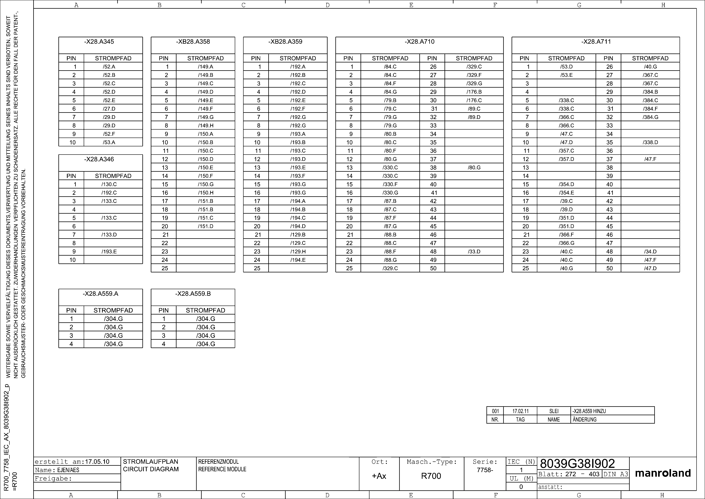

# +Ax — Sheet 272 of 403 — REFERENZMODUL

**REFERENCE MODULE**

> Part of the manroland **R700** printing press IEC/UL circuit diagrams.
> Drawing class: **Stromlaufplan / Circuit diagram** (DIN A3).
> Document `+Ax` covers the **Central control console** machine section.

## At a glance

| Field | Value |
|---|---|
| Document | `+Ax`  (8039G38I902) |
| Sheet | **272** of 403 |
| Section (DE) | REFERENZMODUL |
| Section (EN) | REFERENCE MODULE |
| Section type | REFERENCE_MODULE — Reference module |
| Machine type | `R700` |
| Series | `7758` |
| Created | 17.05.10 |
| Replaces | — |
| Columns used | A, B, C, D, E, F, G, H |
| Path numbers | — |
| Labels on sheet | 349 |
| Cross-refs out | 135 |
| Cross-refs in | 0 |

**Previous:** [+Ax sheet 271](SHEET_0271.md) · **Next:** [+Ax sheet 273](SHEET_0273.md) · **Document TOC:** [_TOC.md](_TOC.md)  (+Ax) · **Master TOC:** [all sheets](../_MASTER_TOC.md)

## Sheet image (300 DPI, exact vector render)



_Rendered directly from the PDF vector layer at 300 DPI (1-bit), no OCR and no resampling. Use it to confirm anything ambiguous in the text below._

## Cross-references on this sheet

Each entry is a wire leaving this sheet. The printed token is `/sheet.column`; the link resolves to that sheet inside the same document.

| Ref | Target sheet | Col | Path | Destination on target | Target section | From col |
|---|---|---|---|---|---|---|
| `/52.A` | [+Ax sheet 52](SHEET_0052.md) | A | — | — | SIGNALGEBER: AKUSTISCHE WARNSIGNALE | A |
| `/149.A` | [+Ax sheet 149](SHEET_0149.md) | A | — | — | ÜBERWACHUNGSRECHNER SICHERHEITSBUS | C |
| `/192.A` | [+Ax sheet 192](SHEET_0192.md) | A | — | — | RESERVE | D |
| `/40.G` | [+Ax sheet 40](SHEET_0040.md) | G | — | — | HAUPTANTRIEB | H |
| `/84.C` | [+Ax sheet 84](SHEET_0084.md) | C | — | — | ANLEGER | E |
| `/53.D` | [+Ax sheet 53](SHEET_0053.md) | D | — | — | SIGNALGEBER: AKUSTISCHE WARNSIGNALE | G |
| `/329.C` | [+Ax sheet 329](SHEET_0329.md) | C | — | — | OPTION: NONSTOP EINRICHTUNG MANUELL, ANLEGER | F |
| `/52.B` | [+Ax sheet 52](SHEET_0052.md) | B | — | — | SIGNALGEBER: AKUSTISCHE WARNSIGNALE | A |
| `/53.E` | [+Ax sheet 53](SHEET_0053.md) | E | — | — | SIGNALGEBER: AKUSTISCHE WARNSIGNALE | G |
| `/149.B` | [+Ax sheet 149](SHEET_0149.md) | B | — | — | ÜBERWACHUNGSRECHNER SICHERHEITSBUS | C |
| `/192.B` | [+Ax sheet 192](SHEET_0192.md) | B | — | — | RESERVE | D |
| `/329.F` | [+Ax sheet 329](SHEET_0329.md) | F | — | — | OPTION: NONSTOP EINRICHTUNG MANUELL, ANLEGER | F |
| `/84.C` | [+Ax sheet 84](SHEET_0084.md) | C | — | — | ANLEGER | E |
| `/367.C` | [+Ax sheet 367](SHEET_0367.md) | C | — | — | OPTION: LOGISTIK AUSLEGER | H |
| `/84.F` | [+Ax sheet 84](SHEET_0084.md) | F | — | — | ANLEGER | E |
| `/52.C` | [+Ax sheet 52](SHEET_0052.md) | C | — | — | SIGNALGEBER: AKUSTISCHE WARNSIGNALE | A |
| `/329.G` | [+Ax sheet 329](SHEET_0329.md) | G | — | — | OPTION: NONSTOP EINRICHTUNG MANUELL, ANLEGER | F |
| `/149.C` | [+Ax sheet 149](SHEET_0149.md) | C | — | — | ÜBERWACHUNGSRECHNER SICHERHEITSBUS | C |
| `/192.C` | [+Ax sheet 192](SHEET_0192.md) | C | — | — | RESERVE | D |
| `/367.C` | [+Ax sheet 367](SHEET_0367.md) | C | — | — | OPTION: LOGISTIK AUSLEGER | H |
| `/84.G` | [+Ax sheet 84](SHEET_0084.md) | G | — | — | ANLEGER | E |
| `/176.B` | [+Ax sheet 176](SHEET_0176.md) | B | — | — | RESERVE | F |
| `/384.B` | [+Ax sheet 384](SHEET_0384.md) | B | — | — | OPTION: INLINEFOILER PRINDOR | H |
| `/52.D` | [+Ax sheet 52](SHEET_0052.md) | D | — | — | SIGNALGEBER: AKUSTISCHE WARNSIGNALE | A |
| `/149.D` | [+Ax sheet 149](SHEET_0149.md) | D | — | — | ÜBERWACHUNGSRECHNER SICHERHEITSBUS | C |
| `/192.D` | [+Ax sheet 192](SHEET_0192.md) | D | — | — | RESERVE | D |
| `/52.E` | [+Ax sheet 52](SHEET_0052.md) | E | — | — | SIGNALGEBER: AKUSTISCHE WARNSIGNALE | A |
| `/79.B` | [+Ax sheet 79](SHEET_0079.md) | B | — | — | ANLEGER | E |
| `/149.E` | [+Ax sheet 149](SHEET_0149.md) | E | — | — | ÜBERWACHUNGSRECHNER SICHERHEITSBUS | C |
| `/192.E` | [+Ax sheet 192](SHEET_0192.md) | E | — | — | RESERVE | D |
| `/176.C` | [+Ax sheet 176](SHEET_0176.md) | C | — | — | RESERVE | F |
| `/338.C` | [+Ax sheet 338](SHEET_0338.md) | C | — | — | OPTION: INLINESHEETER RS104 S | G |
| `/384.C` | [+Ax sheet 384](SHEET_0384.md) | C | — | — | OPTION: INLINEFOILER PRINDOR | H |
| `/149.F` | [+Ax sheet 149](SHEET_0149.md) | F | — | — | ÜBERWACHUNGSRECHNER SICHERHEITSBUS | C |
| `/192.F` | [+Ax sheet 192](SHEET_0192.md) | F | — | — | RESERVE | D |
| `/384.F` | [+Ax sheet 384](SHEET_0384.md) | F | — | — | OPTION: INLINEFOILER PRINDOR | H |
| `/27.D` | [+Ax sheet 27](SHEET_0027.md) | D | — | — | SPANNUNGSVERSORGUNG, SCHALTSCHRANKBELÜFTUNG | A |
| `/79.C` | [+Ax sheet 79](SHEET_0079.md) | C | — | — | ANLEGER | E |
| `/89.C` | [+Ax sheet 89](SHEET_0089.md) | C | — | — | ANLEGER | F |
| `/338.C` | [+Ax sheet 338](SHEET_0338.md) | C | — | — | OPTION: INLINESHEETER RS104 S | G |
| `/79.G` | [+Ax sheet 79](SHEET_0079.md) | G | — | — | ANLEGER | E |
| `/149.G` | [+Ax sheet 149](SHEET_0149.md) | G | — | — | ÜBERWACHUNGSRECHNER SICHERHEITSBUS | C |
| `/192.G` | [+Ax sheet 192](SHEET_0192.md) | G | — | — | RESERVE | D |
| `/384.G` | [+Ax sheet 384](SHEET_0384.md) | G | — | — | OPTION: INLINEFOILER PRINDOR | H |
| `/29.D` | [+Ax sheet 29](SHEET_0029.md) | D | — | — | SPANNUNGSVERSORGUNG, SCHALTSCHRANKBELÜFTUNG | A |
| `/89.D` | [+Ax sheet 89](SHEET_0089.md) | D | — | — | ANLEGER | F |
| `/366.C` | [+Ax sheet 366](SHEET_0366.md) | C | — | — | OPTION: LOGISTIK AUSLEGER | G |
| `/79.G` | [+Ax sheet 79](SHEET_0079.md) | G | — | — | ANLEGER | E |
| `/29.D` | [+Ax sheet 29](SHEET_0029.md) | D | — | — | SPANNUNGSVERSORGUNG, SCHALTSCHRANKBELÜFTUNG | A |
| `/192.G` | [+Ax sheet 192](SHEET_0192.md) | G | — | — | RESERVE | D |
| `/149.H` | [+Ax sheet 149](SHEET_0149.md) | H | — | — | ÜBERWACHUNGSRECHNER SICHERHEITSBUS | C |
| `/366.C` | [+Ax sheet 366](SHEET_0366.md) | C | — | — | OPTION: LOGISTIK AUSLEGER | G |
| `/80.B` | [+Ax sheet 80](SHEET_0080.md) | B | — | — | ANLEGER | E |
| `/52.F` | [+Ax sheet 52](SHEET_0052.md) | F | — | — | SIGNALGEBER: AKUSTISCHE WARNSIGNALE | A |
| `/150.A` | [+Ax sheet 150](SHEET_0150.md) | A | — | — | ÜBERWACHUNGSRECHNER SICHERHEITSBUS | C |
| `/193.A` | [+Ax sheet 193](SHEET_0193.md) | A | — | — | RESERVE | D |
| `/47.C` | [+Ax sheet 47](SHEET_0047.md) | C | — | — | NOT AUS | G |
| `/53.A` | [+Ax sheet 53](SHEET_0053.md) | A | — | — | SIGNALGEBER: AKUSTISCHE WARNSIGNALE | A |
| `/150.B` | [+Ax sheet 150](SHEET_0150.md) | B | — | — | ÜBERWACHUNGSRECHNER SICHERHEITSBUS | C |
| `/193.B` | [+Ax sheet 193](SHEET_0193.md) | B | — | — | RESERVE | D |
| `/80.C` | [+Ax sheet 80](SHEET_0080.md) | C | — | — | ANLEGER | E |
| `/47.D` | [+Ax sheet 47](SHEET_0047.md) | D | — | — | NOT AUS | G |
| `/338.D` | [+Ax sheet 338](SHEET_0338.md) | D | — | — | OPTION: INLINESHEETER RS104 S | H |
| `/80.F` | [+Ax sheet 80](SHEET_0080.md) | F | — | — | ANLEGER | E |
| `/150.C` | [+Ax sheet 150](SHEET_0150.md) | C | — | — | ÜBERWACHUNGSRECHNER SICHERHEITSBUS | C |
| `/193.C` | [+Ax sheet 193](SHEET_0193.md) | C | — | — | RESERVE | D |
| `/357.C` | [+Ax sheet 357](SHEET_0357.md) | C | — | — | OPTION: LOGISTIK ANLEGER | G |
| `/47.F` | [+Ax sheet 47](SHEET_0047.md) | F | — | — | NOT AUS | H |
| `/80.G` | [+Ax sheet 80](SHEET_0080.md) | G | — | — | ANLEGER | E |
| `/150.D` | [+Ax sheet 150](SHEET_0150.md) | D | — | — | ÜBERWACHUNGSRECHNER SICHERHEITSBUS | C |
| `/193.D` | [+Ax sheet 193](SHEET_0193.md) | D | — | — | RESERVE | D |
| `/357.D` | [+Ax sheet 357](SHEET_0357.md) | D | — | — | OPTION: LOGISTIK ANLEGER | G |
| `/150.E` | [+Ax sheet 150](SHEET_0150.md) | E | — | — | ÜBERWACHUNGSRECHNER SICHERHEITSBUS | C |
| `/193.E` | [+Ax sheet 193](SHEET_0193.md) | E | — | — | RESERVE | D |
| `/80.G` | [+Ax sheet 80](SHEET_0080.md) | G | — | — | ANLEGER | F |
| `/330.C` | [+Ax sheet 330](SHEET_0330.md) | C | — | — | OPTION: NONSTOP EINRICHTUNG MANUELL, ANLEGER | E |
| `/150.F` | [+Ax sheet 150](SHEET_0150.md) | F | — | — | ÜBERWACHUNGSRECHNER SICHERHEITSBUS | C |
| `/193.F` | [+Ax sheet 193](SHEET_0193.md) | F | — | — | RESERVE | D |
| `/330.C` | [+Ax sheet 330](SHEET_0330.md) | C | — | — | OPTION: NONSTOP EINRICHTUNG MANUELL, ANLEGER | E |
| `/330.F` | [+Ax sheet 330](SHEET_0330.md) | F | — | — | OPTION: NONSTOP EINRICHTUNG MANUELL, ANLEGER | E |
| `/150.G` | [+Ax sheet 150](SHEET_0150.md) | G | — | — | ÜBERWACHUNGSRECHNER SICHERHEITSBUS | C |
| `/193.G` | [+Ax sheet 193](SHEET_0193.md) | G | — | — | RESERVE | D |
| `/130.C` | [+Ax sheet 130](SHEET_0130.md) | C | — | — | REALTIMERECHNER ANLAGE | A |
| `/354.D` | [+Ax sheet 354](SHEET_0354.md) | D | — | — | OPTION: LOGISTIK ANLEGER | G |
| `/354.E` | [+Ax sheet 354](SHEET_0354.md) | E | — | — | OPTION: LOGISTIK ANLEGER | G |
| `/193.G` | [+Ax sheet 193](SHEET_0193.md) | G | — | — | RESERVE | D |
| `/330.G` | [+Ax sheet 330](SHEET_0330.md) | G | — | — | OPTION: NONSTOP EINRICHTUNG MANUELL, ANLEGER | E |
| `/192.C` | [+Ax sheet 192](SHEET_0192.md) | C | — | — | RESERVE | A |
| `/150.H` | [+Ax sheet 150](SHEET_0150.md) | H | — | — | ÜBERWACHUNGSRECHNER SICHERHEITSBUS | C |
| `/87.B` | [+Ax sheet 87](SHEET_0087.md) | B | — | — | ANLEGER | E |
| `/151.B` | [+Ax sheet 151](SHEET_0151.md) | B | — | — | ÜBERWACHUNGSRECHNER SICHERHEITSBUS | C |
| `/194.A` | [+Ax sheet 194](SHEET_0194.md) | A | — | — | RESERVE | D |
| `/39.C` | [+Ax sheet 39](SHEET_0039.md) | C | — | — | HAUPTANTRIEB | G |
| `/133.C` | [+Ax sheet 133](SHEET_0133.md) | C | — | — | REALTIMERECHNER DRUCKWERK | A |
| `/151.B` | [+Ax sheet 151](SHEET_0151.md) | B | — | — | ÜBERWACHUNGSRECHNER SICHERHEITSBUS | C |
| `/194.B` | [+Ax sheet 194](SHEET_0194.md) | B | — | — | RESERVE | D |
| `/87.C` | [+Ax sheet 87](SHEET_0087.md) | C | — | — | ANLEGER | E |
| `/39.D` | [+Ax sheet 39](SHEET_0039.md) | D | — | — | HAUPTANTRIEB | G |
| `/87.F` | [+Ax sheet 87](SHEET_0087.md) | F | — | — | ANLEGER | E |
| `/133.C` | [+Ax sheet 133](SHEET_0133.md) | C | — | — | REALTIMERECHNER DRUCKWERK | A |
| `/151.C` | [+Ax sheet 151](SHEET_0151.md) | C | — | — | ÜBERWACHUNGSRECHNER SICHERHEITSBUS | C |
| `/194.C` | [+Ax sheet 194](SHEET_0194.md) | C | — | — | RESERVE | D |
| `/351.D` | [+Ax sheet 351](SHEET_0351.md) | D | — | — | OPTION: LOGISTIK ANLEGER | G |
| `/87.G` | [+Ax sheet 87](SHEET_0087.md) | G | — | — | ANLEGER | E |
| `/151.D` | [+Ax sheet 151](SHEET_0151.md) | D | — | — | ÜBERWACHUNGSRECHNER SICHERHEITSBUS | C |
| `/194.D` | [+Ax sheet 194](SHEET_0194.md) | D | — | — | RESERVE | D |
| `/351.D` | [+Ax sheet 351](SHEET_0351.md) | D | — | — | OPTION: LOGISTIK ANLEGER | G |
| `/88.B` | [+Ax sheet 88](SHEET_0088.md) | B | — | — | ANLEGER | E |
| `/129.B` | [+Ax sheet 129](SHEET_0129.md) | B | — | — | REALTIMERECHNER ANLAGE | D |
| `/366.F` | [+Ax sheet 366](SHEET_0366.md) | F | — | — | OPTION: LOGISTIK AUSLEGER | G |
| `/133.D` | [+Ax sheet 133](SHEET_0133.md) | D | — | — | REALTIMERECHNER DRUCKWERK | A |
| `/88.C` | [+Ax sheet 88](SHEET_0088.md) | C | — | — | ANLEGER | E |
| `/366.G` | [+Ax sheet 366](SHEET_0366.md) | G | — | — | OPTION: LOGISTIK AUSLEGER | G |
| `/129.C` | [+Ax sheet 129](SHEET_0129.md) | C | — | — | REALTIMERECHNER ANLAGE | D |
| `/193.E` | [+Ax sheet 193](SHEET_0193.md) | E | — | — | RESERVE | A |
| `/88.F` | [+Ax sheet 88](SHEET_0088.md) | F | — | — | ANLEGER | E |
| `/33.D` | [+Ax sheet 33](SHEET_0033.md) | D | — | — | SPANNUNGSVERSORGUNG, SCHALTSCHRANKBELÜFTUNG | F |
| `/40.C` | [+Ax sheet 40](SHEET_0040.md) | C | — | — | HAUPTANTRIEB | G |
| `/34.D` | [+Ax sheet 34](SHEET_0034.md) | D | — | — | SPANNUNGSVERSORGUNG, SCHALTSCHRANKBELÜFTUNG | H |
| `/129.H` | [+Ax sheet 129](SHEET_0129.md) | H | — | — | REALTIMERECHNER ANLAGE | D |
| `/194.E` | [+Ax sheet 194](SHEET_0194.md) | E | — | — | RESERVE | D |
| `/47.F` | [+Ax sheet 47](SHEET_0047.md) | F | — | — | NOT AUS | H |
| `/88.G` | [+Ax sheet 88](SHEET_0088.md) | G | — | — | ANLEGER | E |
| `/40.C` | [+Ax sheet 40](SHEET_0040.md) | C | — | — | HAUPTANTRIEB | G |
| `/40.G` | [+Ax sheet 40](SHEET_0040.md) | G | — | — | HAUPTANTRIEB | G |
| `/47.D` | [+Ax sheet 47](SHEET_0047.md) | D | — | — | NOT AUS | H |
| `/329.C` | [+Ax sheet 329](SHEET_0329.md) | C | — | — | OPTION: NONSTOP EINRICHTUNG MANUELL, ANLEGER | E |
| `/304.G` | [+Ax sheet 304](SHEET_0304.md) | G | — | — | SCHÖN & WIDERDRUCK HAUPTSCHALTSCHRANK | A |
| `/304.G` | [+Ax sheet 304](SHEET_0304.md) | G | — | — | SCHÖN & WIDERDRUCK HAUPTSCHALTSCHRANK | A |
| `/304.G` | [+Ax sheet 304](SHEET_0304.md) | G | — | — | SCHÖN & WIDERDRUCK HAUPTSCHALTSCHRANK | A |
| `/304.G` | [+Ax sheet 304](SHEET_0304.md) | G | — | — | SCHÖN & WIDERDRUCK HAUPTSCHALTSCHRANK | A |
| `/304.G` | [+Ax sheet 304](SHEET_0304.md) | G | — | — | SCHÖN & WIDERDRUCK HAUPTSCHALTSCHRANK | C |
| `/304.G` | [+Ax sheet 304](SHEET_0304.md) | G | — | — | SCHÖN & WIDERDRUCK HAUPTSCHALTSCHRANK | C |
| `/304.G` | [+Ax sheet 304](SHEET_0304.md) | G | — | — | SCHÖN & WIDERDRUCK HAUPTSCHALTSCHRANK | C |
| `/304.G` | [+Ax sheet 304](SHEET_0304.md) | G | — | — | SCHÖN & WIDERDRUCK HAUPTSCHALTSCHRANK | C |

## Devices on this sheet

| Tag | Class | Class meaning (IEC) | Col | Sub | Terminal | Sign |
|---|---|---|---|---|---|---|
| `X28.A345` | — | cross-device reference | A | — | — | — |
| `X28.A346` | — | cross-device reference | A | — | — | — |
| `XB28.A359` | — | cross-device reference | C | — | — | — |
| `XB28.A358` | — | cross-device reference | B | — | — | — |
| `X28.A710` | — | cross-device reference | E | — | — | — |
| `X28.A711` | — | cross-device reference | G | — | — | — |
| `X28.A559.B` | — | cross-device reference | B | — | — | — |
| `X28.A559.A` | — | cross-device reference | A | — | — | — |
| `NR.` | — | cross-device reference | F | — | — | — |
| `17.02.11` | — | cross-device reference | F | — | — | — |

## Potentials / nets

_No named potentials on this sheet._

## Wire-end annotations (grouped as printed)

A wire that continues elsewhere is annotated with a small cluster: the destination description, the path/line number `#NN`, and the `/sheet.column` cross reference. Each row below is one such cluster exactly as it is grouped on the drawing.

| Col | Y | Path | Cross-ref | Text on the wire |
|---|---|---|---|---|
| A | 65.5 | — | — | `X28.A345` |
| B | 65.5 | — | — | `XB28.A358` |
| C | 65.5 | — | — | `XB28.A359` |
| E | 65.5 | — | — | `X28.A710` |
| G | 65.5 | — | — | `X28.A711` |
| A | 94.2 | — | — | `PIN 10 2 3 4 5 6 7 8 9 1 STROMPFAD` |
| B | 94.2 | — | — | `PIN STROMPFAD` |
| C | 94.2 | — | — | `PIN STROMPFAD` |
| E | 94.2 | — | — | `PIN STROMPFAD` |
| F | 94.2 | — | — | `PIN STROMPFAD` |
| G | 94.2 | — | — | `PIN STROMPFAD` |
| H | 94.2 | — | — | `PIN STROMPFAD` |
| B | 108.4 | — | — | `2 3 4 5 6 7 8 9 1` |
| C | 108.4 | — | — | `2 3 4 5 6 7 8 9 1` |
| D | 108.4 | — | — | `2 3 4 5 6 7 8 9 1` |
| E | 108.4 | — | — | `26 27 28 29 30 32 33 34 35 36 37 38 39 40 42 43 44 45 46 47 48 49 50 31 41` |
| F | 108.4 | — | — | `2 3 4 5 6 7 8 9 1` |
| G | 108.4 | — | — | `26 27 28 29 30 32 33 34 35 36 37 38 39 40 42 43 44 45 46 47 48 49 50 31 41` |
| A | 108.7 | — | `/52.A` | — |
| C | 108.7 | — | `/149.A` | — |
| D | 108.7 | — | `/192.A` | — |
| E | 108.7 | — | `/84.C` | — |
| F | 108.7 | — | `/329.C` | — |
| G | 108.7 | — | `/53.D` | — |
| H | 108.7 | — | `/40.G` | — |
| A | 122.8 | — | `/52.B` | — |
| G | 122.8 | — | `/53.E` | — |
| C | 122.9 | — | `/149.B` | — |
| D | 122.9 | — | `/192.B` | — |
| E | 122.9 | — | `/84.C` | — |
| F | 122.9 | — | `/329.F` | — |
| H | 122.9 | — | `/367.C` | — |
| E | 137.0 | — | `/84.F` | — |
| A | 137.1 | — | `/52.C` | — |
| C | 137.1 | — | `/149.C` | — |
| D | 137.1 | — | `/192.C` | — |
| F | 137.1 | — | `/329.G` | — |
| H | 137.1 | — | `/367.C` | — |
| A | 151.2 | — | `/52.D` | — |
| C | 151.2 | — | `/149.D` | — |
| D | 151.2 | — | `/192.D` | — |
| E | 151.2 | — | `/84.G` | — |
| F | 151.2 | — | `/176.B` | — |
| H | 151.2 | — | `/384.B` | — |
| A | 165.4 | — | `/52.E` | — |
| C | 165.4 | — | `/149.E` | — |
| D | 165.4 | — | `/192.E` | — |
| E | 165.4 | — | `/79.B` | — |
| F | 165.4 | — | `/176.C` | — |
| G | 165.4 | — | `/338.C` | — |
| H | 165.4 | — | `/384.C` | — |
| A | 179.6 | — | `/27.D` | — |
| C | 179.6 | — | `/149.F` | — |
| D | 179.6 | — | `/192.F` | — |
| E | 179.6 | — | `/79.C` | — |
| F | 179.6 | — | `/89.C` | — |
| G | 179.6 | — | `/338.C` | — |
| H | 179.6 | — | `/384.F` | — |
| C | 193.7 | — | `/149.G` | — |
| D | 193.7 | — | `/192.G` | — |
| E | 193.7 | — | `/79.G` | — |
| H | 193.7 | — | `/384.G` | — |
| A | 193.8 | — | `/29.D` | — |
| F | 193.8 | — | `/89.D` | — |
| G | 193.8 | — | `/366.C` | — |
| A | 207.9 | — | `/29.D` | — |
| C | 207.9 | — | `/149.H` | — |
| D | 207.9 | — | `/192.G` | — |
| E | 207.9 | — | `/79.G` | — |
| G | 207.9 | — | `/366.C` | — |
| A | 222.1 | — | `/52.F` | — |
| C | 222.1 | — | `/150.A` | — |
| D | 222.1 | — | `/193.A` | — |
| E | 222.1 | — | `/80.B` | — |
| G | 222.1 | — | `/47.C` | — |
| B | 235.9 | — | — | `10 12 13 14 15 16 17 18 19 20 11` |
| C | 235.9 | — | — | `10 12 13 14 15 16 17 18 19 20 11` |
| D | 235.9 | — | — | `10 12 13 14 15 16 17 18 19 20 11` |
| F | 235.9 | — | — | `10 12 13 14 15 16 17 18 19 20 11` |
| A | 236.2 | — | `/53.A` | — |
| C | 236.2 | — | `/150.B` | — |
| D | 236.2 | — | `/193.B` | — |
| E | 236.3 | — | `/80.C` | — |
| G | 236.3 | — | `/47.D` | — |
| H | 236.3 | — | `/338.D` | — |
| C | 250.4 | — | `/150.C` | — |
| D | 250.4 | — | `/193.C` | — |
| E | 250.4 | — | `/80.F` | — |
| G | 250.4 | — | `/357.C` | — |
| A | 263.9 | — | — | `X28.A346` |
| C | 264.6 | — | `/150.D` | — |
| D | 264.6 | — | `/193.D` | — |
| E | 264.6 | — | `/80.G` | — |
| G | 264.6 | — | `/357.D` | — |
| H | 264.6 | — | `/47.F` | — |
| C | 278.8 | — | `/150.E` | — |
| D | 278.8 | — | `/193.E` | — |
| E | 278.8 | — | `/330.C` | — |
| F | 278.8 | — | `/80.G` | — |
| A | 292.6 | — | — | `PIN 10 2 3 4 5 6 7 8 9 1 STROMPFAD` |
| C | 292.9 | — | `/150.F` | — |
| D | 292.9 | — | `/193.F` | — |
| E | 293.0 | — | `/330.C` | — |
| A | 307.1 | — | `/130.C` | — |
| C | 307.1 | — | `/150.G` | — |
| D | 307.1 | — | `/193.G` | — |
| E | 307.1 | — | `/330.F` | — |
| G | 307.1 | — | `/354.D` | — |
| A | 321.3 | — | `/192.C` | — |
| C | 321.3 | — | `/150.H` | — |
| D | 321.3 | — | `/193.G` | — |
| E | 321.3 | — | `/330.G` | — |
| G | 321.3 | — | `/354.E` | — |
| E | 335.4 | — | `/87.B` | — |
| A | 335.5 | — | `/133.C` | — |
| C | 335.5 | — | `/151.B` | — |
| D | 335.5 | — | `/194.A` | — |
| G | 335.5 | — | `/39.C` | — |
| C | 349.6 | — | `/151.B` | — |
| D | 349.6 | — | `/194.B` | — |
| E | 349.6 | — | `/87.C` | — |
| G | 349.6 | — | `/39.D` | — |
| A | 363.8 | — | `/133.C` | — |
| C | 363.8 | — | `/151.C` | — |
| D | 363.8 | — | `/194.C` | — |
| E | 363.8 | — | `/87.F` | — |
| G | 363.8 | — | `/351.D` | — |
| C | 378.0 | — | `/151.D` | — |
| D | 378.0 | — | `/194.D` | — |
| E | 378.0 | — | `/87.G` | — |
| G | 378.0 | — | `/351.D` | — |
| B | 391.8 | — | — | `22 23 24 25 21` |
| C | 391.8 | — | — | `22 23 24 25 21` |
| D | 391.8 | — | — | `22 23 24 25 21` |
| F | 391.8 | — | — | `22 23 24 25 21` |
| D | 392.1 | — | `/129.B` | — |
| E | 392.1 | — | `/88.B` | — |
| A | 392.2 | — | `/133.D` | — |
| G | 392.2 | — | `/366.F` | — |
| E | 406.3 | — | `/88.C` | — |
| G | 406.3 | — | `/366.G` | — |
| D | 406.4 | — | `/129.C` | — |
| A | 420.5 | — | `/193.E` | — |
| D | 420.5 | — | `/129.H` | — |
| E | 420.5 | — | `/88.F` | — |
| F | 420.5 | — | `/33.D` | — |
| G | 420.5 | — | `/40.C` | — |
| H | 420.5 | — | `/34.D` | — |
| D | 434.7 | — | `/194.E` | — |
| E | 434.7 | — | `/88.G` | — |
| G | 434.7 | — | `/40.C` | — |
| H | 434.7 | — | `/47.F` | — |
| E | 448.9 | — | `/329.C` | — |
| G | 448.9 | — | `/40.G` | — |
| H | 448.9 | — | `/47.D` | — |
| A | 490.7 | — | — | `X28.A559.A` |
| B | 490.7 | — | — | `X28.A559.B` |
| A | 519.0 | — | — | `PIN 3 2 4 1 STROMPFAD` |
| B | 519.0 | — | — | `PIN 3 2 4 1 STROMPFAD` |
| A | 533.2 | — | `/304.G`, `/304.G`, `/304.G`, `/304.G` | — |
| C | 533.2 | — | `/304.G`, `/304.G`, `/304.G`, `/304.G` | — |
| G | 690.5 | — | — | `001 17.02.11 SLEI X28.A559 HINZU` |
| G | 704.6 | — | — | `NR. TAG NAME ÄNDERUNG` |


## Reconstructed tables

This sheet carries tabular content (pin map / terminal assignment / index). The grid below was rebuilt from the drawing's own rule lines, so each row is exactly one physical row of the table.

### Table 1 — 28 data rows × 2 columns (at x=99.2, y=62.4) — **X28.A345**

| PIN | STROMPFAD |
|---|---|
| `1` | `/52.A` |
| `2` | `/52.B` |
| `3` | `/52.C` |
| `4` | `/52.D` |
| `5` | `/52.E` |
| `6` | `/27.D` |
| `7` | `/29.D` |
| `8` | `/29.D` |
| `9` | `/52.F` |
| `10` | `/53.A` |
|  | `X28.A346` |
| `PIN` | `STROMPFAD` |
| `1` | `/130.C` |
| `2` | `/192.C` |
| `3` | `/133.C` |
| `4` |  |
| `5` | `/133.C` |
| `6` |  |
| `7` | `/133.D` |
| `8` |  |
| `9` | `/193.E` |
| `10` |  |
|  | `X28.A559.A` |
| `PIN` | `STROMPFAD` |
| `1` | `/304.G` |
| `2` | `/304.G` |
| `3` | `/304.G` |
| `4` | `/304.G` |


### Table 2 — 31 data rows × 2 columns (at x=255.1, y=62.4) — **XB28.A358**

| PIN | STROMPFAD |
|---|---|
| `1` | `/149.A` |
| `2` | `/149.B` |
| `3` | `/149.C` |
| `4` | `/149.D` |
| `5` | `/149.E` |
| `6` | `/149.F` |
| `7` | `/149.G` |
| `8` | `/149.H` |
| `9` | `/150.A` |
| `10` | `/150.B` |
| `11` | `/150.C` |
| `12` | `/150.D` |
| `13` | `/150.E` |
| `14` | `/150.F` |
| `15` | `/150.G` |
| `16` | `/150.H` |
| `17` | `/151.B` |
| `18` | `/151.B` |
| `19` | `/151.C` |
| `20` | `/151.D` |
| `21` |  |
| `22` |  |
| `23` |  |
| `24` |  |
| `25` |  |
|  | `X28.A559.B` |
| `PIN` | `STROMPFAD` |
| `1` | `/304.G` |
| `2` | `/304.G` |
| `3` | `/304.G` |
| `4` | `/304.G` |


### Table 3 — 25 data rows × 2 columns (at x=411.0, y=62.4) — **XB28.A359**

| PIN | STROMPFAD |
|---|---|
| `1` | `/192.A` |
| `2` | `/192.B` |
| `3` | `/192.C` |
| `4` | `/192.D` |
| `5` | `/192.E` |
| `6` | `/192.F` |
| `7` | `/192.G` |
| `8` | `/192.G` |
| `9` | `/193.A` |
| `10` | `/193.B` |
| `11` | `/193.C` |
| `12` | `/193.D` |
| `13` | `/193.E` |
| `14` | `/193.F` |
| `15` | `/193.G` |
| `16` | `/193.G` |
| `17` | `/194.A` |
| `18` | `/194.B` |
| `19` | `/194.C` |
| `20` | `/194.D` |
| `21` | `/129.B` |
| `22` | `/129.C` |
| `23` | `/129.H` |
| `24` | `/194.E` |
| `25` |  |


### Table 4 — 25 data rows × 4 columns (at x=566.9, y=62.4) — **X28.A710**

| PIN | STROMPFAD | PIN | STROMPFAD |
|---|---|---|---|
| `1` | `/84.C` | `26` | `/329.C` |
| `2` | `/84.C` | `27` | `/329.F` |
| `3` | `/84.F` | `28` | `/329.G` |
| `4` | `/84.G` | `29` | `/176.B` |
| `5` | `/79.B` | `30` | `/176.C` |
| `6` | `/79.C` | `31` | `/89.C` |
| `7` | `/79.G` | `32` | `/89.D` |
| `8` | `/79.G` | `33` |  |
| `9` | `/80.B` | `34` |  |
| `10` | `/80.C` | `35` |  |
| `11` | `/80.F` | `36` |  |
| `12` | `/80.G` | `37` |  |
| `13` | `/330.C` | `38` | `/80.G` |
| `14` | `/330.C` | `39` |  |
| `15` | `/330.F` | `40` |  |
| `16` | `/330.G` | `41` |  |
| `17` | `/87.B` | `42` |  |
| `18` | `/87.C` | `43` |  |
| `19` | `/87.F` | `44` |  |
| `20` | `/87.G` | `45` |  |
| `21` | `/88.B` | `46` |  |
| `22` | `/88.C` | `47` |  |
| `23` | `/88.F` | `48` | `/33.D` |
| `24` | `/88.G` | `49` |  |
| `25` | `/329.C` | `50` |  |


### Table 5 — 25 data rows × 4 columns (at x=864.6, y=62.4) — **X28.A711**

| PIN | STROMPFAD | PIN | STROMPFAD |
|---|---|---|---|
| `1` | `/53.D` | `26` | `/40.G` |
| `2` | `/53.E` | `27` | `/367.C` |
| `3` |  | `28` | `/367.C` |
| `4` |  | `29` | `/384.B` |
| `5` | `/338.C` | `30` | `/384.C` |
| `6` | `/338.C` | `31` | `/384.F` |
| `7` | `/366.C` | `32` | `/384.G` |
| `8` | `/366.C` | `33` |  |
| `9` | `/47.C` | `34` |  |
| `10` | `/47.D` | `35` | `/338.D` |
| `11` | `/357.C` | `36` |  |
| `12` | `/357.D` | `37` | `/47.F` |
| `13` |  | `38` |  |
| `14` |  | `39` |  |
| `15` | `/354.D` | `40` |  |
| `16` | `/354.E` | `41` |  |
| `17` | `/39.C` | `42` |  |
| `18` | `/39.D` | `43` |  |
| `19` | `/351.D` | `44` |  |
| `20` | `/351.D` | `45` |  |
| `21` | `/366.F` | `46` |  |
| `22` | `/366.G` | `47` |  |
| `23` | `/40.C` | `48` | `/34.D` |
| `24` | `/40.C` | `49` | `/47.F` |
| `25` | `/40.G` | `50` | `/47.D` |


## Notes and free text on this sheet

| Text | Col | Y (pt) |
|---|---|---|
| `PIN` | A | 94.2 |
| `STROMPFAD` | A | 94.15 |
| `PIN` | C | 94.2 |
| `STROMPFAD` | D | 94.15 |
| `PIN` | B | 94.2 |
| `STROMPFAD` | C | 94.15 |
| `PIN` | D | 94.2 |
| `STROMPFAD` | E | 94.15 |
| `PIN` | E | 94.2 |
| `STROMPFAD` | F | 94.15 |
| `PIN` | F | 94.2 |
| `STROMPFAD` | G | 94.15 |
| `PIN` | G | 94.2 |
| `STROMPFAD` | H | 94.15 |
| `TAG` | F | 704.75 |
| `NAME` | G | 704.73 |
| `ÄNDERUNG` | G | 704.79 |
| `SLEI` | G | 690.58 |
| `X28.A559 HINZU` | G | 690.62 |

## Complete label inventory (exact text from the drawing)

Every text object inside the drawing area of this sheet, in DIN reading order (column A→H, then top→bottom). This is the authoritative list: if a string is not here it is not printed on this sheet.

| Col | Y | X | Dir | Type | Text |
|---|---|---|---|---|---|
| A | 65.5 | 142.3 | → | device ref | `X28.A345` |
| A | 94.2 | 112.4 | → | text | `PIN` |
| A | 94.2 | 160.6 | → | text | `STROMPFAD` |
| A | 108.4 | 124.2 | → | number | `1` |
| A | 108.7 | 173.9 | → | cross-reference | `/52.A` |
| A | 122.5 | 122.5 | → | number | `2` |
| A | 122.8 | 174.0 | → | cross-reference | `/52.B` |
| A | 136.7 | 122.5 | → | number | `3` |
| A | 137.1 | 173.9 | → | cross-reference | `/52.C` |
| A | 150.9 | 122.5 | → | number | `4` |
| A | 151.2 | 173.9 | → | cross-reference | `/52.D` |
| A | 165.1 | 122.5 | → | number | `5` |
| A | 165.4 | 174.2 | → | cross-reference | `/52.E` |
| A | 179.2 | 122.5 | → | number | `6` |
| A | 179.6 | 173.9 | → | cross-reference | `/27.D` |
| A | 193.4 | 122.5 | → | number | `7` |
| A | 193.7 | 173.9 | → | cross-reference | `/29.D` |
| A | 207.6 | 122.5 | → | number | `8` |
| A | 207.9 | 173.9 | → | cross-reference | `/29.D` |
| A | 221.8 | 122.5 | → | number | `9` |
| A | 222.1 | 174.3 | → | cross-reference | `/52.F` |
| A | 235.9 | 117.1 | → | number | `10` |
| A | 236.2 | 173.9 | → | cross-reference | `/53.A` |
| A | 263.9 | 142.3 | → | device ref | `X28.A346` |
| A | 292.6 | 112.4 | → | text | `PIN` |
| A | 292.6 | 160.6 | → | text | `STROMPFAD` |
| A | 306.8 | 124.2 | → | number | `1` |
| A | 307.1 | 171.5 | → | cross-reference | `/130.C` |
| A | 321.0 | 122.5 | → | number | `2` |
| A | 321.3 | 171.5 | → | cross-reference | `/192.C` |
| A | 335.1 | 122.5 | → | number | `3` |
| A | 335.5 | 171.5 | → | cross-reference | `/133.C` |
| A | 349.3 | 122.5 | → | number | `4` |
| A | 363.5 | 122.5 | → | number | `5` |
| A | 363.8 | 171.5 | → | cross-reference | `/133.C` |
| A | 377.7 | 122.5 | → | number | `6` |
| A | 391.8 | 122.5 | → | number | `7` |
| A | 392.2 | 171.5 | → | cross-reference | `/133.D` |
| A | 406.0 | 122.5 | → | number | `8` |
| A | 420.2 | 122.5 | → | number | `9` |
| A | 420.5 | 171.8 | → | cross-reference | `/193.E` |
| A | 434.4 | 117.1 | → | number | `10` |
| A | 490.7 | 139.7 | → | device ref | `X28.A559.A` |
| A | 519.0 | 158.0 | → | text | `STROMPFAD` |
| A | 519.1 | 111.8 | → | text | `PIN` |
| A | 533.2 | 117.9 | → | number | `1` |
| A | 533.2 | 175.7 | → | cross-reference | `/304.G` |
| A | 547.4 | 117.6 | → | number | `2` |
| A | 547.4 | 175.7 | → | cross-reference | `/304.G` |
| A | 561.5 | 117.5 | → | number | `3` |
| A | 561.6 | 175.7 | → | cross-reference | `/304.G` |
| A | 575.7 | 117.6 | → | number | `4` |
| A | 575.8 | 175.7 | → | cross-reference | `/304.G` |
| B | 65.5 | 297.5 | → | device ref | `XB28.A358` |
| B | 94.2 | 268.3 | → | text | `PIN` |
| B | 108.4 | 280.1 | → | number | `1` |
| B | 122.5 | 278.4 | → | number | `2` |
| B | 136.7 | 278.4 | → | number | `3` |
| B | 150.9 | 278.4 | → | number | `4` |
| B | 165.1 | 278.4 | → | number | `5` |
| B | 179.2 | 278.4 | → | number | `6` |
| B | 193.4 | 278.4 | → | number | `7` |
| B | 207.6 | 278.4 | → | number | `8` |
| B | 221.8 | 278.4 | → | number | `9` |
| B | 235.9 | 273.0 | → | number | `10` |
| B | 250.1 | 274.7 | → | number | `11` |
| B | 264.3 | 273.0 | → | number | `12` |
| B | 278.5 | 273.0 | → | number | `13` |
| B | 292.6 | 273.0 | → | number | `14` |
| B | 306.8 | 273.0 | → | number | `15` |
| B | 321.0 | 273.0 | → | number | `16` |
| B | 335.1 | 273.0 | → | number | `17` |
| B | 349.3 | 273.0 | → | number | `18` |
| B | 363.5 | 273.0 | → | number | `19` |
| B | 377.7 | 273.0 | → | number | `20` |
| B | 391.8 | 274.7 | → | number | `21` |
| B | 406.0 | 273.0 | → | number | `22` |
| B | 420.2 | 273.0 | → | number | `23` |
| B | 434.4 | 273.0 | → | number | `24` |
| B | 448.5 | 273.0 | → | number | `25` |
| B | 490.7 | 296.1 | → | device ref | `X28.A559.B` |
| B | 519.1 | 267.7 | → | text | `PIN` |
| B | 533.2 | 273.8 | → | number | `1` |
| B | 547.4 | 273.5 | → | number | `2` |
| B | 561.5 | 273.4 | → | number | `3` |
| B | 575.7 | 273.5 | → | number | `4` |
| C | 65.5 | 453.4 | → | device ref | `XB28.A359` |
| C | 94.2 | 316.5 | → | text | `STROMPFAD` |
| C | 94.2 | 424.2 | → | text | `PIN` |
| C | 108.4 | 436.0 | → | number | `1` |
| C | 108.7 | 334.5 | → | cross-reference | `/149.A` |
| C | 122.5 | 434.3 | → | number | `2` |
| C | 122.9 | 334.6 | → | cross-reference | `/149.B` |
| C | 136.7 | 434.3 | → | number | `3` |
| C | 137.1 | 334.5 | → | cross-reference | `/149.C` |
| C | 150.9 | 434.3 | → | number | `4` |
| C | 151.2 | 334.5 | → | cross-reference | `/149.D` |
| C | 165.1 | 434.3 | → | number | `5` |
| C | 165.4 | 334.8 | → | cross-reference | `/149.E` |
| C | 179.2 | 434.3 | → | number | `6` |
| C | 179.6 | 334.9 | → | cross-reference | `/149.F` |
| C | 193.4 | 434.3 | → | number | `7` |
| C | 193.7 | 334.3 | → | cross-reference | `/149.G` |
| C | 207.6 | 434.3 | → | number | `8` |
| C | 207.9 | 334.8 | → | cross-reference | `/149.H` |
| C | 221.8 | 434.3 | → | number | `9` |
| C | 222.1 | 334.5 | → | cross-reference | `/150.A` |
| C | 235.9 | 428.9 | → | number | `10` |
| C | 236.2 | 334.6 | → | cross-reference | `/150.B` |
| C | 250.1 | 430.6 | → | number | `11` |
| C | 250.4 | 334.5 | → | cross-reference | `/150.C` |
| C | 264.3 | 428.9 | → | number | `12` |
| C | 264.6 | 334.5 | → | cross-reference | `/150.D` |
| C | 278.5 | 428.9 | → | number | `13` |
| C | 278.8 | 334.8 | → | cross-reference | `/150.E` |
| C | 292.6 | 428.9 | → | number | `14` |
| C | 293.0 | 334.9 | → | cross-reference | `/150.F` |
| C | 306.8 | 428.9 | → | number | `15` |
| C | 307.1 | 334.3 | → | cross-reference | `/150.G` |
| C | 321.0 | 428.9 | → | number | `16` |
| C | 321.3 | 334.8 | → | cross-reference | `/150.H` |
| C | 335.1 | 428.9 | → | number | `17` |
| C | 335.5 | 334.6 | → | cross-reference | `/151.B` |
| C | 349.3 | 428.9 | → | number | `18` |
| C | 349.6 | 334.6 | → | cross-reference | `/151.B` |
| C | 363.5 | 428.9 | → | number | `19` |
| C | 363.8 | 334.5 | → | cross-reference | `/151.C` |
| C | 377.7 | 428.9 | → | number | `20` |
| C | 378.0 | 334.5 | → | cross-reference | `/151.D` |
| C | 391.8 | 430.6 | → | number | `21` |
| C | 406.0 | 428.9 | → | number | `22` |
| C | 420.2 | 428.9 | → | number | `23` |
| C | 434.4 | 428.9 | → | number | `24` |
| C | 448.5 | 428.9 | → | number | `25` |
| C | 519.0 | 313.9 | → | text | `STROMPFAD` |
| C | 533.2 | 331.7 | → | cross-reference | `/304.G` |
| C | 547.4 | 331.7 | → | cross-reference | `/304.G` |
| C | 561.6 | 331.7 | → | cross-reference | `/304.G` |
| C | 575.8 | 331.7 | → | cross-reference | `/304.G` |
| D | 94.2 | 472.4 | → | text | `STROMPFAD` |
| D | 94.2 | 580.1 | → | text | `PIN` |
| D | 108.4 | 591.9 | → | number | `1` |
| D | 108.7 | 490.4 | → | cross-reference | `/192.A` |
| D | 122.5 | 590.2 | → | number | `2` |
| D | 122.9 | 490.5 | → | cross-reference | `/192.B` |
| D | 136.7 | 590.2 | → | number | `3` |
| D | 137.1 | 490.4 | → | cross-reference | `/192.C` |
| D | 150.9 | 590.2 | → | number | `4` |
| D | 151.2 | 490.4 | → | cross-reference | `/192.D` |
| D | 165.1 | 590.2 | → | number | `5` |
| D | 165.4 | 490.7 | → | cross-reference | `/192.E` |
| D | 179.2 | 590.2 | → | number | `6` |
| D | 179.6 | 490.8 | → | cross-reference | `/192.F` |
| D | 193.4 | 590.2 | → | number | `7` |
| D | 193.7 | 490.3 | → | cross-reference | `/192.G` |
| D | 207.6 | 590.2 | → | number | `8` |
| D | 207.9 | 490.3 | → | cross-reference | `/192.G` |
| D | 221.8 | 590.2 | → | number | `9` |
| D | 222.1 | 490.4 | → | cross-reference | `/193.A` |
| D | 235.9 | 584.8 | → | number | `10` |
| D | 236.2 | 490.5 | → | cross-reference | `/193.B` |
| D | 250.1 | 586.5 | → | number | `11` |
| D | 250.4 | 490.4 | → | cross-reference | `/193.C` |
| D | 264.3 | 584.8 | → | number | `12` |
| D | 264.6 | 490.4 | → | cross-reference | `/193.D` |
| D | 278.5 | 584.8 | → | number | `13` |
| D | 278.8 | 490.7 | → | cross-reference | `/193.E` |
| D | 292.6 | 584.8 | → | number | `14` |
| D | 293.0 | 490.8 | → | cross-reference | `/193.F` |
| D | 306.8 | 584.8 | → | number | `15` |
| D | 307.1 | 490.3 | → | cross-reference | `/193.G` |
| D | 321.0 | 584.8 | → | number | `16` |
| D | 321.3 | 490.3 | → | cross-reference | `/193.G` |
| D | 335.1 | 584.8 | → | number | `17` |
| D | 335.5 | 490.4 | → | cross-reference | `/194.A` |
| D | 349.3 | 584.8 | → | number | `18` |
| D | 349.6 | 490.5 | → | cross-reference | `/194.B` |
| D | 363.5 | 584.8 | → | number | `19` |
| D | 363.8 | 490.4 | → | cross-reference | `/194.C` |
| D | 377.7 | 584.8 | → | number | `20` |
| D | 378.0 | 490.4 | → | cross-reference | `/194.D` |
| D | 391.8 | 586.5 | → | number | `21` |
| D | 392.2 | 490.5 | → | cross-reference | `/129.B` |
| D | 406.0 | 584.8 | → | number | `22` |
| D | 406.4 | 490.4 | → | cross-reference | `/129.C` |
| D | 420.2 | 584.8 | → | number | `23` |
| D | 420.5 | 490.7 | → | cross-reference | `/129.H` |
| D | 434.4 | 584.8 | → | number | `24` |
| D | 434.7 | 490.7 | → | cross-reference | `/194.E` |
| D | 448.5 | 584.8 | → | number | `25` |
| E | 65.5 | 683.7 | → | device ref | `X28.A710` |
| E | 94.2 | 628.3 | → | text | `STROMPFAD` |
| E | 94.2 | 721.8 | → | text | `PIN` |
| E | 108.4 | 726.5 | → | number | `26` |
| E | 108.7 | 648.7 | → | cross-reference | `/84.C` |
| E | 122.5 | 726.5 | → | number | `27` |
| E | 122.9 | 648.7 | → | cross-reference | `/84.C` |
| E | 136.7 | 726.5 | → | number | `28` |
| E | 137.0 | 649.1 | → | cross-reference | `/84.F` |
| E | 150.9 | 726.5 | → | number | `29` |
| E | 151.2 | 648.6 | → | cross-reference | `/84.G` |
| E | 165.1 | 726.5 | → | number | `30` |
| E | 165.4 | 648.9 | → | cross-reference | `/79.B` |
| E | 179.2 | 728.2 | → | number | `31` |
| E | 179.6 | 648.7 | → | cross-reference | `/79.C` |
| E | 193.4 | 726.5 | → | number | `32` |
| E | 193.7 | 648.6 | → | cross-reference | `/79.G` |
| E | 207.6 | 726.5 | → | number | `33` |
| E | 207.9 | 648.6 | → | cross-reference | `/79.G` |
| E | 221.8 | 726.5 | → | number | `34` |
| E | 222.1 | 648.9 | → | cross-reference | `/80.B` |
| E | 235.9 | 726.5 | → | number | `35` |
| E | 236.3 | 648.7 | → | cross-reference | `/80.C` |
| E | 250.1 | 726.5 | → | number | `36` |
| E | 250.4 | 649.1 | → | cross-reference | `/80.F` |
| E | 264.3 | 726.5 | → | number | `37` |
| E | 264.6 | 648.6 | → | cross-reference | `/80.G` |
| E | 278.5 | 726.5 | → | number | `38` |
| E | 278.8 | 646.3 | → | cross-reference | `/330.C` |
| E | 292.6 | 726.5 | → | number | `39` |
| E | 293.0 | 646.3 | → | cross-reference | `/330.C` |
| E | 306.8 | 726.5 | → | number | `40` |
| E | 307.1 | 646.7 | → | cross-reference | `/330.F` |
| E | 321.0 | 728.2 | → | number | `41` |
| E | 321.3 | 646.2 | → | cross-reference | `/330.G` |
| E | 335.1 | 726.5 | → | number | `42` |
| E | 335.4 | 648.9 | → | cross-reference | `/87.B` |
| E | 349.3 | 726.5 | → | number | `43` |
| E | 349.7 | 648.7 | → | cross-reference | `/87.C` |
| E | 363.5 | 726.5 | → | number | `44` |
| E | 363.8 | 649.1 | → | cross-reference | `/87.F` |
| E | 377.7 | 726.5 | → | number | `45` |
| E | 378.0 | 648.6 | → | cross-reference | `/87.G` |
| E | 391.8 | 726.5 | → | number | `46` |
| E | 392.1 | 648.9 | → | cross-reference | `/88.B` |
| E | 406.0 | 726.5 | → | number | `47` |
| E | 406.3 | 648.7 | → | cross-reference | `/88.C` |
| E | 420.2 | 726.5 | → | number | `48` |
| E | 420.5 | 649.1 | → | cross-reference | `/88.F` |
| E | 434.4 | 726.5 | → | number | `49` |
| E | 434.7 | 648.6 | → | cross-reference | `/88.G` |
| E | 448.5 | 726.5 | → | number | `50` |
| E | 448.9 | 646.3 | → | cross-reference | `/329.C` |
| F | 94.2 | 770.0 | → | text | `STROMPFAD` |
| F | 94.2 | 877.7 | → | text | `PIN` |
| F | 108.4 | 889.5 | → | number | `1` |
| F | 108.7 | 788.0 | → | cross-reference | `/329.C` |
| F | 122.5 | 887.8 | → | number | `2` |
| F | 122.9 | 788.5 | → | cross-reference | `/329.F` |
| F | 136.7 | 887.8 | → | number | `3` |
| F | 137.1 | 787.9 | → | cross-reference | `/329.G` |
| F | 150.9 | 887.8 | → | number | `4` |
| F | 151.2 | 788.2 | → | cross-reference | `/176.B` |
| F | 165.1 | 887.8 | → | number | `5` |
| F | 165.4 | 788.0 | → | cross-reference | `/176.C` |
| F | 179.2 | 887.8 | → | number | `6` |
| F | 179.6 | 790.4 | → | cross-reference | `/89.C` |
| F | 193.4 | 887.8 | → | number | `7` |
| F | 193.7 | 790.4 | → | cross-reference | `/89.D` |
| F | 207.6 | 887.8 | → | number | `8` |
| F | 221.8 | 887.8 | → | number | `9` |
| F | 235.9 | 882.4 | → | number | `10` |
| F | 250.1 | 884.1 | → | number | `11` |
| F | 264.3 | 882.4 | → | number | `12` |
| F | 278.5 | 882.4 | → | number | `13` |
| F | 278.8 | 790.3 | → | cross-reference | `/80.G` |
| F | 292.6 | 882.4 | → | number | `14` |
| F | 306.8 | 882.4 | → | number | `15` |
| F | 321.0 | 882.4 | → | number | `16` |
| F | 335.1 | 882.4 | → | number | `17` |
| F | 349.3 | 882.4 | → | number | `18` |
| F | 363.5 | 882.4 | → | number | `19` |
| F | 377.7 | 882.4 | → | number | `20` |
| F | 391.8 | 884.1 | → | number | `21` |
| F | 406.0 | 882.4 | → | number | `22` |
| F | 420.2 | 882.4 | → | number | `23` |
| F | 420.5 | 790.4 | → | cross-reference | `/33.D` |
| F | 434.4 | 882.4 | → | number | `24` |
| F | 448.5 | 882.4 | → | number | `25` |
| F | 690.5 | 831.0 | → | number | `001` |
| F | 690.5 | 865.4 | → | device ref | `17.02.11` |
| F | 704.6 | 830.0 | → | device ref | `NR.` |
| F | 704.7 | 871.6 | → | text | `TAG` |
| G | 65.5 | 982.1 | → | device ref | `X28.A711` |
| G | 94.2 | 925.9 | → | text | `STROMPFAD` |
| G | 94.2 | 1019.5 | → | text | `PIN` |
| G | 108.4 | 1024.2 | → | number | `26` |
| G | 108.7 | 946.3 | → | cross-reference | `/53.D` |
| G | 122.5 | 1024.2 | → | number | `27` |
| G | 122.8 | 946.6 | → | cross-reference | `/53.E` |
| G | 136.7 | 1024.2 | → | number | `28` |
| G | 150.9 | 1024.2 | → | number | `29` |
| G | 165.1 | 1024.2 | → | number | `30` |
| G | 165.4 | 943.9 | → | cross-reference | `/338.C` |
| G | 179.2 | 1025.9 | → | number | `31` |
| G | 179.6 | 943.9 | → | cross-reference | `/338.C` |
| G | 193.4 | 1024.2 | → | number | `32` |
| G | 193.8 | 943.9 | → | cross-reference | `/366.C` |
| G | 207.6 | 1024.2 | → | number | `33` |
| G | 207.9 | 943.9 | → | cross-reference | `/366.C` |
| G | 221.8 | 1024.2 | → | number | `34` |
| G | 222.1 | 946.3 | → | cross-reference | `/47.C` |
| G | 235.9 | 1024.2 | → | number | `35` |
| G | 236.3 | 946.3 | → | cross-reference | `/47.D` |
| G | 250.1 | 1024.2 | → | number | `36` |
| G | 250.4 | 943.9 | → | cross-reference | `/357.C` |
| G | 264.3 | 1024.2 | → | number | `37` |
| G | 264.6 | 943.9 | → | cross-reference | `/357.D` |
| G | 278.5 | 1024.2 | → | number | `38` |
| G | 292.6 | 1024.2 | → | number | `39` |
| G | 306.8 | 1024.2 | → | number | `40` |
| G | 307.1 | 943.9 | → | cross-reference | `/354.D` |
| G | 321.0 | 1025.9 | → | number | `41` |
| G | 321.3 | 944.2 | → | cross-reference | `/354.E` |
| G | 335.1 | 1024.2 | → | number | `42` |
| G | 335.5 | 946.3 | → | cross-reference | `/39.C` |
| G | 349.3 | 1024.2 | → | number | `43` |
| G | 349.7 | 946.3 | → | cross-reference | `/39.D` |
| G | 363.5 | 1024.2 | → | number | `44` |
| G | 363.8 | 943.9 | → | cross-reference | `/351.D` |
| G | 377.7 | 1024.2 | → | number | `45` |
| G | 378.0 | 943.9 | → | cross-reference | `/351.D` |
| G | 391.8 | 1024.2 | → | number | `46` |
| G | 392.2 | 944.4 | → | cross-reference | `/366.F` |
| G | 406.0 | 1024.2 | → | number | `47` |
| G | 406.3 | 943.8 | → | cross-reference | `/366.G` |
| G | 420.2 | 1024.2 | → | number | `48` |
| G | 420.5 | 946.3 | → | cross-reference | `/40.C` |
| G | 434.4 | 1024.2 | → | number | `49` |
| G | 434.7 | 946.3 | → | cross-reference | `/40.C` |
| G | 448.5 | 1024.2 | → | number | `50` |
| G | 448.9 | 946.2 | → | cross-reference | `/40.G` |
| G | 690.6 | 927.9 | → | text | `SLEI` |
| G | 690.6 | 967.0 | → | text | `X28.A559 HINZU` |
| G | 704.7 | 925.0 | → | text | `NAME` |
| G | 704.8 | 967.6 | → | text | `ÄNDERUNG` |
| H | 94.2 | 1067.7 | → | text | `STROMPFAD` |
| H | 108.7 | 1087.9 | → | cross-reference | `/40.G` |
| H | 122.9 | 1085.7 | → | cross-reference | `/367.C` |
| H | 137.1 | 1085.7 | → | cross-reference | `/367.C` |
| H | 151.2 | 1085.8 | → | cross-reference | `/384.B` |
| H | 165.4 | 1085.7 | → | cross-reference | `/384.C` |
| H | 179.6 | 1086.1 | → | cross-reference | `/384.F` |
| H | 193.7 | 1085.5 | → | cross-reference | `/384.G` |
| H | 236.3 | 1085.7 | → | cross-reference | `/338.D` |
| H | 264.6 | 1088.5 | → | cross-reference | `/47.F` |
| H | 420.5 | 1088.1 | → | cross-reference | `/34.D` |
| H | 434.7 | 1088.5 | → | cross-reference | `/47.F` |
| H | 448.9 | 1088.1 | → | cross-reference | `/47.D` |

## Reading-order text block

The same content as a plain block, grouped by DIN column — convenient to paste or to match against a visual description.

```text
=== Column A ===
  65.5  142.3  devref       X28.A345
  94.2  112.4  text         PIN
  94.2  160.6  text         STROMPFAD
 108.4  124.2  numeric      1
 108.7  173.9  xref         /52.A
 122.5  122.5  numeric      2
 122.8  174.0  xref         /52.B
 136.7  122.5  numeric      3
 137.1  173.9  xref         /52.C
 150.9  122.5  numeric      4
 151.2  173.9  xref         /52.D
 165.1  122.5  numeric      5
 165.4  174.2  xref         /52.E
 179.2  122.5  numeric      6
 179.6  173.9  xref         /27.D
 193.4  122.5  numeric      7
 193.7  173.9  xref         /29.D
 207.6  122.5  numeric      8
 207.9  173.9  xref         /29.D
 221.8  122.5  numeric      9
 222.1  174.3  xref         /52.F
 235.9  117.1  numeric      10
 236.2  173.9  xref         /53.A
 263.9  142.3  devref       X28.A346
 292.6  112.4  text         PIN
 292.6  160.6  text         STROMPFAD
 306.8  124.2  numeric      1
 307.1  171.5  xref         /130.C
 321.0  122.5  numeric      2
 321.3  171.5  xref         /192.C
 335.1  122.5  numeric      3
 335.5  171.5  xref         /133.C
 349.3  122.5  numeric      4
 363.5  122.5  numeric      5
 363.8  171.5  xref         /133.C
 377.7  122.5  numeric      6
 391.8  122.5  numeric      7
 392.2  171.5  xref         /133.D
 406.0  122.5  numeric      8
 420.2  122.5  numeric      9
 420.5  171.8  xref         /193.E
 434.4  117.1  numeric      10
 490.7  139.7  devref       X28.A559.A
 519.0  158.0  text         STROMPFAD
 519.1  111.8  text         PIN
 533.2  117.9  numeric      1
 533.2  175.7  xref         /304.G
 547.4  117.6  numeric      2
 547.4  175.7  xref         /304.G
 561.5  117.5  numeric      3
 561.6  175.7  xref         /304.G
 575.7  117.6  numeric      4
 575.8  175.7  xref         /304.G
=== Column B ===
  65.5  297.5  devref       XB28.A358
  94.2  268.3  text         PIN
 108.4  280.1  numeric      1
 122.5  278.4  numeric      2
 136.7  278.4  numeric      3
 150.9  278.4  numeric      4
 165.1  278.4  numeric      5
 179.2  278.4  numeric      6
 193.4  278.4  numeric      7
 207.6  278.4  numeric      8
 221.8  278.4  numeric      9
 235.9  273.0  numeric      10
 250.1  274.7  numeric      11
 264.3  273.0  numeric      12
 278.5  273.0  numeric      13
 292.6  273.0  numeric      14
 306.8  273.0  numeric      15
 321.0  273.0  numeric      16
 335.1  273.0  numeric      17
 349.3  273.0  numeric      18
 363.5  273.0  numeric      19
 377.7  273.0  numeric      20
 391.8  274.7  numeric      21
 406.0  273.0  numeric      22
 420.2  273.0  numeric      23
 434.4  273.0  numeric      24
 448.5  273.0  numeric      25
 490.7  296.1  devref       X28.A559.B
 519.1  267.7  text         PIN
 533.2  273.8  numeric      1
 547.4  273.5  numeric      2
 561.5  273.4  numeric      3
 575.7  273.5  numeric      4
=== Column C ===
  65.5  453.4  devref       XB28.A359
  94.2  316.5  text         STROMPFAD
  94.2  424.2  text         PIN
 108.4  436.0  numeric      1
 108.7  334.5  xref         /149.A
 122.5  434.3  numeric      2
 122.9  334.6  xref         /149.B
 136.7  434.3  numeric      3
 137.1  334.5  xref         /149.C
 150.9  434.3  numeric      4
 151.2  334.5  xref         /149.D
 165.1  434.3  numeric      5
 165.4  334.8  xref         /149.E
 179.2  434.3  numeric      6
 179.6  334.9  xref         /149.F
 193.4  434.3  numeric      7
 193.7  334.3  xref         /149.G
 207.6  434.3  numeric      8
 207.9  334.8  xref         /149.H
 221.8  434.3  numeric      9
 222.1  334.5  xref         /150.A
 235.9  428.9  numeric      10
 236.2  334.6  xref         /150.B
 250.1  430.6  numeric      11
 250.4  334.5  xref         /150.C
 264.3  428.9  numeric      12
 264.6  334.5  xref         /150.D
 278.5  428.9  numeric      13
 278.8  334.8  xref         /150.E
 292.6  428.9  numeric      14
 293.0  334.9  xref         /150.F
 306.8  428.9  numeric      15
 307.1  334.3  xref         /150.G
 321.0  428.9  numeric      16
 321.3  334.8  xref         /150.H
 335.1  428.9  numeric      17
 335.5  334.6  xref         /151.B
 349.3  428.9  numeric      18
 349.6  334.6  xref         /151.B
 363.5  428.9  numeric      19
 363.8  334.5  xref         /151.C
 377.7  428.9  numeric      20
 378.0  334.5  xref         /151.D
 391.8  430.6  numeric      21
 406.0  428.9  numeric      22
 420.2  428.9  numeric      23
 434.4  428.9  numeric      24
 448.5  428.9  numeric      25
 519.0  313.9  text         STROMPFAD
 533.2  331.7  xref         /304.G
 547.4  331.7  xref         /304.G
 561.6  331.7  xref         /304.G
 575.8  331.7  xref         /304.G
=== Column D ===
  94.2  472.4  text         STROMPFAD
  94.2  580.1  text         PIN
 108.4  591.9  numeric      1
 108.7  490.4  xref         /192.A
 122.5  590.2  numeric      2
 122.9  490.5  xref         /192.B
 136.7  590.2  numeric      3
 137.1  490.4  xref         /192.C
 150.9  590.2  numeric      4
 151.2  490.4  xref         /192.D
 165.1  590.2  numeric      5
 165.4  490.7  xref         /192.E
 179.2  590.2  numeric      6
 179.6  490.8  xref         /192.F
 193.4  590.2  numeric      7
 193.7  490.3  xref         /192.G
 207.6  590.2  numeric      8
 207.9  490.3  xref         /192.G
 221.8  590.2  numeric      9
 222.1  490.4  xref         /193.A
 235.9  584.8  numeric      10
 236.2  490.5  xref         /193.B
 250.1  586.5  numeric      11
 250.4  490.4  xref         /193.C
 264.3  584.8  numeric      12
 264.6  490.4  xref         /193.D
 278.5  584.8  numeric      13
 278.8  490.7  xref         /193.E
 292.6  584.8  numeric      14
 293.0  490.8  xref         /193.F
 306.8  584.8  numeric      15
 307.1  490.3  xref         /193.G
 321.0  584.8  numeric      16
 321.3  490.3  xref         /193.G
 335.1  584.8  numeric      17
 335.5  490.4  xref         /194.A
 349.3  584.8  numeric      18
 349.6  490.5  xref         /194.B
 363.5  584.8  numeric      19
 363.8  490.4  xref         /194.C
 377.7  584.8  numeric      20
 378.0  490.4  xref         /194.D
 391.8  586.5  numeric      21
 392.2  490.5  xref         /129.B
 406.0  584.8  numeric      22
 406.4  490.4  xref         /129.C
 420.2  584.8  numeric      23
 420.5  490.7  xref         /129.H
 434.4  584.8  numeric      24
 434.7  490.7  xref         /194.E
 448.5  584.8  numeric      25
=== Column E ===
  65.5  683.7  devref       X28.A710
  94.2  628.3  text         STROMPFAD
  94.2  721.8  text         PIN
 108.4  726.5  numeric      26
 108.7  648.7  xref         /84.C
 122.5  726.5  numeric      27
 122.9  648.7  xref         /84.C
 136.7  726.5  numeric      28
 137.0  649.1  xref         /84.F
 150.9  726.5  numeric      29
 151.2  648.6  xref         /84.G
 165.1  726.5  numeric      30
 165.4  648.9  xref         /79.B
 179.2  728.2  numeric      31
 179.6  648.7  xref         /79.C
 193.4  726.5  numeric      32
 193.7  648.6  xref         /79.G
 207.6  726.5  numeric      33
 207.9  648.6  xref         /79.G
 221.8  726.5  numeric      34
 222.1  648.9  xref         /80.B
 235.9  726.5  numeric      35
 236.3  648.7  xref         /80.C
 250.1  726.5  numeric      36
 250.4  649.1  xref         /80.F
 264.3  726.5  numeric      37
 264.6  648.6  xref         /80.G
 278.5  726.5  numeric      38
 278.8  646.3  xref         /330.C
 292.6  726.5  numeric      39
 293.0  646.3  xref         /330.C
 306.8  726.5  numeric      40
 307.1  646.7  xref         /330.F
 321.0  728.2  numeric      41
 321.3  646.2  xref         /330.G
 335.1  726.5  numeric      42
 335.4  648.9  xref         /87.B
 349.3  726.5  numeric      43
 349.7  648.7  xref         /87.C
 363.5  726.5  numeric      44
 363.8  649.1  xref         /87.F
 377.7  726.5  numeric      45
 378.0  648.6  xref         /87.G
 391.8  726.5  numeric      46
 392.1  648.9  xref         /88.B
 406.0  726.5  numeric      47
 406.3  648.7  xref         /88.C
 420.2  726.5  numeric      48
 420.5  649.1  xref         /88.F
 434.4  726.5  numeric      49
 434.7  648.6  xref         /88.G
 448.5  726.5  numeric      50
 448.9  646.3  xref         /329.C
=== Column F ===
  94.2  770.0  text         STROMPFAD
  94.2  877.7  text         PIN
 108.4  889.5  numeric      1
 108.7  788.0  xref         /329.C
 122.5  887.8  numeric      2
 122.9  788.5  xref         /329.F
 136.7  887.8  numeric      3
 137.1  787.9  xref         /329.G
 150.9  887.8  numeric      4
 151.2  788.2  xref         /176.B
 165.1  887.8  numeric      5
 165.4  788.0  xref         /176.C
 179.2  887.8  numeric      6
 179.6  790.4  xref         /89.C
 193.4  887.8  numeric      7
 193.7  790.4  xref         /89.D
 207.6  887.8  numeric      8
 221.8  887.8  numeric      9
 235.9  882.4  numeric      10
 250.1  884.1  numeric      11
 264.3  882.4  numeric      12
 278.5  882.4  numeric      13
 278.8  790.3  xref         /80.G
 292.6  882.4  numeric      14
 306.8  882.4  numeric      15
 321.0  882.4  numeric      16
 335.1  882.4  numeric      17
 349.3  882.4  numeric      18
 363.5  882.4  numeric      19
 377.7  882.4  numeric      20
 391.8  884.1  numeric      21
 406.0  882.4  numeric      22
 420.2  882.4  numeric      23
 420.5  790.4  xref         /33.D
 434.4  882.4  numeric      24
 448.5  882.4  numeric      25
 690.5  831.0  numeric      001
 690.5  865.4  devref       17.02.11
 704.6  830.0  devref       NR.
 704.7  871.6  text         TAG
=== Column G ===
  65.5  982.1  devref       X28.A711
  94.2  925.9  text         STROMPFAD
  94.2 1019.5  text         PIN
 108.4 1024.2  numeric      26
 108.7  946.3  xref         /53.D
 122.5 1024.2  numeric      27
 122.8  946.6  xref         /53.E
 136.7 1024.2  numeric      28
 150.9 1024.2  numeric      29
 165.1 1024.2  numeric      30
 165.4  943.9  xref         /338.C
 179.2 1025.9  numeric      31
 179.6  943.9  xref         /338.C
 193.4 1024.2  numeric      32
 193.8  943.9  xref         /366.C
 207.6 1024.2  numeric      33
 207.9  943.9  xref         /366.C
 221.8 1024.2  numeric      34
 222.1  946.3  xref         /47.C
 235.9 1024.2  numeric      35
 236.3  946.3  xref         /47.D
 250.1 1024.2  numeric      36
 250.4  943.9  xref         /357.C
 264.3 1024.2  numeric      37
 264.6  943.9  xref         /357.D
 278.5 1024.2  numeric      38
 292.6 1024.2  numeric      39
 306.8 1024.2  numeric      40
 307.1  943.9  xref         /354.D
 321.0 1025.9  numeric      41
 321.3  944.2  xref         /354.E
 335.1 1024.2  numeric      42
 335.5  946.3  xref         /39.C
 349.3 1024.2  numeric      43
 349.7  946.3  xref         /39.D
 363.5 1024.2  numeric      44
 363.8  943.9  xref         /351.D
 377.7 1024.2  numeric      45
 378.0  943.9  xref         /351.D
 391.8 1024.2  numeric      46
 392.2  944.4  xref         /366.F
 406.0 1024.2  numeric      47
 406.3  943.8  xref         /366.G
 420.2 1024.2  numeric      48
 420.5  946.3  xref         /40.C
 434.4 1024.2  numeric      49
 434.7  946.3  xref         /40.C
 448.5 1024.2  numeric      50
 448.9  946.2  xref         /40.G
 690.6  927.9  text         SLEI
 690.6  967.0  text         X28.A559 HINZU
 704.7  925.0  text         NAME
 704.8  967.6  text         ÄNDERUNG
=== Column H ===
  94.2 1067.7  text         STROMPFAD
 108.7 1087.9  xref         /40.G
 122.9 1085.7  xref         /367.C
 137.1 1085.7  xref         /367.C
 151.2 1085.8  xref         /384.B
 165.4 1085.7  xref         /384.C
 179.6 1086.1  xref         /384.F
 193.7 1085.5  xref         /384.G
 236.3 1085.7  xref         /338.D
 264.6 1088.5  xref         /47.F
 420.5 1088.1  xref         /34.D
 434.7 1088.5  xref         /47.F
 448.9 1088.1  xref         /47.D
```

---
_Generated from the PDF vector text layer; no OCR. Source: `R700_7758_IEC_AX_8039G38I902_p`, sheet 272._
