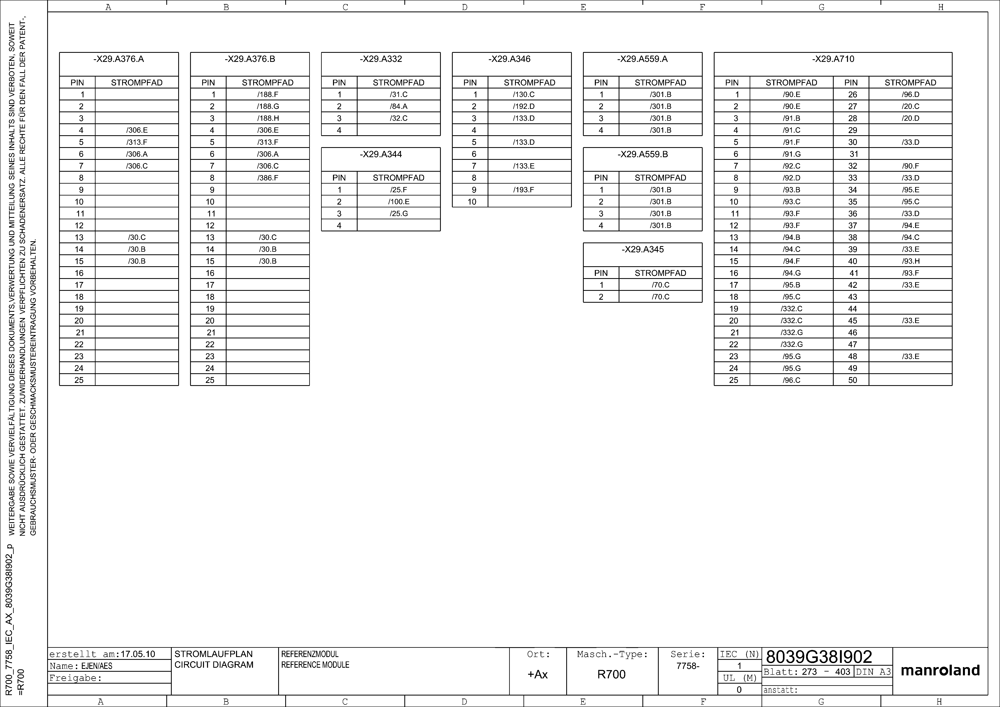

# +Ax — Sheet 273 of 403 — REFERENZMODUL

**REFERENCE MODULE**

> Part of the manroland **R700** printing press IEC/UL circuit diagrams.
> Drawing class: **Stromlaufplan / Circuit diagram** (DIN A3).
> Document `+Ax` covers the **Central control console** machine section.

## At a glance

| Field | Value |
|---|---|
| Document | `+Ax`  (8039G38I902) |
| Sheet | **273** of 403 |
| Section (DE) | REFERENZMODUL |
| Section (EN) | REFERENCE MODULE |
| Section type | REFERENCE_MODULE — Reference module |
| Machine type | `R700` |
| Series | `7758` |
| Created | 17.05.10 |
| Replaces | — |
| Columns used | A, B, C, D, E, F, G, H |
| Path numbers | — |
| Labels on sheet | 239 |
| Cross-refs out | 82 |
| Cross-refs in | 0 |

**Previous:** [+Ax sheet 272](SHEET_0272.md) · **Next:** [+Ax sheet 274](SHEET_0274.md) · **Document TOC:** [_TOC.md](_TOC.md)  (+Ax) · **Master TOC:** [all sheets](../_MASTER_TOC.md)

## Sheet image (300 DPI, exact vector render)



_Rendered directly from the PDF vector layer at 300 DPI (1-bit), no OCR and no resampling. Use it to confirm anything ambiguous in the text below._

## Cross-references on this sheet

Each entry is a wire leaving this sheet. The printed token is `/sheet.column`; the link resolves to that sheet inside the same document.

| Ref | Target sheet | Col | Path | Destination on target | Target section | From col |
|---|---|---|---|---|---|---|
| `/90.E` | [+Ax sheet 90](SHEET_0090.md) | E | — | — | ANLEGER | G |
| `/301.B` | [+Ax sheet 301](SHEET_0301.md) | B | — | — | SPANNUNGSVERSORGUNG: LACKMODUL | F |
| `/188.F` | [+Ax sheet 188](SHEET_0188.md) | F | — | — | RESERVE | B |
| `/31.C` | [+Ax sheet 31](SHEET_0031.md) | C | — | — | SPANNUNGSVERSORGUNG, SCHALTSCHRANKBELÜFTUNG | C |
| `/96.D` | [+Ax sheet 96](SHEET_0096.md) | D | — | — | ANLEGER | H |
| `/130.C` | [+Ax sheet 130](SHEET_0130.md) | C | — | — | REALTIMERECHNER ANLAGE | E |
| `/84.A` | [+Ax sheet 84](SHEET_0084.md) | A | — | — | ANLEGER | C |
| `/90.E` | [+Ax sheet 90](SHEET_0090.md) | E | — | — | ANLEGER | G |
| `/301.B` | [+Ax sheet 301](SHEET_0301.md) | B | — | — | SPANNUNGSVERSORGUNG: LACKMODUL | F |
| `/188.G` | [+Ax sheet 188](SHEET_0188.md) | G | — | — | RESERVE | B |
| `/20.C` | [+Ax sheet 20](SHEET_0020.md) | C | — | — | SPANNUNGSVERSORGUNG, SCHALTSCHRANKBELÜFTUNG | H |
| `/192.D` | [+Ax sheet 192](SHEET_0192.md) | D | — | — | RESERVE | E |
| `/91.B` | [+Ax sheet 91](SHEET_0091.md) | B | — | — | ANLEGER | G |
| `/301.B` | [+Ax sheet 301](SHEET_0301.md) | B | — | — | SPANNUNGSVERSORGUNG: LACKMODUL | F |
| `/32.C` | [+Ax sheet 32](SHEET_0032.md) | C | — | — | SPANNUNGSVERSORGUNG, SCHALTSCHRANKBELÜFTUNG | C |
| `/20.D` | [+Ax sheet 20](SHEET_0020.md) | D | — | — | SPANNUNGSVERSORGUNG, SCHALTSCHRANKBELÜFTUNG | H |
| `/188.H` | [+Ax sheet 188](SHEET_0188.md) | H | — | — | RESERVE | B |
| `/133.D` | [+Ax sheet 133](SHEET_0133.md) | D | — | — | REALTIMERECHNER DRUCKWERK | E |
| `/306.E` | [+Ax sheet 306](SHEET_0306.md) | E | — | — | SCHÖN & WIDERDRUCK HAUPTSCHALTSCHRANK | A |
| `/306.E` | [+Ax sheet 306](SHEET_0306.md) | E | — | — | SCHÖN & WIDERDRUCK HAUPTSCHALTSCHRANK | B |
| `/301.B` | [+Ax sheet 301](SHEET_0301.md) | B | — | — | SPANNUNGSVERSORGUNG: LACKMODUL | F |
| `/91.C` | [+Ax sheet 91](SHEET_0091.md) | C | — | — | ANLEGER | G |
| `/91.F` | [+Ax sheet 91](SHEET_0091.md) | F | — | — | ANLEGER | G |
| `/313.F` | [+Ax sheet 313](SHEET_0313.md) | F | — | — | OPTION: STAUBSAUGER MIT BÜRSTE | A |
| `/313.F` | [+Ax sheet 313](SHEET_0313.md) | F | — | — | OPTION: STAUBSAUGER MIT BÜRSTE | B |
| `/33.D` | [+Ax sheet 33](SHEET_0033.md) | D | — | — | SPANNUNGSVERSORGUNG, SCHALTSCHRANKBELÜFTUNG | H |
| `/133.D` | [+Ax sheet 133](SHEET_0133.md) | D | — | — | REALTIMERECHNER DRUCKWERK | E |
| `/306.A` | [+Ax sheet 306](SHEET_0306.md) | A | — | — | SCHÖN & WIDERDRUCK HAUPTSCHALTSCHRANK | A |
| `/306.A` | [+Ax sheet 306](SHEET_0306.md) | A | — | — | SCHÖN & WIDERDRUCK HAUPTSCHALTSCHRANK | B |
| `/91.G` | [+Ax sheet 91](SHEET_0091.md) | G | — | — | ANLEGER | G |
| `/133.E` | [+Ax sheet 133](SHEET_0133.md) | E | — | — | REALTIMERECHNER DRUCKWERK | E |
| `/90.F` | [+Ax sheet 90](SHEET_0090.md) | F | — | — | ANLEGER | H |
| `/306.C` | [+Ax sheet 306](SHEET_0306.md) | C | — | — | SCHÖN & WIDERDRUCK HAUPTSCHALTSCHRANK | A |
| `/306.C` | [+Ax sheet 306](SHEET_0306.md) | C | — | — | SCHÖN & WIDERDRUCK HAUPTSCHALTSCHRANK | B |
| `/92.C` | [+Ax sheet 92](SHEET_0092.md) | C | — | — | ANLEGER | G |
| `/386.F` | [+Ax sheet 386](SHEET_0386.md) | F | — | — | OPTION: INLINECOATER SMART | B |
| `/92.D` | [+Ax sheet 92](SHEET_0092.md) | D | — | — | ANLEGER | G |
| `/33.D` | [+Ax sheet 33](SHEET_0033.md) | D | — | — | SPANNUNGSVERSORGUNG, SCHALTSCHRANKBELÜFTUNG | H |
| `/93.B` | [+Ax sheet 93](SHEET_0093.md) | B | — | — | ANLEGER | G |
| `/95.E` | [+Ax sheet 95](SHEET_0095.md) | E | — | — | ANLEGER | H |
| `/25.F` | [+Ax sheet 25](SHEET_0025.md) | F | — | — | SPANNUNGSVERSORGUNG, SCHALTSCHRANKBELÜFTUNG | C |
| `/301.B` | [+Ax sheet 301](SHEET_0301.md) | B | — | — | SPANNUNGSVERSORGUNG: LACKMODUL | F |
| `/193.F` | [+Ax sheet 193](SHEET_0193.md) | F | — | — | RESERVE | E |
| `/100.E` | [+Ax sheet 100](SHEET_0100.md) | E | — | — | ANLEGER | C |
| `/301.B` | [+Ax sheet 301](SHEET_0301.md) | B | — | — | SPANNUNGSVERSORGUNG: LACKMODUL | F |
| `/93.C` | [+Ax sheet 93](SHEET_0093.md) | C | — | — | ANLEGER | G |
| `/95.C` | [+Ax sheet 95](SHEET_0095.md) | C | — | — | ANLEGER | H |
| `/301.B` | [+Ax sheet 301](SHEET_0301.md) | B | — | — | SPANNUNGSVERSORGUNG: LACKMODUL | F |
| `/93.F` | [+Ax sheet 93](SHEET_0093.md) | F | — | — | ANLEGER | G |
| `/25.G` | [+Ax sheet 25](SHEET_0025.md) | G | — | — | SPANNUNGSVERSORGUNG, SCHALTSCHRANKBELÜFTUNG | C |
| `/33.D` | [+Ax sheet 33](SHEET_0033.md) | D | — | — | SPANNUNGSVERSORGUNG, SCHALTSCHRANKBELÜFTUNG | H |
| `/94.E` | [+Ax sheet 94](SHEET_0094.md) | E | — | — | ANLEGER | H |
| `/301.B` | [+Ax sheet 301](SHEET_0301.md) | B | — | — | SPANNUNGSVERSORGUNG: LACKMODUL | F |
| `/93.F` | [+Ax sheet 93](SHEET_0093.md) | F | — | — | ANLEGER | G |
| `/94.B` | [+Ax sheet 94](SHEET_0094.md) | B | — | — | ANLEGER | G |
| `/30.C` | [+Ax sheet 30](SHEET_0030.md) | C | — | — | SPANNUNGSVERSORGUNG, SCHALTSCHRANKBELÜFTUNG | A |
| `/30.C` | [+Ax sheet 30](SHEET_0030.md) | C | — | — | SPANNUNGSVERSORGUNG, SCHALTSCHRANKBELÜFTUNG | B |
| `/94.C` | [+Ax sheet 94](SHEET_0094.md) | C | — | — | ANLEGER | H |
| `/30.B` | [+Ax sheet 30](SHEET_0030.md) | B | — | — | SPANNUNGSVERSORGUNG, SCHALTSCHRANKBELÜFTUNG | A |
| `/30.B` | [+Ax sheet 30](SHEET_0030.md) | B | — | — | SPANNUNGSVERSORGUNG, SCHALTSCHRANKBELÜFTUNG | B |
| `/33.E` | [+Ax sheet 33](SHEET_0033.md) | E | — | — | SPANNUNGSVERSORGUNG, SCHALTSCHRANKBELÜFTUNG | H |
| `/94.C` | [+Ax sheet 94](SHEET_0094.md) | C | — | — | ANLEGER | G |
| `/30.B` | [+Ax sheet 30](SHEET_0030.md) | B | — | — | SPANNUNGSVERSORGUNG, SCHALTSCHRANKBELÜFTUNG | A |
| `/30.B` | [+Ax sheet 30](SHEET_0030.md) | B | — | — | SPANNUNGSVERSORGUNG, SCHALTSCHRANKBELÜFTUNG | B |
| `/94.F` | [+Ax sheet 94](SHEET_0094.md) | F | — | — | ANLEGER | G |
| `/93.H` | [+Ax sheet 93](SHEET_0093.md) | H | — | — | ANLEGER | H |
| `/93.F` | [+Ax sheet 93](SHEET_0093.md) | F | — | — | ANLEGER | H |
| `/94.G` | [+Ax sheet 94](SHEET_0094.md) | G | — | — | ANLEGER | G |
| `/95.B` | [+Ax sheet 95](SHEET_0095.md) | B | — | — | ANLEGER | G |
| `/33.E` | [+Ax sheet 33](SHEET_0033.md) | E | — | — | SPANNUNGSVERSORGUNG, SCHALTSCHRANKBELÜFTUNG | H |
| `/70.C` | [+Ax sheet 70](SHEET_0070.md) | C | — | — | WASCHVORRICHTUNGEN DRUCKWERKE | F |
| `/70.C` | [+Ax sheet 70](SHEET_0070.md) | C | — | — | WASCHVORRICHTUNGEN DRUCKWERKE | F |
| `/95.C` | [+Ax sheet 95](SHEET_0095.md) | C | — | — | ANLEGER | G |
| `/332.C` | [+Ax sheet 332](SHEET_0332.md) | C | — | — | OPTION: NONSTOP EINRICHTUNG MANUELL, ANLEGER | G |
| `/33.E` | [+Ax sheet 33](SHEET_0033.md) | E | — | — | SPANNUNGSVERSORGUNG, SCHALTSCHRANKBELÜFTUNG | H |
| `/332.C` | [+Ax sheet 332](SHEET_0332.md) | C | — | — | OPTION: NONSTOP EINRICHTUNG MANUELL, ANLEGER | G |
| `/332.G` | [+Ax sheet 332](SHEET_0332.md) | G | — | — | OPTION: NONSTOP EINRICHTUNG MANUELL, ANLEGER | G |
| `/332.G` | [+Ax sheet 332](SHEET_0332.md) | G | — | — | OPTION: NONSTOP EINRICHTUNG MANUELL, ANLEGER | G |
| `/33.E` | [+Ax sheet 33](SHEET_0033.md) | E | — | — | SPANNUNGSVERSORGUNG, SCHALTSCHRANKBELÜFTUNG | H |
| `/95.G` | [+Ax sheet 95](SHEET_0095.md) | G | — | — | ANLEGER | G |
| `/95.G` | [+Ax sheet 95](SHEET_0095.md) | G | — | — | ANLEGER | G |
| `/96.C` | [+Ax sheet 96](SHEET_0096.md) | C | — | — | ANLEGER | G |

## Devices on this sheet

| Tag | Class | Class meaning (IEC) | Col | Sub | Terminal | Sign |
|---|---|---|---|---|---|---|
| `X29.A376.B` | — | cross-device reference | B | — | — | — |
| `X29.A376.A` | — | cross-device reference | A | — | — | — |
| `X29.A346` | — | cross-device reference | D | — | — | — |
| `X29.A332` | — | cross-device reference | C | — | — | — |
| `X29.A344` | — | cross-device reference | C | — | — | — |
| `X29.A559.A` | — | cross-device reference | E | — | — | — |
| `X29.A559.B` | — | cross-device reference | F | — | — | — |
| `X29.A345` | — | cross-device reference | F | — | — | — |
| `X29.A710` | — | cross-device reference | G | — | — | — |

## Potentials / nets

_No named potentials on this sheet._

## Wire-end annotations (grouped as printed)

A wire that continues elsewhere is annotated with a small cluster: the destination description, the path/line number `#NN`, and the `/sheet.column` cross reference. Each row below is one such cluster exactly as it is grouped on the drawing.

| Col | Y | Path | Cross-ref | Text on the wire |
|---|---|---|---|---|
| A | 65.5 | — | — | `X29.A376.A` |
| B | 65.5 | — | — | `X29.A376.B` |
| C | 65.5 | — | — | `X29.A332` |
| D | 65.5 | — | — | `X29.A346` |
| E | 65.5 | — | — | `X29.A559.A` |
| G | 65.5 | — | — | `X29.A710` |
| A | 94.2 | — | — | `PIN STROMPFAD` |
| B | 94.2 | — | — | `PIN STROMPFAD` |
| C | 94.2 | — | — | `PIN 2 3 4 1 STROMPFAD` |
| D | 94.2 | — | — | `PIN 10 2 3 4 5 6 7 8 9 1 STROMPFAD` |
| E | 94.2 | — | — | `PIN 2 3 4 1 STROMPFAD` |
| G | 94.2 | — | — | `PIN STROMPFAD` |
| H | 94.2 | — | — | `PIN STROMPFAD` |
| A | 108.4 | — | — | `2 3 4 5 6 7 8 9 1` |
| B | 108.4 | — | — | `2 3 4 5 6 7 8 9 1` |
| F | 108.4 | — | — | `2 3 4 5 6 7 8 9 1` |
| G | 108.4 | — | — | `26 27 28 29 30 32 33 34 35 36 37 38 39 40 42 43 44 45 46 47 48 49 50 31 41` |
| B | 108.7 | — | `/188.F` | — |
| C | 108.7 | — | `/31.C` | — |
| E | 108.7 | — | `/130.C` | — |
| F | 108.7 | — | `/301.B` | — |
| G | 108.7 | — | `/90.E` | — |
| H | 108.7 | — | `/96.D` | — |
| C | 122.8 | — | `/84.A` | — |
| G | 122.8 | — | `/90.E` | — |
| B | 122.9 | — | `/188.G` | — |
| E | 122.9 | — | `/192.D` | — |
| F | 122.9 | — | `/301.B` | — |
| H | 122.9 | — | `/20.C` | — |
| F | 137.0 | — | `/301.B` | — |
| G | 137.0 | — | `/91.B` | — |
| B | 137.1 | — | `/188.H` | — |
| C | 137.1 | — | `/32.C` | — |
| E | 137.1 | — | `/133.D` | — |
| H | 137.1 | — | `/20.D` | — |
| A | 151.2 | — | `/306.E` | — |
| B | 151.2 | — | `/306.E` | — |
| F | 151.2 | — | `/301.B` | — |
| G | 151.2 | — | `/91.C` | — |
| A | 165.4 | — | `/313.F` | — |
| B | 165.4 | — | `/313.F` | — |
| E | 165.4 | — | `/133.D` | — |
| G | 165.4 | — | `/91.F` | — |
| H | 165.4 | — | `/33.D` | — |
| C | 178.9 | — | — | `X29.A344` |
| F | 178.9 | — | — | `X29.A559.B` |
| A | 179.6 | — | `/306.A` | — |
| B | 179.6 | — | `/306.A` | — |
| G | 179.6 | — | `/91.G` | — |
| E | 193.7 | — | `/133.E` | — |
| H | 193.7 | — | `/90.F` | — |
| A | 193.8 | — | `/306.C` | — |
| B | 193.8 | — | `/306.C` | — |
| G | 193.8 | — | `/92.C` | — |
| C | 207.5 | — | — | `PIN 2 3 4 1 STROMPFAD` |
| E | 207.5 | — | — | `PIN 2 3 4 1 STROMPFAD` |
| B | 207.9 | — | `/386.F` | — |
| G | 207.9 | — | `/92.D` | — |
| H | 207.9 | — | `/33.D` | — |
| C | 222.1 | — | `/25.F` | — |
| E | 222.1 | — | `/193.F` | — |
| F | 222.1 | — | `/301.B` | — |
| G | 222.1 | — | `/93.B` | — |
| H | 222.1 | — | `/95.E` | — |
| A | 235.9 | — | — | `10 12 13 14 15 16 17 18 19 20 11` |
| B | 235.9 | — | — | `10 12 13 14 15 16 17 18 19 20 11` |
| F | 235.9 | — | — | `10 12 13 14 15 16 17 18 19 20 11` |
| C | 236.2 | — | `/100.E` | — |
| F | 236.2 | — | `/301.B` | — |
| G | 236.3 | — | `/93.C` | — |
| H | 236.3 | — | `/95.C` | — |
| C | 250.4 | — | `/25.G` | — |
| F | 250.4 | — | `/301.B` | — |
| G | 250.4 | — | `/93.F` | — |
| H | 250.4 | — | `/33.D` | — |
| F | 264.6 | — | `/301.B` | — |
| G | 264.6 | — | `/93.F` | — |
| H | 264.6 | — | `/94.E` | — |
| A | 278.8 | — | `/30.C` | — |
| B | 278.8 | — | `/30.C` | — |
| G | 278.8 | — | `/94.B` | — |
| H | 278.8 | — | `/94.C` | — |
| F | 292.3 | — | — | `X29.A345` |
| A | 292.9 | — | `/30.B` | — |
| B | 292.9 | — | `/30.B` | — |
| H | 292.9 | — | `/33.E` | — |
| G | 293.0 | — | `/94.C` | — |
| A | 307.1 | — | `/30.B` | — |
| B | 307.1 | — | `/30.B` | — |
| G | 307.1 | — | `/94.F` | — |
| H | 307.1 | — | `/93.H` | — |
| E | 320.9 | — | — | `PIN 2 1 STROMPFAD` |
| G | 321.3 | — | `/94.G` | — |
| H | 321.3 | — | `/93.F` | — |
| G | 335.4 | — | `/95.B` | — |
| H | 335.4 | — | `/33.E` | — |
| F | 335.5 | — | `/70.C` | — |
| F | 349.6 | — | `/70.C` | — |
| G | 349.6 | — | `/95.C` | — |
| G | 363.8 | — | `/332.C` | — |
| G | 378.0 | — | `/332.C` | — |
| H | 378.0 | — | `/33.E` | — |
| A | 391.8 | — | — | `22 23 24 25 21` |
| B | 391.8 | — | — | `22 23 24 25 21` |
| F | 391.8 | — | — | `22 23 24 25 21` |
| G | 392.2 | — | `/332.G` | — |
| G | 406.3 | — | `/332.G` | — |
| G | 420.5 | — | `/95.G` | — |
| H | 420.5 | — | `/33.E` | — |
| G | 434.7 | — | `/95.G` | — |
| G | 448.9 | — | `/96.C` | — |


## Reconstructed tables

This sheet carries tabular content (pin map / terminal assignment / index). The grid below was rebuilt from the drawing's own rule lines, so each row is exactly one physical row of the table.

### Table 1 — 25 data rows × 2 columns (at x=70.9, y=62.4) — **X29.A376.A**

| PIN | STROMPFAD |
|---|---|
| `1` |  |
| `2` |  |
| `3` |  |
| `4` | `/306.E` |
| `5` | `/313.F` |
| `6` | `/306.A` |
| `7` | `/306.C` |
| `8` |  |
| `9` |  |
| `10` |  |
| `11` |  |
| `12` |  |
| `13` | `/30.C` |
| `14` | `/30.B` |
| `15` | `/30.B` |
| `16` |  |
| `17` |  |
| `18` |  |
| `19` |  |
| `20` |  |
| `21` |  |
| `22` |  |
| `23` |  |
| `24` |  |
| `25` |  |


### Table 2 — 25 data rows × 2 columns (at x=226.8, y=62.4) — **X29.A376.B**

| PIN | STROMPFAD |
|---|---|
| `1` | `/188.F` |
| `2` | `/188.G` |
| `3` | `/188.H` |
| `4` | `/306.E` |
| `5` | `/313.F` |
| `6` | `/306.A` |
| `7` | `/306.C` |
| `8` | `/386.F` |
| `9` |  |
| `10` |  |
| `11` |  |
| `12` |  |
| `13` | `/30.C` |
| `14` | `/30.B` |
| `15` | `/30.B` |
| `16` |  |
| `17` |  |
| `18` |  |
| `19` |  |
| `20` |  |
| `21` |  |
| `22` |  |
| `23` |  |
| `24` |  |
| `25` |  |


### Table 3 — 10 data rows × 2 columns (at x=382.7, y=62.4) — **X29.A332**

| PIN | STROMPFAD |
|---|---|
| `1` | `/31.C` |
| `2` | `/84.A` |
| `3` | `/32.C` |
| `4` |  |
|  | `X29.A344` |
| `PIN` | `STROMPFAD` |
| `1` | `/25.F` |
| `2` | `/100.E` |
| `3` | `/25.G` |
| `4` |  |


### Table 4 — 10 data rows × 2 columns (at x=538.6, y=62.4) — **X29.A346**

| PIN | STROMPFAD |
|---|---|
| `1` | `/130.C` |
| `2` | `/192.D` |
| `3` | `/133.D` |
| `4` |  |
| `5` | `/133.D` |
| `6` |  |
| `7` | `/133.E` |
| `8` |  |
| `9` | `/193.F` |
| `10` |  |


### Table 5 — 14 data rows × 2 columns (at x=694.5, y=62.4) — **X29.A559.A**

| PIN | STROMPFAD |
|---|---|
| `1` | `/301.B` |
| `2` | `/301.B` |
| `3` | `/301.B` |
| `4` | `/301.B` |
|  | `X29.A559.B` |
| `PIN` | `STROMPFAD` |
| `1` | `/301.B` |
| `2` | `/301.B` |
| `3` | `/301.B` |
| `4` | `/301.B` |
|  | `X29.A345` |
| `PIN` | `STROMPFAD` |
| `1` | `/70.C` |
| `2` | `/70.C` |


### Table 6 — 25 data rows × 4 columns (at x=850.4, y=62.4) — **X29.A710**

| PIN | STROMPFAD | PIN | STROMPFAD |
|---|---|---|---|
| `1` | `/90.E` | `26` | `/96.D` |
| `2` | `/90.E` | `27` | `/20.C` |
| `3` | `/91.B` | `28` | `/20.D` |
| `4` | `/91.C` | `29` |  |
| `5` | `/91.F` | `30` | `/33.D` |
| `6` | `/91.G` | `31` |  |
| `7` | `/92.C` | `32` | `/90.F` |
| `8` | `/92.D` | `33` | `/33.D` |
| `9` | `/93.B` | `34` | `/95.E` |
| `10` | `/93.C` | `35` | `/95.C` |
| `11` | `/93.F` | `36` | `/33.D` |
| `12` | `/93.F` | `37` | `/94.E` |
| `13` | `/94.B` | `38` | `/94.C` |
| `14` | `/94.C` | `39` | `/33.E` |
| `15` | `/94.F` | `40` | `/93.H` |
| `16` | `/94.G` | `41` | `/93.F` |
| `17` | `/95.B` | `42` | `/33.E` |
| `18` | `/95.C` | `43` |  |
| `19` | `/332.C` | `44` |  |
| `20` | `/332.C` | `45` | `/33.E` |
| `21` | `/332.G` | `46` |  |
| `22` | `/332.G` | `47` |  |
| `23` | `/95.G` | `48` | `/33.E` |
| `24` | `/95.G` | `49` |  |
| `25` | `/96.C` | `50` |  |


## Notes and free text on this sheet

| Text | Col | Y (pt) |
|---|---|---|
| `PIN` | B | 94.2 |
| `STROMPFAD` | B | 94.15 |
| `PIN` | A | 94.2 |
| `STROMPFAD` | A | 94.15 |
| `PIN` | D | 94.2 |
| `STROMPFAD` | E | 94.15 |
| `PIN` | C | 94.2 |
| `STROMPFAD` | C | 94.15 |
| `PIN` | E | 94.2 |
| `STROMPFAD` | F | 94.15 |
| `PIN` | F | 94.2 |
| `STROMPFAD` | G | 94.15 |
| `PIN` | G | 94.2 |
| `STROMPFAD` | H | 94.15 |

## Complete label inventory (exact text from the drawing)

Every text object inside the drawing area of this sheet, in DIN reading order (column A→H, then top→bottom). This is the authoritative list: if a string is not here it is not printed on this sheet.

| Col | Y | X | Dir | Type | Text |
|---|---|---|---|---|---|
| A | 65.5 | 111.4 | → | device ref | `X29.A376.A` |
| A | 94.2 | 84.0 | → | text | `PIN` |
| A | 94.2 | 132.2 | → | text | `STROMPFAD` |
| A | 108.4 | 95.8 | → | number | `1` |
| A | 122.5 | 94.1 | → | number | `2` |
| A | 136.7 | 94.1 | → | number | `3` |
| A | 150.9 | 94.1 | → | number | `4` |
| A | 151.2 | 150.5 | → | cross-reference | `/306.E` |
| A | 165.1 | 94.1 | → | number | `5` |
| A | 165.4 | 150.7 | → | cross-reference | `/313.F` |
| A | 179.2 | 94.1 | → | number | `6` |
| A | 179.6 | 150.2 | → | cross-reference | `/306.A` |
| A | 193.4 | 94.1 | → | number | `7` |
| A | 193.8 | 150.2 | → | cross-reference | `/306.C` |
| A | 207.6 | 94.1 | → | number | `8` |
| A | 221.8 | 94.1 | → | number | `9` |
| A | 235.9 | 88.7 | → | number | `10` |
| A | 250.1 | 90.4 | → | number | `11` |
| A | 264.3 | 88.7 | → | number | `12` |
| A | 278.5 | 88.7 | → | number | `13` |
| A | 278.8 | 152.6 | → | cross-reference | `/30.C` |
| A | 292.6 | 88.7 | → | number | `14` |
| A | 292.9 | 152.8 | → | cross-reference | `/30.B` |
| A | 306.8 | 88.7 | → | number | `15` |
| A | 307.1 | 152.8 | → | cross-reference | `/30.B` |
| A | 321.0 | 88.7 | → | number | `16` |
| A | 335.1 | 88.7 | → | number | `17` |
| A | 349.3 | 88.7 | → | number | `18` |
| A | 363.5 | 88.7 | → | number | `19` |
| A | 377.7 | 88.7 | → | number | `20` |
| A | 391.8 | 90.4 | → | number | `21` |
| A | 406.0 | 88.7 | → | number | `22` |
| A | 420.2 | 88.7 | → | number | `23` |
| A | 434.4 | 88.7 | → | number | `24` |
| A | 448.5 | 88.7 | → | number | `25` |
| B | 65.5 | 267.7 | → | device ref | `X29.A376.B` |
| B | 94.2 | 240.0 | → | text | `PIN` |
| B | 94.2 | 288.1 | → | text | `STROMPFAD` |
| B | 108.4 | 251.7 | → | number | `1` |
| B | 108.7 | 306.6 | → | cross-reference | `/188.F` |
| B | 122.5 | 250.0 | → | number | `2` |
| B | 122.9 | 306.0 | → | cross-reference | `/188.G` |
| B | 136.7 | 250.0 | → | number | `3` |
| B | 137.1 | 306.4 | → | cross-reference | `/188.H` |
| B | 150.9 | 250.0 | → | number | `4` |
| B | 151.2 | 306.4 | → | cross-reference | `/306.E` |
| B | 165.1 | 250.0 | → | number | `5` |
| B | 165.4 | 306.6 | → | cross-reference | `/313.F` |
| B | 179.2 | 250.0 | → | number | `6` |
| B | 179.6 | 306.1 | → | cross-reference | `/306.A` |
| B | 193.4 | 250.0 | → | number | `7` |
| B | 193.8 | 306.1 | → | cross-reference | `/306.C` |
| B | 207.6 | 250.0 | → | number | `8` |
| B | 207.9 | 306.6 | → | cross-reference | `/386.F` |
| B | 221.8 | 250.0 | → | number | `9` |
| B | 235.9 | 244.6 | → | number | `10` |
| B | 250.1 | 246.3 | → | number | `11` |
| B | 264.3 | 244.6 | → | number | `12` |
| B | 278.5 | 244.6 | → | number | `13` |
| B | 278.8 | 308.6 | → | cross-reference | `/30.C` |
| B | 292.6 | 244.6 | → | number | `14` |
| B | 292.9 | 308.7 | → | cross-reference | `/30.B` |
| B | 306.8 | 244.6 | → | number | `15` |
| B | 307.1 | 308.7 | → | cross-reference | `/30.B` |
| B | 321.0 | 244.6 | → | number | `16` |
| B | 335.1 | 244.6 | → | number | `17` |
| B | 349.3 | 244.6 | → | number | `18` |
| B | 363.5 | 244.6 | → | number | `19` |
| B | 377.7 | 244.6 | → | number | `20` |
| B | 391.8 | 246.3 | → | number | `21` |
| B | 406.0 | 244.6 | → | number | `22` |
| B | 420.2 | 244.6 | → | number | `23` |
| B | 434.4 | 244.6 | → | number | `24` |
| B | 448.5 | 244.6 | → | number | `25` |
| C | 65.5 | 428.6 | → | device ref | `X29.A332` |
| C | 94.2 | 395.9 | → | text | `PIN` |
| C | 94.2 | 444.0 | → | text | `STROMPFAD` |
| C | 108.4 | 401.8 | → | number | `1` |
| C | 108.7 | 464.5 | → | cross-reference | `/31.C` |
| C | 122.5 | 401.2 | → | number | `2` |
| C | 122.8 | 464.5 | → | cross-reference | `/84.A` |
| C | 136.7 | 401.2 | → | number | `3` |
| C | 137.1 | 464.5 | → | cross-reference | `/32.C` |
| C | 150.9 | 401.2 | → | number | `4` |
| C | 178.9 | 428.6 | → | device ref | `X29.A344` |
| C | 207.5 | 444.0 | → | text | `STROMPFAD` |
| C | 207.6 | 395.9 | → | text | `PIN` |
| C | 221.8 | 401.8 | → | number | `1` |
| C | 222.1 | 464.9 | → | cross-reference | `/25.F` |
| C | 235.9 | 401.2 | → | number | `2` |
| C | 236.2 | 462.3 | → | cross-reference | `/100.E` |
| C | 250.1 | 401.2 | → | number | `3` |
| C | 250.4 | 464.3 | → | cross-reference | `/25.G` |
| C | 264.3 | 401.2 | → | number | `4` |
| D | 65.5 | 581.7 | → | device ref | `X29.A346` |
| D | 94.2 | 551.8 | → | text | `PIN` |
| D | 108.4 | 563.5 | → | number | `1` |
| D | 122.5 | 561.8 | → | number | `2` |
| D | 136.7 | 561.8 | → | number | `3` |
| D | 150.9 | 561.8 | → | number | `4` |
| D | 165.1 | 561.8 | → | number | `5` |
| D | 179.2 | 561.8 | → | number | `6` |
| D | 193.4 | 561.8 | → | number | `7` |
| D | 207.6 | 561.8 | → | number | `8` |
| D | 221.8 | 561.8 | → | number | `9` |
| D | 235.9 | 556.4 | → | number | `10` |
| E | 65.5 | 735.0 | → | device ref | `X29.A559.A` |
| E | 94.2 | 600.0 | → | text | `STROMPFAD` |
| E | 94.2 | 707.7 | → | text | `PIN` |
| E | 108.4 | 713.6 | → | number | `1` |
| E | 108.7 | 610.9 | → | cross-reference | `/130.C` |
| E | 122.5 | 713.1 | → | number | `2` |
| E | 122.9 | 610.9 | → | cross-reference | `/192.D` |
| E | 136.7 | 713.1 | → | number | `3` |
| E | 137.1 | 610.9 | → | cross-reference | `/133.D` |
| E | 150.9 | 713.1 | → | number | `4` |
| E | 165.4 | 610.9 | → | cross-reference | `/133.D` |
| E | 193.7 | 611.1 | → | cross-reference | `/133.E` |
| E | 207.6 | 707.7 | → | text | `PIN` |
| E | 221.8 | 713.6 | → | number | `1` |
| E | 222.1 | 611.3 | → | cross-reference | `/193.F` |
| E | 235.9 | 713.1 | → | number | `2` |
| E | 250.1 | 713.1 | → | number | `3` |
| E | 264.3 | 713.1 | → | number | `4` |
| E | 321.0 | 707.7 | → | text | `PIN` |
| E | 335.1 | 713.6 | → | number | `1` |
| E | 349.3 | 713.1 | → | number | `2` |
| F | 94.2 | 755.9 | → | text | `STROMPFAD` |
| F | 94.2 | 863.6 | → | text | `PIN` |
| F | 108.4 | 875.3 | → | number | `1` |
| F | 108.7 | 774.0 | → | cross-reference | `/301.B` |
| F | 122.5 | 873.6 | → | number | `2` |
| F | 122.9 | 774.0 | → | cross-reference | `/301.B` |
| F | 136.7 | 873.6 | → | number | `3` |
| F | 137.0 | 774.0 | → | cross-reference | `/301.B` |
| F | 150.9 | 873.6 | → | number | `4` |
| F | 151.2 | 774.0 | → | cross-reference | `/301.B` |
| F | 165.1 | 873.6 | → | number | `5` |
| F | 178.9 | 735.4 | → | device ref | `X29.A559.B` |
| F | 179.2 | 873.6 | → | number | `6` |
| F | 193.4 | 873.6 | → | number | `7` |
| F | 207.5 | 755.9 | → | text | `STROMPFAD` |
| F | 207.6 | 873.6 | → | number | `8` |
| F | 221.8 | 873.6 | → | number | `9` |
| F | 222.1 | 774.0 | → | cross-reference | `/301.B` |
| F | 235.9 | 868.3 | → | number | `10` |
| F | 236.2 | 774.0 | → | cross-reference | `/301.B` |
| F | 250.1 | 870.0 | → | number | `11` |
| F | 250.4 | 774.0 | → | cross-reference | `/301.B` |
| F | 264.3 | 868.3 | → | number | `12` |
| F | 264.6 | 774.0 | → | cross-reference | `/301.B` |
| F | 278.5 | 868.3 | → | number | `13` |
| F | 292.3 | 740.4 | → | device ref | `X29.A345` |
| F | 292.6 | 868.3 | → | number | `14` |
| F | 306.8 | 868.3 | → | number | `15` |
| F | 320.9 | 755.9 | → | text | `STROMPFAD` |
| F | 321.0 | 868.3 | → | number | `16` |
| F | 335.1 | 868.3 | → | number | `17` |
| F | 335.5 | 776.3 | → | cross-reference | `/70.C` |
| F | 349.3 | 868.3 | → | number | `18` |
| F | 349.7 | 776.3 | → | cross-reference | `/70.C` |
| F | 363.5 | 868.3 | → | number | `19` |
| F | 377.7 | 868.3 | → | number | `20` |
| F | 391.8 | 870.0 | → | number | `21` |
| F | 406.0 | 868.3 | → | number | `22` |
| F | 420.2 | 868.3 | → | number | `23` |
| F | 434.4 | 868.3 | → | number | `24` |
| F | 448.5 | 868.3 | → | number | `25` |
| G | 65.5 | 967.2 | → | device ref | `X29.A710` |
| G | 94.2 | 911.8 | → | text | `STROMPFAD` |
| G | 94.2 | 1005.3 | → | text | `PIN` |
| G | 108.4 | 1010.0 | → | number | `26` |
| G | 108.7 | 932.5 | → | cross-reference | `/90.E` |
| G | 122.5 | 1010.0 | → | number | `27` |
| G | 122.8 | 932.5 | → | cross-reference | `/90.E` |
| G | 136.7 | 1010.0 | → | number | `28` |
| G | 137.0 | 932.3 | → | cross-reference | `/91.B` |
| G | 150.9 | 1010.0 | → | number | `29` |
| G | 151.2 | 932.2 | → | cross-reference | `/91.C` |
| G | 165.1 | 1010.0 | → | number | `30` |
| G | 165.4 | 932.6 | → | cross-reference | `/91.F` |
| G | 179.2 | 1011.7 | → | number | `31` |
| G | 179.6 | 932.0 | → | cross-reference | `/91.G` |
| G | 193.4 | 1010.0 | → | number | `32` |
| G | 193.7 | 932.2 | → | cross-reference | `/92.C` |
| G | 207.6 | 1010.0 | → | number | `33` |
| G | 207.9 | 932.2 | → | cross-reference | `/92.D` |
| G | 221.8 | 1010.0 | → | number | `34` |
| G | 222.1 | 932.3 | → | cross-reference | `/93.B` |
| G | 235.9 | 1010.0 | → | number | `35` |
| G | 236.3 | 932.2 | → | cross-reference | `/93.C` |
| G | 250.1 | 1010.0 | → | number | `36` |
| G | 250.4 | 932.6 | → | cross-reference | `/93.F` |
| G | 264.3 | 1010.0 | → | number | `37` |
| G | 264.6 | 932.6 | → | cross-reference | `/93.F` |
| G | 278.5 | 1010.0 | → | number | `38` |
| G | 278.8 | 932.3 | → | cross-reference | `/94.B` |
| G | 292.6 | 1010.0 | → | number | `39` |
| G | 293.0 | 932.2 | → | cross-reference | `/94.C` |
| G | 306.8 | 1010.0 | → | number | `40` |
| G | 307.1 | 932.6 | → | cross-reference | `/94.F` |
| G | 321.0 | 1011.7 | → | number | `41` |
| G | 321.3 | 932.0 | → | cross-reference | `/94.G` |
| G | 335.1 | 1010.0 | → | number | `42` |
| G | 335.4 | 932.3 | → | cross-reference | `/95.B` |
| G | 349.3 | 1010.0 | → | number | `43` |
| G | 349.7 | 932.2 | → | cross-reference | `/95.C` |
| G | 363.5 | 1010.0 | → | number | `44` |
| G | 363.8 | 929.8 | → | cross-reference | `/332.C` |
| G | 377.7 | 1010.0 | → | number | `45` |
| G | 378.0 | 929.8 | → | cross-reference | `/332.C` |
| G | 391.8 | 1010.0 | → | number | `46` |
| G | 392.2 | 929.6 | → | cross-reference | `/332.G` |
| G | 406.0 | 1010.0 | → | number | `47` |
| G | 406.3 | 929.6 | → | cross-reference | `/332.G` |
| G | 420.2 | 1010.0 | → | number | `48` |
| G | 420.5 | 932.0 | → | cross-reference | `/95.G` |
| G | 434.4 | 1010.0 | → | number | `49` |
| G | 434.7 | 932.0 | → | cross-reference | `/95.G` |
| G | 448.5 | 1010.0 | → | number | `50` |
| G | 448.9 | 932.2 | → | cross-reference | `/96.C` |
| H | 94.2 | 1053.5 | → | text | `STROMPFAD` |
| H | 108.7 | 1073.9 | → | cross-reference | `/96.D` |
| H | 122.9 | 1073.9 | → | cross-reference | `/20.C` |
| H | 137.1 | 1073.9 | → | cross-reference | `/20.D` |
| H | 165.4 | 1073.9 | → | cross-reference | `/33.D` |
| H | 193.7 | 1074.3 | → | cross-reference | `/90.F` |
| H | 207.9 | 1073.9 | → | cross-reference | `/33.D` |
| H | 222.1 | 1074.2 | → | cross-reference | `/95.E` |
| H | 236.3 | 1073.9 | → | cross-reference | `/95.C` |
| H | 250.4 | 1073.9 | → | cross-reference | `/33.D` |
| H | 264.6 | 1074.2 | → | cross-reference | `/94.E` |
| H | 278.8 | 1073.9 | → | cross-reference | `/94.C` |
| H | 292.9 | 1074.2 | → | cross-reference | `/33.E` |
| H | 307.1 | 1074.2 | → | cross-reference | `/93.H` |
| H | 321.3 | 1074.3 | → | cross-reference | `/93.F` |
| H | 335.4 | 1074.2 | → | cross-reference | `/33.E` |
| H | 378.0 | 1074.2 | → | cross-reference | `/33.E` |
| H | 420.5 | 1074.2 | → | cross-reference | `/33.E` |

## Reading-order text block

The same content as a plain block, grouped by DIN column — convenient to paste or to match against a visual description.

```text
=== Column A ===
  65.5  111.4  devref       X29.A376.A
  94.2   84.0  text         PIN
  94.2  132.2  text         STROMPFAD
 108.4   95.8  numeric      1
 122.5   94.1  numeric      2
 136.7   94.1  numeric      3
 150.9   94.1  numeric      4
 151.2  150.5  xref         /306.E
 165.1   94.1  numeric      5
 165.4  150.7  xref         /313.F
 179.2   94.1  numeric      6
 179.6  150.2  xref         /306.A
 193.4   94.1  numeric      7
 193.8  150.2  xref         /306.C
 207.6   94.1  numeric      8
 221.8   94.1  numeric      9
 235.9   88.7  numeric      10
 250.1   90.4  numeric      11
 264.3   88.7  numeric      12
 278.5   88.7  numeric      13
 278.8  152.6  xref         /30.C
 292.6   88.7  numeric      14
 292.9  152.8  xref         /30.B
 306.8   88.7  numeric      15
 307.1  152.8  xref         /30.B
 321.0   88.7  numeric      16
 335.1   88.7  numeric      17
 349.3   88.7  numeric      18
 363.5   88.7  numeric      19
 377.7   88.7  numeric      20
 391.8   90.4  numeric      21
 406.0   88.7  numeric      22
 420.2   88.7  numeric      23
 434.4   88.7  numeric      24
 448.5   88.7  numeric      25
=== Column B ===
  65.5  267.7  devref       X29.A376.B
  94.2  240.0  text         PIN
  94.2  288.1  text         STROMPFAD
 108.4  251.7  numeric      1
 108.7  306.6  xref         /188.F
 122.5  250.0  numeric      2
 122.9  306.0  xref         /188.G
 136.7  250.0  numeric      3
 137.1  306.4  xref         /188.H
 150.9  250.0  numeric      4
 151.2  306.4  xref         /306.E
 165.1  250.0  numeric      5
 165.4  306.6  xref         /313.F
 179.2  250.0  numeric      6
 179.6  306.1  xref         /306.A
 193.4  250.0  numeric      7
 193.8  306.1  xref         /306.C
 207.6  250.0  numeric      8
 207.9  306.6  xref         /386.F
 221.8  250.0  numeric      9
 235.9  244.6  numeric      10
 250.1  246.3  numeric      11
 264.3  244.6  numeric      12
 278.5  244.6  numeric      13
 278.8  308.6  xref         /30.C
 292.6  244.6  numeric      14
 292.9  308.7  xref         /30.B
 306.8  244.6  numeric      15
 307.1  308.7  xref         /30.B
 321.0  244.6  numeric      16
 335.1  244.6  numeric      17
 349.3  244.6  numeric      18
 363.5  244.6  numeric      19
 377.7  244.6  numeric      20
 391.8  246.3  numeric      21
 406.0  244.6  numeric      22
 420.2  244.6  numeric      23
 434.4  244.6  numeric      24
 448.5  244.6  numeric      25
=== Column C ===
  65.5  428.6  devref       X29.A332
  94.2  395.9  text         PIN
  94.2  444.0  text         STROMPFAD
 108.4  401.8  numeric      1
 108.7  464.5  xref         /31.C
 122.5  401.2  numeric      2
 122.8  464.5  xref         /84.A
 136.7  401.2  numeric      3
 137.1  464.5  xref         /32.C
 150.9  401.2  numeric      4
 178.9  428.6  devref       X29.A344
 207.5  444.0  text         STROMPFAD
 207.6  395.9  text         PIN
 221.8  401.8  numeric      1
 222.1  464.9  xref         /25.F
 235.9  401.2  numeric      2
 236.2  462.3  xref         /100.E
 250.1  401.2  numeric      3
 250.4  464.3  xref         /25.G
 264.3  401.2  numeric      4
=== Column D ===
  65.5  581.7  devref       X29.A346
  94.2  551.8  text         PIN
 108.4  563.5  numeric      1
 122.5  561.8  numeric      2
 136.7  561.8  numeric      3
 150.9  561.8  numeric      4
 165.1  561.8  numeric      5
 179.2  561.8  numeric      6
 193.4  561.8  numeric      7
 207.6  561.8  numeric      8
 221.8  561.8  numeric      9
 235.9  556.4  numeric      10
=== Column E ===
  65.5  735.0  devref       X29.A559.A
  94.2  600.0  text         STROMPFAD
  94.2  707.7  text         PIN
 108.4  713.6  numeric      1
 108.7  610.9  xref         /130.C
 122.5  713.1  numeric      2
 122.9  610.9  xref         /192.D
 136.7  713.1  numeric      3
 137.1  610.9  xref         /133.D
 150.9  713.1  numeric      4
 165.4  610.9  xref         /133.D
 193.7  611.1  xref         /133.E
 207.6  707.7  text         PIN
 221.8  713.6  numeric      1
 222.1  611.3  xref         /193.F
 235.9  713.1  numeric      2
 250.1  713.1  numeric      3
 264.3  713.1  numeric      4
 321.0  707.7  text         PIN
 335.1  713.6  numeric      1
 349.3  713.1  numeric      2
=== Column F ===
  94.2  755.9  text         STROMPFAD
  94.2  863.6  text         PIN
 108.4  875.3  numeric      1
 108.7  774.0  xref         /301.B
 122.5  873.6  numeric      2
 122.9  774.0  xref         /301.B
 136.7  873.6  numeric      3
 137.0  774.0  xref         /301.B
 150.9  873.6  numeric      4
 151.2  774.0  xref         /301.B
 165.1  873.6  numeric      5
 178.9  735.4  devref       X29.A559.B
 179.2  873.6  numeric      6
 193.4  873.6  numeric      7
 207.5  755.9  text         STROMPFAD
 207.6  873.6  numeric      8
 221.8  873.6  numeric      9
 222.1  774.0  xref         /301.B
 235.9  868.3  numeric      10
 236.2  774.0  xref         /301.B
 250.1  870.0  numeric      11
 250.4  774.0  xref         /301.B
 264.3  868.3  numeric      12
 264.6  774.0  xref         /301.B
 278.5  868.3  numeric      13
 292.3  740.4  devref       X29.A345
 292.6  868.3  numeric      14
 306.8  868.3  numeric      15
 320.9  755.9  text         STROMPFAD
 321.0  868.3  numeric      16
 335.1  868.3  numeric      17
 335.5  776.3  xref         /70.C
 349.3  868.3  numeric      18
 349.7  776.3  xref         /70.C
 363.5  868.3  numeric      19
 377.7  868.3  numeric      20
 391.8  870.0  numeric      21
 406.0  868.3  numeric      22
 420.2  868.3  numeric      23
 434.4  868.3  numeric      24
 448.5  868.3  numeric      25
=== Column G ===
  65.5  967.2  devref       X29.A710
  94.2  911.8  text         STROMPFAD
  94.2 1005.3  text         PIN
 108.4 1010.0  numeric      26
 108.7  932.5  xref         /90.E
 122.5 1010.0  numeric      27
 122.8  932.5  xref         /90.E
 136.7 1010.0  numeric      28
 137.0  932.3  xref         /91.B
 150.9 1010.0  numeric      29
 151.2  932.2  xref         /91.C
 165.1 1010.0  numeric      30
 165.4  932.6  xref         /91.F
 179.2 1011.7  numeric      31
 179.6  932.0  xref         /91.G
 193.4 1010.0  numeric      32
 193.7  932.2  xref         /92.C
 207.6 1010.0  numeric      33
 207.9  932.2  xref         /92.D
 221.8 1010.0  numeric      34
 222.1  932.3  xref         /93.B
 235.9 1010.0  numeric      35
 236.3  932.2  xref         /93.C
 250.1 1010.0  numeric      36
 250.4  932.6  xref         /93.F
 264.3 1010.0  numeric      37
 264.6  932.6  xref         /93.F
 278.5 1010.0  numeric      38
 278.8  932.3  xref         /94.B
 292.6 1010.0  numeric      39
 293.0  932.2  xref         /94.C
 306.8 1010.0  numeric      40
 307.1  932.6  xref         /94.F
 321.0 1011.7  numeric      41
 321.3  932.0  xref         /94.G
 335.1 1010.0  numeric      42
 335.4  932.3  xref         /95.B
 349.3 1010.0  numeric      43
 349.7  932.2  xref         /95.C
 363.5 1010.0  numeric      44
 363.8  929.8  xref         /332.C
 377.7 1010.0  numeric      45
 378.0  929.8  xref         /332.C
 391.8 1010.0  numeric      46
 392.2  929.6  xref         /332.G
 406.0 1010.0  numeric      47
 406.3  929.6  xref         /332.G
 420.2 1010.0  numeric      48
 420.5  932.0  xref         /95.G
 434.4 1010.0  numeric      49
 434.7  932.0  xref         /95.G
 448.5 1010.0  numeric      50
 448.9  932.2  xref         /96.C
=== Column H ===
  94.2 1053.5  text         STROMPFAD
 108.7 1073.9  xref         /96.D
 122.9 1073.9  xref         /20.C
 137.1 1073.9  xref         /20.D
 165.4 1073.9  xref         /33.D
 193.7 1074.3  xref         /90.F
 207.9 1073.9  xref         /33.D
 222.1 1074.2  xref         /95.E
 236.3 1073.9  xref         /95.C
 250.4 1073.9  xref         /33.D
 264.6 1074.2  xref         /94.E
 278.8 1073.9  xref         /94.C
 292.9 1074.2  xref         /33.E
 307.1 1074.2  xref         /93.H
 321.3 1074.3  xref         /93.F
 335.4 1074.2  xref         /33.E
 378.0 1074.2  xref         /33.E
 420.5 1074.2  xref         /33.E
```

---
_Generated from the PDF vector text layer; no OCR. Source: `R700_7758_IEC_AX_8039G38I902_p`, sheet 273._
