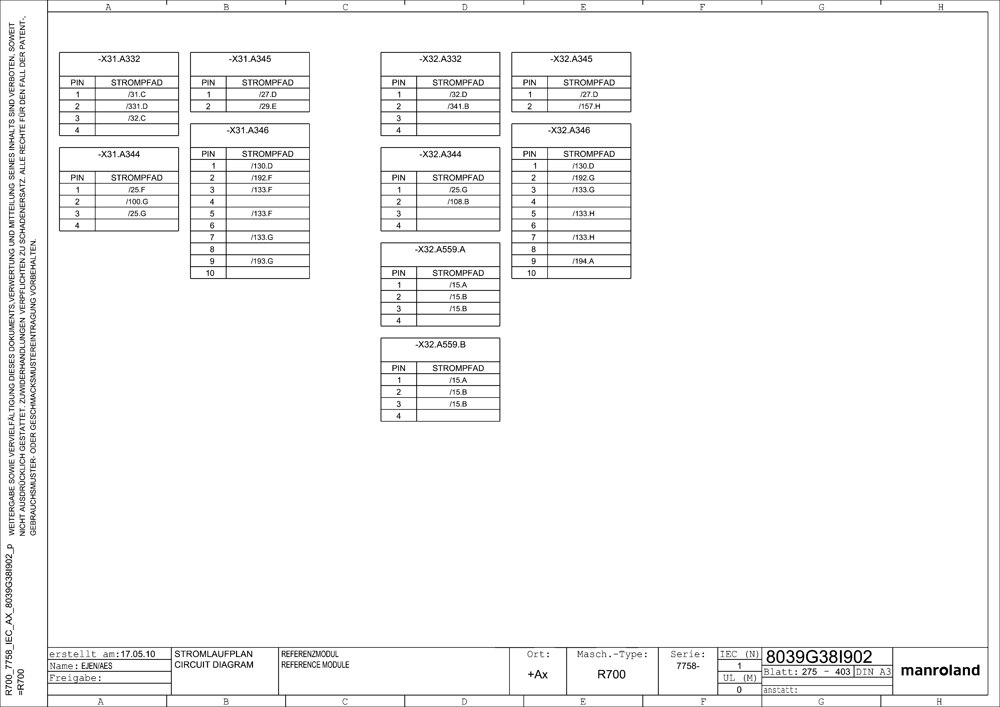

# +Ax — Sheet 275 of 403 — REFERENZMODUL

**REFERENCE MODULE**

> Part of the manroland **R700** printing press IEC/UL circuit diagrams.
> Drawing class: **Stromlaufplan / Circuit diagram** (DIN A3).
> Document `+Ax` covers the **Central control console** machine section.

## At a glance

| Field | Value |
|---|---|
| Document | `+Ax`  (8039G38I902) |
| Sheet | **275** of 403 |
| Section (DE) | REFERENZMODUL |
| Section (EN) | REFERENCE MODULE |
| Section type | REFERENCE_MODULE — Reference module |
| Machine type | `R700` |
| Series | `7758` |
| Created | 17.05.10 |
| Replaces | — |
| Columns used | A, B, C, D, E |
| Path numbers | — |
| Labels on sheet | 110 |
| Cross-refs out | 32 |
| Cross-refs in | 0 |

**Previous:** [+Ax sheet 274](SHEET_0274.md) · **Next:** [+Ax sheet 276](SHEET_0276.md) · **Document TOC:** [_TOC.md](_TOC.md)  (+Ax) · **Master TOC:** [all sheets](../_MASTER_TOC.md)

## Sheet image (300 DPI, exact vector render)



_Rendered directly from the PDF vector layer at 300 DPI (1-bit), no OCR and no resampling. Use it to confirm anything ambiguous in the text below._

## Cross-references on this sheet

Each entry is a wire leaving this sheet. The printed token is `/sheet.column`; the link resolves to that sheet inside the same document.

| Ref | Target sheet | Col | Path | Destination on target | Target section | From col |
|---|---|---|---|---|---|---|
| `/31.C` | [+Ax sheet 31](SHEET_0031.md) | C | — | — | SPANNUNGSVERSORGUNG, SCHALTSCHRANKBELÜFTUNG | A |
| `/27.D` | [+Ax sheet 27](SHEET_0027.md) | D | — | — | SPANNUNGSVERSORGUNG, SCHALTSCHRANKBELÜFTUNG | B |
| `/32.D` | [+Ax sheet 32](SHEET_0032.md) | D | — | — | SPANNUNGSVERSORGUNG, SCHALTSCHRANKBELÜFTUNG | D |
| `/27.D` | [+Ax sheet 27](SHEET_0027.md) | D | — | — | SPANNUNGSVERSORGUNG, SCHALTSCHRANKBELÜFTUNG | E |
| `/29.E` | [+Ax sheet 29](SHEET_0029.md) | E | — | — | SPANNUNGSVERSORGUNG, SCHALTSCHRANKBELÜFTUNG | B |
| `/341.B` | [+Ax sheet 341](SHEET_0341.md) | B | — | — | OPTION: INLINESHEETER RS104 S | D |
| `/331.D` | [+Ax sheet 331](SHEET_0331.md) | D | — | — | OPTION: NONSTOP EINRICHTUNG MANUELL, ANLEGER | A |
| `/157.H` | [+Ax sheet 157](SHEET_0157.md) | H | — | — | ÜBERWACHUNGSRECHNER/ANSTEUERUNG NOT AUS | E |
| `/32.C` | [+Ax sheet 32](SHEET_0032.md) | C | — | — | SPANNUNGSVERSORGUNG, SCHALTSCHRANKBELÜFTUNG | A |
| `/130.D` | [+Ax sheet 130](SHEET_0130.md) | D | — | — | REALTIMERECHNER ANLAGE | B |
| `/130.D` | [+Ax sheet 130](SHEET_0130.md) | D | — | — | REALTIMERECHNER ANLAGE | E |
| `/192.F` | [+Ax sheet 192](SHEET_0192.md) | F | — | — | RESERVE | B |
| `/192.G` | [+Ax sheet 192](SHEET_0192.md) | G | — | — | RESERVE | E |
| `/25.F` | [+Ax sheet 25](SHEET_0025.md) | F | — | — | SPANNUNGSVERSORGUNG, SCHALTSCHRANKBELÜFTUNG | A |
| `/133.F` | [+Ax sheet 133](SHEET_0133.md) | F | — | — | REALTIMERECHNER DRUCKWERK | B |
| `/25.G` | [+Ax sheet 25](SHEET_0025.md) | G | — | — | SPANNUNGSVERSORGUNG, SCHALTSCHRANKBELÜFTUNG | D |
| `/133.G` | [+Ax sheet 133](SHEET_0133.md) | G | — | — | REALTIMERECHNER DRUCKWERK | E |
| `/108.B` | [+Ax sheet 108](SHEET_0108.md) | B | — | — | ANLEGER | D |
| `/100.G` | [+Ax sheet 100](SHEET_0100.md) | G | — | — | ANLEGER | A |
| `/25.G` | [+Ax sheet 25](SHEET_0025.md) | G | — | — | SPANNUNGSVERSORGUNG, SCHALTSCHRANKBELÜFTUNG | A |
| `/133.F` | [+Ax sheet 133](SHEET_0133.md) | F | — | — | REALTIMERECHNER DRUCKWERK | B |
| `/133.H` | [+Ax sheet 133](SHEET_0133.md) | H | — | — | REALTIMERECHNER DRUCKWERK | E |
| `/133.G` | [+Ax sheet 133](SHEET_0133.md) | G | — | — | REALTIMERECHNER DRUCKWERK | B |
| `/133.H` | [+Ax sheet 133](SHEET_0133.md) | H | — | — | REALTIMERECHNER DRUCKWERK | E |
| `/194.A` | [+Ax sheet 194](SHEET_0194.md) | A | — | — | RESERVE | E |
| `/193.G` | [+Ax sheet 193](SHEET_0193.md) | G | — | — | RESERVE | B |
| `/15.A` | [+Ax sheet 15](SHEET_0015.md) | A | — | — | SPANNUNGSVERSORGUNG, SCHALTSCHRANKBELÜFTUNG | D |
| `/15.B` | [+Ax sheet 15](SHEET_0015.md) | B | — | — | SPANNUNGSVERSORGUNG, SCHALTSCHRANKBELÜFTUNG | D |
| `/15.B` | [+Ax sheet 15](SHEET_0015.md) | B | — | — | SPANNUNGSVERSORGUNG, SCHALTSCHRANKBELÜFTUNG | D |
| `/15.A` | [+Ax sheet 15](SHEET_0015.md) | A | — | — | SPANNUNGSVERSORGUNG, SCHALTSCHRANKBELÜFTUNG | D |
| `/15.B` | [+Ax sheet 15](SHEET_0015.md) | B | — | — | SPANNUNGSVERSORGUNG, SCHALTSCHRANKBELÜFTUNG | D |
| `/15.B` | [+Ax sheet 15](SHEET_0015.md) | B | — | — | SPANNUNGSVERSORGUNG, SCHALTSCHRANKBELÜFTUNG | D |

## Devices on this sheet

| Tag | Class | Class meaning (IEC) | Col | Sub | Terminal | Sign |
|---|---|---|---|---|---|---|
| `X31.A332` | — | cross-device reference | A | — | — | — |
| `X31.A344` | — | cross-device reference | A | — | — | — |
| `X31.A345` | — | cross-device reference | B | — | — | — |
| `X31.A346` | — | cross-device reference | B | — | — | — |
| `X32.A345` | — | cross-device reference | E | — | — | — |
| `X32.A346` | — | cross-device reference | E | — | — | — |
| `X32.A332` | — | cross-device reference | D | — | — | — |
| `X32.A344` | — | cross-device reference | D | — | — | — |
| `X32.A559.A` | — | cross-device reference | D | — | — | — |
| `X32.A559.B` | — | cross-device reference | D | — | — | — |

## Potentials / nets

_No named potentials on this sheet._

## Wire-end annotations (grouped as printed)

A wire that continues elsewhere is annotated with a small cluster: the destination description, the path/line number `#NN`, and the `/sheet.column` cross reference. Each row below is one such cluster exactly as it is grouped on the drawing.

| Col | Y | Path | Cross-ref | Text on the wire |
|---|---|---|---|---|
| A | 65.5 | — | — | `X31.A332` |
| B | 65.5 | — | — | `X31.A345` |
| D | 65.5 | — | — | `X32.A332` |
| E | 65.5 | — | — | `X32.A345` |
| A | 94.2 | — | — | `PIN 2 3 4 1 STROMPFAD` |
| B | 94.2 | — | — | `PIN 2 1 STROMPFAD` |
| D | 94.2 | — | — | `PIN 2 3 4 1 STROMPFAD` |
| E | 94.2 | — | — | `PIN 2 1 STROMPFAD` |
| A | 108.7 | — | `/31.C` | — |
| B | 108.7 | — | `/27.D` | — |
| D | 108.7 | — | `/32.D` | — |
| E | 108.7 | — | `/27.D` | — |
| B | 122.8 | — | `/29.E` | — |
| A | 122.9 | — | `/331.D` | — |
| D | 122.9 | — | `/341.B` | — |
| E | 122.9 | — | `/157.H` | — |
| A | 137.1 | — | `/32.C` | — |
| B | 150.5 | — | — | `X31.A346` |
| E | 150.5 | — | — | `X32.A346` |
| A | 178.9 | — | — | `X31.A344` |
| D | 178.9 | — | — | `X32.A344` |
| B | 179.2 | — | — | `PIN 10 2 3 4 5 6 7 8 9 1 STROMPFAD` |
| E | 179.2 | — | — | `PIN 10 2 3 4 5 6 7 8 9 1 STROMPFAD` |
| B | 193.8 | — | `/130.D` | — |
| E | 193.8 | — | `/130.D` | — |
| A | 207.5 | — | — | `PIN 2 3 4 1 STROMPFAD` |
| D | 207.5 | — | — | `PIN 2 3 4 1 STROMPFAD` |
| B | 207.9 | — | `/192.F` | — |
| E | 207.9 | — | `/192.G` | — |
| A | 222.1 | — | `/25.F` | — |
| B | 222.1 | — | `/133.F` | — |
| D | 222.1 | — | `/25.G` | — |
| E | 222.1 | — | `/133.G` | — |
| D | 236.2 | — | `/108.B` | — |
| A | 236.3 | — | `/100.G` | — |
| A | 250.4 | — | `/25.G` | — |
| B | 250.4 | — | `/133.F` | — |
| E | 250.4 | — | `/133.H` | — |
| B | 278.8 | — | `/133.G` | — |
| E | 278.8 | — | `/133.H` | — |
| D | 292.3 | — | — | `X32.A559.A` |
| B | 307.1 | — | `/193.G` | — |
| E | 307.1 | — | `/194.A` | — |
| D | 320.9 | — | — | `PIN 2 3 4 1 STROMPFAD` |
| D | 335.4 | — | `/15.A` | — |
| D | 349.6 | — | `/15.B` | — |
| D | 363.8 | — | `/15.B` | — |
| D | 405.7 | — | — | `X32.A559.B` |
| D | 434.3 | — | — | `PIN 2 3 4 1 STROMPFAD` |
| D | 448.8 | — | `/15.A` | — |
| D | 463.0 | — | `/15.B` | — |
| D | 477.2 | — | `/15.B` | — |


## Reconstructed tables

This sheet carries tabular content (pin map / terminal assignment / index). The grid below was rebuilt from the drawing's own rule lines, so each row is exactly one physical row of the table.

### Table 1 — 10 data rows × 2 columns (at x=70.9, y=62.4) — **X31.A332**

| PIN | STROMPFAD |
|---|---|
| `1` | `/31.C` |
| `2` | `/331.D` |
| `3` | `/32.C` |
| `4` |  |
|  | `X31.A344` |
| `PIN` | `STROMPFAD` |
| `1` | `/25.F` |
| `2` | `/100.G` |
| `3` | `/25.G` |
| `4` |  |


### Table 2 — 14 data rows × 2 columns (at x=226.8, y=62.4) — **X31.A345**

| PIN | STROMPFAD |
|---|---|
| `1` | `/27.D` |
| `2` | `/29.E` |
|  | `X31.A346` |
| `PIN` | `STROMPFAD` |
| `1` | `/130.D` |
| `2` | `/192.F` |
| `3` | `/133.F` |
| `4` |  |
| `5` | `/133.F` |
| `6` |  |
| `7` | `/133.G` |
| `8` |  |
| `9` | `/193.G` |
| `10` |  |


### Table 3 — 22 data rows × 2 columns (at x=453.5, y=62.4) — **X32.A332**

| PIN | STROMPFAD |
|---|---|
| `1` | `/32.D` |
| `2` | `/341.B` |
| `3` |  |
| `4` |  |
|  | `X32.A344` |
| `PIN` | `STROMPFAD` |
| `1` | `/25.G` |
| `2` | `/108.B` |
| `3` |  |
| `4` |  |
|  | `X32.A559.A` |
| `PIN` | `STROMPFAD` |
| `1` | `/15.A` |
| `2` | `/15.B` |
| `3` | `/15.B` |
| `4` |  |
|  | `X32.A559.B` |
| `PIN` | `STROMPFAD` |
| `1` | `/15.A` |
| `2` | `/15.B` |
| `3` | `/15.B` |
| `4` |  |


### Table 4 — 14 data rows × 2 columns (at x=609.4, y=62.4) — **X32.A345**

| PIN | STROMPFAD |
|---|---|
| `1` | `/27.D` |
| `2` | `/157.H` |
|  | `X32.A346` |
| `PIN` | `STROMPFAD` |
| `1` | `/130.D` |
| `2` | `/192.G` |
| `3` | `/133.G` |
| `4` |  |
| `5` | `/133.H` |
| `6` |  |
| `7` | `/133.H` |
| `8` |  |
| `9` | `/194.A` |
| `10` |  |


## Notes and free text on this sheet

| Text | Col | Y (pt) |
|---|---|---|
| `PIN` | A | 94.2 |
| `STROMPFAD` | A | 94.15 |
| `PIN` | B | 94.2 |
| `STROMPFAD` | B | 94.15 |
| `PIN` | E | 94.2 |
| `STROMPFAD` | E | 94.15 |
| `PIN` | C | 94.2 |
| `STROMPFAD` | D | 94.15 |

## Complete label inventory (exact text from the drawing)

Every text object inside the drawing area of this sheet, in DIN reading order (column A→H, then top→bottom). This is the authoritative list: if a string is not here it is not printed on this sheet.

| Col | Y | X | Dir | Type | Text |
|---|---|---|---|---|---|
| A | 65.5 | 116.8 | → | device ref | `X31.A332` |
| A | 94.2 | 84.0 | → | text | `PIN` |
| A | 94.2 | 132.2 | → | text | `STROMPFAD` |
| A | 108.4 | 90.0 | → | number | `1` |
| A | 108.7 | 152.6 | → | cross-reference | `/31.C` |
| A | 122.5 | 89.4 | → | number | `2` |
| A | 122.9 | 150.2 | → | cross-reference | `/331.D` |
| A | 136.7 | 89.4 | → | number | `3` |
| A | 137.1 | 152.6 | → | cross-reference | `/32.C` |
| A | 150.9 | 89.4 | → | number | `4` |
| A | 178.9 | 116.8 | → | device ref | `X31.A344` |
| A | 207.5 | 132.2 | → | text | `STROMPFAD` |
| A | 207.6 | 84.0 | → | text | `PIN` |
| A | 221.8 | 90.0 | → | number | `1` |
| A | 222.1 | 153.1 | → | cross-reference | `/25.F` |
| A | 235.9 | 89.4 | → | number | `2` |
| A | 236.3 | 150.1 | → | cross-reference | `/100.G` |
| A | 250.1 | 89.4 | → | number | `3` |
| A | 250.4 | 152.5 | → | cross-reference | `/25.G` |
| A | 264.3 | 89.4 | → | number | `4` |
| B | 65.5 | 272.7 | → | device ref | `X31.A345` |
| B | 94.2 | 240.0 | → | text | `PIN` |
| B | 94.2 | 288.1 | → | text | `STROMPFAD` |
| B | 108.4 | 245.9 | → | number | `1` |
| B | 108.7 | 308.6 | → | cross-reference | `/27.D` |
| B | 122.5 | 245.3 | → | number | `2` |
| B | 122.8 | 308.8 | → | cross-reference | `/29.E` |
| B | 150.5 | 269.9 | → | device ref | `X31.A346` |
| B | 179.2 | 240.0 | → | text | `PIN` |
| B | 179.2 | 288.1 | → | text | `STROMPFAD` |
| B | 193.4 | 251.7 | → | number | `1` |
| B | 193.8 | 299.1 | → | cross-reference | `/130.D` |
| B | 207.6 | 250.0 | → | number | `2` |
| B | 207.9 | 299.5 | → | cross-reference | `/192.F` |
| B | 221.8 | 250.0 | → | number | `3` |
| B | 222.1 | 299.5 | → | cross-reference | `/133.F` |
| B | 235.9 | 250.0 | → | number | `4` |
| B | 250.1 | 250.0 | → | number | `5` |
| B | 250.4 | 299.5 | → | cross-reference | `/133.F` |
| B | 264.3 | 250.0 | → | number | `6` |
| B | 278.5 | 250.0 | → | number | `7` |
| B | 278.8 | 298.9 | → | cross-reference | `/133.G` |
| B | 292.6 | 250.0 | → | number | `8` |
| B | 306.8 | 250.0 | → | number | `9` |
| B | 307.1 | 298.9 | → | cross-reference | `/193.G` |
| B | 321.0 | 244.6 | → | number | `10` |
| C | 94.2 | 466.7 | → | text | `PIN` |
| C | 108.4 | 472.7 | → | number | `1` |
| C | 122.5 | 472.1 | → | number | `2` |
| C | 136.7 | 472.1 | → | number | `3` |
| C | 150.9 | 472.1 | → | number | `4` |
| C | 207.6 | 466.7 | → | text | `PIN` |
| C | 221.8 | 472.7 | → | number | `1` |
| C | 235.9 | 472.1 | → | number | `2` |
| C | 250.1 | 472.1 | → | number | `3` |
| C | 264.3 | 472.1 | → | number | `4` |
| C | 321.0 | 466.7 | → | text | `PIN` |
| C | 335.1 | 472.7 | → | number | `1` |
| C | 349.3 | 472.1 | → | number | `2` |
| C | 363.5 | 472.1 | → | number | `3` |
| C | 377.7 | 472.1 | → | number | `4` |
| C | 434.4 | 466.7 | → | text | `PIN` |
| C | 448.5 | 472.7 | → | number | `1` |
| C | 462.7 | 472.1 | → | number | `2` |
| C | 476.9 | 472.1 | → | number | `3` |
| C | 491.0 | 472.1 | → | number | `4` |
| D | 65.5 | 499.5 | → | device ref | `X32.A332` |
| D | 94.2 | 514.9 | → | text | `STROMPFAD` |
| D | 108.7 | 535.3 | → | cross-reference | `/32.D` |
| D | 122.9 | 533.1 | → | cross-reference | `/341.B` |
| D | 178.9 | 499.5 | → | device ref | `X32.A344` |
| D | 207.5 | 514.9 | → | text | `STROMPFAD` |
| D | 222.1 | 535.2 | → | cross-reference | `/25.G` |
| D | 236.2 | 533.1 | → | cross-reference | `/108.B` |
| D | 292.3 | 494.1 | → | device ref | `X32.A559.A` |
| D | 320.9 | 514.9 | → | text | `STROMPFAD` |
| D | 335.4 | 535.3 | → | cross-reference | `/15.A` |
| D | 349.6 | 535.5 | → | cross-reference | `/15.B` |
| D | 363.8 | 535.5 | → | cross-reference | `/15.B` |
| D | 405.7 | 494.5 | → | device ref | `X32.A559.B` |
| D | 434.3 | 514.9 | → | text | `STROMPFAD` |
| D | 448.8 | 535.3 | → | cross-reference | `/15.A` |
| D | 463.0 | 535.5 | → | cross-reference | `/15.B` |
| D | 477.2 | 535.5 | → | cross-reference | `/15.B` |
| E | 65.5 | 655.4 | → | device ref | `X32.A345` |
| E | 94.2 | 622.6 | → | text | `PIN` |
| E | 94.2 | 670.8 | → | text | `STROMPFAD` |
| E | 108.4 | 628.6 | → | number | `1` |
| E | 108.7 | 691.2 | → | cross-reference | `/27.D` |
| E | 122.5 | 628.0 | → | number | `2` |
| E | 122.9 | 689.1 | → | cross-reference | `/157.H` |
| E | 150.5 | 652.5 | → | device ref | `X32.A346` |
| E | 179.2 | 622.6 | → | text | `PIN` |
| E | 179.2 | 670.8 | → | text | `STROMPFAD` |
| E | 193.4 | 634.4 | → | number | `1` |
| E | 193.8 | 681.7 | → | cross-reference | `/130.D` |
| E | 207.6 | 632.7 | → | number | `2` |
| E | 207.9 | 681.6 | → | cross-reference | `/192.G` |
| E | 221.8 | 632.7 | → | number | `3` |
| E | 222.1 | 681.6 | → | cross-reference | `/133.G` |
| E | 235.9 | 632.7 | → | number | `4` |
| E | 250.1 | 632.7 | → | number | `5` |
| E | 250.4 | 682.0 | → | cross-reference | `/133.H` |
| E | 264.3 | 632.7 | → | number | `6` |
| E | 278.5 | 632.7 | → | number | `7` |
| E | 278.8 | 682.0 | → | cross-reference | `/133.H` |
| E | 292.6 | 632.7 | → | number | `8` |
| E | 306.8 | 632.7 | → | number | `9` |
| E | 307.1 | 681.7 | → | cross-reference | `/194.A` |
| E | 321.0 | 627.3 | → | number | `10` |

## Reading-order text block

The same content as a plain block, grouped by DIN column — convenient to paste or to match against a visual description.

```text
=== Column A ===
  65.5  116.8  devref       X31.A332
  94.2   84.0  text         PIN
  94.2  132.2  text         STROMPFAD
 108.4   90.0  numeric      1
 108.7  152.6  xref         /31.C
 122.5   89.4  numeric      2
 122.9  150.2  xref         /331.D
 136.7   89.4  numeric      3
 137.1  152.6  xref         /32.C
 150.9   89.4  numeric      4
 178.9  116.8  devref       X31.A344
 207.5  132.2  text         STROMPFAD
 207.6   84.0  text         PIN
 221.8   90.0  numeric      1
 222.1  153.1  xref         /25.F
 235.9   89.4  numeric      2
 236.3  150.1  xref         /100.G
 250.1   89.4  numeric      3
 250.4  152.5  xref         /25.G
 264.3   89.4  numeric      4
=== Column B ===
  65.5  272.7  devref       X31.A345
  94.2  240.0  text         PIN
  94.2  288.1  text         STROMPFAD
 108.4  245.9  numeric      1
 108.7  308.6  xref         /27.D
 122.5  245.3  numeric      2
 122.8  308.8  xref         /29.E
 150.5  269.9  devref       X31.A346
 179.2  240.0  text         PIN
 179.2  288.1  text         STROMPFAD
 193.4  251.7  numeric      1
 193.8  299.1  xref         /130.D
 207.6  250.0  numeric      2
 207.9  299.5  xref         /192.F
 221.8  250.0  numeric      3
 222.1  299.5  xref         /133.F
 235.9  250.0  numeric      4
 250.1  250.0  numeric      5
 250.4  299.5  xref         /133.F
 264.3  250.0  numeric      6
 278.5  250.0  numeric      7
 278.8  298.9  xref         /133.G
 292.6  250.0  numeric      8
 306.8  250.0  numeric      9
 307.1  298.9  xref         /193.G
 321.0  244.6  numeric      10
=== Column C ===
  94.2  466.7  text         PIN
 108.4  472.7  numeric      1
 122.5  472.1  numeric      2
 136.7  472.1  numeric      3
 150.9  472.1  numeric      4
 207.6  466.7  text         PIN
 221.8  472.7  numeric      1
 235.9  472.1  numeric      2
 250.1  472.1  numeric      3
 264.3  472.1  numeric      4
 321.0  466.7  text         PIN
 335.1  472.7  numeric      1
 349.3  472.1  numeric      2
 363.5  472.1  numeric      3
 377.7  472.1  numeric      4
 434.4  466.7  text         PIN
 448.5  472.7  numeric      1
 462.7  472.1  numeric      2
 476.9  472.1  numeric      3
 491.0  472.1  numeric      4
=== Column D ===
  65.5  499.5  devref       X32.A332
  94.2  514.9  text         STROMPFAD
 108.7  535.3  xref         /32.D
 122.9  533.1  xref         /341.B
 178.9  499.5  devref       X32.A344
 207.5  514.9  text         STROMPFAD
 222.1  535.2  xref         /25.G
 236.2  533.1  xref         /108.B
 292.3  494.1  devref       X32.A559.A
 320.9  514.9  text         STROMPFAD
 335.4  535.3  xref         /15.A
 349.6  535.5  xref         /15.B
 363.8  535.5  xref         /15.B
 405.7  494.5  devref       X32.A559.B
 434.3  514.9  text         STROMPFAD
 448.8  535.3  xref         /15.A
 463.0  535.5  xref         /15.B
 477.2  535.5  xref         /15.B
=== Column E ===
  65.5  655.4  devref       X32.A345
  94.2  622.6  text         PIN
  94.2  670.8  text         STROMPFAD
 108.4  628.6  numeric      1
 108.7  691.2  xref         /27.D
 122.5  628.0  numeric      2
 122.9  689.1  xref         /157.H
 150.5  652.5  devref       X32.A346
 179.2  622.6  text         PIN
 179.2  670.8  text         STROMPFAD
 193.4  634.4  numeric      1
 193.8  681.7  xref         /130.D
 207.6  632.7  numeric      2
 207.9  681.6  xref         /192.G
 221.8  632.7  numeric      3
 222.1  681.6  xref         /133.G
 235.9  632.7  numeric      4
 250.1  632.7  numeric      5
 250.4  682.0  xref         /133.H
 264.3  632.7  numeric      6
 278.5  632.7  numeric      7
 278.8  682.0  xref         /133.H
 292.6  632.7  numeric      8
 306.8  632.7  numeric      9
 307.1  681.7  xref         /194.A
 321.0  627.3  numeric      10
```

---
_Generated from the PDF vector text layer; no OCR. Source: `R700_7758_IEC_AX_8039G38I902_p`, sheet 275._
