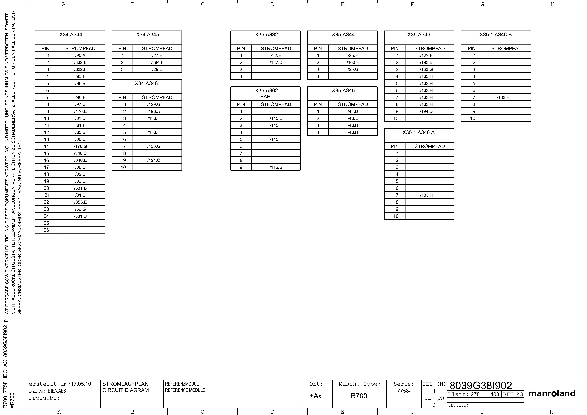

# +Ax — Sheet 278 of 403 — REFERENZMODUL

**REFERENCE MODULE**

> Part of the manroland **R700** printing press IEC/UL circuit diagrams.
> Drawing class: **Stromlaufplan / Circuit diagram** (DIN A3).
> Document `+Ax` covers the **Central control console** machine section.

## At a glance

| Field | Value |
|---|---|
| Document | `+Ax`  (8039G38I902) |
| Sheet | **278** of 403 |
| Section (DE) | REFERENZMODUL |
| Section (EN) | REFERENCE MODULE |
| Section type | REFERENCE_MODULE — Reference module |
| Machine type | `R700` |
| Series | `7758` |
| Created | 17.05.10 |
| Replaces | — |
| Columns used | A, B, D, E, F, G |
| Path numbers | — |
| Labels on sheet | 177 |
| Cross-refs out | 56 |
| Cross-refs in | 0 |

**Previous:** [+Ax sheet 277](SHEET_0277.md) · **Next:** [+Ax sheet 279](SHEET_0279.md) · **Document TOC:** [_TOC.md](_TOC.md)  (+Ax) · **Master TOC:** [all sheets](../_MASTER_TOC.md)

## Sheet image (300 DPI, exact vector render)



_Rendered directly from the PDF vector layer at 300 DPI (1-bit), no OCR and no resampling. Use it to confirm anything ambiguous in the text below._

## Cross-references on this sheet

Each entry is a wire leaving this sheet. The printed token is `/sheet.column`; the link resolves to that sheet inside the same document.

| Ref | Target sheet | Col | Path | Destination on target | Target section | From col |
|---|---|---|---|---|---|---|
| `/95.A` | [+Ax sheet 95](SHEET_0095.md) | A | — | — | ANLEGER | A |
| `/27.E` | [+Ax sheet 27](SHEET_0027.md) | E | — | — | SPANNUNGSVERSORGUNG, SCHALTSCHRANKBELÜFTUNG | B |
| `/32.E` | [+Ax sheet 32](SHEET_0032.md) | E | — | — | SPANNUNGSVERSORGUNG, SCHALTSCHRANKBELÜFTUNG | D |
| `/25.F` | [+Ax sheet 25](SHEET_0025.md) | F | — | — | SPANNUNGSVERSORGUNG, SCHALTSCHRANKBELÜFTUNG | E |
| `/129.F` | [+Ax sheet 129](SHEET_0129.md) | F | — | — | REALTIMERECHNER ANLAGE | F |
| `/332.B` | [+Ax sheet 332](SHEET_0332.md) | B | — | — | OPTION: NONSTOP EINRICHTUNG MANUELL, ANLEGER | A |
| `/193.B` | [+Ax sheet 193](SHEET_0193.md) | B | — | — | RESERVE | F |
| `/384.F` | [+Ax sheet 384](SHEET_0384.md) | F | — | — | OPTION: INLINEFOILER PRINDOR | B |
| `/187.D` | [+Ax sheet 187](SHEET_0187.md) | D | — | — | RESERVE | D |
| `/100.H` | [+Ax sheet 100](SHEET_0100.md) | H | — | — | ANLEGER | E |
| `/29.E` | [+Ax sheet 29](SHEET_0029.md) | E | — | — | SPANNUNGSVERSORGUNG, SCHALTSCHRANKBELÜFTUNG | B |
| `/332.F` | [+Ax sheet 332](SHEET_0332.md) | F | — | — | OPTION: NONSTOP EINRICHTUNG MANUELL, ANLEGER | A |
| `/25.G` | [+Ax sheet 25](SHEET_0025.md) | G | — | — | SPANNUNGSVERSORGUNG, SCHALTSCHRANKBELÜFTUNG | E |
| `/133.G` | [+Ax sheet 133](SHEET_0133.md) | G | — | — | REALTIMERECHNER DRUCKWERK | F |
| `/95.F` | [+Ax sheet 95](SHEET_0095.md) | F | — | — | ANLEGER | A |
| `/133.H` | [+Ax sheet 133](SHEET_0133.md) | H | — | — | REALTIMERECHNER DRUCKWERK | F |
| `/96.B` | [+Ax sheet 96](SHEET_0096.md) | B | — | — | ANLEGER | A |
| `/133.H` | [+Ax sheet 133](SHEET_0133.md) | H | — | — | REALTIMERECHNER DRUCKWERK | F |
| `/133.H` | [+Ax sheet 133](SHEET_0133.md) | H | — | — | REALTIMERECHNER DRUCKWERK | F |
| `/96.F` | [+Ax sheet 96](SHEET_0096.md) | F | — | — | ANLEGER | A |
| `/133.H` | [+Ax sheet 133](SHEET_0133.md) | H | — | — | REALTIMERECHNER DRUCKWERK | F |
| `/133.H` | [+Ax sheet 133](SHEET_0133.md) | H | — | — | REALTIMERECHNER DRUCKWERK | G |
| `/97.C` | [+Ax sheet 97](SHEET_0097.md) | C | — | — | ANLEGER | A |
| `/129.G` | [+Ax sheet 129](SHEET_0129.md) | G | — | — | REALTIMERECHNER ANLAGE | B |
| `/133.H` | [+Ax sheet 133](SHEET_0133.md) | H | — | — | REALTIMERECHNER DRUCKWERK | F |
| `/176.E` | [+Ax sheet 176](SHEET_0176.md) | E | — | — | RESERVE | A |
| `/193.A` | [+Ax sheet 193](SHEET_0193.md) | A | — | — | RESERVE | B |
| `/43.D` | [+Ax sheet 43](SHEET_0043.md) | D | — | — | HAUPTANTRIEB | E |
| `/194.D` | [+Ax sheet 194](SHEET_0194.md) | D | — | — | RESERVE | F |
| `/43.E` | [+Ax sheet 43](SHEET_0043.md) | E | — | — | HAUPTANTRIEB | E |
| `/115.E` | [+Ax sheet 115](SHEET_0115.md) | E | — | — | HANDTERMINAL | D |
| `/133.F` | [+Ax sheet 133](SHEET_0133.md) | F | — | — | REALTIMERECHNER DRUCKWERK | B |
| `/81.D` | [+Ax sheet 81](SHEET_0081.md) | D | — | — | ANLEGER | A |
| `/81.F` | [+Ax sheet 81](SHEET_0081.md) | F | — | — | ANLEGER | A |
| `/115.F` | [+Ax sheet 115](SHEET_0115.md) | F | — | — | HANDTERMINAL | D |
| `/43.H` | [+Ax sheet 43](SHEET_0043.md) | H | — | — | HAUPTANTRIEB | E |
| `/85.B` | [+Ax sheet 85](SHEET_0085.md) | B | — | — | ANLEGER | A |
| `/133.F` | [+Ax sheet 133](SHEET_0133.md) | F | — | — | REALTIMERECHNER DRUCKWERK | B |
| `/43.H` | [+Ax sheet 43](SHEET_0043.md) | H | — | — | HAUPTANTRIEB | E |
| `/115.F` | [+Ax sheet 115](SHEET_0115.md) | F | — | — | HANDTERMINAL | D |
| `/86.C` | [+Ax sheet 86](SHEET_0086.md) | C | — | — | ANLEGER | A |
| `/176.G` | [+Ax sheet 176](SHEET_0176.md) | G | — | — | RESERVE | A |
| `/133.G` | [+Ax sheet 133](SHEET_0133.md) | G | — | — | REALTIMERECHNER DRUCKWERK | B |
| `/340.C` | [+Ax sheet 340](SHEET_0340.md) | C | — | — | OPTION: INLINESHEETER RS104 S | A |
| `/340.E` | [+Ax sheet 340](SHEET_0340.md) | E | — | — | OPTION: INLINESHEETER RS104 S | A |
| `/194.C` | [+Ax sheet 194](SHEET_0194.md) | C | — | — | RESERVE | B |
| `/86.D` | [+Ax sheet 86](SHEET_0086.md) | D | — | — | ANLEGER | A |
| `/115.G` | [+Ax sheet 115](SHEET_0115.md) | G | — | — | HANDTERMINAL | D |
| `/82.B` | [+Ax sheet 82](SHEET_0082.md) | B | — | — | ANLEGER | A |
| `/82.D` | [+Ax sheet 82](SHEET_0082.md) | D | — | — | ANLEGER | A |
| `/331.B` | [+Ax sheet 331](SHEET_0331.md) | B | — | — | OPTION: NONSTOP EINRICHTUNG MANUELL, ANLEGER | A |
| `/81.B` | [+Ax sheet 81](SHEET_0081.md) | B | — | — | ANLEGER | A |
| `/133.H` | [+Ax sheet 133](SHEET_0133.md) | H | — | — | REALTIMERECHNER DRUCKWERK | F |
| `/355.E` | [+Ax sheet 355](SHEET_0355.md) | E | — | — | OPTION: LOGISTIK ANLEGER | A |
| `/86.G` | [+Ax sheet 86](SHEET_0086.md) | G | — | — | ANLEGER | A |
| `/331.D` | [+Ax sheet 331](SHEET_0331.md) | D | — | — | OPTION: NONSTOP EINRICHTUNG MANUELL, ANLEGER | A |

## Devices on this sheet

| Tag | Class | Class meaning (IEC) | Col | Sub | Terminal | Sign |
|---|---|---|---|---|---|---|
| `X34.A344` | — | cross-device reference | A | — | — | — |
| `X34.A345` | — | cross-device reference | B | — | — | — |
| `X34.A346` | — | cross-device reference | B | — | — | — |
| `X35.A332` | — | cross-device reference | D | — | — | — |
| `X35.A345` | — | cross-device reference | E | — | — | — |
| `X35.A344` | — | cross-device reference | E | — | — | — |
| `X35.A302` | — | cross-device reference | D | — | — | — |
| `X35.A346` | — | cross-device reference | F | — | — | — |
| `X35.1.A346.A` | — | cross-device reference | F | — | — | — |
| `X35.1.A346.B` | — | cross-device reference | G | — | — | — |

## Potentials / nets

_No named potentials on this sheet._

## Wire-end annotations (grouped as printed)

A wire that continues elsewhere is annotated with a small cluster: the destination description, the path/line number `#NN`, and the `/sheet.column` cross reference. Each row below is one such cluster exactly as it is grouped on the drawing.

| Col | Y | Path | Cross-ref | Text on the wire |
|---|---|---|---|---|
| A | 65.5 | — | — | `X34.A344` |
| B | 65.5 | — | — | `X34.A345` |
| D | 65.5 | — | — | `X35.A332` |
| E | 65.5 | — | — | `X35.A344` |
| F | 65.5 | — | — | `X35.A346` |
| G | 65.5 | — | — | `X35.1.A346.B` |
| A | 94.2 | — | — | `PIN STROMPFAD` |
| B | 94.2 | — | — | `PIN 2 3 1 STROMPFAD` |
| D | 94.2 | — | — | `PIN 2 3 4 1 STROMPFAD` |
| E | 94.2 | — | — | `PIN 2 3 4 1 STROMPFAD` |
| F | 94.2 | — | — | `PIN 10 2 3 4 5 6 7 8 9 1 STROMPFAD` |
| G | 94.2 | — | — | `PIN 10 2 3 4 5 6 7 8 9 1 STROMPFAD` |
| A | 108.4 | — | — | `2 3 4 5 6 7 8 9 1` |
| A | 108.7 | — | `/95.A` | — |
| B | 108.7 | — | `/27.E` | — |
| D | 108.7 | — | `/32.E` | — |
| E | 108.7 | — | `/25.F` | — |
| F | 108.7 | — | `/129.F` | — |
| A | 122.9 | — | `/332.B` | — |
| B | 122.9 | — | `/384.F` | — |
| D | 122.9 | — | `/187.D` | — |
| E | 122.9 | — | `/100.H` | — |
| F | 122.9 | — | `/193.B` | — |
| A | 137.0 | — | `/332.F` | — |
| B | 137.0 | — | `/29.E` | — |
| E | 137.0 | — | `/25.G` | — |
| F | 137.1 | — | `/133.G` | — |
| A | 151.2 | — | `/95.F` | — |
| F | 151.2 | — | `/133.H` | — |
| B | 164.7 | — | — | `X34.A346` |
| A | 165.4 | — | `/96.B` | — |
| F | 165.4 | — | `/133.H` | — |
| D | 178.9 | — | — | `X35.A302` |
| E | 178.9 | — | — | `X35.A345` |
| F | 179.6 | — | `/133.H` | — |
| D | 191.6 | — | — | `+AB` |
| B | 193.4 | — | — | `PIN 10 2 3 4 5 6 7 8 9 1 STROMPFAD` |
| A | 193.7 | — | `/96.F` | — |
| F | 193.8 | — | `/133.H` | — |
| G | 193.8 | — | `/133.H` | — |
| D | 207.5 | — | — | `PIN 2 3 4 5 6 7 8 9 1 STROMPFAD` |
| E | 207.5 | — | — | `PIN 2 3 4 1 STROMPFAD` |
| A | 207.9 | — | `/97.C` | — |
| B | 207.9 | — | `/129.G` | — |
| F | 207.9 | — | `/133.H` | — |
| A | 222.1 | — | `/176.E` | — |
| B | 222.1 | — | `/193.A` | — |
| E | 222.1 | — | `/43.D` | — |
| F | 222.1 | — | `/194.D` | — |
| A | 235.9 | — | — | `10 12 13 14 15 16 17 18 19 20 11` |
| D | 236.2 | — | `/115.E` | — |
| E | 236.2 | — | `/43.E` | — |
| A | 236.3 | — | `/81.D` | — |
| B | 236.3 | — | `/133.F` | — |
| A | 250.4 | — | `/81.F` | — |
| D | 250.4 | — | `/115.F` | — |
| E | 250.4 | — | `/43.H` | — |
| F | 263.9 | — | — | `X35.1.A346.A` |
| A | 264.6 | — | `/85.B` | — |
| B | 264.6 | — | `/133.F` | — |
| E | 264.6 | — | `/43.H` | — |
| A | 278.8 | — | `/86.C` | — |
| D | 278.8 | — | `/115.F` | — |
| F | 292.6 | — | — | `PIN 10 2 3 4 5 6 7 8 9 1 STROMPFAD` |
| A | 293.0 | — | `/176.G` | — |
| B | 293.0 | — | `/133.G` | — |
| A | 307.1 | — | `/340.C` | — |
| A | 321.3 | — | `/340.E` | — |
| B | 321.3 | — | `/194.C` | — |
| A | 335.5 | — | `/86.D` | — |
| D | 335.5 | — | `/115.G` | — |
| A | 349.6 | — | `/82.B` | — |
| A | 363.8 | — | `/82.D` | — |
| A | 378.0 | — | `/331.B` | — |
| A | 391.8 | — | — | `22 23 24 25 26 21` |
| A | 392.1 | — | `/81.B` | — |
| F | 392.2 | — | `/133.H` | — |
| A | 406.3 | — | `/355.E` | — |
| A | 420.5 | — | `/86.G` | — |
| A | 434.7 | — | `/331.D` | — |


## Reconstructed tables

This sheet carries tabular content (pin map / terminal assignment / index). The grid below was rebuilt from the drawing's own rule lines, so each row is exactly one physical row of the table.

### Table 1 — 26 data rows × 2 columns (at x=70.9, y=62.4) — **X34.A344**

| PIN | STROMPFAD |
|---|---|
| `1` | `/95.A` |
| `2` | `/332.B` |
| `3` | `/332.F` |
| `4` | `/95.F` |
| `5` | `/96.B` |
| `6` |  |
| `7` | `/96.F` |
| `8` | `/97.C` |
| `9` | `/176.E` |
| `10` | `/81.D` |
| `11` | `/81.F` |
| `12` | `/85.B` |
| `13` | `/86.C` |
| `14` | `/176.G` |
| `15` | `/340.C` |
| `16` | `/340.E` |
| `17` | `/86.D` |
| `18` | `/82.B` |
| `19` | `/82.D` |
| `20` | `/331.B` |
| `21` | `/81.B` |
| `22` | `/355.E` |
| `23` | `/86.G` |
| `24` | `/331.D` |
| `25` |  |
| `26` |  |


### Table 2 — 15 data rows × 2 columns (at x=226.8, y=62.4) — **X34.A345**

| PIN | STROMPFAD |
|---|---|
| `1` | `/27.E` |
| `2` | `/384.F` |
| `3` | `/29.E` |
|  | `X34.A346` |
| `PIN` | `STROMPFAD` |
| `1` | `/129.G` |
| `2` | `/193.A` |
| `3` | `/133.F` |
| `4` |  |
| `5` | `/133.F` |
| `6` |  |
| `7` | `/133.G` |
| `8` |  |
| `9` | `/194.C` |
| `10` |  |


### Table 3 — 16 data rows × 2 columns (at x=467.7, y=62.4) — **X35.A332**

| PIN | STROMPFAD |
|---|---|
| `1` | `/32.E` |
| `2` | `/187.D` |
| `3` |  |
| `4` |  |
|  | `X35.A302` |
|  | `+AB` |
| `PIN` | `STROMPFAD` |
| `1` |  |
| `2` | `/115.E` |
| `3` | `/115.F` |
| `4` |  |
| `5` | `/115.F` |
| `6` |  |
| `7` |  |
| `8` |  |
| `9` | `/115.G` |


### Table 4 — 10 data rows × 2 columns (at x=623.6, y=62.4) — **X35.A344**

| PIN | STROMPFAD |
|---|---|
| `1` | `/25.F` |
| `2` | `/100.H` |
| `3` | `/25.G` |
| `4` |  |
|  | `X35.A345` |
| `PIN` | `STROMPFAD` |
| `1` | `/43.D` |
| `2` | `/43.E` |
| `3` | `/43.H` |
| `4` | `/43.H` |


### Table 5 — 22 data rows × 2 columns (at x=779.5, y=62.4) — **X35.A346**

| PIN | STROMPFAD |
|---|---|
| `1` | `/129.F` |
| `2` | `/193.B` |
| `3` | `/133.G` |
| `4` | `/133.H` |
| `5` | `/133.H` |
| `6` | `/133.H` |
| `7` | `/133.H` |
| `8` | `/133.H` |
| `9` | `/194.D` |
| `10` |  |
|  | `X35.1.A346.A` |
| `PIN` | `STROMPFAD` |
| `1` |  |
| `2` |  |
| `3` |  |
| `4` |  |
| `5` |  |
| `6` |  |
| `7` | `/133.H` |
| `8` |  |
| `9` |  |
| `10` |  |


### Table 6 — 10 data rows × 2 columns (at x=935.4, y=62.4) — **X35.1.A346.B**

| PIN | STROMPFAD |
|---|---|
| `1` |  |
| `2` |  |
| `3` |  |
| `4` |  |
| `5` |  |
| `6` |  |
| `7` | `/133.H` |
| `8` |  |
| `9` |  |
| `10` |  |


## Notes and free text on this sheet

| Text | Col | Y (pt) |
|---|---|---|
| `PIN` | A | 94.2 |
| `STROMPFAD` | A | 94.15 |
| `PIN` | B | 94.2 |
| `STROMPFAD` | B | 94.15 |
| `PIN` | D | 94.2 |
| `STROMPFAD` | D | 94.15 |
| `PIN` | E | 207.58 |
| `STROMPFAD` | E | 207.54 |
| `+AB` | D | 191.57 |
| `PIN` | F | 94.2 |
| `STROMPFAD` | F | 94.15 |
| `PIN` | G | 94.2 |
| `STROMPFAD` | G | 94.15 |

## Complete label inventory (exact text from the drawing)

Every text object inside the drawing area of this sheet, in DIN reading order (column A→H, then top→bottom). This is the authoritative list: if a string is not here it is not printed on this sheet.

| Col | Y | X | Dir | Type | Text |
|---|---|---|---|---|---|
| A | 65.5 | 116.8 | → | device ref | `X34.A344` |
| A | 94.2 | 84.0 | → | text | `PIN` |
| A | 94.2 | 132.2 | → | text | `STROMPFAD` |
| A | 108.4 | 95.8 | → | number | `1` |
| A | 108.7 | 152.6 | → | cross-reference | `/95.A` |
| A | 122.5 | 94.1 | → | number | `2` |
| A | 122.9 | 150.4 | → | cross-reference | `/332.B` |
| A | 136.7 | 94.1 | → | number | `3` |
| A | 137.0 | 150.7 | → | cross-reference | `/332.F` |
| A | 150.9 | 94.1 | → | number | `4` |
| A | 151.2 | 153.1 | → | cross-reference | `/95.F` |
| A | 165.1 | 94.1 | → | number | `5` |
| A | 165.4 | 152.8 | → | cross-reference | `/96.B` |
| A | 179.2 | 94.1 | → | number | `6` |
| A | 193.4 | 94.1 | → | number | `7` |
| A | 193.7 | 153.1 | → | cross-reference | `/96.F` |
| A | 207.6 | 94.1 | → | number | `8` |
| A | 207.9 | 152.6 | → | cross-reference | `/97.C` |
| A | 221.8 | 94.1 | → | number | `9` |
| A | 222.1 | 150.5 | → | cross-reference | `/176.E` |
| A | 235.9 | 88.7 | → | number | `10` |
| A | 236.3 | 152.6 | → | cross-reference | `/81.D` |
| A | 250.1 | 90.4 | → | number | `11` |
| A | 250.4 | 153.1 | → | cross-reference | `/81.F` |
| A | 264.3 | 88.7 | → | number | `12` |
| A | 264.6 | 152.8 | → | cross-reference | `/85.B` |
| A | 278.5 | 88.7 | → | number | `13` |
| A | 278.8 | 152.6 | → | cross-reference | `/86.C` |
| A | 292.6 | 88.7 | → | number | `14` |
| A | 293.0 | 150.1 | → | cross-reference | `/176.G` |
| A | 306.8 | 88.7 | → | number | `15` |
| A | 307.1 | 150.2 | → | cross-reference | `/340.C` |
| A | 321.0 | 88.7 | → | number | `16` |
| A | 321.3 | 150.5 | → | cross-reference | `/340.E` |
| A | 335.1 | 88.7 | → | number | `17` |
| A | 335.5 | 152.6 | → | cross-reference | `/86.D` |
| A | 349.3 | 88.7 | → | number | `18` |
| A | 349.6 | 152.8 | → | cross-reference | `/82.B` |
| A | 363.5 | 88.7 | → | number | `19` |
| A | 363.8 | 152.6 | → | cross-reference | `/82.D` |
| A | 377.7 | 88.7 | → | number | `20` |
| A | 378.0 | 150.4 | → | cross-reference | `/331.B` |
| A | 391.8 | 90.4 | → | number | `21` |
| A | 392.1 | 152.8 | → | cross-reference | `/81.B` |
| A | 406.0 | 88.7 | → | number | `22` |
| A | 406.3 | 150.5 | → | cross-reference | `/355.E` |
| A | 420.2 | 88.7 | → | number | `23` |
| A | 420.5 | 152.5 | → | cross-reference | `/86.G` |
| A | 434.4 | 88.7 | → | number | `24` |
| A | 434.7 | 150.2 | → | cross-reference | `/331.D` |
| A | 448.5 | 88.7 | → | number | `25` |
| A | 462.7 | 88.7 | → | number | `26` |
| B | 65.5 | 272.7 | → | device ref | `X34.A345` |
| B | 94.2 | 240.0 | → | text | `PIN` |
| B | 94.2 | 288.1 | → | text | `STROMPFAD` |
| B | 108.4 | 245.9 | → | number | `1` |
| B | 108.7 | 308.8 | → | cross-reference | `/27.E` |
| B | 122.5 | 245.3 | → | number | `2` |
| B | 122.9 | 306.6 | → | cross-reference | `/384.F` |
| B | 136.7 | 245.3 | → | number | `3` |
| B | 137.0 | 308.8 | → | cross-reference | `/29.E` |
| B | 164.7 | 269.9 | → | device ref | `X34.A346` |
| B | 193.4 | 240.0 | → | text | `PIN` |
| B | 193.4 | 288.1 | → | text | `STROMPFAD` |
| B | 207.6 | 251.7 | → | number | `1` |
| B | 207.9 | 298.9 | → | cross-reference | `/129.G` |
| B | 221.8 | 250.0 | → | number | `2` |
| B | 222.1 | 299.1 | → | cross-reference | `/193.A` |
| B | 235.9 | 250.0 | → | number | `3` |
| B | 236.3 | 299.5 | → | cross-reference | `/133.F` |
| B | 250.1 | 250.0 | → | number | `4` |
| B | 264.3 | 250.0 | → | number | `5` |
| B | 264.6 | 299.5 | → | cross-reference | `/133.F` |
| B | 278.5 | 250.0 | → | number | `6` |
| B | 292.6 | 250.0 | → | number | `7` |
| B | 293.0 | 298.9 | → | cross-reference | `/133.G` |
| B | 306.8 | 250.0 | → | number | `8` |
| B | 321.0 | 250.0 | → | number | `9` |
| B | 321.3 | 299.1 | → | cross-reference | `/194.C` |
| B | 335.1 | 244.6 | → | number | `10` |
| D | 65.5 | 513.6 | → | device ref | `X35.A332` |
| D | 94.2 | 480.9 | → | text | `PIN` |
| D | 94.2 | 529.1 | → | text | `STROMPFAD` |
| D | 108.4 | 486.9 | → | number | `1` |
| D | 108.7 | 549.8 | → | cross-reference | `/32.E` |
| D | 122.5 | 486.3 | → | number | `2` |
| D | 122.9 | 547.1 | → | cross-reference | `/187.D` |
| D | 136.7 | 486.3 | → | number | `3` |
| D | 150.9 | 486.3 | → | number | `4` |
| D | 178.9 | 513.6 | → | device ref | `X35.A302` |
| D | 191.6 | 528.4 | → | text | `+AB` |
| D | 207.5 | 529.1 | → | text | `STROMPFAD` |
| D | 207.6 | 480.9 | → | text | `PIN` |
| D | 221.8 | 486.9 | → | number | `1` |
| D | 235.9 | 486.3 | → | number | `2` |
| D | 236.2 | 547.4 | → | cross-reference | `/115.E` |
| D | 250.1 | 486.3 | → | number | `3` |
| D | 250.4 | 547.5 | → | cross-reference | `/115.F` |
| D | 264.3 | 486.3 | → | number | `4` |
| D | 278.5 | 486.3 | → | number | `5` |
| D | 278.8 | 547.5 | → | cross-reference | `/115.F` |
| D | 292.6 | 486.3 | → | number | `6` |
| D | 306.8 | 486.3 | → | number | `7` |
| D | 321.0 | 486.3 | → | number | `8` |
| D | 335.1 | 486.3 | → | number | `9` |
| D | 335.5 | 546.9 | → | cross-reference | `/115.G` |
| E | 65.5 | 669.5 | → | device ref | `X35.A344` |
| E | 94.2 | 636.8 | → | text | `PIN` |
| E | 94.2 | 685.0 | → | text | `STROMPFAD` |
| E | 108.4 | 642.8 | → | number | `1` |
| E | 108.7 | 705.8 | → | cross-reference | `/25.F` |
| E | 122.5 | 642.2 | → | number | `2` |
| E | 122.9 | 703.3 | → | cross-reference | `/100.H` |
| E | 136.7 | 642.2 | → | number | `3` |
| E | 137.0 | 705.3 | → | cross-reference | `/25.G` |
| E | 150.9 | 642.2 | → | number | `4` |
| E | 178.9 | 669.5 | → | device ref | `X35.A345` |
| E | 207.5 | 685.0 | → | text | `STROMPFAD` |
| E | 207.6 | 636.8 | → | text | `PIN` |
| E | 221.8 | 642.8 | → | number | `1` |
| E | 222.1 | 705.4 | → | cross-reference | `/43.D` |
| E | 235.9 | 642.2 | → | number | `2` |
| E | 236.2 | 705.7 | → | cross-reference | `/43.E` |
| E | 250.1 | 642.2 | → | number | `3` |
| E | 250.4 | 705.7 | → | cross-reference | `/43.H` |
| E | 264.3 | 642.2 | → | number | `4` |
| E | 264.6 | 705.7 | → | cross-reference | `/43.H` |
| F | 65.5 | 822.6 | → | device ref | `X35.A346` |
| F | 94.2 | 792.7 | → | text | `PIN` |
| F | 94.2 | 840.9 | → | text | `STROMPFAD` |
| F | 108.4 | 804.5 | → | number | `1` |
| F | 108.7 | 852.2 | → | cross-reference | `/129.F` |
| F | 122.5 | 802.8 | → | number | `2` |
| F | 122.9 | 852.0 | → | cross-reference | `/193.B` |
| F | 136.7 | 802.8 | → | number | `3` |
| F | 137.1 | 851.7 | → | cross-reference | `/133.G` |
| F | 150.9 | 802.8 | → | number | `4` |
| F | 151.2 | 852.1 | → | cross-reference | `/133.H` |
| F | 165.1 | 802.8 | → | number | `5` |
| F | 165.4 | 852.1 | → | cross-reference | `/133.H` |
| F | 179.2 | 802.8 | → | number | `6` |
| F | 179.6 | 852.1 | → | cross-reference | `/133.H` |
| F | 193.4 | 802.8 | → | number | `7` |
| F | 193.8 | 852.1 | → | cross-reference | `/133.H` |
| F | 207.6 | 802.8 | → | number | `8` |
| F | 207.9 | 852.1 | → | cross-reference | `/133.H` |
| F | 221.8 | 802.8 | → | number | `9` |
| F | 222.1 | 851.8 | → | cross-reference | `/194.D` |
| F | 235.9 | 797.4 | → | number | `10` |
| F | 263.9 | 812.8 | → | device ref | `X35.1.A346.A` |
| F | 292.6 | 792.7 | → | text | `PIN` |
| F | 292.6 | 840.9 | → | text | `STROMPFAD` |
| F | 306.8 | 804.5 | → | number | `1` |
| F | 321.0 | 802.8 | → | number | `2` |
| F | 335.1 | 802.8 | → | number | `3` |
| F | 349.3 | 802.8 | → | number | `4` |
| F | 363.5 | 802.8 | → | number | `5` |
| F | 377.7 | 802.8 | → | number | `6` |
| F | 391.8 | 802.8 | → | number | `7` |
| F | 392.2 | 852.1 | → | cross-reference | `/133.H` |
| F | 406.0 | 802.8 | → | number | `8` |
| F | 420.2 | 802.8 | → | number | `9` |
| F | 434.4 | 797.4 | → | number | `10` |
| G | 65.5 | 969.2 | → | device ref | `X35.1.A346.B` |
| G | 94.2 | 948.6 | → | text | `PIN` |
| G | 94.2 | 996.8 | → | text | `STROMPFAD` |
| G | 108.4 | 960.4 | → | number | `1` |
| G | 122.5 | 958.7 | → | number | `2` |
| G | 136.7 | 958.7 | → | number | `3` |
| G | 150.9 | 958.7 | → | number | `4` |
| G | 165.1 | 958.7 | → | number | `5` |
| G | 179.2 | 958.7 | → | number | `6` |
| G | 193.4 | 958.7 | → | number | `7` |
| G | 193.8 | 1008.0 | → | cross-reference | `/133.H` |
| G | 207.6 | 958.7 | → | number | `8` |
| G | 221.8 | 958.7 | → | number | `9` |
| G | 235.9 | 953.3 | → | number | `10` |

## Reading-order text block

The same content as a plain block, grouped by DIN column — convenient to paste or to match against a visual description.

```text
=== Column A ===
  65.5  116.8  devref       X34.A344
  94.2   84.0  text         PIN
  94.2  132.2  text         STROMPFAD
 108.4   95.8  numeric      1
 108.7  152.6  xref         /95.A
 122.5   94.1  numeric      2
 122.9  150.4  xref         /332.B
 136.7   94.1  numeric      3
 137.0  150.7  xref         /332.F
 150.9   94.1  numeric      4
 151.2  153.1  xref         /95.F
 165.1   94.1  numeric      5
 165.4  152.8  xref         /96.B
 179.2   94.1  numeric      6
 193.4   94.1  numeric      7
 193.7  153.1  xref         /96.F
 207.6   94.1  numeric      8
 207.9  152.6  xref         /97.C
 221.8   94.1  numeric      9
 222.1  150.5  xref         /176.E
 235.9   88.7  numeric      10
 236.3  152.6  xref         /81.D
 250.1   90.4  numeric      11
 250.4  153.1  xref         /81.F
 264.3   88.7  numeric      12
 264.6  152.8  xref         /85.B
 278.5   88.7  numeric      13
 278.8  152.6  xref         /86.C
 292.6   88.7  numeric      14
 293.0  150.1  xref         /176.G
 306.8   88.7  numeric      15
 307.1  150.2  xref         /340.C
 321.0   88.7  numeric      16
 321.3  150.5  xref         /340.E
 335.1   88.7  numeric      17
 335.5  152.6  xref         /86.D
 349.3   88.7  numeric      18
 349.6  152.8  xref         /82.B
 363.5   88.7  numeric      19
 363.8  152.6  xref         /82.D
 377.7   88.7  numeric      20
 378.0  150.4  xref         /331.B
 391.8   90.4  numeric      21
 392.1  152.8  xref         /81.B
 406.0   88.7  numeric      22
 406.3  150.5  xref         /355.E
 420.2   88.7  numeric      23
 420.5  152.5  xref         /86.G
 434.4   88.7  numeric      24
 434.7  150.2  xref         /331.D
 448.5   88.7  numeric      25
 462.7   88.7  numeric      26
=== Column B ===
  65.5  272.7  devref       X34.A345
  94.2  240.0  text         PIN
  94.2  288.1  text         STROMPFAD
 108.4  245.9  numeric      1
 108.7  308.8  xref         /27.E
 122.5  245.3  numeric      2
 122.9  306.6  xref         /384.F
 136.7  245.3  numeric      3
 137.0  308.8  xref         /29.E
 164.7  269.9  devref       X34.A346
 193.4  240.0  text         PIN
 193.4  288.1  text         STROMPFAD
 207.6  251.7  numeric      1
 207.9  298.9  xref         /129.G
 221.8  250.0  numeric      2
 222.1  299.1  xref         /193.A
 235.9  250.0  numeric      3
 236.3  299.5  xref         /133.F
 250.1  250.0  numeric      4
 264.3  250.0  numeric      5
 264.6  299.5  xref         /133.F
 278.5  250.0  numeric      6
 292.6  250.0  numeric      7
 293.0  298.9  xref         /133.G
 306.8  250.0  numeric      8
 321.0  250.0  numeric      9
 321.3  299.1  xref         /194.C
 335.1  244.6  numeric      10
=== Column D ===
  65.5  513.6  devref       X35.A332
  94.2  480.9  text         PIN
  94.2  529.1  text         STROMPFAD
 108.4  486.9  numeric      1
 108.7  549.8  xref         /32.E
 122.5  486.3  numeric      2
 122.9  547.1  xref         /187.D
 136.7  486.3  numeric      3
 150.9  486.3  numeric      4
 178.9  513.6  devref       X35.A302
 191.6  528.4  text         +AB
 207.5  529.1  text         STROMPFAD
 207.6  480.9  text         PIN
 221.8  486.9  numeric      1
 235.9  486.3  numeric      2
 236.2  547.4  xref         /115.E
 250.1  486.3  numeric      3
 250.4  547.5  xref         /115.F
 264.3  486.3  numeric      4
 278.5  486.3  numeric      5
 278.8  547.5  xref         /115.F
 292.6  486.3  numeric      6
 306.8  486.3  numeric      7
 321.0  486.3  numeric      8
 335.1  486.3  numeric      9
 335.5  546.9  xref         /115.G
=== Column E ===
  65.5  669.5  devref       X35.A344
  94.2  636.8  text         PIN
  94.2  685.0  text         STROMPFAD
 108.4  642.8  numeric      1
 108.7  705.8  xref         /25.F
 122.5  642.2  numeric      2
 122.9  703.3  xref         /100.H
 136.7  642.2  numeric      3
 137.0  705.3  xref         /25.G
 150.9  642.2  numeric      4
 178.9  669.5  devref       X35.A345
 207.5  685.0  text         STROMPFAD
 207.6  636.8  text         PIN
 221.8  642.8  numeric      1
 222.1  705.4  xref         /43.D
 235.9  642.2  numeric      2
 236.2  705.7  xref         /43.E
 250.1  642.2  numeric      3
 250.4  705.7  xref         /43.H
 264.3  642.2  numeric      4
 264.6  705.7  xref         /43.H
=== Column F ===
  65.5  822.6  devref       X35.A346
  94.2  792.7  text         PIN
  94.2  840.9  text         STROMPFAD
 108.4  804.5  numeric      1
 108.7  852.2  xref         /129.F
 122.5  802.8  numeric      2
 122.9  852.0  xref         /193.B
 136.7  802.8  numeric      3
 137.1  851.7  xref         /133.G
 150.9  802.8  numeric      4
 151.2  852.1  xref         /133.H
 165.1  802.8  numeric      5
 165.4  852.1  xref         /133.H
 179.2  802.8  numeric      6
 179.6  852.1  xref         /133.H
 193.4  802.8  numeric      7
 193.8  852.1  xref         /133.H
 207.6  802.8  numeric      8
 207.9  852.1  xref         /133.H
 221.8  802.8  numeric      9
 222.1  851.8  xref         /194.D
 235.9  797.4  numeric      10
 263.9  812.8  devref       X35.1.A346.A
 292.6  792.7  text         PIN
 292.6  840.9  text         STROMPFAD
 306.8  804.5  numeric      1
 321.0  802.8  numeric      2
 335.1  802.8  numeric      3
 349.3  802.8  numeric      4
 363.5  802.8  numeric      5
 377.7  802.8  numeric      6
 391.8  802.8  numeric      7
 392.2  852.1  xref         /133.H
 406.0  802.8  numeric      8
 420.2  802.8  numeric      9
 434.4  797.4  numeric      10
=== Column G ===
  65.5  969.2  devref       X35.1.A346.B
  94.2  948.6  text         PIN
  94.2  996.8  text         STROMPFAD
 108.4  960.4  numeric      1
 122.5  958.7  numeric      2
 136.7  958.7  numeric      3
 150.9  958.7  numeric      4
 165.1  958.7  numeric      5
 179.2  958.7  numeric      6
 193.4  958.7  numeric      7
 193.8 1008.0  xref         /133.H
 207.6  958.7  numeric      8
 221.8  958.7  numeric      9
 235.9  953.3  numeric      10
```

---
_Generated from the PDF vector text layer; no OCR. Source: `R700_7758_IEC_AX_8039G38I902_p`, sheet 278._
