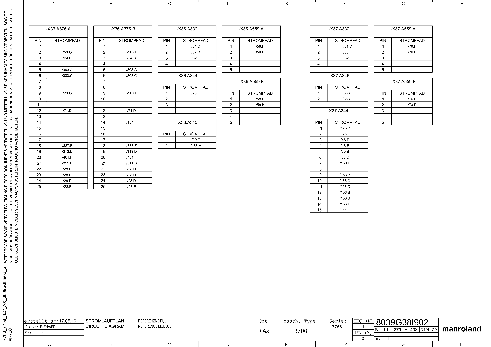

# +Ax — Sheet 279 of 403 — REFERENZMODUL

**REFERENCE MODULE**

> Part of the manroland **R700** printing press IEC/UL circuit diagrams.
> Drawing class: **Stromlaufplan / Circuit diagram** (DIN A3).
> Document `+Ax` covers the **Central control console** machine section.

## At a glance

| Field | Value |
|---|---|
| Document | `+Ax`  (8039G38I902) |
| Sheet | **279** of 403 |
| Section (DE) | REFERENZMODUL |
| Section (EN) | REFERENCE MODULE |
| Section type | REFERENCE_MODULE — Reference module |
| Machine type | `R700` |
| Series | `7758` |
| Created | 17.05.10 |
| Replaces | — |
| Columns used | A, B, C, D, E, F, G |
| Path numbers | — |
| Labels on sheet | 200 |
| Cross-refs out | 63 |
| Cross-refs in | 0 |

**Previous:** [+Ax sheet 278](SHEET_0278.md) · **Next:** [+Ax sheet 280](SHEET_0280.md) · **Document TOC:** [_TOC.md](_TOC.md)  (+Ax) · **Master TOC:** [all sheets](../_MASTER_TOC.md)

## Sheet image (300 DPI, exact vector render)



_Rendered directly from the PDF vector layer at 300 DPI (1-bit), no OCR and no resampling. Use it to confirm anything ambiguous in the text below._

## Cross-references on this sheet

Each entry is a wire leaving this sheet. The printed token is `/sheet.column`; the link resolves to that sheet inside the same document.

| Ref | Target sheet | Col | Path | Destination on target | Target section | From col |
|---|---|---|---|---|---|---|
| `/76.F` | [+Ax sheet 76](SHEET_0076.md) | F | — | — | ANLEGER | G |
| `/31.C` | [+Ax sheet 31](SHEET_0031.md) | C | — | — | SPANNUNGSVERSORGUNG, SCHALTSCHRANKBELÜFTUNG | C |
| `/58.H` | [+Ax sheet 58](SHEET_0058.md) | H | — | — | LUFTVERSORGUNG | E |
| `/31.D` | [+Ax sheet 31](SHEET_0031.md) | D | — | — | SPANNUNGSVERSORGUNG, SCHALTSCHRANKBELÜFTUNG | F |
| `/76.F` | [+Ax sheet 76](SHEET_0076.md) | F | — | — | ANLEGER | G |
| `/56.G` | [+Ax sheet 56](SHEET_0056.md) | G | — | — | LUFTVERSORGUNG | A |
| `/56.G` | [+Ax sheet 56](SHEET_0056.md) | G | — | — | LUFTVERSORGUNG | B |
| `/86.G` | [+Ax sheet 86](SHEET_0086.md) | G | — | — | ANLEGER | F |
| `/82.D` | [+Ax sheet 82](SHEET_0082.md) | D | — | — | ANLEGER | C |
| `/58.H` | [+Ax sheet 58](SHEET_0058.md) | H | — | — | LUFTVERSORGUNG | E |
| `/24.B` | [+Ax sheet 24](SHEET_0024.md) | B | — | — | SPANNUNGSVERSORGUNG, SCHALTSCHRANKBELÜFTUNG | A |
| `/24.B` | [+Ax sheet 24](SHEET_0024.md) | B | — | — | SPANNUNGSVERSORGUNG, SCHALTSCHRANKBELÜFTUNG | B |
| `/32.E` | [+Ax sheet 32](SHEET_0032.md) | E | — | — | SPANNUNGSVERSORGUNG, SCHALTSCHRANKBELÜFTUNG | C |
| `/32.E` | [+Ax sheet 32](SHEET_0032.md) | E | — | — | SPANNUNGSVERSORGUNG, SCHALTSCHRANKBELÜFTUNG | F |
| `/303.A` | [+Ax sheet 303](SHEET_0303.md) | A | — | — | SPANNUNGSVERSORGUNG: LACKMODUL | A |
| `/303.A` | [+Ax sheet 303](SHEET_0303.md) | A | — | — | SPANNUNGSVERSORGUNG: LACKMODUL | B |
| `/303.C` | [+Ax sheet 303](SHEET_0303.md) | C | — | — | SPANNUNGSVERSORGUNG: LACKMODUL | A |
| `/303.C` | [+Ax sheet 303](SHEET_0303.md) | C | — | — | SPANNUNGSVERSORGUNG: LACKMODUL | B |
| `/25.G` | [+Ax sheet 25](SHEET_0025.md) | G | — | STROMPFAD PIN 1 2 3 4 | SPANNUNGSVERSORGUNG, SCHALTSCHRANKBELÜFTUNG | C |
| `/368.E` | [+Ax sheet 368](SHEET_0368.md) | E | — | — | OPTION: LOGISTIK AUSLEGER | F |
| `/20.G` | [+Ax sheet 20](SHEET_0020.md) | G | — | — | SPANNUNGSVERSORGUNG, SCHALTSCHRANKBELÜFTUNG | A |
| `/20.G` | [+Ax sheet 20](SHEET_0020.md) | G | — | — | SPANNUNGSVERSORGUNG, SCHALTSCHRANKBELÜFTUNG | B |
| `/368.E` | [+Ax sheet 368](SHEET_0368.md) | E | — | — | OPTION: LOGISTIK AUSLEGER | F |
| `/76.F` | [+Ax sheet 76](SHEET_0076.md) | F | — | — | ANLEGER | G |
| `/58.H` | [+Ax sheet 58](SHEET_0058.md) | H | — | — | LUFTVERSORGUNG | E |
| `/76.F` | [+Ax sheet 76](SHEET_0076.md) | F | — | — | ANLEGER | G |
| `/58.H` | [+Ax sheet 58](SHEET_0058.md) | H | — | — | LUFTVERSORGUNG | E |
| `/71.D` | [+Ax sheet 71](SHEET_0071.md) | D | — | — | WASCHVORRICHTUNGEN DRUCKWERKE | A |
| `/71.D` | [+Ax sheet 71](SHEET_0071.md) | D | — | — | WASCHVORRICHTUNGEN DRUCKWERKE | B |
| `/184.F` | [+Ax sheet 184](SHEET_0184.md) | F | — | — | RESERVE | B |
| `/175.B` | [+Ax sheet 175](SHEET_0175.md) | B | — | — | RESERVE | F |
| `/175.C` | [+Ax sheet 175](SHEET_0175.md) | C | — | — | RESERVE | F |
| `/29.E` | [+Ax sheet 29](SHEET_0029.md) | E | — | — | SPANNUNGSVERSORGUNG, SCHALTSCHRANKBELÜFTUNG | C |
| `/48.E` | [+Ax sheet 48](SHEET_0048.md) | E | — | — | NOT AUS | F |
| `/48.E` | [+Ax sheet 48](SHEET_0048.md) | E | — | — | NOT AUS | F |
| `/387.F` | [+Ax sheet 387](SHEET_0387.md) | F | — | — | OPTION: PUDERABSAUGEINRICHTUNG | A |
| `/387.F` | [+Ax sheet 387](SHEET_0387.md) | F | — | — | OPTION: PUDERABSAUGEINRICHTUNG | B |
| `/188.H` | [+Ax sheet 188](SHEET_0188.md) | H | — | — | RESERVE | C |
| `/50.B` | [+Ax sheet 50](SHEET_0050.md) | B | — | — | STOP SICHERN | F |
| `/313.D` | [+Ax sheet 313](SHEET_0313.md) | D | — | — | OPTION: STAUBSAUGER MIT BÜRSTE | A |
| `/313.D` | [+Ax sheet 313](SHEET_0313.md) | D | — | — | OPTION: STAUBSAUGER MIT BÜRSTE | B |
| `/401.F` | [+Ax sheet 401](SHEET_0401.md) | F | — | — | OPTION: INLINE COLORPILOT | A |
| `/401.F` | [+Ax sheet 401](SHEET_0401.md) | F | — | — | OPTION: INLINE COLORPILOT | B |
| `/50.C` | [+Ax sheet 50](SHEET_0050.md) | C | — | — | STOP SICHERN | F |
| `/311.B` | [+Ax sheet 311](SHEET_0311.md) | B | — | — | OPTION: IONISATIONSANLAGE ANLEGER | A |
| `/311.B` | [+Ax sheet 311](SHEET_0311.md) | B | — | — | OPTION: IONISATIONSANLAGE ANLEGER | B |
| `/158.F` | [+Ax sheet 158](SHEET_0158.md) | F | — | — | ÜBERWACHUNGSRECHNER/ANSTEUERUNG NOT AUS | F |
| `/28.D` | [+Ax sheet 28](SHEET_0028.md) | D | — | — | SPANNUNGSVERSORGUNG, SCHALTSCHRANKBELÜFTUNG | A |
| `/28.D` | [+Ax sheet 28](SHEET_0028.md) | D | — | — | SPANNUNGSVERSORGUNG, SCHALTSCHRANKBELÜFTUNG | B |
| `/158.G` | [+Ax sheet 158](SHEET_0158.md) | G | — | — | ÜBERWACHUNGSRECHNER/ANSTEUERUNG NOT AUS | F |
| `/158.B` | [+Ax sheet 158](SHEET_0158.md) | B | — | — | ÜBERWACHUNGSRECHNER/ANSTEUERUNG NOT AUS | F |
| `/28.D` | [+Ax sheet 28](SHEET_0028.md) | D | — | — | SPANNUNGSVERSORGUNG, SCHALTSCHRANKBELÜFTUNG | A |
| `/28.D` | [+Ax sheet 28](SHEET_0028.md) | D | — | — | SPANNUNGSVERSORGUNG, SCHALTSCHRANKBELÜFTUNG | B |
| `/28.D` | [+Ax sheet 28](SHEET_0028.md) | D | — | — | SPANNUNGSVERSORGUNG, SCHALTSCHRANKBELÜFTUNG | A |
| `/28.D` | [+Ax sheet 28](SHEET_0028.md) | D | — | — | SPANNUNGSVERSORGUNG, SCHALTSCHRANKBELÜFTUNG | B |
| `/158.C` | [+Ax sheet 158](SHEET_0158.md) | C | — | — | ÜBERWACHUNGSRECHNER/ANSTEUERUNG NOT AUS | F |
| `/28.E` | [+Ax sheet 28](SHEET_0028.md) | E | — | — | SPANNUNGSVERSORGUNG, SCHALTSCHRANKBELÜFTUNG | A |
| `/28.E` | [+Ax sheet 28](SHEET_0028.md) | E | — | — | SPANNUNGSVERSORGUNG, SCHALTSCHRANKBELÜFTUNG | B |
| `/158.D` | [+Ax sheet 158](SHEET_0158.md) | D | — | — | ÜBERWACHUNGSRECHNER/ANSTEUERUNG NOT AUS | F |
| `/156.B` | [+Ax sheet 156](SHEET_0156.md) | B | — | — | ÜBERWACHUNGSRECHNER/ANSTEUERUNG NOT AUS | F |
| `/156.B` | [+Ax sheet 156](SHEET_0156.md) | B | — | — | ÜBERWACHUNGSRECHNER/ANSTEUERUNG NOT AUS | F |
| `/156.F` | [+Ax sheet 156](SHEET_0156.md) | F | — | — | ÜBERWACHUNGSRECHNER/ANSTEUERUNG NOT AUS | F |
| `/156.G` | [+Ax sheet 156](SHEET_0156.md) | G | — | — | ÜBERWACHUNGSRECHNER/ANSTEUERUNG NOT AUS | F |

## Devices on this sheet

| Tag | Class | Class meaning (IEC) | Col | Sub | Terminal | Sign |
|---|---|---|---|---|---|---|
| `X36.A376.B` | — | cross-device reference | B | — | — | — |
| `X36.A376.A` | — | cross-device reference | A | — | — | — |
| `X36.A332` | — | cross-device reference | C | — | — | — |
| `X36.A344` | — | cross-device reference | C | — | — | — |
| `X36.A345` | — | cross-device reference | C | — | — | — |
| `X36.A559.A` | — | cross-device reference | D | — | — | — |
| `X36.A559.B` | — | cross-device reference | D | — | — | — |
| `X37.A332` | — | cross-device reference | F | — | — | — |
| `X37.A345` | — | cross-device reference | F | — | — | — |
| `X37.A344` | — | cross-device reference | F | — | — | — |
| `X37.A559.A` | — | cross-device reference | G | — | — | — |
| `X37.A559.B` | — | cross-device reference | G | — | — | — |

## Potentials / nets

_No named potentials on this sheet._

## Wire-end annotations (grouped as printed)

A wire that continues elsewhere is annotated with a small cluster: the destination description, the path/line number `#NN`, and the `/sheet.column` cross reference. Each row below is one such cluster exactly as it is grouped on the drawing.

| Col | Y | Path | Cross-ref | Text on the wire |
|---|---|---|---|---|
| A | 65.5 | — | — | `X36.A376.A` |
| B | 65.5 | — | — | `X36.A376.B` |
| C | 65.5 | — | — | `X36.A332` |
| D | 65.5 | — | — | `X36.A559.A` |
| F | 65.5 | — | — | `X37.A332` |
| G | 65.5 | — | — | `X37.A559.A` |
| A | 94.2 | — | — | `PIN STROMPFAD` |
| B | 94.2 | — | — | `PIN STROMPFAD` |
| C | 94.2 | — | — | `PIN 2 3 4 1 STROMPFAD` |
| D | 94.2 | — | — | `PIN 2 3 4 5 1 STROMPFAD` |
| F | 94.2 | — | — | `PIN 2 3 4 1 STROMPFAD` |
| G | 94.2 | — | — | `PIN 2 3 4 5 1 STROMPFAD` |
| A | 108.4 | — | — | `2 3 4 5 6 7 8 9 1` |
| B | 108.4 | — | — | `2 3 4 5 6 7 8 9 1` |
| C | 108.7 | — | `/31.C` | — |
| E | 108.7 | — | `/58.H` | — |
| F | 108.7 | — | `/31.D` | — |
| G | 108.7 | — | `/76.F` | — |
| A | 122.9 | — | `/56.G` | — |
| B | 122.9 | — | `/56.G` | — |
| C | 122.9 | — | `/82.D` | — |
| E | 122.9 | — | `/58.H` | — |
| F | 122.9 | — | `/86.G` | — |
| G | 122.9 | — | `/76.F` | — |
| A | 137.0 | — | `/24.B` | — |
| B | 137.0 | — | `/24.B` | — |
| C | 137.0 | — | `/32.E` | — |
| F | 137.0 | — | `/32.E` | — |
| A | 165.4 | — | `/303.A` | — |
| B | 165.4 | — | `/303.A` | — |
| C | 178.9 | — | — | `X36.A344` |
| F | 178.9 | — | — | `X37.A345` |
| A | 179.6 | — | `/303.C` | — |
| B | 179.6 | — | `/303.C` | — |
| D | 193.1 | — | — | `X36.A559.B` |
| G | 193.1 | — | — | `X37.A559.B` |
| C | 207.5 | — | `/25.G` | `PIN 2 3 4 1 STROMPFAD` |
| F | 207.5 | — | — | `PIN 2 1 STROMPFAD` |
| D | 221.7 | — | — | `PIN 2 3 4 5 1 STROMPFAD` |
| G | 221.7 | — | — | `PIN 2 3 4 5 1 STROMPFAD` |
| A | 222.1 | — | `/20.G` | — |
| B | 222.1 | — | `/20.G` | — |
| F | 222.1 | — | `/368.E` | — |
| A | 235.9 | — | — | `10 12 13 14 15 16 17 18 19 20 11` |
| B | 235.9 | — | — | `10 12 13 14 15 16 17 18 19 20 11` |
| F | 236.2 | — | `/368.E` | — |
| G | 236.2 | — | `/76.F` | — |
| E | 236.3 | — | `/58.H` | — |
| E | 250.4 | — | `/58.H` | — |
| G | 250.4 | — | `/76.F` | — |
| F | 263.9 | — | — | `X37.A344` |
| A | 264.6 | — | `/71.D` | — |
| B | 264.6 | — | `/71.D` | — |
| C | 292.3 | — | — | `X36.A345` |
| F | 292.6 | — | — | `PIN 10 12 13 14 15 11 2 3 4 5 6 7 8 9 1 STROMPFAD` |
| B | 292.9 | — | `/184.F` | — |
| F | 307.1 | — | `/175.B` | — |
| C | 320.9 | — | — | `PIN 2 1 STROMPFAD` |
| F | 321.3 | — | `/175.C` | — |
| C | 335.4 | — | `/29.E` | — |
| F | 335.4 | — | `/48.E` | — |
| A | 349.6 | — | `/387.F` | — |
| B | 349.6 | — | `/387.F` | — |
| F | 349.6 | — | `/48.E` | — |
| C | 349.7 | — | `/188.H` | — |
| A | 363.8 | — | `/313.D` | — |
| B | 363.8 | — | `/313.D` | — |
| F | 363.8 | — | `/50.B` | — |
| A | 378.0 | — | `/401.F` | — |
| B | 378.0 | — | `/401.F` | — |
| F | 378.0 | — | `/50.C` | — |
| A | 391.8 | — | — | `22 23 24 25 21` |
| B | 391.8 | — | — | `22 23 24 25 21` |
| A | 392.1 | — | `/311.B` | — |
| B | 392.1 | — | `/311.B` | — |
| F | 392.2 | — | `/158.F` | — |
| A | 406.3 | — | `/28.D` | — |
| B | 406.3 | — | `/28.D` | — |
| F | 406.3 | — | `/158.G` | — |
| A | 420.5 | — | `/28.D` | — |
| B | 420.5 | — | `/28.D` | — |
| F | 420.5 | — | `/158.B` | — |
| A | 434.7 | — | `/28.D` | — |
| B | 434.7 | — | `/28.D` | — |
| F | 434.7 | — | `/158.C` | — |
| A | 448.8 | — | `/28.E` | — |
| B | 448.8 | — | `/28.E` | — |
| F | 448.9 | — | `/158.D` | — |
| F | 463.0 | — | `/156.B` | — |
| F | 477.2 | — | `/156.B` | — |
| F | 491.4 | — | `/156.F` | — |
| F | 505.6 | — | `/156.G` | — |


## Reconstructed tables

This sheet carries tabular content (pin map / terminal assignment / index). The grid below was rebuilt from the drawing's own rule lines, so each row is exactly one physical row of the table.

### Table 1 — 25 data rows × 2 columns (at x=70.9, y=62.4) — **X36.A376.A**

| PIN | STROMPFAD |
|---|---|
| `1` |  |
| `2` | `/56.G` |
| `3` | `/24.B` |
| `4` |  |
| `5` | `/303.A` |
| `6` | `/303.C` |
| `7` |  |
| `8` |  |
| `9` | `/20.G` |
| `10` |  |
| `11` |  |
| `12` | `/71.D` |
| `13` |  |
| `14` |  |
| `15` |  |
| `16` |  |
| `17` |  |
| `18` | `/387.F` |
| `19` | `/313.D` |
| `20` | `/401.F` |
| `21` | `/311.B` |
| `22` | `/28.D` |
| `23` | `/28.D` |
| `24` | `/28.D` |
| `25` | `/28.E` |


### Table 2 — 25 data rows × 2 columns (at x=226.8, y=62.4) — **X36.A376.B**

| PIN | STROMPFAD |
|---|---|
| `1` |  |
| `2` | `/56.G` |
| `3` | `/24.B` |
| `4` |  |
| `5` | `/303.A` |
| `6` | `/303.C` |
| `7` |  |
| `8` |  |
| `9` | `/20.G` |
| `10` |  |
| `11` |  |
| `12` | `/71.D` |
| `13` |  |
| `14` | `/184.F` |
| `15` |  |
| `16` |  |
| `17` |  |
| `18` | `/387.F` |
| `19` | `/313.D` |
| `20` | `/401.F` |
| `21` | `/311.B` |
| `22` | `/28.D` |
| `23` | `/28.D` |
| `24` | `/28.D` |
| `25` | `/28.E` |


### Table 3 — 14 data rows × 2 columns (at x=382.7, y=62.4) — **X36.A332**

| PIN | STROMPFAD |
|---|---|
| `1` | `/31.C` |
| `2` | `/82.D` |
| `3` | `/32.E` |
| `4` |  |
|  | `X36.A344` |
| `PIN` | `STROMPFAD` |
| `1` | `/25.G` |
| `2` |  |
| `3` |  |
| `4` |  |
|  | `X36.A345` |
| `PIN` | `STROMPFAD` |
| `1` | `/29.E` |
| `2` | `/188.H` |


### Table 4 — 12 data rows × 2 columns (at x=538.6, y=62.4) — **X36.A559.A**

| PIN | STROMPFAD |
|---|---|
| `1` | `/58.H` |
| `2` | `/58.H` |
| `3` |  |
| `4` |  |
| `5` |  |
|  | `X36.A559.B` |
| `PIN` | `STROMPFAD` |
| `1` | `/58.H` |
| `2` | `/58.H` |
| `3` |  |
| `4` |  |
| `5` |  |


### Table 5 — 25 data rows × 2 columns (at x=751.2, y=62.4) — **X37.A332**

| PIN | STROMPFAD |
|---|---|
| `1` | `/31.D` |
| `2` | `/86.G` |
| `3` | `/32.E` |
| `4` |  |
|  | `X37.A345` |
| `PIN` | `STROMPFAD` |
| `1` | `/368.E` |
| `2` | `/368.E` |
|  | `X37.A344` |
| `PIN` | `STROMPFAD` |
| `1` | `/175.B` |
| `2` | `/175.C` |
| `3` | `/48.E` |
| `4` | `/48.E` |
| `5` | `/50.B` |
| `6` | `/50.C` |
| `7` | `/158.F` |
| `8` | `/158.G` |
| `9` | `/158.B` |
| `10` | `/158.C` |
| `11` | `/158.D` |
| `12` | `/156.B` |
| `13` | `/156.B` |
| `14` | `/156.F` |
| `15` | `/156.G` |


### Table 6 — 12 data rows × 2 columns (at x=907.1, y=62.4) — **X37.A559.A**

| PIN | STROMPFAD |
|---|---|
| `1` | `/76.F` |
| `2` | `/76.F` |
| `3` |  |
| `4` |  |
| `5` |  |
|  | `X37.A559.B` |
| `PIN` | `STROMPFAD` |
| `1` | `/76.F` |
| `2` | `/76.F` |
| `3` |  |
| `4` |  |
| `5` |  |


## Notes and free text on this sheet

| Text | Col | Y (pt) |
|---|---|---|
| `PIN` | B | 94.2 |
| `STROMPFAD` | B | 94.15 |
| `PIN` | A | 94.2 |
| `STROMPFAD` | A | 94.15 |
| `PIN` | C | 94.2 |
| `STROMPFAD` | C | 94.15 |
| `PIN` | D | 94.2 |
| `STROMPFAD` | E | 94.15 |
| `PIN` | F | 94.2 |
| `STROMPFAD` | F | 94.15 |
| `PIN` | G | 94.2 |
| `STROMPFAD` | G | 94.15 |

## Complete label inventory (exact text from the drawing)

Every text object inside the drawing area of this sheet, in DIN reading order (column A→H, then top→bottom). This is the authoritative list: if a string is not here it is not printed on this sheet.

| Col | Y | X | Dir | Type | Text |
|---|---|---|---|---|---|
| A | 65.5 | 111.4 | → | device ref | `X36.A376.A` |
| A | 94.2 | 84.0 | → | text | `PIN` |
| A | 94.2 | 132.2 | → | text | `STROMPFAD` |
| A | 108.4 | 95.8 | → | number | `1` |
| A | 122.5 | 94.1 | → | number | `2` |
| A | 122.9 | 152.5 | → | cross-reference | `/56.G` |
| A | 136.7 | 94.1 | → | number | `3` |
| A | 137.0 | 152.8 | → | cross-reference | `/24.B` |
| A | 150.9 | 94.1 | → | number | `4` |
| A | 165.1 | 94.1 | → | number | `5` |
| A | 165.4 | 150.2 | → | cross-reference | `/303.A` |
| A | 179.2 | 94.1 | → | number | `6` |
| A | 179.6 | 150.2 | → | cross-reference | `/303.C` |
| A | 193.4 | 94.1 | → | number | `7` |
| A | 207.6 | 94.1 | → | number | `8` |
| A | 221.8 | 94.1 | → | number | `9` |
| A | 222.1 | 152.5 | → | cross-reference | `/20.G` |
| A | 235.9 | 88.7 | → | number | `10` |
| A | 250.1 | 90.4 | → | number | `11` |
| A | 264.3 | 88.7 | → | number | `12` |
| A | 264.6 | 152.6 | → | cross-reference | `/71.D` |
| A | 278.5 | 88.7 | → | number | `13` |
| A | 292.6 | 88.7 | → | number | `14` |
| A | 306.8 | 88.7 | → | number | `15` |
| A | 321.0 | 88.7 | → | number | `16` |
| A | 335.1 | 88.7 | → | number | `17` |
| A | 349.3 | 88.7 | → | number | `18` |
| A | 349.6 | 150.7 | → | cross-reference | `/387.F` |
| A | 363.5 | 88.7 | → | number | `19` |
| A | 363.8 | 150.2 | → | cross-reference | `/313.D` |
| A | 377.7 | 88.7 | → | number | `20` |
| A | 378.0 | 150.7 | → | cross-reference | `/401.F` |
| A | 391.8 | 90.4 | → | number | `21` |
| A | 392.2 | 150.4 | → | cross-reference | `/311.B` |
| A | 406.0 | 88.7 | → | number | `22` |
| A | 406.3 | 152.6 | → | cross-reference | `/28.D` |
| A | 420.2 | 88.7 | → | number | `23` |
| A | 420.5 | 152.6 | → | cross-reference | `/28.D` |
| A | 434.4 | 88.7 | → | number | `24` |
| A | 434.7 | 152.6 | → | cross-reference | `/28.D` |
| A | 448.5 | 88.7 | → | number | `25` |
| A | 448.8 | 152.9 | → | cross-reference | `/28.E` |
| B | 65.5 | 267.7 | → | device ref | `X36.A376.B` |
| B | 94.2 | 240.0 | → | text | `PIN` |
| B | 94.2 | 288.1 | → | text | `STROMPFAD` |
| B | 108.4 | 251.7 | → | number | `1` |
| B | 122.5 | 250.0 | → | number | `2` |
| B | 122.9 | 308.4 | → | cross-reference | `/56.G` |
| B | 136.7 | 250.0 | → | number | `3` |
| B | 137.0 | 308.7 | → | cross-reference | `/24.B` |
| B | 150.9 | 250.0 | → | number | `4` |
| B | 165.1 | 250.0 | → | number | `5` |
| B | 165.4 | 306.1 | → | cross-reference | `/303.A` |
| B | 179.2 | 250.0 | → | number | `6` |
| B | 179.6 | 306.1 | → | cross-reference | `/303.C` |
| B | 193.4 | 250.0 | → | number | `7` |
| B | 207.6 | 250.0 | → | number | `8` |
| B | 221.8 | 250.0 | → | number | `9` |
| B | 222.1 | 308.4 | → | cross-reference | `/20.G` |
| B | 235.9 | 244.6 | → | number | `10` |
| B | 250.1 | 246.3 | → | number | `11` |
| B | 264.3 | 244.6 | → | number | `12` |
| B | 264.6 | 308.6 | → | cross-reference | `/71.D` |
| B | 278.5 | 244.6 | → | number | `13` |
| B | 292.6 | 244.6 | → | number | `14` |
| B | 293.0 | 306.6 | → | cross-reference | `/184.F` |
| B | 306.8 | 244.6 | → | number | `15` |
| B | 321.0 | 244.6 | → | number | `16` |
| B | 335.1 | 244.6 | → | number | `17` |
| B | 349.3 | 244.6 | → | number | `18` |
| B | 349.6 | 306.6 | → | cross-reference | `/387.F` |
| B | 363.5 | 244.6 | → | number | `19` |
| B | 363.8 | 306.1 | → | cross-reference | `/313.D` |
| B | 377.7 | 244.6 | → | number | `20` |
| B | 378.0 | 306.6 | → | cross-reference | `/401.F` |
| B | 391.8 | 246.3 | → | number | `21` |
| B | 392.2 | 306.3 | → | cross-reference | `/311.B` |
| B | 406.0 | 244.6 | → | number | `22` |
| B | 406.3 | 308.6 | → | cross-reference | `/28.D` |
| B | 420.2 | 244.6 | → | number | `23` |
| B | 420.5 | 308.6 | → | cross-reference | `/28.D` |
| B | 434.4 | 244.6 | → | number | `24` |
| B | 434.7 | 308.6 | → | cross-reference | `/28.D` |
| B | 448.5 | 244.6 | → | number | `25` |
| B | 448.8 | 308.8 | → | cross-reference | `/28.E` |
| C | 65.5 | 428.6 | → | device ref | `X36.A332` |
| C | 94.2 | 395.9 | → | text | `PIN` |
| C | 94.2 | 444.0 | → | text | `STROMPFAD` |
| C | 108.4 | 401.8 | → | number | `1` |
| C | 108.7 | 464.5 | → | cross-reference | `/31.C` |
| C | 122.5 | 401.2 | → | number | `2` |
| C | 122.9 | 464.5 | → | cross-reference | `/82.D` |
| C | 136.7 | 401.2 | → | number | `3` |
| C | 137.0 | 464.7 | → | cross-reference | `/32.E` |
| C | 150.9 | 401.2 | → | number | `4` |
| C | 178.9 | 428.6 | → | device ref | `X36.A344` |
| C | 207.5 | 444.0 | → | text | `STROMPFAD` |
| C | 207.6 | 395.9 | → | text | `PIN` |
| C | 221.8 | 401.8 | → | number | `1` |
| C | 222.1 | 464.3 | → | cross-reference | `/25.G` |
| C | 235.9 | 401.2 | → | number | `2` |
| C | 250.1 | 401.2 | → | number | `3` |
| C | 264.3 | 401.2 | → | number | `4` |
| C | 292.3 | 428.6 | → | device ref | `X36.A345` |
| C | 320.9 | 444.0 | → | text | `STROMPFAD` |
| C | 321.0 | 395.9 | → | text | `PIN` |
| C | 335.1 | 401.8 | → | number | `1` |
| C | 335.4 | 464.7 | → | cross-reference | `/29.E` |
| C | 349.3 | 401.2 | → | number | `2` |
| C | 349.7 | 462.3 | → | cross-reference | `/188.H` |
| D | 65.5 | 579.1 | → | device ref | `X36.A559.A` |
| D | 94.2 | 551.8 | → | text | `PIN` |
| D | 108.4 | 557.7 | → | number | `1` |
| D | 122.5 | 557.1 | → | number | `2` |
| D | 136.7 | 557.1 | → | number | `3` |
| D | 150.9 | 557.1 | → | number | `4` |
| D | 165.1 | 557.1 | → | number | `5` |
| D | 193.1 | 579.5 | → | device ref | `X36.A559.B` |
| D | 221.8 | 551.8 | → | text | `PIN` |
| D | 235.9 | 557.7 | → | number | `1` |
| D | 250.1 | 557.1 | → | number | `2` |
| D | 264.3 | 557.1 | → | number | `3` |
| D | 278.5 | 557.1 | → | number | `4` |
| D | 292.6 | 557.1 | → | number | `5` |
| E | 94.2 | 600.0 | → | text | `STROMPFAD` |
| E | 108.7 | 620.6 | → | cross-reference | `/58.H` |
| E | 122.9 | 620.6 | → | cross-reference | `/58.H` |
| E | 221.7 | 600.0 | → | text | `STROMPFAD` |
| E | 236.3 | 620.6 | → | cross-reference | `/58.H` |
| E | 250.4 | 620.6 | → | cross-reference | `/58.H` |
| F | 65.5 | 797.1 | → | device ref | `X37.A332` |
| F | 94.2 | 764.4 | → | text | `PIN` |
| F | 94.2 | 812.6 | → | text | `STROMPFAD` |
| F | 108.4 | 770.3 | → | number | `1` |
| F | 108.7 | 833.0 | → | cross-reference | `/31.D` |
| F | 122.5 | 769.7 | → | number | `2` |
| F | 122.9 | 832.8 | → | cross-reference | `/86.G` |
| F | 136.7 | 769.7 | → | number | `3` |
| F | 137.0 | 833.2 | → | cross-reference | `/32.E` |
| F | 150.9 | 769.7 | → | number | `4` |
| F | 178.9 | 797.1 | → | device ref | `X37.A345` |
| F | 207.5 | 812.6 | → | text | `STROMPFAD` |
| F | 207.6 | 764.4 | → | text | `PIN` |
| F | 221.8 | 770.3 | → | number | `1` |
| F | 222.1 | 830.8 | → | cross-reference | `/368.E` |
| F | 235.9 | 769.7 | → | number | `2` |
| F | 236.2 | 830.8 | → | cross-reference | `/368.E` |
| F | 263.9 | 794.3 | → | device ref | `X37.A344` |
| F | 292.6 | 764.4 | → | text | `PIN` |
| F | 292.6 | 812.6 | → | text | `STROMPFAD` |
| F | 306.8 | 776.1 | → | number | `1` |
| F | 307.1 | 823.6 | → | cross-reference | `/175.B` |
| F | 321.0 | 774.4 | → | number | `2` |
| F | 321.3 | 823.5 | → | cross-reference | `/175.C` |
| F | 335.1 | 774.4 | → | number | `3` |
| F | 335.4 | 826.2 | → | cross-reference | `/48.E` |
| F | 349.3 | 774.4 | → | number | `4` |
| F | 349.6 | 826.2 | → | cross-reference | `/48.E` |
| F | 363.5 | 774.4 | → | number | `5` |
| F | 363.8 | 826.0 | → | cross-reference | `/50.B` |
| F | 377.7 | 774.4 | → | number | `6` |
| F | 378.0 | 825.9 | → | cross-reference | `/50.C` |
| F | 391.8 | 774.4 | → | number | `7` |
| F | 392.2 | 823.9 | → | cross-reference | `/158.F` |
| F | 406.0 | 774.4 | → | number | `8` |
| F | 406.3 | 823.3 | → | cross-reference | `/158.G` |
| F | 420.2 | 774.4 | → | number | `9` |
| F | 420.5 | 823.6 | → | cross-reference | `/158.B` |
| F | 434.4 | 769.0 | → | number | `10` |
| F | 434.7 | 823.5 | → | cross-reference | `/158.C` |
| F | 448.5 | 770.7 | → | number | `11` |
| F | 448.9 | 823.5 | → | cross-reference | `/158.D` |
| F | 462.7 | 769.0 | → | number | `12` |
| F | 463.0 | 823.6 | → | cross-reference | `/156.B` |
| F | 476.9 | 769.0 | → | number | `13` |
| F | 477.2 | 823.6 | → | cross-reference | `/156.B` |
| F | 491.0 | 769.0 | → | number | `14` |
| F | 491.4 | 823.9 | → | cross-reference | `/156.F` |
| F | 505.2 | 769.0 | → | number | `15` |
| F | 505.6 | 823.3 | → | cross-reference | `/156.G` |
| G | 65.5 | 947.6 | → | device ref | `X37.A559.A` |
| G | 94.2 | 920.3 | → | text | `PIN` |
| G | 94.2 | 968.5 | → | text | `STROMPFAD` |
| G | 108.4 | 926.2 | → | number | `1` |
| G | 108.7 | 989.3 | → | cross-reference | `/76.F` |
| G | 122.5 | 925.7 | → | number | `2` |
| G | 122.9 | 989.3 | → | cross-reference | `/76.F` |
| G | 136.7 | 925.7 | → | number | `3` |
| G | 150.9 | 925.7 | → | number | `4` |
| G | 165.1 | 925.7 | → | number | `5` |
| G | 193.1 | 948.0 | → | device ref | `X37.A559.B` |
| G | 221.7 | 968.5 | → | text | `STROMPFAD` |
| G | 221.8 | 920.3 | → | text | `PIN` |
| G | 235.9 | 926.2 | → | number | `1` |
| G | 236.2 | 989.3 | → | cross-reference | `/76.F` |
| G | 250.1 | 925.7 | → | number | `2` |
| G | 250.4 | 989.3 | → | cross-reference | `/76.F` |
| G | 264.3 | 925.7 | → | number | `3` |
| G | 278.5 | 925.7 | → | number | `4` |
| G | 292.6 | 925.7 | → | number | `5` |

## Reading-order text block

The same content as a plain block, grouped by DIN column — convenient to paste or to match against a visual description.

```text
=== Column A ===
  65.5  111.4  devref       X36.A376.A
  94.2   84.0  text         PIN
  94.2  132.2  text         STROMPFAD
 108.4   95.8  numeric      1
 122.5   94.1  numeric      2
 122.9  152.5  xref         /56.G
 136.7   94.1  numeric      3
 137.0  152.8  xref         /24.B
 150.9   94.1  numeric      4
 165.1   94.1  numeric      5
 165.4  150.2  xref         /303.A
 179.2   94.1  numeric      6
 179.6  150.2  xref         /303.C
 193.4   94.1  numeric      7
 207.6   94.1  numeric      8
 221.8   94.1  numeric      9
 222.1  152.5  xref         /20.G
 235.9   88.7  numeric      10
 250.1   90.4  numeric      11
 264.3   88.7  numeric      12
 264.6  152.6  xref         /71.D
 278.5   88.7  numeric      13
 292.6   88.7  numeric      14
 306.8   88.7  numeric      15
 321.0   88.7  numeric      16
 335.1   88.7  numeric      17
 349.3   88.7  numeric      18
 349.6  150.7  xref         /387.F
 363.5   88.7  numeric      19
 363.8  150.2  xref         /313.D
 377.7   88.7  numeric      20
 378.0  150.7  xref         /401.F
 391.8   90.4  numeric      21
 392.2  150.4  xref         /311.B
 406.0   88.7  numeric      22
 406.3  152.6  xref         /28.D
 420.2   88.7  numeric      23
 420.5  152.6  xref         /28.D
 434.4   88.7  numeric      24
 434.7  152.6  xref         /28.D
 448.5   88.7  numeric      25
 448.8  152.9  xref         /28.E
=== Column B ===
  65.5  267.7  devref       X36.A376.B
  94.2  240.0  text         PIN
  94.2  288.1  text         STROMPFAD
 108.4  251.7  numeric      1
 122.5  250.0  numeric      2
 122.9  308.4  xref         /56.G
 136.7  250.0  numeric      3
 137.0  308.7  xref         /24.B
 150.9  250.0  numeric      4
 165.1  250.0  numeric      5
 165.4  306.1  xref         /303.A
 179.2  250.0  numeric      6
 179.6  306.1  xref         /303.C
 193.4  250.0  numeric      7
 207.6  250.0  numeric      8
 221.8  250.0  numeric      9
 222.1  308.4  xref         /20.G
 235.9  244.6  numeric      10
 250.1  246.3  numeric      11
 264.3  244.6  numeric      12
 264.6  308.6  xref         /71.D
 278.5  244.6  numeric      13
 292.6  244.6  numeric      14
 293.0  306.6  xref         /184.F
 306.8  244.6  numeric      15
 321.0  244.6  numeric      16
 335.1  244.6  numeric      17
 349.3  244.6  numeric      18
 349.6  306.6  xref         /387.F
 363.5  244.6  numeric      19
 363.8  306.1  xref         /313.D
 377.7  244.6  numeric      20
 378.0  306.6  xref         /401.F
 391.8  246.3  numeric      21
 392.2  306.3  xref         /311.B
 406.0  244.6  numeric      22
 406.3  308.6  xref         /28.D
 420.2  244.6  numeric      23
 420.5  308.6  xref         /28.D
 434.4  244.6  numeric      24
 434.7  308.6  xref         /28.D
 448.5  244.6  numeric      25
 448.8  308.8  xref         /28.E
=== Column C ===
  65.5  428.6  devref       X36.A332
  94.2  395.9  text         PIN
  94.2  444.0  text         STROMPFAD
 108.4  401.8  numeric      1
 108.7  464.5  xref         /31.C
 122.5  401.2  numeric      2
 122.9  464.5  xref         /82.D
 136.7  401.2  numeric      3
 137.0  464.7  xref         /32.E
 150.9  401.2  numeric      4
 178.9  428.6  devref       X36.A344
 207.5  444.0  text         STROMPFAD
 207.6  395.9  text         PIN
 221.8  401.8  numeric      1
 222.1  464.3  xref         /25.G
 235.9  401.2  numeric      2
 250.1  401.2  numeric      3
 264.3  401.2  numeric      4
 292.3  428.6  devref       X36.A345
 320.9  444.0  text         STROMPFAD
 321.0  395.9  text         PIN
 335.1  401.8  numeric      1
 335.4  464.7  xref         /29.E
 349.3  401.2  numeric      2
 349.7  462.3  xref         /188.H
=== Column D ===
  65.5  579.1  devref       X36.A559.A
  94.2  551.8  text         PIN
 108.4  557.7  numeric      1
 122.5  557.1  numeric      2
 136.7  557.1  numeric      3
 150.9  557.1  numeric      4
 165.1  557.1  numeric      5
 193.1  579.5  devref       X36.A559.B
 221.8  551.8  text         PIN
 235.9  557.7  numeric      1
 250.1  557.1  numeric      2
 264.3  557.1  numeric      3
 278.5  557.1  numeric      4
 292.6  557.1  numeric      5
=== Column E ===
  94.2  600.0  text         STROMPFAD
 108.7  620.6  xref         /58.H
 122.9  620.6  xref         /58.H
 221.7  600.0  text         STROMPFAD
 236.3  620.6  xref         /58.H
 250.4  620.6  xref         /58.H
=== Column F ===
  65.5  797.1  devref       X37.A332
  94.2  764.4  text         PIN
  94.2  812.6  text         STROMPFAD
 108.4  770.3  numeric      1
 108.7  833.0  xref         /31.D
 122.5  769.7  numeric      2
 122.9  832.8  xref         /86.G
 136.7  769.7  numeric      3
 137.0  833.2  xref         /32.E
 150.9  769.7  numeric      4
 178.9  797.1  devref       X37.A345
 207.5  812.6  text         STROMPFAD
 207.6  764.4  text         PIN
 221.8  770.3  numeric      1
 222.1  830.8  xref         /368.E
 235.9  769.7  numeric      2
 236.2  830.8  xref         /368.E
 263.9  794.3  devref       X37.A344
 292.6  764.4  text         PIN
 292.6  812.6  text         STROMPFAD
 306.8  776.1  numeric      1
 307.1  823.6  xref         /175.B
 321.0  774.4  numeric      2
 321.3  823.5  xref         /175.C
 335.1  774.4  numeric      3
 335.4  826.2  xref         /48.E
 349.3  774.4  numeric      4
 349.6  826.2  xref         /48.E
 363.5  774.4  numeric      5
 363.8  826.0  xref         /50.B
 377.7  774.4  numeric      6
 378.0  825.9  xref         /50.C
 391.8  774.4  numeric      7
 392.2  823.9  xref         /158.F
 406.0  774.4  numeric      8
 406.3  823.3  xref         /158.G
 420.2  774.4  numeric      9
 420.5  823.6  xref         /158.B
 434.4  769.0  numeric      10
 434.7  823.5  xref         /158.C
 448.5  770.7  numeric      11
 448.9  823.5  xref         /158.D
 462.7  769.0  numeric      12
 463.0  823.6  xref         /156.B
 476.9  769.0  numeric      13
 477.2  823.6  xref         /156.B
 491.0  769.0  numeric      14
 491.4  823.9  xref         /156.F
 505.2  769.0  numeric      15
 505.6  823.3  xref         /156.G
=== Column G ===
  65.5  947.6  devref       X37.A559.A
  94.2  920.3  text         PIN
  94.2  968.5  text         STROMPFAD
 108.4  926.2  numeric      1
 108.7  989.3  xref         /76.F
 122.5  925.7  numeric      2
 122.9  989.3  xref         /76.F
 136.7  925.7  numeric      3
 150.9  925.7  numeric      4
 165.1  925.7  numeric      5
 193.1  948.0  devref       X37.A559.B
 221.7  968.5  text         STROMPFAD
 221.8  920.3  text         PIN
 235.9  926.2  numeric      1
 236.2  989.3  xref         /76.F
 250.1  925.7  numeric      2
 250.4  989.3  xref         /76.F
 264.3  925.7  numeric      3
 278.5  925.7  numeric      4
 292.6  925.7  numeric      5
```

---
_Generated from the PDF vector text layer; no OCR. Source: `R700_7758_IEC_AX_8039G38I902_p`, sheet 279._
