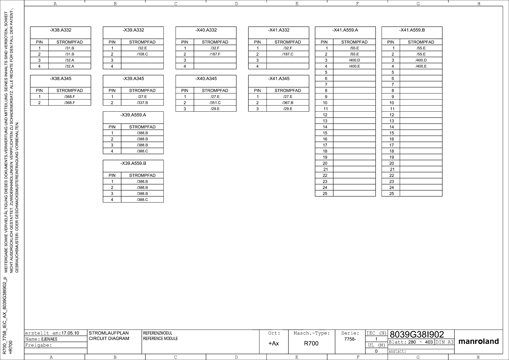

# +Ax — Sheet 280 of 403 — REFERENZMODUL

**REFERENCE MODULE**

> Part of the manroland **R700** printing press IEC/UL circuit diagrams.
> Drawing class: **Stromlaufplan / Circuit diagram** (DIN A3).
> Document `+Ax` covers the **Central control console** machine section.

## At a glance

| Field | Value |
|---|---|
| Document | `+Ax`  (8039G38I902) |
| Sheet | **280** of 403 |
| Section (DE) | REFERENZMODUL |
| Section (EN) | REFERENCE MODULE |
| Section type | REFERENCE_MODULE — Reference module |
| Machine type | `R700` |
| Series | `7758` |
| Created | 17.05.10 |
| Replaces | — |
| Columns used | A, B, C, D, E, F, G |
| Path numbers | — |
| Labels on sheet | 156 |
| Cross-refs out | 36 |
| Cross-refs in | 0 |

**Previous:** [+Ax sheet 279](SHEET_0279.md) · **Next:** [+Ax sheet 281](SHEET_0281.md) · **Document TOC:** [_TOC.md](_TOC.md)  (+Ax) · **Master TOC:** [all sheets](../_MASTER_TOC.md)

## Sheet image (300 DPI, exact vector render)



_Rendered directly from the PDF vector layer at 300 DPI (1-bit), no OCR and no resampling. Use it to confirm anything ambiguous in the text below._

## Cross-references on this sheet

Each entry is a wire leaving this sheet. The printed token is `/sheet.column`; the link resolves to that sheet inside the same document.

| Ref | Target sheet | Col | Path | Destination on target | Target section | From col |
|---|---|---|---|---|---|---|
| `/31.B` | [+Ax sheet 31](SHEET_0031.md) | B | — | — | SPANNUNGSVERSORGUNG, SCHALTSCHRANKBELÜFTUNG | A |
| `/32.E` | [+Ax sheet 32](SHEET_0032.md) | E | — | — | SPANNUNGSVERSORGUNG, SCHALTSCHRANKBELÜFTUNG | B |
| `/55.E` | [+Ax sheet 55](SHEET_0055.md) | E | — | — | LUFTVERSORGUNG | F |
| `/55.E` | [+Ax sheet 55](SHEET_0055.md) | E | — | — | LUFTVERSORGUNG | G |
| `/32.F` | [+Ax sheet 32](SHEET_0032.md) | F | — | — | SPANNUNGSVERSORGUNG, SCHALTSCHRANKBELÜFTUNG | D |
| `/32.F` | [+Ax sheet 32](SHEET_0032.md) | F | — | — | SPANNUNGSVERSORGUNG, SCHALTSCHRANKBELÜFTUNG | E |
| `/31.B` | [+Ax sheet 31](SHEET_0031.md) | B | — | — | SPANNUNGSVERSORGUNG, SCHALTSCHRANKBELÜFTUNG | A |
| `/55.E` | [+Ax sheet 55](SHEET_0055.md) | E | — | — | LUFTVERSORGUNG | F |
| `/55.E` | [+Ax sheet 55](SHEET_0055.md) | E | — | — | LUFTVERSORGUNG | G |
| `/187.F` | [+Ax sheet 187](SHEET_0187.md) | F | — | — | RESERVE | D |
| `/108.C` | [+Ax sheet 108](SHEET_0108.md) | C | — | — | ANLEGER | B |
| `/187.C` | [+Ax sheet 187](SHEET_0187.md) | C | — | — | RESERVE | E |
| `/32.A` | [+Ax sheet 32](SHEET_0032.md) | A | — | — | SPANNUNGSVERSORGUNG, SCHALTSCHRANKBELÜFTUNG | A |
| `/400.D` | [+Ax sheet 400](SHEET_0400.md) | D | — | — | OPTION: DÜNNDRUCKEINRICHTUNG | F |
| `/400.D` | [+Ax sheet 400](SHEET_0400.md) | D | — | — | OPTION: DÜNNDRUCKEINRICHTUNG | G |
| `/32.A` | [+Ax sheet 32](SHEET_0032.md) | A | — | — | SPANNUNGSVERSORGUNG, SCHALTSCHRANKBELÜFTUNG | A |
| `/400.E` | [+Ax sheet 400](SHEET_0400.md) | E | — | — | OPTION: DÜNNDRUCKEINRICHTUNG | F |
| `/400.E` | [+Ax sheet 400](SHEET_0400.md) | E | — | — | OPTION: DÜNNDRUCKEINRICHTUNG | G |
| `/27.E` | [+Ax sheet 27](SHEET_0027.md) | E | — | — | SPANNUNGSVERSORGUNG, SCHALTSCHRANKBELÜFTUNG | B |
| `/27.E` | [+Ax sheet 27](SHEET_0027.md) | E | — | — | SPANNUNGSVERSORGUNG, SCHALTSCHRANKBELÜFTUNG | D |
| `/27.E` | [+Ax sheet 27](SHEET_0027.md) | E | — | — | SPANNUNGSVERSORGUNG, SCHALTSCHRANKBELÜFTUNG | E |
| `/368.F` | [+Ax sheet 368](SHEET_0368.md) | F | — | — | OPTION: LOGISTIK AUSLEGER | A |
| `/337.B` | [+Ax sheet 337](SHEET_0337.md) | B | — | — | OPTION: INLINESHEETER RS104 S | B |
| `/367.B` | [+Ax sheet 367](SHEET_0367.md) | B | — | — | OPTION: LOGISTIK AUSLEGER | E |
| `/368.F` | [+Ax sheet 368](SHEET_0368.md) | F | — | — | OPTION: LOGISTIK AUSLEGER | A |
| `/351.C` | [+Ax sheet 351](SHEET_0351.md) | C | — | — | OPTION: LOGISTIK ANLEGER | D |
| `/29.E` | [+Ax sheet 29](SHEET_0029.md) | E | — | — | SPANNUNGSVERSORGUNG, SCHALTSCHRANKBELÜFTUNG | D |
| `/29.E` | [+Ax sheet 29](SHEET_0029.md) | E | — | — | SPANNUNGSVERSORGUNG, SCHALTSCHRANKBELÜFTUNG | E |
| `/388.B` | [+Ax sheet 388](SHEET_0388.md) | B | — | — | OPTION: WASCHVORRICHTUNG MIT TUCH | B |
| `/388.B` | [+Ax sheet 388](SHEET_0388.md) | B | — | — | OPTION: WASCHVORRICHTUNG MIT TUCH | B |
| `/388.B` | [+Ax sheet 388](SHEET_0388.md) | B | — | — | OPTION: WASCHVORRICHTUNG MIT TUCH | B |
| `/388.C` | [+Ax sheet 388](SHEET_0388.md) | C | — | — | OPTION: WASCHVORRICHTUNG MIT TUCH | B |
| `/388.B` | [+Ax sheet 388](SHEET_0388.md) | B | — | — | OPTION: WASCHVORRICHTUNG MIT TUCH | B |
| `/388.B` | [+Ax sheet 388](SHEET_0388.md) | B | — | — | OPTION: WASCHVORRICHTUNG MIT TUCH | B |
| `/388.B` | [+Ax sheet 388](SHEET_0388.md) | B | — | — | OPTION: WASCHVORRICHTUNG MIT TUCH | B |
| `/388.C` | [+Ax sheet 388](SHEET_0388.md) | C | — | — | OPTION: WASCHVORRICHTUNG MIT TUCH | B |

## Devices on this sheet

| Tag | Class | Class meaning (IEC) | Col | Sub | Terminal | Sign |
|---|---|---|---|---|---|---|
| `X38.A332` | — | cross-device reference | A | — | — | — |
| `X38.A345` | — | cross-device reference | A | — | — | — |
| `X39.A332` | — | cross-device reference | B | — | — | — |
| `X39.A345` | — | cross-device reference | B | — | — | — |
| `X39.A559.A` | — | cross-device reference | B | — | — | — |
| `X39.A559.B` | — | cross-device reference | B | — | — | — |
| `X40.A332` | — | cross-device reference | C | — | — | — |
| `X40.A345` | — | cross-device reference | C | — | — | — |
| `X41.A559.A` | — | cross-device reference | F | — | — | — |
| `X41.A559.B` | — | cross-device reference | G | — | — | — |
| `X41.A332` | — | cross-device reference | E | — | — | — |
| `X41.A345` | — | cross-device reference | E | — | — | — |

## Potentials / nets

_No named potentials on this sheet._

## Wire-end annotations (grouped as printed)

A wire that continues elsewhere is annotated with a small cluster: the destination description, the path/line number `#NN`, and the `/sheet.column` cross reference. Each row below is one such cluster exactly as it is grouped on the drawing.

| Col | Y | Path | Cross-ref | Text on the wire |
|---|---|---|---|---|
| A | 65.5 | — | — | `X38.A332` |
| B | 65.5 | — | — | `X39.A332` |
| C | 65.5 | — | — | `X40.A332` |
| E | 65.5 | — | — | `X41.A332` |
| F | 65.5 | — | — | `X41.A559.A` |
| G | 65.5 | — | — | `X41.A559.B` |
| A | 94.2 | — | — | `PIN 2 3 4 1 STROMPFAD` |
| B | 94.2 | — | — | `PIN 2 3 4 1 STROMPFAD` |
| C | 94.2 | — | — | `PIN 2 3 4 1 STROMPFAD` |
| E | 94.2 | — | — | `PIN 2 3 4 1 STROMPFAD` |
| F | 94.2 | — | — | `PIN STROMPFAD` |
| G | 94.2 | — | — | `PIN STROMPFAD` |
| E | 108.4 | — | — | `2 3 4 5 6 7 8 9 1` |
| G | 108.4 | — | — | `2 3 4 5 6 7 8 9 1` |
| A | 108.7 | — | `/31.B` | — |
| B | 108.7 | — | `/32.E` | — |
| D | 108.7 | — | `/32.F` | — |
| E | 108.7 | — | `/32.F` | — |
| F | 108.7 | — | `/55.E` | — |
| G | 108.7 | — | `/55.E` | — |
| A | 122.8 | — | `/31.B` | — |
| F | 122.8 | — | `/55.E` | — |
| G | 122.8 | — | `/55.E` | — |
| B | 122.9 | — | `/108.C` | — |
| D | 122.9 | — | `/187.F` | — |
| E | 122.9 | — | `/187.C` | — |
| A | 137.0 | — | `/32.A` | — |
| F | 137.1 | — | `/400.D` | — |
| G | 137.1 | — | `/400.D` | — |
| A | 151.2 | — | `/32.A` | — |
| F | 151.2 | — | `/400.E` | — |
| G | 151.2 | — | `/400.E` | — |
| A | 178.9 | — | — | `X38.A345` |
| B | 178.9 | — | — | `X39.A345` |
| C | 178.9 | — | — | `X40.A345` |
| E | 178.9 | — | — | `X41.A345` |
| A | 207.5 | — | — | `PIN 2 1 STROMPFAD` |
| B | 207.5 | — | — | `PIN 2 1 STROMPFAD` |
| C | 207.5 | — | — | `PIN 2 3 1 STROMPFAD` |
| E | 207.5 | — | — | `PIN 2 3 1 STROMPFAD` |
| A | 222.1 | — | `/368.F` | — |
| B | 222.1 | — | `/27.E` | — |
| D | 222.1 | — | `/27.E` | — |
| E | 222.1 | — | `/27.E` | — |
| E | 235.9 | — | — | `10 12 13 14 15 16 17 18 19 20 11` |
| G | 235.9 | — | — | `10 12 13 14 15 16 17 18 19 20 11` |
| B | 236.2 | — | `/337.B` | — |
| E | 236.2 | — | `/367.B` | — |
| A | 236.3 | — | `/368.F` | — |
| D | 236.3 | — | `/351.C` | — |
| D | 250.4 | — | `/29.E` | — |
| E | 250.4 | — | `/29.E` | — |
| B | 263.9 | — | — | `X39.A559.A` |
| B | 292.6 | — | — | `PIN 2 3 4 1 STROMPFAD` |
| B | 307.1 | — | `/388.B` | — |
| B | 321.3 | — | `/388.B` | — |
| B | 335.5 | — | `/388.B` | — |
| B | 349.7 | — | `/388.C` | — |
| B | 377.3 | — | — | `X39.A559.B` |
| E | 391.8 | — | — | `22 23 24 25 21` |
| G | 391.8 | — | — | `22 23 24 25 21` |
| B | 406.0 | — | — | `PIN 2 3 4 1 STROMPFAD` |
| B | 420.5 | — | `/388.B` | — |
| B | 434.7 | — | `/388.B` | — |
| B | 448.9 | — | `/388.B` | — |
| B | 463.1 | — | `/388.C` | — |


## Reconstructed tables

This sheet carries tabular content (pin map / terminal assignment / index). The grid below was rebuilt from the drawing's own rule lines, so each row is exactly one physical row of the table.

### Table 1 — 8 data rows × 2 columns (at x=70.9, y=62.4) — **X38.A332**

| PIN | STROMPFAD |
|---|---|
| `1` | `/31.B` |
| `2` | `/31.B` |
| `3` | `/32.A` |
| `4` | `/32.A` |
|  | `X38.A345` |
| `PIN` | `STROMPFAD` |
| `1` | `/368.F` |
| `2` | `/368.F` |


### Table 2 — 20 data rows × 2 columns (at x=240.9, y=62.4) — **X39.A332**

| PIN | STROMPFAD |
|---|---|
| `1` | `/32.E` |
| `2` | `/108.C` |
| `3` |  |
| `4` |  |
|  | `X39.A345` |
| `PIN` | `STROMPFAD` |
| `1` | `/27.E` |
| `2` | `/337.B` |
|  | `X39.A559.A` |
| `PIN` | `STROMPFAD` |
| `1` | `/388.B` |
| `2` | `/388.B` |
| `3` | `/388.B` |
| `4` | `/388.C` |
|  | `X39.A559.B` |
| `PIN` | `STROMPFAD` |
| `1` | `/388.B` |
| `2` | `/388.B` |
| `3` | `/388.B` |
| `4` | `/388.C` |


### Table 3 — 9 data rows × 2 columns (at x=411.0, y=62.4) — **X40.A332**

| PIN | STROMPFAD |
|---|---|
| `1` | `/32.F` |
| `2` | `/187.F` |
| `3` |  |
| `4` |  |
|  | `X40.A345` |
| `PIN` | `STROMPFAD` |
| `1` | `/27.E` |
| `2` | `/351.C` |
| `3` | `/29.E` |


### Table 4 — 9 data rows × 2 columns (at x=581.1, y=62.4) — **X41.A332**

| PIN | STROMPFAD |
|---|---|
| `1` | `/32.F` |
| `2` | `/187.C` |
| `3` |  |
| `4` |  |
|  | `X41.A345` |
| `PIN` | `STROMPFAD` |
| `1` | `/27.E` |
| `2` | `/367.B` |
| `3` | `/29.E` |


### Table 5 — 25 data rows × 2 columns (at x=737.0, y=62.4) — **X41.A559.A**

| PIN | STROMPFAD |
|---|---|
| `1` | `/55.E` |
| `2` | `/55.E` |
| `3` | `/400.D` |
| `4` | `/400.E` |
| `5` |  |
| `6` |  |
| `7` |  |
| `8` |  |
| `9` |  |
| `10` |  |
| `11` |  |
| `12` |  |
| `13` |  |
| `14` |  |
| `15` |  |
| `16` |  |
| `17` |  |
| `18` |  |
| `19` |  |
| `20` |  |
| `21` |  |
| `22` |  |
| `23` |  |
| `24` |  |
| `25` |  |


### Table 6 — 25 data rows × 2 columns (at x=892.9, y=62.4) — **X41.A559.B**

| PIN | STROMPFAD |
|---|---|
| `1` | `/55.E` |
| `2` | `/55.E` |
| `3` | `/400.D` |
| `4` | `/400.E` |
| `5` |  |
| `6` |  |
| `7` |  |
| `8` |  |
| `9` |  |
| `10` |  |
| `11` |  |
| `12` |  |
| `13` |  |
| `14` |  |
| `15` |  |
| `16` |  |
| `17` |  |
| `18` |  |
| `19` |  |
| `20` |  |
| `21` |  |
| `22` |  |
| `23` |  |
| `24` |  |
| `25` |  |


## Notes and free text on this sheet

| Text | Col | Y (pt) |
|---|---|---|
| `PIN` | A | 94.2 |
| `STROMPFAD` | A | 94.15 |
| `PIN` | B | 94.2 |
| `STROMPFAD` | B | 94.15 |
| `PIN` | C | 94.2 |
| `STROMPFAD` | D | 94.15 |
| `PIN` | E | 94.2 |
| `STROMPFAD` | F | 94.15 |
| `PIN` | G | 94.2 |
| `STROMPFAD` | G | 94.15 |
| `PIN` | D | 94.2 |
| `STROMPFAD` | E | 94.15 |

## Complete label inventory (exact text from the drawing)

Every text object inside the drawing area of this sheet, in DIN reading order (column A→H, then top→bottom). This is the authoritative list: if a string is not here it is not printed on this sheet.

| Col | Y | X | Dir | Type | Text |
|---|---|---|---|---|---|
| A | 65.5 | 116.8 | → | device ref | `X38.A332` |
| A | 94.2 | 84.0 | → | text | `PIN` |
| A | 94.2 | 132.2 | → | text | `STROMPFAD` |
| A | 108.4 | 90.0 | → | number | `1` |
| A | 108.7 | 152.8 | → | cross-reference | `/31.B` |
| A | 122.5 | 89.4 | → | number | `2` |
| A | 122.8 | 152.8 | → | cross-reference | `/31.B` |
| A | 136.7 | 89.4 | → | number | `3` |
| A | 137.0 | 152.6 | → | cross-reference | `/32.A` |
| A | 150.9 | 89.4 | → | number | `4` |
| A | 151.2 | 152.6 | → | cross-reference | `/32.A` |
| A | 178.9 | 116.8 | → | device ref | `X38.A345` |
| A | 207.5 | 132.2 | → | text | `STROMPFAD` |
| A | 207.6 | 84.0 | → | text | `PIN` |
| A | 221.8 | 90.0 | → | number | `1` |
| A | 222.1 | 150.7 | → | cross-reference | `/368.F` |
| A | 235.9 | 89.4 | → | number | `2` |
| A | 236.3 | 150.7 | → | cross-reference | `/368.F` |
| B | 65.5 | 286.9 | → | device ref | `X39.A332` |
| B | 94.2 | 254.1 | → | text | `PIN` |
| B | 94.2 | 302.3 | → | text | `STROMPFAD` |
| B | 108.4 | 260.1 | → | number | `1` |
| B | 108.7 | 323.0 | → | cross-reference | `/32.E` |
| B | 122.5 | 259.5 | → | number | `2` |
| B | 122.9 | 320.3 | → | cross-reference | `/108.C` |
| B | 136.7 | 259.5 | → | number | `3` |
| B | 150.9 | 259.5 | → | number | `4` |
| B | 178.9 | 286.9 | → | device ref | `X39.A345` |
| B | 207.5 | 302.3 | → | text | `STROMPFAD` |
| B | 207.6 | 254.1 | → | text | `PIN` |
| B | 221.8 | 260.1 | → | number | `1` |
| B | 222.1 | 323.0 | → | cross-reference | `/27.E` |
| B | 235.9 | 259.5 | → | number | `2` |
| B | 236.2 | 320.5 | → | cross-reference | `/337.B` |
| B | 263.9 | 281.5 | → | device ref | `X39.A559.A` |
| B | 292.6 | 254.1 | → | text | `PIN` |
| B | 292.6 | 302.3 | → | text | `STROMPFAD` |
| B | 306.8 | 260.1 | → | number | `1` |
| B | 307.1 | 320.5 | → | cross-reference | `/388.B` |
| B | 321.0 | 259.5 | → | number | `2` |
| B | 321.3 | 320.5 | → | cross-reference | `/388.B` |
| B | 335.1 | 259.5 | → | number | `3` |
| B | 335.5 | 320.5 | → | cross-reference | `/388.B` |
| B | 349.3 | 259.5 | → | number | `4` |
| B | 349.7 | 320.3 | → | cross-reference | `/388.C` |
| B | 377.3 | 281.9 | → | device ref | `X39.A559.B` |
| B | 406.0 | 254.1 | → | text | `PIN` |
| B | 406.0 | 302.3 | → | text | `STROMPFAD` |
| B | 420.2 | 260.1 | → | number | `1` |
| B | 420.5 | 320.5 | → | cross-reference | `/388.B` |
| B | 434.4 | 259.5 | → | number | `2` |
| B | 434.7 | 320.5 | → | cross-reference | `/388.B` |
| B | 448.5 | 259.5 | → | number | `3` |
| B | 448.8 | 320.5 | → | cross-reference | `/388.B` |
| B | 462.7 | 259.5 | → | number | `4` |
| B | 463.0 | 320.3 | → | cross-reference | `/388.C` |
| C | 65.5 | 456.9 | → | device ref | `X40.A332` |
| C | 94.2 | 424.2 | → | text | `PIN` |
| C | 108.4 | 430.2 | → | number | `1` |
| C | 122.5 | 429.6 | → | number | `2` |
| C | 136.7 | 429.6 | → | number | `3` |
| C | 150.9 | 429.6 | → | number | `4` |
| C | 178.9 | 456.9 | → | device ref | `X40.A345` |
| C | 207.6 | 424.2 | → | text | `PIN` |
| C | 221.8 | 430.2 | → | number | `1` |
| C | 235.9 | 429.6 | → | number | `2` |
| C | 250.1 | 429.6 | → | number | `3` |
| D | 94.2 | 472.4 | → | text | `STROMPFAD` |
| D | 94.2 | 594.3 | → | text | `PIN` |
| D | 108.4 | 600.2 | → | number | `1` |
| D | 108.7 | 493.2 | → | cross-reference | `/32.F` |
| D | 122.5 | 599.7 | → | number | `2` |
| D | 122.9 | 490.8 | → | cross-reference | `/187.F` |
| D | 136.7 | 599.7 | → | number | `3` |
| D | 150.9 | 599.7 | → | number | `4` |
| D | 207.5 | 472.4 | → | text | `STROMPFAD` |
| D | 207.6 | 594.3 | → | text | `PIN` |
| D | 221.8 | 600.2 | → | number | `1` |
| D | 222.1 | 493.1 | → | cross-reference | `/27.E` |
| D | 235.9 | 599.7 | → | number | `2` |
| D | 236.3 | 490.4 | → | cross-reference | `/351.C` |
| D | 250.1 | 599.7 | → | number | `3` |
| D | 250.4 | 493.1 | → | cross-reference | `/29.E` |
| E | 65.5 | 627.0 | → | device ref | `X41.A332` |
| E | 94.2 | 642.5 | → | text | `STROMPFAD` |
| E | 94.2 | 750.2 | → | text | `PIN` |
| E | 108.4 | 762.0 | → | number | `1` |
| E | 108.7 | 663.3 | → | cross-reference | `/32.F` |
| E | 122.5 | 760.3 | → | number | `2` |
| E | 122.9 | 660.5 | → | cross-reference | `/187.C` |
| E | 136.7 | 760.3 | → | number | `3` |
| E | 150.9 | 760.3 | → | number | `4` |
| E | 165.1 | 760.3 | → | number | `5` |
| E | 178.9 | 627.0 | → | device ref | `X41.A345` |
| E | 179.2 | 760.3 | → | number | `6` |
| E | 193.4 | 760.3 | → | number | `7` |
| E | 207.5 | 642.5 | → | text | `STROMPFAD` |
| E | 207.6 | 760.3 | → | number | `8` |
| E | 221.8 | 760.3 | → | number | `9` |
| E | 222.1 | 663.2 | → | cross-reference | `/27.E` |
| E | 235.9 | 754.9 | → | number | `10` |
| E | 236.2 | 660.6 | → | cross-reference | `/367.B` |
| E | 250.1 | 756.6 | → | number | `11` |
| E | 250.4 | 663.2 | → | cross-reference | `/29.E` |
| E | 264.3 | 754.9 | → | number | `12` |
| E | 278.5 | 754.9 | → | number | `13` |
| E | 292.6 | 754.9 | → | number | `14` |
| E | 306.8 | 754.9 | → | number | `15` |
| E | 321.0 | 754.9 | → | number | `16` |
| E | 335.1 | 754.9 | → | number | `17` |
| E | 349.3 | 754.9 | → | number | `18` |
| E | 363.5 | 754.9 | → | number | `19` |
| E | 377.7 | 754.9 | → | number | `20` |
| E | 391.8 | 756.6 | → | number | `21` |
| E | 406.0 | 754.9 | → | number | `22` |
| E | 420.2 | 754.9 | → | number | `23` |
| E | 434.4 | 754.9 | → | number | `24` |
| E | 448.5 | 754.9 | → | number | `25` |
| F | 65.5 | 777.5 | → | device ref | `X41.A559.A` |
| F | 94.2 | 798.4 | → | text | `STROMPFAD` |
| F | 108.7 | 819.1 | → | cross-reference | `/55.E` |
| F | 122.8 | 819.1 | → | cross-reference | `/55.E` |
| F | 137.1 | 816.4 | → | cross-reference | `/400.D` |
| F | 151.2 | 816.7 | → | cross-reference | `/400.E` |
| G | 65.5 | 933.9 | → | device ref | `X41.A559.B` |
| G | 94.2 | 906.1 | → | text | `PIN` |
| G | 94.2 | 954.3 | → | text | `STROMPFAD` |
| G | 108.4 | 917.9 | → | number | `1` |
| G | 108.7 | 975.0 | → | cross-reference | `/55.E` |
| G | 122.5 | 916.2 | → | number | `2` |
| G | 122.8 | 975.0 | → | cross-reference | `/55.E` |
| G | 136.7 | 916.2 | → | number | `3` |
| G | 137.1 | 972.3 | → | cross-reference | `/400.D` |
| G | 150.9 | 916.2 | → | number | `4` |
| G | 151.2 | 972.6 | → | cross-reference | `/400.E` |
| G | 165.1 | 916.2 | → | number | `5` |
| G | 179.2 | 916.2 | → | number | `6` |
| G | 193.4 | 916.2 | → | number | `7` |
| G | 207.6 | 916.2 | → | number | `8` |
| G | 221.8 | 916.2 | → | number | `9` |
| G | 235.9 | 910.8 | → | number | `10` |
| G | 250.1 | 912.5 | → | number | `11` |
| G | 264.3 | 910.8 | → | number | `12` |
| G | 278.5 | 910.8 | → | number | `13` |
| G | 292.6 | 910.8 | → | number | `14` |
| G | 306.8 | 910.8 | → | number | `15` |
| G | 321.0 | 910.8 | → | number | `16` |
| G | 335.1 | 910.8 | → | number | `17` |
| G | 349.3 | 910.8 | → | number | `18` |
| G | 363.5 | 910.8 | → | number | `19` |
| G | 377.7 | 910.8 | → | number | `20` |
| G | 391.8 | 912.5 | → | number | `21` |
| G | 406.0 | 910.8 | → | number | `22` |
| G | 420.2 | 910.8 | → | number | `23` |
| G | 434.4 | 910.8 | → | number | `24` |
| G | 448.5 | 910.8 | → | number | `25` |

## Reading-order text block

The same content as a plain block, grouped by DIN column — convenient to paste or to match against a visual description.

```text
=== Column A ===
  65.5  116.8  devref       X38.A332
  94.2   84.0  text         PIN
  94.2  132.2  text         STROMPFAD
 108.4   90.0  numeric      1
 108.7  152.8  xref         /31.B
 122.5   89.4  numeric      2
 122.8  152.8  xref         /31.B
 136.7   89.4  numeric      3
 137.0  152.6  xref         /32.A
 150.9   89.4  numeric      4
 151.2  152.6  xref         /32.A
 178.9  116.8  devref       X38.A345
 207.5  132.2  text         STROMPFAD
 207.6   84.0  text         PIN
 221.8   90.0  numeric      1
 222.1  150.7  xref         /368.F
 235.9   89.4  numeric      2
 236.3  150.7  xref         /368.F
=== Column B ===
  65.5  286.9  devref       X39.A332
  94.2  254.1  text         PIN
  94.2  302.3  text         STROMPFAD
 108.4  260.1  numeric      1
 108.7  323.0  xref         /32.E
 122.5  259.5  numeric      2
 122.9  320.3  xref         /108.C
 136.7  259.5  numeric      3
 150.9  259.5  numeric      4
 178.9  286.9  devref       X39.A345
 207.5  302.3  text         STROMPFAD
 207.6  254.1  text         PIN
 221.8  260.1  numeric      1
 222.1  323.0  xref         /27.E
 235.9  259.5  numeric      2
 236.2  320.5  xref         /337.B
 263.9  281.5  devref       X39.A559.A
 292.6  254.1  text         PIN
 292.6  302.3  text         STROMPFAD
 306.8  260.1  numeric      1
 307.1  320.5  xref         /388.B
 321.0  259.5  numeric      2
 321.3  320.5  xref         /388.B
 335.1  259.5  numeric      3
 335.5  320.5  xref         /388.B
 349.3  259.5  numeric      4
 349.7  320.3  xref         /388.C
 377.3  281.9  devref       X39.A559.B
 406.0  254.1  text         PIN
 406.0  302.3  text         STROMPFAD
 420.2  260.1  numeric      1
 420.5  320.5  xref         /388.B
 434.4  259.5  numeric      2
 434.7  320.5  xref         /388.B
 448.5  259.5  numeric      3
 448.8  320.5  xref         /388.B
 462.7  259.5  numeric      4
 463.0  320.3  xref         /388.C
=== Column C ===
  65.5  456.9  devref       X40.A332
  94.2  424.2  text         PIN
 108.4  430.2  numeric      1
 122.5  429.6  numeric      2
 136.7  429.6  numeric      3
 150.9  429.6  numeric      4
 178.9  456.9  devref       X40.A345
 207.6  424.2  text         PIN
 221.8  430.2  numeric      1
 235.9  429.6  numeric      2
 250.1  429.6  numeric      3
=== Column D ===
  94.2  472.4  text         STROMPFAD
  94.2  594.3  text         PIN
 108.4  600.2  numeric      1
 108.7  493.2  xref         /32.F
 122.5  599.7  numeric      2
 122.9  490.8  xref         /187.F
 136.7  599.7  numeric      3
 150.9  599.7  numeric      4
 207.5  472.4  text         STROMPFAD
 207.6  594.3  text         PIN
 221.8  600.2  numeric      1
 222.1  493.1  xref         /27.E
 235.9  599.7  numeric      2
 236.3  490.4  xref         /351.C
 250.1  599.7  numeric      3
 250.4  493.1  xref         /29.E
=== Column E ===
  65.5  627.0  devref       X41.A332
  94.2  642.5  text         STROMPFAD
  94.2  750.2  text         PIN
 108.4  762.0  numeric      1
 108.7  663.3  xref         /32.F
 122.5  760.3  numeric      2
 122.9  660.5  xref         /187.C
 136.7  760.3  numeric      3
 150.9  760.3  numeric      4
 165.1  760.3  numeric      5
 178.9  627.0  devref       X41.A345
 179.2  760.3  numeric      6
 193.4  760.3  numeric      7
 207.5  642.5  text         STROMPFAD
 207.6  760.3  numeric      8
 221.8  760.3  numeric      9
 222.1  663.2  xref         /27.E
 235.9  754.9  numeric      10
 236.2  660.6  xref         /367.B
 250.1  756.6  numeric      11
 250.4  663.2  xref         /29.E
 264.3  754.9  numeric      12
 278.5  754.9  numeric      13
 292.6  754.9  numeric      14
 306.8  754.9  numeric      15
 321.0  754.9  numeric      16
 335.1  754.9  numeric      17
 349.3  754.9  numeric      18
 363.5  754.9  numeric      19
 377.7  754.9  numeric      20
 391.8  756.6  numeric      21
 406.0  754.9  numeric      22
 420.2  754.9  numeric      23
 434.4  754.9  numeric      24
 448.5  754.9  numeric      25
=== Column F ===
  65.5  777.5  devref       X41.A559.A
  94.2  798.4  text         STROMPFAD
 108.7  819.1  xref         /55.E
 122.8  819.1  xref         /55.E
 137.1  816.4  xref         /400.D
 151.2  816.7  xref         /400.E
=== Column G ===
  65.5  933.9  devref       X41.A559.B
  94.2  906.1  text         PIN
  94.2  954.3  text         STROMPFAD
 108.4  917.9  numeric      1
 108.7  975.0  xref         /55.E
 122.5  916.2  numeric      2
 122.8  975.0  xref         /55.E
 136.7  916.2  numeric      3
 137.1  972.3  xref         /400.D
 150.9  916.2  numeric      4
 151.2  972.6  xref         /400.E
 165.1  916.2  numeric      5
 179.2  916.2  numeric      6
 193.4  916.2  numeric      7
 207.6  916.2  numeric      8
 221.8  916.2  numeric      9
 235.9  910.8  numeric      10
 250.1  912.5  numeric      11
 264.3  910.8  numeric      12
 278.5  910.8  numeric      13
 292.6  910.8  numeric      14
 306.8  910.8  numeric      15
 321.0  910.8  numeric      16
 335.1  910.8  numeric      17
 349.3  910.8  numeric      18
 363.5  910.8  numeric      19
 377.7  910.8  numeric      20
 391.8  912.5  numeric      21
 406.0  910.8  numeric      22
 420.2  910.8  numeric      23
 434.4  910.8  numeric      24
 448.5  910.8  numeric      25
```

---
_Generated from the PDF vector text layer; no OCR. Source: `R700_7758_IEC_AX_8039G38I902_p`, sheet 280._
