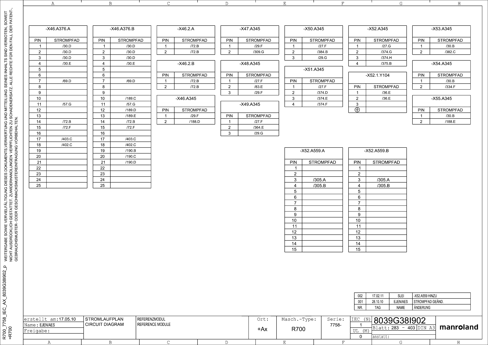

# +Ax — Sheet 283 of 403 — REFERENZMODUL

**REFERENCE MODULE**

> Part of the manroland **R700** printing press IEC/UL circuit diagrams.
> Drawing class: **Stromlaufplan / Circuit diagram** (DIN A3).
> Document `+Ax` covers the **Central control console** machine section.

## At a glance

| Field | Value |
|---|---|
| Document | `+Ax`  (8039G38I902) |
| Sheet | **283** of 403 |
| Section (DE) | REFERENZMODUL |
| Section (EN) | REFERENCE MODULE |
| Section type | REFERENCE_MODULE — Reference module |
| Machine type | `R700` |
| Series | `7758` |
| Created | 17.05.10 |
| Replaces | — |
| Columns used | A, B, C, D, E, F, G, H |
| Path numbers | — |
| Labels on sheet | 240 |
| Cross-refs out | 63 |
| Cross-refs in | 4 |

**Previous:** [+Ax sheet 282](SHEET_0282.md) · **Next:** [+Ax sheet 284](SHEET_0284.md) · **Document TOC:** [_TOC.md](_TOC.md)  (+Ax) · **Master TOC:** [all sheets](../_MASTER_TOC.md)

## Sheet image (300 DPI, exact vector render)



_Rendered directly from the PDF vector layer at 300 DPI (1-bit), no OCR and no resampling. Use it to confirm anything ambiguous in the text below._

## Cross-references on this sheet

Each entry is a wire leaving this sheet. The printed token is `/sheet.column`; the link resolves to that sheet inside the same document.

| Ref | Target sheet | Col | Path | Destination on target | Target section | From col |
|---|---|---|---|---|---|---|
| `/72.B` | [+Ax sheet 72](SHEET_0072.md) | B | — | — | WASCHVORRICHTUNGEN DRUCKWERKE | C |
| `/30.B` | [+Ax sheet 30](SHEET_0030.md) | B | — | — | SPANNUNGSVERSORGUNG, SCHALTSCHRANKBELÜFTUNG | H |
| `/29.F` | [+Ax sheet 29](SHEET_0029.md) | F | — | — | SPANNUNGSVERSORGUNG, SCHALTSCHRANKBELÜFTUNG | E |
| `/27.F` | [+Ax sheet 27](SHEET_0027.md) | F | — | — | SPANNUNGSVERSORGUNG, SCHALTSCHRANKBELÜFTUNG | F |
| `/27.G` | [+Ax sheet 27](SHEET_0027.md) | G | — | — | SPANNUNGSVERSORGUNG, SCHALTSCHRANKBELÜFTUNG | G |
| `/30.D` | [+Ax sheet 30](SHEET_0030.md) | D | — | — | SPANNUNGSVERSORGUNG, SCHALTSCHRANKBELÜFTUNG | A |
| `/30.D` | [+Ax sheet 30](SHEET_0030.md) | D | — | — | SPANNUNGSVERSORGUNG, SCHALTSCHRANKBELÜFTUNG | B |
| `/72.B` | [+Ax sheet 72](SHEET_0072.md) | B | — | — | WASCHVORRICHTUNGEN DRUCKWERKE | C |
| `/384.B` | [+Ax sheet 384](SHEET_0384.md) | B | — | — | OPTION: INLINEFOILER PRINDOR | F |
| `/30.D` | [+Ax sheet 30](SHEET_0030.md) | D | — | — | SPANNUNGSVERSORGUNG, SCHALTSCHRANKBELÜFTUNG | A |
| `/30.D` | [+Ax sheet 30](SHEET_0030.md) | D | — | — | SPANNUNGSVERSORGUNG, SCHALTSCHRANKBELÜFTUNG | B |
| `/309.G` | [+Ax sheet 309](SHEET_0309.md) | G | — | — | OPTION: FARBWERKTEMPERIERUNG | E |
| `/374.G` | [+Ax sheet 374](SHEET_0374.md) | G | — | — | OPTION: VORDERMARKENEINSTELLUNG | G |
| `/382.C` | [+Ax sheet 382](SHEET_0382.md) | C | — | — | OPTION: INLINEFOILER PRINDOR | H |
| `/29.G` | [+Ax sheet 29](SHEET_0029.md) | G | — | — | SPANNUNGSVERSORGUNG, SCHALTSCHRANKBELÜFTUNG | F |
| `/30.D` | [+Ax sheet 30](SHEET_0030.md) | D | — | — | SPANNUNGSVERSORGUNG, SCHALTSCHRANKBELÜFTUNG | A |
| `/30.D` | [+Ax sheet 30](SHEET_0030.md) | D | — | — | SPANNUNGSVERSORGUNG, SCHALTSCHRANKBELÜFTUNG | B |
| `/374.H` | [+Ax sheet 374](SHEET_0374.md) | H | — | — | OPTION: VORDERMARKENEINSTELLUNG | G |
| `/30.E` | [+Ax sheet 30](SHEET_0030.md) | E | — | — | SPANNUNGSVERSORGUNG, SCHALTSCHRANKBELÜFTUNG | A |
| `/30.E` | [+Ax sheet 30](SHEET_0030.md) | E | — | — | SPANNUNGSVERSORGUNG, SCHALTSCHRANKBELÜFTUNG | B |
| `/375.B` | [+Ax sheet 375](SHEET_0375.md) | B | — | — | OPTION: VORDERMARKENEINSTELLUNG | G |
| `/72.B` | [+Ax sheet 72](SHEET_0072.md) | B | — | — | WASCHVORRICHTUNGEN DRUCKWERKE | C |
| `/30.B` | [+Ax sheet 30](SHEET_0030.md) | B | — | — | SPANNUNGSVERSORGUNG, SCHALTSCHRANKBELÜFTUNG | H |
| `/27.F` | [+Ax sheet 27](SHEET_0027.md) | F | — | — | SPANNUNGSVERSORGUNG, SCHALTSCHRANKBELÜFTUNG | E |
| `/69.D` | [+Ax sheet 69](SHEET_0069.md) | D | — | — | SAUGBÄNDERTISCH | A |
| `/69.D` | [+Ax sheet 69](SHEET_0069.md) | D | — | — | SAUGBÄNDERTISCH | B |
| `/72.B` | [+Ax sheet 72](SHEET_0072.md) | B | — | — | WASCHVORRICHTUNGEN DRUCKWERKE | C |
| `/83.E` | [+Ax sheet 83](SHEET_0083.md) | E | — | — | ANLEGER | E |
| `/27.F` | [+Ax sheet 27](SHEET_0027.md) | F | — | — | SPANNUNGSVERSORGUNG, SCHALTSCHRANKBELÜFTUNG | F |
| `/334.F` | [+Ax sheet 334](SHEET_0334.md) | F | — | — | OPTION: INLINESORTER | H |
| `/36.E` | [+Ax sheet 36](SHEET_0036.md) | E | — | — | SCHMIERUNG | G |
| `/29.F` | [+Ax sheet 29](SHEET_0029.md) | F | — | — | SPANNUNGSVERSORGUNG, SCHALTSCHRANKBELÜFTUNG | E |
| `/374.D` | [+Ax sheet 374](SHEET_0374.md) | D | — | — | OPTION: VORDERMARKENEINSTELLUNG | F |
| `/36.E` | [+Ax sheet 36](SHEET_0036.md) | E | — | — | SCHMIERUNG | G |
| `/374.E` | [+Ax sheet 374](SHEET_0374.md) | E | — | — | OPTION: VORDERMARKENEINSTELLUNG | F |
| `/189.C` | [+Ax sheet 189](SHEET_0189.md) | C | — | — | RESERVE | B |
| `/57.G` | [+Ax sheet 57](SHEET_0057.md) | G | — | — | LUFTVERSORGUNG | A |
| `/57.G` | [+Ax sheet 57](SHEET_0057.md) | G | — | — | LUFTVERSORGUNG | B |
| `/374.F` | [+Ax sheet 374](SHEET_0374.md) | F | — | — | OPTION: VORDERMARKENEINSTELLUNG | F |
| `/189.D` | [+Ax sheet 189](SHEET_0189.md) | D | — | — | RESERVE | B |
| `/30.B` | [+Ax sheet 30](SHEET_0030.md) | B | — | — | SPANNUNGSVERSORGUNG, SCHALTSCHRANKBELÜFTUNG | H |
| `/29.F` | [+Ax sheet 29](SHEET_0029.md) | F | — | — | SPANNUNGSVERSORGUNG, SCHALTSCHRANKBELÜFTUNG | C |
| `/189.E` | [+Ax sheet 189](SHEET_0189.md) | E | — | — | RESERVE | B |
| `/72.B` | [+Ax sheet 72](SHEET_0072.md) | B | — | — | WASCHVORRICHTUNGEN DRUCKWERKE | A |
| `/72.B` | [+Ax sheet 72](SHEET_0072.md) | B | — | — | WASCHVORRICHTUNGEN DRUCKWERKE | B |
| `/27.F` | [+Ax sheet 27](SHEET_0027.md) | F | — | — | SPANNUNGSVERSORGUNG, SCHALTSCHRANKBELÜFTUNG | E |
| `/188.E` | [+Ax sheet 188](SHEET_0188.md) | E | — | — | RESERVE | H |
| `/188.D` | [+Ax sheet 188](SHEET_0188.md) | D | — | — | RESERVE | C |
| `/72.F` | [+Ax sheet 72](SHEET_0072.md) | F | — | — | WASCHVORRICHTUNGEN DRUCKWERKE | A |
| `/72.F` | [+Ax sheet 72](SHEET_0072.md) | F | — | — | WASCHVORRICHTUNGEN DRUCKWERKE | B |
| `/364.E` | [+Ax sheet 364](SHEET_0364.md) | E | — | — | OPTION: LOGISTIK AUSLEGER | E |
| `/29.G` | [+Ax sheet 29](SHEET_0029.md) | G | — | — | SPANNUNGSVERSORGUNG, SCHALTSCHRANKBELÜFTUNG | E |
| `/403.C` | [+Ax sheet 403](SHEET_0403.md) | C | — | — | OPTION: INLINE COLORPILOT | A |
| `/403.C` | [+Ax sheet 403](SHEET_0403.md) | C | — | — | OPTION: INLINE COLORPILOT | B |
| `/402.C` | [+Ax sheet 402](SHEET_0402.md) | C | — | — | OPTION: INLINE COLORPILOT | A |
| `/402.C` | [+Ax sheet 402](SHEET_0402.md) | C | — | — | OPTION: INLINE COLORPILOT | B |
| `/190.B` | [+Ax sheet 190](SHEET_0190.md) | B | — | — | RESERVE | B |
| `/190.C` | [+Ax sheet 190](SHEET_0190.md) | C | — | — | RESERVE | B |
| `/190.D` | [+Ax sheet 190](SHEET_0190.md) | D | — | — | RESERVE | B |
| `/305.A` | [+Ax sheet 305](SHEET_0305.md) | A | — | — | SCHÖN & WIDERDRUCK HAUPTSCHALTSCHRANK | F |
| `/305.B` | [+Ax sheet 305](SHEET_0305.md) | B | — | — | SCHÖN & WIDERDRUCK HAUPTSCHALTSCHRANK | F |
| `/305.A` | [+Ax sheet 305](SHEET_0305.md) | A | — | — | SCHÖN & WIDERDRUCK HAUPTSCHALTSCHRANK | G |
| `/305.B` | [+Ax sheet 305](SHEET_0305.md) | B | — | — | SCHÖN & WIDERDRUCK HAUPTSCHALTSCHRANK | G |

### Incoming references (sheets that point here)

Every other sheet that sends a wire to this one. `Back-ref` is the token printed on *that* sheet; `Path` is its line number.

| From sheet | Cols | Back-ref | Path | Refs | What continues there |
|---|---|---|---|---|---|
| [+Ax#305](SHEET_0305.md) | A, B | `/305.A`, `/305.B` | — | 4 | 4 |


## Devices on this sheet

| Tag | Class | Class meaning (IEC) | Col | Sub | Terminal | Sign |
|---|---|---|---|---|---|---|
| `X46.A376.B` | — | cross-device reference | B | — | — | — |
| `X46.A376.A` | — | cross-device reference | A | — | — | — |
| `X46.2.A` | — | cross-device reference | C | — | — | — |
| `X46.2.B` | — | cross-device reference | C | — | — | — |
| `X46.A345` | — | cross-device reference | C | — | — | — |
| `X47.A345` | — | cross-device reference | D | — | — | — |
| `X48.A345` | — | cross-device reference | D | — | — | — |
| `X49.A345` | — | cross-device reference | D | — | — | — |
| `X53.A345` | — | cross-device reference | H | — | — | — |
| `X54.A345` | — | cross-device reference | H | — | — | — |
| `X55.A345` | — | cross-device reference | H | — | — | — |
| `X52.A345` | — | cross-device reference | G | — | — | — |
| `X52.1.Y104` | — | cross-device reference | G | — | — | — |
| `X50.A345` | — | cross-device reference | F | — | — | — |
| `X51.A345` | — | cross-device reference | F | — | — | — |
| `NR.` | — | cross-device reference | F | — | — | — |
| `28.10.10` | — | cross-device reference | G | — | — | — |
| `X52.A559.B` | — | cross-device reference | G | — | — | — |
| `X52.A559.A` | — | cross-device reference | E | — | — | — |
| `17.02.11` | — | cross-device reference | G | — | — | — |

## Potentials / nets

_No named potentials on this sheet._

## Wire-end annotations (grouped as printed)

A wire that continues elsewhere is annotated with a small cluster: the destination description, the path/line number `#NN`, and the `/sheet.column` cross reference. Each row below is one such cluster exactly as it is grouped on the drawing.

| Col | Y | Path | Cross-ref | Text on the wire |
|---|---|---|---|---|
| A | 65.5 | — | — | `X46.A376.A` |
| B | 65.5 | — | — | `X46.A376.B` |
| C | 65.5 | — | — | `X46.2.A` |
| D | 65.5 | — | — | `X47.A345` |
| F | 65.5 | — | — | `X50.A345` |
| G | 65.5 | — | — | `X52.A345` |
| H | 65.5 | — | — | `X53.A345` |
| A | 94.2 | — | — | `PIN STROMPFAD` |
| B | 94.2 | — | — | `PIN STROMPFAD` |
| C | 94.2 | — | — | `PIN 2 1 STROMPFAD` |
| D | 94.2 | — | — | `PIN 2 1 STROMPFAD` |
| E | 94.2 | — | — | `PIN 2 3 1 STROMPFAD` |
| G | 94.2 | — | — | `PIN 2 3 4 1 STROMPFAD` |
| H | 94.2 | — | — | `PIN 2 1 STROMPFAD` |
| A | 108.4 | — | — | `2 3 4 5 6 7 8 9 1` |
| B | 108.4 | — | — | `2 3 4 5 6 7 8 9 1` |
| A | 108.7 | — | `/30.D` | — |
| B | 108.7 | — | `/30.D` | — |
| C | 108.7 | — | `/72.B` | — |
| E | 108.7 | — | `/29.F` | — |
| F | 108.7 | — | `/27.F` | — |
| G | 108.7 | — | `/27.G` | — |
| H | 108.7 | — | `/30.B` | — |
| C | 122.8 | — | `/72.B` | — |
| A | 122.9 | — | `/30.D` | — |
| B | 122.9 | — | `/30.D` | — |
| E | 122.9 | — | `/309.G` | — |
| F | 122.9 | — | `/384.B` | — |
| G | 122.9 | — | `/374.G` | — |
| H | 122.9 | — | `/382.C` | — |
| F | 137.0 | — | `/29.G` | — |
| A | 137.1 | — | `/30.D` | — |
| B | 137.1 | — | `/30.D` | — |
| G | 137.1 | — | `/374.H` | — |
| D | 150.5 | — | — | `X48.A345` |
| H | 150.5 | — | — | `X54.A345` |
| C | 150.6 | — | — | `X46.2.B` |
| A | 151.2 | — | `/30.E` | — |
| B | 151.2 | — | `/30.E` | — |
| G | 151.2 | — | `/375.B` | — |
| F | 164.7 | — | — | `X51.A345` |
| G | 178.9 | — | — | `X52.1.Y104` |
| C | 179.2 | — | — | `PIN 2 1 STROMPFAD` |
| D | 179.2 | — | — | `PIN 2 3 1 STROMPFAD` |
| H | 179.2 | — | — | `PIN 2 1 STROMPFAD` |
| E | 193.4 | — | — | `PIN 2 3 4 1 STROMPFAD` |
| C | 193.7 | — | `/72.B` | — |
| E | 193.7 | — | `/27.F` | — |
| H | 193.7 | — | `/30.B` | — |
| A | 193.8 | — | `/69.D` | — |
| B | 193.8 | — | `/69.D` | — |
| G | 207.5 | — | — | `PIN 2 3 1 STROMPFAD` |
| C | 207.9 | — | `/72.B` | — |
| E | 207.9 | — | `/83.E` | — |
| F | 207.9 | — | `/27.F` | — |
| H | 207.9 | — | `/334.F` | — |
| E | 222.1 | — | `/29.F` | — |
| F | 222.1 | — | `/374.D` | — |
| G | 222.1 | — | `/36.E` | — |
| C | 235.6 | — | — | `X46.A345` |
| H | 235.6 | — | — | `X55.A345` |
| A | 235.9 | — | — | `10 12 13 14 15 16 17 18 19 20 11` |
| B | 235.9 | — | — | `10 12 13 14 15 16 17 18 19 20 11` |
| F | 236.2 | — | `/374.E` | — |
| G | 236.2 | — | `/36.E` | — |
| B | 236.3 | — | `/189.C` | — |
| D | 249.8 | — | — | `X49.A345` |
| A | 250.4 | — | `/57.G` | — |
| B | 250.4 | — | `/57.G` | — |
| F | 250.4 | — | `/374.F` | — |
| C | 264.2 | — | — | `PIN 2 1 STROMPFAD` |
| H | 264.2 | — | — | `PIN 2 1 STROMPFAD` |
| B | 264.6 | — | `/189.D` | — |
| D | 278.4 | — | — | `PIN 2 3 1 STROMPFAD` |
| B | 278.8 | — | `/189.E` | — |
| C | 278.8 | — | `/29.F` | — |
| H | 278.8 | — | `/30.B` | — |
| A | 292.9 | — | `/72.B` | — |
| B | 292.9 | — | `/72.B` | — |
| E | 292.9 | — | `/27.F` | — |
| H | 292.9 | — | `/188.E` | — |
| C | 293.0 | — | `/188.D` | — |
| A | 307.1 | — | `/72.F` | — |
| B | 307.1 | — | `/72.F` | — |
| E | 307.1 | — | `/364.E` | — |
| E | 321.3 | — | `/29.G` | — |
| A | 335.5 | — | `/403.C` | — |
| B | 335.5 | — | `/403.C` | — |
| A | 349.7 | — | `/402.C` | — |
| B | 349.7 | — | `/402.C` | — |
| E | 363.1 | — | — | `X52.A559.A` |
| G | 363.1 | — | — | `X52.A559.B` |
| B | 363.8 | — | `/190.B` | — |
| B | 378.0 | — | `/190.C` | — |
| E | 391.5 | — | — | `PIN 10 12 13 14 15 11 2 3 4 5 6 7 8 9 1 STROMPFAD` |
| G | 391.5 | — | — | `PIN 10 12 13 14 15 11 2 3 4 5 6 7 8 9 1 STROMPFAD` |
| A | 391.8 | — | — | `22 23 24 25 21` |
| B | 391.8 | — | — | `22 23 24 25 21` |
| B | 392.2 | — | `/190.D` | — |
| F | 434.0 | — | `/305.A`, `/305.B` | — |
| G | 434.0 | — | `/305.A`, `/305.B` | — |
| G | 718.9 | — | — | `002 17.02.11 SLEI X52.A559 HINZU` |
| G | 733.0 | — | — | `001 28.10.10 EJEN/AES STROMPFAD GEÄND.` |
| G | 747.1 | — | — | `NR. TAG NAME ÄNDERUNG` |


## Reconstructed tables

This sheet carries tabular content (pin map / terminal assignment / index). The grid below was rebuilt from the drawing's own rule lines, so each row is exactly one physical row of the table.

### Table 1 — 25 data rows × 2 columns (at x=70.9, y=62.4) — **X46.A376.A**

| PIN | STROMPFAD |
|---|---|
| `1` | `/30.D` |
| `2` | `/30.D` |
| `3` | `/30.D` |
| `4` | `/30.E` |
| `5` |  |
| `6` |  |
| `7` | `/69.D` |
| `8` |  |
| `9` |  |
| `10` |  |
| `11` | `/57.G` |
| `12` |  |
| `13` |  |
| `14` | `/72.B` |
| `15` | `/72.F` |
| `16` |  |
| `17` | `/403.C` |
| `18` | `/402.C` |
| `19` |  |
| `20` |  |
| `21` |  |
| `22` |  |
| `23` |  |
| `24` |  |
| `25` |  |


### Table 2 — 25 data rows × 2 columns (at x=226.8, y=62.4) — **X46.A376.B**

| PIN | STROMPFAD |
|---|---|
| `1` | `/30.D` |
| `2` | `/30.D` |
| `3` | `/30.D` |
| `4` | `/30.E` |
| `5` |  |
| `6` |  |
| `7` | `/69.D` |
| `8` |  |
| `9` |  |
| `10` | `/189.C` |
| `11` | `/57.G` |
| `12` | `/189.D` |
| `13` | `/189.E` |
| `14` | `/72.B` |
| `15` | `/72.F` |
| `16` |  |
| `17` | `/403.C` |
| `18` | `/402.C` |
| `19` | `/190.B` |
| `20` | `/190.C` |
| `21` | `/190.D` |
| `22` |  |
| `23` |  |
| `24` |  |
| `25` |  |


### Table 3 — 10 data rows × 2 columns (at x=382.7, y=62.4) — **X46.2.A**

| PIN | STROMPFAD |
|---|---|
| `1` | `/72.B` |
| `2` | `/72.B` |
|  | `X46.2.B` |
| `PIN` | `STROMPFAD` |
| `1` | `/72.B` |
| `2` | `/72.B` |
|  | `X46.A345` |
| `PIN` | `STROMPFAD` |
| `1` | `/29.F` |
| `2` | `/188.D` |


### Table 4 — 12 data rows × 2 columns (at x=538.6, y=62.4) — **X47.A345**

| PIN | STROMPFAD |
|---|---|
| `1` | `/29.F` |
| `2` | `/309.G` |
|  | `X48.A345` |
| `PIN` | `STROMPFAD` |
| `1` | `/27.F` |
| `2` | `/83.E` |
| `3` | `/29.F` |
|  | `X49.A345` |
| `PIN` | `STROMPFAD` |
| `1` | `/27.F` |
| `2` | `/364.E` |
| `3` | `/29.G` |


### Table 5 — 26 data rows × 2 columns (at x=694.5, y=62.4) — **X50.A345**

| PIN | STROMPFAD |
|---|---|
| `1` | `/27.F` |
| `2` | `/384.B` |
| `3` | `/29.G` |
|  | `X51.A345` |
| `PIN` | `STROMPFAD` |
| `1` | `/27.F` |
| `2` | `/374.D` |
| `3` | `/374.E` |
| `4` | `/374.F` |
|  | `X52.A559.A` |
| `PIN` | `STROMPFAD` |
| `1` |  |
| `2` |  |
| `3` | `/305.A` |
| `4` | `/305.B` |
| `5` |  |
| `6` |  |
| `7` |  |
| `8` |  |
| `9` |  |
| `10` |  |
| `11` |  |
| `12` |  |
| `13` |  |
| `14` |  |
| `15` |  |


### Table 6 — 26 data rows × 2 columns (at x=850.4, y=62.4) — **X52.A345**

| PIN | STROMPFAD |
|---|---|
| `1` | `/27.G` |
| `2` | `/374.G` |
| `3` | `/374.H` |
| `4` | `/375.B` |
|  | `X52.1.Y104` |
| `PIN` | `STROMPFAD` |
| `1` | `/36.E` |
| `2` | `/36.E` |
| `3` |  |
|  | `X52.A559.B` |
| `PIN` | `STROMPFAD` |
| `1` |  |
| `2` |  |
| `3` | `/305.A` |
| `4` | `/305.B` |
| `5` |  |
| `6` |  |
| `7` |  |
| `8` |  |
| `9` |  |
| `10` |  |
| `11` |  |
| `12` |  |
| `13` |  |
| `14` |  |
| `15` |  |


### Table 7 — 10 data rows × 2 columns (at x=1006.3, y=62.4) — **X53.A345**

| PIN | STROMPFAD |
|---|---|
| `1` | `/30.B` |
| `2` | `/382.C` |
|  | `X54.A345` |
| `PIN` | `STROMPFAD` |
| `1` | `/30.B` |
| `2` | `/334.F` |
|  | `X55.A345` |
| `PIN` | `STROMPFAD` |
| `1` | `/30.B` |
| `2` | `/188.E` |


## Notes and free text on this sheet

| Text | Col | Y (pt) |
|---|---|---|
| `PIN` | B | 94.2 |
| `STROMPFAD` | B | 94.15 |
| `PIN` | A | 94.2 |
| `STROMPFAD` | A | 94.15 |
| `PIN` | C | 94.2 |
| `STROMPFAD` | C | 94.15 |
| `PIN` | D | 94.2 |
| `STROMPFAD` | E | 94.15 |
| `PIN` | G | 94.2 |
| `STROMPFAD` | H | 94.15 |
| `PIN` | F | 94.2 |
| `STROMPFAD` | G | 94.15 |
| `PIN` | E | 94.2 |
| `STROMPFAD` | F | 94.15 |
| `TAG` | G | 747.27 |
| `NAME` | G | 747.25 |
| `ÄNDERUNG` | G | 747.31 |
| `EJEN/AES` | G | 733.09 |
| `STROMPFAD GEÄND.` | G | 733.12 |
| `SLEI` | G | 718.93 |
| `X52.A559 HINZU` | G | 718.96 |

## Complete label inventory (exact text from the drawing)

Every text object inside the drawing area of this sheet, in DIN reading order (column A→H, then top→bottom). This is the authoritative list: if a string is not here it is not printed on this sheet.

| Col | Y | X | Dir | Type | Text |
|---|---|---|---|---|---|
| A | 65.5 | 111.4 | → | device ref | `X46.A376.A` |
| A | 94.2 | 84.0 | → | text | `PIN` |
| A | 94.2 | 132.2 | → | text | `STROMPFAD` |
| A | 108.4 | 95.8 | → | number | `1` |
| A | 108.7 | 152.6 | → | cross-reference | `/30.D` |
| A | 122.5 | 94.1 | → | number | `2` |
| A | 122.9 | 152.6 | → | cross-reference | `/30.D` |
| A | 136.7 | 94.1 | → | number | `3` |
| A | 137.1 | 152.6 | → | cross-reference | `/30.D` |
| A | 150.9 | 94.1 | → | number | `4` |
| A | 151.2 | 152.9 | → | cross-reference | `/30.E` |
| A | 165.1 | 94.1 | → | number | `5` |
| A | 179.2 | 94.1 | → | number | `6` |
| A | 193.4 | 94.1 | → | number | `7` |
| A | 193.7 | 152.6 | → | cross-reference | `/69.D` |
| A | 207.6 | 94.1 | → | number | `8` |
| A | 221.8 | 94.1 | → | number | `9` |
| A | 235.9 | 88.7 | → | number | `10` |
| A | 250.1 | 90.4 | → | number | `11` |
| A | 250.4 | 152.5 | → | cross-reference | `/57.G` |
| A | 264.3 | 88.7 | → | number | `12` |
| A | 278.5 | 88.7 | → | number | `13` |
| A | 292.6 | 88.7 | → | number | `14` |
| A | 292.9 | 152.8 | → | cross-reference | `/72.B` |
| A | 306.8 | 88.7 | → | number | `15` |
| A | 307.1 | 153.1 | → | cross-reference | `/72.F` |
| A | 321.0 | 88.7 | → | number | `16` |
| A | 335.1 | 88.7 | → | number | `17` |
| A | 335.5 | 150.2 | → | cross-reference | `/403.C` |
| A | 349.3 | 88.7 | → | number | `18` |
| A | 349.7 | 150.2 | → | cross-reference | `/402.C` |
| A | 363.5 | 88.7 | → | number | `19` |
| A | 377.7 | 88.7 | → | number | `20` |
| A | 391.8 | 90.4 | → | number | `21` |
| A | 406.0 | 88.7 | → | number | `22` |
| A | 420.2 | 88.7 | → | number | `23` |
| A | 434.4 | 88.7 | → | number | `24` |
| A | 448.5 | 88.7 | → | number | `25` |
| B | 65.5 | 267.7 | → | device ref | `X46.A376.B` |
| B | 94.2 | 240.0 | → | text | `PIN` |
| B | 94.2 | 288.1 | → | text | `STROMPFAD` |
| B | 108.4 | 251.7 | → | number | `1` |
| B | 108.7 | 308.6 | → | cross-reference | `/30.D` |
| B | 122.5 | 250.0 | → | number | `2` |
| B | 122.9 | 308.6 | → | cross-reference | `/30.D` |
| B | 136.7 | 250.0 | → | number | `3` |
| B | 137.1 | 308.6 | → | cross-reference | `/30.D` |
| B | 150.9 | 250.0 | → | number | `4` |
| B | 151.2 | 308.8 | → | cross-reference | `/30.E` |
| B | 165.1 | 250.0 | → | number | `5` |
| B | 179.2 | 250.0 | → | number | `6` |
| B | 193.4 | 250.0 | → | number | `7` |
| B | 193.7 | 308.6 | → | cross-reference | `/69.D` |
| B | 207.6 | 250.0 | → | number | `8` |
| B | 221.8 | 250.0 | → | number | `9` |
| B | 235.9 | 244.6 | → | number | `10` |
| B | 236.3 | 306.1 | → | cross-reference | `/189.C` |
| B | 250.1 | 246.3 | → | number | `11` |
| B | 250.4 | 308.4 | → | cross-reference | `/57.G` |
| B | 264.3 | 244.6 | → | number | `12` |
| B | 264.6 | 306.1 | → | cross-reference | `/189.D` |
| B | 278.5 | 244.6 | → | number | `13` |
| B | 278.8 | 306.4 | → | cross-reference | `/189.E` |
| B | 292.6 | 244.6 | → | number | `14` |
| B | 292.9 | 308.7 | → | cross-reference | `/72.B` |
| B | 306.8 | 244.6 | → | number | `15` |
| B | 307.1 | 309.0 | → | cross-reference | `/72.F` |
| B | 321.0 | 244.6 | → | number | `16` |
| B | 335.1 | 244.6 | → | number | `17` |
| B | 335.5 | 306.1 | → | cross-reference | `/403.C` |
| B | 349.3 | 244.6 | → | number | `18` |
| B | 349.7 | 306.1 | → | cross-reference | `/402.C` |
| B | 363.5 | 244.6 | → | number | `19` |
| B | 363.8 | 306.3 | → | cross-reference | `/190.B` |
| B | 377.7 | 244.6 | → | number | `20` |
| B | 378.0 | 306.1 | → | cross-reference | `/190.C` |
| B | 391.8 | 246.3 | → | number | `21` |
| B | 392.2 | 306.1 | → | cross-reference | `/190.D` |
| B | 406.0 | 244.6 | → | number | `22` |
| B | 420.2 | 244.6 | → | number | `23` |
| B | 434.4 | 244.6 | → | number | `24` |
| B | 448.5 | 244.6 | → | number | `25` |
| C | 65.5 | 432.7 | → | device ref | `X46.2.A` |
| C | 94.2 | 395.9 | → | text | `PIN` |
| C | 94.2 | 444.0 | → | text | `STROMPFAD` |
| C | 108.4 | 401.8 | → | number | `1` |
| C | 108.7 | 464.6 | → | cross-reference | `/72.B` |
| C | 122.5 | 401.2 | → | number | `2` |
| C | 122.8 | 464.6 | → | cross-reference | `/72.B` |
| C | 150.6 | 433.1 | → | device ref | `X46.2.B` |
| C | 179.2 | 395.9 | → | text | `PIN` |
| C | 179.2 | 444.0 | → | text | `STROMPFAD` |
| C | 193.4 | 401.8 | → | number | `1` |
| C | 193.7 | 464.6 | → | cross-reference | `/72.B` |
| C | 207.6 | 401.2 | → | number | `2` |
| C | 207.9 | 464.6 | → | cross-reference | `/72.B` |
| C | 235.6 | 428.6 | → | device ref | `X46.A345` |
| C | 264.2 | 444.0 | → | text | `STROMPFAD` |
| C | 264.3 | 395.9 | → | text | `PIN` |
| C | 278.5 | 401.8 | → | number | `1` |
| C | 278.8 | 464.9 | → | cross-reference | `/29.F` |
| C | 292.6 | 401.2 | → | number | `2` |
| C | 293.0 | 462.0 | → | cross-reference | `/188.D` |
| D | 65.5 | 584.5 | → | device ref | `X47.A345` |
| D | 94.2 | 551.8 | → | text | `PIN` |
| D | 108.4 | 557.7 | → | number | `1` |
| D | 122.5 | 557.1 | → | number | `2` |
| D | 150.5 | 584.5 | → | device ref | `X48.A345` |
| D | 179.2 | 551.8 | → | text | `PIN` |
| D | 193.4 | 557.7 | → | number | `1` |
| D | 207.6 | 557.1 | → | number | `2` |
| D | 221.8 | 557.1 | → | number | `3` |
| D | 249.8 | 584.5 | → | device ref | `X49.A345` |
| D | 278.4 | 551.8 | → | text | `PIN` |
| D | 292.6 | 557.7 | → | number | `1` |
| D | 306.8 | 557.1 | → | number | `2` |
| D | 321.0 | 557.1 | → | number | `3` |
| E | 94.2 | 600.0 | → | text | `STROMPFAD` |
| E | 94.2 | 707.7 | → | text | `PIN` |
| E | 108.4 | 713.6 | → | number | `1` |
| E | 108.7 | 620.8 | → | cross-reference | `/29.F` |
| E | 122.5 | 713.1 | → | number | `2` |
| E | 122.9 | 617.8 | → | cross-reference | `/309.G` |
| E | 136.7 | 713.1 | → | number | `3` |
| E | 179.2 | 600.0 | → | text | `STROMPFAD` |
| E | 193.4 | 707.7 | → | text | `PIN` |
| E | 193.7 | 620.8 | → | cross-reference | `/27.F` |
| E | 207.6 | 713.6 | → | number | `1` |
| E | 207.9 | 620.6 | → | cross-reference | `/83.E` |
| E | 221.8 | 713.1 | → | number | `2` |
| E | 222.1 | 620.8 | → | cross-reference | `/29.F` |
| E | 235.9 | 713.1 | → | number | `3` |
| E | 250.1 | 713.1 | → | number | `4` |
| E | 278.4 | 600.0 | → | text | `STROMPFAD` |
| E | 292.9 | 620.8 | → | cross-reference | `/27.F` |
| E | 307.1 | 618.2 | → | cross-reference | `/364.E` |
| E | 321.3 | 620.2 | → | cross-reference | `/29.G` |
| E | 363.1 | 732.2 | → | device ref | `X52.A559.A` |
| E | 391.6 | 707.1 | → | text | `PIN` |
| E | 405.6 | 718.9 | → | number | `1` |
| E | 419.8 | 717.4 | → | number | `2` |
| E | 434.0 | 717.4 | → | number | `3` |
| E | 448.1 | 717.4 | → | number | `4` |
| E | 462.3 | 717.4 | → | number | `5` |
| E | 476.5 | 717.4 | → | number | `6` |
| E | 490.7 | 717.4 | → | number | `7` |
| E | 504.8 | 717.4 | → | number | `8` |
| E | 519.0 | 717.4 | → | number | `9` |
| E | 533.2 | 711.5 | → | number | `10` |
| E | 547.4 | 712.9 | → | number | `11` |
| E | 561.5 | 711.5 | → | number | `12` |
| E | 575.7 | 711.5 | → | number | `13` |
| E | 589.9 | 711.5 | → | number | `14` |
| E | 604.1 | 711.5 | → | number | `15` |
| F | 65.5 | 740.4 | → | device ref | `X50.A345` |
| F | 94.2 | 755.9 | → | text | `STROMPFAD` |
| F | 94.2 | 863.6 | → | text | `PIN` |
| F | 108.4 | 869.5 | → | number | `1` |
| F | 108.7 | 776.7 | → | cross-reference | `/27.F` |
| F | 122.5 | 869.0 | → | number | `2` |
| F | 122.9 | 774.0 | → | cross-reference | `/384.B` |
| F | 136.7 | 869.0 | → | number | `3` |
| F | 137.0 | 776.1 | → | cross-reference | `/29.G` |
| F | 150.9 | 869.0 | → | number | `4` |
| F | 164.7 | 740.4 | → | device ref | `X51.A345` |
| F | 193.4 | 755.9 | → | text | `STROMPFAD` |
| F | 207.6 | 863.6 | → | text | `PIN` |
| F | 207.9 | 776.7 | → | cross-reference | `/27.F` |
| F | 221.8 | 869.5 | → | number | `1` |
| F | 222.1 | 773.9 | → | cross-reference | `/374.D` |
| F | 235.9 | 869.0 | → | number | `2` |
| F | 236.2 | 774.1 | → | cross-reference | `/374.E` |
| F | 250.1 | 869.0 | → | number | `3` |
| F | 250.4 | 774.3 | → | cross-reference | `/374.F` |
| F | 391.5 | 753.3 | → | text | `STROMPFAD` |
| F | 391.6 | 863.0 | → | text | `PIN` |
| F | 405.6 | 874.8 | → | number | `1` |
| F | 419.8 | 873.4 | → | number | `2` |
| F | 434.0 | 764.1 | → | cross-reference | `/305.A` |
| F | 434.0 | 873.4 | → | number | `3` |
| F | 448.1 | 873.4 | → | number | `4` |
| F | 448.2 | 764.5 | → | cross-reference | `/305.B` |
| F | 462.3 | 873.4 | → | number | `5` |
| F | 476.5 | 873.4 | → | number | `6` |
| F | 490.7 | 873.4 | → | number | `7` |
| F | 504.8 | 873.4 | → | number | `8` |
| F | 519.0 | 873.4 | → | number | `9` |
| F | 533.2 | 867.4 | → | number | `10` |
| F | 547.4 | 868.8 | → | number | `11` |
| F | 561.5 | 867.4 | → | number | `12` |
| F | 575.7 | 867.4 | → | number | `13` |
| F | 589.9 | 867.4 | → | number | `14` |
| F | 604.1 | 867.4 | → | number | `15` |
| F | 719.0 | 872.9 | → | number | `002` |
| F | 733.0 | 873.5 | → | number | `001` |
| F | 747.1 | 872.6 | → | device ref | `NR.` |
| G | 65.5 | 896.3 | → | device ref | `X52.A345` |
| G | 94.2 | 911.8 | → | text | `STROMPFAD` |
| G | 94.2 | 1019.5 | → | text | `PIN` |
| G | 108.4 | 1025.4 | → | number | `1` |
| G | 108.7 | 932.0 | → | cross-reference | `/27.G` |
| G | 122.5 | 1024.9 | → | number | `2` |
| G | 122.9 | 929.6 | → | cross-reference | `/374.G` |
| G | 137.1 | 930.0 | → | cross-reference | `/374.H` |
| G | 151.2 | 929.9 | → | cross-reference | `/375.B` |
| G | 178.9 | 892.2 | → | device ref | `X52.1.Y104` |
| G | 179.2 | 1019.5 | → | text | `PIN` |
| G | 193.4 | 1025.4 | → | number | `1` |
| G | 207.5 | 911.8 | → | text | `STROMPFAD` |
| G | 207.6 | 1024.9 | → | number | `2` |
| G | 222.1 | 932.5 | → | cross-reference | `/36.E` |
| G | 236.2 | 932.5 | → | cross-reference | `/36.E` |
| G | 264.3 | 1019.5 | → | text | `PIN` |
| G | 278.5 | 1025.4 | → | number | `1` |
| G | 292.6 | 1024.9 | → | number | `2` |
| G | 363.1 | 888.5 | → | device ref | `X52.A559.B` |
| G | 391.5 | 909.2 | → | text | `STROMPFAD` |
| G | 434.0 | 920.0 | → | cross-reference | `/305.A` |
| G | 448.2 | 920.4 | → | cross-reference | `/305.B` |
| G | 718.9 | 907.9 | → | device ref | `17.02.11` |
| G | 718.9 | 970.4 | → | text | `SLEI` |
| G | 719.0 | 1009.6 | → | text | `X52.A559 HINZU` |
| G | 733.1 | 907.7 | → | device ref | `28.10.10` |
| G | 733.1 | 960.7 | → | text | `EJEN/AES` |
| G | 733.1 | 1009.3 | → | text | `STROMPFAD GEÄND.` |
| G | 747.3 | 914.1 | → | text | `TAG` |
| G | 747.3 | 967.5 | → | text | `NAME` |
| G | 747.3 | 1010.1 | → | text | `ÄNDERUNG` |
| H | 65.5 | 1052.2 | → | device ref | `X53.A345` |
| H | 94.2 | 1067.7 | → | text | `STROMPFAD` |
| H | 108.7 | 1088.2 | → | cross-reference | `/30.B` |
| H | 122.9 | 1085.7 | → | cross-reference | `/382.C` |
| H | 150.5 | 1052.2 | → | device ref | `X54.A345` |
| H | 179.2 | 1067.7 | → | text | `STROMPFAD` |
| H | 193.7 | 1088.2 | → | cross-reference | `/30.B` |
| H | 207.9 | 1086.1 | → | cross-reference | `/334.F` |
| H | 235.6 | 1052.2 | → | device ref | `X55.A345` |
| H | 264.2 | 1067.7 | → | text | `STROMPFAD` |
| H | 278.8 | 1088.2 | → | cross-reference | `/30.B` |
| H | 292.9 | 1086.0 | → | cross-reference | `/188.E` |

## Reading-order text block

The same content as a plain block, grouped by DIN column — convenient to paste or to match against a visual description.

```text
=== Column A ===
  65.5  111.4  devref       X46.A376.A
  94.2   84.0  text         PIN
  94.2  132.2  text         STROMPFAD
 108.4   95.8  numeric      1
 108.7  152.6  xref         /30.D
 122.5   94.1  numeric      2
 122.9  152.6  xref         /30.D
 136.7   94.1  numeric      3
 137.1  152.6  xref         /30.D
 150.9   94.1  numeric      4
 151.2  152.9  xref         /30.E
 165.1   94.1  numeric      5
 179.2   94.1  numeric      6
 193.4   94.1  numeric      7
 193.7  152.6  xref         /69.D
 207.6   94.1  numeric      8
 221.8   94.1  numeric      9
 235.9   88.7  numeric      10
 250.1   90.4  numeric      11
 250.4  152.5  xref         /57.G
 264.3   88.7  numeric      12
 278.5   88.7  numeric      13
 292.6   88.7  numeric      14
 292.9  152.8  xref         /72.B
 306.8   88.7  numeric      15
 307.1  153.1  xref         /72.F
 321.0   88.7  numeric      16
 335.1   88.7  numeric      17
 335.5  150.2  xref         /403.C
 349.3   88.7  numeric      18
 349.7  150.2  xref         /402.C
 363.5   88.7  numeric      19
 377.7   88.7  numeric      20
 391.8   90.4  numeric      21
 406.0   88.7  numeric      22
 420.2   88.7  numeric      23
 434.4   88.7  numeric      24
 448.5   88.7  numeric      25
=== Column B ===
  65.5  267.7  devref       X46.A376.B
  94.2  240.0  text         PIN
  94.2  288.1  text         STROMPFAD
 108.4  251.7  numeric      1
 108.7  308.6  xref         /30.D
 122.5  250.0  numeric      2
 122.9  308.6  xref         /30.D
 136.7  250.0  numeric      3
 137.1  308.6  xref         /30.D
 150.9  250.0  numeric      4
 151.2  308.8  xref         /30.E
 165.1  250.0  numeric      5
 179.2  250.0  numeric      6
 193.4  250.0  numeric      7
 193.7  308.6  xref         /69.D
 207.6  250.0  numeric      8
 221.8  250.0  numeric      9
 235.9  244.6  numeric      10
 236.3  306.1  xref         /189.C
 250.1  246.3  numeric      11
 250.4  308.4  xref         /57.G
 264.3  244.6  numeric      12
 264.6  306.1  xref         /189.D
 278.5  244.6  numeric      13
 278.8  306.4  xref         /189.E
 292.6  244.6  numeric      14
 292.9  308.7  xref         /72.B
 306.8  244.6  numeric      15
 307.1  309.0  xref         /72.F
 321.0  244.6  numeric      16
 335.1  244.6  numeric      17
 335.5  306.1  xref         /403.C
 349.3  244.6  numeric      18
 349.7  306.1  xref         /402.C
 363.5  244.6  numeric      19
 363.8  306.3  xref         /190.B
 377.7  244.6  numeric      20
 378.0  306.1  xref         /190.C
 391.8  246.3  numeric      21
 392.2  306.1  xref         /190.D
 406.0  244.6  numeric      22
 420.2  244.6  numeric      23
 434.4  244.6  numeric      24
 448.5  244.6  numeric      25
=== Column C ===
  65.5  432.7  devref       X46.2.A
  94.2  395.9  text         PIN
  94.2  444.0  text         STROMPFAD
 108.4  401.8  numeric      1
 108.7  464.6  xref         /72.B
 122.5  401.2  numeric      2
 122.8  464.6  xref         /72.B
 150.6  433.1  devref       X46.2.B
 179.2  395.9  text         PIN
 179.2  444.0  text         STROMPFAD
 193.4  401.8  numeric      1
 193.7  464.6  xref         /72.B
 207.6  401.2  numeric      2
 207.9  464.6  xref         /72.B
 235.6  428.6  devref       X46.A345
 264.2  444.0  text         STROMPFAD
 264.3  395.9  text         PIN
 278.5  401.8  numeric      1
 278.8  464.9  xref         /29.F
 292.6  401.2  numeric      2
 293.0  462.0  xref         /188.D
=== Column D ===
  65.5  584.5  devref       X47.A345
  94.2  551.8  text         PIN
 108.4  557.7  numeric      1
 122.5  557.1  numeric      2
 150.5  584.5  devref       X48.A345
 179.2  551.8  text         PIN
 193.4  557.7  numeric      1
 207.6  557.1  numeric      2
 221.8  557.1  numeric      3
 249.8  584.5  devref       X49.A345
 278.4  551.8  text         PIN
 292.6  557.7  numeric      1
 306.8  557.1  numeric      2
 321.0  557.1  numeric      3
=== Column E ===
  94.2  600.0  text         STROMPFAD
  94.2  707.7  text         PIN
 108.4  713.6  numeric      1
 108.7  620.8  xref         /29.F
 122.5  713.1  numeric      2
 122.9  617.8  xref         /309.G
 136.7  713.1  numeric      3
 179.2  600.0  text         STROMPFAD
 193.4  707.7  text         PIN
 193.7  620.8  xref         /27.F
 207.6  713.6  numeric      1
 207.9  620.6  xref         /83.E
 221.8  713.1  numeric      2
 222.1  620.8  xref         /29.F
 235.9  713.1  numeric      3
 250.1  713.1  numeric      4
 278.4  600.0  text         STROMPFAD
 292.9  620.8  xref         /27.F
 307.1  618.2  xref         /364.E
 321.3  620.2  xref         /29.G
 363.1  732.2  devref       X52.A559.A
 391.6  707.1  text         PIN
 405.6  718.9  numeric      1
 419.8  717.4  numeric      2
 434.0  717.4  numeric      3
 448.1  717.4  numeric      4
 462.3  717.4  numeric      5
 476.5  717.4  numeric      6
 490.7  717.4  numeric      7
 504.8  717.4  numeric      8
 519.0  717.4  numeric      9
 533.2  711.5  numeric      10
 547.4  712.9  numeric      11
 561.5  711.5  numeric      12
 575.7  711.5  numeric      13
 589.9  711.5  numeric      14
 604.1  711.5  numeric      15
=== Column F ===
  65.5  740.4  devref       X50.A345
  94.2  755.9  text         STROMPFAD
  94.2  863.6  text         PIN
 108.4  869.5  numeric      1
 108.7  776.7  xref         /27.F
 122.5  869.0  numeric      2
 122.9  774.0  xref         /384.B
 136.7  869.0  numeric      3
 137.0  776.1  xref         /29.G
 150.9  869.0  numeric      4
 164.7  740.4  devref       X51.A345
 193.4  755.9  text         STROMPFAD
 207.6  863.6  text         PIN
 207.9  776.7  xref         /27.F
 221.8  869.5  numeric      1
 222.1  773.9  xref         /374.D
 235.9  869.0  numeric      2
 236.2  774.1  xref         /374.E
 250.1  869.0  numeric      3
 250.4  774.3  xref         /374.F
 391.5  753.3  text         STROMPFAD
 391.6  863.0  text         PIN
 405.6  874.8  numeric      1
 419.8  873.4  numeric      2
 434.0  764.1  xref         /305.A
 434.0  873.4  numeric      3
 448.1  873.4  numeric      4
 448.2  764.5  xref         /305.B
 462.3  873.4  numeric      5
 476.5  873.4  numeric      6
 490.7  873.4  numeric      7
 504.8  873.4  numeric      8
 519.0  873.4  numeric      9
 533.2  867.4  numeric      10
 547.4  868.8  numeric      11
 561.5  867.4  numeric      12
 575.7  867.4  numeric      13
 589.9  867.4  numeric      14
 604.1  867.4  numeric      15
 719.0  872.9  numeric      002
 733.0  873.5  numeric      001
 747.1  872.6  devref       NR.
=== Column G ===
  65.5  896.3  devref       X52.A345
  94.2  911.8  text         STROMPFAD
  94.2 1019.5  text         PIN
 108.4 1025.4  numeric      1
 108.7  932.0  xref         /27.G
 122.5 1024.9  numeric      2
 122.9  929.6  xref         /374.G
 137.1  930.0  xref         /374.H
 151.2  929.9  xref         /375.B
 178.9  892.2  devref       X52.1.Y104
 179.2 1019.5  text         PIN
 193.4 1025.4  numeric      1
 207.5  911.8  text         STROMPFAD
 207.6 1024.9  numeric      2
 222.1  932.5  xref         /36.E
 236.2  932.5  xref         /36.E
 264.3 1019.5  text         PIN
 278.5 1025.4  numeric      1
 292.6 1024.9  numeric      2
 363.1  888.5  devref       X52.A559.B
 391.5  909.2  text         STROMPFAD
 434.0  920.0  xref         /305.A
 448.2  920.4  xref         /305.B
 718.9  907.9  devref       17.02.11
 718.9  970.4  text         SLEI
 719.0 1009.6  text         X52.A559 HINZU
 733.1  907.7  devref       28.10.10
 733.1  960.7  text         EJEN/AES
 733.1 1009.3  text         STROMPFAD GEÄND.
 747.3  914.1  text         TAG
 747.3  967.5  text         NAME
 747.3 1010.1  text         ÄNDERUNG
=== Column H ===
  65.5 1052.2  devref       X53.A345
  94.2 1067.7  text         STROMPFAD
 108.7 1088.2  xref         /30.B
 122.9 1085.7  xref         /382.C
 150.5 1052.2  devref       X54.A345
 179.2 1067.7  text         STROMPFAD
 193.7 1088.2  xref         /30.B
 207.9 1086.1  xref         /334.F
 235.6 1052.2  devref       X55.A345
 264.2 1067.7  text         STROMPFAD
 278.8 1088.2  xref         /30.B
 292.9 1086.0  xref         /188.E
```

---
_Generated from the PDF vector text layer; no OCR. Source: `R700_7758_IEC_AX_8039G38I902_p`, sheet 283._
