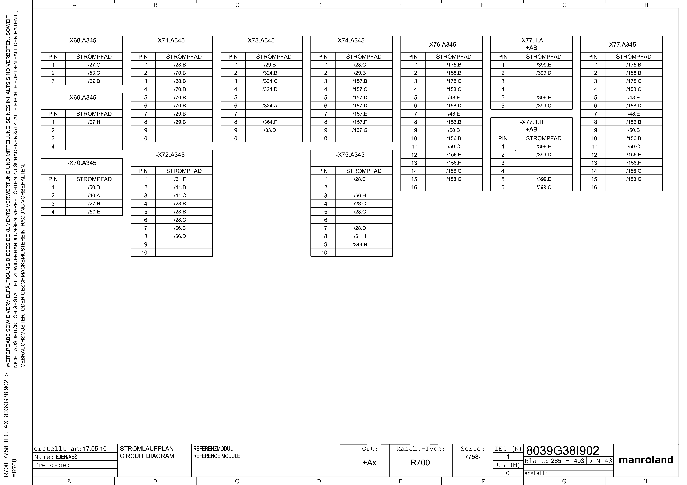

# +Ax — Sheet 285 of 403 — REFERENZMODUL

**REFERENCE MODULE**

> Part of the manroland **R700** printing press IEC/UL circuit diagrams.
> Drawing class: **Stromlaufplan / Circuit diagram** (DIN A3).
> Document `+Ax` covers the **Central control console** machine section.

## At a glance

| Field | Value |
|---|---|
| Document | `+Ax`  (8039G38I902) |
| Sheet | **285** of 403 |
| Section (DE) | REFERENZMODUL |
| Section (EN) | REFERENCE MODULE |
| Section type | REFERENCE_MODULE — Reference module |
| Machine type | `R700` |
| Series | `7758` |
| Created | 17.05.10 |
| Replaces | — |
| Columns used | A, B, C, D, E, F, G, H |
| Path numbers | — |
| Labels on sheet | 228 |
| Cross-refs out | 85 |
| Cross-refs in | 0 |

**Previous:** [+Ax sheet 284](SHEET_0284.md) · **Next:** [+Ax sheet 286](SHEET_0286.md) · **Document TOC:** [_TOC.md](_TOC.md)  (+Ax) · **Master TOC:** [all sheets](../_MASTER_TOC.md)

## Sheet image (300 DPI, exact vector render)



_Rendered directly from the PDF vector layer at 300 DPI (1-bit), no OCR and no resampling. Use it to confirm anything ambiguous in the text below._

## Cross-references on this sheet

Each entry is a wire leaving this sheet. The printed token is `/sheet.column`; the link resolves to that sheet inside the same document.

| Ref | Target sheet | Col | Path | Destination on target | Target section | From col |
|---|---|---|---|---|---|---|
| `/28.B` | [+Ax sheet 28](SHEET_0028.md) | B | — | — | SPANNUNGSVERSORGUNG, SCHALTSCHRANKBELÜFTUNG | B |
| `/29.B` | [+Ax sheet 29](SHEET_0029.md) | B | — | — | SPANNUNGSVERSORGUNG, SCHALTSCHRANKBELÜFTUNG | C |
| `/175.B` | [+Ax sheet 175](SHEET_0175.md) | B | — | — | RESERVE | F |
| `/399.E` | [+Ax sheet 399](SHEET_0399.md) | E | — | — | OPTION: BOGENSTOPPEINRICHTUNG | G |
| `/175.B` | [+Ax sheet 175](SHEET_0175.md) | B | — | — | RESERVE | H |
| `/27.G` | [+Ax sheet 27](SHEET_0027.md) | G | — | — | SPANNUNGSVERSORGUNG, SCHALTSCHRANKBELÜFTUNG | A |
| `/28.C` | [+Ax sheet 28](SHEET_0028.md) | C | — | — | SPANNUNGSVERSORGUNG, SCHALTSCHRANKBELÜFTUNG | E |
| `/70.B` | [+Ax sheet 70](SHEET_0070.md) | B | — | — | WASCHVORRICHTUNGEN DRUCKWERKE | B |
| `/29.B` | [+Ax sheet 29](SHEET_0029.md) | B | — | — | SPANNUNGSVERSORGUNG, SCHALTSCHRANKBELÜFTUNG | E |
| `/324.B` | [+Ax sheet 324](SHEET_0324.md) | B | — | — | OPTION: "EJEKTOR" ANLAGE / SELECT AIRSTATION / | C |
| `/158.B` | [+Ax sheet 158](SHEET_0158.md) | B | — | — | ÜBERWACHUNGSRECHNER/ANSTEUERUNG NOT AUS | F |
| `/158.B` | [+Ax sheet 158](SHEET_0158.md) | B | — | — | ÜBERWACHUNGSRECHNER/ANSTEUERUNG NOT AUS | H |
| `/53.C` | [+Ax sheet 53](SHEET_0053.md) | C | — | — | SIGNALGEBER: AKUSTISCHE WARNSIGNALE | A |
| `/399.D` | [+Ax sheet 399](SHEET_0399.md) | D | — | — | OPTION: BOGENSTOPPEINRICHTUNG | G |
| `/29.B` | [+Ax sheet 29](SHEET_0029.md) | B | — | — | SPANNUNGSVERSORGUNG, SCHALTSCHRANKBELÜFTUNG | A |
| `/28.B` | [+Ax sheet 28](SHEET_0028.md) | B | — | — | SPANNUNGSVERSORGUNG, SCHALTSCHRANKBELÜFTUNG | B |
| `/157.B` | [+Ax sheet 157](SHEET_0157.md) | B | — | — | ÜBERWACHUNGSRECHNER/ANSTEUERUNG NOT AUS | E |
| `/324.C` | [+Ax sheet 324](SHEET_0324.md) | C | — | — | OPTION: "EJEKTOR" ANLAGE / SELECT AIRSTATION / | C |
| `/175.C` | [+Ax sheet 175](SHEET_0175.md) | C | — | — | RESERVE | F |
| `/175.C` | [+Ax sheet 175](SHEET_0175.md) | C | — | — | RESERVE | H |
| `/70.B` | [+Ax sheet 70](SHEET_0070.md) | B | — | — | WASCHVORRICHTUNGEN DRUCKWERKE | B |
| `/324.D` | [+Ax sheet 324](SHEET_0324.md) | D | — | — | OPTION: "EJEKTOR" ANLAGE / SELECT AIRSTATION / | C |
| `/157.C` | [+Ax sheet 157](SHEET_0157.md) | C | — | — | ÜBERWACHUNGSRECHNER/ANSTEUERUNG NOT AUS | E |
| `/158.C` | [+Ax sheet 158](SHEET_0158.md) | C | — | — | ÜBERWACHUNGSRECHNER/ANSTEUERUNG NOT AUS | F |
| `/158.C` | [+Ax sheet 158](SHEET_0158.md) | C | — | — | ÜBERWACHUNGSRECHNER/ANSTEUERUNG NOT AUS | H |
| `/70.B` | [+Ax sheet 70](SHEET_0070.md) | B | — | — | WASCHVORRICHTUNGEN DRUCKWERKE | B |
| `/48.E` | [+Ax sheet 48](SHEET_0048.md) | E | — | — | NOT AUS | F |
| `/48.E` | [+Ax sheet 48](SHEET_0048.md) | E | — | — | NOT AUS | H |
| `/399.E` | [+Ax sheet 399](SHEET_0399.md) | E | — | — | OPTION: BOGENSTOPPEINRICHTUNG | G |
| `/157.D` | [+Ax sheet 157](SHEET_0157.md) | D | — | — | ÜBERWACHUNGSRECHNER/ANSTEUERUNG NOT AUS | E |
| `/70.B` | [+Ax sheet 70](SHEET_0070.md) | B | — | — | WASCHVORRICHTUNGEN DRUCKWERKE | B |
| `/324.A` | [+Ax sheet 324](SHEET_0324.md) | A | — | — | OPTION: "EJEKTOR" ANLAGE / SELECT AIRSTATION / | C |
| `/157.D` | [+Ax sheet 157](SHEET_0157.md) | D | — | — | ÜBERWACHUNGSRECHNER/ANSTEUERUNG NOT AUS | E |
| `/158.D` | [+Ax sheet 158](SHEET_0158.md) | D | — | — | ÜBERWACHUNGSRECHNER/ANSTEUERUNG NOT AUS | F |
| `/399.C` | [+Ax sheet 399](SHEET_0399.md) | C | — | — | OPTION: BOGENSTOPPEINRICHTUNG | G |
| `/158.D` | [+Ax sheet 158](SHEET_0158.md) | D | — | — | ÜBERWACHUNGSRECHNER/ANSTEUERUNG NOT AUS | H |
| `/27.H` | [+Ax sheet 27](SHEET_0027.md) | H | — | STROMPFAD PIN 1 2 3 4 | SPANNUNGSVERSORGUNG, SCHALTSCHRANKBELÜFTUNG | A |
| `/29.B` | [+Ax sheet 29](SHEET_0029.md) | B | — | — | SPANNUNGSVERSORGUNG, SCHALTSCHRANKBELÜFTUNG | B |
| `/48.E` | [+Ax sheet 48](SHEET_0048.md) | E | — | — | NOT AUS | F |
| `/48.E` | [+Ax sheet 48](SHEET_0048.md) | E | — | — | NOT AUS | H |
| `/157.E` | [+Ax sheet 157](SHEET_0157.md) | E | — | — | ÜBERWACHUNGSRECHNER/ANSTEUERUNG NOT AUS | E |
| `/29.B` | [+Ax sheet 29](SHEET_0029.md) | B | — | — | SPANNUNGSVERSORGUNG, SCHALTSCHRANKBELÜFTUNG | B |
| `/156.B` | [+Ax sheet 156](SHEET_0156.md) | B | — | — | ÜBERWACHUNGSRECHNER/ANSTEUERUNG NOT AUS | F |
| `/156.B` | [+Ax sheet 156](SHEET_0156.md) | B | — | — | ÜBERWACHUNGSRECHNER/ANSTEUERUNG NOT AUS | H |
| `/364.F` | [+Ax sheet 364](SHEET_0364.md) | F | — | — | OPTION: LOGISTIK AUSLEGER | C |
| `/157.F` | [+Ax sheet 157](SHEET_0157.md) | F | — | — | ÜBERWACHUNGSRECHNER/ANSTEUERUNG NOT AUS | E |
| `/50.B` | [+Ax sheet 50](SHEET_0050.md) | B | — | — | STOP SICHERN | F |
| `/50.B` | [+Ax sheet 50](SHEET_0050.md) | B | — | — | STOP SICHERN | H |
| `/83.D` | [+Ax sheet 83](SHEET_0083.md) | D | — | — | ANLEGER | C |
| `/157.G` | [+Ax sheet 157](SHEET_0157.md) | G | — | — | ÜBERWACHUNGSRECHNER/ANSTEUERUNG NOT AUS | E |
| `/156.B` | [+Ax sheet 156](SHEET_0156.md) | B | — | — | ÜBERWACHUNGSRECHNER/ANSTEUERUNG NOT AUS | F |
| `/156.B` | [+Ax sheet 156](SHEET_0156.md) | B | — | — | ÜBERWACHUNGSRECHNER/ANSTEUERUNG NOT AUS | H |
| `/399.E` | [+Ax sheet 399](SHEET_0399.md) | E | — | — | OPTION: BOGENSTOPPEINRICHTUNG | G |
| `/50.C` | [+Ax sheet 50](SHEET_0050.md) | C | — | — | STOP SICHERN | F |
| `/50.C` | [+Ax sheet 50](SHEET_0050.md) | C | — | — | STOP SICHERN | H |
| `/156.F` | [+Ax sheet 156](SHEET_0156.md) | F | — | — | ÜBERWACHUNGSRECHNER/ANSTEUERUNG NOT AUS | F |
| `/156.F` | [+Ax sheet 156](SHEET_0156.md) | F | — | — | ÜBERWACHUNGSRECHNER/ANSTEUERUNG NOT AUS | H |
| `/399.D` | [+Ax sheet 399](SHEET_0399.md) | D | — | — | OPTION: BOGENSTOPPEINRICHTUNG | G |
| `/158.F` | [+Ax sheet 158](SHEET_0158.md) | F | — | — | ÜBERWACHUNGSRECHNER/ANSTEUERUNG NOT AUS | F |
| `/158.F` | [+Ax sheet 158](SHEET_0158.md) | F | — | — | ÜBERWACHUNGSRECHNER/ANSTEUERUNG NOT AUS | H |
| `/156.G` | [+Ax sheet 156](SHEET_0156.md) | G | — | — | ÜBERWACHUNGSRECHNER/ANSTEUERUNG NOT AUS | F |
| `/156.G` | [+Ax sheet 156](SHEET_0156.md) | G | — | — | ÜBERWACHUNGSRECHNER/ANSTEUERUNG NOT AUS | H |
| `/61.F` | [+Ax sheet 61](SHEET_0061.md) | F | — | — | DRUCKLUFTANLAGE | B |
| `/399.E` | [+Ax sheet 399](SHEET_0399.md) | E | — | — | OPTION: BOGENSTOPPEINRICHTUNG | G |
| `/28.C` | [+Ax sheet 28](SHEET_0028.md) | C | — | — | SPANNUNGSVERSORGUNG, SCHALTSCHRANKBELÜFTUNG | E |
| `/158.G` | [+Ax sheet 158](SHEET_0158.md) | G | — | — | ÜBERWACHUNGSRECHNER/ANSTEUERUNG NOT AUS | F |
| `/158.G` | [+Ax sheet 158](SHEET_0158.md) | G | — | — | ÜBERWACHUNGSRECHNER/ANSTEUERUNG NOT AUS | H |
| `/41.B` | [+Ax sheet 41](SHEET_0041.md) | B | — | — | HAUPTANTRIEB | B |
| `/50.D` | [+Ax sheet 50](SHEET_0050.md) | D | — | — | STOP SICHERN | A |
| `/399.C` | [+Ax sheet 399](SHEET_0399.md) | C | — | — | OPTION: BOGENSTOPPEINRICHTUNG | G |
| `/40.A` | [+Ax sheet 40](SHEET_0040.md) | A | — | — | HAUPTANTRIEB | A |
| `/41.C` | [+Ax sheet 41](SHEET_0041.md) | C | — | — | HAUPTANTRIEB | B |
| `/66.H` | [+Ax sheet 66](SHEET_0066.md) | H | — | — | DRUCKLUFTANLAGE | E |
| `/28.B` | [+Ax sheet 28](SHEET_0028.md) | B | — | — | SPANNUNGSVERSORGUNG, SCHALTSCHRANKBELÜFTUNG | B |
| `/27.H` | [+Ax sheet 27](SHEET_0027.md) | H | — | — | SPANNUNGSVERSORGUNG, SCHALTSCHRANKBELÜFTUNG | A |
| `/28.C` | [+Ax sheet 28](SHEET_0028.md) | C | — | — | SPANNUNGSVERSORGUNG, SCHALTSCHRANKBELÜFTUNG | E |
| `/50.E` | [+Ax sheet 50](SHEET_0050.md) | E | — | — | STOP SICHERN | A |
| `/28.B` | [+Ax sheet 28](SHEET_0028.md) | B | — | — | SPANNUNGSVERSORGUNG, SCHALTSCHRANKBELÜFTUNG | B |
| `/28.C` | [+Ax sheet 28](SHEET_0028.md) | C | — | — | SPANNUNGSVERSORGUNG, SCHALTSCHRANKBELÜFTUNG | E |
| `/28.C` | [+Ax sheet 28](SHEET_0028.md) | C | — | — | SPANNUNGSVERSORGUNG, SCHALTSCHRANKBELÜFTUNG | B |
| `/66.C` | [+Ax sheet 66](SHEET_0066.md) | C | — | — | DRUCKLUFTANLAGE | B |
| `/28.D` | [+Ax sheet 28](SHEET_0028.md) | D | — | — | SPANNUNGSVERSORGUNG, SCHALTSCHRANKBELÜFTUNG | E |
| `/66.D` | [+Ax sheet 66](SHEET_0066.md) | D | — | — | DRUCKLUFTANLAGE | B |
| `/61.H` | [+Ax sheet 61](SHEET_0061.md) | H | — | — | DRUCKLUFTANLAGE | E |
| `/344.B` | [+Ax sheet 344](SHEET_0344.md) | B | — | — | OPTION: INLINESHEETER RS104 S | E |

## Devices on this sheet

| Tag | Class | Class meaning (IEC) | Col | Sub | Terminal | Sign |
|---|---|---|---|---|---|---|
| `X68.A345` | — | cross-device reference | A | — | — | — |
| `X77.A345` | — | cross-device reference | H | — | — | — |
| `X69.A345` | — | cross-device reference | A | — | — | — |
| `X70.A345` | — | cross-device reference | A | — | — | — |
| `X71.A345` | — | cross-device reference | B | — | — | — |
| `X76.A345` | — | cross-device reference | F | — | — | — |
| `X74.A345` | — | cross-device reference | D | — | — | — |
| `X75.A345` | — | cross-device reference | D | — | — | — |
| `X73.A345` | — | cross-device reference | C | — | — | — |
| `X72.A345` | — | cross-device reference | B | — | — | — |
| `X77.1.A` | — | cross-device reference | G | — | — | — |
| `X77.1.B` | — | cross-device reference | G | — | — | — |

## Potentials / nets

_No named potentials on this sheet._

## Wire-end annotations (grouped as printed)

A wire that continues elsewhere is annotated with a small cluster: the destination description, the path/line number `#NN`, and the `/sheet.column` cross reference. Each row below is one such cluster exactly as it is grouped on the drawing.

| Col | Y | Path | Cross-ref | Text on the wire |
|---|---|---|---|---|
| A | 65.5 | — | — | `X68.A345` |
| B | 65.5 | — | — | `X71.A345` |
| C | 65.5 | — | — | `X73.A345` |
| D | 65.5 | — | — | `X74.A345` |
| G | 65.5 | — | — | `X77.1.A` |
| F | 72.6 | — | — | `X76.A345` |
| H | 72.6 | — | — | `X77.A345` |
| G | 78.2 | — | — | `+AB` |
| A | 94.2 | — | — | `PIN 2 3 1 STROMPFAD` |
| B | 94.2 | — | — | `PIN 10 2 3 4 5 6 7 8 9 1 STROMPFAD` |
| C | 94.2 | — | — | `PIN 10 2 3 4 5 6 7 8 9 1 STROMPFAD` |
| D | 94.2 | — | — | `PIN 10 2 3 4 5 6 7 8 9 1 STROMPFAD` |
| E | 94.2 | — | — | `PIN STROMPFAD` |
| G | 94.2 | — | — | `PIN 2 3 4 5 6 1 STROMPFAD` |
| H | 94.2 | — | — | `PIN STROMPFAD` |
| E | 108.4 | — | — | `2 3 4 5 6 7 8 9 1` |
| G | 108.4 | — | — | `2 3 4 5 6 7 8 9 1` |
| A | 108.7 | — | `/27.G` | — |
| B | 108.7 | — | `/28.B` | — |
| C | 108.7 | — | `/29.B` | — |
| E | 108.7 | — | `/28.C` | — |
| F | 108.7 | — | `/175.B` | — |
| G | 108.7 | — | `/399.E` | — |
| H | 108.7 | — | `/175.B` | — |
| B | 122.8 | — | `/70.B` | — |
| E | 122.8 | — | `/29.B` | — |
| A | 122.9 | — | `/53.C` | — |
| C | 122.9 | — | `/324.B` | — |
| F | 122.9 | — | `/158.B` | — |
| G | 122.9 | — | `/399.D` | — |
| H | 122.9 | — | `/158.B` | — |
| A | 137.0 | — | `/29.B` | — |
| B | 137.0 | — | `/28.B` | — |
| E | 137.0 | — | `/157.B` | — |
| C | 137.1 | — | `/324.C` | — |
| F | 137.1 | — | `/175.C` | — |
| H | 137.1 | — | `/175.C` | — |
| B | 151.2 | — | `/70.B` | — |
| C | 151.2 | — | `/324.D` | — |
| E | 151.2 | — | `/157.C` | — |
| F | 151.2 | — | `/158.C` | — |
| H | 151.2 | — | `/158.C` | — |
| A | 164.7 | — | — | `X69.A345` |
| B | 165.4 | — | `/70.B` | — |
| E | 165.4 | — | `/157.D` | — |
| F | 165.4 | — | `/48.E` | — |
| G | 165.4 | — | `/399.E` | — |
| H | 165.4 | — | `/48.E` | — |
| B | 179.5 | — | `/70.B` | — |
| C | 179.6 | — | `/324.A` | — |
| E | 179.6 | — | `/157.D` | — |
| F | 179.6 | — | `/158.D` | — |
| G | 179.6 | — | `/399.C` | — |
| H | 179.6 | — | `/158.D` | — |
| A | 193.4 | — | `/27.H` | `PIN 2 3 4 1 STROMPFAD` |
| B | 193.7 | — | `/29.B` | — |
| E | 193.7 | — | `/157.E` | — |
| F | 193.7 | — | `/48.E` | — |
| H | 193.7 | — | `/48.E` | — |
| G | 207.3 | — | — | `X77.1.B` |
| B | 207.9 | — | `/29.B` | — |
| C | 207.9 | — | `/364.F` | — |
| E | 207.9 | — | `/157.F` | — |
| F | 207.9 | — | `/156.B` | — |
| H | 207.9 | — | `/156.B` | — |
| G | 219.9 | — | — | `+AB` |
| C | 222.1 | — | `/83.D` | — |
| E | 222.1 | — | `/157.G` | — |
| F | 222.1 | — | `/50.B` | — |
| H | 222.1 | — | `/50.B` | — |
| E | 235.9 | — | — | `10 12 13 14 15 16 11` |
| G | 235.9 | — | — | `PIN 2 3 4 5 6 1 STROMPFAD` |
| G | 235.9 | — | — | `10 12 13 14 15 16 11` |
| F | 236.2 | — | `/156.B` | — |
| H | 236.2 | — | `/156.B` | — |
| F | 250.4 | — | `/50.C` | — |
| G | 250.4 | — | `/399.E` | — |
| H | 250.4 | — | `/50.C` | — |
| B | 263.9 | — | — | `X72.A345` |
| D | 263.9 | — | — | `X75.A345` |
| F | 264.6 | — | `/156.F` | — |
| G | 264.6 | — | `/399.D` | — |
| H | 264.6 | — | `/156.F` | — |
| A | 278.1 | — | — | `X70.A345` |
| F | 278.8 | — | `/158.F` | — |
| H | 278.8 | — | `/158.F` | — |
| B | 292.6 | — | — | `PIN 10 2 3 4 5 6 7 8 9 1 STROMPFAD` |
| D | 292.6 | — | — | `PIN 10 2 3 4 5 6 7 8 9 1 STROMPFAD` |
| F | 293.0 | — | `/156.G` | — |
| H | 293.0 | — | `/156.G` | — |
| A | 306.8 | — | — | `PIN 2 3 4 1 STROMPFAD` |
| B | 307.1 | — | `/61.F` | — |
| E | 307.1 | — | `/28.C` | — |
| F | 307.1 | — | `/158.G` | — |
| G | 307.1 | — | `/399.E` | — |
| H | 307.1 | — | `/158.G` | — |
| A | 321.3 | — | `/50.D` | — |
| B | 321.3 | — | `/41.B` | — |
| G | 321.3 | — | `/399.C` | — |
| A | 335.4 | — | `/40.A` | — |
| B | 335.5 | — | `/41.C` | — |
| E | 335.5 | — | `/66.H` | — |
| A | 349.6 | — | `/27.H` | — |
| B | 349.6 | — | `/28.B` | — |
| E | 349.6 | — | `/28.C` | — |
| A | 363.8 | — | `/50.E` | — |
| B | 363.8 | — | `/28.B` | — |
| E | 363.8 | — | `/28.C` | — |
| B | 378.0 | — | `/28.C` | — |
| B | 392.2 | — | `/66.C` | — |
| E | 392.2 | — | `/28.D` | — |
| B | 406.3 | — | `/66.D` | — |
| E | 406.3 | — | `/61.H` | — |
| E | 420.5 | — | `/344.B` | — |


## Reconstructed tables

This sheet carries tabular content (pin map / terminal assignment / index). The grid below was rebuilt from the drawing's own rule lines, so each row is exactly one physical row of the table.

### Table 1 — 15 data rows × 2 columns (at x=70.9, y=62.4) — **X68.A345**

| PIN | STROMPFAD |
|---|---|
| `1` | `/27.G` |
| `2` | `/53.C` |
| `3` | `/29.B` |
|  | `X69.A345` |
| `PIN` | `STROMPFAD` |
| `1` | `/27.H` |
| `2` |  |
| `3` |  |
| `4` |  |
|  | `X70.A345` |
| `PIN` | `STROMPFAD` |
| `1` | `/50.D` |
| `2` | `/40.A` |
| `3` | `/27.H` |
| `4` | `/50.E` |


### Table 2 — 22 data rows × 2 columns (at x=226.8, y=62.4) — **X71.A345**

| PIN | STROMPFAD |
|---|---|
| `1` | `/28.B` |
| `2` | `/70.B` |
| `3` | `/28.B` |
| `4` | `/70.B` |
| `5` | `/70.B` |
| `6` | `/70.B` |
| `7` | `/29.B` |
| `8` | `/29.B` |
| `9` |  |
| `10` |  |
|  | `X72.A345` |
| `PIN` | `STROMPFAD` |
| `1` | `/61.F` |
| `2` | `/41.B` |
| `3` | `/41.C` |
| `4` | `/28.B` |
| `5` | `/28.B` |
| `6` | `/28.C` |
| `7` | `/66.C` |
| `8` | `/66.D` |
| `9` |  |
| `10` |  |


### Table 3 — 10 data rows × 2 columns (at x=382.7, y=62.4) — **X73.A345**

| PIN | STROMPFAD |
|---|---|
| `1` | `/29.B` |
| `2` | `/324.B` |
| `3` | `/324.C` |
| `4` | `/324.D` |
| `5` |  |
| `6` | `/324.A` |
| `7` |  |
| `8` | `/364.F` |
| `9` | `/83.D` |
| `10` |  |


### Table 4 — 22 data rows × 2 columns (at x=538.6, y=62.4) — **X74.A345**

| PIN | STROMPFAD |
|---|---|
| `1` | `/28.C` |
| `2` | `/29.B` |
| `3` | `/157.B` |
| `4` | `/157.C` |
| `5` | `/157.D` |
| `6` | `/157.D` |
| `7` | `/157.E` |
| `8` | `/157.F` |
| `9` | `/157.G` |
| `10` |  |
|  | `X75.A345` |
| `PIN` | `STROMPFAD` |
| `1` | `/28.C` |
| `2` |  |
| `3` | `/66.H` |
| `4` | `/28.C` |
| `5` | `/28.C` |
| `6` |  |
| `7` | `/28.D` |
| `8` | `/61.H` |
| `9` | `/344.B` |
| `10` |  |


### Table 5 — 16 data rows × 2 columns (at x=694.5, y=62.4) — **X76.A345**

| PIN | STROMPFAD |
|---|---|
| `1` | `/175.B` |
| `2` | `/158.B` |
| `3` | `/175.C` |
| `4` | `/158.C` |
| `5` | `/48.E` |
| `6` | `/158.D` |
| `7` | `/48.E` |
| `8` | `/156.B` |
| `9` | `/50.B` |
| `10` | `/156.B` |
| `11` | `/50.C` |
| `12` | `/156.F` |
| `13` | `/158.F` |
| `14` | `/156.G` |
| `15` | `/158.G` |
| `16` |  |


### Table 6 — 15 data rows × 2 columns (at x=850.4, y=62.4) — **X77.1.A +AB**

| PIN | STROMPFAD |
|---|---|
| `1` | `/399.E` |
| `2` | `/399.D` |
| `3` |  |
| `4` |  |
| `5` | `/399.E` |
| `6` | `/399.C` |
|  | `X77.1.B` |
|  | `+AB` |
| `PIN` | `STROMPFAD` |
| `1` | `/399.E` |
| `2` | `/399.D` |
| `3` |  |
| `4` |  |
| `5` | `/399.E` |
| `6` | `/399.C` |


### Table 7 — 16 data rows × 2 columns (at x=1006.3, y=62.4) — **X77.A345**

| PIN | STROMPFAD |
|---|---|
| `1` | `/175.B` |
| `2` | `/158.B` |
| `3` | `/175.C` |
| `4` | `/158.C` |
| `5` | `/48.E` |
| `6` | `/158.D` |
| `7` | `/48.E` |
| `8` | `/156.B` |
| `9` | `/50.B` |
| `10` | `/156.B` |
| `11` | `/50.C` |
| `12` | `/156.F` |
| `13` | `/158.F` |
| `14` | `/156.G` |
| `15` | `/158.G` |
| `16` |  |


## Notes and free text on this sheet

| Text | Col | Y (pt) |
|---|---|---|
| `PIN` | A | 94.2 |
| `STROMPFAD` | A | 94.15 |
| `PIN` | G | 94.2 |
| `STROMPFAD` | H | 94.15 |
| `PIN` | B | 94.2 |
| `STROMPFAD` | B | 94.15 |
| `PIN` | E | 94.2 |
| `STROMPFAD` | F | 94.15 |
| `PIN` | D | 94.2 |
| `STROMPFAD` | E | 94.15 |
| `PIN` | C | 94.2 |
| `STROMPFAD` | C | 94.15 |
| `PIN` | F | 94.2 |
| `STROMPFAD` | G | 94.15 |
| `+AB` | G | 78.18 |

## Complete label inventory (exact text from the drawing)

Every text object inside the drawing area of this sheet, in DIN reading order (column A→H, then top→bottom). This is the authoritative list: if a string is not here it is not printed on this sheet.

| Col | Y | X | Dir | Type | Text |
|---|---|---|---|---|---|
| A | 65.5 | 116.8 | → | device ref | `X68.A345` |
| A | 94.2 | 84.0 | → | text | `PIN` |
| A | 94.2 | 132.2 | → | text | `STROMPFAD` |
| A | 108.4 | 90.0 | → | number | `1` |
| A | 108.7 | 152.5 | → | cross-reference | `/27.G` |
| A | 122.5 | 89.4 | → | number | `2` |
| A | 122.9 | 152.6 | → | cross-reference | `/53.C` |
| A | 136.7 | 89.4 | → | number | `3` |
| A | 137.0 | 152.8 | → | cross-reference | `/29.B` |
| A | 164.7 | 116.8 | → | device ref | `X69.A345` |
| A | 193.4 | 84.0 | → | text | `PIN` |
| A | 193.4 | 132.2 | → | text | `STROMPFAD` |
| A | 207.6 | 90.0 | → | number | `1` |
| A | 207.9 | 152.9 | → | cross-reference | `/27.H` |
| A | 221.8 | 89.4 | → | number | `2` |
| A | 235.9 | 89.4 | → | number | `3` |
| A | 250.1 | 89.4 | → | number | `4` |
| A | 278.1 | 116.8 | → | device ref | `X70.A345` |
| A | 306.8 | 84.0 | → | text | `PIN` |
| A | 306.8 | 132.2 | → | text | `STROMPFAD` |
| A | 321.0 | 90.0 | → | number | `1` |
| A | 321.3 | 152.6 | → | cross-reference | `/50.D` |
| A | 335.1 | 89.4 | → | number | `2` |
| A | 335.4 | 152.6 | → | cross-reference | `/40.A` |
| A | 349.3 | 89.4 | → | number | `3` |
| A | 349.7 | 152.9 | → | cross-reference | `/27.H` |
| A | 363.5 | 89.4 | → | number | `4` |
| A | 363.8 | 152.9 | → | cross-reference | `/50.E` |
| B | 65.5 | 269.9 | → | device ref | `X71.A345` |
| B | 94.2 | 240.0 | → | text | `PIN` |
| B | 94.2 | 288.1 | → | text | `STROMPFAD` |
| B | 108.4 | 251.7 | → | number | `1` |
| B | 108.7 | 301.6 | → | cross-reference | `/28.B` |
| B | 122.5 | 250.0 | → | number | `2` |
| B | 122.8 | 301.6 | → | cross-reference | `/70.B` |
| B | 136.7 | 250.0 | → | number | `3` |
| B | 137.0 | 301.6 | → | cross-reference | `/28.B` |
| B | 150.9 | 250.0 | → | number | `4` |
| B | 151.2 | 301.6 | → | cross-reference | `/70.B` |
| B | 165.1 | 250.0 | → | number | `5` |
| B | 165.4 | 301.6 | → | cross-reference | `/70.B` |
| B | 179.2 | 250.0 | → | number | `6` |
| B | 179.5 | 301.6 | → | cross-reference | `/70.B` |
| B | 193.4 | 250.0 | → | number | `7` |
| B | 193.7 | 301.6 | → | cross-reference | `/29.B` |
| B | 207.6 | 250.0 | → | number | `8` |
| B | 207.9 | 301.6 | → | cross-reference | `/29.B` |
| B | 221.8 | 250.0 | → | number | `9` |
| B | 235.9 | 244.6 | → | number | `10` |
| B | 263.9 | 269.9 | → | device ref | `X72.A345` |
| B | 292.6 | 240.0 | → | text | `PIN` |
| B | 292.6 | 288.1 | → | text | `STROMPFAD` |
| B | 306.8 | 251.7 | → | number | `1` |
| B | 307.1 | 301.9 | → | cross-reference | `/61.F` |
| B | 321.0 | 250.0 | → | number | `2` |
| B | 321.3 | 301.6 | → | cross-reference | `/41.B` |
| B | 335.1 | 250.0 | → | number | `3` |
| B | 335.5 | 301.5 | → | cross-reference | `/41.C` |
| B | 349.3 | 250.0 | → | number | `4` |
| B | 349.6 | 301.6 | → | cross-reference | `/28.B` |
| B | 363.5 | 250.0 | → | number | `5` |
| B | 363.8 | 301.6 | → | cross-reference | `/28.B` |
| B | 377.7 | 250.0 | → | number | `6` |
| B | 378.0 | 301.5 | → | cross-reference | `/28.C` |
| B | 391.8 | 250.0 | → | number | `7` |
| B | 392.2 | 301.5 | → | cross-reference | `/66.C` |
| B | 406.0 | 250.0 | → | number | `8` |
| B | 406.3 | 301.5 | → | cross-reference | `/66.D` |
| B | 420.2 | 250.0 | → | number | `9` |
| B | 434.4 | 244.6 | → | number | `10` |
| C | 65.5 | 425.8 | → | device ref | `X73.A345` |
| C | 94.2 | 395.9 | → | text | `PIN` |
| C | 94.2 | 444.0 | → | text | `STROMPFAD` |
| C | 108.4 | 407.6 | → | number | `1` |
| C | 108.7 | 457.5 | → | cross-reference | `/29.B` |
| C | 122.5 | 405.9 | → | number | `2` |
| C | 122.9 | 455.1 | → | cross-reference | `/324.B` |
| C | 136.7 | 405.9 | → | number | `3` |
| C | 137.1 | 455.0 | → | cross-reference | `/324.C` |
| C | 150.9 | 405.9 | → | number | `4` |
| C | 151.2 | 455.0 | → | cross-reference | `/324.D` |
| C | 165.1 | 405.9 | → | number | `5` |
| C | 179.2 | 405.9 | → | number | `6` |
| C | 179.6 | 455.0 | → | cross-reference | `/324.A` |
| C | 193.4 | 405.9 | → | number | `7` |
| C | 207.6 | 405.9 | → | number | `8` |
| C | 207.9 | 455.4 | → | cross-reference | `/364.F` |
| C | 221.8 | 405.9 | → | number | `9` |
| C | 222.1 | 457.4 | → | cross-reference | `/83.D` |
| C | 235.9 | 400.5 | → | number | `10` |
| D | 65.5 | 581.7 | → | device ref | `X74.A345` |
| D | 94.2 | 551.8 | → | text | `PIN` |
| D | 108.4 | 563.5 | → | number | `1` |
| D | 122.5 | 561.8 | → | number | `2` |
| D | 136.7 | 561.8 | → | number | `3` |
| D | 150.9 | 561.8 | → | number | `4` |
| D | 165.1 | 561.8 | → | number | `5` |
| D | 179.2 | 561.8 | → | number | `6` |
| D | 193.4 | 561.8 | → | number | `7` |
| D | 207.6 | 561.8 | → | number | `8` |
| D | 221.8 | 561.8 | → | number | `9` |
| D | 235.9 | 556.4 | → | number | `10` |
| D | 263.9 | 581.7 | → | device ref | `X75.A345` |
| D | 292.6 | 551.8 | → | text | `PIN` |
| D | 306.8 | 563.5 | → | number | `1` |
| D | 321.0 | 561.8 | → | number | `2` |
| D | 335.1 | 561.8 | → | number | `3` |
| D | 349.3 | 561.8 | → | number | `4` |
| D | 363.5 | 561.8 | → | number | `5` |
| D | 377.7 | 561.8 | → | number | `6` |
| D | 391.8 | 561.8 | → | number | `7` |
| D | 406.0 | 561.8 | → | number | `8` |
| D | 420.2 | 561.8 | → | number | `9` |
| D | 434.4 | 556.4 | → | number | `10` |
| E | 94.2 | 600.0 | → | text | `STROMPFAD` |
| E | 94.2 | 707.7 | → | text | `PIN` |
| E | 108.4 | 719.4 | → | number | `1` |
| E | 108.7 | 613.3 | → | cross-reference | `/28.C` |
| E | 122.5 | 717.7 | → | number | `2` |
| E | 122.8 | 613.4 | → | cross-reference | `/29.B` |
| E | 136.7 | 717.7 | → | number | `3` |
| E | 137.0 | 611.0 | → | cross-reference | `/157.B` |
| E | 150.9 | 717.7 | → | number | `4` |
| E | 151.2 | 610.9 | → | cross-reference | `/157.C` |
| E | 165.1 | 717.7 | → | number | `5` |
| E | 165.4 | 610.9 | → | cross-reference | `/157.D` |
| E | 179.2 | 717.7 | → | number | `6` |
| E | 179.6 | 610.9 | → | cross-reference | `/157.D` |
| E | 193.4 | 717.7 | → | number | `7` |
| E | 193.7 | 611.1 | → | cross-reference | `/157.E` |
| E | 207.6 | 717.7 | → | number | `8` |
| E | 207.9 | 611.3 | → | cross-reference | `/157.F` |
| E | 221.8 | 717.7 | → | number | `9` |
| E | 222.1 | 610.7 | → | cross-reference | `/157.G` |
| E | 235.9 | 712.3 | → | number | `10` |
| E | 250.1 | 714.0 | → | number | `11` |
| E | 264.3 | 712.3 | → | number | `12` |
| E | 278.5 | 712.3 | → | number | `13` |
| E | 292.6 | 600.0 | → | text | `STROMPFAD` |
| E | 292.6 | 712.3 | → | number | `14` |
| E | 306.8 | 712.3 | → | number | `15` |
| E | 307.1 | 613.3 | → | cross-reference | `/28.C` |
| E | 321.0 | 712.3 | → | number | `16` |
| E | 335.5 | 613.6 | → | cross-reference | `/66.H` |
| E | 349.7 | 613.3 | → | cross-reference | `/28.C` |
| E | 363.8 | 613.3 | → | cross-reference | `/28.C` |
| E | 392.2 | 613.3 | → | cross-reference | `/28.D` |
| E | 406.3 | 613.6 | → | cross-reference | `/61.H` |
| E | 420.5 | 611.0 | → | cross-reference | `/344.B` |
| F | 72.6 | 740.4 | → | device ref | `X76.A345` |
| F | 94.2 | 755.9 | → | text | `STROMPFAD` |
| F | 94.2 | 863.6 | → | text | `PIN` |
| F | 108.4 | 869.5 | → | number | `1` |
| F | 108.7 | 774.0 | → | cross-reference | `/175.B` |
| F | 122.5 | 869.0 | → | number | `2` |
| F | 122.9 | 774.0 | → | cross-reference | `/158.B` |
| F | 136.7 | 869.0 | → | number | `3` |
| F | 137.1 | 773.9 | → | cross-reference | `/175.C` |
| F | 150.9 | 869.0 | → | number | `4` |
| F | 151.2 | 773.9 | → | cross-reference | `/158.C` |
| F | 165.1 | 869.0 | → | number | `5` |
| F | 165.4 | 776.6 | → | cross-reference | `/48.E` |
| F | 179.2 | 869.0 | → | number | `6` |
| F | 179.6 | 773.9 | → | cross-reference | `/158.D` |
| F | 193.7 | 776.6 | → | cross-reference | `/48.E` |
| F | 207.9 | 774.0 | → | cross-reference | `/156.B` |
| F | 222.1 | 776.4 | → | cross-reference | `/50.B` |
| F | 235.9 | 863.6 | → | text | `PIN` |
| F | 236.2 | 774.0 | → | cross-reference | `/156.B` |
| F | 250.1 | 869.5 | → | number | `1` |
| F | 250.4 | 776.3 | → | cross-reference | `/50.C` |
| F | 264.3 | 869.0 | → | number | `2` |
| F | 264.6 | 774.3 | → | cross-reference | `/156.F` |
| F | 278.5 | 869.0 | → | number | `3` |
| F | 278.8 | 774.3 | → | cross-reference | `/158.F` |
| F | 292.6 | 869.0 | → | number | `4` |
| F | 293.0 | 773.7 | → | cross-reference | `/156.G` |
| F | 306.8 | 869.0 | → | number | `5` |
| F | 307.1 | 773.7 | → | cross-reference | `/158.G` |
| F | 321.0 | 869.0 | → | number | `6` |
| G | 65.5 | 900.4 | → | device ref | `X77.1.A` |
| G | 78.2 | 911.1 | → | text | `+AB` |
| G | 94.2 | 911.8 | → | text | `STROMPFAD` |
| G | 94.2 | 1019.5 | → | text | `PIN` |
| G | 108.4 | 1031.2 | → | number | `1` |
| G | 108.7 | 930.0 | → | cross-reference | `/399.E` |
| G | 122.5 | 1029.5 | → | number | `2` |
| G | 122.9 | 929.8 | → | cross-reference | `/399.D` |
| G | 136.7 | 1029.5 | → | number | `3` |
| G | 150.9 | 1029.5 | → | number | `4` |
| G | 165.1 | 1029.5 | → | number | `5` |
| G | 165.4 | 930.0 | → | cross-reference | `/399.E` |
| G | 179.2 | 1029.5 | → | number | `6` |
| G | 179.6 | 929.8 | → | cross-reference | `/399.C` |
| G | 193.4 | 1029.5 | → | number | `7` |
| G | 207.3 | 900.9 | → | device ref | `X77.1.B` |
| G | 207.6 | 1029.5 | → | number | `8` |
| G | 219.9 | 911.1 | → | text | `+AB` |
| G | 221.8 | 1029.5 | → | number | `9` |
| G | 235.9 | 911.8 | → | text | `STROMPFAD` |
| G | 235.9 | 1024.2 | → | number | `10` |
| G | 250.1 | 1025.9 | → | number | `11` |
| G | 250.4 | 930.0 | → | cross-reference | `/399.E` |
| G | 264.3 | 1024.2 | → | number | `12` |
| G | 264.6 | 929.8 | → | cross-reference | `/399.D` |
| G | 278.5 | 1024.2 | → | number | `13` |
| G | 292.6 | 1024.2 | → | number | `14` |
| G | 306.8 | 1024.2 | → | number | `15` |
| G | 307.1 | 930.0 | → | cross-reference | `/399.E` |
| G | 321.0 | 1024.2 | → | number | `16` |
| G | 321.3 | 929.8 | → | cross-reference | `/399.C` |
| H | 72.6 | 1052.2 | → | device ref | `X77.A345` |
| H | 94.2 | 1067.7 | → | text | `STROMPFAD` |
| H | 108.7 | 1085.8 | → | cross-reference | `/175.B` |
| H | 122.9 | 1085.8 | → | cross-reference | `/158.B` |
| H | 137.1 | 1085.7 | → | cross-reference | `/175.C` |
| H | 151.2 | 1085.7 | → | cross-reference | `/158.C` |
| H | 165.4 | 1088.4 | → | cross-reference | `/48.E` |
| H | 179.6 | 1085.7 | → | cross-reference | `/158.D` |
| H | 193.7 | 1088.4 | → | cross-reference | `/48.E` |
| H | 207.9 | 1085.8 | → | cross-reference | `/156.B` |
| H | 222.1 | 1088.2 | → | cross-reference | `/50.B` |
| H | 236.2 | 1085.8 | → | cross-reference | `/156.B` |
| H | 250.4 | 1088.1 | → | cross-reference | `/50.C` |
| H | 264.6 | 1086.1 | → | cross-reference | `/156.F` |
| H | 278.8 | 1086.1 | → | cross-reference | `/158.F` |
| H | 293.0 | 1085.5 | → | cross-reference | `/156.G` |
| H | 307.1 | 1085.5 | → | cross-reference | `/158.G` |

## Reading-order text block

The same content as a plain block, grouped by DIN column — convenient to paste or to match against a visual description.

```text
=== Column A ===
  65.5  116.8  devref       X68.A345
  94.2   84.0  text         PIN
  94.2  132.2  text         STROMPFAD
 108.4   90.0  numeric      1
 108.7  152.5  xref         /27.G
 122.5   89.4  numeric      2
 122.9  152.6  xref         /53.C
 136.7   89.4  numeric      3
 137.0  152.8  xref         /29.B
 164.7  116.8  devref       X69.A345
 193.4   84.0  text         PIN
 193.4  132.2  text         STROMPFAD
 207.6   90.0  numeric      1
 207.9  152.9  xref         /27.H
 221.8   89.4  numeric      2
 235.9   89.4  numeric      3
 250.1   89.4  numeric      4
 278.1  116.8  devref       X70.A345
 306.8   84.0  text         PIN
 306.8  132.2  text         STROMPFAD
 321.0   90.0  numeric      1
 321.3  152.6  xref         /50.D
 335.1   89.4  numeric      2
 335.4  152.6  xref         /40.A
 349.3   89.4  numeric      3
 349.7  152.9  xref         /27.H
 363.5   89.4  numeric      4
 363.8  152.9  xref         /50.E
=== Column B ===
  65.5  269.9  devref       X71.A345
  94.2  240.0  text         PIN
  94.2  288.1  text         STROMPFAD
 108.4  251.7  numeric      1
 108.7  301.6  xref         /28.B
 122.5  250.0  numeric      2
 122.8  301.6  xref         /70.B
 136.7  250.0  numeric      3
 137.0  301.6  xref         /28.B
 150.9  250.0  numeric      4
 151.2  301.6  xref         /70.B
 165.1  250.0  numeric      5
 165.4  301.6  xref         /70.B
 179.2  250.0  numeric      6
 179.5  301.6  xref         /70.B
 193.4  250.0  numeric      7
 193.7  301.6  xref         /29.B
 207.6  250.0  numeric      8
 207.9  301.6  xref         /29.B
 221.8  250.0  numeric      9
 235.9  244.6  numeric      10
 263.9  269.9  devref       X72.A345
 292.6  240.0  text         PIN
 292.6  288.1  text         STROMPFAD
 306.8  251.7  numeric      1
 307.1  301.9  xref         /61.F
 321.0  250.0  numeric      2
 321.3  301.6  xref         /41.B
 335.1  250.0  numeric      3
 335.5  301.5  xref         /41.C
 349.3  250.0  numeric      4
 349.6  301.6  xref         /28.B
 363.5  250.0  numeric      5
 363.8  301.6  xref         /28.B
 377.7  250.0  numeric      6
 378.0  301.5  xref         /28.C
 391.8  250.0  numeric      7
 392.2  301.5  xref         /66.C
 406.0  250.0  numeric      8
 406.3  301.5  xref         /66.D
 420.2  250.0  numeric      9
 434.4  244.6  numeric      10
=== Column C ===
  65.5  425.8  devref       X73.A345
  94.2  395.9  text         PIN
  94.2  444.0  text         STROMPFAD
 108.4  407.6  numeric      1
 108.7  457.5  xref         /29.B
 122.5  405.9  numeric      2
 122.9  455.1  xref         /324.B
 136.7  405.9  numeric      3
 137.1  455.0  xref         /324.C
 150.9  405.9  numeric      4
 151.2  455.0  xref         /324.D
 165.1  405.9  numeric      5
 179.2  405.9  numeric      6
 179.6  455.0  xref         /324.A
 193.4  405.9  numeric      7
 207.6  405.9  numeric      8
 207.9  455.4  xref         /364.F
 221.8  405.9  numeric      9
 222.1  457.4  xref         /83.D
 235.9  400.5  numeric      10
=== Column D ===
  65.5  581.7  devref       X74.A345
  94.2  551.8  text         PIN
 108.4  563.5  numeric      1
 122.5  561.8  numeric      2
 136.7  561.8  numeric      3
 150.9  561.8  numeric      4
 165.1  561.8  numeric      5
 179.2  561.8  numeric      6
 193.4  561.8  numeric      7
 207.6  561.8  numeric      8
 221.8  561.8  numeric      9
 235.9  556.4  numeric      10
 263.9  581.7  devref       X75.A345
 292.6  551.8  text         PIN
 306.8  563.5  numeric      1
 321.0  561.8  numeric      2
 335.1  561.8  numeric      3
 349.3  561.8  numeric      4
 363.5  561.8  numeric      5
 377.7  561.8  numeric      6
 391.8  561.8  numeric      7
 406.0  561.8  numeric      8
 420.2  561.8  numeric      9
 434.4  556.4  numeric      10
=== Column E ===
  94.2  600.0  text         STROMPFAD
  94.2  707.7  text         PIN
 108.4  719.4  numeric      1
 108.7  613.3  xref         /28.C
 122.5  717.7  numeric      2
 122.8  613.4  xref         /29.B
 136.7  717.7  numeric      3
 137.0  611.0  xref         /157.B
 150.9  717.7  numeric      4
 151.2  610.9  xref         /157.C
 165.1  717.7  numeric      5
 165.4  610.9  xref         /157.D
 179.2  717.7  numeric      6
 179.6  610.9  xref         /157.D
 193.4  717.7  numeric      7
 193.7  611.1  xref         /157.E
 207.6  717.7  numeric      8
 207.9  611.3  xref         /157.F
 221.8  717.7  numeric      9
 222.1  610.7  xref         /157.G
 235.9  712.3  numeric      10
 250.1  714.0  numeric      11
 264.3  712.3  numeric      12
 278.5  712.3  numeric      13
 292.6  600.0  text         STROMPFAD
 292.6  712.3  numeric      14
 306.8  712.3  numeric      15
 307.1  613.3  xref         /28.C
 321.0  712.3  numeric      16
 335.5  613.6  xref         /66.H
 349.7  613.3  xref         /28.C
 363.8  613.3  xref         /28.C
 392.2  613.3  xref         /28.D
 406.3  613.6  xref         /61.H
 420.5  611.0  xref         /344.B
=== Column F ===
  72.6  740.4  devref       X76.A345
  94.2  755.9  text         STROMPFAD
  94.2  863.6  text         PIN
 108.4  869.5  numeric      1
 108.7  774.0  xref         /175.B
 122.5  869.0  numeric      2
 122.9  774.0  xref         /158.B
 136.7  869.0  numeric      3
 137.1  773.9  xref         /175.C
 150.9  869.0  numeric      4
 151.2  773.9  xref         /158.C
 165.1  869.0  numeric      5
 165.4  776.6  xref         /48.E
 179.2  869.0  numeric      6
 179.6  773.9  xref         /158.D
 193.7  776.6  xref         /48.E
 207.9  774.0  xref         /156.B
 222.1  776.4  xref         /50.B
 235.9  863.6  text         PIN
 236.2  774.0  xref         /156.B
 250.1  869.5  numeric      1
 250.4  776.3  xref         /50.C
 264.3  869.0  numeric      2
 264.6  774.3  xref         /156.F
 278.5  869.0  numeric      3
 278.8  774.3  xref         /158.F
 292.6  869.0  numeric      4
 293.0  773.7  xref         /156.G
 306.8  869.0  numeric      5
 307.1  773.7  xref         /158.G
 321.0  869.0  numeric      6
=== Column G ===
  65.5  900.4  devref       X77.1.A
  78.2  911.1  text         +AB
  94.2  911.8  text         STROMPFAD
  94.2 1019.5  text         PIN
 108.4 1031.2  numeric      1
 108.7  930.0  xref         /399.E
 122.5 1029.5  numeric      2
 122.9  929.8  xref         /399.D
 136.7 1029.5  numeric      3
 150.9 1029.5  numeric      4
 165.1 1029.5  numeric      5
 165.4  930.0  xref         /399.E
 179.2 1029.5  numeric      6
 179.6  929.8  xref         /399.C
 193.4 1029.5  numeric      7
 207.3  900.9  devref       X77.1.B
 207.6 1029.5  numeric      8
 219.9  911.1  text         +AB
 221.8 1029.5  numeric      9
 235.9  911.8  text         STROMPFAD
 235.9 1024.2  numeric      10
 250.1 1025.9  numeric      11
 250.4  930.0  xref         /399.E
 264.3 1024.2  numeric      12
 264.6  929.8  xref         /399.D
 278.5 1024.2  numeric      13
 292.6 1024.2  numeric      14
 306.8 1024.2  numeric      15
 307.1  930.0  xref         /399.E
 321.0 1024.2  numeric      16
 321.3  929.8  xref         /399.C
=== Column H ===
  72.6 1052.2  devref       X77.A345
  94.2 1067.7  text         STROMPFAD
 108.7 1085.8  xref         /175.B
 122.9 1085.8  xref         /158.B
 137.1 1085.7  xref         /175.C
 151.2 1085.7  xref         /158.C
 165.4 1088.4  xref         /48.E
 179.6 1085.7  xref         /158.D
 193.7 1088.4  xref         /48.E
 207.9 1085.8  xref         /156.B
 222.1 1088.2  xref         /50.B
 236.2 1085.8  xref         /156.B
 250.4 1088.1  xref         /50.C
 264.6 1086.1  xref         /156.F
 278.8 1086.1  xref         /158.F
 293.0 1085.5  xref         /156.G
 307.1 1085.5  xref         /158.G
```

---
_Generated from the PDF vector text layer; no OCR. Source: `R700_7758_IEC_AX_8039G38I902_p`, sheet 285._
