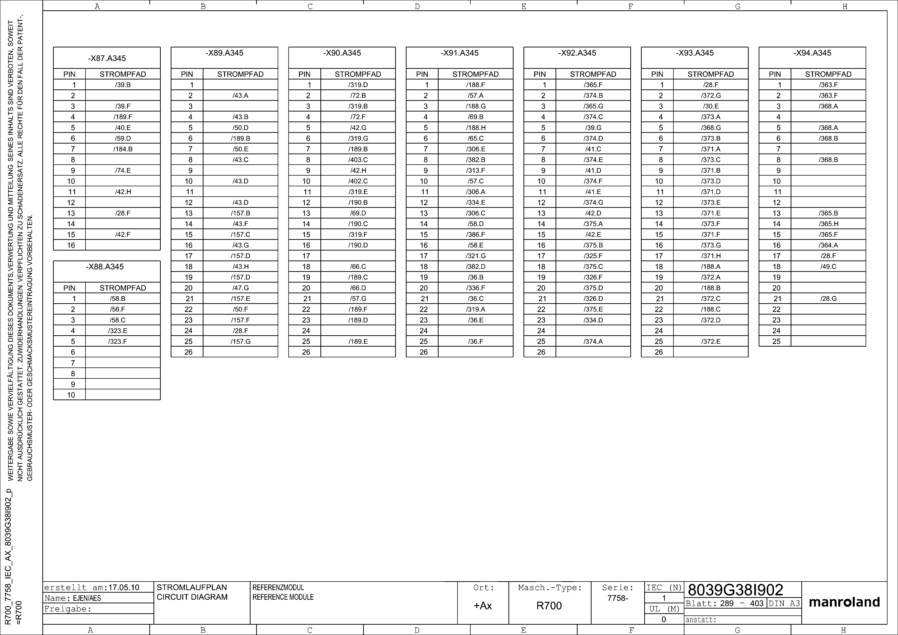

# +Ax — Sheet 289 of 403 — REFERENZMODUL

**REFERENCE MODULE**

> Part of the manroland **R700** printing press IEC/UL circuit diagrams.
> Drawing class: **Stromlaufplan / Circuit diagram** (DIN A3).
> Document `+Ax` covers the **Central control console** machine section.

## At a glance

| Field | Value |
|---|---|
| Document | `+Ax`  (8039G38I902) |
| Sheet | **289** of 403 |
| Section (DE) | REFERENZMODUL |
| Section (EN) | REFERENCE MODULE |
| Section type | REFERENCE_MODULE — Reference module |
| Machine type | `R700` |
| Series | `7758` |
| Created | 17.05.10 |
| Replaces | — |
| Columns used | A, B, C, D, E, F, G, H |
| Path numbers | — |
| Labels on sheet | 349 |
| Cross-refs out | 144 |
| Cross-refs in | 0 |

**Previous:** [+Ax sheet 288](SHEET_0288.md) · **Next:** [+Ax sheet 290](SHEET_0290.md) · **Document TOC:** [_TOC.md](_TOC.md)  (+Ax) · **Master TOC:** [all sheets](../_MASTER_TOC.md)

## Sheet image (300 DPI, exact vector render)



_Rendered directly from the PDF vector layer at 300 DPI (1-bit), no OCR and no resampling. Use it to confirm anything ambiguous in the text below._

## Cross-references on this sheet

Each entry is a wire leaving this sheet. The printed token is `/sheet.column`; the link resolves to that sheet inside the same document.

| Ref | Target sheet | Col | Path | Destination on target | Target section | From col |
|---|---|---|---|---|---|---|
| `/39.B` | [+Ax sheet 39](SHEET_0039.md) | B | — | — | HAUPTANTRIEB | A |
| `/28.F` | [+Ax sheet 28](SHEET_0028.md) | F | — | — | SPANNUNGSVERSORGUNG, SCHALTSCHRANKBELÜFTUNG | G |
| `/188.F` | [+Ax sheet 188](SHEET_0188.md) | F | — | — | RESERVE | E |
| `/365.F` | [+Ax sheet 365](SHEET_0365.md) | F | — | — | OPTION: LOGISTIK AUSLEGER | F |
| `/363.F` | [+Ax sheet 363](SHEET_0363.md) | F | — | — | OPTION: LOGISTIK AUSLEGER | H |
| `/319.D` | [+Ax sheet 319](SHEET_0319.md) | D | — | — | OPTION: "EJEKTOR" ANLAGE / SELECT AIRSTATION / | C |
| `/43.A` | [+Ax sheet 43](SHEET_0043.md) | A | — | — | HAUPTANTRIEB | B |
| `/72.B` | [+Ax sheet 72](SHEET_0072.md) | B | — | — | WASCHVORRICHTUNGEN DRUCKWERKE | C |
| `/57.A` | [+Ax sheet 57](SHEET_0057.md) | A | — | — | LUFTVERSORGUNG | E |
| `/374.B` | [+Ax sheet 374](SHEET_0374.md) | B | — | — | OPTION: VORDERMARKENEINSTELLUNG | F |
| `/363.F` | [+Ax sheet 363](SHEET_0363.md) | F | — | — | OPTION: LOGISTIK AUSLEGER | H |
| `/372.G` | [+Ax sheet 372](SHEET_0372.md) | G | — | — | OPTION: VORDERMARKENEINSTELLUNG | G |
| `/30.E` | [+Ax sheet 30](SHEET_0030.md) | E | — | — | SPANNUNGSVERSORGUNG, SCHALTSCHRANKBELÜFTUNG | G |
| `/39.F` | [+Ax sheet 39](SHEET_0039.md) | F | — | — | HAUPTANTRIEB | A |
| `/319.B` | [+Ax sheet 319](SHEET_0319.md) | B | — | — | OPTION: "EJEKTOR" ANLAGE / SELECT AIRSTATION / | C |
| `/368.A` | [+Ax sheet 368](SHEET_0368.md) | A | — | — | OPTION: LOGISTIK AUSLEGER | H |
| `/188.G` | [+Ax sheet 188](SHEET_0188.md) | G | — | — | RESERVE | E |
| `/365.G` | [+Ax sheet 365](SHEET_0365.md) | G | — | — | OPTION: LOGISTIK AUSLEGER | F |
| `/43.B` | [+Ax sheet 43](SHEET_0043.md) | B | — | — | HAUPTANTRIEB | B |
| `/69.B` | [+Ax sheet 69](SHEET_0069.md) | B | — | — | SAUGBÄNDERTISCH | E |
| `/72.F` | [+Ax sheet 72](SHEET_0072.md) | F | — | — | WASCHVORRICHTUNGEN DRUCKWERKE | C |
| `/373.A` | [+Ax sheet 373](SHEET_0373.md) | A | — | — | OPTION: VORDERMARKENEINSTELLUNG | G |
| `/189.F` | [+Ax sheet 189](SHEET_0189.md) | F | — | — | RESERVE | A |
| `/374.C` | [+Ax sheet 374](SHEET_0374.md) | C | — | — | OPTION: VORDERMARKENEINSTELLUNG | F |
| `/40.E` | [+Ax sheet 40](SHEET_0040.md) | E | — | — | HAUPTANTRIEB | A |
| `/368.A` | [+Ax sheet 368](SHEET_0368.md) | A | — | — | OPTION: LOGISTIK AUSLEGER | H |
| `/42.G` | [+Ax sheet 42](SHEET_0042.md) | G | — | — | HAUPTANTRIEB | C |
| `/39.G` | [+Ax sheet 39](SHEET_0039.md) | G | — | — | HAUPTANTRIEB | F |
| `/50.D` | [+Ax sheet 50](SHEET_0050.md) | D | — | — | STOP SICHERN | B |
| `/368.G` | [+Ax sheet 368](SHEET_0368.md) | G | — | — | OPTION: LOGISTIK AUSLEGER | G |
| `/188.H` | [+Ax sheet 188](SHEET_0188.md) | H | — | — | RESERVE | E |
| `/189.B` | [+Ax sheet 189](SHEET_0189.md) | B | — | — | RESERVE | B |
| `/373.B` | [+Ax sheet 373](SHEET_0373.md) | B | — | — | OPTION: VORDERMARKENEINSTELLUNG | G |
| `/368.B` | [+Ax sheet 368](SHEET_0368.md) | B | — | — | OPTION: LOGISTIK AUSLEGER | H |
| `/59.D` | [+Ax sheet 59](SHEET_0059.md) | D | — | — | DRUCKLUFTANLAGE | A |
| `/319.G` | [+Ax sheet 319](SHEET_0319.md) | G | — | — | OPTION: "EJEKTOR" ANLAGE / SELECT AIRSTATION / | C |
| `/65.C` | [+Ax sheet 65](SHEET_0065.md) | C | — | — | DRUCKLUFTANLAGE | E |
| `/374.D` | [+Ax sheet 374](SHEET_0374.md) | D | — | — | OPTION: VORDERMARKENEINSTELLUNG | F |
| `/50.E` | [+Ax sheet 50](SHEET_0050.md) | E | — | — | STOP SICHERN | B |
| `/184.B` | [+Ax sheet 184](SHEET_0184.md) | B | — | — | RESERVE | A |
| `/189.B` | [+Ax sheet 189](SHEET_0189.md) | B | — | — | RESERVE | C |
| `/306.E` | [+Ax sheet 306](SHEET_0306.md) | E | — | — | SCHÖN & WIDERDRUCK HAUPTSCHALTSCHRANK | E |
| `/371.A` | [+Ax sheet 371](SHEET_0371.md) | A | — | — | OPTION: VORDERMARKENEINSTELLUNG | G |
| `/41.C` | [+Ax sheet 41](SHEET_0041.md) | C | — | — | HAUPTANTRIEB | F |
| `/382.B` | [+Ax sheet 382](SHEET_0382.md) | B | — | — | OPTION: INLINEFOILER PRINDOR | E |
| `/374.E` | [+Ax sheet 374](SHEET_0374.md) | E | — | — | OPTION: VORDERMARKENEINSTELLUNG | F |
| `/368.B` | [+Ax sheet 368](SHEET_0368.md) | B | — | — | OPTION: LOGISTIK AUSLEGER | H |
| `/43.C` | [+Ax sheet 43](SHEET_0043.md) | C | — | — | HAUPTANTRIEB | B |
| `/403.C` | [+Ax sheet 403](SHEET_0403.md) | C | — | — | OPTION: INLINE COLORPILOT | C |
| `/373.C` | [+Ax sheet 373](SHEET_0373.md) | C | — | — | OPTION: VORDERMARKENEINSTELLUNG | G |
| `/74.E` | [+Ax sheet 74](SHEET_0074.md) | E | — | — | FEUCHTMITTELKÜHLGERÄT | A |
| `/371.B` | [+Ax sheet 371](SHEET_0371.md) | B | — | — | OPTION: VORDERMARKENEINSTELLUNG | G |
| `/313.F` | [+Ax sheet 313](SHEET_0313.md) | F | — | — | OPTION: STAUBSAUGER MIT BÜRSTE | E |
| `/42.H` | [+Ax sheet 42](SHEET_0042.md) | H | — | — | HAUPTANTRIEB | C |
| `/41.D` | [+Ax sheet 41](SHEET_0041.md) | D | — | — | HAUPTANTRIEB | F |
| `/374.F` | [+Ax sheet 374](SHEET_0374.md) | F | — | — | OPTION: VORDERMARKENEINSTELLUNG | F |
| `/43.D` | [+Ax sheet 43](SHEET_0043.md) | D | — | — | HAUPTANTRIEB | B |
| `/402.C` | [+Ax sheet 402](SHEET_0402.md) | C | — | — | OPTION: INLINE COLORPILOT | C |
| `/57.C` | [+Ax sheet 57](SHEET_0057.md) | C | — | — | LUFTVERSORGUNG | E |
| `/373.D` | [+Ax sheet 373](SHEET_0373.md) | D | — | — | OPTION: VORDERMARKENEINSTELLUNG | G |
| `/41.E` | [+Ax sheet 41](SHEET_0041.md) | E | — | — | HAUPTANTRIEB | F |
| `/319.E` | [+Ax sheet 319](SHEET_0319.md) | E | — | — | OPTION: "EJEKTOR" ANLAGE / SELECT AIRSTATION / | C |
| `/306.A` | [+Ax sheet 306](SHEET_0306.md) | A | — | — | SCHÖN & WIDERDRUCK HAUPTSCHALTSCHRANK | E |
| `/42.H` | [+Ax sheet 42](SHEET_0042.md) | H | — | — | HAUPTANTRIEB | A |
| `/371.D` | [+Ax sheet 371](SHEET_0371.md) | D | — | — | OPTION: VORDERMARKENEINSTELLUNG | G |
| `/190.B` | [+Ax sheet 190](SHEET_0190.md) | B | — | — | RESERVE | C |
| `/334.E` | [+Ax sheet 334](SHEET_0334.md) | E | — | — | OPTION: INLINESORTER | E |
| `/373.E` | [+Ax sheet 373](SHEET_0373.md) | E | — | — | OPTION: VORDERMARKENEINSTELLUNG | G |
| `/43.D` | [+Ax sheet 43](SHEET_0043.md) | D | — | — | HAUPTANTRIEB | B |
| `/374.G` | [+Ax sheet 374](SHEET_0374.md) | G | — | — | OPTION: VORDERMARKENEINSTELLUNG | F |
| `/28.F` | [+Ax sheet 28](SHEET_0028.md) | F | — | — | SPANNUNGSVERSORGUNG, SCHALTSCHRANKBELÜFTUNG | A |
| `/157.B` | [+Ax sheet 157](SHEET_0157.md) | B | — | — | ÜBERWACHUNGSRECHNER/ANSTEUERUNG NOT AUS | B |
| `/371.E` | [+Ax sheet 371](SHEET_0371.md) | E | — | — | OPTION: VORDERMARKENEINSTELLUNG | G |
| `/365.B` | [+Ax sheet 365](SHEET_0365.md) | B | — | — | OPTION: LOGISTIK AUSLEGER | H |
| `/69.D` | [+Ax sheet 69](SHEET_0069.md) | D | — | — | SAUGBÄNDERTISCH | C |
| `/306.C` | [+Ax sheet 306](SHEET_0306.md) | C | — | — | SCHÖN & WIDERDRUCK HAUPTSCHALTSCHRANK | E |
| `/42.D` | [+Ax sheet 42](SHEET_0042.md) | D | — | — | HAUPTANTRIEB | F |
| `/43.F` | [+Ax sheet 43](SHEET_0043.md) | F | — | — | HAUPTANTRIEB | B |
| `/375.A` | [+Ax sheet 375](SHEET_0375.md) | A | — | — | OPTION: VORDERMARKENEINSTELLUNG | F |
| `/373.F` | [+Ax sheet 373](SHEET_0373.md) | F | — | — | OPTION: VORDERMARKENEINSTELLUNG | G |
| `/58.D` | [+Ax sheet 58](SHEET_0058.md) | D | — | — | LUFTVERSORGUNG | E |
| `/190.C` | [+Ax sheet 190](SHEET_0190.md) | C | — | — | RESERVE | C |
| `/365.H` | [+Ax sheet 365](SHEET_0365.md) | H | — | — | OPTION: LOGISTIK AUSLEGER | H |
| `/42.E` | [+Ax sheet 42](SHEET_0042.md) | E | — | — | HAUPTANTRIEB | F |
| `/42.F` | [+Ax sheet 42](SHEET_0042.md) | F | — | — | HAUPTANTRIEB | A |
| `/319.F` | [+Ax sheet 319](SHEET_0319.md) | F | — | — | OPTION: "EJEKTOR" ANLAGE / SELECT AIRSTATION / | C |
| `/386.F` | [+Ax sheet 386](SHEET_0386.md) | F | — | — | OPTION: INLINECOATER SMART | E |
| `/371.F` | [+Ax sheet 371](SHEET_0371.md) | F | — | — | OPTION: VORDERMARKENEINSTELLUNG | G |
| `/365.F` | [+Ax sheet 365](SHEET_0365.md) | F | — | — | OPTION: LOGISTIK AUSLEGER | H |
| `/157.C` | [+Ax sheet 157](SHEET_0157.md) | C | — | — | ÜBERWACHUNGSRECHNER/ANSTEUERUNG NOT AUS | B |
| `/58.E` | [+Ax sheet 58](SHEET_0058.md) | E | — | — | LUFTVERSORGUNG | E |
| `/43.G` | [+Ax sheet 43](SHEET_0043.md) | G | — | — | HAUPTANTRIEB | B |
| `/375.B` | [+Ax sheet 375](SHEET_0375.md) | B | — | — | OPTION: VORDERMARKENEINSTELLUNG | F |
| `/364.A` | [+Ax sheet 364](SHEET_0364.md) | A | — | — | OPTION: LOGISTIK AUSLEGER | H |
| `/373.G` | [+Ax sheet 373](SHEET_0373.md) | G | — | — | OPTION: VORDERMARKENEINSTELLUNG | G |
| `/190.D` | [+Ax sheet 190](SHEET_0190.md) | D | — | — | RESERVE | C |
| `/28.F` | [+Ax sheet 28](SHEET_0028.md) | F | — | — | SPANNUNGSVERSORGUNG, SCHALTSCHRANKBELÜFTUNG | H |
| `/325.F` | [+Ax sheet 325](SHEET_0325.md) | F | — | — | OPTION: AUTOMATISCHE FARBZUFÜHRUNG | F |
| `/321.G` | [+Ax sheet 321](SHEET_0321.md) | G | — | — | OPTION: "EJEKTOR" ANLAGE / SELECT AIRSTATION / | E |
| `/157.D` | [+Ax sheet 157](SHEET_0157.md) | D | — | — | ÜBERWACHUNGSRECHNER/ANSTEUERUNG NOT AUS | B |
| `/371.H` | [+Ax sheet 371](SHEET_0371.md) | H | — | — | OPTION: VORDERMARKENEINSTELLUNG | G |
| `/188.A` | [+Ax sheet 188](SHEET_0188.md) | A | — | — | RESERVE | G |
| `/43.H` | [+Ax sheet 43](SHEET_0043.md) | H | — | — | HAUPTANTRIEB | B |
| `/66.C` | [+Ax sheet 66](SHEET_0066.md) | C | — | — | DRUCKLUFTANLAGE | C |
| `/49.C` | [+Ax sheet 49](SHEET_0049.md) | C | — | — | NOT AUS | H |
| `/382.D` | [+Ax sheet 382](SHEET_0382.md) | D | — | — | OPTION: INLINEFOILER PRINDOR | E |
| `/375.C` | [+Ax sheet 375](SHEET_0375.md) | C | — | — | OPTION: VORDERMARKENEINSTELLUNG | F |
| `/36.B` | [+Ax sheet 36](SHEET_0036.md) | B | — | — | SCHMIERUNG | E |
| `/372.A` | [+Ax sheet 372](SHEET_0372.md) | A | — | — | OPTION: VORDERMARKENEINSTELLUNG | G |
| `/326.F` | [+Ax sheet 326](SHEET_0326.md) | F | — | — | OPTION: AUTOMATISCHE FARBZUFÜHRUNG | F |
| `/157.D` | [+Ax sheet 157](SHEET_0157.md) | D | — | — | ÜBERWACHUNGSRECHNER/ANSTEUERUNG NOT AUS | B |
| `/189.C` | [+Ax sheet 189](SHEET_0189.md) | C | — | — | RESERVE | C |
| `/188.B` | [+Ax sheet 188](SHEET_0188.md) | B | — | — | RESERVE | G |
| `/47.G` | [+Ax sheet 47](SHEET_0047.md) | G | — | — | NOT AUS | B |
| `/336.F` | [+Ax sheet 336](SHEET_0336.md) | F | — | — | OPTION: LOGISTIK ANLEGER / | E |
| `/66.D` | [+Ax sheet 66](SHEET_0066.md) | D | — | — | DRUCKLUFTANLAGE | C |
| `/375.D` | [+Ax sheet 375](SHEET_0375.md) | D | — | — | OPTION: VORDERMARKENEINSTELLUNG | F |
| `/58.B` | [+Ax sheet 58](SHEET_0058.md) | B | — | — | LUFTVERSORGUNG | A |
| `/157.E` | [+Ax sheet 157](SHEET_0157.md) | E | — | — | ÜBERWACHUNGSRECHNER/ANSTEUERUNG NOT AUS | B |
| `/57.G` | [+Ax sheet 57](SHEET_0057.md) | G | — | — | LUFTVERSORGUNG | C |
| `/28.G` | [+Ax sheet 28](SHEET_0028.md) | G | — | — | SPANNUNGSVERSORGUNG, SCHALTSCHRANKBELÜFTUNG | H |
| `/36.C` | [+Ax sheet 36](SHEET_0036.md) | C | — | — | SCHMIERUNG | E |
| `/326.D` | [+Ax sheet 326](SHEET_0326.md) | D | — | — | OPTION: AUTOMATISCHE FARBZUFÜHRUNG | F |
| `/372.C` | [+Ax sheet 372](SHEET_0372.md) | C | — | — | OPTION: VORDERMARKENEINSTELLUNG | G |
| `/56.F` | [+Ax sheet 56](SHEET_0056.md) | F | — | — | LUFTVERSORGUNG | A |
| `/50.F` | [+Ax sheet 50](SHEET_0050.md) | F | — | — | STOP SICHERN | B |
| `/319.A` | [+Ax sheet 319](SHEET_0319.md) | A | — | — | OPTION: "EJEKTOR" ANLAGE / SELECT AIRSTATION / | E |
| `/375.E` | [+Ax sheet 375](SHEET_0375.md) | E | — | — | OPTION: VORDERMARKENEINSTELLUNG | F |
| `/189.F` | [+Ax sheet 189](SHEET_0189.md) | F | — | — | RESERVE | C |
| `/188.C` | [+Ax sheet 188](SHEET_0188.md) | C | — | — | RESERVE | G |
| `/36.E` | [+Ax sheet 36](SHEET_0036.md) | E | — | — | SCHMIERUNG | E |
| `/157.F` | [+Ax sheet 157](SHEET_0157.md) | F | — | — | ÜBERWACHUNGSRECHNER/ANSTEUERUNG NOT AUS | B |
| `/58.C` | [+Ax sheet 58](SHEET_0058.md) | C | — | — | LUFTVERSORGUNG | A |
| `/189.D` | [+Ax sheet 189](SHEET_0189.md) | D | — | — | RESERVE | C |
| `/334.D` | [+Ax sheet 334](SHEET_0334.md) | D | — | — | OPTION: INLINESORTER | F |
| `/372.D` | [+Ax sheet 372](SHEET_0372.md) | D | — | — | OPTION: VORDERMARKENEINSTELLUNG | G |
| `/323.E` | [+Ax sheet 323](SHEET_0323.md) | E | — | — | OPTION: "EJEKTOR" ANLAGE / SELECT AIRSTATION / | A |
| `/28.F` | [+Ax sheet 28](SHEET_0028.md) | F | — | — | SPANNUNGSVERSORGUNG, SCHALTSCHRANKBELÜFTUNG | B |
| `/36.F` | [+Ax sheet 36](SHEET_0036.md) | F | — | — | SCHMIERUNG | E |
| `/189.E` | [+Ax sheet 189](SHEET_0189.md) | E | — | — | RESERVE | C |
| `/374.A` | [+Ax sheet 374](SHEET_0374.md) | A | — | — | OPTION: VORDERMARKENEINSTELLUNG | F |
| `/372.E` | [+Ax sheet 372](SHEET_0372.md) | E | — | — | OPTION: VORDERMARKENEINSTELLUNG | G |
| `/323.F` | [+Ax sheet 323](SHEET_0323.md) | F | — | — | OPTION: "EJEKTOR" ANLAGE / SELECT AIRSTATION / | A |
| `/157.G` | [+Ax sheet 157](SHEET_0157.md) | G | — | — | ÜBERWACHUNGSRECHNER/ANSTEUERUNG NOT AUS | B |

## Devices on this sheet

| Tag | Class | Class meaning (IEC) | Col | Sub | Terminal | Sign |
|---|---|---|---|---|---|---|
| `X89.A345` | — | cross-device reference | B | — | — | — |
| `X90.A345` | — | cross-device reference | C | — | — | — |
| `X91.A345` | — | cross-device reference | D | — | — | — |
| `X92.A345` | — | cross-device reference | F | — | — | — |
| `X93.A345` | — | cross-device reference | G | — | — | — |
| `X94.A345` | — | cross-device reference | H | — | — | — |
| `X87.A345` | — | cross-device reference | A | — | — | — |
| `X88.A345` | — | cross-device reference | A | — | — | — |

## Potentials / nets

_No named potentials on this sheet._

## Wire-end annotations (grouped as printed)

A wire that continues elsewhere is annotated with a small cluster: the destination description, the path/line number `#NN`, and the `/sheet.column` cross reference. Each row below is one such cluster exactly as it is grouped on the drawing.

| Col | Y | Path | Cross-ref | Text on the wire |
|---|---|---|---|---|
| B | 65.5 | — | — | `X89.A345` |
| C | 65.5 | — | — | `X90.A345` |
| D | 65.5 | — | — | `X91.A345` |
| F | 65.5 | — | — | `X92.A345` |
| G | 65.5 | — | — | `X93.A345` |
| H | 65.5 | — | — | `X94.A345` |
| A | 72.6 | — | — | `X87.A345` |
| A | 94.2 | — | — | `PIN STROMPFAD` |
| B | 94.2 | — | — | `PIN STROMPFAD` |
| C | 94.2 | — | — | `PIN STROMPFAD` |
| D | 94.2 | — | — | `PIN STROMPFAD` |
| E | 94.2 | — | — | `PIN STROMPFAD` |
| G | 94.2 | — | — | `PIN STROMPFAD` |
| H | 94.2 | — | — | `PIN STROMPFAD` |
| A | 108.4 | — | — | `2 3 4 5 6 7 8 9 1` |
| B | 108.4 | — | — | `2 3 4 5 6 7 8 9 1` |
| C | 108.4 | — | — | `2 3 4 5 6 7 8 9 1` |
| D | 108.4 | — | — | `2 3 4 5 6 7 8 9 1` |
| E | 108.4 | — | — | `2 3 4 5 6 7 8 9 1` |
| F | 108.4 | — | — | `2 3 4 5 6 7 8 9 1` |
| G | 108.4 | — | — | `2 3 4 5 6 7 8 9 1` |
| A | 108.7 | — | `/39.B` | — |
| C | 108.7 | — | `/319.D` | — |
| E | 108.7 | — | `/188.F` | — |
| F | 108.7 | — | `/365.F` | — |
| G | 108.7 | — | `/28.F` | — |
| H | 108.7 | — | `/363.F` | — |
| B | 122.8 | — | `/43.A` | — |
| C | 122.8 | — | `/72.B` | — |
| E | 122.8 | — | `/57.A` | — |
| F | 122.9 | — | `/374.B` | — |
| G | 122.9 | — | `/372.G` | — |
| H | 122.9 | — | `/363.F` | — |
| A | 137.0 | — | `/39.F` | — |
| C | 137.0 | — | `/319.B` | — |
| G | 137.0 | — | `/30.E` | — |
| H | 137.0 | — | `/368.A` | — |
| E | 137.1 | — | `/188.G` | — |
| F | 137.1 | — | `/365.G` | — |
| A | 151.2 | — | `/189.F` | — |
| B | 151.2 | — | `/43.B` | — |
| C | 151.2 | — | `/72.F` | — |
| E | 151.2 | — | `/69.B` | — |
| F | 151.2 | — | `/374.C` | — |
| G | 151.2 | — | `/373.A` | — |
| A | 165.4 | — | `/40.E` | — |
| B | 165.4 | — | `/50.D` | — |
| C | 165.4 | — | `/42.G` | — |
| E | 165.4 | — | `/188.H` | — |
| F | 165.4 | — | `/39.G` | — |
| G | 165.4 | — | `/368.G` | — |
| H | 165.4 | — | `/368.A` | — |
| A | 179.6 | — | `/59.D` | — |
| B | 179.6 | — | `/189.B` | — |
| C | 179.6 | — | `/319.G` | — |
| E | 179.6 | — | `/65.C` | — |
| F | 179.6 | — | `/374.D` | — |
| G | 179.6 | — | `/373.B` | — |
| H | 179.6 | — | `/368.B` | — |
| A | 193.7 | — | `/184.B` | — |
| B | 193.7 | — | `/50.E` | — |
| C | 193.7 | — | `/189.B` | — |
| E | 193.7 | — | `/306.E` | — |
| G | 193.7 | — | `/371.A` | — |
| F | 193.8 | — | `/41.C` | — |
| B | 207.9 | — | `/43.C` | — |
| C | 207.9 | — | `/403.C` | — |
| E | 207.9 | — | `/382.B` | — |
| F | 207.9 | — | `/374.E` | — |
| G | 207.9 | — | `/373.C` | — |
| H | 207.9 | — | `/368.B` | — |
| A | 222.1 | — | `/74.E` | — |
| C | 222.1 | — | `/42.H` | — |
| E | 222.1 | — | `/313.F` | — |
| F | 222.1 | — | `/41.D` | — |
| G | 222.1 | — | `/371.B` | — |
| A | 235.9 | — | — | `10 12 13 14 15 16 11` |
| B | 235.9 | — | — | `10 12 13 14 15 16 17 18 19 20 11` |
| C | 235.9 | — | — | `10 12 13 14 15 16 17 18 19 20 11` |
| D | 235.9 | — | — | `10 12 13 14 15 16 17 18 19 20 11` |
| E | 235.9 | — | — | `10 12 13 14 15 16 17 18 19 20 11` |
| F | 235.9 | — | — | `10 12 13 14 15 16 17 18 19 20 11` |
| G | 235.9 | — | — | `10 12 13 14 15 16 17 18 19 20 11` |
| B | 236.3 | — | `/43.D` | — |
| C | 236.3 | — | `/402.C` | — |
| E | 236.3 | — | `/57.C` | — |
| F | 236.3 | — | `/374.F` | — |
| G | 236.3 | — | `/373.D` | — |
| A | 250.4 | — | `/42.H` | — |
| C | 250.4 | — | `/319.E` | — |
| E | 250.4 | — | `/306.A` | — |
| F | 250.4 | — | `/41.E` | — |
| G | 250.4 | — | `/371.D` | — |
| B | 264.6 | — | `/43.D` | — |
| C | 264.6 | — | `/190.B` | — |
| E | 264.6 | — | `/334.E` | — |
| F | 264.6 | — | `/374.G` | — |
| G | 264.6 | — | `/373.E` | — |
| A | 278.8 | — | `/28.F` | — |
| B | 278.8 | — | `/157.B` | — |
| C | 278.8 | — | `/69.D` | — |
| E | 278.8 | — | `/306.C` | — |
| F | 278.8 | — | `/42.D` | — |
| G | 278.8 | — | `/371.E` | — |
| H | 278.8 | — | `/365.B` | — |
| B | 292.9 | — | `/43.F` | — |
| F | 292.9 | — | `/375.A` | — |
| G | 292.9 | — | `/373.F` | — |
| C | 293.0 | — | `/190.C` | — |
| E | 293.0 | — | `/58.D` | — |
| H | 293.0 | — | `/365.H` | — |
| A | 307.1 | — | `/42.F` | — |
| B | 307.1 | — | `/157.C` | — |
| C | 307.1 | — | `/319.F` | — |
| E | 307.1 | — | `/386.F` | — |
| F | 307.1 | — | `/42.E` | — |
| G | 307.1 | — | `/371.F` | — |
| H | 307.1 | — | `/365.F` | — |
| B | 321.3 | — | `/43.G` | — |
| C | 321.3 | — | `/190.D` | — |
| E | 321.3 | — | `/58.E` | — |
| F | 321.3 | — | `/375.B` | — |
| G | 321.3 | — | `/373.G` | — |
| H | 321.3 | — | `/364.A` | — |
| B | 335.5 | — | `/157.D` | — |
| E | 335.5 | — | `/321.G` | — |
| F | 335.5 | — | `/325.F` | — |
| G | 335.5 | — | `/371.H` | — |
| H | 335.5 | — | `/28.F` | — |
| A | 349.0 | — | — | `X88.A345` |
| B | 349.6 | — | `/43.H` | — |
| C | 349.6 | — | `/66.C` | — |
| G | 349.6 | — | `/188.A` | — |
| H | 349.6 | — | `/49.C` | — |
| E | 349.7 | — | `/382.D` | — |
| F | 349.7 | — | `/375.C` | — |
| B | 363.8 | — | `/157.D` | — |
| C | 363.8 | — | `/189.C` | — |
| E | 363.8 | — | `/36.B` | — |
| F | 363.8 | — | `/326.F` | — |
| G | 363.8 | — | `/372.A` | — |
| A | 377.6 | — | — | `PIN 10 2 3 4 5 6 7 8 9 1 STROMPFAD` |
| B | 378.0 | — | `/47.G` | — |
| C | 378.0 | — | `/66.D` | — |
| E | 378.0 | — | `/336.F` | — |
| F | 378.0 | — | `/375.D` | — |
| G | 378.0 | — | `/188.B` | — |
| B | 391.8 | — | — | `22 23 24 25 26 21` |
| C | 391.8 | — | — | `22 23 24 25 26 21` |
| D | 391.8 | — | — | `22 23 24 25 26 21` |
| E | 391.8 | — | — | `22 23 24 25 26 21` |
| F | 391.8 | — | — | `22 23 24 25 26 21` |
| G | 391.8 | — | — | `22 23 24 25 21` |
| A | 392.1 | — | `/58.B` | — |
| B | 392.1 | — | `/157.E` | — |
| C | 392.2 | — | `/57.G` | — |
| E | 392.2 | — | `/36.C` | — |
| F | 392.2 | — | `/326.D` | — |
| G | 392.2 | — | `/372.C` | — |
| H | 392.2 | — | `/28.G` | — |
| A | 406.3 | — | `/56.F` | — |
| B | 406.3 | — | `/50.F` | — |
| C | 406.3 | — | `/189.F` | — |
| E | 406.3 | — | `/319.A` | — |
| F | 406.3 | — | `/375.E` | — |
| G | 406.4 | — | `/188.C` | — |
| A | 420.5 | — | `/58.C` | — |
| B | 420.5 | — | `/157.F` | — |
| C | 420.5 | — | `/189.D` | — |
| E | 420.5 | — | `/36.E` | — |
| F | 420.5 | — | `/334.D` | — |
| G | 420.5 | — | `/372.D` | — |
| A | 434.7 | — | `/323.E` | — |
| B | 434.7 | — | `/28.F` | — |
| E | 448.8 | — | `/36.F` | — |
| A | 448.9 | — | `/323.F` | — |
| B | 448.9 | — | `/157.G` | — |
| C | 448.9 | — | `/189.E` | — |
| F | 448.9 | — | `/374.A` | — |
| G | 448.9 | — | `/372.E` | — |


## Reconstructed tables

This sheet carries tabular content (pin map / terminal assignment / index). The grid below was rebuilt from the drawing's own rule lines, so each row is exactly one physical row of the table.

### Table 1 — 28 data rows × 2 columns (at x=70.9, y=62.4) — **X87.A345**

| PIN | STROMPFAD |
|---|---|
| `1` | `/39.B` |
| `2` |  |
| `3` | `/39.F` |
| `4` | `/189.F` |
| `5` | `/40.E` |
| `6` | `/59.D` |
| `7` | `/184.B` |
| `8` |  |
| `9` | `/74.E` |
| `10` |  |
| `11` | `/42.H` |
| `12` |  |
| `13` | `/28.F` |
| `14` |  |
| `15` | `/42.F` |
| `16` |  |
|  | `X88.A345` |
| `PIN` | `STROMPFAD` |
| `1` | `/58.B` |
| `2` | `/56.F` |
| `3` | `/58.C` |
| `4` | `/323.E` |
| `5` | `/323.F` |
| `6` |  |
| `7` |  |
| `8` |  |
| `9` |  |
| `10` |  |


### Table 2 — 26 data rows × 2 columns (at x=226.8, y=62.4) — **X89.A345**

| PIN | STROMPFAD |
|---|---|
| `1` |  |
| `2` | `/43.A` |
| `3` |  |
| `4` | `/43.B` |
| `5` | `/50.D` |
| `6` | `/189.B` |
| `7` | `/50.E` |
| `8` | `/43.C` |
| `9` |  |
| `10` | `/43.D` |
| `11` |  |
| `12` | `/43.D` |
| `13` | `/157.B` |
| `14` | `/43.F` |
| `15` | `/157.C` |
| `16` | `/43.G` |
| `17` | `/157.D` |
| `18` | `/43.H` |
| `19` | `/157.D` |
| `20` | `/47.G` |
| `21` | `/157.E` |
| `22` | `/50.F` |
| `23` | `/157.F` |
| `24` | `/28.F` |
| `25` | `/157.G` |
| `26` |  |


### Table 3 — 26 data rows × 2 columns (at x=382.7, y=62.4) — **X90.A345**

| PIN | STROMPFAD |
|---|---|
| `1` | `/319.D` |
| `2` | `/72.B` |
| `3` | `/319.B` |
| `4` | `/72.F` |
| `5` | `/42.G` |
| `6` | `/319.G` |
| `7` | `/189.B` |
| `8` | `/403.C` |
| `9` | `/42.H` |
| `10` | `/402.C` |
| `11` | `/319.E` |
| `12` | `/190.B` |
| `13` | `/69.D` |
| `14` | `/190.C` |
| `15` | `/319.F` |
| `16` | `/190.D` |
| `17` |  |
| `18` | `/66.C` |
| `19` | `/189.C` |
| `20` | `/66.D` |
| `21` | `/57.G` |
| `22` | `/189.F` |
| `23` | `/189.D` |
| `24` |  |
| `25` | `/189.E` |
| `26` |  |


### Table 4 — 26 data rows × 2 columns (at x=538.6, y=62.4) — **X91.A345**

| PIN | STROMPFAD |
|---|---|
| `1` | `/188.F` |
| `2` | `/57.A` |
| `3` | `/188.G` |
| `4` | `/69.B` |
| `5` | `/188.H` |
| `6` | `/65.C` |
| `7` | `/306.E` |
| `8` | `/382.B` |
| `9` | `/313.F` |
| `10` | `/57.C` |
| `11` | `/306.A` |
| `12` | `/334.E` |
| `13` | `/306.C` |
| `14` | `/58.D` |
| `15` | `/386.F` |
| `16` | `/58.E` |
| `17` | `/321.G` |
| `18` | `/382.D` |
| `19` | `/36.B` |
| `20` | `/336.F` |
| `21` | `/36.C` |
| `22` | `/319.A` |
| `23` | `/36.E` |
| `24` |  |
| `25` | `/36.F` |
| `26` |  |


### Table 5 — 26 data rows × 2 columns (at x=694.5, y=62.4) — **X92.A345**

| PIN | STROMPFAD |
|---|---|
| `1` | `/365.F` |
| `2` | `/374.B` |
| `3` | `/365.G` |
| `4` | `/374.C` |
| `5` | `/39.G` |
| `6` | `/374.D` |
| `7` | `/41.C` |
| `8` | `/374.E` |
| `9` | `/41.D` |
| `10` | `/374.F` |
| `11` | `/41.E` |
| `12` | `/374.G` |
| `13` | `/42.D` |
| `14` | `/375.A` |
| `15` | `/42.E` |
| `16` | `/375.B` |
| `17` | `/325.F` |
| `18` | `/375.C` |
| `19` | `/326.F` |
| `20` | `/375.D` |
| `21` | `/326.D` |
| `22` | `/375.E` |
| `23` | `/334.D` |
| `24` |  |
| `25` | `/374.A` |
| `26` |  |


### Table 6 — 26 data rows × 2 columns (at x=850.4, y=62.4) — **X93.A345**

| PIN | STROMPFAD |
|---|---|
| `1` | `/28.F` |
| `2` | `/372.G` |
| `3` | `/30.E` |
| `4` | `/373.A` |
| `5` | `/368.G` |
| `6` | `/373.B` |
| `7` | `/371.A` |
| `8` | `/373.C` |
| `9` | `/371.B` |
| `10` | `/373.D` |
| `11` | `/371.D` |
| `12` | `/373.E` |
| `13` | `/371.E` |
| `14` | `/373.F` |
| `15` | `/371.F` |
| `16` | `/373.G` |
| `17` | `/371.H` |
| `18` | `/188.A` |
| `19` | `/372.A` |
| `20` | `/188.B` |
| `21` | `/372.C` |
| `22` | `/188.C` |
| `23` | `/372.D` |
| `24` |  |
| `25` | `/372.E` |
| `26` |  |


### Table 7 — 25 data rows × 2 columns (at x=1006.3, y=62.4) — **X94.A345**

| PIN | STROMPFAD |
|---|---|
| `1` | `/363.F` |
| `2` | `/363.F` |
| `3` | `/368.A` |
| `4` |  |
| `5` | `/368.A` |
| `6` | `/368.B` |
| `7` |  |
| `8` | `/368.B` |
| `9` |  |
| `10` |  |
| `11` |  |
| `12` |  |
| `13` | `/365.B` |
| `14` | `/365.H` |
| `15` | `/365.F` |
| `16` | `/364.A` |
| `17` | `/28.F` |
| `18` | `/49.C` |
| `19` |  |
| `20` |  |
| `21` | `/28.G` |
| `22` |  |
| `23` |  |
| `24` |  |
| `25` |  |


## Notes and free text on this sheet

| Text | Col | Y (pt) |
|---|---|---|
| `PIN` | B | 94.2 |
| `STROMPFAD` | B | 94.15 |
| `PIN` | C | 94.2 |
| `STROMPFAD` | C | 94.15 |
| `PIN` | D | 94.2 |
| `STROMPFAD` | E | 94.15 |
| `PIN` | E | 94.2 |
| `STROMPFAD` | F | 94.15 |
| `PIN` | F | 94.2 |
| `STROMPFAD` | G | 94.15 |
| `PIN` | G | 94.2 |
| `STROMPFAD` | H | 94.15 |
| `PIN` | A | 94.2 |
| `STROMPFAD` | A | 94.15 |

## Complete label inventory (exact text from the drawing)

Every text object inside the drawing area of this sheet, in DIN reading order (column A→H, then top→bottom). This is the authoritative list: if a string is not here it is not printed on this sheet.

| Col | Y | X | Dir | Type | Text |
|---|---|---|---|---|---|
| A | 72.6 | 116.8 | → | device ref | `X87.A345` |
| A | 94.2 | 84.0 | → | text | `PIN` |
| A | 94.2 | 132.2 | → | text | `STROMPFAD` |
| A | 108.4 | 95.8 | → | number | `1` |
| A | 108.7 | 152.8 | → | cross-reference | `/39.B` |
| A | 122.5 | 94.1 | → | number | `2` |
| A | 136.7 | 94.1 | → | number | `3` |
| A | 137.0 | 153.1 | → | cross-reference | `/39.F` |
| A | 150.9 | 94.1 | → | number | `4` |
| A | 151.2 | 150.7 | → | cross-reference | `/189.F` |
| A | 165.1 | 94.1 | → | number | `5` |
| A | 165.4 | 152.9 | → | cross-reference | `/40.E` |
| A | 179.2 | 94.1 | → | number | `6` |
| A | 179.6 | 152.6 | → | cross-reference | `/59.D` |
| A | 193.4 | 94.1 | → | number | `7` |
| A | 193.7 | 150.4 | → | cross-reference | `/184.B` |
| A | 207.6 | 94.1 | → | number | `8` |
| A | 221.8 | 94.1 | → | number | `9` |
| A | 222.1 | 152.9 | → | cross-reference | `/74.E` |
| A | 235.9 | 88.7 | → | number | `10` |
| A | 250.1 | 90.4 | → | number | `11` |
| A | 250.4 | 152.9 | → | cross-reference | `/42.H` |
| A | 264.3 | 88.7 | → | number | `12` |
| A | 278.5 | 88.7 | → | number | `13` |
| A | 278.8 | 153.1 | → | cross-reference | `/28.F` |
| A | 292.6 | 88.7 | → | number | `14` |
| A | 306.8 | 88.7 | → | number | `15` |
| A | 307.1 | 153.1 | → | cross-reference | `/42.F` |
| A | 321.0 | 88.7 | → | number | `16` |
| A | 349.0 | 114.0 | → | device ref | `X88.A345` |
| A | 377.6 | 132.2 | → | text | `STROMPFAD` |
| A | 377.7 | 84.0 | → | text | `PIN` |
| A | 391.8 | 95.8 | → | number | `1` |
| A | 392.1 | 145.7 | → | cross-reference | `/58.B` |
| A | 406.0 | 94.1 | → | number | `2` |
| A | 406.3 | 146.0 | → | cross-reference | `/56.F` |
| A | 420.2 | 94.1 | → | number | `3` |
| A | 420.5 | 145.6 | → | cross-reference | `/58.C` |
| A | 434.4 | 94.1 | → | number | `4` |
| A | 434.7 | 143.4 | → | cross-reference | `/323.E` |
| A | 448.5 | 94.1 | → | number | `5` |
| A | 448.9 | 143.6 | → | cross-reference | `/323.F` |
| A | 462.7 | 94.1 | → | number | `6` |
| A | 476.9 | 94.1 | → | number | `7` |
| A | 491.0 | 94.1 | → | number | `8` |
| A | 505.2 | 94.1 | → | number | `9` |
| A | 519.4 | 88.7 | → | number | `10` |
| B | 65.5 | 272.7 | → | device ref | `X89.A345` |
| B | 94.2 | 240.0 | → | text | `PIN` |
| B | 94.2 | 288.1 | → | text | `STROMPFAD` |
| B | 108.4 | 251.7 | → | number | `1` |
| B | 122.5 | 250.0 | → | number | `2` |
| B | 122.8 | 308.6 | → | cross-reference | `/43.A` |
| B | 136.7 | 250.0 | → | number | `3` |
| B | 150.9 | 250.0 | → | number | `4` |
| B | 151.2 | 308.7 | → | cross-reference | `/43.B` |
| B | 165.1 | 250.0 | → | number | `5` |
| B | 165.4 | 308.6 | → | cross-reference | `/50.D` |
| B | 179.2 | 250.0 | → | number | `6` |
| B | 179.6 | 306.3 | → | cross-reference | `/189.B` |
| B | 193.4 | 250.0 | → | number | `7` |
| B | 193.7 | 308.8 | → | cross-reference | `/50.E` |
| B | 207.6 | 250.0 | → | number | `8` |
| B | 207.9 | 308.6 | → | cross-reference | `/43.C` |
| B | 221.8 | 250.0 | → | number | `9` |
| B | 235.9 | 244.6 | → | number | `10` |
| B | 236.3 | 308.6 | → | cross-reference | `/43.D` |
| B | 250.1 | 246.3 | → | number | `11` |
| B | 264.3 | 244.6 | → | number | `12` |
| B | 264.6 | 308.6 | → | cross-reference | `/43.D` |
| B | 278.5 | 244.6 | → | number | `13` |
| B | 278.8 | 306.3 | → | cross-reference | `/157.B` |
| B | 292.6 | 244.6 | → | number | `14` |
| B | 292.9 | 309.0 | → | cross-reference | `/43.F` |
| B | 306.8 | 244.6 | → | number | `15` |
| B | 307.1 | 306.1 | → | cross-reference | `/157.C` |
| B | 321.0 | 244.6 | → | number | `16` |
| B | 321.3 | 308.4 | → | cross-reference | `/43.G` |
| B | 335.1 | 244.6 | → | number | `17` |
| B | 335.5 | 306.1 | → | cross-reference | `/157.D` |
| B | 349.3 | 244.6 | → | number | `18` |
| B | 349.7 | 308.8 | → | cross-reference | `/43.H` |
| B | 363.5 | 244.6 | → | number | `19` |
| B | 363.8 | 306.1 | → | cross-reference | `/157.D` |
| B | 377.7 | 244.6 | → | number | `20` |
| B | 378.0 | 308.4 | → | cross-reference | `/47.G` |
| B | 391.8 | 246.3 | → | number | `21` |
| B | 392.2 | 306.4 | → | cross-reference | `/157.E` |
| B | 406.0 | 244.6 | → | number | `22` |
| B | 406.3 | 309.0 | → | cross-reference | `/50.F` |
| B | 420.2 | 244.6 | → | number | `23` |
| B | 420.5 | 306.6 | → | cross-reference | `/157.F` |
| B | 434.4 | 244.6 | → | number | `24` |
| B | 434.7 | 309.0 | → | cross-reference | `/28.F` |
| B | 448.5 | 244.6 | → | number | `25` |
| B | 448.9 | 306.0 | → | cross-reference | `/157.G` |
| B | 462.7 | 244.6 | → | number | `26` |
| C | 65.5 | 428.6 | → | device ref | `X90.A345` |
| C | 94.2 | 395.9 | → | text | `PIN` |
| C | 94.2 | 444.0 | → | text | `STROMPFAD` |
| C | 108.4 | 407.6 | → | number | `1` |
| C | 108.7 | 462.0 | → | cross-reference | `/319.D` |
| C | 122.5 | 405.9 | → | number | `2` |
| C | 122.8 | 464.6 | → | cross-reference | `/72.B` |
| C | 136.7 | 405.9 | → | number | `3` |
| C | 137.0 | 462.2 | → | cross-reference | `/319.B` |
| C | 150.9 | 405.9 | → | number | `4` |
| C | 151.2 | 464.9 | → | cross-reference | `/72.F` |
| C | 165.1 | 405.9 | → | number | `5` |
| C | 165.4 | 464.3 | → | cross-reference | `/42.G` |
| C | 179.2 | 405.9 | → | number | `6` |
| C | 179.6 | 461.9 | → | cross-reference | `/319.G` |
| C | 193.4 | 405.9 | → | number | `7` |
| C | 193.7 | 462.2 | → | cross-reference | `/189.B` |
| C | 207.6 | 405.9 | → | number | `8` |
| C | 207.9 | 462.0 | → | cross-reference | `/403.C` |
| C | 221.8 | 405.9 | → | number | `9` |
| C | 222.1 | 464.7 | → | cross-reference | `/42.H` |
| C | 235.9 | 400.5 | → | number | `10` |
| C | 236.3 | 462.0 | → | cross-reference | `/402.C` |
| C | 250.1 | 402.2 | → | number | `11` |
| C | 250.4 | 462.3 | → | cross-reference | `/319.E` |
| C | 264.3 | 400.5 | → | number | `12` |
| C | 264.6 | 462.2 | → | cross-reference | `/190.B` |
| C | 278.5 | 400.5 | → | number | `13` |
| C | 278.8 | 464.5 | → | cross-reference | `/69.D` |
| C | 292.6 | 400.5 | → | number | `14` |
| C | 293.0 | 462.0 | → | cross-reference | `/190.C` |
| C | 306.8 | 400.5 | → | number | `15` |
| C | 307.1 | 462.5 | → | cross-reference | `/319.F` |
| C | 321.0 | 400.5 | → | number | `16` |
| C | 321.3 | 462.0 | → | cross-reference | `/190.D` |
| C | 335.1 | 400.5 | → | number | `17` |
| C | 349.3 | 400.5 | → | number | `18` |
| C | 349.7 | 464.5 | → | cross-reference | `/66.C` |
| C | 363.5 | 400.5 | → | number | `19` |
| C | 363.8 | 462.0 | → | cross-reference | `/189.C` |
| C | 377.7 | 400.5 | → | number | `20` |
| C | 378.0 | 464.5 | → | cross-reference | `/66.D` |
| C | 391.8 | 402.2 | → | number | `21` |
| C | 392.2 | 464.3 | → | cross-reference | `/57.G` |
| C | 406.0 | 400.5 | → | number | `22` |
| C | 406.3 | 462.5 | → | cross-reference | `/189.F` |
| C | 420.2 | 400.5 | → | number | `23` |
| C | 420.5 | 462.0 | → | cross-reference | `/189.D` |
| C | 434.4 | 400.5 | → | number | `24` |
| C | 448.5 | 400.5 | → | number | `25` |
| C | 448.8 | 462.3 | → | cross-reference | `/189.E` |
| C | 462.7 | 400.5 | → | number | `26` |
| D | 65.5 | 584.5 | → | device ref | `X91.A345` |
| D | 94.2 | 551.8 | → | text | `PIN` |
| D | 108.4 | 563.5 | → | number | `1` |
| D | 122.5 | 561.8 | → | number | `2` |
| D | 136.7 | 561.8 | → | number | `3` |
| D | 150.9 | 561.8 | → | number | `4` |
| D | 165.1 | 561.8 | → | number | `5` |
| D | 179.2 | 561.8 | → | number | `6` |
| D | 193.4 | 561.8 | → | number | `7` |
| D | 207.6 | 561.8 | → | number | `8` |
| D | 221.8 | 561.8 | → | number | `9` |
| D | 235.9 | 556.4 | → | number | `10` |
| D | 250.1 | 558.1 | → | number | `11` |
| D | 264.3 | 556.4 | → | number | `12` |
| D | 278.5 | 556.4 | → | number | `13` |
| D | 292.6 | 556.4 | → | number | `14` |
| D | 306.8 | 556.4 | → | number | `15` |
| D | 321.0 | 556.4 | → | number | `16` |
| D | 335.1 | 556.4 | → | number | `17` |
| D | 349.3 | 556.4 | → | number | `18` |
| D | 363.5 | 556.4 | → | number | `19` |
| D | 377.7 | 556.4 | → | number | `20` |
| D | 391.8 | 558.1 | → | number | `21` |
| D | 406.0 | 556.4 | → | number | `22` |
| D | 420.2 | 556.4 | → | number | `23` |
| D | 434.4 | 556.4 | → | number | `24` |
| D | 448.5 | 556.4 | → | number | `25` |
| D | 462.7 | 556.4 | → | number | `26` |
| E | 94.2 | 600.0 | → | text | `STROMPFAD` |
| E | 94.2 | 707.7 | → | text | `PIN` |
| E | 108.4 | 719.4 | → | number | `1` |
| E | 108.7 | 618.4 | → | cross-reference | `/188.F` |
| E | 122.5 | 717.7 | → | number | `2` |
| E | 122.8 | 620.4 | → | cross-reference | `/57.A` |
| E | 136.7 | 717.7 | → | number | `3` |
| E | 137.1 | 617.8 | → | cross-reference | `/188.G` |
| E | 150.9 | 717.7 | → | number | `4` |
| E | 151.2 | 620.5 | → | cross-reference | `/69.B` |
| E | 165.1 | 717.7 | → | number | `5` |
| E | 165.4 | 618.2 | → | cross-reference | `/188.H` |
| E | 179.2 | 717.7 | → | number | `6` |
| E | 179.6 | 620.4 | → | cross-reference | `/65.C` |
| E | 193.4 | 717.7 | → | number | `7` |
| E | 193.7 | 618.2 | → | cross-reference | `/306.E` |
| E | 207.6 | 717.7 | → | number | `8` |
| E | 207.9 | 618.1 | → | cross-reference | `/382.B` |
| E | 221.8 | 717.7 | → | number | `9` |
| E | 222.1 | 618.4 | → | cross-reference | `/313.F` |
| E | 235.9 | 712.3 | → | number | `10` |
| E | 236.3 | 620.4 | → | cross-reference | `/57.C` |
| E | 250.1 | 714.0 | → | number | `11` |
| E | 250.4 | 618.0 | → | cross-reference | `/306.A` |
| E | 264.3 | 712.3 | → | number | `12` |
| E | 264.6 | 618.2 | → | cross-reference | `/334.E` |
| E | 278.5 | 712.3 | → | number | `13` |
| E | 278.8 | 618.0 | → | cross-reference | `/306.C` |
| E | 292.6 | 712.3 | → | number | `14` |
| E | 293.0 | 620.4 | → | cross-reference | `/58.D` |
| E | 306.8 | 712.3 | → | number | `15` |
| E | 307.1 | 618.4 | → | cross-reference | `/386.F` |
| E | 321.0 | 712.3 | → | number | `16` |
| E | 321.3 | 620.6 | → | cross-reference | `/58.E` |
| E | 335.1 | 712.3 | → | number | `17` |
| E | 335.5 | 617.8 | → | cross-reference | `/321.G` |
| E | 349.3 | 712.3 | → | number | `18` |
| E | 349.7 | 618.0 | → | cross-reference | `/382.D` |
| E | 363.5 | 712.3 | → | number | `19` |
| E | 363.8 | 620.5 | → | cross-reference | `/36.B` |
| E | 377.7 | 712.3 | → | number | `20` |
| E | 378.0 | 618.4 | → | cross-reference | `/336.F` |
| E | 391.8 | 714.0 | → | number | `21` |
| E | 392.2 | 620.4 | → | cross-reference | `/36.C` |
| E | 406.0 | 712.3 | → | number | `22` |
| E | 406.3 | 618.0 | → | cross-reference | `/319.A` |
| E | 420.2 | 712.3 | → | number | `23` |
| E | 420.5 | 620.6 | → | cross-reference | `/36.E` |
| E | 434.4 | 712.3 | → | number | `24` |
| E | 448.5 | 712.3 | → | number | `25` |
| E | 448.8 | 620.8 | → | cross-reference | `/36.F` |
| E | 462.7 | 712.3 | → | number | `26` |
| F | 65.5 | 740.4 | → | device ref | `X92.A345` |
| F | 94.2 | 755.9 | → | text | `STROMPFAD` |
| F | 94.2 | 863.6 | → | text | `PIN` |
| F | 108.4 | 875.3 | → | number | `1` |
| F | 108.7 | 774.3 | → | cross-reference | `/365.F` |
| F | 122.5 | 873.6 | → | number | `2` |
| F | 122.9 | 774.0 | → | cross-reference | `/374.B` |
| F | 136.7 | 873.6 | → | number | `3` |
| F | 137.1 | 773.7 | → | cross-reference | `/365.G` |
| F | 150.9 | 873.6 | → | number | `4` |
| F | 151.2 | 773.9 | → | cross-reference | `/374.C` |
| F | 165.1 | 873.6 | → | number | `5` |
| F | 165.4 | 776.1 | → | cross-reference | `/39.G` |
| F | 179.2 | 873.6 | → | number | `6` |
| F | 179.6 | 773.9 | → | cross-reference | `/374.D` |
| F | 193.4 | 873.6 | → | number | `7` |
| F | 193.7 | 776.3 | → | cross-reference | `/41.C` |
| F | 207.6 | 873.6 | → | number | `8` |
| F | 207.9 | 774.1 | → | cross-reference | `/374.E` |
| F | 221.8 | 873.6 | → | number | `9` |
| F | 222.1 | 776.3 | → | cross-reference | `/41.D` |
| F | 235.9 | 868.3 | → | number | `10` |
| F | 236.3 | 774.3 | → | cross-reference | `/374.F` |
| F | 250.1 | 870.0 | → | number | `11` |
| F | 250.4 | 776.6 | → | cross-reference | `/41.E` |
| F | 264.3 | 868.3 | → | number | `12` |
| F | 264.6 | 773.7 | → | cross-reference | `/374.G` |
| F | 278.5 | 868.3 | → | number | `13` |
| F | 278.8 | 776.3 | → | cross-reference | `/42.D` |
| F | 292.6 | 868.3 | → | number | `14` |
| F | 292.9 | 773.9 | → | cross-reference | `/375.A` |
| F | 306.8 | 868.3 | → | number | `15` |
| F | 307.1 | 776.6 | → | cross-reference | `/42.E` |
| F | 321.0 | 868.3 | → | number | `16` |
| F | 321.3 | 774.0 | → | cross-reference | `/375.B` |
| F | 335.1 | 868.3 | → | number | `17` |
| F | 335.5 | 774.3 | → | cross-reference | `/325.F` |
| F | 349.3 | 868.3 | → | number | `18` |
| F | 349.7 | 773.9 | → | cross-reference | `/375.C` |
| F | 363.5 | 868.3 | → | number | `19` |
| F | 363.8 | 774.3 | → | cross-reference | `/326.F` |
| F | 377.7 | 868.3 | → | number | `20` |
| F | 378.0 | 773.9 | → | cross-reference | `/375.D` |
| F | 391.8 | 870.0 | → | number | `21` |
| F | 392.2 | 773.9 | → | cross-reference | `/326.D` |
| F | 406.0 | 868.3 | → | number | `22` |
| F | 406.3 | 774.1 | → | cross-reference | `/375.E` |
| F | 420.2 | 868.3 | → | number | `23` |
| F | 420.5 | 773.9 | → | cross-reference | `/334.D` |
| F | 434.4 | 868.3 | → | number | `24` |
| F | 448.5 | 868.3 | → | number | `25` |
| F | 448.8 | 773.9 | → | cross-reference | `/374.A` |
| F | 462.7 | 868.3 | → | number | `26` |
| G | 65.5 | 896.3 | → | device ref | `X93.A345` |
| G | 94.2 | 911.8 | → | text | `STROMPFAD` |
| G | 94.2 | 1019.5 | → | text | `PIN` |
| G | 108.4 | 1031.2 | → | number | `1` |
| G | 108.7 | 932.6 | → | cross-reference | `/28.F` |
| G | 122.5 | 1029.5 | → | number | `2` |
| G | 122.9 | 929.6 | → | cross-reference | `/372.G` |
| G | 136.7 | 1029.5 | → | number | `3` |
| G | 137.0 | 932.5 | → | cross-reference | `/30.E` |
| G | 150.9 | 1029.5 | → | number | `4` |
| G | 151.2 | 929.8 | → | cross-reference | `/373.A` |
| G | 165.1 | 1029.5 | → | number | `5` |
| G | 165.4 | 929.6 | → | cross-reference | `/368.G` |
| G | 179.2 | 1029.5 | → | number | `6` |
| G | 179.6 | 929.9 | → | cross-reference | `/373.B` |
| G | 193.4 | 1029.5 | → | number | `7` |
| G | 193.7 | 929.8 | → | cross-reference | `/371.A` |
| G | 207.6 | 1029.5 | → | number | `8` |
| G | 207.9 | 929.8 | → | cross-reference | `/373.C` |
| G | 221.8 | 1029.5 | → | number | `9` |
| G | 222.1 | 929.9 | → | cross-reference | `/371.B` |
| G | 235.9 | 1024.2 | → | number | `10` |
| G | 236.3 | 929.8 | → | cross-reference | `/373.D` |
| G | 250.1 | 1025.9 | → | number | `11` |
| G | 250.4 | 929.8 | → | cross-reference | `/371.D` |
| G | 264.3 | 1024.2 | → | number | `12` |
| G | 264.6 | 930.0 | → | cross-reference | `/373.E` |
| G | 278.5 | 1024.2 | → | number | `13` |
| G | 278.8 | 930.0 | → | cross-reference | `/371.E` |
| G | 292.6 | 1024.2 | → | number | `14` |
| G | 293.0 | 930.2 | → | cross-reference | `/373.F` |
| G | 306.8 | 1024.2 | → | number | `15` |
| G | 307.1 | 930.2 | → | cross-reference | `/371.F` |
| G | 321.0 | 1024.2 | → | number | `16` |
| G | 321.3 | 929.6 | → | cross-reference | `/373.G` |
| G | 335.1 | 1024.2 | → | number | `17` |
| G | 335.5 | 930.0 | → | cross-reference | `/371.H` |
| G | 349.3 | 1024.2 | → | number | `18` |
| G | 349.6 | 929.8 | → | cross-reference | `/188.A` |
| G | 363.5 | 1024.2 | → | number | `19` |
| G | 363.8 | 929.8 | → | cross-reference | `/372.A` |
| G | 377.7 | 1024.2 | → | number | `20` |
| G | 378.0 | 929.9 | → | cross-reference | `/188.B` |
| G | 391.8 | 1025.9 | → | number | `21` |
| G | 392.2 | 929.8 | → | cross-reference | `/372.C` |
| G | 406.0 | 1024.2 | → | number | `22` |
| G | 406.4 | 929.8 | → | cross-reference | `/188.C` |
| G | 420.2 | 1024.2 | → | number | `23` |
| G | 420.5 | 929.8 | → | cross-reference | `/372.D` |
| G | 434.4 | 1024.2 | → | number | `24` |
| G | 448.5 | 1024.2 | → | number | `25` |
| G | 448.8 | 930.0 | → | cross-reference | `/372.E` |
| H | 65.5 | 1052.2 | → | device ref | `X94.A345` |
| H | 94.2 | 1067.7 | → | text | `STROMPFAD` |
| H | 108.7 | 1086.1 | → | cross-reference | `/363.F` |
| H | 122.9 | 1086.1 | → | cross-reference | `/363.F` |
| H | 137.0 | 1085.7 | → | cross-reference | `/368.A` |
| H | 165.4 | 1085.7 | → | cross-reference | `/368.A` |
| H | 179.6 | 1085.8 | → | cross-reference | `/368.B` |
| H | 207.9 | 1085.8 | → | cross-reference | `/368.B` |
| H | 278.8 | 1085.8 | → | cross-reference | `/365.B` |
| H | 293.0 | 1086.0 | → | cross-reference | `/365.H` |
| H | 307.1 | 1086.1 | → | cross-reference | `/365.F` |
| H | 321.3 | 1085.7 | → | cross-reference | `/364.A` |
| H | 335.5 | 1088.5 | → | cross-reference | `/28.F` |
| H | 349.7 | 1088.1 | → | cross-reference | `/49.C` |
| H | 392.2 | 1087.9 | → | cross-reference | `/28.G` |

## Reading-order text block

The same content as a plain block, grouped by DIN column — convenient to paste or to match against a visual description.

```text
=== Column A ===
  72.6  116.8  devref       X87.A345
  94.2   84.0  text         PIN
  94.2  132.2  text         STROMPFAD
 108.4   95.8  numeric      1
 108.7  152.8  xref         /39.B
 122.5   94.1  numeric      2
 136.7   94.1  numeric      3
 137.0  153.1  xref         /39.F
 150.9   94.1  numeric      4
 151.2  150.7  xref         /189.F
 165.1   94.1  numeric      5
 165.4  152.9  xref         /40.E
 179.2   94.1  numeric      6
 179.6  152.6  xref         /59.D
 193.4   94.1  numeric      7
 193.7  150.4  xref         /184.B
 207.6   94.1  numeric      8
 221.8   94.1  numeric      9
 222.1  152.9  xref         /74.E
 235.9   88.7  numeric      10
 250.1   90.4  numeric      11
 250.4  152.9  xref         /42.H
 264.3   88.7  numeric      12
 278.5   88.7  numeric      13
 278.8  153.1  xref         /28.F
 292.6   88.7  numeric      14
 306.8   88.7  numeric      15
 307.1  153.1  xref         /42.F
 321.0   88.7  numeric      16
 349.0  114.0  devref       X88.A345
 377.6  132.2  text         STROMPFAD
 377.7   84.0  text         PIN
 391.8   95.8  numeric      1
 392.1  145.7  xref         /58.B
 406.0   94.1  numeric      2
 406.3  146.0  xref         /56.F
 420.2   94.1  numeric      3
 420.5  145.6  xref         /58.C
 434.4   94.1  numeric      4
 434.7  143.4  xref         /323.E
 448.5   94.1  numeric      5
 448.9  143.6  xref         /323.F
 462.7   94.1  numeric      6
 476.9   94.1  numeric      7
 491.0   94.1  numeric      8
 505.2   94.1  numeric      9
 519.4   88.7  numeric      10
=== Column B ===
  65.5  272.7  devref       X89.A345
  94.2  240.0  text         PIN
  94.2  288.1  text         STROMPFAD
 108.4  251.7  numeric      1
 122.5  250.0  numeric      2
 122.8  308.6  xref         /43.A
 136.7  250.0  numeric      3
 150.9  250.0  numeric      4
 151.2  308.7  xref         /43.B
 165.1  250.0  numeric      5
 165.4  308.6  xref         /50.D
 179.2  250.0  numeric      6
 179.6  306.3  xref         /189.B
 193.4  250.0  numeric      7
 193.7  308.8  xref         /50.E
 207.6  250.0  numeric      8
 207.9  308.6  xref         /43.C
 221.8  250.0  numeric      9
 235.9  244.6  numeric      10
 236.3  308.6  xref         /43.D
 250.1  246.3  numeric      11
 264.3  244.6  numeric      12
 264.6  308.6  xref         /43.D
 278.5  244.6  numeric      13
 278.8  306.3  xref         /157.B
 292.6  244.6  numeric      14
 292.9  309.0  xref         /43.F
 306.8  244.6  numeric      15
 307.1  306.1  xref         /157.C
 321.0  244.6  numeric      16
 321.3  308.4  xref         /43.G
 335.1  244.6  numeric      17
 335.5  306.1  xref         /157.D
 349.3  244.6  numeric      18
 349.7  308.8  xref         /43.H
 363.5  244.6  numeric      19
 363.8  306.1  xref         /157.D
 377.7  244.6  numeric      20
 378.0  308.4  xref         /47.G
 391.8  246.3  numeric      21
 392.2  306.4  xref         /157.E
 406.0  244.6  numeric      22
 406.3  309.0  xref         /50.F
 420.2  244.6  numeric      23
 420.5  306.6  xref         /157.F
 434.4  244.6  numeric      24
 434.7  309.0  xref         /28.F
 448.5  244.6  numeric      25
 448.9  306.0  xref         /157.G
 462.7  244.6  numeric      26
=== Column C ===
  65.5  428.6  devref       X90.A345
  94.2  395.9  text         PIN
  94.2  444.0  text         STROMPFAD
 108.4  407.6  numeric      1
 108.7  462.0  xref         /319.D
 122.5  405.9  numeric      2
 122.8  464.6  xref         /72.B
 136.7  405.9  numeric      3
 137.0  462.2  xref         /319.B
 150.9  405.9  numeric      4
 151.2  464.9  xref         /72.F
 165.1  405.9  numeric      5
 165.4  464.3  xref         /42.G
 179.2  405.9  numeric      6
 179.6  461.9  xref         /319.G
 193.4  405.9  numeric      7
 193.7  462.2  xref         /189.B
 207.6  405.9  numeric      8
 207.9  462.0  xref         /403.C
 221.8  405.9  numeric      9
 222.1  464.7  xref         /42.H
 235.9  400.5  numeric      10
 236.3  462.0  xref         /402.C
 250.1  402.2  numeric      11
 250.4  462.3  xref         /319.E
 264.3  400.5  numeric      12
 264.6  462.2  xref         /190.B
 278.5  400.5  numeric      13
 278.8  464.5  xref         /69.D
 292.6  400.5  numeric      14
 293.0  462.0  xref         /190.C
 306.8  400.5  numeric      15
 307.1  462.5  xref         /319.F
 321.0  400.5  numeric      16
 321.3  462.0  xref         /190.D
 335.1  400.5  numeric      17
 349.3  400.5  numeric      18
 349.7  464.5  xref         /66.C
 363.5  400.5  numeric      19
 363.8  462.0  xref         /189.C
 377.7  400.5  numeric      20
 378.0  464.5  xref         /66.D
 391.8  402.2  numeric      21
 392.2  464.3  xref         /57.G
 406.0  400.5  numeric      22
 406.3  462.5  xref         /189.F
 420.2  400.5  numeric      23
 420.5  462.0  xref         /189.D
 434.4  400.5  numeric      24
 448.5  400.5  numeric      25
 448.8  462.3  xref         /189.E
 462.7  400.5  numeric      26
=== Column D ===
  65.5  584.5  devref       X91.A345
  94.2  551.8  text         PIN
 108.4  563.5  numeric      1
 122.5  561.8  numeric      2
 136.7  561.8  numeric      3
 150.9  561.8  numeric      4
 165.1  561.8  numeric      5
 179.2  561.8  numeric      6
 193.4  561.8  numeric      7
 207.6  561.8  numeric      8
 221.8  561.8  numeric      9
 235.9  556.4  numeric      10
 250.1  558.1  numeric      11
 264.3  556.4  numeric      12
 278.5  556.4  numeric      13
 292.6  556.4  numeric      14
 306.8  556.4  numeric      15
 321.0  556.4  numeric      16
 335.1  556.4  numeric      17
 349.3  556.4  numeric      18
 363.5  556.4  numeric      19
 377.7  556.4  numeric      20
 391.8  558.1  numeric      21
 406.0  556.4  numeric      22
 420.2  556.4  numeric      23
 434.4  556.4  numeric      24
 448.5  556.4  numeric      25
 462.7  556.4  numeric      26
=== Column E ===
  94.2  600.0  text         STROMPFAD
  94.2  707.7  text         PIN
 108.4  719.4  numeric      1
 108.7  618.4  xref         /188.F
 122.5  717.7  numeric      2
 122.8  620.4  xref         /57.A
 136.7  717.7  numeric      3
 137.1  617.8  xref         /188.G
 150.9  717.7  numeric      4
 151.2  620.5  xref         /69.B
 165.1  717.7  numeric      5
 165.4  618.2  xref         /188.H
 179.2  717.7  numeric      6
 179.6  620.4  xref         /65.C
 193.4  717.7  numeric      7
 193.7  618.2  xref         /306.E
 207.6  717.7  numeric      8
 207.9  618.1  xref         /382.B
 221.8  717.7  numeric      9
 222.1  618.4  xref         /313.F
 235.9  712.3  numeric      10
 236.3  620.4  xref         /57.C
 250.1  714.0  numeric      11
 250.4  618.0  xref         /306.A
 264.3  712.3  numeric      12
 264.6  618.2  xref         /334.E
 278.5  712.3  numeric      13
 278.8  618.0  xref         /306.C
 292.6  712.3  numeric      14
 293.0  620.4  xref         /58.D
 306.8  712.3  numeric      15
 307.1  618.4  xref         /386.F
 321.0  712.3  numeric      16
 321.3  620.6  xref         /58.E
 335.1  712.3  numeric      17
 335.5  617.8  xref         /321.G
 349.3  712.3  numeric      18
 349.7  618.0  xref         /382.D
 363.5  712.3  numeric      19
 363.8  620.5  xref         /36.B
 377.7  712.3  numeric      20
 378.0  618.4  xref         /336.F
 391.8  714.0  numeric      21
 392.2  620.4  xref         /36.C
 406.0  712.3  numeric      22
 406.3  618.0  xref         /319.A
 420.2  712.3  numeric      23
 420.5  620.6  xref         /36.E
 434.4  712.3  numeric      24
 448.5  712.3  numeric      25
 448.8  620.8  xref         /36.F
 462.7  712.3  numeric      26
=== Column F ===
  65.5  740.4  devref       X92.A345
  94.2  755.9  text         STROMPFAD
  94.2  863.6  text         PIN
 108.4  875.3  numeric      1
 108.7  774.3  xref         /365.F
 122.5  873.6  numeric      2
 122.9  774.0  xref         /374.B
 136.7  873.6  numeric      3
 137.1  773.7  xref         /365.G
 150.9  873.6  numeric      4
 151.2  773.9  xref         /374.C
 165.1  873.6  numeric      5
 165.4  776.1  xref         /39.G
 179.2  873.6  numeric      6
 179.6  773.9  xref         /374.D
 193.4  873.6  numeric      7
 193.7  776.3  xref         /41.C
 207.6  873.6  numeric      8
 207.9  774.1  xref         /374.E
 221.8  873.6  numeric      9
 222.1  776.3  xref         /41.D
 235.9  868.3  numeric      10
 236.3  774.3  xref         /374.F
 250.1  870.0  numeric      11
 250.4  776.6  xref         /41.E
 264.3  868.3  numeric      12
 264.6  773.7  xref         /374.G
 278.5  868.3  numeric      13
 278.8  776.3  xref         /42.D
 292.6  868.3  numeric      14
 292.9  773.9  xref         /375.A
 306.8  868.3  numeric      15
 307.1  776.6  xref         /42.E
 321.0  868.3  numeric      16
 321.3  774.0  xref         /375.B
 335.1  868.3  numeric      17
 335.5  774.3  xref         /325.F
 349.3  868.3  numeric      18
 349.7  773.9  xref         /375.C
 363.5  868.3  numeric      19
 363.8  774.3  xref         /326.F
 377.7  868.3  numeric      20
 378.0  773.9  xref         /375.D
 391.8  870.0  numeric      21
 392.2  773.9  xref         /326.D
 406.0  868.3  numeric      22
 406.3  774.1  xref         /375.E
 420.2  868.3  numeric      23
 420.5  773.9  xref         /334.D
 434.4  868.3  numeric      24
 448.5  868.3  numeric      25
 448.8  773.9  xref         /374.A
 462.7  868.3  numeric      26
=== Column G ===
  65.5  896.3  devref       X93.A345
  94.2  911.8  text         STROMPFAD
  94.2 1019.5  text         PIN
 108.4 1031.2  numeric      1
 108.7  932.6  xref         /28.F
 122.5 1029.5  numeric      2
 122.9  929.6  xref         /372.G
 136.7 1029.5  numeric      3
 137.0  932.5  xref         /30.E
 150.9 1029.5  numeric      4
 151.2  929.8  xref         /373.A
 165.1 1029.5  numeric      5
 165.4  929.6  xref         /368.G
 179.2 1029.5  numeric      6
 179.6  929.9  xref         /373.B
 193.4 1029.5  numeric      7
 193.7  929.8  xref         /371.A
 207.6 1029.5  numeric      8
 207.9  929.8  xref         /373.C
 221.8 1029.5  numeric      9
 222.1  929.9  xref         /371.B
 235.9 1024.2  numeric      10
 236.3  929.8  xref         /373.D
 250.1 1025.9  numeric      11
 250.4  929.8  xref         /371.D
 264.3 1024.2  numeric      12
 264.6  930.0  xref         /373.E
 278.5 1024.2  numeric      13
 278.8  930.0  xref         /371.E
 292.6 1024.2  numeric      14
 293.0  930.2  xref         /373.F
 306.8 1024.2  numeric      15
 307.1  930.2  xref         /371.F
 321.0 1024.2  numeric      16
 321.3  929.6  xref         /373.G
 335.1 1024.2  numeric      17
 335.5  930.0  xref         /371.H
 349.3 1024.2  numeric      18
 349.6  929.8  xref         /188.A
 363.5 1024.2  numeric      19
 363.8  929.8  xref         /372.A
 377.7 1024.2  numeric      20
 378.0  929.9  xref         /188.B
 391.8 1025.9  numeric      21
 392.2  929.8  xref         /372.C
 406.0 1024.2  numeric      22
 406.4  929.8  xref         /188.C
 420.2 1024.2  numeric      23
 420.5  929.8  xref         /372.D
 434.4 1024.2  numeric      24
 448.5 1024.2  numeric      25
 448.8  930.0  xref         /372.E
=== Column H ===
  65.5 1052.2  devref       X94.A345
  94.2 1067.7  text         STROMPFAD
 108.7 1086.1  xref         /363.F
 122.9 1086.1  xref         /363.F
 137.0 1085.7  xref         /368.A
 165.4 1085.7  xref         /368.A
 179.6 1085.8  xref         /368.B
 207.9 1085.8  xref         /368.B
 278.8 1085.8  xref         /365.B
 293.0 1086.0  xref         /365.H
 307.1 1086.1  xref         /365.F
 321.3 1085.7  xref         /364.A
 335.5 1088.5  xref         /28.F
 349.7 1088.1  xref         /49.C
 392.2 1087.9  xref         /28.G
```

---
_Generated from the PDF vector text layer; no OCR. Source: `R700_7758_IEC_AX_8039G38I902_p`, sheet 289._
