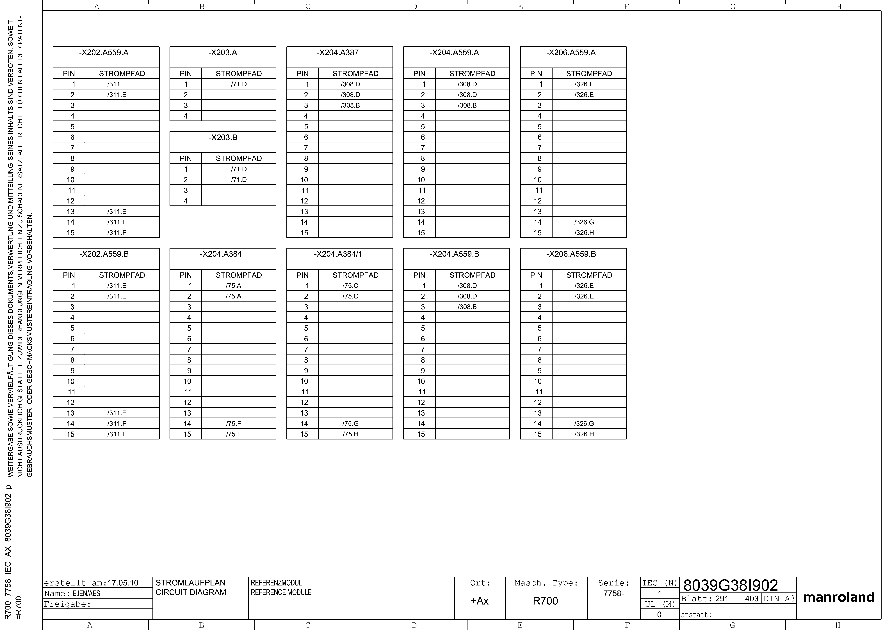

# +Ax — Sheet 291 of 403 — REFERENZMODUL

**REFERENCE MODULE**

> Part of the manroland **R700** printing press IEC/UL circuit diagrams.
> Drawing class: **Stromlaufplan / Circuit diagram** (DIN A3).
> Document `+Ax` covers the **Central control console** machine section.

## At a glance

| Field | Value |
|---|---|
| Document | `+Ax`  (8039G38I902) |
| Sheet | **291** of 403 |
| Section (DE) | REFERENZMODUL |
| Section (EN) | REFERENCE MODULE |
| Section type | REFERENCE_MODULE — Reference module |
| Machine type | `R700` |
| Series | `7758` |
| Created | 17.05.10 |
| Replaces | — |
| Columns used | A, B, C, D, E, F |
| Path numbers | — |
| Labels on sheet | 214 |
| Cross-refs out | 38 |
| Cross-refs in | 0 |

**Previous:** [+Ax sheet 290](SHEET_0290.md) · **Next:** [+Ax sheet 292](SHEET_0292.md) · **Document TOC:** [_TOC.md](_TOC.md)  (+Ax) · **Master TOC:** [all sheets](../_MASTER_TOC.md)

## Sheet image (300 DPI, exact vector render)



_Rendered directly from the PDF vector layer at 300 DPI (1-bit), no OCR and no resampling. Use it to confirm anything ambiguous in the text below._

## Cross-references on this sheet

Each entry is a wire leaving this sheet. The printed token is `/sheet.column`; the link resolves to that sheet inside the same document.

| Ref | Target sheet | Col | Path | Destination on target | Target section | From col |
|---|---|---|---|---|---|---|
| `/71.D` | [+Ax sheet 71](SHEET_0071.md) | D | — | STROMPFAD PIN 1 2 3 4 | WASCHVORRICHTUNGEN DRUCKWERKE | B |
| `/311.E` | [+Ax sheet 311](SHEET_0311.md) | E | — | — | OPTION: IONISATIONSANLAGE ANLEGER | A |
| `/326.E` | [+Ax sheet 326](SHEET_0326.md) | E | — | — | OPTION: AUTOMATISCHE FARBZUFÜHRUNG | F |
| `/308.D` | [+Ax sheet 308](SHEET_0308.md) | D | — | — | OPTION: KOMBIGERÄT | C |
| `/308.D` | [+Ax sheet 308](SHEET_0308.md) | D | — | — | OPTION: KOMBIGERÄT | E |
| `/311.E` | [+Ax sheet 311](SHEET_0311.md) | E | — | — | OPTION: IONISATIONSANLAGE ANLEGER | A |
| `/326.E` | [+Ax sheet 326](SHEET_0326.md) | E | — | — | OPTION: AUTOMATISCHE FARBZUFÜHRUNG | F |
| `/308.D` | [+Ax sheet 308](SHEET_0308.md) | D | — | — | OPTION: KOMBIGERÄT | C |
| `/308.D` | [+Ax sheet 308](SHEET_0308.md) | D | — | — | OPTION: KOMBIGERÄT | E |
| `/308.B` | [+Ax sheet 308](SHEET_0308.md) | B | — | — | OPTION: KOMBIGERÄT | C |
| `/308.B` | [+Ax sheet 308](SHEET_0308.md) | B | — | — | OPTION: KOMBIGERÄT | E |
| `/71.D` | [+Ax sheet 71](SHEET_0071.md) | D | — | — | WASCHVORRICHTUNGEN DRUCKWERKE | B |
| `/71.D` | [+Ax sheet 71](SHEET_0071.md) | D | — | — | WASCHVORRICHTUNGEN DRUCKWERKE | B |
| `/311.E` | [+Ax sheet 311](SHEET_0311.md) | E | — | — | OPTION: IONISATIONSANLAGE ANLEGER | A |
| `/311.F` | [+Ax sheet 311](SHEET_0311.md) | F | — | — | OPTION: IONISATIONSANLAGE ANLEGER | A |
| `/326.G` | [+Ax sheet 326](SHEET_0326.md) | G | — | — | OPTION: AUTOMATISCHE FARBZUFÜHRUNG | F |
| `/311.F` | [+Ax sheet 311](SHEET_0311.md) | F | — | — | OPTION: IONISATIONSANLAGE ANLEGER | A |
| `/326.H` | [+Ax sheet 326](SHEET_0326.md) | H | — | — | OPTION: AUTOMATISCHE FARBZUFÜHRUNG | F |
| `/75.A` | [+Ax sheet 75](SHEET_0075.md) | A | — | — | FEUCHTMITTELKÜHLGERÄT | B |
| `/311.E` | [+Ax sheet 311](SHEET_0311.md) | E | — | — | OPTION: IONISATIONSANLAGE ANLEGER | A |
| `/326.E` | [+Ax sheet 326](SHEET_0326.md) | E | — | — | OPTION: AUTOMATISCHE FARBZUFÜHRUNG | F |
| `/75.C` | [+Ax sheet 75](SHEET_0075.md) | C | — | — | FEUCHTMITTELKÜHLGERÄT | C |
| `/308.D` | [+Ax sheet 308](SHEET_0308.md) | D | — | — | OPTION: KOMBIGERÄT | E |
| `/75.A` | [+Ax sheet 75](SHEET_0075.md) | A | — | — | FEUCHTMITTELKÜHLGERÄT | B |
| `/311.E` | [+Ax sheet 311](SHEET_0311.md) | E | — | — | OPTION: IONISATIONSANLAGE ANLEGER | A |
| `/326.E` | [+Ax sheet 326](SHEET_0326.md) | E | — | — | OPTION: AUTOMATISCHE FARBZUFÜHRUNG | F |
| `/75.C` | [+Ax sheet 75](SHEET_0075.md) | C | — | — | FEUCHTMITTELKÜHLGERÄT | C |
| `/308.D` | [+Ax sheet 308](SHEET_0308.md) | D | — | — | OPTION: KOMBIGERÄT | E |
| `/308.B` | [+Ax sheet 308](SHEET_0308.md) | B | — | — | OPTION: KOMBIGERÄT | E |
| `/311.E` | [+Ax sheet 311](SHEET_0311.md) | E | — | — | OPTION: IONISATIONSANLAGE ANLEGER | A |
| `/75.F` | [+Ax sheet 75](SHEET_0075.md) | F | — | — | FEUCHTMITTELKÜHLGERÄT | B |
| `/311.F` | [+Ax sheet 311](SHEET_0311.md) | F | — | — | OPTION: IONISATIONSANLAGE ANLEGER | A |
| `/75.G` | [+Ax sheet 75](SHEET_0075.md) | G | — | — | FEUCHTMITTELKÜHLGERÄT | C |
| `/326.G` | [+Ax sheet 326](SHEET_0326.md) | G | — | — | OPTION: AUTOMATISCHE FARBZUFÜHRUNG | F |
| `/75.F` | [+Ax sheet 75](SHEET_0075.md) | F | — | — | FEUCHTMITTELKÜHLGERÄT | B |
| `/311.F` | [+Ax sheet 311](SHEET_0311.md) | F | — | — | OPTION: IONISATIONSANLAGE ANLEGER | A |
| `/75.H` | [+Ax sheet 75](SHEET_0075.md) | H | — | — | FEUCHTMITTELKÜHLGERÄT | C |
| `/326.H` | [+Ax sheet 326](SHEET_0326.md) | H | — | — | OPTION: AUTOMATISCHE FARBZUFÜHRUNG | F |

## Devices on this sheet

| Tag | Class | Class meaning (IEC) | Col | Sub | Terminal | Sign |
|---|---|---|---|---|---|---|
| `X202.A559.A` | — | cross-device reference | A | — | — | — |
| `X202.A559.B` | — | cross-device reference | A | — | — | — |
| `X203.A` | — | cross-device reference | B | — | — | — |
| `X203.B` | — | cross-device reference | B | — | — | — |
| `X204.A559.A` | — | cross-device reference | D | — | — | — |
| `X204.A559.B` | — | cross-device reference | D | — | — | — |
| `X206.A559.A` | — | cross-device reference | E | — | — | — |
| `X206.A559.B` | — | cross-device reference | E | — | — | — |
| `X204.A387` | — | cross-device reference | C | — | — | — |
| `X204.A384` | — | cross-device reference | B | — | — | — |

## Potentials / nets

_No named potentials on this sheet._

## Wire-end annotations (grouped as printed)

A wire that continues elsewhere is annotated with a small cluster: the destination description, the path/line number `#NN`, and the `/sheet.column` cross reference. Each row below is one such cluster exactly as it is grouped on the drawing.

| Col | Y | Path | Cross-ref | Text on the wire |
|---|---|---|---|---|
| A | 65.5 | — | — | `X202.A559.A` |
| B | 65.5 | — | — | `X203.A` |
| C | 65.5 | — | — | `X204.A387` |
| D | 65.5 | — | — | `X204.A559.A` |
| E | 65.5 | — | — | `X206.A559.A` |
| A | 94.2 | — | — | `PIN 10 12 13 14 15 11 2 3 4 5 6 7 8 9 1 STROMPFAD` |
| B | 94.2 | — | `/71.D` | `PIN 2 3 4 1 STROMPFAD` |
| C | 94.2 | — | — | `PIN 10 12 13 14 15 11 2 3 4 5 6 7 8 9 1 STROMPFAD` |
| D | 94.2 | — | — | `PIN 10 12 13 14 15 11 2 3 4 5 6 7 8 9 1 STROMPFAD` |
| E | 94.2 | — | — | `PIN 10 12 13 14 15 11 2 3 4 5 6 7 8 9 1 STROMPFAD` |
| A | 108.7 | — | `/311.E` | — |
| C | 108.7 | — | `/308.D` | — |
| E | 108.7 | — | `/308.D` | — |
| F | 108.7 | — | `/326.E` | — |
| A | 122.9 | — | `/311.E` | — |
| C | 122.9 | — | `/308.D` | — |
| E | 122.9 | — | `/308.D` | — |
| F | 122.9 | — | `/326.E` | — |
| C | 137.0 | — | `/308.B` | — |
| E | 137.0 | — | `/308.B` | — |
| B | 178.9 | — | — | `X203.B` |
| B | 207.5 | — | — | `PIN 2 3 4 1 STROMPFAD` |
| B | 222.1 | — | `/71.D` | — |
| B | 236.3 | — | `/71.D` | — |
| A | 278.8 | — | `/311.E` | — |
| A | 292.9 | — | `/311.F` | — |
| F | 293.0 | — | `/326.G` | — |
| A | 307.1 | — | `/311.F` | — |
| F | 307.1 | — | `/326.H` | — |
| A | 334.8 | — | — | `X202.A559.B` |
| B | 334.8 | — | — | `X204.A384` |
| C | 334.8 | — | — | `X204.A384/1` |
| D | 334.8 | — | — | `X204.A559.B` |
| E | 334.8 | — | — | `X206.A559.B` |
| A | 363.4 | — | — | `PIN 10 12 13 14 15 11 2 3 4 5 6 7 8 9 1 STROMPFAD` |
| B | 363.4 | — | — | `PIN 10 12 13 14 15 11 2 3 4 5 6 7 8 9 1 STROMPFAD` |
| C | 363.4 | — | — | `PIN 10 12 13 14 15 11 2 3 4 5 6 7 8 9 1 STROMPFAD` |
| D | 363.4 | — | — | `PIN 10 12 13 14 15 11 2 3 4 5 6 7 8 9 1 STROMPFAD` |
| E | 363.4 | — | — | `PIN 10 12 13 14 15 11 2 3 4 5 6 7 8 9 1 STROMPFAD` |
| A | 378.0 | — | `/311.E` | — |
| B | 378.0 | — | `/75.A` | — |
| C | 378.0 | — | `/75.C` | — |
| E | 378.0 | — | `/308.D` | — |
| F | 378.0 | — | `/326.E` | — |
| A | 392.1 | — | `/311.E` | — |
| B | 392.1 | — | `/75.A` | — |
| F | 392.1 | — | `/326.E` | — |
| C | 392.2 | — | `/75.C` | — |
| E | 392.2 | — | `/308.D` | — |
| E | 406.3 | — | `/308.B` | — |
| A | 548.1 | — | `/311.E` | — |
| A | 562.2 | — | `/311.F` | — |
| B | 562.2 | — | `/75.F` | — |
| C | 562.2 | — | `/75.G` | — |
| F | 562.2 | — | `/326.G` | — |
| A | 576.4 | — | `/311.F` | — |
| B | 576.4 | — | `/75.F` | — |
| C | 576.4 | — | `/75.H` | — |
| F | 576.4 | — | `/326.H` | — |


## Reconstructed tables

This sheet carries tabular content (pin map / terminal assignment / index). The grid below was rebuilt from the drawing's own rule lines, so each row is exactly one physical row of the table.

### Table 1 — 32 data rows × 2 columns (at x=70.9, y=62.4) — **X202.A559.A**

| PIN | STROMPFAD |
|---|---|
| `1` | `/311.E` |
| `2` | `/311.E` |
| `3` |  |
| `4` |  |
| `5` |  |
| `6` |  |
| `7` |  |
| `8` |  |
| `9` |  |
| `10` |  |
| `11` |  |
| `12` |  |
| `13` | `/311.E` |
| `14` | `/311.F` |
| `15` | `/311.F` |
|  | `X202.A559.B` |
| `PIN` | `STROMPFAD` |
| `1` | `/311.E` |
| `2` | `/311.E` |
| `3` |  |
| `4` |  |
| `5` |  |
| `6` |  |
| `7` |  |
| `8` |  |
| `9` |  |
| `10` |  |
| `11` |  |
| `12` |  |
| `13` | `/311.E` |
| `14` | `/311.F` |
| `15` | `/311.F` |


### Table 2 — 27 data rows × 2 columns (at x=226.8, y=62.4) — **X203.A**

| PIN | STROMPFAD |
|---|---|
| `1` | `/71.D` |
| `2` |  |
| `3` |  |
| `4` |  |
|  | `X203.B` |
| `PIN` | `STROMPFAD` |
| `1` | `/71.D` |
| `2` | `/71.D` |
| `3` |  |
| `4` |  |
|  | `X204.A384` |
| `PIN` | `STROMPFAD` |
| `1` | `/75.A` |
| `2` | `/75.A` |
| `3` |  |
| `4` |  |
| `5` |  |
| `6` |  |
| `7` |  |
| `8` |  |
| `9` |  |
| `10` |  |
| `11` |  |
| `12` |  |
| `13` |  |
| `14` | `/75.F` |
| `15` | `/75.F` |


### Table 3 — 32 data rows × 2 columns (at x=382.7, y=62.4) — **X204.A387**

| PIN | STROMPFAD |
|---|---|
| `1` | `/308.D` |
| `2` | `/308.D` |
| `3` | `/308.B` |
| `4` |  |
| `5` |  |
| `6` |  |
| `7` |  |
| `8` |  |
| `9` |  |
| `10` |  |
| `11` |  |
| `12` |  |
| `13` |  |
| `14` |  |
| `15` |  |
|  | `X204.A384/1` |
| `PIN` | `STROMPFAD` |
| `1` | `/75.C` |
| `2` | `/75.C` |
| `3` |  |
| `4` |  |
| `5` |  |
| `6` |  |
| `7` |  |
| `8` |  |
| `9` |  |
| `10` |  |
| `11` |  |
| `12` |  |
| `13` |  |
| `14` | `/75.G` |
| `15` | `/75.H` |


### Table 4 — 32 data rows × 2 columns (at x=538.6, y=62.4) — **X204.A559.A**

| PIN | STROMPFAD |
|---|---|
| `1` | `/308.D` |
| `2` | `/308.D` |
| `3` | `/308.B` |
| `4` |  |
| `5` |  |
| `6` |  |
| `7` |  |
| `8` |  |
| `9` |  |
| `10` |  |
| `11` |  |
| `12` |  |
| `13` |  |
| `14` |  |
| `15` |  |
|  | `X204.A559.B` |
| `PIN` | `STROMPFAD` |
| `1` | `/308.D` |
| `2` | `/308.D` |
| `3` | `/308.B` |
| `4` |  |
| `5` |  |
| `6` |  |
| `7` |  |
| `8` |  |
| `9` |  |
| `10` |  |
| `11` |  |
| `12` |  |
| `13` |  |
| `14` |  |
| `15` |  |


### Table 5 — 32 data rows × 2 columns (at x=694.5, y=62.4) — **X206.A559.A**

| PIN | STROMPFAD |
|---|---|
| `1` | `/326.E` |
| `2` | `/326.E` |
| `3` |  |
| `4` |  |
| `5` |  |
| `6` |  |
| `7` |  |
| `8` |  |
| `9` |  |
| `10` |  |
| `11` |  |
| `12` |  |
| `13` |  |
| `14` | `/326.G` |
| `15` | `/326.H` |
|  | `X206.A559.B` |
| `PIN` | `STROMPFAD` |
| `1` | `/326.E` |
| `2` | `/326.E` |
| `3` |  |
| `4` |  |
| `5` |  |
| `6` |  |
| `7` |  |
| `8` |  |
| `9` |  |
| `10` |  |
| `11` |  |
| `12` |  |
| `13` |  |
| `14` | `/326.G` |
| `15` | `/326.H` |


## Notes and free text on this sheet

| Text | Col | Y (pt) |
|---|---|---|
| `PIN` | A | 94.2 |
| `STROMPFAD` | A | 94.15 |
| `PIN` | B | 94.2 |
| `STROMPFAD` | B | 94.15 |
| `PIN` | D | 94.2 |
| `STROMPFAD` | E | 94.15 |
| `PIN` | E | 94.2 |
| `STROMPFAD` | F | 94.15 |
| `PIN` | C | 94.2 |
| `STROMPFAD` | C | 94.15 |
| `X204.A384/1` | C | 334.79 |

## Complete label inventory (exact text from the drawing)

Every text object inside the drawing area of this sheet, in DIN reading order (column A→H, then top→bottom). This is the authoritative list: if a string is not here it is not printed on this sheet.

| Col | Y | X | Dir | Type | Text |
|---|---|---|---|---|---|
| A | 65.5 | 105.6 | → | device ref | `X202.A559.A` |
| A | 94.2 | 84.0 | → | text | `PIN` |
| A | 94.2 | 132.2 | → | text | `STROMPFAD` |
| A | 108.4 | 95.8 | → | number | `1` |
| A | 108.7 | 143.4 | → | cross-reference | `/311.E` |
| A | 122.5 | 94.1 | → | number | `2` |
| A | 122.9 | 143.4 | → | cross-reference | `/311.E` |
| A | 136.7 | 94.1 | → | number | `3` |
| A | 150.9 | 94.1 | → | number | `4` |
| A | 165.1 | 94.1 | → | number | `5` |
| A | 179.2 | 94.1 | → | number | `6` |
| A | 193.4 | 94.1 | → | number | `7` |
| A | 207.6 | 94.1 | → | number | `8` |
| A | 221.8 | 94.1 | → | number | `9` |
| A | 235.9 | 88.7 | → | number | `10` |
| A | 250.1 | 90.4 | → | number | `11` |
| A | 264.3 | 88.7 | → | number | `12` |
| A | 278.5 | 88.7 | → | number | `13` |
| A | 278.8 | 143.4 | → | cross-reference | `/311.E` |
| A | 292.6 | 88.7 | → | number | `14` |
| A | 293.0 | 143.6 | → | cross-reference | `/311.F` |
| A | 306.8 | 88.7 | → | number | `15` |
| A | 307.1 | 143.6 | → | cross-reference | `/311.F` |
| A | 334.8 | 106.0 | → | device ref | `X202.A559.B` |
| A | 363.4 | 132.2 | → | text | `STROMPFAD` |
| A | 363.5 | 84.0 | → | text | `PIN` |
| A | 377.7 | 95.8 | → | number | `1` |
| A | 378.0 | 143.4 | → | cross-reference | `/311.E` |
| A | 391.8 | 94.1 | → | number | `2` |
| A | 392.2 | 143.4 | → | cross-reference | `/311.E` |
| A | 406.0 | 94.1 | → | number | `3` |
| A | 420.2 | 94.1 | → | number | `4` |
| A | 434.4 | 94.1 | → | number | `5` |
| A | 448.5 | 94.1 | → | number | `6` |
| A | 462.7 | 94.1 | → | number | `7` |
| A | 476.9 | 94.1 | → | number | `8` |
| A | 491.0 | 94.1 | → | number | `9` |
| A | 505.2 | 88.7 | → | number | `10` |
| A | 519.4 | 90.4 | → | number | `11` |
| A | 533.6 | 88.7 | → | number | `12` |
| A | 547.7 | 88.7 | → | number | `13` |
| A | 548.1 | 143.4 | → | cross-reference | `/311.E` |
| A | 561.9 | 88.7 | → | number | `14` |
| A | 562.2 | 143.6 | → | cross-reference | `/311.F` |
| A | 576.1 | 88.7 | → | number | `15` |
| A | 576.4 | 143.6 | → | cross-reference | `/311.F` |
| B | 65.5 | 278.2 | → | device ref | `X203.A` |
| B | 94.2 | 240.0 | → | text | `PIN` |
| B | 94.2 | 288.1 | → | text | `STROMPFAD` |
| B | 108.4 | 245.9 | → | number | `1` |
| B | 108.7 | 308.6 | → | cross-reference | `/71.D` |
| B | 122.5 | 245.3 | → | number | `2` |
| B | 136.7 | 245.3 | → | number | `3` |
| B | 150.9 | 245.3 | → | number | `4` |
| B | 178.9 | 278.6 | → | device ref | `X203.B` |
| B | 207.5 | 288.1 | → | text | `STROMPFAD` |
| B | 207.6 | 240.0 | → | text | `PIN` |
| B | 221.8 | 245.9 | → | number | `1` |
| B | 222.1 | 308.6 | → | cross-reference | `/71.D` |
| B | 235.9 | 245.3 | → | number | `2` |
| B | 236.3 | 308.6 | → | cross-reference | `/71.D` |
| B | 250.1 | 245.3 | → | number | `3` |
| B | 264.3 | 245.3 | → | number | `4` |
| B | 334.8 | 266.9 | → | device ref | `X204.A384` |
| B | 363.4 | 288.1 | → | text | `STROMPFAD` |
| B | 363.5 | 240.0 | → | text | `PIN` |
| B | 377.7 | 251.7 | → | number | `1` |
| B | 378.0 | 301.5 | → | cross-reference | `/75.A` |
| B | 391.8 | 250.0 | → | number | `2` |
| B | 392.1 | 301.5 | → | cross-reference | `/75.A` |
| B | 406.0 | 250.0 | → | number | `3` |
| B | 420.2 | 250.0 | → | number | `4` |
| B | 434.4 | 250.0 | → | number | `5` |
| B | 448.5 | 250.0 | → | number | `6` |
| B | 462.7 | 250.0 | → | number | `7` |
| B | 476.9 | 250.0 | → | number | `8` |
| B | 491.0 | 250.0 | → | number | `9` |
| B | 505.2 | 244.6 | → | number | `10` |
| B | 519.4 | 246.3 | → | number | `11` |
| B | 533.6 | 244.6 | → | number | `12` |
| B | 547.7 | 244.6 | → | number | `13` |
| B | 561.9 | 244.6 | → | number | `14` |
| B | 562.2 | 301.9 | → | cross-reference | `/75.F` |
| B | 576.1 | 244.6 | → | number | `15` |
| B | 576.4 | 301.9 | → | cross-reference | `/75.F` |
| C | 65.5 | 422.8 | → | device ref | `X204.A387` |
| C | 94.2 | 395.9 | → | text | `PIN` |
| C | 94.2 | 444.0 | → | text | `STROMPFAD` |
| C | 108.4 | 407.6 | → | number | `1` |
| C | 108.7 | 455.0 | → | cross-reference | `/308.D` |
| C | 122.5 | 405.9 | → | number | `2` |
| C | 122.9 | 455.0 | → | cross-reference | `/308.D` |
| C | 136.7 | 405.9 | → | number | `3` |
| C | 137.0 | 455.1 | → | cross-reference | `/308.B` |
| C | 150.9 | 405.9 | → | number | `4` |
| C | 165.1 | 405.9 | → | number | `5` |
| C | 179.2 | 405.9 | → | number | `6` |
| C | 193.4 | 405.9 | → | number | `7` |
| C | 207.6 | 405.9 | → | number | `8` |
| C | 221.8 | 405.9 | → | number | `9` |
| C | 235.9 | 400.5 | → | number | `10` |
| C | 250.1 | 402.2 | → | number | `11` |
| C | 264.3 | 400.5 | → | number | `12` |
| C | 278.5 | 400.5 | → | number | `13` |
| C | 292.6 | 400.5 | → | number | `14` |
| C | 306.8 | 400.5 | → | number | `15` |
| C | 334.8 | 419.1 | → | text | `X204.A384/1` |
| C | 363.4 | 444.0 | → | text | `STROMPFAD` |
| C | 363.5 | 395.9 | → | text | `PIN` |
| C | 377.7 | 407.6 | → | number | `1` |
| C | 378.0 | 457.4 | → | cross-reference | `/75.C` |
| C | 391.8 | 405.9 | → | number | `2` |
| C | 392.2 | 457.4 | → | cross-reference | `/75.C` |
| C | 406.0 | 405.9 | → | number | `3` |
| C | 420.2 | 405.9 | → | number | `4` |
| C | 434.4 | 405.9 | → | number | `5` |
| C | 448.5 | 405.9 | → | number | `6` |
| C | 462.7 | 405.9 | → | number | `7` |
| C | 476.9 | 405.9 | → | number | `8` |
| C | 491.0 | 405.9 | → | number | `9` |
| C | 505.2 | 400.5 | → | number | `10` |
| C | 519.4 | 402.2 | → | number | `11` |
| C | 533.6 | 400.5 | → | number | `12` |
| C | 547.7 | 400.5 | → | number | `13` |
| C | 561.9 | 400.5 | → | number | `14` |
| C | 562.2 | 457.2 | → | cross-reference | `/75.G` |
| C | 576.1 | 400.5 | → | number | `15` |
| C | 576.4 | 457.7 | → | cross-reference | `/75.H` |
| D | 65.5 | 573.3 | → | device ref | `X204.A559.A` |
| D | 94.2 | 551.8 | → | text | `PIN` |
| D | 108.4 | 563.5 | → | number | `1` |
| D | 122.5 | 561.8 | → | number | `2` |
| D | 136.7 | 561.8 | → | number | `3` |
| D | 150.9 | 561.8 | → | number | `4` |
| D | 165.1 | 561.8 | → | number | `5` |
| D | 179.2 | 561.8 | → | number | `6` |
| D | 193.4 | 561.8 | → | number | `7` |
| D | 207.6 | 561.8 | → | number | `8` |
| D | 221.8 | 561.8 | → | number | `9` |
| D | 235.9 | 556.4 | → | number | `10` |
| D | 250.1 | 558.1 | → | number | `11` |
| D | 264.3 | 556.4 | → | number | `12` |
| D | 278.5 | 556.4 | → | number | `13` |
| D | 292.6 | 556.4 | → | number | `14` |
| D | 306.8 | 556.4 | → | number | `15` |
| D | 334.8 | 573.7 | → | device ref | `X204.A559.B` |
| D | 363.5 | 551.8 | → | text | `PIN` |
| D | 377.7 | 563.5 | → | number | `1` |
| D | 391.8 | 561.8 | → | number | `2` |
| D | 406.0 | 561.8 | → | number | `3` |
| D | 420.2 | 561.8 | → | number | `4` |
| D | 434.4 | 561.8 | → | number | `5` |
| D | 448.5 | 561.8 | → | number | `6` |
| D | 462.7 | 561.8 | → | number | `7` |
| D | 476.9 | 561.8 | → | number | `8` |
| D | 491.0 | 561.8 | → | number | `9` |
| D | 505.2 | 556.4 | → | number | `10` |
| D | 519.4 | 558.1 | → | number | `11` |
| D | 533.6 | 556.4 | → | number | `12` |
| D | 547.7 | 556.4 | → | number | `13` |
| D | 561.9 | 556.4 | → | number | `14` |
| D | 576.1 | 556.4 | → | number | `15` |
| E | 65.5 | 729.2 | → | device ref | `X206.A559.A` |
| E | 94.2 | 600.0 | → | text | `STROMPFAD` |
| E | 94.2 | 707.7 | → | text | `PIN` |
| E | 108.4 | 719.4 | → | number | `1` |
| E | 108.7 | 610.9 | → | cross-reference | `/308.D` |
| E | 122.5 | 717.7 | → | number | `2` |
| E | 122.9 | 610.9 | → | cross-reference | `/308.D` |
| E | 136.7 | 717.7 | → | number | `3` |
| E | 137.0 | 611.0 | → | cross-reference | `/308.B` |
| E | 150.9 | 717.7 | → | number | `4` |
| E | 165.1 | 717.7 | → | number | `5` |
| E | 179.2 | 717.7 | → | number | `6` |
| E | 193.4 | 717.7 | → | number | `7` |
| E | 207.6 | 717.7 | → | number | `8` |
| E | 221.8 | 717.7 | → | number | `9` |
| E | 235.9 | 712.3 | → | number | `10` |
| E | 250.1 | 714.0 | → | number | `11` |
| E | 264.3 | 712.3 | → | number | `12` |
| E | 278.5 | 712.3 | → | number | `13` |
| E | 292.6 | 712.3 | → | number | `14` |
| E | 306.8 | 712.3 | → | number | `15` |
| E | 334.8 | 729.6 | → | device ref | `X206.A559.B` |
| E | 363.4 | 600.0 | → | text | `STROMPFAD` |
| E | 363.5 | 707.7 | → | text | `PIN` |
| E | 377.7 | 719.4 | → | number | `1` |
| E | 378.0 | 610.9 | → | cross-reference | `/308.D` |
| E | 391.8 | 717.7 | → | number | `2` |
| E | 392.2 | 610.9 | → | cross-reference | `/308.D` |
| E | 406.0 | 717.7 | → | number | `3` |
| E | 406.3 | 611.0 | → | cross-reference | `/308.B` |
| E | 420.2 | 717.7 | → | number | `4` |
| E | 434.4 | 717.7 | → | number | `5` |
| E | 448.5 | 717.7 | → | number | `6` |
| E | 462.7 | 717.7 | → | number | `7` |
| E | 476.9 | 717.7 | → | number | `8` |
| E | 491.0 | 717.7 | → | number | `9` |
| E | 505.2 | 712.3 | → | number | `10` |
| E | 519.4 | 714.0 | → | number | `11` |
| E | 533.6 | 712.3 | → | number | `12` |
| E | 547.7 | 712.3 | → | number | `13` |
| E | 561.9 | 712.3 | → | number | `14` |
| E | 576.1 | 712.3 | → | number | `15` |
| F | 94.2 | 755.9 | → | text | `STROMPFAD` |
| F | 108.7 | 767.1 | → | cross-reference | `/326.E` |
| F | 122.9 | 767.1 | → | cross-reference | `/326.E` |
| F | 293.0 | 766.6 | → | cross-reference | `/326.G` |
| F | 307.1 | 767.1 | → | cross-reference | `/326.H` |
| F | 363.4 | 755.9 | → | text | `STROMPFAD` |
| F | 378.0 | 767.1 | → | cross-reference | `/326.E` |
| F | 392.2 | 767.1 | → | cross-reference | `/326.E` |
| F | 562.2 | 766.6 | → | cross-reference | `/326.G` |
| F | 576.4 | 767.1 | → | cross-reference | `/326.H` |

## Reading-order text block

The same content as a plain block, grouped by DIN column — convenient to paste or to match against a visual description.

```text
=== Column A ===
  65.5  105.6  devref       X202.A559.A
  94.2   84.0  text         PIN
  94.2  132.2  text         STROMPFAD
 108.4   95.8  numeric      1
 108.7  143.4  xref         /311.E
 122.5   94.1  numeric      2
 122.9  143.4  xref         /311.E
 136.7   94.1  numeric      3
 150.9   94.1  numeric      4
 165.1   94.1  numeric      5
 179.2   94.1  numeric      6
 193.4   94.1  numeric      7
 207.6   94.1  numeric      8
 221.8   94.1  numeric      9
 235.9   88.7  numeric      10
 250.1   90.4  numeric      11
 264.3   88.7  numeric      12
 278.5   88.7  numeric      13
 278.8  143.4  xref         /311.E
 292.6   88.7  numeric      14
 293.0  143.6  xref         /311.F
 306.8   88.7  numeric      15
 307.1  143.6  xref         /311.F
 334.8  106.0  devref       X202.A559.B
 363.4  132.2  text         STROMPFAD
 363.5   84.0  text         PIN
 377.7   95.8  numeric      1
 378.0  143.4  xref         /311.E
 391.8   94.1  numeric      2
 392.2  143.4  xref         /311.E
 406.0   94.1  numeric      3
 420.2   94.1  numeric      4
 434.4   94.1  numeric      5
 448.5   94.1  numeric      6
 462.7   94.1  numeric      7
 476.9   94.1  numeric      8
 491.0   94.1  numeric      9
 505.2   88.7  numeric      10
 519.4   90.4  numeric      11
 533.6   88.7  numeric      12
 547.7   88.7  numeric      13
 548.1  143.4  xref         /311.E
 561.9   88.7  numeric      14
 562.2  143.6  xref         /311.F
 576.1   88.7  numeric      15
 576.4  143.6  xref         /311.F
=== Column B ===
  65.5  278.2  devref       X203.A
  94.2  240.0  text         PIN
  94.2  288.1  text         STROMPFAD
 108.4  245.9  numeric      1
 108.7  308.6  xref         /71.D
 122.5  245.3  numeric      2
 136.7  245.3  numeric      3
 150.9  245.3  numeric      4
 178.9  278.6  devref       X203.B
 207.5  288.1  text         STROMPFAD
 207.6  240.0  text         PIN
 221.8  245.9  numeric      1
 222.1  308.6  xref         /71.D
 235.9  245.3  numeric      2
 236.3  308.6  xref         /71.D
 250.1  245.3  numeric      3
 264.3  245.3  numeric      4
 334.8  266.9  devref       X204.A384
 363.4  288.1  text         STROMPFAD
 363.5  240.0  text         PIN
 377.7  251.7  numeric      1
 378.0  301.5  xref         /75.A
 391.8  250.0  numeric      2
 392.1  301.5  xref         /75.A
 406.0  250.0  numeric      3
 420.2  250.0  numeric      4
 434.4  250.0  numeric      5
 448.5  250.0  numeric      6
 462.7  250.0  numeric      7
 476.9  250.0  numeric      8
 491.0  250.0  numeric      9
 505.2  244.6  numeric      10
 519.4  246.3  numeric      11
 533.6  244.6  numeric      12
 547.7  244.6  numeric      13
 561.9  244.6  numeric      14
 562.2  301.9  xref         /75.F
 576.1  244.6  numeric      15
 576.4  301.9  xref         /75.F
=== Column C ===
  65.5  422.8  devref       X204.A387
  94.2  395.9  text         PIN
  94.2  444.0  text         STROMPFAD
 108.4  407.6  numeric      1
 108.7  455.0  xref         /308.D
 122.5  405.9  numeric      2
 122.9  455.0  xref         /308.D
 136.7  405.9  numeric      3
 137.0  455.1  xref         /308.B
 150.9  405.9  numeric      4
 165.1  405.9  numeric      5
 179.2  405.9  numeric      6
 193.4  405.9  numeric      7
 207.6  405.9  numeric      8
 221.8  405.9  numeric      9
 235.9  400.5  numeric      10
 250.1  402.2  numeric      11
 264.3  400.5  numeric      12
 278.5  400.5  numeric      13
 292.6  400.5  numeric      14
 306.8  400.5  numeric      15
 334.8  419.1  text         X204.A384/1
 363.4  444.0  text         STROMPFAD
 363.5  395.9  text         PIN
 377.7  407.6  numeric      1
 378.0  457.4  xref         /75.C
 391.8  405.9  numeric      2
 392.2  457.4  xref         /75.C
 406.0  405.9  numeric      3
 420.2  405.9  numeric      4
 434.4  405.9  numeric      5
 448.5  405.9  numeric      6
 462.7  405.9  numeric      7
 476.9  405.9  numeric      8
 491.0  405.9  numeric      9
 505.2  400.5  numeric      10
 519.4  402.2  numeric      11
 533.6  400.5  numeric      12
 547.7  400.5  numeric      13
 561.9  400.5  numeric      14
 562.2  457.2  xref         /75.G
 576.1  400.5  numeric      15
 576.4  457.7  xref         /75.H
=== Column D ===
  65.5  573.3  devref       X204.A559.A
  94.2  551.8  text         PIN
 108.4  563.5  numeric      1
 122.5  561.8  numeric      2
 136.7  561.8  numeric      3
 150.9  561.8  numeric      4
 165.1  561.8  numeric      5
 179.2  561.8  numeric      6
 193.4  561.8  numeric      7
 207.6  561.8  numeric      8
 221.8  561.8  numeric      9
 235.9  556.4  numeric      10
 250.1  558.1  numeric      11
 264.3  556.4  numeric      12
 278.5  556.4  numeric      13
 292.6  556.4  numeric      14
 306.8  556.4  numeric      15
 334.8  573.7  devref       X204.A559.B
 363.5  551.8  text         PIN
 377.7  563.5  numeric      1
 391.8  561.8  numeric      2
 406.0  561.8  numeric      3
 420.2  561.8  numeric      4
 434.4  561.8  numeric      5
 448.5  561.8  numeric      6
 462.7  561.8  numeric      7
 476.9  561.8  numeric      8
 491.0  561.8  numeric      9
 505.2  556.4  numeric      10
 519.4  558.1  numeric      11
 533.6  556.4  numeric      12
 547.7  556.4  numeric      13
 561.9  556.4  numeric      14
 576.1  556.4  numeric      15
=== Column E ===
  65.5  729.2  devref       X206.A559.A
  94.2  600.0  text         STROMPFAD
  94.2  707.7  text         PIN
 108.4  719.4  numeric      1
 108.7  610.9  xref         /308.D
 122.5  717.7  numeric      2
 122.9  610.9  xref         /308.D
 136.7  717.7  numeric      3
 137.0  611.0  xref         /308.B
 150.9  717.7  numeric      4
 165.1  717.7  numeric      5
 179.2  717.7  numeric      6
 193.4  717.7  numeric      7
 207.6  717.7  numeric      8
 221.8  717.7  numeric      9
 235.9  712.3  numeric      10
 250.1  714.0  numeric      11
 264.3  712.3  numeric      12
 278.5  712.3  numeric      13
 292.6  712.3  numeric      14
 306.8  712.3  numeric      15
 334.8  729.6  devref       X206.A559.B
 363.4  600.0  text         STROMPFAD
 363.5  707.7  text         PIN
 377.7  719.4  numeric      1
 378.0  610.9  xref         /308.D
 391.8  717.7  numeric      2
 392.2  610.9  xref         /308.D
 406.0  717.7  numeric      3
 406.3  611.0  xref         /308.B
 420.2  717.7  numeric      4
 434.4  717.7  numeric      5
 448.5  717.7  numeric      6
 462.7  717.7  numeric      7
 476.9  717.7  numeric      8
 491.0  717.7  numeric      9
 505.2  712.3  numeric      10
 519.4  714.0  numeric      11
 533.6  712.3  numeric      12
 547.7  712.3  numeric      13
 561.9  712.3  numeric      14
 576.1  712.3  numeric      15
=== Column F ===
  94.2  755.9  text         STROMPFAD
 108.7  767.1  xref         /326.E
 122.9  767.1  xref         /326.E
 293.0  766.6  xref         /326.G
 307.1  767.1  xref         /326.H
 363.4  755.9  text         STROMPFAD
 378.0  767.1  xref         /326.E
 392.2  767.1  xref         /326.E
 562.2  766.6  xref         /326.G
 576.4  767.1  xref         /326.H
```

---
_Generated from the PDF vector text layer; no OCR. Source: `R700_7758_IEC_AX_8039G38I902_p`, sheet 291._
