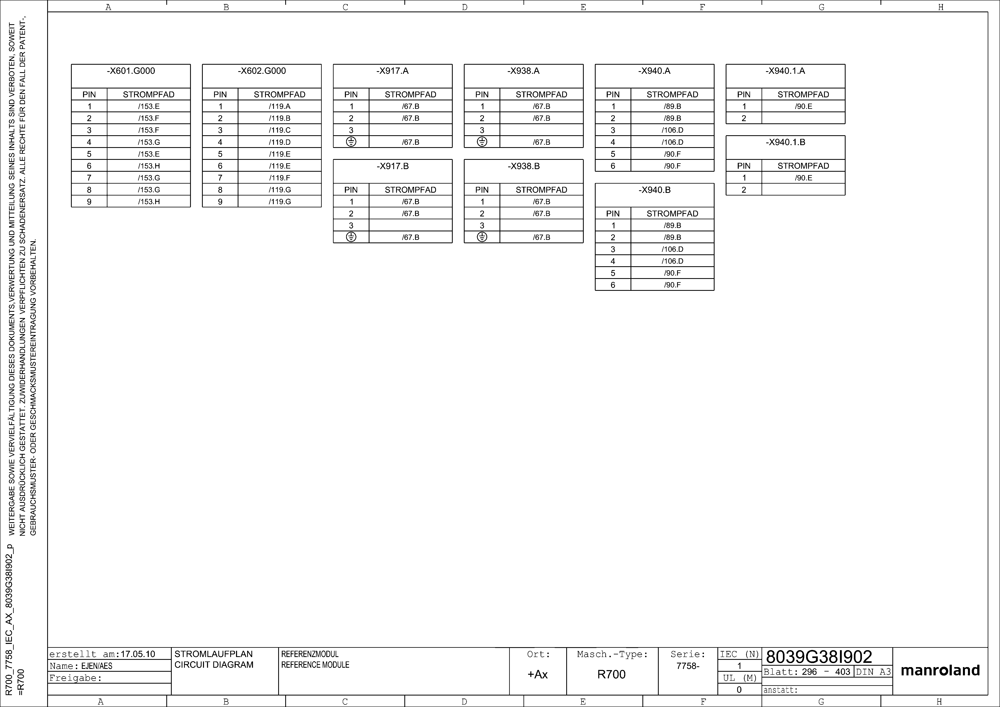

# +Ax — Sheet 296 of 403 — REFERENZMODUL

**REFERENCE MODULE**

> Part of the manroland **R700** printing press IEC/UL circuit diagrams.
> Drawing class: **Stromlaufplan / Circuit diagram** (DIN A3).
> Document `+Ax` covers the **Central control console** machine section.

## At a glance

| Field | Value |
|---|---|
| Document | `+Ax`  (8039G38I902) |
| Sheet | **296** of 403 |
| Section (DE) | REFERENZMODUL |
| Section (EN) | REFERENCE MODULE |
| Section type | REFERENCE_MODULE — Reference module |
| Machine type | `R700` |
| Series | `7758` |
| Created | 17.05.10 |
| Replaces | — |
| Columns used | A, B, C, D, E, F, G |
| Path numbers | — |
| Labels on sheet | 120 |
| Cross-refs out | 44 |
| Cross-refs in | 0 |

**Previous:** [+Ax sheet 295](SHEET_0295.md) · **Next:** [+Ax sheet 297](SHEET_0297.md) · **Document TOC:** [_TOC.md](_TOC.md)  (+Ax) · **Master TOC:** [all sheets](../_MASTER_TOC.md)

## Sheet image (300 DPI, exact vector render)



_Rendered directly from the PDF vector layer at 300 DPI (1-bit), no OCR and no resampling. Use it to confirm anything ambiguous in the text below._

## Cross-references on this sheet

Each entry is a wire leaving this sheet. The printed token is `/sheet.column`; the link resolves to that sheet inside the same document.

| Ref | Target sheet | Col | Path | Destination on target | Target section | From col |
|---|---|---|---|---|---|---|
| `/90.E` | [+Ax sheet 90](SHEET_0090.md) | E | — | STROMPFAD PIN 1 2 | ANLEGER | G |
| `/67.B` | [+Ax sheet 67](SHEET_0067.md) | B | — | — | SAUGBÄNDERTISCH | D |
| `/67.B` | [+Ax sheet 67](SHEET_0067.md) | B | — | — | SAUGBÄNDERTISCH | E |
| `/89.B` | [+Ax sheet 89](SHEET_0089.md) | B | — | — | ANLEGER | F |
| `/153.E` | [+Ax sheet 153](SHEET_0153.md) | E | — | — | ÜBERWACHUNGSRECHNER HAUPTANTRIEB | A |
| `/119.A` | [+Ax sheet 119](SHEET_0119.md) | A | — | — | REALTIMERECHNER HAUPTANTRIEB | B |
| `/67.B` | [+Ax sheet 67](SHEET_0067.md) | B | — | — | SAUGBÄNDERTISCH | D |
| `/67.B` | [+Ax sheet 67](SHEET_0067.md) | B | — | — | SAUGBÄNDERTISCH | E |
| `/89.B` | [+Ax sheet 89](SHEET_0089.md) | B | — | — | ANLEGER | F |
| `/153.F` | [+Ax sheet 153](SHEET_0153.md) | F | — | — | ÜBERWACHUNGSRECHNER HAUPTANTRIEB | A |
| `/119.B` | [+Ax sheet 119](SHEET_0119.md) | B | — | — | REALTIMERECHNER HAUPTANTRIEB | B |
| `/153.F` | [+Ax sheet 153](SHEET_0153.md) | F | — | — | ÜBERWACHUNGSRECHNER HAUPTANTRIEB | A |
| `/119.C` | [+Ax sheet 119](SHEET_0119.md) | C | — | — | REALTIMERECHNER HAUPTANTRIEB | B |
| `/106.D` | [+Ax sheet 106](SHEET_0106.md) | D | — | — | ANLEGER | F |
| `/67.B` | [+Ax sheet 67](SHEET_0067.md) | B | — | — | SAUGBÄNDERTISCH | D |
| `/67.B` | [+Ax sheet 67](SHEET_0067.md) | B | — | — | SAUGBÄNDERTISCH | E |
| `/153.G` | [+Ax sheet 153](SHEET_0153.md) | G | — | — | ÜBERWACHUNGSRECHNER HAUPTANTRIEB | A |
| `/119.D` | [+Ax sheet 119](SHEET_0119.md) | D | — | — | REALTIMERECHNER HAUPTANTRIEB | B |
| `/106.D` | [+Ax sheet 106](SHEET_0106.md) | D | — | — | ANLEGER | F |
| `/153.E` | [+Ax sheet 153](SHEET_0153.md) | E | — | — | ÜBERWACHUNGSRECHNER HAUPTANTRIEB | A |
| `/119.E` | [+Ax sheet 119](SHEET_0119.md) | E | — | — | REALTIMERECHNER HAUPTANTRIEB | B |
| `/90.F` | [+Ax sheet 90](SHEET_0090.md) | F | — | — | ANLEGER | F |
| `/90.E` | [+Ax sheet 90](SHEET_0090.md) | E | — | STROMPFAD PIN 1 2 | ANLEGER | G |
| `/119.E` | [+Ax sheet 119](SHEET_0119.md) | E | — | — | REALTIMERECHNER HAUPTANTRIEB | B |
| `/90.F` | [+Ax sheet 90](SHEET_0090.md) | F | — | — | ANLEGER | F |
| `/153.H` | [+Ax sheet 153](SHEET_0153.md) | H | — | — | ÜBERWACHUNGSRECHNER HAUPTANTRIEB | A |
| `/119.F` | [+Ax sheet 119](SHEET_0119.md) | F | — | — | REALTIMERECHNER HAUPTANTRIEB | B |
| `/153.G` | [+Ax sheet 153](SHEET_0153.md) | G | — | — | ÜBERWACHUNGSRECHNER HAUPTANTRIEB | A |
| `/153.G` | [+Ax sheet 153](SHEET_0153.md) | G | — | — | ÜBERWACHUNGSRECHNER HAUPTANTRIEB | A |
| `/119.G` | [+Ax sheet 119](SHEET_0119.md) | G | — | — | REALTIMERECHNER HAUPTANTRIEB | B |
| `/67.B` | [+Ax sheet 67](SHEET_0067.md) | B | — | — | SAUGBÄNDERTISCH | D |
| `/67.B` | [+Ax sheet 67](SHEET_0067.md) | B | — | — | SAUGBÄNDERTISCH | E |
| `/119.G` | [+Ax sheet 119](SHEET_0119.md) | G | — | — | REALTIMERECHNER HAUPTANTRIEB | B |
| `/153.H` | [+Ax sheet 153](SHEET_0153.md) | H | — | — | ÜBERWACHUNGSRECHNER HAUPTANTRIEB | A |
| `/67.B` | [+Ax sheet 67](SHEET_0067.md) | B | — | — | SAUGBÄNDERTISCH | D |
| `/67.B` | [+Ax sheet 67](SHEET_0067.md) | B | — | — | SAUGBÄNDERTISCH | E |
| `/89.B` | [+Ax sheet 89](SHEET_0089.md) | B | — | — | ANLEGER | F |
| `/67.B` | [+Ax sheet 67](SHEET_0067.md) | B | — | — | SAUGBÄNDERTISCH | D |
| `/67.B` | [+Ax sheet 67](SHEET_0067.md) | B | — | — | SAUGBÄNDERTISCH | E |
| `/89.B` | [+Ax sheet 89](SHEET_0089.md) | B | — | — | ANLEGER | F |
| `/106.D` | [+Ax sheet 106](SHEET_0106.md) | D | — | — | ANLEGER | F |
| `/106.D` | [+Ax sheet 106](SHEET_0106.md) | D | — | — | ANLEGER | F |
| `/90.F` | [+Ax sheet 90](SHEET_0090.md) | F | — | — | ANLEGER | F |
| `/90.F` | [+Ax sheet 90](SHEET_0090.md) | F | — | — | ANLEGER | F |

## Devices on this sheet

| Tag | Class | Class meaning (IEC) | Col | Sub | Terminal | Sign |
|---|---|---|---|---|---|---|
| `X917.A` | — | cross-device reference | C | — | — | — |
| `X917.B` | — | cross-device reference | C | — | — | — |
| `X938.B` | — | cross-device reference | E | — | — | — |
| `X938.A` | — | cross-device reference | D | — | — | — |
| `X940.A` | — | cross-device reference | F | — | — | — |
| `X940.B` | — | cross-device reference | F | — | — | — |
| `X940.1.A` | — | cross-device reference | G | — | — | — |
| `X940.1.B` | — | cross-device reference | G | — | — | — |
| `X602.G000` | — | cross-device reference | B | — | — | — |
| `X601.G000` | — | cross-device reference | A | — | — | — |

## Potentials / nets

_No named potentials on this sheet._

## Wire-end annotations (grouped as printed)

A wire that continues elsewhere is annotated with a small cluster: the destination description, the path/line number `#NN`, and the `/sheet.column` cross reference. Each row below is one such cluster exactly as it is grouped on the drawing.

| Col | Y | Path | Cross-ref | Text on the wire |
|---|---|---|---|---|
| A | 79.7 | — | — | `X601.G000` |
| B | 79.7 | — | — | `X602.G000` |
| C | 79.7 | — | — | `X917.A` |
| D | 79.7 | — | — | `X938.A` |
| F | 79.7 | — | — | `X940.A` |
| G | 79.7 | — | — | `X940.1.A` |
| A | 108.3 | — | — | `PIN 2 3 4 5 6 7 8 9 1 STROMPFAD` |
| B | 108.3 | — | — | `PIN 2 3 4 5 6 7 8 9 1 STROMPFAD` |
| C | 108.3 | — | — | `PIN 2 3 1 STROMPFAD` |
| D | 108.3 | — | — | `PIN 2 3 1 STROMPFAD` |
| F | 108.3 | — | — | `PIN 2 3 4 5 6 1 STROMPFAD` |
| G | 108.3 | — | `/90.E` | `PIN 2 1 STROMPFAD` |
| D | 122.8 | — | `/67.B` | — |
| E | 122.8 | — | `/67.B` | — |
| F | 122.8 | — | `/89.B` | — |
| A | 122.9 | — | `/153.E` | — |
| B | 122.9 | — | `/119.A` | — |
| A | 137.0 | — | `/153.F` | — |
| B | 137.0 | — | `/119.B` | — |
| D | 137.0 | — | `/67.B` | — |
| E | 137.0 | — | `/67.B` | — |
| F | 137.0 | — | `/89.B` | — |
| A | 151.2 | — | `/153.F` | — |
| B | 151.2 | — | `/119.C` | — |
| F | 151.2 | — | `/106.D` | — |
| G | 164.7 | — | — | `X940.1.B` |
| A | 165.4 | — | `/153.G` | — |
| B | 165.4 | — | `/119.D` | — |
| D | 165.4 | — | `/67.B` | — |
| E | 165.4 | — | `/67.B` | — |
| F | 165.4 | — | `/106.D` | — |
| A | 179.6 | — | `/153.E` | — |
| B | 179.6 | — | `/119.E` | — |
| F | 179.6 | — | `/90.F` | — |
| C | 193.1 | — | — | `X917.B` |
| E | 193.1 | — | — | `X938.B` |
| G | 193.4 | — | `/90.E` | `PIN 2 1 STROMPFAD` |
| B | 193.7 | — | `/119.E` | — |
| F | 193.7 | — | `/90.F` | — |
| A | 193.8 | — | `/153.H` | — |
| A | 207.9 | — | `/153.G` | — |
| B | 207.9 | — | `/119.F` | — |
| F | 221.4 | — | — | `X940.B` |
| C | 221.7 | — | — | `PIN 2 3 1 STROMPFAD` |
| D | 221.7 | — | — | `PIN 2 3 1 STROMPFAD` |
| A | 222.1 | — | `/153.G` | — |
| B | 222.1 | — | `/119.G` | — |
| D | 236.2 | — | `/67.B` | — |
| E | 236.2 | — | `/67.B` | — |
| A | 236.3 | — | `/153.H` | — |
| B | 236.3 | — | `/119.G` | — |
| F | 250.1 | — | — | `PIN 2 3 4 5 6 1 STROMPFAD` |
| D | 250.4 | — | `/67.B` | — |
| E | 250.4 | — | `/67.B` | — |
| F | 264.6 | — | `/89.B` | — |
| D | 278.8 | — | `/67.B` | — |
| E | 278.8 | — | `/67.B` | — |
| F | 278.8 | — | `/89.B` | — |
| F | 293.0 | — | `/106.D` | — |
| F | 307.1 | — | `/106.D` | — |
| F | 321.3 | — | `/90.F` | — |
| F | 335.5 | — | `/90.F` | — |


## Reconstructed tables

This sheet carries tabular content (pin map / terminal assignment / index). The grid below was rebuilt from the drawing's own rule lines, so each row is exactly one physical row of the table.

### Table 1 — 9 data rows × 2 columns (at x=85.0, y=76.5) — **X601.G000**

| PIN | STROMPFAD |
|---|---|
| `1` | `/153.E` |
| `2` | `/153.F` |
| `3` | `/153.F` |
| `4` | `/153.G` |
| `5` | `/153.E` |
| `6` | `/153.H` |
| `7` | `/153.G` |
| `8` | `/153.G` |
| `9` | `/153.H` |


### Table 2 — 9 data rows × 2 columns (at x=240.9, y=76.5) — **X602.G000**

| PIN | STROMPFAD |
|---|---|
| `1` | `/119.A` |
| `2` | `/119.B` |
| `3` | `/119.C` |
| `4` | `/119.D` |
| `5` | `/119.E` |
| `6` | `/119.E` |
| `7` | `/119.F` |
| `8` | `/119.G` |
| `9` | `/119.G` |


### Table 3 — 10 data rows × 2 columns (at x=396.9, y=76.5) — **X917.A**

| PIN | STROMPFAD |
|---|---|
| `1` | `/67.B` |
| `2` | `/67.B` |
| `3` |  |
|  | `/67.B` |
|  | `X917.B` |
| `PIN` | `STROMPFAD` |
| `1` | `/67.B` |
| `2` | `/67.B` |
| `3` |  |
|  | `/67.B` |


### Table 4 — 10 data rows × 2 columns (at x=552.8, y=76.5) — **X938.A**

| PIN | STROMPFAD |
|---|---|
| `1` | `/67.B` |
| `2` | `/67.B` |
| `3` |  |
|  | `/67.B` |
|  | `X938.B` |
| `PIN` | `STROMPFAD` |
| `1` | `/67.B` |
| `2` | `/67.B` |
| `3` |  |
|  | `/67.B` |


### Table 5 — 14 data rows × 2 columns (at x=708.7, y=76.5) — **X940.A**

| PIN | STROMPFAD |
|---|---|
| `1` | `/89.B` |
| `2` | `/89.B` |
| `3` | `/106.D` |
| `4` | `/106.D` |
| `5` | `/90.F` |
| `6` | `/90.F` |
|  | `X940.B` |
| `PIN` | `STROMPFAD` |
| `1` | `/89.B` |
| `2` | `/89.B` |
| `3` | `/106.D` |
| `4` | `/106.D` |
| `5` | `/90.F` |
| `6` | `/90.F` |


### Table 6 — 6 data rows × 2 columns (at x=864.6, y=76.5) — **X940.1.A**

| PIN | STROMPFAD |
|---|---|
| `1` | `/90.E` |
| `2` |  |
|  | `X940.1.B` |
| `PIN` | `STROMPFAD` |
| `1` | `/90.E` |
| `2` |  |


## Notes and free text on this sheet

| Text | Col | Y (pt) |
|---|---|---|
| `PIN` | C | 108.37 |
| `STROMPFAD` | D | 108.33 |
| `PIN` | D | 221.76 |
| `STROMPFAD` | E | 221.71 |
| `PIN` | E | 108.37 |
| `STROMPFAD` | F | 108.33 |
| `PIN` | F | 108.37 |
| `STROMPFAD` | G | 108.33 |
| `PIN` | B | 108.37 |
| `STROMPFAD` | B | 108.33 |
| `PIN` | A | 108.37 |
| `STROMPFAD` | A | 108.33 |

## Complete label inventory (exact text from the drawing)

Every text object inside the drawing area of this sheet, in DIN reading order (column A→H, then top→bottom). This is the authoritative list: if a string is not here it is not printed on this sheet.

| Col | Y | X | Dir | Type | Text |
|---|---|---|---|---|---|
| A | 79.7 | 127.4 | → | device ref | `X601.G000` |
| A | 108.3 | 146.4 | → | text | `STROMPFAD` |
| A | 108.4 | 98.2 | → | text | `PIN` |
| A | 122.5 | 104.2 | → | number | `1` |
| A | 122.9 | 164.7 | → | cross-reference | `/153.E` |
| A | 136.7 | 103.6 | → | number | `2` |
| A | 137.0 | 164.8 | → | cross-reference | `/153.F` |
| A | 150.9 | 103.6 | → | number | `3` |
| A | 151.2 | 164.8 | → | cross-reference | `/153.F` |
| A | 165.1 | 103.6 | → | number | `4` |
| A | 165.4 | 164.3 | → | cross-reference | `/153.G` |
| A | 179.2 | 103.6 | → | number | `5` |
| A | 179.6 | 164.7 | → | cross-reference | `/153.E` |
| A | 193.4 | 103.6 | → | number | `6` |
| A | 193.8 | 164.7 | → | cross-reference | `/153.H` |
| A | 207.6 | 103.6 | → | number | `7` |
| A | 207.9 | 164.3 | → | cross-reference | `/153.G` |
| A | 221.8 | 103.6 | → | number | `8` |
| A | 222.1 | 164.3 | → | cross-reference | `/153.G` |
| A | 235.9 | 103.6 | → | number | `9` |
| A | 236.3 | 164.7 | → | cross-reference | `/153.H` |
| B | 79.7 | 283.3 | → | device ref | `X602.G000` |
| B | 108.3 | 302.3 | → | text | `STROMPFAD` |
| B | 108.4 | 254.1 | → | text | `PIN` |
| B | 122.5 | 260.1 | → | number | `1` |
| B | 122.9 | 320.3 | → | cross-reference | `/119.A` |
| B | 136.7 | 259.5 | → | number | `2` |
| B | 137.0 | 320.5 | → | cross-reference | `/119.B` |
| B | 150.9 | 259.5 | → | number | `3` |
| B | 151.2 | 320.3 | → | cross-reference | `/119.C` |
| B | 165.1 | 259.5 | → | number | `4` |
| B | 165.4 | 320.3 | → | cross-reference | `/119.D` |
| B | 179.2 | 259.5 | → | number | `5` |
| B | 179.6 | 320.6 | → | cross-reference | `/119.E` |
| B | 193.4 | 259.5 | → | number | `6` |
| B | 193.7 | 320.6 | → | cross-reference | `/119.E` |
| B | 207.6 | 259.5 | → | number | `7` |
| B | 207.9 | 320.7 | → | cross-reference | `/119.F` |
| B | 221.8 | 259.5 | → | number | `8` |
| B | 222.1 | 320.2 | → | cross-reference | `/119.G` |
| B | 235.9 | 259.5 | → | number | `9` |
| B | 236.3 | 320.2 | → | cross-reference | `/119.G` |
| C | 79.7 | 448.3 | → | device ref | `X917.A` |
| C | 108.4 | 410.0 | → | text | `PIN` |
| C | 122.5 | 416.0 | → | number | `1` |
| C | 136.7 | 415.4 | → | number | `2` |
| C | 150.9 | 415.4 | → | number | `3` |
| C | 193.1 | 448.7 | → | device ref | `X917.B` |
| C | 221.8 | 410.0 | → | text | `PIN` |
| C | 235.9 | 416.0 | → | number | `1` |
| C | 250.1 | 415.4 | → | number | `2` |
| C | 264.3 | 415.4 | → | number | `3` |
| D | 79.7 | 604.2 | → | device ref | `X938.A` |
| D | 108.3 | 458.2 | → | text | `STROMPFAD` |
| D | 108.4 | 565.9 | → | text | `PIN` |
| D | 122.5 | 571.9 | → | number | `1` |
| D | 122.8 | 478.8 | → | cross-reference | `/67.B` |
| D | 136.7 | 571.3 | → | number | `2` |
| D | 137.0 | 478.8 | → | cross-reference | `/67.B` |
| D | 150.9 | 571.3 | → | number | `3` |
| D | 165.4 | 478.8 | → | cross-reference | `/67.B` |
| D | 221.7 | 458.2 | → | text | `STROMPFAD` |
| D | 221.8 | 565.9 | → | text | `PIN` |
| D | 235.9 | 571.9 | → | number | `1` |
| D | 236.2 | 478.8 | → | cross-reference | `/67.B` |
| D | 250.1 | 571.3 | → | number | `2` |
| D | 250.4 | 478.8 | → | cross-reference | `/67.B` |
| D | 264.3 | 571.3 | → | number | `3` |
| D | 278.8 | 478.8 | → | cross-reference | `/67.B` |
| E | 108.3 | 614.1 | → | text | `STROMPFAD` |
| E | 108.4 | 721.8 | → | text | `PIN` |
| E | 122.5 | 727.8 | → | number | `1` |
| E | 122.8 | 634.7 | → | cross-reference | `/67.B` |
| E | 136.7 | 727.2 | → | number | `2` |
| E | 137.0 | 634.7 | → | cross-reference | `/67.B` |
| E | 150.9 | 727.2 | → | number | `3` |
| E | 165.1 | 727.2 | → | number | `4` |
| E | 165.4 | 634.7 | → | cross-reference | `/67.B` |
| E | 179.2 | 727.2 | → | number | `5` |
| E | 193.1 | 604.6 | → | device ref | `X938.B` |
| E | 193.4 | 727.2 | → | number | `6` |
| E | 221.7 | 614.1 | → | text | `STROMPFAD` |
| E | 236.2 | 634.7 | → | cross-reference | `/67.B` |
| E | 250.1 | 721.8 | → | text | `PIN` |
| E | 250.4 | 634.7 | → | cross-reference | `/67.B` |
| E | 264.3 | 727.8 | → | number | `1` |
| E | 278.5 | 727.2 | → | number | `2` |
| E | 278.8 | 634.7 | → | cross-reference | `/67.B` |
| E | 292.6 | 727.2 | → | number | `3` |
| E | 306.8 | 727.2 | → | number | `4` |
| E | 321.0 | 727.2 | → | number | `5` |
| E | 335.1 | 727.2 | → | number | `6` |
| F | 79.7 | 760.1 | → | device ref | `X940.A` |
| F | 108.3 | 770.0 | → | text | `STROMPFAD` |
| F | 108.4 | 877.7 | → | text | `PIN` |
| F | 122.5 | 883.7 | → | number | `1` |
| F | 122.8 | 790.6 | → | cross-reference | `/89.B` |
| F | 136.7 | 883.1 | → | number | `2` |
| F | 137.0 | 790.6 | → | cross-reference | `/89.B` |
| F | 151.2 | 788.0 | → | cross-reference | `/106.D` |
| F | 165.4 | 788.0 | → | cross-reference | `/106.D` |
| F | 179.6 | 790.9 | → | cross-reference | `/90.F` |
| F | 193.4 | 877.7 | → | text | `PIN` |
| F | 193.7 | 790.9 | → | cross-reference | `/90.F` |
| F | 207.6 | 883.7 | → | number | `1` |
| F | 221.4 | 760.5 | → | device ref | `X940.B` |
| F | 221.8 | 883.1 | → | number | `2` |
| F | 250.1 | 770.0 | → | text | `STROMPFAD` |
| F | 264.6 | 790.6 | → | cross-reference | `/89.B` |
| F | 278.8 | 790.6 | → | cross-reference | `/89.B` |
| F | 293.0 | 788.0 | → | cross-reference | `/106.D` |
| F | 307.1 | 788.0 | → | cross-reference | `/106.D` |
| F | 321.3 | 790.9 | → | cross-reference | `/90.F` |
| F | 335.5 | 790.9 | → | cross-reference | `/90.F` |
| G | 79.7 | 911.6 | → | device ref | `X940.1.A` |
| G | 108.3 | 925.9 | → | text | `STROMPFAD` |
| G | 122.8 | 946.6 | → | cross-reference | `/90.E` |
| G | 164.7 | 912.0 | → | device ref | `X940.1.B` |
| G | 193.4 | 925.9 | → | text | `STROMPFAD` |
| G | 207.9 | 946.6 | → | cross-reference | `/90.E` |

## Reading-order text block

The same content as a plain block, grouped by DIN column — convenient to paste or to match against a visual description.

```text
=== Column A ===
  79.7  127.4  devref       X601.G000
 108.3  146.4  text         STROMPFAD
 108.4   98.2  text         PIN
 122.5  104.2  numeric      1
 122.9  164.7  xref         /153.E
 136.7  103.6  numeric      2
 137.0  164.8  xref         /153.F
 150.9  103.6  numeric      3
 151.2  164.8  xref         /153.F
 165.1  103.6  numeric      4
 165.4  164.3  xref         /153.G
 179.2  103.6  numeric      5
 179.6  164.7  xref         /153.E
 193.4  103.6  numeric      6
 193.8  164.7  xref         /153.H
 207.6  103.6  numeric      7
 207.9  164.3  xref         /153.G
 221.8  103.6  numeric      8
 222.1  164.3  xref         /153.G
 235.9  103.6  numeric      9
 236.3  164.7  xref         /153.H
=== Column B ===
  79.7  283.3  devref       X602.G000
 108.3  302.3  text         STROMPFAD
 108.4  254.1  text         PIN
 122.5  260.1  numeric      1
 122.9  320.3  xref         /119.A
 136.7  259.5  numeric      2
 137.0  320.5  xref         /119.B
 150.9  259.5  numeric      3
 151.2  320.3  xref         /119.C
 165.1  259.5  numeric      4
 165.4  320.3  xref         /119.D
 179.2  259.5  numeric      5
 179.6  320.6  xref         /119.E
 193.4  259.5  numeric      6
 193.7  320.6  xref         /119.E
 207.6  259.5  numeric      7
 207.9  320.7  xref         /119.F
 221.8  259.5  numeric      8
 222.1  320.2  xref         /119.G
 235.9  259.5  numeric      9
 236.3  320.2  xref         /119.G
=== Column C ===
  79.7  448.3  devref       X917.A
 108.4  410.0  text         PIN
 122.5  416.0  numeric      1
 136.7  415.4  numeric      2
 150.9  415.4  numeric      3
 193.1  448.7  devref       X917.B
 221.8  410.0  text         PIN
 235.9  416.0  numeric      1
 250.1  415.4  numeric      2
 264.3  415.4  numeric      3
=== Column D ===
  79.7  604.2  devref       X938.A
 108.3  458.2  text         STROMPFAD
 108.4  565.9  text         PIN
 122.5  571.9  numeric      1
 122.8  478.8  xref         /67.B
 136.7  571.3  numeric      2
 137.0  478.8  xref         /67.B
 150.9  571.3  numeric      3
 165.4  478.8  xref         /67.B
 221.7  458.2  text         STROMPFAD
 221.8  565.9  text         PIN
 235.9  571.9  numeric      1
 236.2  478.8  xref         /67.B
 250.1  571.3  numeric      2
 250.4  478.8  xref         /67.B
 264.3  571.3  numeric      3
 278.8  478.8  xref         /67.B
=== Column E ===
 108.3  614.1  text         STROMPFAD
 108.4  721.8  text         PIN
 122.5  727.8  numeric      1
 122.8  634.7  xref         /67.B
 136.7  727.2  numeric      2
 137.0  634.7  xref         /67.B
 150.9  727.2  numeric      3
 165.1  727.2  numeric      4
 165.4  634.7  xref         /67.B
 179.2  727.2  numeric      5
 193.1  604.6  devref       X938.B
 193.4  727.2  numeric      6
 221.7  614.1  text         STROMPFAD
 236.2  634.7  xref         /67.B
 250.1  721.8  text         PIN
 250.4  634.7  xref         /67.B
 264.3  727.8  numeric      1
 278.5  727.2  numeric      2
 278.8  634.7  xref         /67.B
 292.6  727.2  numeric      3
 306.8  727.2  numeric      4
 321.0  727.2  numeric      5
 335.1  727.2  numeric      6
=== Column F ===
  79.7  760.1  devref       X940.A
 108.3  770.0  text         STROMPFAD
 108.4  877.7  text         PIN
 122.5  883.7  numeric      1
 122.8  790.6  xref         /89.B
 136.7  883.1  numeric      2
 137.0  790.6  xref         /89.B
 151.2  788.0  xref         /106.D
 165.4  788.0  xref         /106.D
 179.6  790.9  xref         /90.F
 193.4  877.7  text         PIN
 193.7  790.9  xref         /90.F
 207.6  883.7  numeric      1
 221.4  760.5  devref       X940.B
 221.8  883.1  numeric      2
 250.1  770.0  text         STROMPFAD
 264.6  790.6  xref         /89.B
 278.8  790.6  xref         /89.B
 293.0  788.0  xref         /106.D
 307.1  788.0  xref         /106.D
 321.3  790.9  xref         /90.F
 335.5  790.9  xref         /90.F
=== Column G ===
  79.7  911.6  devref       X940.1.A
 108.3  925.9  text         STROMPFAD
 122.8  946.6  xref         /90.E
 164.7  912.0  devref       X940.1.B
 193.4  925.9  text         STROMPFAD
 207.9  946.6  xref         /90.E
```

---
_Generated from the PDF vector text layer; no OCR. Source: `R700_7758_IEC_AX_8039G38I902_p`, sheet 296._
