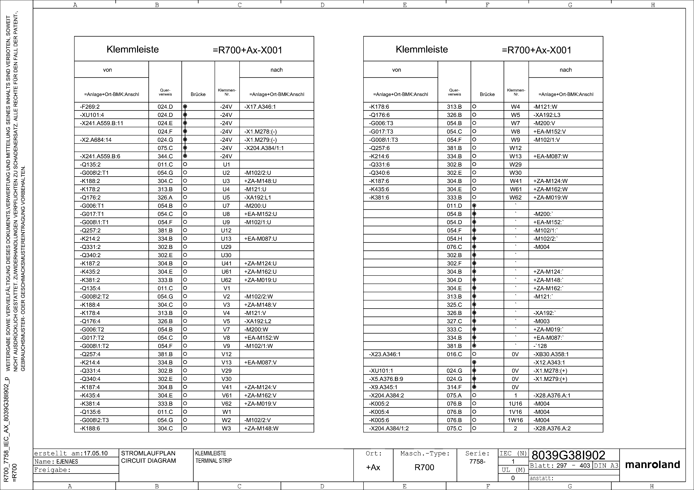

# +Ax — Sheet 297 of 403 — KLEMMLEISTE

**TERMINAL STRIP**

> Part of the manroland **R700** printing press IEC/UL circuit diagrams.
> Drawing class: **Stromlaufplan / Circuit diagram** (DIN A3).
> Document `+Ax` covers the **Central control console** machine section.

## At a glance

| Field | Value |
|---|---|
| Document | `+Ax`  (8039G38I902) |
| Sheet | **297** of 403 |
| Section (DE) | KLEMMLEISTE |
| Section (EN) | TERMINAL STRIP |
| Section type | TERMINALS — Terminal strip |
| Machine type | `R700` |
| Series | `7758` |
| Created | 17.05.10 |
| Replaces | — |
| Columns used | A, B, C, E, F, G |
| Path numbers | — |
| Labels on sheet | 299 |
| Cross-refs out | 0 |
| Cross-refs in | 0 |

**Previous:** [+Ax sheet 296](SHEET_0296.md) · **Next:** [+Ax sheet 298](SHEET_0298.md) · **Document TOC:** [_TOC.md](_TOC.md)  (+Ax) · **Master TOC:** [all sheets](../_MASTER_TOC.md)

## Sheet image (300 DPI, exact vector render)



_Rendered directly from the PDF vector layer at 300 DPI (1-bit), no OCR and no resampling. Use it to confirm anything ambiguous in the text below._

## Cross-references on this sheet

Each entry is a wire leaving this sheet. The printed token is `/sheet.column`; the link resolves to that sheet inside the same document.

_No outgoing cross-references on this sheet._

## Devices on this sheet

| Tag | Class | Class meaning (IEC) | Col | Sub | Terminal | Sign |
|---|---|---|---|---|---|---|
| `F269:2` | F | Schutz / protection device (fuse, circuit breaker) | A | — | 2 | — |
| `XU101:4` | XU |  | A | — | 4 | — |
| `U1` | U | Umrichter / frequency converter | C | — | — | — |
| `Q135:2` | Q | Leistungsschalter / power switching device | A | — | 2 | — |
| `U2` | U | Umrichter / frequency converter | C | — | — | — |
| `M102/2:U` | M | Motor | C | 2 | U | — |
| `U3` | U | Umrichter / frequency converter | C | — | — | — |
| `K188:2` | K | Relais / relay, contactor | A | — | 2 | — |
| `U4` | U | Umrichter / frequency converter | C | — | — | — |
| `K178:2` | K | Relais / relay, contactor | A | — | 2 | — |
| `M121:U` | M | Motor | C | — | U | — |
| `U5` | U | Umrichter / frequency converter | C | — | — | — |
| `Q176:2` | Q | Leistungsschalter / power switching device | A | — | 2 | — |
| `XA192:L1` | XA |  | C | — | L1 | — |
| `U7` | U | Umrichter / frequency converter | C | — | — | — |
| `G006:T1` | G | Stromversorgung / power supply | A | — | T1 | — |
| `M200:U` | M | Motor | C | — | U | — |
| `U8` | U | Umrichter / frequency converter | C | — | — | — |
| `G017:T1` | G | Stromversorgung / power supply | A | — | T1 | — |
| `U9` | U | Umrichter / frequency converter | C | — | — | — |
| `M102/1:U` | M | Motor | C | 1 | U | — |
| `U12` | U | Umrichter / frequency converter | C | — | — | — |
| `Q257:2` | Q | Leistungsschalter / power switching device | A | — | 2 | — |
| `U13` | U | Umrichter / frequency converter | C | — | — | — |
| `K214:2` | K | Relais / relay, contactor | A | — | 2 | — |
| `U29` | U | Umrichter / frequency converter | C | — | — | — |
| `Q331:2` | Q | Leistungsschalter / power switching device | A | — | 2 | — |
| `U30` | U | Umrichter / frequency converter | C | — | — | — |
| `Q340:2` | Q | Leistungsschalter / power switching device | A | — | 2 | — |
| `U41` | U | Umrichter / frequency converter | C | — | — | — |
| `K187:2` | K | Relais / relay, contactor | A | — | 2 | — |
| `U61` | U | Umrichter / frequency converter | C | — | — | — |
| `K435:2` | K | Relais / relay, contactor | A | — | 2 | — |
| `U62` | U | Umrichter / frequency converter | C | — | — | — |
| `K381:2` | K | Relais / relay, contactor | A | — | 2 | — |
| `V1` | V | Diode / semiconductor valve | C | — | — | — |
| `Q135:4` | Q | Leistungsschalter / power switching device | A | — | 4 | — |
| `V2` | V | Diode / semiconductor valve | C | — | — | — |
| `M102/2:W` | M | Motor | C | 2 | W | — |
| `V3` | V | Diode / semiconductor valve | C | — | — | — |
| `K188:4` | K | Relais / relay, contactor | A | — | 4 | — |
| `V4` | V | Diode / semiconductor valve | C | — | — | — |
| `K178:4` | K | Relais / relay, contactor | A | — | 4 | — |
| `M121:V` | M | Motor | C | — | V | — |
| `V5` | V | Diode / semiconductor valve | C | — | — | — |
| `Q176:4` | Q | Leistungsschalter / power switching device | A | — | 4 | — |
| `XA192:L2` | XA |  | C | — | L2 | — |
| `V7` | V | Diode / semiconductor valve | C | — | — | — |
| `G006:T2` | G | Stromversorgung / power supply | A | — | T2 | — |
| `M200:W` | M | Motor | C | — | W | — |
| `V8` | V | Diode / semiconductor valve | C | — | — | — |
| `G017:T2` | G | Stromversorgung / power supply | A | — | T2 | — |
| `V9` | V | Diode / semiconductor valve | C | — | — | — |
| `M102/1:W` | M | Motor | C | 1 | W | — |
| `V12` | V | Diode / semiconductor valve | C | — | — | — |
| `Q257:4` | Q | Leistungsschalter / power switching device | A | — | 4 | — |
| `V13` | V | Diode / semiconductor valve | C | — | — | — |
| `K214:4` | K | Relais / relay, contactor | A | — | 4 | — |
| `V29` | V | Diode / semiconductor valve | C | — | — | — |
| `Q331:4` | Q | Leistungsschalter / power switching device | A | — | 4 | — |
| `V30` | V | Diode / semiconductor valve | C | — | — | — |
| `Q340:4` | Q | Leistungsschalter / power switching device | A | — | 4 | — |
| `V41` | V | Diode / semiconductor valve | C | — | — | — |
| `K187:4` | K | Relais / relay, contactor | A | — | 4 | — |
| `V61` | V | Diode / semiconductor valve | C | — | — | — |
| `K435:4` | K | Relais / relay, contactor | A | — | 4 | — |
| `V62` | V | Diode / semiconductor valve | C | — | — | — |
| `K381:4` | K | Relais / relay, contactor | A | — | 4 | — |
| `W1` | W | Kabel / cable, line, bus | C | — | — | — |
| `Q135:6` | Q | Leistungsschalter / power switching device | A | — | 6 | — |
| `W2` | W | Kabel / cable, line, bus | C | — | — | — |
| `M102/2:V` | M | Motor | C | 2 | V | — |
| `W3` | W | Kabel / cable, line, bus | C | — | — | — |
| `K188:6` | K | Relais / relay, contactor | A | — | 6 | — |
| `W4` | W | Kabel / cable, line, bus | F | — | — | — |
| `K178:6` | K | Relais / relay, contactor | E | — | 6 | — |
| `M121:W` | M | Motor | G | — | W | — |
| `W5` | W | Kabel / cable, line, bus | F | — | — | — |
| `Q176:6` | Q | Leistungsschalter / power switching device | E | — | 6 | — |
| `XA192:L3` | XA |  | G | — | L3 | — |
| `W7` | W | Kabel / cable, line, bus | F | — | — | — |
| `G006:T3` | G | Stromversorgung / power supply | E | — | T3 | — |
| `M200:V` | M | Motor | G | — | V | — |
| `W8` | W | Kabel / cable, line, bus | F | — | — | — |
| `G017:T3` | G | Stromversorgung / power supply | E | — | T3 | — |
| `W9` | W | Kabel / cable, line, bus | F | — | — | — |
| `M102/1:V` | M | Motor | G | 1 | V | — |
| `W12` | W | Kabel / cable, line, bus | F | — | — | — |
| `Q257:6` | Q | Leistungsschalter / power switching device | E | — | 6 | — |
| `W13` | W | Kabel / cable, line, bus | F | — | — | — |
| `K214:6` | K | Relais / relay, contactor | E | — | 6 | — |
| `W29` | W | Kabel / cable, line, bus | F | — | — | — |
| `Q331:6` | Q | Leistungsschalter / power switching device | E | — | 6 | — |
| `W30` | W | Kabel / cable, line, bus | F | — | — | — |
| `Q340:6` | Q | Leistungsschalter / power switching device | E | — | 6 | — |
| `W41` | W | Kabel / cable, line, bus | F | — | — | — |
| `K187:6` | K | Relais / relay, contactor | E | — | 6 | — |
| `W61` | W | Kabel / cable, line, bus | F | — | — | — |
| `K435:6` | K | Relais / relay, contactor | E | — | 6 | — |
| `W62` | W | Kabel / cable, line, bus | F | — | — | — |
| `K381:6` | K | Relais / relay, contactor | E | — | 6 | — |
| `XU101:1` | XU |  | E | — | 1 | — |
| `K005:2` | K | Relais / relay, contactor | E | — | 2 | — |
| `K005:4` | K | Relais / relay, contactor | E | — | 4 | — |
| `K005:6` | K | Relais / relay, contactor | E | — | 6 | — |
| `Nr.` | — | cross-device reference | C | — | — | — |
| `024.D` | — | cross-device reference | B | — | — | — |
| `X17.A346:1` | — | cross-device reference | C | — | 1 | — |
| `024.D` | — | cross-device reference | B | — | — | — |
| `024.E` | — | cross-device reference | B | — | — | — |
| `X241.A559.B:11` | — | cross-device reference | A | — | 11 | — |
| `024.F` | — | cross-device reference | B | — | — | — |
| `X1.M278:( )` | — | cross-device reference | C | — | — | — |
| `024.G` | — | cross-device reference | B | — | — | — |
| `X2.A684:14` | — | cross-device reference | A | — | 14 | — |
| `X1.M279:( )` | — | cross-device reference | C | — | — | — |
| `075.C` | — | cross-device reference | B | — | — | — |
| `344.C` | — | cross-device reference | B | — | — | — |
| `X241.A559.B:6` | — | cross-device reference | A | — | 6 | — |
| `011.C` | — | cross-device reference | B | — | — | — |
| `054.G` | — | cross-device reference | B | — | — | — |
| `304.C` | — | cross-device reference | B | — | — | — |
| `313.B` | — | cross-device reference | B | — | — | — |
| `326.A` | — | cross-device reference | B | — | — | — |
| `054.B` | — | cross-device reference | B | — | — | — |
| `054.C` | — | cross-device reference | B | — | — | — |
| `054.F` | — | cross-device reference | B | — | — | — |
| `381.B` | — | cross-device reference | B | — | — | — |
| `334.B` | — | cross-device reference | B | — | — | — |
| `302.B` | — | cross-device reference | B | — | — | — |
| `302.E` | — | cross-device reference | B | — | — | — |
| `304.B` | — | cross-device reference | B | — | — | — |
| `304.E` | — | cross-device reference | B | — | — | — |
| `333.B` | — | cross-device reference | B | — | — | — |
| `011.C` | — | cross-device reference | B | — | — | — |
| `054.G` | — | cross-device reference | B | — | — | — |
| `304.C` | — | cross-device reference | B | — | — | — |
| `313.B` | — | cross-device reference | B | — | — | — |
| `326.B` | — | cross-device reference | B | — | — | — |
| `054.B` | — | cross-device reference | B | — | — | — |
| `054.C` | — | cross-device reference | B | — | — | — |
| `054.F` | — | cross-device reference | B | — | — | — |
| `381.B` | — | cross-device reference | B | — | — | — |
| `334.B` | — | cross-device reference | B | — | — | — |
| `302.B` | — | cross-device reference | B | — | — | — |
| `302.E` | — | cross-device reference | B | — | — | — |
| `304.B` | — | cross-device reference | B | — | — | — |
| `304.E` | — | cross-device reference | B | — | — | — |
| `333.B` | — | cross-device reference | B | — | — | — |
| `011.C` | — | cross-device reference | B | — | — | — |
| `054.G` | — | cross-device reference | B | — | — | — |
| `304.C` | — | cross-device reference | B | — | — | — |
| `Nr.` | — | cross-device reference | F | — | — | — |
| `313.B` | — | cross-device reference | F | — | — | — |
| `326.B` | — | cross-device reference | F | — | — | — |
| `054.B` | — | cross-device reference | F | — | — | — |
| `054.C` | — | cross-device reference | F | — | — | — |
| `054.F` | — | cross-device reference | F | — | — | — |
| `381.B` | — | cross-device reference | F | — | — | — |
| `334.B` | — | cross-device reference | F | — | — | — |
| `302.B` | — | cross-device reference | F | — | — | — |
| `302.E` | — | cross-device reference | F | — | — | — |
| `304.B` | — | cross-device reference | F | — | — | — |
| `304.E` | — | cross-device reference | F | — | — | — |
| `333.B` | — | cross-device reference | F | — | — | — |
| `011.D` | — | cross-device reference | F | — | — | — |
| `054.B` | — | cross-device reference | F | — | — | — |
| `054.D` | — | cross-device reference | F | — | — | — |
| `054.F` | — | cross-device reference | F | — | — | — |
| `054.H` | — | cross-device reference | F | — | — | — |
| `076.C` | — | cross-device reference | F | — | — | — |
| `302.B` | — | cross-device reference | F | — | — | — |
| `302.F` | — | cross-device reference | F | — | — | — |
| `304.B` | — | cross-device reference | F | — | — | — |
| `304.D` | — | cross-device reference | F | — | — | — |
| `304.E` | — | cross-device reference | F | — | — | — |
| `313.B` | — | cross-device reference | F | — | — | — |
| `325.C` | — | cross-device reference | F | — | — | — |
| `326.B` | — | cross-device reference | F | — | — | — |
| `327.C` | — | cross-device reference | F | — | — | — |
| `333.C` | — | cross-device reference | F | — | — | — |
| `334.B` | — | cross-device reference | F | — | — | — |
| `381.B` | — | cross-device reference | F | — | — | — |
| `016.C` | — | cross-device reference | F | — | — | — |
| `X23.A346:1` | — | cross-device reference | E | — | 1 | — |
| `XB30.A358:1` | — | cross-device reference | G | — | 1 | — |
| `X12.A343:1` | — | cross-device reference | G | — | 1 | — |
| `024.G` | — | cross-device reference | F | — | — | — |
| `X1.M278:(+)` | — | cross-device reference | G | — | — | — |
| `024.G` | — | cross-device reference | F | — | — | — |
| `X5.A376.B:9` | — | cross-device reference | E | — | 9 | — |
| `X1.M279:(+)` | — | cross-device reference | G | — | — | — |
| `314.F` | — | cross-device reference | F | — | — | — |
| `X9.A345:1` | — | cross-device reference | E | — | 1 | — |
| `075.A` | — | cross-device reference | F | — | — | — |
| `X204.A384:2` | — | cross-device reference | E | — | 2 | — |
| `X28.A376.A:1` | — | cross-device reference | G | — | 1 | — |
| `076.B` | — | cross-device reference | F | — | — | — |
| `076.B` | — | cross-device reference | F | — | — | — |
| `076.B` | — | cross-device reference | F | — | — | — |
| `075.C` | — | cross-device reference | F | — | — | — |
| `X28.A376.A:2` | — | cross-device reference | G | — | 2 | — |

## Potentials / nets

| Potential | Count | Columns | Attached devices | Terminals |
|---|---|---|---|---|
| `0V` | 4 | F | — | — |
| `24V` | 7 | C | — | — |
| `M003` | 1 | G | — | — |
| `M004` | 4 | G | — | — |


A potential such as `L24+/4` or `M24+` is a named supply/return rail; every place it appears on this sheet is electrically common.

## Wire-end annotations (grouped as printed)

A wire that continues elsewhere is annotated with a small cluster: the destination description, the path/line number `#NN`, and the `/sheet.column` cross reference. Each row below is one such cluster exactly as it is grouped on the drawing.

| Col | Y | Path | Cross-ref | Text on the wire |
|---|---|---|---|---|
| B | 77.5 | — | — | `Klemmleiste` |
| E | 77.5 | — | — | `Klemmleiste` |
| C | 79.0 | — | — | `=R700+Ax X001` |
| G | 79.0 | — | — | `=R700+Ax X001` |
| A | 115.5 | — | — | `von` |
| C | 115.5 | — | — | `nach` |
| E | 115.5 | — | — | `von` |
| G | 115.5 | — | — | `nach` |
| B | 151.9 | — | — | `Quer` |
| C | 151.9 | — | — | `Klemmen =Anlage+Ort BMK:Anschl` |
| F | 151.9 | — | — | `Quer` |
| G | 151.9 | — | — | `Klemmen =Anlage+Ort BMK:Anschl` |
| A | 158.5 | — | — | `=Anlage+Ort BMK:Anschl` |
| C | 158.5 | — | — | `Brücke Nr.` |
| E | 158.5 | — | — | `=Anlage+Ort BMK:Anschl` |
| F | 158.5 | — | — | `Brücke Nr.` |
| B | 159.1 | — | — | `verweis` |
| F | 159.1 | — | — | `verweis` |
| F | 179.0 | — | — | `K178:6 Q176:6 G006:T3 G017:T3 G008\1:T3 Q257:6 054.C 313.B 326.B 054.B 381.B 054.F W12 W4 W5 W7 W8 W9 +EA M152:V M121:W XA192:L3 M200:V M102/1:V` |
| B | 179.2 | — | — | `F269:2 XU101:4 024.D 024.D 24V 24V X17.A346:1` |
| B | 207.5 | — | — | `X241.A559.B:11 024.E 24V` |
| B | 221.7 | — | — | `X2.A684:14 X241.A559.B:6 024.G 075.C 344.C 024.F 24V 24V 24V 24V X1.M278:( ) X1.M279:( ) X204.A384/1:1` |
| F | 264.1 | — | — | `K214:6 Q331:6 334.B 302.B W13 W29 +EA M087:W` |
| B | 278.4 | — | — | `Q135:2 011.C U1` |
| E | 292.4 | — | — | `Q340:6 302.E W30` |
| B | 292.6 | — | — | `G008\2:T1 K188:2 K178:2 Q176:2 G006:T1 G017:T1 G008\1:T1 Q257:2 054.G 326.A 304.C 054.C 313.B 054.B 381.B 054.F U12 U2 U3 U4 U5 U7 U8 U9 +ZA M148:U +EA M152:U M102/2:U M121:U XA192:L1 M200:U M102/1:U` |
| F | 306.6 | — | — | `K187:6 K435:6 K381:6 X23.A346:1 XU101:1 X5.A376.B:9 X9.A345:1 024.G 024.G 011.D 054.D 076.C 304.D 325.C 327.C 333.C 016.C 054.H 304.B 304.E 333.B 054.B 302.B 304.B 304.E 313.B 326.B 334.B 381.B 054.F 302.F 314.F W62 W41 W61 0V 0V 0V 0V ' ' ' ' ' ' ' ' ' ' ' ' ' ' ' ' ' ' +ZA M124:W +ZA M162:W +ZA M019:W +EA M152:' +ZA M124:' +ZA M148:' +ZA M162:' +ZA M019:' +EA M087:' M200:' M102/1:' M102/2:' M004 M121:' XA192:' M003 '128 XB30.A358:1 X12.A343:1 X1.M278:(+) X1.M279:(+)` |
| B | 406.0 | — | — | `K214:2 Q331:2 334.B 302.B U13 U29 +EA M087:U` |
| B | 434.3 | — | — | `Q340:2 302.E U30` |
| B | 448.5 | — | — | `K187:2 K435:2 K381:2 Q135:4 011.C 304.B 304.E 333.B U62 U41 U61 V1 +ZA M124:U +ZA M162:U +ZA M019:U` |
| B | 505.1 | — | — | `G008\2:T2 K188:4 K178:4 Q176:4 G006:T2 G017:T2 G008\1:T2 Q257:4 054.G 304.C 054.C 313.B 326.B 054.B 381.B 054.F V12 V2 V3 V4 V5 V7 V8 V9 +ZA M148:V +EA M152:W M102/2:W M121:V XA192:L2 M200:W M102/1:W` |
| B | 618.6 | — | — | `K214:4 Q331:4 334.B 302.B V13 V29 +EA M087:V` |
| B | 646.9 | — | — | `Q340:4 302.E V30` |
| B | 661.1 | — | — | `K187:4 K435:4 K381:4 Q135:6 011.C 304.B 304.E 333.B V62 V41 V61 W1 +ZA M124:V +ZA M162:V +ZA M019:V` |
| F | 675.2 | — | — | `X204.A384:2 K005:2 K005:4 K005:6 X204.A384/1:2 075.A 075.C 076.B 076.B 076.B 1W16 1U16 1V16 2 1 X28.A376.A:1 M004 M004 M004 X28.A376.A:2` |
| B | 717.5 | — | — | `G008\2:T3 K188:6 054.G 304.C W2 W3 +ZA M148:W M102/2:V` |


## Reconstructed tables

This sheet carries tabular content (pin map / terminal assignment / index). The grid below was rebuilt from the drawing's own rule lines, so each row is exactly one physical row of the table.

### Table 1 — 40 data rows × 3 columns (at x=255.1, y=62.4)

| Quer verweis | Brücke | Klemmen Nr. |
|---|---|---|
| `024.D` |  | `24V` |
| `024.D` |  | `24V` |
| `024.E` |  | `24V` |
| `024.F` |  | `24V` |
| `024.G` |  | `24V` |
| `075.C` |  | `24V` |
| `344.C` |  | `24V` |
| `011.C` |  | `U1` |
| `054.G` |  | `U2` |
| `304.C` |  | `U3` |
| `313.B` |  | `U4` |
| `326.A` |  | `U5` |
| `054.B` |  | `U7` |
| `054.C` |  | `U8` |
| `054.F` |  | `U9` |
| `381.B` |  | `U12` |
| `334.B` |  | `U13` |
| `302.B` |  | `U29` |
| `302.E` |  | `U30` |
| `304.B` |  | `U41` |
| `304.E` |  | `U61` |
| `333.B` |  | `U62` |
| `011.C` |  | `V1` |
| `054.G` |  | `V2` |
| `304.C` |  | `V3` |
| `313.B` |  | `V4` |
| `326.B` |  | `V5` |
| `054.B` |  | `V7` |
| `054.C` |  | `V8` |
| `054.F` |  | `V9` |
| `381.B` |  | `V12` |
| `334.B` |  | `V13` |
| `302.B` |  | `V29` |
| `302.E` |  | `V30` |
| `304.B` |  | `V41` |
| `304.E` |  | `V61` |
| `333.B` |  | `V62` |
| `011.C` |  | `W1` |
| `054.G` |  | `W2` |
| `304.C` |  | `W3` |


### Table 2 — 39 data rows × 3 columns (at x=751.2, y=62.4)

| Quer verweis | Brücke | Klemmen Nr. |
|---|---|---|
| `313.B` |  | `W4` |
| `326.B` |  | `W5` |
| `054.B` |  | `W7` |
| `054.C` |  | `W8` |
| `054.F` |  | `W9` |
| `381.B` |  | `W12` |
| `334.B` |  | `W13` |
| `302.B` |  | `W29` |
| `302.E` |  | `W30` |
| `304.B` |  | `W41` |
| `304.E` |  | `W61` |
| `333.B` |  | `W62` |
| `011.D` |  | `'` |
| `054.B` |  | `'` |
| `054.D` |  | `'` |
| `054.F` |  | `'` |
| `054.H` |  | `'` |
| `076.C` |  | `'` |
| `302.B` |  | `'` |
| `302.F` |  | `'` |
| `304.B` |  | `'` |
| `304.D` |  | `'` |
| `304.E` |  | `'` |
| `313.B` |  | `'` |
| `325.C` |  | `'` |
| `326.B` |  | `'` |
| `327.C` |  | `'` |
| `333.C` |  | `'` |
| `334.B` |  | `'` |
| `381.B` |  | `'` |
| `016.C` |  | `0V` |
| `024.G` |  | `0V` |
| `024.G` |  | `0V` |
| `314.F` |  | `0V` |
| `075.A` |  | `1` |
| `076.B` |  | `1U16` |
| `076.B` |  | `1V16` |
| `076.B` |  | `1W16` |
| `075.C` |  | `2` |


## Notes and free text on this sheet

| Text | Col | Y (pt) |
|---|---|---|
| `von` | A | 115.53 |
| `=Anlage+Ort BMK:Anschl` | A | 158.52 |
| `Quer` | B | 151.93 |
| `Klemmleiste` | B | 77.49 |
| `verweis` | B | 159.12 |
| `nach` | C | 115.46 |
| `=Anlage+Ort BMK:Anschl` | C | 158.52 |
| `Klemmen` | C | 151.94 |
| `Brücke` | B | 158.53 |
| `=R700+Ax X001` | C | 78.99 |
| `X204.A384/1:1` | C | 250.06 |
| `G008\2:T1` | A | 292.58 |
| `+ZA M148:U` | C | 306.75 |
| `+EA M152:U` | C | 363.44 |
| `G008\1:T1` | A | 377.62 |
| `+EA M087:U` | C | 405.96 |
| `+ZA M124:U` | C | 448.48 |
| `+ZA M162:U` | C | 462.66 |
| `+ZA M019:U` | C | 476.83 |
| `G008\2:T2` | A | 505.17 |
| `+ZA M148:V` | C | 519.35 |
| `+EA M152:W` | C | 575.98 |
| `G008\1:T2` | A | 590.21 |
| `+EA M087:V` | C | 618.56 |
| `+ZA M124:V` | C | 661.08 |
| `+ZA M162:V` | C | 675.26 |
| `+ZA M019:V` | C | 689.43 |
| `G008\2:T3` | A | 717.77 |
| `+ZA M148:W` | C | 731.89 |
| `von` | E | 115.53 |
| `=Anlage+Ort BMK:Anschl` | E | 158.52 |
| `Quer` | F | 151.93 |
| `Klemmleiste` | E | 77.49 |
| `verweis` | F | 159.12 |
| `nach` | G | 115.46 |
| `=Anlage+Ort BMK:Anschl` | G | 158.52 |
| `Klemmen` | F | 151.94 |
| `Brücke` | F | 158.53 |
| `=R700+Ax X001` | G | 78.99 |
| `+EA M152:V` | G | 221.71 |
| `G008\1:T3` | E | 235.88 |
| `+EA M087:W` | G | 264.17 |
| `+ZA M124:W` | G | 306.69 |
| `+ZA M162:W` | G | 320.86 |
| `+ZA M019:W` | G | 335.04 |
| `M200:'` | G | 363.42 |
| `+EA M152:'` | G | 377.61 |
| `M102/1:'` | G | 391.76 |
| `M102/2:'` | G | 405.94 |
| `+ZA M124:'` | G | 462.65 |
| `+ZA M148:'` | G | 476.82 |
| `+ZA M162:'` | G | 490.99 |
| `M121:'` | G | 505.15 |
| `XA192:'` | G | 533.51 |
| `+ZA M019:'` | G | 561.86 |
| `+EA M087:'` | G | 576.03 |
| `1U16` | F | 689.46 |
| `1V16` | F | 703.64 |
| `1W16` | F | 717.66 |
| `X204.A384/1:2` | E | 731.95 |

## Complete label inventory (exact text from the drawing)

Every text object inside the drawing area of this sheet, in DIN reading order (column A→H, then top→bottom). This is the authoritative list: if a string is not here it is not printed on this sheet.

| Col | Y | X | Dir | Type | Text |
|---|---|---|---|---|---|
| A | 115.5 | 176.9 | → | text | `von` |
| A | 158.5 | 144.4 | → | text | `=Anlage+Ort BMK:Anschl` |
| A | 179.2 | 137.2 | → | device tag | `F269:2` |
| A | 193.4 | 137.2 | → | device tag | `XU101:4` |
| A | 207.5 | 137.2 | → | device ref | `X241.A559.B:11` |
| A | 235.9 | 137.2 | → | device ref | `X2.A684:14` |
| A | 264.2 | 137.2 | → | device ref | `X241.A559.B:6` |
| A | 278.4 | 137.2 | → | device tag | `Q135:2` |
| A | 292.6 | 137.2 | → | text | `G008\2:T1` |
| A | 306.8 | 137.2 | → | device tag | `K188:2` |
| A | 320.9 | 137.2 | → | device tag | `K178:2` |
| A | 335.1 | 137.2 | → | device tag | `Q176:2` |
| A | 349.3 | 137.2 | → | device tag | `G006:T1` |
| A | 363.4 | 137.2 | → | device tag | `G017:T1` |
| A | 377.6 | 137.2 | → | text | `G008\1:T1` |
| A | 391.8 | 137.2 | → | device tag | `Q257:2` |
| A | 406.0 | 137.2 | → | device tag | `K214:2` |
| A | 420.1 | 137.2 | → | device tag | `Q331:2` |
| A | 434.3 | 137.2 | → | device tag | `Q340:2` |
| A | 448.5 | 137.2 | → | device tag | `K187:2` |
| A | 462.7 | 137.2 | → | device tag | `K435:2` |
| A | 476.8 | 137.2 | → | device tag | `K381:2` |
| A | 491.0 | 137.2 | → | device tag | `Q135:4` |
| A | 505.2 | 137.2 | → | text | `G008\2:T2` |
| A | 519.4 | 137.2 | → | device tag | `K188:4` |
| A | 533.5 | 137.2 | → | device tag | `K178:4` |
| A | 547.7 | 137.2 | → | device tag | `Q176:4` |
| A | 561.9 | 137.2 | → | device tag | `G006:T2` |
| A | 576.0 | 137.2 | → | device tag | `G017:T2` |
| A | 590.2 | 137.2 | → | text | `G008\1:T2` |
| A | 604.4 | 137.2 | → | device tag | `Q257:4` |
| A | 618.6 | 137.2 | → | device tag | `K214:4` |
| A | 632.7 | 137.2 | → | device tag | `Q331:4` |
| A | 646.9 | 137.2 | → | device tag | `Q340:4` |
| A | 661.1 | 137.2 | → | device tag | `K187:4` |
| A | 675.3 | 137.2 | → | device tag | `K435:4` |
| A | 689.4 | 137.2 | → | device tag | `K381:4` |
| A | 703.6 | 137.2 | → | device tag | `Q135:6` |
| A | 717.8 | 137.2 | → | text | `G008\2:T3` |
| A | 732.0 | 137.2 | → | device tag | `K188:6` |
| B | 77.5 | 182.8 | → | text | `Klemmleiste` |
| B | 151.9 | 274.7 | → | text | `Quer` |
| B | 158.5 | 327.3 | → | text | `Brücke` |
| B | 159.1 | 272.6 | → | text | `verweis` |
| B | 179.2 | 270.6 | → | device ref | `024.D` |
| B | 193.4 | 270.6 | → | device ref | `024.D` |
| B | 207.6 | 270.9 | → | device ref | `024.E` |
| B | 221.7 | 271.1 | → | device ref | `024.F` |
| B | 235.9 | 270.3 | → | device ref | `024.G` |
| B | 250.1 | 270.6 | → | device ref | `075.C` |
| B | 264.2 | 270.6 | → | device ref | `344.C` |
| B | 278.4 | 270.6 | → | device ref | `011.C` |
| B | 292.6 | 270.3 | → | device ref | `054.G` |
| B | 306.8 | 270.6 | → | device ref | `304.C` |
| B | 320.9 | 270.9 | → | device ref | `313.B` |
| B | 335.1 | 270.4 | → | device ref | `326.A` |
| B | 349.3 | 270.9 | → | device ref | `054.B` |
| B | 363.5 | 270.6 | → | device ref | `054.C` |
| B | 377.6 | 271.1 | → | device ref | `054.F` |
| B | 391.8 | 270.9 | → | device ref | `381.B` |
| B | 406.0 | 270.9 | → | device ref | `334.B` |
| B | 420.2 | 270.9 | → | device ref | `302.B` |
| B | 434.3 | 270.9 | → | device ref | `302.E` |
| B | 448.5 | 270.9 | → | device ref | `304.B` |
| B | 462.7 | 270.9 | → | device ref | `304.E` |
| B | 476.8 | 270.9 | → | device ref | `333.B` |
| B | 491.0 | 270.6 | → | device ref | `011.C` |
| B | 505.2 | 270.3 | → | device ref | `054.G` |
| B | 519.4 | 270.6 | → | device ref | `304.C` |
| B | 533.5 | 270.9 | → | device ref | `313.B` |
| B | 547.7 | 270.9 | → | device ref | `326.B` |
| B | 561.9 | 270.9 | → | device ref | `054.B` |
| B | 576.1 | 270.6 | → | device ref | `054.C` |
| B | 590.2 | 271.1 | → | device ref | `054.F` |
| B | 604.4 | 270.9 | → | device ref | `381.B` |
| B | 618.6 | 270.9 | → | device ref | `334.B` |
| B | 632.8 | 270.9 | → | device ref | `302.B` |
| B | 646.9 | 270.9 | → | device ref | `302.E` |
| B | 661.1 | 270.9 | → | device ref | `304.B` |
| B | 675.3 | 270.9 | → | device ref | `304.E` |
| B | 689.4 | 270.9 | → | device ref | `333.B` |
| B | 703.6 | 270.6 | → | device ref | `011.C` |
| B | 717.8 | 270.3 | → | device ref | `054.G` |
| B | 732.0 | 270.6 | → | device ref | `304.C` |
| C | 79.0 | 364.8 | → | text | `=R700+Ax X001` |
| C | 115.5 | 464.3 | → | text | `nach` |
| C | 151.9 | 374.0 | → | text | `Klemmen` |
| C | 158.5 | 427.9 | → | text | `=Anlage+Ort BMK:Anschl` |
| C | 159.0 | 385.4 | → | device ref | `Nr.` |
| C | 179.2 | 377.7 | → | potential | `24V` |
| C | 179.2 | 419.2 | → | device ref | `X17.A346:1` |
| C | 193.4 | 377.7 | → | potential | `24V` |
| C | 207.5 | 377.7 | → | potential | `24V` |
| C | 221.7 | 377.7 | → | potential | `24V` |
| C | 221.7 | 419.2 | → | device ref | `X1.M278:( )` |
| C | 235.8 | 419.2 | → | device ref | `X1.M279:( )` |
| C | 235.9 | 377.7 | → | potential | `24V` |
| C | 250.1 | 377.7 | → | potential | `24V` |
| C | 250.1 | 419.2 | → | text | `X204.A384/1:1` |
| C | 264.2 | 377.7 | → | potential | `24V` |
| C | 278.4 | 382.7 | → | device tag | `U1` |
| C | 292.6 | 381.8 | → | device tag | `U2` |
| C | 292.6 | 419.2 | → | device tag | `M102/2:U` |
| C | 306.8 | 381.8 | → | device tag | `U3` |
| C | 306.8 | 419.0 | → | text | `+ZA M148:U` |
| C | 320.9 | 381.8 | → | device tag | `U4` |
| C | 320.9 | 419.2 | → | device tag | `M121:U` |
| C | 335.1 | 381.8 | → | device tag | `U5` |
| C | 335.1 | 419.2 | → | device tag | `XA192:L1` |
| C | 349.3 | 381.8 | → | device tag | `U7` |
| C | 349.3 | 419.2 | → | device tag | `M200:U` |
| C | 363.4 | 419.0 | → | text | `+EA M152:U` |
| C | 363.5 | 381.8 | → | device tag | `U8` |
| C | 377.6 | 381.8 | → | device tag | `U9` |
| C | 377.6 | 419.2 | → | device tag | `M102/1:U` |
| C | 391.8 | 379.1 | → | device tag | `U12` |
| C | 406.0 | 379.1 | → | device tag | `U13` |
| C | 406.0 | 419.0 | → | text | `+EA M087:U` |
| C | 420.2 | 379.1 | → | device tag | `U29` |
| C | 434.3 | 379.1 | → | device tag | `U30` |
| C | 448.5 | 380.0 | → | device tag | `U41` |
| C | 448.5 | 419.0 | → | text | `+ZA M124:U` |
| C | 462.7 | 380.0 | → | device tag | `U61` |
| C | 462.7 | 419.0 | → | text | `+ZA M162:U` |
| C | 476.8 | 419.0 | → | text | `+ZA M019:U` |
| C | 476.9 | 379.1 | → | device tag | `U62` |
| C | 491.0 | 383.5 | → | device tag | `V1` |
| C | 505.1 | 419.2 | → | device tag | `M102/2:W` |
| C | 505.2 | 382.7 | → | device tag | `V2` |
| C | 519.4 | 382.7 | → | device tag | `V3` |
| C | 519.4 | 419.0 | → | text | `+ZA M148:V` |
| C | 533.5 | 382.7 | → | device tag | `V4` |
| C | 533.5 | 419.2 | → | device tag | `M121:V` |
| C | 547.7 | 382.7 | → | device tag | `V5` |
| C | 547.7 | 419.2 | → | device tag | `XA192:L2` |
| C | 561.8 | 419.2 | → | device tag | `M200:W` |
| C | 561.9 | 382.7 | → | device tag | `V7` |
| C | 576.0 | 419.0 | → | text | `+EA M152:W` |
| C | 576.1 | 382.7 | → | device tag | `V8` |
| C | 590.1 | 419.2 | → | device tag | `M102/1:W` |
| C | 590.2 | 382.7 | → | device tag | `V9` |
| C | 604.4 | 380.0 | → | device tag | `V12` |
| C | 618.6 | 380.0 | → | device tag | `V13` |
| C | 618.6 | 419.0 | → | text | `+EA M087:V` |
| C | 632.8 | 380.0 | → | device tag | `V29` |
| C | 646.9 | 380.0 | → | device tag | `V30` |
| C | 661.1 | 380.8 | → | device tag | `V41` |
| C | 661.1 | 419.0 | → | text | `+ZA M124:V` |
| C | 675.3 | 380.8 | → | device tag | `V61` |
| C | 675.3 | 419.0 | → | text | `+ZA M162:V` |
| C | 689.4 | 419.0 | → | text | `+ZA M019:V` |
| C | 689.5 | 380.0 | → | device tag | `V62` |
| C | 703.4 | 381.5 | → | device tag | `W1` |
| C | 717.5 | 380.7 | → | device tag | `W2` |
| C | 717.8 | 419.2 | → | device tag | `M102/2:V` |
| C | 731.7 | 380.7 | → | device tag | `W3` |
| C | 731.9 | 419.0 | → | text | `+ZA M148:W` |
| E | 77.5 | 678.9 | → | text | `Klemmleiste` |
| E | 115.5 | 672.9 | → | text | `von` |
| E | 158.5 | 640.5 | → | text | `=Anlage+Ort BMK:Anschl` |
| E | 179.2 | 633.3 | → | device tag | `K178:6` |
| E | 193.4 | 633.3 | → | device tag | `Q176:6` |
| E | 207.5 | 633.3 | → | device tag | `G006:T3` |
| E | 221.7 | 633.3 | → | device tag | `G017:T3` |
| E | 235.9 | 633.3 | → | text | `G008\1:T3` |
| E | 250.1 | 633.3 | → | device tag | `Q257:6` |
| E | 264.2 | 633.3 | → | device tag | `K214:6` |
| E | 278.4 | 633.3 | → | device tag | `Q331:6` |
| E | 292.6 | 633.3 | → | device tag | `Q340:6` |
| E | 306.8 | 633.3 | → | device tag | `K187:6` |
| E | 320.9 | 633.3 | → | device tag | `K435:6` |
| E | 335.1 | 633.3 | → | device tag | `K381:6` |
| E | 604.4 | 633.3 | → | device ref | `X23.A346:1` |
| E | 632.7 | 633.3 | → | device tag | `XU101:1` |
| E | 646.9 | 633.3 | → | device ref | `X5.A376.B:9` |
| E | 661.1 | 633.3 | → | device ref | `X9.A345:1` |
| E | 675.3 | 633.3 | → | device ref | `X204.A384:2` |
| E | 689.4 | 633.3 | → | device tag | `K005:2` |
| E | 703.6 | 633.3 | → | device tag | `K005:4` |
| E | 717.8 | 633.3 | → | device tag | `K005:6` |
| E | 732.0 | 633.3 | → | text | `X204.A384/1:2` |
| F | 151.9 | 770.7 | → | text | `Quer` |
| F | 151.9 | 870.1 | → | text | `Klemmen` |
| F | 158.5 | 823.3 | → | text | `Brücke` |
| F | 159.0 | 881.4 | → | device ref | `Nr.` |
| F | 159.1 | 768.6 | → | text | `verweis` |
| F | 179.0 | 876.8 | → | device tag | `W4` |
| F | 179.2 | 766.9 | → | device ref | `313.B` |
| F | 193.1 | 876.8 | → | device tag | `W5` |
| F | 193.4 | 766.9 | → | device ref | `326.B` |
| F | 207.3 | 876.8 | → | device tag | `W7` |
| F | 207.6 | 766.9 | → | device ref | `054.B` |
| F | 221.5 | 876.8 | → | device tag | `W8` |
| F | 221.7 | 766.6 | → | device ref | `054.C` |
| F | 235.7 | 876.8 | → | device tag | `W9` |
| F | 235.9 | 767.2 | → | device ref | `054.F` |
| F | 249.9 | 874.1 | → | device tag | `W12` |
| F | 250.1 | 766.9 | → | device ref | `381.B` |
| F | 264.1 | 874.1 | → | device tag | `W13` |
| F | 264.2 | 766.9 | → | device ref | `334.B` |
| F | 278.3 | 874.1 | → | device tag | `W29` |
| F | 278.4 | 766.9 | → | device ref | `302.B` |
| F | 292.4 | 874.1 | → | device tag | `W30` |
| F | 292.6 | 766.9 | → | device ref | `302.E` |
| F | 306.6 | 874.9 | → | device tag | `W41` |
| F | 306.8 | 766.9 | → | device ref | `304.B` |
| F | 320.8 | 874.9 | → | device tag | `W61` |
| F | 320.9 | 766.9 | → | device ref | `304.E` |
| F | 334.9 | 874.1 | → | device tag | `W62` |
| F | 335.1 | 766.9 | → | device ref | `333.B` |
| F | 349.1 | 883.3 | → | other | `'` |
| F | 349.3 | 766.6 | → | device ref | `011.D` |
| F | 363.3 | 883.3 | → | other | `'` |
| F | 363.5 | 766.9 | → | device ref | `054.B` |
| F | 377.5 | 883.3 | → | other | `'` |
| F | 377.6 | 766.6 | → | device ref | `054.D` |
| F | 391.6 | 883.3 | → | other | `'` |
| F | 391.8 | 767.2 | → | device ref | `054.F` |
| F | 405.8 | 883.3 | → | other | `'` |
| F | 406.0 | 766.8 | → | device ref | `054.H` |
| F | 420.0 | 883.3 | → | other | `'` |
| F | 420.1 | 766.6 | → | device ref | `076.C` |
| F | 434.2 | 883.3 | → | other | `'` |
| F | 434.3 | 766.9 | → | device ref | `302.B` |
| F | 448.3 | 883.3 | → | other | `'` |
| F | 448.5 | 767.2 | → | device ref | `302.F` |
| F | 462.5 | 883.3 | → | other | `'` |
| F | 462.7 | 766.9 | → | device ref | `304.B` |
| F | 476.7 | 883.3 | → | other | `'` |
| F | 476.8 | 766.6 | → | device ref | `304.D` |
| F | 490.8 | 883.3 | → | other | `'` |
| F | 491.0 | 766.9 | → | device ref | `304.E` |
| F | 505.0 | 883.3 | → | other | `'` |
| F | 505.2 | 766.9 | → | device ref | `313.B` |
| F | 519.2 | 883.3 | → | other | `'` |
| F | 519.4 | 766.6 | → | device ref | `325.C` |
| F | 533.4 | 883.3 | → | other | `'` |
| F | 533.5 | 766.9 | → | device ref | `326.B` |
| F | 547.5 | 883.3 | → | other | `'` |
| F | 547.7 | 766.6 | → | device ref | `327.C` |
| F | 561.7 | 883.3 | → | other | `'` |
| F | 561.9 | 766.6 | → | device ref | `333.C` |
| F | 575.9 | 883.3 | → | other | `'` |
| F | 576.1 | 766.9 | → | device ref | `334.B` |
| F | 590.1 | 883.3 | → | other | `'` |
| F | 590.2 | 766.9 | → | device ref | `381.B` |
| F | 604.4 | 766.6 | → | device ref | `016.C` |
| F | 604.4 | 878.2 | → | potential | `0V` |
| F | 632.7 | 766.3 | → | device ref | `024.G` |
| F | 632.8 | 878.2 | → | potential | `0V` |
| F | 646.9 | 766.3 | → | device ref | `024.G` |
| F | 646.9 | 878.2 | → | potential | `0V` |
| F | 661.1 | 767.2 | → | device ref | `314.F` |
| F | 661.1 | 878.2 | → | potential | `0V` |
| F | 675.3 | 766.5 | → | device ref | `075.A` |
| F | 675.3 | 882.3 | → | number | `1` |
| F | 689.4 | 766.9 | → | device ref | `076.B` |
| F | 689.5 | 872.5 | → | text | `1U16` |
| F | 703.6 | 766.9 | → | device ref | `076.B` |
| F | 703.6 | 872.8 | → | text | `1V16` |
| F | 717.7 | 870.9 | → | text | `1W16` |
| F | 717.8 | 766.9 | → | device ref | `076.B` |
| F | 732.0 | 766.6 | → | device ref | `075.C` |
| F | 732.0 | 881.7 | → | number | `2` |
| G | 79.0 | 860.9 | → | text | `=R700+Ax X001` |
| G | 115.5 | 960.4 | → | text | `nach` |
| G | 158.5 | 924.0 | → | text | `=Anlage+Ort BMK:Anschl` |
| G | 179.1 | 915.3 | → | device tag | `M121:W` |
| G | 193.4 | 915.3 | → | device tag | `XA192:L3` |
| G | 207.5 | 915.3 | → | device tag | `M200:V` |
| G | 221.7 | 915.0 | → | text | `+EA M152:V` |
| G | 235.9 | 915.3 | → | device tag | `M102/1:V` |
| G | 264.2 | 915.0 | → | text | `+EA M087:W` |
| G | 306.7 | 915.0 | → | text | `+ZA M124:W` |
| G | 320.9 | 915.0 | → | text | `+ZA M162:W` |
| G | 335.0 | 915.0 | → | text | `+ZA M019:W` |
| G | 363.4 | 915.3 | → | text | `M200:'` |
| G | 377.6 | 915.0 | → | text | `+EA M152:'` |
| G | 391.8 | 915.3 | → | text | `M102/1:'` |
| G | 405.9 | 915.3 | → | text | `M102/2:'` |
| G | 420.1 | 915.3 | → | potential | `M004` |
| G | 462.6 | 915.0 | → | text | `+ZA M124:'` |
| G | 476.8 | 915.0 | → | text | `+ZA M148:'` |
| G | 491.0 | 915.0 | → | text | `+ZA M162:'` |
| G | 505.1 | 915.3 | → | text | `M121:'` |
| G | 533.5 | 915.3 | → | text | `XA192:'` |
| G | 547.7 | 915.3 | → | potential | `M003` |
| G | 561.9 | 915.0 | → | text | `+ZA M019:'` |
| G | 576.0 | 915.0 | → | text | `+EA M087:'` |
| G | 590.2 | 915.3 | → | other | `'128` |
| G | 604.4 | 915.3 | → | device ref | `XB30.A358:1` |
| G | 618.6 | 915.3 | → | device ref | `X12.A343:1` |
| G | 632.7 | 915.3 | → | device ref | `X1.M278:(+)` |
| G | 646.9 | 915.3 | → | device ref | `X1.M279:(+)` |
| G | 675.3 | 915.3 | → | device ref | `X28.A376.A:1` |
| G | 689.4 | 915.3 | → | potential | `M004` |
| G | 703.6 | 915.3 | → | potential | `M004` |
| G | 717.8 | 915.3 | → | potential | `M004` |
| G | 731.9 | 915.3 | → | device ref | `X28.A376.A:2` |

## Reading-order text block

The same content as a plain block, grouped by DIN column — convenient to paste or to match against a visual description.

```text
=== Column A ===
 115.5  176.9  text         von
 158.5  144.4  text         =Anlage+Ort BMK:Anschl
 179.2  137.2  devtag       F269:2
 193.4  137.2  devtag       XU101:4
 207.5  137.2  devref       X241.A559.B:11
 235.9  137.2  devref       X2.A684:14
 264.2  137.2  devref       X241.A559.B:6
 278.4  137.2  devtag       Q135:2
 292.6  137.2  text         G008\2:T1
 306.8  137.2  devtag       K188:2
 320.9  137.2  devtag       K178:2
 335.1  137.2  devtag       Q176:2
 349.3  137.2  devtag       G006:T1
 363.4  137.2  devtag       G017:T1
 377.6  137.2  text         G008\1:T1
 391.8  137.2  devtag       Q257:2
 406.0  137.2  devtag       K214:2
 420.1  137.2  devtag       Q331:2
 434.3  137.2  devtag       Q340:2
 448.5  137.2  devtag       K187:2
 462.7  137.2  devtag       K435:2
 476.8  137.2  devtag       K381:2
 491.0  137.2  devtag       Q135:4
 505.2  137.2  text         G008\2:T2
 519.4  137.2  devtag       K188:4
 533.5  137.2  devtag       K178:4
 547.7  137.2  devtag       Q176:4
 561.9  137.2  devtag       G006:T2
 576.0  137.2  devtag       G017:T2
 590.2  137.2  text         G008\1:T2
 604.4  137.2  devtag       Q257:4
 618.6  137.2  devtag       K214:4
 632.7  137.2  devtag       Q331:4
 646.9  137.2  devtag       Q340:4
 661.1  137.2  devtag       K187:4
 675.3  137.2  devtag       K435:4
 689.4  137.2  devtag       K381:4
 703.6  137.2  devtag       Q135:6
 717.8  137.2  text         G008\2:T3
 732.0  137.2  devtag       K188:6
=== Column B ===
  77.5  182.8  text         Klemmleiste
 151.9  274.7  text         Quer
 158.5  327.3  text         Brücke
 159.1  272.6  text         verweis
 179.2  270.6  devref       024.D
 193.4  270.6  devref       024.D
 207.6  270.9  devref       024.E
 221.7  271.1  devref       024.F
 235.9  270.3  devref       024.G
 250.1  270.6  devref       075.C
 264.2  270.6  devref       344.C
 278.4  270.6  devref       011.C
 292.6  270.3  devref       054.G
 306.8  270.6  devref       304.C
 320.9  270.9  devref       313.B
 335.1  270.4  devref       326.A
 349.3  270.9  devref       054.B
 363.5  270.6  devref       054.C
 377.6  271.1  devref       054.F
 391.8  270.9  devref       381.B
 406.0  270.9  devref       334.B
 420.2  270.9  devref       302.B
 434.3  270.9  devref       302.E
 448.5  270.9  devref       304.B
 462.7  270.9  devref       304.E
 476.8  270.9  devref       333.B
 491.0  270.6  devref       011.C
 505.2  270.3  devref       054.G
 519.4  270.6  devref       304.C
 533.5  270.9  devref       313.B
 547.7  270.9  devref       326.B
 561.9  270.9  devref       054.B
 576.1  270.6  devref       054.C
 590.2  271.1  devref       054.F
 604.4  270.9  devref       381.B
 618.6  270.9  devref       334.B
 632.8  270.9  devref       302.B
 646.9  270.9  devref       302.E
 661.1  270.9  devref       304.B
 675.3  270.9  devref       304.E
 689.4  270.9  devref       333.B
 703.6  270.6  devref       011.C
 717.8  270.3  devref       054.G
 732.0  270.6  devref       304.C
=== Column C ===
  79.0  364.8  text         =R700+Ax X001
 115.5  464.3  text         nach
 151.9  374.0  text         Klemmen
 158.5  427.9  text         =Anlage+Ort BMK:Anschl
 159.0  385.4  devref       Nr.
 179.2  377.7  net          24V
 179.2  419.2  devref       X17.A346:1
 193.4  377.7  net          24V
 207.5  377.7  net          24V
 221.7  377.7  net          24V
 221.7  419.2  devref       X1.M278:( )
 235.8  419.2  devref       X1.M279:( )
 235.9  377.7  net          24V
 250.1  377.7  net          24V
 250.1  419.2  text         X204.A384/1:1
 264.2  377.7  net          24V
 278.4  382.7  devtag       U1
 292.6  381.8  devtag       U2
 292.6  419.2  devtag       M102/2:U
 306.8  381.8  devtag       U3
 306.8  419.0  text         +ZA M148:U
 320.9  381.8  devtag       U4
 320.9  419.2  devtag       M121:U
 335.1  381.8  devtag       U5
 335.1  419.2  devtag       XA192:L1
 349.3  381.8  devtag       U7
 349.3  419.2  devtag       M200:U
 363.4  419.0  text         +EA M152:U
 363.5  381.8  devtag       U8
 377.6  381.8  devtag       U9
 377.6  419.2  devtag       M102/1:U
 391.8  379.1  devtag       U12
 406.0  379.1  devtag       U13
 406.0  419.0  text         +EA M087:U
 420.2  379.1  devtag       U29
 434.3  379.1  devtag       U30
 448.5  380.0  devtag       U41
 448.5  419.0  text         +ZA M124:U
 462.7  380.0  devtag       U61
 462.7  419.0  text         +ZA M162:U
 476.8  419.0  text         +ZA M019:U
 476.9  379.1  devtag       U62
 491.0  383.5  devtag       V1
 505.1  419.2  devtag       M102/2:W
 505.2  382.7  devtag       V2
 519.4  382.7  devtag       V3
 519.4  419.0  text         +ZA M148:V
 533.5  382.7  devtag       V4
 533.5  419.2  devtag       M121:V
 547.7  382.7  devtag       V5
 547.7  419.2  devtag       XA192:L2
 561.8  419.2  devtag       M200:W
 561.9  382.7  devtag       V7
 576.0  419.0  text         +EA M152:W
 576.1  382.7  devtag       V8
 590.1  419.2  devtag       M102/1:W
 590.2  382.7  devtag       V9
 604.4  380.0  devtag       V12
 618.6  380.0  devtag       V13
 618.6  419.0  text         +EA M087:V
 632.8  380.0  devtag       V29
 646.9  380.0  devtag       V30
 661.1  380.8  devtag       V41
 661.1  419.0  text         +ZA M124:V
 675.3  380.8  devtag       V61
 675.3  419.0  text         +ZA M162:V
 689.4  419.0  text         +ZA M019:V
 689.5  380.0  devtag       V62
 703.4  381.5  devtag       W1
 717.5  380.7  devtag       W2
 717.8  419.2  devtag       M102/2:V
 731.7  380.7  devtag       W3
 731.9  419.0  text         +ZA M148:W
=== Column E ===
  77.5  678.9  text         Klemmleiste
 115.5  672.9  text         von
 158.5  640.5  text         =Anlage+Ort BMK:Anschl
 179.2  633.3  devtag       K178:6
 193.4  633.3  devtag       Q176:6
 207.5  633.3  devtag       G006:T3
 221.7  633.3  devtag       G017:T3
 235.9  633.3  text         G008\1:T3
 250.1  633.3  devtag       Q257:6
 264.2  633.3  devtag       K214:6
 278.4  633.3  devtag       Q331:6
 292.6  633.3  devtag       Q340:6
 306.8  633.3  devtag       K187:6
 320.9  633.3  devtag       K435:6
 335.1  633.3  devtag       K381:6
 604.4  633.3  devref       X23.A346:1
 632.7  633.3  devtag       XU101:1
 646.9  633.3  devref       X5.A376.B:9
 661.1  633.3  devref       X9.A345:1
 675.3  633.3  devref       X204.A384:2
 689.4  633.3  devtag       K005:2
 703.6  633.3  devtag       K005:4
 717.8  633.3  devtag       K005:6
 732.0  633.3  text         X204.A384/1:2
=== Column F ===
 151.9  770.7  text         Quer
 151.9  870.1  text         Klemmen
 158.5  823.3  text         Brücke
 159.0  881.4  devref       Nr.
 159.1  768.6  text         verweis
 179.0  876.8  devtag       W4
 179.2  766.9  devref       313.B
 193.1  876.8  devtag       W5
 193.4  766.9  devref       326.B
 207.3  876.8  devtag       W7
 207.6  766.9  devref       054.B
 221.5  876.8  devtag       W8
 221.7  766.6  devref       054.C
 235.7  876.8  devtag       W9
 235.9  767.2  devref       054.F
 249.9  874.1  devtag       W12
 250.1  766.9  devref       381.B
 264.1  874.1  devtag       W13
 264.2  766.9  devref       334.B
 278.3  874.1  devtag       W29
 278.4  766.9  devref       302.B
 292.4  874.1  devtag       W30
 292.6  766.9  devref       302.E
 306.6  874.9  devtag       W41
 306.8  766.9  devref       304.B
 320.8  874.9  devtag       W61
 320.9  766.9  devref       304.E
 334.9  874.1  devtag       W62
 335.1  766.9  devref       333.B
 349.1  883.3  other        `
 349.3  766.6  devref       011.D
 363.3  883.3  other        `
 363.5  766.9  devref       054.B
 377.5  883.3  other        `
 377.6  766.6  devref       054.D
 391.6  883.3  other        `
 391.8  767.2  devref       054.F
 405.8  883.3  other        `
 406.0  766.8  devref       054.H
 420.0  883.3  other        `
 420.1  766.6  devref       076.C
 434.2  883.3  other        `
 434.3  766.9  devref       302.B
 448.3  883.3  other        `
 448.5  767.2  devref       302.F
 462.5  883.3  other        `
 462.7  766.9  devref       304.B
 476.7  883.3  other        `
 476.8  766.6  devref       304.D
 490.8  883.3  other        `
 491.0  766.9  devref       304.E
 505.0  883.3  other        `
 505.2  766.9  devref       313.B
 519.2  883.3  other        `
 519.4  766.6  devref       325.C
 533.4  883.3  other        `
 533.5  766.9  devref       326.B
 547.5  883.3  other        `
 547.7  766.6  devref       327.C
 561.7  883.3  other        `
 561.9  766.6  devref       333.C
 575.9  883.3  other        `
 576.1  766.9  devref       334.B
 590.1  883.3  other        `
 590.2  766.9  devref       381.B
 604.4  766.6  devref       016.C
 604.4  878.2  net          0V
 632.7  766.3  devref       024.G
 632.8  878.2  net          0V
 646.9  766.3  devref       024.G
 646.9  878.2  net          0V
 661.1  767.2  devref       314.F
 661.1  878.2  net          0V
 675.3  766.5  devref       075.A
 675.3  882.3  numeric      1
 689.4  766.9  devref       076.B
 689.5  872.5  text         1U16
 703.6  766.9  devref       076.B
 703.6  872.8  text         1V16
 717.7  870.9  text         1W16
 717.8  766.9  devref       076.B
 732.0  766.6  devref       075.C
 732.0  881.7  numeric      2
=== Column G ===
  79.0  860.9  text         =R700+Ax X001
 115.5  960.4  text         nach
 158.5  924.0  text         =Anlage+Ort BMK:Anschl
 179.1  915.3  devtag       M121:W
 193.4  915.3  devtag       XA192:L3
 207.5  915.3  devtag       M200:V
 221.7  915.0  text         +EA M152:V
 235.9  915.3  devtag       M102/1:V
 264.2  915.0  text         +EA M087:W
 306.7  915.0  text         +ZA M124:W
 320.9  915.0  text         +ZA M162:W
 335.0  915.0  text         +ZA M019:W
 363.4  915.3  text         M200:`
 377.6  915.0  text         +EA M152:`
 391.8  915.3  text         M102/1:`
 405.9  915.3  text         M102/2:`
 420.1  915.3  net          M004
 462.6  915.0  text         +ZA M124:`
 476.8  915.0  text         +ZA M148:`
 491.0  915.0  text         +ZA M162:`
 505.1  915.3  text         M121:`
 533.5  915.3  text         XA192:`
 547.7  915.3  net          M003
 561.9  915.0  text         +ZA M019:`
 576.0  915.0  text         +EA M087:`
 590.2  915.3  other        `128
 604.4  915.3  devref       XB30.A358:1
 618.6  915.3  devref       X12.A343:1
 632.7  915.3  devref       X1.M278:(+)
 646.9  915.3  devref       X1.M279:(+)
 675.3  915.3  devref       X28.A376.A:1
 689.4  915.3  net          M004
 703.6  915.3  net          M004
 717.8  915.3  net          M004
 731.9  915.3  devref       X28.A376.A:2
```

---
_Generated from the PDF vector text layer; no OCR. Source: `R700_7758_IEC_AX_8039G38I902_p`, sheet 297._
