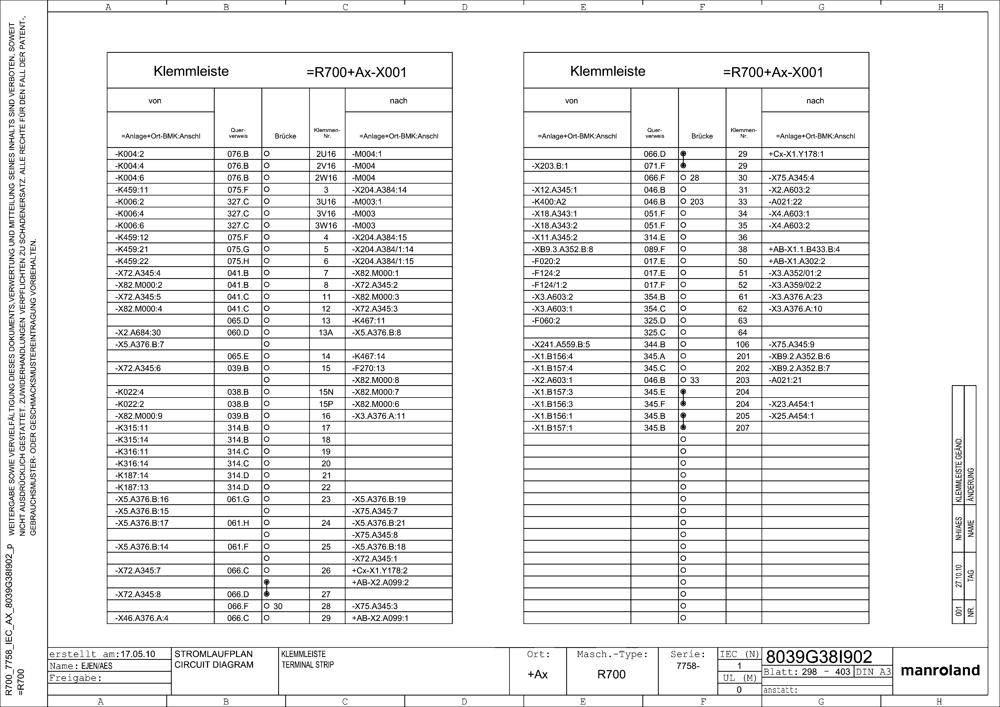

# +Ax — Sheet 298 of 403 — KLEMMLEISTE

**TERMINAL STRIP**

> Part of the manroland **R700** printing press IEC/UL circuit diagrams.
> Drawing class: **Stromlaufplan / Circuit diagram** (DIN A3).
> Document `+Ax` covers the **Central control console** machine section.

## At a glance

| Field | Value |
|---|---|
| Document | `+Ax`  (8039G38I902) |
| Sheet | **298** of 403 |
| Section (DE) | KLEMMLEISTE |
| Section (EN) | TERMINAL STRIP |
| Section type | TERMINALS — Terminal strip |
| Machine type | `R700` |
| Series | `7758` |
| Created | 17.05.10 |
| Replaces | — |
| Columns used | A, B, C, E, F, G, H |
| Path numbers | — |
| Labels on sheet | 254 |
| Cross-refs out | 0 |
| Cross-refs in | 0 |

**Previous:** [+Ax sheet 297](SHEET_0297.md) · **Next:** [+Ax sheet 299](SHEET_0299.md) · **Document TOC:** [_TOC.md](_TOC.md)  (+Ax) · **Master TOC:** [all sheets](../_MASTER_TOC.md)

## Sheet image (300 DPI, exact vector render)



_Rendered directly from the PDF vector layer at 300 DPI (1-bit), no OCR and no resampling. Use it to confirm anything ambiguous in the text below._

## Cross-references on this sheet

Each entry is a wire leaving this sheet. The printed token is `/sheet.column`; the link resolves to that sheet inside the same document.

_No outgoing cross-references on this sheet._

## Devices on this sheet

| Tag | Class | Class meaning (IEC) | Col | Sub | Terminal | Sign |
|---|---|---|---|---|---|---|
| `K004:2` | K | Relais / relay, contactor | A | — | 2 | — |
| `M004:1` | M | Motor | C | — | 1 | — |
| `K004:4` | K | Relais / relay, contactor | A | — | 4 | — |
| `K004:6` | K | Relais / relay, contactor | A | — | 6 | — |
| `K459:11` | K | Relais / relay, contactor | A | — | 11 | — |
| `K006:2` | K | Relais / relay, contactor | A | — | 2 | — |
| `M003:1` | M | Motor | C | — | 1 | — |
| `K006:4` | K | Relais / relay, contactor | A | — | 4 | — |
| `K006:6` | K | Relais / relay, contactor | A | — | 6 | — |
| `K459:12` | K | Relais / relay, contactor | A | — | 12 | — |
| `K459:21` | K | Relais / relay, contactor | A | — | 21 | — |
| `K459:22` | K | Relais / relay, contactor | A | — | 22 | — |
| `K467:11` | K | Relais / relay, contactor | C | — | 11 | — |
| `K467:14` | K | Relais / relay, contactor | C | — | 14 | — |
| `F270:13` | F | Schutz / protection device (fuse, circuit breaker) | C | — | 13 | — |
| `K022:4` | K | Relais / relay, contactor | A | — | 4 | — |
| `K022:2` | K | Relais / relay, contactor | A | — | 2 | — |
| `K315:11` | K | Relais / relay, contactor | A | — | 11 | — |
| `K315:14` | K | Relais / relay, contactor | A | — | 14 | — |
| `K316:11` | K | Relais / relay, contactor | A | — | 11 | — |
| `K316:14` | K | Relais / relay, contactor | A | — | 14 | — |
| `K187:14` | K | Relais / relay, contactor | A | — | 14 | — |
| `K187:13` | K | Relais / relay, contactor | A | — | 13 | — |
| `K400:A2` | K | Relais / relay, contactor | E | — | A2 | — |
| `A021:22` | A | Baugruppe / assembly, module, PC board | G | — | 22 | — |
| `F020:2` | F | Schutz / protection device (fuse, circuit breaker) | E | — | 2 | — |
| `F124:2` | F | Schutz / protection device (fuse, circuit breaker) | E | — | 2 | — |
| `F124/1:2` | F | Schutz / protection device (fuse, circuit breaker) | E | 1 | 2 | — |
| `F060:2` | F | Schutz / protection device (fuse, circuit breaker) | E | — | 2 | — |
| `A021:21` | A | Baugruppe / assembly, module, PC board | G | — | 21 | — |
| `NR.` | — | cross-device reference | H | — | — | — |
| `27.10.10` | — | cross-device reference | H | — | — | — |
| `Nr.` | — | cross-device reference | C | — | — | — |
| `076.B` | — | cross-device reference | B | — | — | — |
| `076.B` | — | cross-device reference | B | — | — | — |
| `076.B` | — | cross-device reference | B | — | — | — |
| `075.F` | — | cross-device reference | B | — | — | — |
| `X204.A384:14` | — | cross-device reference | C | — | 14 | — |
| `327.C` | — | cross-device reference | B | — | — | — |
| `327.C` | — | cross-device reference | B | — | — | — |
| `327.C` | — | cross-device reference | B | — | — | — |
| `075.F` | — | cross-device reference | B | — | — | — |
| `X204.A384:15` | — | cross-device reference | C | — | 15 | — |
| `075.G` | — | cross-device reference | B | — | — | — |
| `075.H` | — | cross-device reference | B | — | — | — |
| `041.B` | — | cross-device reference | B | — | — | — |
| `X72.A345:4` | — | cross-device reference | A | — | 4 | — |
| `X82.M000:1` | — | cross-device reference | C | — | 1 | — |
| `041.B` | — | cross-device reference | B | — | — | — |
| `X82.M000:2` | — | cross-device reference | A | — | 2 | — |
| `X72.A345:2` | — | cross-device reference | C | — | 2 | — |
| `041.C` | — | cross-device reference | B | — | — | — |
| `X72.A345:5` | — | cross-device reference | A | — | 5 | — |
| `X82.M000:3` | — | cross-device reference | C | — | 3 | — |
| `041.C` | — | cross-device reference | B | — | — | — |
| `X82.M000:4` | — | cross-device reference | A | — | 4 | — |
| `X72.A345:3` | — | cross-device reference | C | — | 3 | — |
| `065.D` | — | cross-device reference | B | — | — | — |
| `060.D` | — | cross-device reference | B | — | — | — |
| `X2.A684:30` | — | cross-device reference | A | — | 30 | — |
| `X5.A376.B:8` | — | cross-device reference | C | — | 8 | — |
| `X5.A376.B:7` | — | cross-device reference | A | — | 7 | — |
| `065.E` | — | cross-device reference | B | — | — | — |
| `039.B` | — | cross-device reference | B | — | — | — |
| `X72.A345:6` | — | cross-device reference | A | — | 6 | — |
| `X82.M000:8` | — | cross-device reference | C | — | 8 | — |
| `038.B` | — | cross-device reference | B | — | — | — |
| `X82.M000:7` | — | cross-device reference | C | — | 7 | — |
| `038.B` | — | cross-device reference | B | — | — | — |
| `X82.M000:6` | — | cross-device reference | C | — | 6 | — |
| `039.B` | — | cross-device reference | B | — | — | — |
| `X82.M000:9` | — | cross-device reference | A | — | 9 | — |
| `X3.A376.A:11` | — | cross-device reference | C | — | 11 | — |
| `314.B` | — | cross-device reference | B | — | — | — |
| `314.B` | — | cross-device reference | B | — | — | — |
| `314.C` | — | cross-device reference | B | — | — | — |
| `314.C` | — | cross-device reference | B | — | — | — |
| `314.D` | — | cross-device reference | B | — | — | — |
| `314.D` | — | cross-device reference | B | — | — | — |
| `061.G` | — | cross-device reference | B | — | — | — |
| `X5.A376.B:16` | — | cross-device reference | A | — | 16 | — |
| `X5.A376.B:19` | — | cross-device reference | C | — | 19 | — |
| `X5.A376.B:15` | — | cross-device reference | A | — | 15 | — |
| `X75.A345:7` | — | cross-device reference | C | — | 7 | — |
| `061.H` | — | cross-device reference | B | — | — | — |
| `X5.A376.B:17` | — | cross-device reference | A | — | 17 | — |
| `X5.A376.B:21` | — | cross-device reference | C | — | 21 | — |
| `X75.A345:8` | — | cross-device reference | C | — | 8 | — |
| `061.F` | — | cross-device reference | B | — | — | — |
| `X5.A376.B:14` | — | cross-device reference | A | — | 14 | — |
| `X5.A376.B:18` | — | cross-device reference | C | — | 18 | — |
| `X72.A345:1` | — | cross-device reference | C | — | 1 | — |
| `066.C` | — | cross-device reference | B | — | — | — |
| `X72.A345:7` | — | cross-device reference | A | — | 7 | — |
| `066.D` | — | cross-device reference | B | — | — | — |
| `X72.A345:8` | — | cross-device reference | A | — | 8 | — |
| `066.F` | — | cross-device reference | B | — | — | — |
| `X75.A345:3` | — | cross-device reference | C | — | 3 | — |
| `066.C` | — | cross-device reference | B | — | — | — |
| `X46.A376.A:4` | — | cross-device reference | A | — | 4 | — |
| `Nr.` | — | cross-device reference | F | — | — | — |
| `066.D` | — | cross-device reference | F | — | — | — |
| `071.F` | — | cross-device reference | F | — | — | — |
| `X203.B:1` | — | cross-device reference | E | — | 1 | — |
| `066.F` | — | cross-device reference | F | — | — | — |
| `X75.A345:4` | — | cross-device reference | G | — | 4 | — |
| `046.B` | — | cross-device reference | F | — | — | — |
| `X12.A345:1` | — | cross-device reference | E | — | 1 | — |
| `X2.A603:2` | — | cross-device reference | G | — | 2 | — |
| `046.B` | — | cross-device reference | F | — | — | — |
| `051.F` | — | cross-device reference | F | — | — | — |
| `X18.A343:1` | — | cross-device reference | E | — | 1 | — |
| `X4.A603:1` | — | cross-device reference | G | — | 1 | — |
| `051.F` | — | cross-device reference | F | — | — | — |
| `X18.A343:2` | — | cross-device reference | E | — | 2 | — |
| `X4.A603:2` | — | cross-device reference | G | — | 2 | — |
| `314.E` | — | cross-device reference | F | — | — | — |
| `X11.A345:2` | — | cross-device reference | E | — | 2 | — |
| `089.F` | — | cross-device reference | F | — | — | — |
| `XB9.3.A352.B:8` | — | cross-device reference | E | — | 8 | — |
| `017.E` | — | cross-device reference | F | — | — | — |
| `017.E` | — | cross-device reference | F | — | — | — |
| `017.F` | — | cross-device reference | F | — | — | — |
| `354.B` | — | cross-device reference | F | — | — | — |
| `X3.A603:2` | — | cross-device reference | E | — | 2 | — |
| `X3.A376.A:23` | — | cross-device reference | G | — | 23 | — |
| `354.C` | — | cross-device reference | F | — | — | — |
| `X3.A603:1` | — | cross-device reference | E | — | 1 | — |
| `X3.A376.A:10` | — | cross-device reference | G | — | 10 | — |
| `325.D` | — | cross-device reference | F | — | — | — |
| `325.C` | — | cross-device reference | F | — | — | — |
| `344.B` | — | cross-device reference | F | — | — | — |
| `X241.A559.B:5` | — | cross-device reference | E | — | 5 | — |
| `X75.A345:9` | — | cross-device reference | G | — | 9 | — |
| `345.A` | — | cross-device reference | F | — | — | — |
| `X1.B156:4` | — | cross-device reference | E | — | 4 | — |
| `XB9.2.A352.B:6` | — | cross-device reference | G | — | 6 | — |
| `345.C` | — | cross-device reference | F | — | — | — |
| `X1.B157:4` | — | cross-device reference | E | — | 4 | — |
| `XB9.2.A352.B:7` | — | cross-device reference | G | — | 7 | — |
| `046.B` | — | cross-device reference | F | — | — | — |
| `X2.A603:1` | — | cross-device reference | E | — | 1 | — |
| `345.E` | — | cross-device reference | F | — | — | — |
| `X1.B157:3` | — | cross-device reference | E | — | 3 | — |
| `345.F` | — | cross-device reference | F | — | — | — |
| `X1.B156:3` | — | cross-device reference | E | — | 3 | — |
| `X23.A454:1` | — | cross-device reference | G | — | 1 | — |
| `345.B` | — | cross-device reference | F | — | — | — |
| `X1.B156:1` | — | cross-device reference | E | — | 1 | — |
| `X25.A454:1` | — | cross-device reference | G | — | 1 | — |
| `345.B` | — | cross-device reference | F | — | — | — |
| `X1.B157:1` | — | cross-device reference | E | — | 1 | — |

## Potentials / nets

| Potential | Count | Columns | Attached devices | Terminals |
|---|---|---|---|---|
| `M003` | 2 | C | — | — |
| `M004` | 2 | C | — | — |


A potential such as `L24+/4` or `M24+` is a named supply/return rail; every place it appears on this sheet is electrically common.

## Wire-end annotations (grouped as printed)

A wire that continues elsewhere is annotated with a small cluster: the destination description, the path/line number `#NN`, and the `/sheet.column` cross reference. Each row below is one such cluster exactly as it is grouped on the drawing.

| Col | Y | Path | Cross-ref | Text on the wire |
|---|---|---|---|---|
| B | 77.5 | — | — | `Klemmleiste` |
| E | 77.5 | — | — | `Klemmleiste` |
| C | 79.0 | — | — | `=R700+Ax X001` |
| G | 79.0 | — | — | `=R700+Ax X001` |
| A | 115.5 | — | — | `von` |
| C | 115.5 | — | — | `nach` |
| E | 115.5 | — | — | `von` |
| G | 115.5 | — | — | `nach` |
| B | 151.9 | — | — | `Quer` |
| C | 151.9 | — | — | `Klemmen =Anlage+Ort BMK:Anschl` |
| F | 151.9 | — | — | `Quer` |
| G | 151.9 | — | — | `Klemmen =Anlage+Ort BMK:Anschl` |
| A | 158.5 | — | — | `=Anlage+Ort BMK:Anschl` |
| C | 158.5 | — | — | `Brücke Nr.` |
| E | 158.5 | — | — | `=Anlage+Ort BMK:Anschl` |
| F | 158.5 | — | — | `Brücke Nr.` |
| B | 159.1 | — | — | `verweis` |
| F | 159.1 | — | — | `verweis` |
| B | 179.2 | — | — | `K004:2 K004:4 K004:6 K459:11 K006:2 K006:4 K006:6 K459:12 K459:21 K459:22 X72.A345:4 X82.M000:2 X72.A345:5 X82.M000:4 X2.A684:30 X5.A376.B:7 075.G 327.C 327.C 327.C 041.C 041.C 065.D 060.D 075.H 076.B 076.B 076.B 041.B 041.B 075.F 075.F 2W16 3W16 2U16 3U16 2V16 3V16 13A 12 13 11 3 4 5 6 7 8 M004:1 M004 M004 X204.A384:14 M003:1 M003 M003 X204.A384:15 X204.A384/1:14 X204.A384/1:15 X82.M000:1 X72.A345:2 X82.M000:3 X72.A345:3 K467:11 X5.A376.B:8` |
| F | 179.2 | — | — | `X203.B:1 066.D 071.F 29 29 +Cx X1.Y178:1` |
| F | 207.5 | — | — | `X12.A345:1 K400:A2 X18.A343:1 X18.A343:2 X11.A345:2 046.B 046.B 314.E 066.F 051.F 051.F 28 203 30 33 34 35 36 31 X75.A345:4 X2.A603:2 A021:22 X4.A603:1 X4.A603:2` |
| F | 292.6 | — | — | `XB9.3.A352.B:8 F020:2 F124:2 F124/1:2 X3.A603:2 X3.A603:1 F060:2 354.C 325.D 017.E 017.E 354.B 089.F 017.F 38 50 52 62 63 51 61 +AB X1.1.B433.B:4 +AB X1.A302:2 X3.A352/01:2 X3.A359/02:2 X3.A376.A:23 X3.A376.A:10` |
| F | 391.8 | — | — | `X241.A559.B:5 X1.B156:4 X1.B157:4 X2.A603:1 X1.B157:3 345.A 325.C 345.C 344.B 046.B 345.E 33 106 202 203 204 201 64 X75.A345:9 XB9.2.A352.B:6 XB9.2.A352.B:7 A021:21` |
| B | 420.1 | — | — | `X72.A345:6 K022:4 K022:2 X82.M000:9 K315:11 065.E 039.B 038.B 038.B 039.B 314.B 15N 15P 14 15 16 17 K467:14 F270:13 X82.M000:8 X82.M000:7 X82.M000:6 X3.A376.A:11` |
| F | 476.8 | — | — | `X1.B156:3 X1.B156:1 X1.B157:1 345.B 345.B 345.F 204 205 207 X23.A454:1 X25.A454:1` |
| B | 519.4 | — | — | `K315:14 314.B 18` |
| H | 520.4 | — | — | `001 NHI/AES KLEMMLEISTE GEÄND. 27.10.10` |
| B | 533.5 | — | — | `K316:11 314.C 19` |
| B | 547.7 | — | — | `K316:14 314.C 20` |
| H | 557.2 | — | — | `NR. NAME TAG ÄNDERUNG` |
| B | 561.9 | — | — | `K187:14 314.D 21` |
| B | 576.0 | — | — | `K187:13 314.D 22` |
| B | 590.2 | — | — | `X5.A376.B:16 X5.A376.B:15 X5.A376.B:17 X5.A376.B:14 X72.A345:7 X72.A345:8 061.G 066.C 066.D 061.H 061.F 23 24 25 26 27 +Cx X1.Y178:2 +AB X2.A099:2 X5.A376.B:19 X75.A345:7 X5.A376.B:21 X75.A345:8 X5.A376.B:18 X72.A345:1` |
| B | 717.8 | — | — | `X46.A376.A:4 066.C 066.F 30 28 29 +AB X2.A099:1 X75.A345:3` |


## Reconstructed tables

This sheet carries tabular content (pin map / terminal assignment / index). The grid below was rebuilt from the drawing's own rule lines, so each row is exactly one physical row of the table.

### Table 1 — 34 data rows × 3 columns (at x=255.1, y=62.4)

| Quer verweis | Brücke | Klemmen Nr. |
|---|---|---|
| `076.B` |  | `2U16` |
| `076.B` |  | `2V16` |
| `076.B` |  | `2W16` |
| `075.F` |  | `3` |
| `327.C` |  | `3U16` |
| `327.C` |  | `3V16` |
| `327.C` |  | `3W16` |
| `075.F` |  | `4` |
| `075.G` |  | `5` |
| `075.H` |  | `6` |
| `041.B` |  | `7` |
| `041.B` |  | `8` |
| `041.C` |  | `11` |
| `041.C` |  | `12` |
| `065.D` |  | `13` |
| `060.D` |  | `13A` |
| `065.E` |  | `14` |
| `039.B` |  | `15` |
| `038.B` |  | `15N` |
| `038.B` |  | `15P` |
| `039.B` |  | `16` |
| `314.B` |  | `17` |
| `314.B` |  | `18` |
| `314.C` |  | `19` |
| `314.C` |  | `20` |
| `314.D` |  | `21` |
| `314.D` |  | `22` |
| `061.G` |  | `23` |
| `061.H` |  | `24` |
| `061.F` |  | `25` |
| `066.C` |  | `26` |
| `066.D` |  | `27` |
| `066.F` | `30` | `28` |
| `066.C` |  | `29` |


### Table 2 — 24 data rows × 3 columns (at x=751.2, y=62.4)

| Quer verweis | Brücke | Klemmen Nr. |
|---|---|---|
| `066.D` |  | `29` |
| `071.F` |  | `29` |
| `066.F` | `28` | `30` |
| `046.B` |  | `31` |
| `046.B` | `203` | `33` |
| `051.F` |  | `34` |
| `051.F` |  | `35` |
| `314.E` |  | `36` |
| `089.F` |  | `38` |
| `017.E` |  | `50` |
| `017.E` |  | `51` |
| `017.F` |  | `52` |
| `354.B` |  | `61` |
| `354.C` |  | `62` |
| `325.D` |  | `63` |
| `325.C` |  | `64` |
| `344.B` |  | `106` |
| `345.A` |  | `201` |
| `345.C` |  | `202` |
| `046.B` | `33` | `203` |
| `345.E` |  | `204` |
| `345.F` |  | `204` |
| `345.B` |  | `205` |
| `345.B` |  | `207` |


## Notes and free text on this sheet

| Text | Col | Y (pt) |
|---|---|---|
| `TAG` | H | 678.58 |
| `NAME` | H | 619.16 |
| `ÄNDERUNG` | H | 557.19 |
| `NHI/AES` | H | 615.34 |
| `KLEMMLEISTE GEÄND.` | H | 520.4 |
| `von` | A | 115.53 |
| `=Anlage+Ort BMK:Anschl` | A | 158.52 |
| `Quer` | B | 151.93 |
| `Klemmleiste` | B | 77.49 |
| `verweis` | B | 159.12 |
| `nach` | C | 115.46 |
| `=Anlage+Ort BMK:Anschl` | C | 158.52 |
| `Klemmen` | C | 151.94 |
| `Brücke` | B | 158.53 |
| `=R700+Ax X001` | C | 78.99 |
| `2U16` | C | 179.22 |
| `2V16` | C | 193.4 |
| `2W16` | C | 207.43 |
| `3U16` | C | 235.92 |
| `3V16` | C | 250.09 |
| `3W16` | C | 264.12 |
| `X204.A384/1:14` | C | 292.59 |
| `X204.A384/1:15` | C | 306.76 |
| `13A` | C | 391.82 |
| `15N` | C | 462.68 |
| `15P` | C | 476.86 |
| `+Cx X1.Y178:2` | C | 675.28 |
| `+AB X2.A099:2` | C | 689.43 |
| `+AB X2.A099:1` | C | 731.95 |
| `von` | E | 115.53 |
| `=Anlage+Ort BMK:Anschl` | E | 158.52 |
| `Quer` | F | 151.93 |
| `Klemmleiste` | E | 77.49 |
| `verweis` | F | 159.12 |
| `nach` | G | 115.46 |
| `=Anlage+Ort BMK:Anschl` | G | 158.52 |
| `Klemmen` | F | 151.94 |
| `Brücke` | F | 158.53 |
| `=R700+Ax X001` | G | 78.99 |
| `+Cx X1.Y178:1` | G | 179.22 |
| `+AB X1.1.B433.B:4` | G | 292.58 |
| `+AB X1.A302:2` | G | 306.76 |
| `X3.A352/01:2` | G | 320.93 |
| `X3.A359/02:2` | G | 335.1 |

## Complete label inventory (exact text from the drawing)

Every text object inside the drawing area of this sheet, in DIN reading order (column A→H, then top→bottom). This is the authoritative list: if a string is not here it is not printed on this sheet.

| Col | Y | X | Dir | Type | Text |
|---|---|---|---|---|---|
| A | 115.5 | 176.9 | → | text | `von` |
| A | 158.5 | 144.4 | → | text | `=Anlage+Ort BMK:Anschl` |
| A | 179.2 | 137.2 | → | device tag | `K004:2` |
| A | 193.4 | 137.2 | → | device tag | `K004:4` |
| A | 207.5 | 137.2 | → | device tag | `K004:6` |
| A | 221.7 | 137.2 | → | device tag | `K459:11` |
| A | 235.9 | 137.2 | → | device tag | `K006:2` |
| A | 250.1 | 137.2 | → | device tag | `K006:4` |
| A | 264.2 | 137.2 | → | device tag | `K006:6` |
| A | 278.4 | 137.2 | → | device tag | `K459:12` |
| A | 292.6 | 137.2 | → | device tag | `K459:21` |
| A | 306.8 | 137.2 | → | device tag | `K459:22` |
| A | 320.9 | 137.2 | → | device ref | `X72.A345:4` |
| A | 335.1 | 137.2 | → | device ref | `X82.M000:2` |
| A | 349.3 | 137.2 | → | device ref | `X72.A345:5` |
| A | 363.4 | 137.2 | → | device ref | `X82.M000:4` |
| A | 391.8 | 137.2 | → | device ref | `X2.A684:30` |
| A | 406.0 | 137.2 | → | device ref | `X5.A376.B:7` |
| A | 434.3 | 137.2 | → | device ref | `X72.A345:6` |
| A | 462.7 | 137.2 | → | device tag | `K022:4` |
| A | 476.8 | 137.2 | → | device tag | `K022:2` |
| A | 491.0 | 137.2 | → | device ref | `X82.M000:9` |
| A | 505.2 | 137.2 | → | device tag | `K315:11` |
| A | 519.4 | 137.2 | → | device tag | `K315:14` |
| A | 533.5 | 137.2 | → | device tag | `K316:11` |
| A | 547.7 | 137.2 | → | device tag | `K316:14` |
| A | 561.9 | 137.2 | → | device tag | `K187:14` |
| A | 576.1 | 137.2 | → | device tag | `K187:13` |
| A | 590.2 | 137.2 | → | device ref | `X5.A376.B:16` |
| A | 604.4 | 137.2 | → | device ref | `X5.A376.B:15` |
| A | 618.6 | 137.2 | → | device ref | `X5.A376.B:17` |
| A | 646.9 | 137.2 | → | device ref | `X5.A376.B:14` |
| A | 675.3 | 137.2 | → | device ref | `X72.A345:7` |
| A | 703.6 | 137.2 | → | device ref | `X72.A345:8` |
| A | 731.9 | 137.2 | → | device ref | `X46.A376.A:4` |
| B | 77.5 | 182.8 | → | text | `Klemmleiste` |
| B | 151.9 | 274.7 | → | text | `Quer` |
| B | 158.5 | 327.3 | → | text | `Brücke` |
| B | 159.1 | 272.6 | → | text | `verweis` |
| B | 179.2 | 270.9 | → | device ref | `076.B` |
| B | 193.4 | 270.9 | → | device ref | `076.B` |
| B | 207.6 | 270.9 | → | device ref | `076.B` |
| B | 221.7 | 271.1 | → | device ref | `075.F` |
| B | 235.9 | 270.6 | → | device ref | `327.C` |
| B | 250.1 | 270.6 | → | device ref | `327.C` |
| B | 264.2 | 270.6 | → | device ref | `327.C` |
| B | 278.4 | 271.1 | → | device ref | `075.F` |
| B | 292.6 | 270.3 | → | device ref | `075.G` |
| B | 306.8 | 270.7 | → | device ref | `075.H` |
| B | 320.9 | 270.9 | → | device ref | `041.B` |
| B | 335.1 | 270.9 | → | device ref | `041.B` |
| B | 349.3 | 270.6 | → | device ref | `041.C` |
| B | 363.5 | 270.6 | → | device ref | `041.C` |
| B | 377.6 | 270.6 | → | device ref | `065.D` |
| B | 391.8 | 270.6 | → | device ref | `060.D` |
| B | 420.2 | 270.9 | → | device ref | `065.E` |
| B | 434.3 | 270.9 | → | device ref | `039.B` |
| B | 462.7 | 270.9 | → | device ref | `038.B` |
| B | 476.8 | 270.9 | → | device ref | `038.B` |
| B | 491.0 | 270.9 | → | device ref | `039.B` |
| B | 505.2 | 270.9 | → | device ref | `314.B` |
| B | 519.4 | 270.9 | → | device ref | `314.B` |
| B | 533.5 | 270.6 | → | device ref | `314.C` |
| B | 547.7 | 270.6 | → | device ref | `314.C` |
| B | 561.9 | 270.6 | → | device ref | `314.D` |
| B | 576.1 | 270.6 | → | device ref | `314.D` |
| B | 590.2 | 270.3 | → | device ref | `061.G` |
| B | 618.6 | 270.7 | → | device ref | `061.H` |
| B | 646.9 | 271.1 | → | device ref | `061.F` |
| B | 675.3 | 270.6 | → | device ref | `066.C` |
| B | 703.6 | 270.6 | → | device ref | `066.D` |
| B | 717.8 | 271.1 | → | device ref | `066.F` |
| B | 717.8 | 325.7 | → | number | `30` |
| B | 732.0 | 270.6 | → | device ref | `066.C` |
| C | 79.0 | 364.8 | → | text | `=R700+Ax X001` |
| C | 115.5 | 464.3 | → | text | `nach` |
| C | 151.9 | 374.0 | → | text | `Klemmen` |
| C | 158.5 | 427.9 | → | text | `=Anlage+Ort BMK:Anschl` |
| C | 159.0 | 385.4 | → | device ref | `Nr.` |
| C | 179.2 | 376.7 | → | text | `2U16` |
| C | 179.2 | 419.2 | → | device tag | `M004:1` |
| C | 193.4 | 377.0 | → | text | `2V16` |
| C | 193.4 | 419.2 | → | potential | `M004` |
| C | 207.4 | 375.2 | → | text | `2W16` |
| C | 207.5 | 419.2 | → | potential | `M004` |
| C | 221.7 | 419.2 | → | device ref | `X204.A384:14` |
| C | 221.8 | 385.7 | → | number | `3` |
| C | 235.9 | 376.7 | → | text | `3U16` |
| C | 235.9 | 419.2 | → | device tag | `M003:1` |
| C | 250.1 | 377.0 | → | text | `3V16` |
| C | 250.1 | 419.2 | → | potential | `M003` |
| C | 264.1 | 375.2 | → | text | `3W16` |
| C | 264.2 | 419.2 | → | potential | `M003` |
| C | 278.4 | 419.2 | → | device ref | `X204.A384:15` |
| C | 278.5 | 385.7 | → | number | `4` |
| C | 292.6 | 385.7 | → | number | `5` |
| C | 292.6 | 419.2 | → | text | `X204.A384/1:14` |
| C | 306.8 | 385.7 | → | number | `6` |
| C | 306.8 | 419.2 | → | text | `X204.A384/1:15` |
| C | 320.9 | 419.2 | → | device ref | `X82.M000:1` |
| C | 321.0 | 385.7 | → | number | `7` |
| C | 335.1 | 385.7 | → | number | `8` |
| C | 335.1 | 419.2 | → | device ref | `X72.A345:2` |
| C | 349.3 | 383.5 | → | number | `11` |
| C | 349.3 | 419.2 | → | device ref | `X82.M000:3` |
| C | 363.4 | 419.2 | → | device ref | `X72.A345:3` |
| C | 363.5 | 382.7 | → | number | `12` |
| C | 377.6 | 419.2 | → | device tag | `K467:11` |
| C | 377.7 | 382.7 | → | number | `13` |
| C | 391.8 | 379.1 | → | text | `13A` |
| C | 391.8 | 419.2 | → | device ref | `X5.A376.B:8` |
| C | 420.1 | 419.2 | → | device tag | `K467:14` |
| C | 420.2 | 382.7 | → | number | `14` |
| C | 434.3 | 419.2 | → | device tag | `F270:13` |
| C | 434.4 | 382.7 | → | number | `15` |
| C | 448.5 | 419.2 | → | device ref | `X82.M000:8` |
| C | 462.7 | 379.4 | → | text | `15N` |
| C | 462.7 | 419.2 | → | device ref | `X82.M000:7` |
| C | 476.8 | 419.2 | → | device ref | `X82.M000:6` |
| C | 476.9 | 379.6 | → | text | `15P` |
| C | 491.0 | 382.7 | → | number | `16` |
| C | 491.0 | 419.2 | → | device ref | `X3.A376.A:11` |
| C | 505.2 | 382.7 | → | number | `17` |
| C | 519.4 | 382.7 | → | number | `18` |
| C | 533.6 | 382.7 | → | number | `19` |
| C | 547.7 | 383.0 | → | number | `20` |
| C | 561.9 | 383.8 | → | number | `21` |
| C | 576.1 | 383.0 | → | number | `22` |
| C | 590.2 | 419.2 | → | device ref | `X5.A376.B:19` |
| C | 590.3 | 383.0 | → | number | `23` |
| C | 604.4 | 419.2 | → | device ref | `X75.A345:7` |
| C | 618.6 | 383.0 | → | number | `24` |
| C | 618.6 | 419.2 | → | device ref | `X5.A376.B:21` |
| C | 632.7 | 419.2 | → | device ref | `X75.A345:8` |
| C | 646.9 | 419.2 | → | device ref | `X5.A376.B:18` |
| C | 647.0 | 383.0 | → | number | `25` |
| C | 661.1 | 419.2 | → | device ref | `X72.A345:1` |
| C | 675.3 | 383.0 | → | number | `26` |
| C | 675.3 | 419.0 | → | text | `+Cx X1.Y178:2` |
| C | 689.4 | 419.0 | → | text | `+AB X2.A099:2` |
| C | 703.6 | 383.0 | → | number | `27` |
| C | 717.8 | 383.0 | → | number | `28` |
| C | 717.8 | 419.2 | → | device ref | `X75.A345:3` |
| C | 732.0 | 383.0 | → | number | `29` |
| C | 732.0 | 419.0 | → | text | `+AB X2.A099:1` |
| E | 77.5 | 678.9 | → | text | `Klemmleiste` |
| E | 115.5 | 672.9 | → | text | `von` |
| E | 158.5 | 640.5 | → | text | `=Anlage+Ort BMK:Anschl` |
| E | 193.4 | 633.3 | → | device ref | `X203.B:1` |
| E | 221.7 | 633.3 | → | device ref | `X12.A345:1` |
| E | 235.9 | 633.3 | → | device tag | `K400:A2` |
| E | 250.1 | 633.3 | → | device ref | `X18.A343:1` |
| E | 264.2 | 633.3 | → | device ref | `X18.A343:2` |
| E | 278.4 | 633.3 | → | device ref | `X11.A345:2` |
| E | 292.6 | 633.3 | → | device ref | `XB9.3.A352.B:8` |
| E | 306.8 | 633.3 | → | device tag | `F020:2` |
| E | 320.9 | 633.3 | → | device tag | `F124:2` |
| E | 335.1 | 633.3 | → | device tag | `F124/1:2` |
| E | 349.3 | 633.3 | → | device ref | `X3.A603:2` |
| E | 363.4 | 633.3 | → | device ref | `X3.A603:1` |
| E | 377.6 | 633.3 | → | device tag | `F060:2` |
| E | 406.0 | 633.3 | → | device ref | `X241.A559.B:5` |
| E | 420.1 | 633.3 | → | device ref | `X1.B156:4` |
| E | 434.3 | 633.3 | → | device ref | `X1.B157:4` |
| E | 448.5 | 633.3 | → | device ref | `X2.A603:1` |
| E | 462.7 | 633.3 | → | device ref | `X1.B157:3` |
| E | 476.8 | 633.3 | → | device ref | `X1.B156:3` |
| E | 491.0 | 633.3 | → | device ref | `X1.B156:1` |
| E | 505.2 | 633.3 | → | device ref | `X1.B157:1` |
| F | 151.9 | 770.7 | → | text | `Quer` |
| F | 151.9 | 870.1 | → | text | `Klemmen` |
| F | 158.5 | 823.3 | → | text | `Brücke` |
| F | 159.0 | 881.4 | → | device ref | `Nr.` |
| F | 159.1 | 768.6 | → | text | `verweis` |
| F | 179.2 | 766.6 | → | device ref | `066.D` |
| F | 179.2 | 879.0 | → | number | `29` |
| F | 193.4 | 767.2 | → | device ref | `071.F` |
| F | 193.4 | 879.0 | → | number | `29` |
| F | 207.6 | 767.2 | → | device ref | `066.F` |
| F | 207.6 | 821.8 | → | number | `28` |
| F | 207.6 | 879.0 | → | number | `30` |
| F | 221.7 | 766.9 | → | device ref | `046.B` |
| F | 221.8 | 879.9 | → | number | `31` |
| F | 235.9 | 766.9 | → | device ref | `046.B` |
| F | 235.9 | 821.8 | → | number | `203` |
| F | 235.9 | 879.0 | → | number | `33` |
| F | 250.1 | 767.2 | → | device ref | `051.F` |
| F | 250.1 | 879.0 | → | number | `34` |
| F | 264.3 | 767.2 | → | device ref | `051.F` |
| F | 264.3 | 879.0 | → | number | `35` |
| F | 278.4 | 766.9 | → | device ref | `314.E` |
| F | 278.5 | 879.0 | → | number | `36` |
| F | 292.6 | 767.2 | → | device ref | `089.F` |
| F | 292.6 | 879.0 | → | number | `38` |
| F | 306.8 | 766.9 | → | device ref | `017.E` |
| F | 306.8 | 879.0 | → | number | `50` |
| F | 320.9 | 766.9 | → | device ref | `017.E` |
| F | 321.0 | 879.9 | → | number | `51` |
| F | 335.1 | 767.2 | → | device ref | `017.F` |
| F | 335.1 | 879.0 | → | number | `52` |
| F | 349.3 | 766.9 | → | device ref | `354.B` |
| F | 349.3 | 879.9 | → | number | `61` |
| F | 363.5 | 766.6 | → | device ref | `354.C` |
| F | 363.5 | 879.0 | → | number | `62` |
| F | 377.6 | 766.6 | → | device ref | `325.D` |
| F | 377.7 | 879.0 | → | number | `63` |
| F | 391.8 | 766.6 | → | device ref | `325.C` |
| F | 391.8 | 879.0 | → | number | `64` |
| F | 406.0 | 766.9 | → | device ref | `344.B` |
| F | 406.0 | 876.0 | → | number | `106` |
| F | 420.2 | 766.5 | → | device ref | `345.A` |
| F | 420.2 | 877.2 | → | number | `201` |
| F | 434.3 | 766.6 | → | device ref | `345.C` |
| F | 434.4 | 876.3 | → | number | `202` |
| F | 448.5 | 766.9 | → | device ref | `046.B` |
| F | 448.5 | 821.8 | → | number | `33` |
| F | 448.5 | 876.3 | → | number | `203` |
| F | 462.7 | 766.9 | → | device ref | `345.E` |
| F | 462.7 | 876.3 | → | number | `204` |
| F | 476.8 | 767.2 | → | device ref | `345.F` |
| F | 476.9 | 876.3 | → | number | `204` |
| F | 491.0 | 766.9 | → | device ref | `345.B` |
| F | 491.0 | 876.3 | → | number | `205` |
| F | 505.2 | 766.9 | → | device ref | `345.B` |
| F | 505.2 | 876.3 | → | number | `207` |
| G | 79.0 | 860.9 | → | text | `=R700+Ax X001` |
| G | 115.5 | 960.4 | → | text | `nach` |
| G | 158.5 | 924.0 | → | text | `=Anlage+Ort BMK:Anschl` |
| G | 179.2 | 915.0 | → | text | `+Cx X1.Y178:1` |
| G | 207.5 | 915.3 | → | device ref | `X75.A345:4` |
| G | 221.7 | 915.3 | → | device ref | `X2.A603:2` |
| G | 235.9 | 915.3 | → | device tag | `A021:22` |
| G | 250.1 | 915.3 | → | device ref | `X4.A603:1` |
| G | 264.2 | 915.3 | → | device ref | `X4.A603:2` |
| G | 292.6 | 915.0 | → | text | `+AB X1.1.B433.B:4` |
| G | 306.8 | 915.0 | → | text | `+AB X1.A302:2` |
| G | 320.9 | 915.3 | → | text | `X3.A352/01:2` |
| G | 335.1 | 915.3 | → | text | `X3.A359/02:2` |
| G | 349.3 | 915.3 | → | device ref | `X3.A376.A:23` |
| G | 363.4 | 915.3 | → | device ref | `X3.A376.A:10` |
| G | 406.0 | 915.3 | → | device ref | `X75.A345:9` |
| G | 420.1 | 915.3 | → | device ref | `XB9.2.A352.B:6` |
| G | 434.3 | 915.3 | → | device ref | `XB9.2.A352.B:7` |
| G | 448.5 | 915.3 | → | device tag | `A021:21` |
| G | 476.8 | 915.3 | → | device ref | `X23.A454:1` |
| G | 491.0 | 915.3 | → | device ref | `X25.A454:1` |
| H | 520.4 | 1138.5 | ↕ | text | `KLEMMLEISTE GEÄND.` |
| H | 557.2 | 1152.7 | ↕ | text | `ÄNDERUNG` |
| H | 615.3 | 1138.5 | ↕ | text | `NHI/AES` |
| H | 619.2 | 1152.6 | ↕ | text | `NAME` |
| H | 672.4 | 1138.5 | ↕ | device ref | `27.10.10` |
| H | 678.6 | 1152.6 | ↕ | text | `TAG` |
| H | 721.6 | 1138.4 | ↕ | number | `001` |
| H | 722.0 | 1152.5 | ↕ | device ref | `NR.` |

## Reading-order text block

The same content as a plain block, grouped by DIN column — convenient to paste or to match against a visual description.

```text
=== Column A ===
 115.5  176.9  text         von
 158.5  144.4  text         =Anlage+Ort BMK:Anschl
 179.2  137.2  devtag       K004:2
 193.4  137.2  devtag       K004:4
 207.5  137.2  devtag       K004:6
 221.7  137.2  devtag       K459:11
 235.9  137.2  devtag       K006:2
 250.1  137.2  devtag       K006:4
 264.2  137.2  devtag       K006:6
 278.4  137.2  devtag       K459:12
 292.6  137.2  devtag       K459:21
 306.8  137.2  devtag       K459:22
 320.9  137.2  devref       X72.A345:4
 335.1  137.2  devref       X82.M000:2
 349.3  137.2  devref       X72.A345:5
 363.4  137.2  devref       X82.M000:4
 391.8  137.2  devref       X2.A684:30
 406.0  137.2  devref       X5.A376.B:7
 434.3  137.2  devref       X72.A345:6
 462.7  137.2  devtag       K022:4
 476.8  137.2  devtag       K022:2
 491.0  137.2  devref       X82.M000:9
 505.2  137.2  devtag       K315:11
 519.4  137.2  devtag       K315:14
 533.5  137.2  devtag       K316:11
 547.7  137.2  devtag       K316:14
 561.9  137.2  devtag       K187:14
 576.1  137.2  devtag       K187:13
 590.2  137.2  devref       X5.A376.B:16
 604.4  137.2  devref       X5.A376.B:15
 618.6  137.2  devref       X5.A376.B:17
 646.9  137.2  devref       X5.A376.B:14
 675.3  137.2  devref       X72.A345:7
 703.6  137.2  devref       X72.A345:8
 731.9  137.2  devref       X46.A376.A:4
=== Column B ===
  77.5  182.8  text         Klemmleiste
 151.9  274.7  text         Quer
 158.5  327.3  text         Brücke
 159.1  272.6  text         verweis
 179.2  270.9  devref       076.B
 193.4  270.9  devref       076.B
 207.6  270.9  devref       076.B
 221.7  271.1  devref       075.F
 235.9  270.6  devref       327.C
 250.1  270.6  devref       327.C
 264.2  270.6  devref       327.C
 278.4  271.1  devref       075.F
 292.6  270.3  devref       075.G
 306.8  270.7  devref       075.H
 320.9  270.9  devref       041.B
 335.1  270.9  devref       041.B
 349.3  270.6  devref       041.C
 363.5  270.6  devref       041.C
 377.6  270.6  devref       065.D
 391.8  270.6  devref       060.D
 420.2  270.9  devref       065.E
 434.3  270.9  devref       039.B
 462.7  270.9  devref       038.B
 476.8  270.9  devref       038.B
 491.0  270.9  devref       039.B
 505.2  270.9  devref       314.B
 519.4  270.9  devref       314.B
 533.5  270.6  devref       314.C
 547.7  270.6  devref       314.C
 561.9  270.6  devref       314.D
 576.1  270.6  devref       314.D
 590.2  270.3  devref       061.G
 618.6  270.7  devref       061.H
 646.9  271.1  devref       061.F
 675.3  270.6  devref       066.C
 703.6  270.6  devref       066.D
 717.8  271.1  devref       066.F
 717.8  325.7  numeric      30
 732.0  270.6  devref       066.C
=== Column C ===
  79.0  364.8  text         =R700+Ax X001
 115.5  464.3  text         nach
 151.9  374.0  text         Klemmen
 158.5  427.9  text         =Anlage+Ort BMK:Anschl
 159.0  385.4  devref       Nr.
 179.2  376.7  text         2U16
 179.2  419.2  devtag       M004:1
 193.4  377.0  text         2V16
 193.4  419.2  net          M004
 207.4  375.2  text         2W16
 207.5  419.2  net          M004
 221.7  419.2  devref       X204.A384:14
 221.8  385.7  numeric      3
 235.9  376.7  text         3U16
 235.9  419.2  devtag       M003:1
 250.1  377.0  text         3V16
 250.1  419.2  net          M003
 264.1  375.2  text         3W16
 264.2  419.2  net          M003
 278.4  419.2  devref       X204.A384:15
 278.5  385.7  numeric      4
 292.6  385.7  numeric      5
 292.6  419.2  text         X204.A384/1:14
 306.8  385.7  numeric      6
 306.8  419.2  text         X204.A384/1:15
 320.9  419.2  devref       X82.M000:1
 321.0  385.7  numeric      7
 335.1  385.7  numeric      8
 335.1  419.2  devref       X72.A345:2
 349.3  383.5  numeric      11
 349.3  419.2  devref       X82.M000:3
 363.4  419.2  devref       X72.A345:3
 363.5  382.7  numeric      12
 377.6  419.2  devtag       K467:11
 377.7  382.7  numeric      13
 391.8  379.1  text         13A
 391.8  419.2  devref       X5.A376.B:8
 420.1  419.2  devtag       K467:14
 420.2  382.7  numeric      14
 434.3  419.2  devtag       F270:13
 434.4  382.7  numeric      15
 448.5  419.2  devref       X82.M000:8
 462.7  379.4  text         15N
 462.7  419.2  devref       X82.M000:7
 476.8  419.2  devref       X82.M000:6
 476.9  379.6  text         15P
 491.0  382.7  numeric      16
 491.0  419.2  devref       X3.A376.A:11
 505.2  382.7  numeric      17
 519.4  382.7  numeric      18
 533.6  382.7  numeric      19
 547.7  383.0  numeric      20
 561.9  383.8  numeric      21
 576.1  383.0  numeric      22
 590.2  419.2  devref       X5.A376.B:19
 590.3  383.0  numeric      23
 604.4  419.2  devref       X75.A345:7
 618.6  383.0  numeric      24
 618.6  419.2  devref       X5.A376.B:21
 632.7  419.2  devref       X75.A345:8
 646.9  419.2  devref       X5.A376.B:18
 647.0  383.0  numeric      25
 661.1  419.2  devref       X72.A345:1
 675.3  383.0  numeric      26
 675.3  419.0  text         +Cx X1.Y178:2
 689.4  419.0  text         +AB X2.A099:2
 703.6  383.0  numeric      27
 717.8  383.0  numeric      28
 717.8  419.2  devref       X75.A345:3
 732.0  383.0  numeric      29
 732.0  419.0  text         +AB X2.A099:1
=== Column E ===
  77.5  678.9  text         Klemmleiste
 115.5  672.9  text         von
 158.5  640.5  text         =Anlage+Ort BMK:Anschl
 193.4  633.3  devref       X203.B:1
 221.7  633.3  devref       X12.A345:1
 235.9  633.3  devtag       K400:A2
 250.1  633.3  devref       X18.A343:1
 264.2  633.3  devref       X18.A343:2
 278.4  633.3  devref       X11.A345:2
 292.6  633.3  devref       XB9.3.A352.B:8
 306.8  633.3  devtag       F020:2
 320.9  633.3  devtag       F124:2
 335.1  633.3  devtag       F124/1:2
 349.3  633.3  devref       X3.A603:2
 363.4  633.3  devref       X3.A603:1
 377.6  633.3  devtag       F060:2
 406.0  633.3  devref       X241.A559.B:5
 420.1  633.3  devref       X1.B156:4
 434.3  633.3  devref       X1.B157:4
 448.5  633.3  devref       X2.A603:1
 462.7  633.3  devref       X1.B157:3
 476.8  633.3  devref       X1.B156:3
 491.0  633.3  devref       X1.B156:1
 505.2  633.3  devref       X1.B157:1
=== Column F ===
 151.9  770.7  text         Quer
 151.9  870.1  text         Klemmen
 158.5  823.3  text         Brücke
 159.0  881.4  devref       Nr.
 159.1  768.6  text         verweis
 179.2  766.6  devref       066.D
 179.2  879.0  numeric      29
 193.4  767.2  devref       071.F
 193.4  879.0  numeric      29
 207.6  767.2  devref       066.F
 207.6  821.8  numeric      28
 207.6  879.0  numeric      30
 221.7  766.9  devref       046.B
 221.8  879.9  numeric      31
 235.9  766.9  devref       046.B
 235.9  821.8  numeric      203
 235.9  879.0  numeric      33
 250.1  767.2  devref       051.F
 250.1  879.0  numeric      34
 264.3  767.2  devref       051.F
 264.3  879.0  numeric      35
 278.4  766.9  devref       314.E
 278.5  879.0  numeric      36
 292.6  767.2  devref       089.F
 292.6  879.0  numeric      38
 306.8  766.9  devref       017.E
 306.8  879.0  numeric      50
 320.9  766.9  devref       017.E
 321.0  879.9  numeric      51
 335.1  767.2  devref       017.F
 335.1  879.0  numeric      52
 349.3  766.9  devref       354.B
 349.3  879.9  numeric      61
 363.5  766.6  devref       354.C
 363.5  879.0  numeric      62
 377.6  766.6  devref       325.D
 377.7  879.0  numeric      63
 391.8  766.6  devref       325.C
 391.8  879.0  numeric      64
 406.0  766.9  devref       344.B
 406.0  876.0  numeric      106
 420.2  766.5  devref       345.A
 420.2  877.2  numeric      201
 434.3  766.6  devref       345.C
 434.4  876.3  numeric      202
 448.5  766.9  devref       046.B
 448.5  821.8  numeric      33
 448.5  876.3  numeric      203
 462.7  766.9  devref       345.E
 462.7  876.3  numeric      204
 476.8  767.2  devref       345.F
 476.9  876.3  numeric      204
 491.0  766.9  devref       345.B
 491.0  876.3  numeric      205
 505.2  766.9  devref       345.B
 505.2  876.3  numeric      207
=== Column G ===
  79.0  860.9  text         =R700+Ax X001
 115.5  960.4  text         nach
 158.5  924.0  text         =Anlage+Ort BMK:Anschl
 179.2  915.0  text         +Cx X1.Y178:1
 207.5  915.3  devref       X75.A345:4
 221.7  915.3  devref       X2.A603:2
 235.9  915.3  devtag       A021:22
 250.1  915.3  devref       X4.A603:1
 264.2  915.3  devref       X4.A603:2
 292.6  915.0  text         +AB X1.1.B433.B:4
 306.8  915.0  text         +AB X1.A302:2
 320.9  915.3  text         X3.A352/01:2
 335.1  915.3  text         X3.A359/02:2
 349.3  915.3  devref       X3.A376.A:23
 363.4  915.3  devref       X3.A376.A:10
 406.0  915.3  devref       X75.A345:9
 420.1  915.3  devref       XB9.2.A352.B:6
 434.3  915.3  devref       XB9.2.A352.B:7
 448.5  915.3  devtag       A021:21
 476.8  915.3  devref       X23.A454:1
 491.0  915.3  devref       X25.A454:1
=== Column H ===
 520.4 1138.5  text         KLEMMLEISTE GEÄND.
 557.2 1152.7  text         ÄNDERUNG
 615.3 1138.5  text         NHI/AES
 619.2 1152.6  text         NAME
 672.4 1138.5  devref       27.10.10
 678.6 1152.6  text         TAG
 721.6 1138.4  numeric      001
 722.0 1152.5  devref       NR.
```

---
_Generated from the PDF vector text layer; no OCR. Source: `R700_7758_IEC_AX_8039G38I902_p`, sheet 298._
