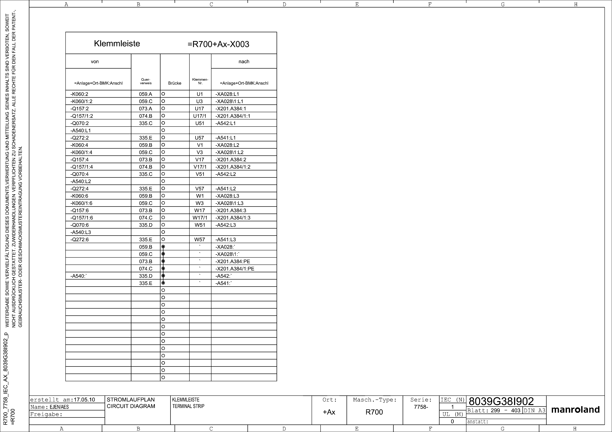

# +Ax — Sheet 299 of 403 — KLEMMLEISTE

**TERMINAL STRIP**

> Part of the manroland **R700** printing press IEC/UL circuit diagrams.
> Drawing class: **Stromlaufplan / Circuit diagram** (DIN A3).
> Document `+Ax` covers the **Central control console** machine section.

## At a glance

| Field | Value |
|---|---|
| Document | `+Ax`  (8039G38I902) |
| Sheet | **299** of 403 |
| Section (DE) | KLEMMLEISTE |
| Section (EN) | TERMINAL STRIP |
| Section type | TERMINALS — Terminal strip |
| Machine type | `R700` |
| Series | `7758` |
| Created | 17.05.10 |
| Replaces | — |
| Columns used | A, B, C |
| Path numbers | — |
| Labels on sheet | 105 |
| Cross-refs out | 0 |
| Cross-refs in | 0 |

**Previous:** [+Ax sheet 298](SHEET_0298.md) · **Next:** [+Ax sheet 300](SHEET_0300.md) · **Document TOC:** [_TOC.md](_TOC.md)  (+Ax) · **Master TOC:** [all sheets](../_MASTER_TOC.md)

## Sheet image (300 DPI, exact vector render)



_Rendered directly from the PDF vector layer at 300 DPI (1-bit), no OCR and no resampling. Use it to confirm anything ambiguous in the text below._

## Cross-references on this sheet

Each entry is a wire leaving this sheet. The printed token is `/sheet.column`; the link resolves to that sheet inside the same document.

_No outgoing cross-references on this sheet._

## Devices on this sheet

| Tag | Class | Class meaning (IEC) | Col | Sub | Terminal | Sign |
|---|---|---|---|---|---|---|
| `U1` | U | Umrichter / frequency converter | C | — | — | — |
| `K060:2` | K | Relais / relay, contactor | A | — | 2 | — |
| `XA028:L1` | XA |  | C | — | L1 | — |
| `U3` | U | Umrichter / frequency converter | C | — | — | — |
| `K060/1:2` | K | Relais / relay, contactor | A | 1 | 2 | — |
| `U17` | U | Umrichter / frequency converter | C | — | — | — |
| `Q157:2` | Q | Leistungsschalter / power switching device | A | — | 2 | — |
| `U17/1` | U | Umrichter / frequency converter | C | 1 | — | — |
| `Q157/1:2` | Q | Leistungsschalter / power switching device | A | 1 | 2 | — |
| `U51` | U | Umrichter / frequency converter | C | — | — | — |
| `Q070:2` | Q | Leistungsschalter / power switching device | A | — | 2 | — |
| `A542:L1` | A | Baugruppe / assembly, module, PC board | C | — | L1 | — |
| `A540:L1` | A | Baugruppe / assembly, module, PC board | A | — | L1 | — |
| `U57` | U | Umrichter / frequency converter | C | — | — | — |
| `Q272:2` | Q | Leistungsschalter / power switching device | A | — | 2 | — |
| `A541:L1` | A | Baugruppe / assembly, module, PC board | C | — | L1 | — |
| `V1` | V | Diode / semiconductor valve | C | — | — | — |
| `K060:4` | K | Relais / relay, contactor | A | — | 4 | — |
| `XA028:L2` | XA |  | C | — | L2 | — |
| `V3` | V | Diode / semiconductor valve | C | — | — | — |
| `K060/1:4` | K | Relais / relay, contactor | A | 1 | 4 | — |
| `V17` | V | Diode / semiconductor valve | C | — | — | — |
| `Q157:4` | Q | Leistungsschalter / power switching device | A | — | 4 | — |
| `V17/1` | V | Diode / semiconductor valve | C | 1 | — | — |
| `Q157/1:4` | Q | Leistungsschalter / power switching device | A | 1 | 4 | — |
| `V51` | V | Diode / semiconductor valve | C | — | — | — |
| `Q070:4` | Q | Leistungsschalter / power switching device | A | — | 4 | — |
| `A542:L2` | A | Baugruppe / assembly, module, PC board | C | — | L2 | — |
| `A540:L2` | A | Baugruppe / assembly, module, PC board | A | — | L2 | — |
| `V57` | V | Diode / semiconductor valve | C | — | — | — |
| `Q272:4` | Q | Leistungsschalter / power switching device | A | — | 4 | — |
| `A541:L2` | A | Baugruppe / assembly, module, PC board | C | — | L2 | — |
| `W1` | W | Kabel / cable, line, bus | C | — | — | — |
| `K060:6` | K | Relais / relay, contactor | A | — | 6 | — |
| `XA028:L3` | XA |  | C | — | L3 | — |
| `W3` | W | Kabel / cable, line, bus | C | — | — | — |
| `K060/1:6` | K | Relais / relay, contactor | A | 1 | 6 | — |
| `W17` | W | Kabel / cable, line, bus | C | — | — | — |
| `Q157:6` | Q | Leistungsschalter / power switching device | A | — | 6 | — |
| `W17/1` | W | Kabel / cable, line, bus | C | 1 | — | — |
| `Q157/1:6` | Q | Leistungsschalter / power switching device | A | 1 | 6 | — |
| `W51` | W | Kabel / cable, line, bus | C | — | — | — |
| `Q070:6` | Q | Leistungsschalter / power switching device | A | — | 6 | — |
| `A542:L3` | A | Baugruppe / assembly, module, PC board | C | — | L3 | — |
| `A540:L3` | A | Baugruppe / assembly, module, PC board | A | — | L3 | — |
| `W57` | W | Kabel / cable, line, bus | C | — | — | — |
| `Q272:6` | Q | Leistungsschalter / power switching device | A | — | 6 | — |
| `A541:L3` | A | Baugruppe / assembly, module, PC board | C | — | L3 | — |
| `Nr.` | — | cross-device reference | C | — | — | — |
| `059.A` | — | cross-device reference | B | — | — | — |
| `059.C` | — | cross-device reference | B | — | — | — |
| `073.A` | — | cross-device reference | B | — | — | — |
| `X201.A384:1` | — | cross-device reference | C | — | 1 | — |
| `074.B` | — | cross-device reference | B | — | — | — |
| `335.C` | — | cross-device reference | B | — | — | — |
| `335.E` | — | cross-device reference | B | — | — | — |
| `059.B` | — | cross-device reference | B | — | — | — |
| `059.C` | — | cross-device reference | B | — | — | — |
| `073.B` | — | cross-device reference | B | — | — | — |
| `X201.A384:2` | — | cross-device reference | C | — | 2 | — |
| `074.B` | — | cross-device reference | B | — | — | — |
| `335.C` | — | cross-device reference | B | — | — | — |
| `335.E` | — | cross-device reference | B | — | — | — |
| `059.B` | — | cross-device reference | B | — | — | — |
| `059.C` | — | cross-device reference | B | — | — | — |
| `073.B` | — | cross-device reference | B | — | — | — |
| `X201.A384:3` | — | cross-device reference | C | — | 3 | — |
| `074.C` | — | cross-device reference | B | — | — | — |
| `335.D` | — | cross-device reference | B | — | — | — |
| `335.E` | — | cross-device reference | B | — | — | — |
| `059.B` | — | cross-device reference | B | — | — | — |
| `059.C` | — | cross-device reference | B | — | — | — |
| `073.B` | — | cross-device reference | B | — | — | — |
| `X201.A384:PE` | — | cross-device reference | C | — | PE | — |
| `074.C` | — | cross-device reference | B | — | — | — |
| `335.D` | — | cross-device reference | B | — | — | — |
| `335.E` | — | cross-device reference | B | — | — | — |

## Potentials / nets

_No named potentials on this sheet._

## Wire-end annotations (grouped as printed)

A wire that continues elsewhere is annotated with a small cluster: the destination description, the path/line number `#NN`, and the `/sheet.column` cross reference. Each row below is one such cluster exactly as it is grouped on the drawing.

| Col | Y | Path | Cross-ref | Text on the wire |
|---|---|---|---|---|
| B | 77.5 | — | — | `Klemmleiste` |
| C | 79.0 | — | — | `=R700+Ax X003` |
| A | 115.5 | — | — | `von` |
| C | 115.5 | — | — | `nach` |
| B | 151.9 | — | — | `Quer` |
| C | 151.9 | — | — | `Klemmen =Anlage+Ort BMK:Anschl` |
| A | 158.5 | — | — | `=Anlage+Ort BMK:Anschl` |
| C | 158.5 | — | — | `Brücke Nr.` |
| B | 159.1 | — | — | `verweis` |
| B | 179.2 | — | — | `K060:2 K060/1:2 Q157:2 Q157/1:2 Q070:2 A540:L1 059.A 073.A 059.C 335.C 074.B U17/1 U17 U51 U3 U1 XA028:L1 XA028\1:L1 X201.A384:1 X201.A384/1:1 A542:L1` |
| B | 264.2 | — | — | `Q272:2 K060:4 K060/1:4 Q157:4 Q157/1:4 Q070:4 A540:L2 059.C 335.C 335.E 059.B 073.B 074.B V17/1 U57 V17 V51 V3 V1 A541:L1 XA028:L2 XA028\1:L2 X201.A384:2 X201.A384/1:2 A542:L2` |
| B | 363.4 | — | — | `Q272:4 K060:6 K060/1:6 Q157:6 Q157/1:6 Q070:6 A540:L3 059.C 074.C 335.D 335.E 059.B 073.B W17/1 W17 W51 V57 W3 W1 A541:L2 XA028:L3 XA028\1:L3 X201.A384:3 X201.A384/1:3 A542:L3` |
| B | 462.5 | — | — | `Q272:6 A540:' 059.C 074.C 335.D 335.E 059.B 073.B 335.E W57 ' ' ' ' ' ' A541:L3 XA028:' XA028\1:' X201.A384:PE X201.A384/1:PE A542:' A541:'` |


## Reconstructed tables

This sheet carries tabular content (pin map / terminal assignment / index). The grid below was rebuilt from the drawing's own rule lines, so each row is exactly one physical row of the table.

### Table 1 — 24 data rows × 3 columns (at x=255.1, y=62.4)

| Quer verweis | Brücke | Klemmen Nr. |
|---|---|---|
| `059.A` |  | `U1` |
| `059.C` |  | `U3` |
| `073.A` |  | `U17` |
| `074.B` |  | `U17/1` |
| `335.C` |  | `U51` |
| `335.E` |  | `U57` |
| `059.B` |  | `V1` |
| `059.C` |  | `V3` |
| `073.B` |  | `V17` |
| `074.B` |  | `V17/1` |
| `335.C` |  | `V51` |
| `335.E` |  | `V57` |
| `059.B` |  | `W1` |
| `059.C` |  | `W3` |
| `073.B` |  | `W17` |
| `074.C` |  | `W17/1` |
| `335.D` |  | `W51` |
| `335.E` |  | `W57` |
| `059.B` |  | `'` |
| `059.C` |  | `'` |
| `073.B` |  | `'` |
| `074.C` |  | `'` |
| `335.D` |  | `'` |
| `335.E` |  | `'` |


## Notes and free text on this sheet

| Text | Col | Y (pt) |
|---|---|---|
| `von` | A | 115.53 |
| `=Anlage+Ort BMK:Anschl` | A | 158.52 |
| `Quer` | B | 151.93 |
| `Klemmleiste` | B | 77.49 |
| `verweis` | B | 159.12 |
| `nach` | C | 115.46 |
| `=Anlage+Ort BMK:Anschl` | C | 158.52 |
| `Klemmen` | C | 151.94 |
| `Brücke` | B | 158.53 |
| `=R700+Ax X003` | C | 78.99 |
| `XA028\1:L1` | C | 193.37 |
| `X201.A384/1:1` | C | 221.72 |
| `XA028\1:L2` | C | 292.58 |
| `X201.A384/1:2` | C | 320.93 |
| `XA028\1:L3` | C | 391.8 |
| `X201.A384/1:3` | C | 420.14 |
| `XA028:'` | C | 476.82 |
| `XA028\1:'` | C | 490.99 |
| `X201.A384/1:PE` | C | 519.35 |
| `A540:'` | A | 533.5 |
| `A542:'` | C | 533.5 |
| `A541:'` | C | 547.68 |

## Complete label inventory (exact text from the drawing)

Every text object inside the drawing area of this sheet, in DIN reading order (column A→H, then top→bottom). This is the authoritative list: if a string is not here it is not printed on this sheet.

| Col | Y | X | Dir | Type | Text |
|---|---|---|---|---|---|
| A | 115.5 | 176.9 | → | text | `von` |
| A | 158.5 | 144.4 | → | text | `=Anlage+Ort BMK:Anschl` |
| A | 179.2 | 137.2 | → | device tag | `K060:2` |
| A | 193.4 | 137.2 | → | device tag | `K060/1:2` |
| A | 207.5 | 137.2 | → | device tag | `Q157:2` |
| A | 221.7 | 137.2 | → | device tag | `Q157/1:2` |
| A | 235.9 | 137.2 | → | device tag | `Q070:2` |
| A | 250.1 | 137.2 | → | device tag | `A540:L1` |
| A | 264.2 | 137.2 | → | device tag | `Q272:2` |
| A | 278.4 | 137.2 | → | device tag | `K060:4` |
| A | 292.6 | 137.2 | → | device tag | `K060/1:4` |
| A | 306.7 | 137.2 | → | device tag | `Q157:4` |
| A | 320.9 | 137.2 | → | device tag | `Q157/1:4` |
| A | 335.1 | 137.2 | → | device tag | `Q070:4` |
| A | 349.3 | 137.2 | → | device tag | `A540:L2` |
| A | 363.4 | 137.2 | → | device tag | `Q272:4` |
| A | 377.6 | 137.2 | → | device tag | `K060:6` |
| A | 391.8 | 137.2 | → | device tag | `K060/1:6` |
| A | 406.0 | 137.2 | → | device tag | `Q157:6` |
| A | 420.1 | 137.2 | → | device tag | `Q157/1:6` |
| A | 434.3 | 137.2 | → | device tag | `Q070:6` |
| A | 448.5 | 137.2 | → | device tag | `A540:L3` |
| A | 462.7 | 137.2 | → | device tag | `Q272:6` |
| A | 533.5 | 137.2 | → | text | `A540:'` |
| B | 77.5 | 182.8 | → | text | `Klemmleiste` |
| B | 151.9 | 274.7 | → | text | `Quer` |
| B | 158.5 | 327.3 | → | text | `Brücke` |
| B | 159.1 | 272.6 | → | text | `verweis` |
| B | 179.2 | 270.4 | → | device ref | `059.A` |
| B | 193.4 | 270.6 | → | device ref | `059.C` |
| B | 207.6 | 270.4 | → | device ref | `073.A` |
| B | 221.7 | 270.9 | → | device ref | `074.B` |
| B | 235.9 | 270.6 | → | device ref | `335.C` |
| B | 264.2 | 270.9 | → | device ref | `335.E` |
| B | 278.4 | 270.9 | → | device ref | `059.B` |
| B | 292.6 | 270.6 | → | device ref | `059.C` |
| B | 306.8 | 270.9 | → | device ref | `073.B` |
| B | 320.9 | 270.9 | → | device ref | `074.B` |
| B | 335.1 | 270.6 | → | device ref | `335.C` |
| B | 363.5 | 270.9 | → | device ref | `335.E` |
| B | 377.6 | 270.9 | → | device ref | `059.B` |
| B | 391.8 | 270.6 | → | device ref | `059.C` |
| B | 406.0 | 270.9 | → | device ref | `073.B` |
| B | 420.1 | 270.6 | → | device ref | `074.C` |
| B | 434.3 | 270.6 | → | device ref | `335.D` |
| B | 462.7 | 270.9 | → | device ref | `335.E` |
| B | 476.8 | 270.9 | → | device ref | `059.B` |
| B | 491.0 | 270.6 | → | device ref | `059.C` |
| B | 505.2 | 270.9 | → | device ref | `073.B` |
| B | 519.4 | 270.6 | → | device ref | `074.C` |
| B | 533.5 | 270.6 | → | device ref | `335.D` |
| B | 547.7 | 270.9 | → | device ref | `335.E` |
| C | 79.0 | 364.8 | → | text | `=R700+Ax X003` |
| C | 115.5 | 464.3 | → | text | `nach` |
| C | 151.9 | 374.0 | → | text | `Klemmen` |
| C | 158.5 | 427.9 | → | text | `=Anlage+Ort BMK:Anschl` |
| C | 159.0 | 385.4 | → | device ref | `Nr.` |
| C | 179.2 | 382.7 | → | device tag | `U1` |
| C | 179.2 | 419.2 | → | device tag | `XA028:L1` |
| C | 193.4 | 381.8 | → | device tag | `U3` |
| C | 193.4 | 419.2 | → | text | `XA028\1:L1` |
| C | 207.5 | 419.2 | → | device ref | `X201.A384:1` |
| C | 207.6 | 379.1 | → | device tag | `U17` |
| C | 221.7 | 375.9 | → | device tag | `U17/1` |
| C | 221.7 | 419.2 | → | text | `X201.A384/1:1` |
| C | 235.9 | 380.0 | → | device tag | `U51` |
| C | 235.9 | 419.2 | → | device tag | `A542:L1` |
| C | 264.2 | 419.2 | → | device tag | `A541:L1` |
| C | 264.3 | 379.1 | → | device tag | `U57` |
| C | 278.4 | 383.5 | → | device tag | `V1` |
| C | 278.4 | 419.2 | → | device tag | `XA028:L2` |
| C | 292.6 | 382.7 | → | device tag | `V3` |
| C | 292.6 | 419.2 | → | text | `XA028\1:L2` |
| C | 306.8 | 380.0 | → | device tag | `V17` |
| C | 306.8 | 419.2 | → | device ref | `X201.A384:2` |
| C | 320.9 | 376.7 | → | device tag | `V17/1` |
| C | 320.9 | 419.2 | → | text | `X201.A384/1:2` |
| C | 335.1 | 380.8 | → | device tag | `V51` |
| C | 335.1 | 419.2 | → | device tag | `A542:L2` |
| C | 363.5 | 380.0 | → | device tag | `V57` |
| C | 363.5 | 419.2 | → | device tag | `A541:L2` |
| C | 377.4 | 381.5 | → | device tag | `W1` |
| C | 377.6 | 419.2 | → | device tag | `XA028:L3` |
| C | 391.6 | 380.7 | → | device tag | `W3` |
| C | 391.8 | 419.2 | → | text | `XA028\1:L3` |
| C | 405.8 | 378.0 | → | device tag | `W17` |
| C | 406.0 | 419.2 | → | device ref | `X201.A384:3` |
| C | 420.0 | 374.7 | → | device tag | `W17/1` |
| C | 420.1 | 419.2 | → | text | `X201.A384/1:3` |
| C | 434.2 | 378.9 | → | device tag | `W51` |
| C | 434.3 | 419.2 | → | device tag | `A542:L3` |
| C | 462.5 | 378.0 | → | device tag | `W57` |
| C | 462.7 | 419.2 | → | device tag | `A541:L3` |
| C | 476.7 | 387.2 | → | other | `'` |
| C | 476.8 | 419.2 | → | text | `XA028:'` |
| C | 490.8 | 387.2 | → | other | `'` |
| C | 491.0 | 419.2 | → | text | `XA028\1:'` |
| C | 505.0 | 387.2 | → | other | `'` |
| C | 505.2 | 419.2 | → | device ref | `X201.A384:PE` |
| C | 519.2 | 387.2 | → | other | `'` |
| C | 519.4 | 419.2 | → | text | `X201.A384/1:PE` |
| C | 533.4 | 387.2 | → | other | `'` |
| C | 533.5 | 419.2 | → | text | `A542:'` |
| C | 547.5 | 387.2 | → | other | `'` |
| C | 547.7 | 419.2 | → | text | `A541:'` |

## Reading-order text block

The same content as a plain block, grouped by DIN column — convenient to paste or to match against a visual description.

```text
=== Column A ===
 115.5  176.9  text         von
 158.5  144.4  text         =Anlage+Ort BMK:Anschl
 179.2  137.2  devtag       K060:2
 193.4  137.2  devtag       K060/1:2
 207.5  137.2  devtag       Q157:2
 221.7  137.2  devtag       Q157/1:2
 235.9  137.2  devtag       Q070:2
 250.1  137.2  devtag       A540:L1
 264.2  137.2  devtag       Q272:2
 278.4  137.2  devtag       K060:4
 292.6  137.2  devtag       K060/1:4
 306.7  137.2  devtag       Q157:4
 320.9  137.2  devtag       Q157/1:4
 335.1  137.2  devtag       Q070:4
 349.3  137.2  devtag       A540:L2
 363.4  137.2  devtag       Q272:4
 377.6  137.2  devtag       K060:6
 391.8  137.2  devtag       K060/1:6
 406.0  137.2  devtag       Q157:6
 420.1  137.2  devtag       Q157/1:6
 434.3  137.2  devtag       Q070:6
 448.5  137.2  devtag       A540:L3
 462.7  137.2  devtag       Q272:6
 533.5  137.2  text         A540:`
=== Column B ===
  77.5  182.8  text         Klemmleiste
 151.9  274.7  text         Quer
 158.5  327.3  text         Brücke
 159.1  272.6  text         verweis
 179.2  270.4  devref       059.A
 193.4  270.6  devref       059.C
 207.6  270.4  devref       073.A
 221.7  270.9  devref       074.B
 235.9  270.6  devref       335.C
 264.2  270.9  devref       335.E
 278.4  270.9  devref       059.B
 292.6  270.6  devref       059.C
 306.8  270.9  devref       073.B
 320.9  270.9  devref       074.B
 335.1  270.6  devref       335.C
 363.5  270.9  devref       335.E
 377.6  270.9  devref       059.B
 391.8  270.6  devref       059.C
 406.0  270.9  devref       073.B
 420.1  270.6  devref       074.C
 434.3  270.6  devref       335.D
 462.7  270.9  devref       335.E
 476.8  270.9  devref       059.B
 491.0  270.6  devref       059.C
 505.2  270.9  devref       073.B
 519.4  270.6  devref       074.C
 533.5  270.6  devref       335.D
 547.7  270.9  devref       335.E
=== Column C ===
  79.0  364.8  text         =R700+Ax X003
 115.5  464.3  text         nach
 151.9  374.0  text         Klemmen
 158.5  427.9  text         =Anlage+Ort BMK:Anschl
 159.0  385.4  devref       Nr.
 179.2  382.7  devtag       U1
 179.2  419.2  devtag       XA028:L1
 193.4  381.8  devtag       U3
 193.4  419.2  text         XA028\1:L1
 207.5  419.2  devref       X201.A384:1
 207.6  379.1  devtag       U17
 221.7  375.9  devtag       U17/1
 221.7  419.2  text         X201.A384/1:1
 235.9  380.0  devtag       U51
 235.9  419.2  devtag       A542:L1
 264.2  419.2  devtag       A541:L1
 264.3  379.1  devtag       U57
 278.4  383.5  devtag       V1
 278.4  419.2  devtag       XA028:L2
 292.6  382.7  devtag       V3
 292.6  419.2  text         XA028\1:L2
 306.8  380.0  devtag       V17
 306.8  419.2  devref       X201.A384:2
 320.9  376.7  devtag       V17/1
 320.9  419.2  text         X201.A384/1:2
 335.1  380.8  devtag       V51
 335.1  419.2  devtag       A542:L2
 363.5  380.0  devtag       V57
 363.5  419.2  devtag       A541:L2
 377.4  381.5  devtag       W1
 377.6  419.2  devtag       XA028:L3
 391.6  380.7  devtag       W3
 391.8  419.2  text         XA028\1:L3
 405.8  378.0  devtag       W17
 406.0  419.2  devref       X201.A384:3
 420.0  374.7  devtag       W17/1
 420.1  419.2  text         X201.A384/1:3
 434.2  378.9  devtag       W51
 434.3  419.2  devtag       A542:L3
 462.5  378.0  devtag       W57
 462.7  419.2  devtag       A541:L3
 476.7  387.2  other        `
 476.8  419.2  text         XA028:`
 490.8  387.2  other        `
 491.0  419.2  text         XA028\1:`
 505.0  387.2  other        `
 505.2  419.2  devref       X201.A384:PE
 519.2  387.2  other        `
 519.4  419.2  text         X201.A384/1:PE
 533.4  387.2  other        `
 533.5  419.2  text         A542:`
 547.5  387.2  other        `
 547.7  419.2  text         A541:`
```

---
_Generated from the PDF vector text layer; no OCR. Source: `R700_7758_IEC_AX_8039G38I902_p`, sheet 299._
