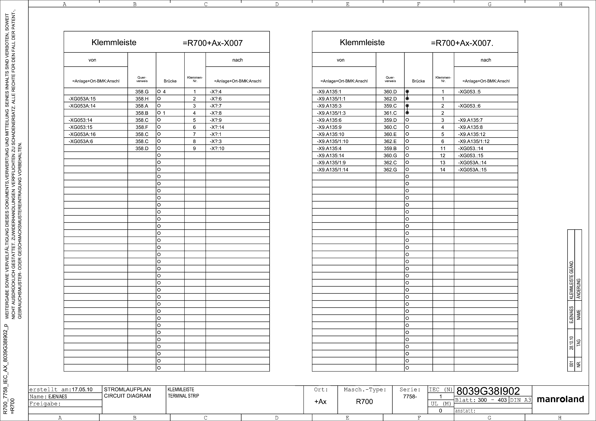

# +Ax — Sheet 300 of 403 — KLEMMLEISTE

**TERMINAL STRIP**

> Part of the manroland **R700** printing press IEC/UL circuit diagrams.
> Drawing class: **Stromlaufplan / Circuit diagram** (DIN A3).
> Document `+Ax` covers the **Central control console** machine section.

## At a glance

| Field | Value |
|---|---|
| Document | `+Ax`  (8039G38I902) |
| Sheet | **300** of 403 |
| Section (DE) | KLEMMLEISTE |
| Section (EN) | TERMINAL STRIP |
| Section type | TERMINALS — Terminal strip |
| Machine type | `R700` |
| Series | `7758` |
| Created | 17.05.10 |
| Replaces | — |
| Columns used | A, B, C, E, F, G, H |
| Path numbers | — |
| Labels on sheet | 111 |
| Cross-refs out | 0 |
| Cross-refs in | 0 |

**Previous:** [+Ax sheet 299](SHEET_0299.md) · **Next:** [+Ax sheet 301](SHEET_0301.md) · **Document TOC:** [_TOC.md](_TOC.md)  (+Ax) · **Master TOC:** [all sheets](../_MASTER_TOC.md)

## Sheet image (300 DPI, exact vector render)



_Rendered directly from the PDF vector layer at 300 DPI (1-bit), no OCR and no resampling. Use it to confirm anything ambiguous in the text below._

## Cross-references on this sheet

Each entry is a wire leaving this sheet. The printed token is `/sheet.column`; the link resolves to that sheet inside the same document.

_No outgoing cross-references on this sheet._

## Devices on this sheet

| Tag | Class | Class meaning (IEC) | Col | Sub | Terminal | Sign |
|---|---|---|---|---|---|---|
| `XG053:14` | XG |  | A | — | 14 | — |
| `XG053:15` | XG |  | A | — | 15 | — |
| `NR.` | — | cross-device reference | H | — | — | — |
| `28.10.10` | — | cross-device reference | H | — | — | — |
| `Nr.` | — | cross-device reference | C | — | — | — |
| `358.G` | — | cross-device reference | B | — | — | — |
| `358.H` | — | cross-device reference | B | — | — | — |
| `358.A` | — | cross-device reference | B | — | — | — |
| `358.B` | — | cross-device reference | B | — | — | — |
| `358.C` | — | cross-device reference | B | — | — | — |
| `358.F` | — | cross-device reference | B | — | — | — |
| `358.C` | — | cross-device reference | B | — | — | — |
| `358.C` | — | cross-device reference | B | — | — | — |
| `358.D` | — | cross-device reference | B | — | — | — |
| `Nr.` | — | cross-device reference | F | — | — | — |
| `360.D` | — | cross-device reference | F | — | — | — |
| `X9.A135:1` | — | cross-device reference | E | — | 1 | — |
| `362.D` | — | cross-device reference | F | — | — | — |
| `359.C` | — | cross-device reference | F | — | — | — |
| `X9.A135:3` | — | cross-device reference | E | — | 3 | — |
| `361.C` | — | cross-device reference | F | — | — | — |
| `359.D` | — | cross-device reference | F | — | — | — |
| `X9.A135:6` | — | cross-device reference | E | — | 6 | — |
| `X9.A135:7` | — | cross-device reference | G | — | 7 | — |
| `360.C` | — | cross-device reference | F | — | — | — |
| `X9.A135:9` | — | cross-device reference | E | — | 9 | — |
| `X9.A135:8` | — | cross-device reference | G | — | 8 | — |
| `360.E` | — | cross-device reference | F | — | — | — |
| `X9.A135:10` | — | cross-device reference | E | — | 10 | — |
| `X9.A135:12` | — | cross-device reference | G | — | 12 | — |
| `362.E` | — | cross-device reference | F | — | — | — |
| `359.B` | — | cross-device reference | F | — | — | — |
| `X9.A135:4` | — | cross-device reference | E | — | 4 | — |
| `360.G` | — | cross-device reference | F | — | — | — |
| `X9.A135:14` | — | cross-device reference | E | — | 14 | — |
| `362.C` | — | cross-device reference | F | — | — | — |
| `362.G` | — | cross-device reference | F | — | — | — |

## Potentials / nets

_No named potentials on this sheet._

## Wire-end annotations (grouped as printed)

A wire that continues elsewhere is annotated with a small cluster: the destination description, the path/line number `#NN`, and the `/sheet.column` cross reference. Each row below is one such cluster exactly as it is grouped on the drawing.

| Col | Y | Path | Cross-ref | Text on the wire |
|---|---|---|---|---|
| B | 77.5 | — | — | `Klemmleiste` |
| E | 77.5 | — | — | `Klemmleiste` |
| C | 79.0 | — | — | `=R700+Ax X007` |
| G | 79.0 | — | — | `=R700+Ax X007.` |
| A | 115.5 | — | — | `von` |
| C | 115.5 | — | — | `nach` |
| E | 115.5 | — | — | `von` |
| G | 115.5 | — | — | `nach` |
| B | 151.9 | — | — | `Quer` |
| C | 151.9 | — | — | `Klemmen =Anlage+Ort BMK:Anschl` |
| F | 151.9 | — | — | `Quer` |
| G | 151.9 | — | — | `Klemmen =Anlage+Ort BMK:Anschl` |
| A | 158.5 | — | — | `=Anlage+Ort BMK:Anschl` |
| C | 158.5 | — | — | `Brücke Nr.` |
| E | 158.5 | — | — | `=Anlage+Ort BMK:Anschl` |
| F | 158.5 | — | — | `Brücke Nr.` |
| B | 159.1 | — | — | `verweis` |
| F | 159.1 | — | — | `verweis` |
| B | 179.2 | — | — | `XG053A:15 XG053A:14 XG053:14 XG053:15 XG053A:16 XG053A:6 358.G 358.A 358.C 358.C 358.C 358.D 358.H 358.B 358.F 1 4 2 3 4 5 6 7 8 9 1 X?:4 X?:6 X?:7 X?:8 X?:9 X?:14 X?:1 X?:3 X?:10` |
| F | 179.2 | — | — | `X9.A135:1 X9.A135/1:1 360.D 362.D 1 1 XG053.:5` |
| F | 207.5 | — | — | `X9.A135:3 X9.A135/1:3 359.C 361.C 2 2 XG053.:6` |
| F | 235.9 | — | — | `X9.A135:6 X9.A135:9 X9.A135:10 X9.A135/1:10 X9.A135:4 X9.A135:14 X9.A135/1:9 X9.A135/1:14 360.G 362.G 359.D 360.C 362.C 360.E 362.E 359.B 12 13 14 11 3 4 5 6 X9.A135:7 X9.A135:8 X9.A135:12 X9.A135/1:12 XG053.:14 XG053.:15 XG053A.:14 XG053A.:15` |
| H | 520.4 | — | — | `001 EJEN/AES KLEMMLEISTE GEÄND. 28.10.10` |
| H | 557.2 | — | — | `NR. NAME TAG ÄNDERUNG` |


## Reconstructed tables

This sheet carries tabular content (pin map / terminal assignment / index). The grid below was rebuilt from the drawing's own rule lines, so each row is exactly one physical row of the table.

### Table 1 — 9 data rows × 3 columns (at x=255.1, y=62.4)

| Quer verweis | Brücke | Klemmen Nr. |
|---|---|---|
| `358.G` | `4` | `1` |
| `358.H` |  | `2` |
| `358.A` |  | `3` |
| `358.B` | `1` | `4` |
| `358.C` |  | `5` |
| `358.F` |  | `6` |
| `358.C` |  | `7` |
| `358.C` |  | `8` |
| `358.D` |  | `9` |


### Table 2 — 12 data rows × 3 columns (at x=751.2, y=62.4)

| Quer verweis | Brücke | Klemmen Nr. |
|---|---|---|
| `360.D` |  | `1` |
| `362.D` |  | `1` |
| `359.C` |  | `2` |
| `361.C` |  | `2` |
| `359.D` |  | `3` |
| `360.C` |  | `4` |
| `360.E` |  | `5` |
| `362.E` |  | `6` |
| `359.B` |  | `11` |
| `360.G` |  | `12` |
| `362.C` |  | `13` |
| `362.G` |  | `14` |


## Notes and free text on this sheet

| Text | Col | Y (pt) |
|---|---|---|
| `TAG` | H | 678.58 |
| `NAME` | H | 619.16 |
| `ÄNDERUNG` | H | 557.19 |
| `EJEN/AES` | H | 612.32 |
| `KLEMMLEISTE GEÄND.` | H | 520.4 |
| `von` | A | 115.53 |
| `=Anlage+Ort BMK:Anschl` | A | 158.52 |
| `Quer` | B | 151.93 |
| `Klemmleiste` | B | 77.49 |
| `verweis` | B | 159.12 |
| `nach` | C | 115.46 |
| `=Anlage+Ort BMK:Anschl` | C | 158.52 |
| `Klemmen` | C | 151.94 |
| `Brücke` | B | 158.53 |
| `=R700+Ax X007` | C | 78.99 |
| `X?:4` | C | 179.18 |
| `XG053A:15` | A | 193.37 |
| `X?:6` | C | 193.35 |
| `XG053A:14` | A | 207.54 |
| `X?:7` | C | 207.52 |
| `X?:8` | C | 221.7 |
| `X?:9` | C | 235.87 |
| `X?:14` | C | 250.05 |
| `XG053A:16` | A | 264.24 |
| `X?:1` | C | 264.22 |
| `XG053A:6` | A | 278.41 |
| `X?:3` | C | 278.39 |
| `X?:10` | C | 292.57 |
| `von` | E | 115.53 |
| `=Anlage+Ort BMK:Anschl` | E | 158.52 |
| `Quer` | F | 151.93 |
| `Klemmleiste` | E | 77.49 |
| `verweis` | F | 159.12 |
| `nach` | G | 115.46 |
| `=Anlage+Ort BMK:Anschl` | G | 158.52 |
| `Klemmen` | F | 151.94 |
| `Brücke` | F | 158.53 |
| `=R700+Ax X007.` | G | 78.98 |
| `XG053.:5` | G | 179.18 |
| `X9.A135/1:1` | E | 193.36 |
| `XG053.:6` | G | 207.53 |
| `X9.A135/1:3` | E | 221.71 |
| `X9.A135/1:10` | E | 278.41 |
| `X9.A135/1:12` | G | 278.41 |
| `XG053.:14` | G | 292.58 |
| `XG053.:15` | G | 306.75 |
| `X9.A135/1:9` | E | 320.92 |
| `XG053A.:14` | G | 320.92 |
| `X9.A135/1:14` | E | 335.1 |
| `XG053A.:15` | G | 335.1 |

## Complete label inventory (exact text from the drawing)

Every text object inside the drawing area of this sheet, in DIN reading order (column A→H, then top→bottom). This is the authoritative list: if a string is not here it is not printed on this sheet.

| Col | Y | X | Dir | Type | Text |
|---|---|---|---|---|---|
| A | 115.5 | 176.9 | → | text | `von` |
| A | 158.5 | 144.4 | → | text | `=Anlage+Ort BMK:Anschl` |
| A | 193.4 | 137.2 | → | text | `XG053A:15` |
| A | 207.5 | 137.2 | → | text | `XG053A:14` |
| A | 235.9 | 137.2 | → | device tag | `XG053:14` |
| A | 250.1 | 137.2 | → | device tag | `XG053:15` |
| A | 264.2 | 137.2 | → | text | `XG053A:16` |
| A | 278.4 | 137.2 | → | text | `XG053A:6` |
| B | 77.5 | 182.8 | → | text | `Klemmleiste` |
| B | 151.9 | 274.7 | → | text | `Quer` |
| B | 158.5 | 327.3 | → | text | `Brücke` |
| B | 159.1 | 272.6 | → | text | `verweis` |
| B | 179.2 | 270.3 | → | device ref | `358.G` |
| B | 179.2 | 325.7 | → | number | `4` |
| B | 193.4 | 270.7 | → | device ref | `358.H` |
| B | 207.6 | 270.4 | → | device ref | `358.A` |
| B | 221.7 | 270.9 | → | device ref | `358.B` |
| B | 221.8 | 325.1 | → | number | `1` |
| B | 235.9 | 270.6 | → | device ref | `358.C` |
| B | 250.1 | 271.1 | → | device ref | `358.F` |
| B | 264.2 | 270.6 | → | device ref | `358.C` |
| B | 278.4 | 270.6 | → | device ref | `358.C` |
| B | 292.6 | 270.6 | → | device ref | `358.D` |
| C | 79.0 | 364.8 | → | text | `=R700+Ax X007` |
| C | 115.5 | 464.3 | → | text | `nach` |
| C | 151.9 | 374.0 | → | text | `Klemmen` |
| C | 158.5 | 427.9 | → | text | `=Anlage+Ort BMK:Anschl` |
| C | 159.0 | 385.4 | → | device ref | `Nr.` |
| C | 179.2 | 386.2 | → | number | `1` |
| C | 179.2 | 419.2 | → | text | `X?:4` |
| C | 193.3 | 419.2 | → | text | `X?:6` |
| C | 193.4 | 385.7 | → | number | `2` |
| C | 207.5 | 419.2 | → | text | `X?:7` |
| C | 207.6 | 385.7 | → | number | `3` |
| C | 221.7 | 419.2 | → | text | `X?:8` |
| C | 221.8 | 385.7 | → | number | `4` |
| C | 235.9 | 385.7 | → | number | `5` |
| C | 235.9 | 419.2 | → | text | `X?:9` |
| C | 250.1 | 385.7 | → | number | `6` |
| C | 250.1 | 419.2 | → | text | `X?:14` |
| C | 264.2 | 419.2 | → | text | `X?:1` |
| C | 264.3 | 385.7 | → | number | `7` |
| C | 278.4 | 419.2 | → | text | `X?:3` |
| C | 278.5 | 385.7 | → | number | `8` |
| C | 292.6 | 385.7 | → | number | `9` |
| C | 292.6 | 419.2 | → | text | `X?:10` |
| E | 77.5 | 678.9 | → | text | `Klemmleiste` |
| E | 115.5 | 672.9 | → | text | `von` |
| E | 158.5 | 640.5 | → | text | `=Anlage+Ort BMK:Anschl` |
| E | 179.2 | 633.3 | → | device ref | `X9.A135:1` |
| E | 193.4 | 633.3 | → | text | `X9.A135/1:1` |
| E | 207.5 | 633.3 | → | device ref | `X9.A135:3` |
| E | 221.7 | 633.3 | → | text | `X9.A135/1:3` |
| E | 235.9 | 633.3 | → | device ref | `X9.A135:6` |
| E | 250.1 | 633.3 | → | device ref | `X9.A135:9` |
| E | 264.2 | 633.3 | → | device ref | `X9.A135:10` |
| E | 278.4 | 633.3 | → | text | `X9.A135/1:10` |
| E | 292.6 | 633.3 | → | device ref | `X9.A135:4` |
| E | 306.8 | 633.3 | → | device ref | `X9.A135:14` |
| E | 320.9 | 633.3 | → | text | `X9.A135/1:9` |
| E | 335.1 | 633.3 | → | text | `X9.A135/1:14` |
| F | 151.9 | 770.7 | → | text | `Quer` |
| F | 151.9 | 870.1 | → | text | `Klemmen` |
| F | 158.5 | 823.3 | → | text | `Brücke` |
| F | 159.0 | 881.4 | → | device ref | `Nr.` |
| F | 159.1 | 768.6 | → | text | `verweis` |
| F | 179.2 | 766.6 | → | device ref | `360.D` |
| F | 179.2 | 882.3 | → | number | `1` |
| F | 193.4 | 766.6 | → | device ref | `362.D` |
| F | 193.4 | 882.3 | → | number | `1` |
| F | 207.5 | 766.6 | → | device ref | `359.C` |
| F | 207.6 | 881.7 | → | number | `2` |
| F | 221.7 | 766.6 | → | device ref | `361.C` |
| F | 221.8 | 881.7 | → | number | `2` |
| F | 235.9 | 766.6 | → | device ref | `359.D` |
| F | 235.9 | 881.7 | → | number | `3` |
| F | 250.1 | 766.6 | → | device ref | `360.C` |
| F | 250.1 | 881.7 | → | number | `4` |
| F | 264.2 | 766.9 | → | device ref | `360.E` |
| F | 264.3 | 881.7 | → | number | `5` |
| F | 278.4 | 766.9 | → | device ref | `362.E` |
| F | 278.5 | 881.7 | → | number | `6` |
| F | 292.6 | 766.9 | → | device ref | `359.B` |
| F | 292.6 | 879.6 | → | number | `11` |
| F | 306.8 | 766.3 | → | device ref | `360.G` |
| F | 306.8 | 878.7 | → | number | `12` |
| F | 320.9 | 766.6 | → | device ref | `362.C` |
| F | 321.0 | 878.7 | → | number | `13` |
| F | 335.1 | 766.3 | → | device ref | `362.G` |
| F | 335.1 | 878.7 | → | number | `14` |
| G | 79.0 | 860.9 | → | text | `=R700+Ax X007.` |
| G | 115.5 | 960.4 | → | text | `nach` |
| G | 158.5 | 924.0 | → | text | `=Anlage+Ort BMK:Anschl` |
| G | 179.2 | 915.3 | → | text | `XG053.:5` |
| G | 207.5 | 915.3 | → | text | `XG053.:6` |
| G | 235.9 | 915.3 | → | device ref | `X9.A135:7` |
| G | 250.1 | 915.3 | → | device ref | `X9.A135:8` |
| G | 264.2 | 915.3 | → | device ref | `X9.A135:12` |
| G | 278.4 | 915.3 | → | text | `X9.A135/1:12` |
| G | 292.6 | 915.3 | → | text | `XG053.:14` |
| G | 306.7 | 915.3 | → | text | `XG053.:15` |
| G | 320.9 | 915.3 | → | text | `XG053A.:14` |
| G | 335.1 | 915.3 | → | text | `XG053A.:15` |
| H | 520.4 | 1138.5 | ↕ | text | `KLEMMLEISTE GEÄND.` |
| H | 557.2 | 1152.7 | ↕ | text | `ÄNDERUNG` |
| H | 612.3 | 1138.4 | ↕ | text | `EJEN/AES` |
| H | 619.2 | 1152.6 | ↕ | text | `NAME` |
| H | 672.4 | 1138.5 | ↕ | device ref | `28.10.10` |
| H | 678.6 | 1152.6 | ↕ | text | `TAG` |
| H | 721.6 | 1138.4 | ↕ | number | `001` |
| H | 722.0 | 1152.5 | ↕ | device ref | `NR.` |

## Reading-order text block

The same content as a plain block, grouped by DIN column — convenient to paste or to match against a visual description.

```text
=== Column A ===
 115.5  176.9  text         von
 158.5  144.4  text         =Anlage+Ort BMK:Anschl
 193.4  137.2  text         XG053A:15
 207.5  137.2  text         XG053A:14
 235.9  137.2  devtag       XG053:14
 250.1  137.2  devtag       XG053:15
 264.2  137.2  text         XG053A:16
 278.4  137.2  text         XG053A:6
=== Column B ===
  77.5  182.8  text         Klemmleiste
 151.9  274.7  text         Quer
 158.5  327.3  text         Brücke
 159.1  272.6  text         verweis
 179.2  270.3  devref       358.G
 179.2  325.7  numeric      4
 193.4  270.7  devref       358.H
 207.6  270.4  devref       358.A
 221.7  270.9  devref       358.B
 221.8  325.1  numeric      1
 235.9  270.6  devref       358.C
 250.1  271.1  devref       358.F
 264.2  270.6  devref       358.C
 278.4  270.6  devref       358.C
 292.6  270.6  devref       358.D
=== Column C ===
  79.0  364.8  text         =R700+Ax X007
 115.5  464.3  text         nach
 151.9  374.0  text         Klemmen
 158.5  427.9  text         =Anlage+Ort BMK:Anschl
 159.0  385.4  devref       Nr.
 179.2  386.2  numeric      1
 179.2  419.2  text         X?:4
 193.3  419.2  text         X?:6
 193.4  385.7  numeric      2
 207.5  419.2  text         X?:7
 207.6  385.7  numeric      3
 221.7  419.2  text         X?:8
 221.8  385.7  numeric      4
 235.9  385.7  numeric      5
 235.9  419.2  text         X?:9
 250.1  385.7  numeric      6
 250.1  419.2  text         X?:14
 264.2  419.2  text         X?:1
 264.3  385.7  numeric      7
 278.4  419.2  text         X?:3
 278.5  385.7  numeric      8
 292.6  385.7  numeric      9
 292.6  419.2  text         X?:10
=== Column E ===
  77.5  678.9  text         Klemmleiste
 115.5  672.9  text         von
 158.5  640.5  text         =Anlage+Ort BMK:Anschl
 179.2  633.3  devref       X9.A135:1
 193.4  633.3  text         X9.A135/1:1
 207.5  633.3  devref       X9.A135:3
 221.7  633.3  text         X9.A135/1:3
 235.9  633.3  devref       X9.A135:6
 250.1  633.3  devref       X9.A135:9
 264.2  633.3  devref       X9.A135:10
 278.4  633.3  text         X9.A135/1:10
 292.6  633.3  devref       X9.A135:4
 306.8  633.3  devref       X9.A135:14
 320.9  633.3  text         X9.A135/1:9
 335.1  633.3  text         X9.A135/1:14
=== Column F ===
 151.9  770.7  text         Quer
 151.9  870.1  text         Klemmen
 158.5  823.3  text         Brücke
 159.0  881.4  devref       Nr.
 159.1  768.6  text         verweis
 179.2  766.6  devref       360.D
 179.2  882.3  numeric      1
 193.4  766.6  devref       362.D
 193.4  882.3  numeric      1
 207.5  766.6  devref       359.C
 207.6  881.7  numeric      2
 221.7  766.6  devref       361.C
 221.8  881.7  numeric      2
 235.9  766.6  devref       359.D
 235.9  881.7  numeric      3
 250.1  766.6  devref       360.C
 250.1  881.7  numeric      4
 264.2  766.9  devref       360.E
 264.3  881.7  numeric      5
 278.4  766.9  devref       362.E
 278.5  881.7  numeric      6
 292.6  766.9  devref       359.B
 292.6  879.6  numeric      11
 306.8  766.3  devref       360.G
 306.8  878.7  numeric      12
 320.9  766.6  devref       362.C
 321.0  878.7  numeric      13
 335.1  766.3  devref       362.G
 335.1  878.7  numeric      14
=== Column G ===
  79.0  860.9  text         =R700+Ax X007.
 115.5  960.4  text         nach
 158.5  924.0  text         =Anlage+Ort BMK:Anschl
 179.2  915.3  text         XG053.:5
 207.5  915.3  text         XG053.:6
 235.9  915.3  devref       X9.A135:7
 250.1  915.3  devref       X9.A135:8
 264.2  915.3  devref       X9.A135:12
 278.4  915.3  text         X9.A135/1:12
 292.6  915.3  text         XG053.:14
 306.7  915.3  text         XG053.:15
 320.9  915.3  text         XG053A.:14
 335.1  915.3  text         XG053A.:15
=== Column H ===
 520.4 1138.5  text         KLEMMLEISTE GEÄND.
 557.2 1152.7  text         ÄNDERUNG
 612.3 1138.4  text         EJEN/AES
 619.2 1152.6  text         NAME
 672.4 1138.5  devref       28.10.10
 678.6 1152.6  text         TAG
 721.6 1138.4  numeric      001
 722.0 1152.5  devref       NR.
```

---
_Generated from the PDF vector text layer; no OCR. Source: `R700_7758_IEC_AX_8039G38I902_p`, sheet 300._
