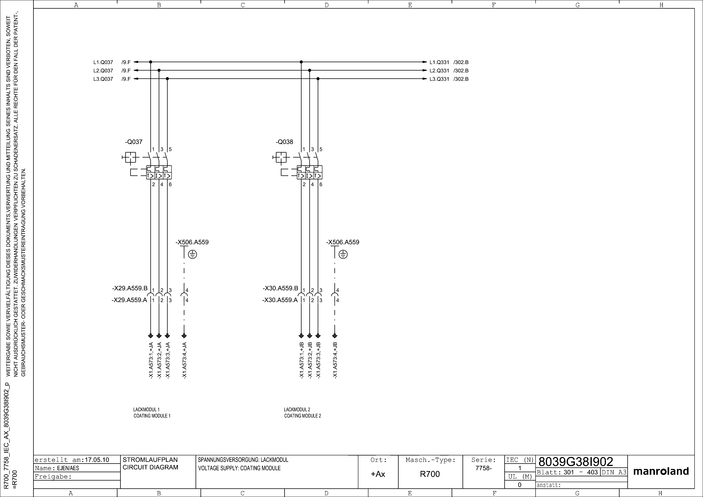

# +Ax — Sheet 301 of 403 — SPANNUNGSVERSORGUNG: LACKMODUL

**VOLTAGE SUPPLY: COATING MODULE**

> Part of the manroland **R700** printing press IEC/UL circuit diagrams.
> Drawing class: **Stromlaufplan / Circuit diagram** (DIN A3).
> Document `+Ax` covers the **Central control console** machine section.

## At a glance

| Field | Value |
|---|---|
| Document | `+Ax`  (8039G38I902) |
| Sheet | **301** of 403 |
| Section (DE) | SPANNUNGSVERSORGUNG: LACKMODUL |
| Section (EN) | VOLTAGE SUPPLY: COATING MODULE |
| Section type | POWER_SUPPLY — Voltage supply |
| Machine type | `R700` |
| Series | `7758` |
| Created | 17.05.10 |
| Replaces | — |
| Columns used | A, B, C, D, E, F |
| Path numbers | — |
| Labels on sheet | 60 |
| Cross-refs out | 6 |
| Cross-refs in | 22 |

**Previous:** [+Ax sheet 300](SHEET_0300.md) · **Next:** [+Ax sheet 302](SHEET_0302.md) · **Document TOC:** [_TOC.md](_TOC.md)  (+Ax) · **Master TOC:** [all sheets](../_MASTER_TOC.md)

## Sheet image (300 DPI, exact vector render)



_Rendered directly from the PDF vector layer at 300 DPI (1-bit), no OCR and no resampling. Use it to confirm anything ambiguous in the text below._

## Cross-references on this sheet

Each entry is a wire leaving this sheet. The printed token is `/sheet.column`; the link resolves to that sheet inside the same document.

| Ref | Target sheet | Col | Path | Destination on target | Target section | From col |
|---|---|---|---|---|---|---|
| `/9.F` | [+Ax sheet 9](SHEET_0009.md) | F | — | L1.Q037 | SPANNUNGSVERSORGUNG, SCHALTSCHRANKBELÜFTUNG | A |
| `/302.B` | [+Ax sheet 302](SHEET_0302.md) | B | — | L1.Q331 | SPANNUNGSVERSORGUNG: LACKMODUL | E |
| `/9.F` | [+Ax sheet 9](SHEET_0009.md) | F | — | L2.Q037 | SPANNUNGSVERSORGUNG, SCHALTSCHRANKBELÜFTUNG | A |
| `/302.B` | [+Ax sheet 302](SHEET_0302.md) | B | — | L2.Q331 | SPANNUNGSVERSORGUNG: LACKMODUL | E |
| `/9.F` | [+Ax sheet 9](SHEET_0009.md) | F | — | L3.Q037 | SPANNUNGSVERSORGUNG, SCHALTSCHRANKBELÜFTUNG | A |
| `/302.B` | [+Ax sheet 302](SHEET_0302.md) | B | — | L3.Q331 | SPANNUNGSVERSORGUNG: LACKMODUL | E |

### Incoming references (sheets that point here)

Every other sheet that sends a wire to this one. `Back-ref` is the token printed on *that* sheet; `Path` is its line number.

| From sheet | Cols | Back-ref | Path | Refs | What continues there |
|---|---|---|---|---|---|
| [+Ax#9](SHEET_0009.md) | F | `/9.F` | — | 3 | L1.Q037; L2.Q037; L3.Q037 |
| [+Ax#273](SHEET_0273.md) | F | `/273.F` | — | 8 | — |
| [+Ax#274](SHEET_0274.md) | H | `/274.H` | — | 8 | — |
| [+Ax#302](SHEET_0302.md) | D | `/302.D` | — | 3 | L1.Q331 L1.Q340 L1.Q304; L2.Q331 L2.Q340 L2.Q304; L3.Q331 L3.Q340 L3.Q304 |


## Devices on this sheet

| Tag | Class | Class meaning (IEC) | Col | Sub | Terminal | Sign |
|---|---|---|---|---|---|---|
| `Q037` | Q | Leistungsschalter / power switching device | B | — | — | — |
| `Q038` | Q | Leistungsschalter / power switching device | C | — | — | — |
| `X29.A559.B` | — | cross-device reference | B | — | — | — |
| `X29.A559.A` | — | cross-device reference | B | — | — | — |
| `X30.A559.B` | — | cross-device reference | C | — | — | — |
| `X30.A559.A` | — | cross-device reference | C | — | — | — |
| `X506.A559` | — | cross-device reference | B | — | — | — |
| `X506.A559` | — | cross-device reference | D | — | — | — |

## Potentials / nets

| Potential | Count | Columns | Attached devices | Terminals |
|---|---|---|---|---|
| `L1` | 2 | A, E | `Q037`, `Q331` | — |
| `L2` | 2 | A, E | `Q037`, `Q331` | — |
| `L3` | 2 | A, E | `Q037`, `Q331` | — |


A potential such as `L24+/4` or `M24+` is a named supply/return rail; every place it appears on this sheet is electrically common.

## Wire-end annotations (grouped as printed)

A wire that continues elsewhere is annotated with a small cluster: the destination description, the path/line number `#NN`, and the `/sheet.column` cross reference. Each row below is one such cluster exactly as it is grouped on the drawing.

| Col | Y | Path | Cross-ref | Text on the wire |
|---|---|---|---|---|
| A | 101.6 | — | `/9.F` | `L1.Q037` |
| E | 101.6 | — | `/302.B` | `L1.Q331` |
| A | 115.8 | — | `/9.F` | `L2.Q037` |
| E | 115.8 | — | `/302.B` | `L2.Q331` |
| A | 129.9 | — | `/9.F` | `L3.Q037` |
| E | 129.9 | — | `/302.B` | `L3.Q331` |
| B | 235.6 | — | — | `Q037` |
| C | 235.6 | — | — | `Q038` |
| B | 249.1 | — | — | `1 3 5` |
| D | 249.1 | — | — | `1 3 5` |
| B | 308.6 | — | — | `2 4 6` |
| D | 308.6 | — | — | `2 4 6` |
| C | 405.7 | — | — | `X506.A559 X506.A559` |
| B | 483.6 | — | — | `X29.A559.B 1 2 3 4` |
| D | 483.6 | — | — | `X30.A559.B 1 2 3 4` |
| B | 503.5 | — | — | `X29.A559.A 1 2 3 4` |
| D | 503.5 | — | — | `X30.A559.A 1 2 3 4` |
| D | 579.4 | — | — | `X1.A573:1,+JB` |
| D | 579.4 | — | — | `X1.A573:2,+JB` |
| D | 579.4 | — | — | `X1.A573:3,+JB` |
| D | 579.4 | — | — | `X1.A573:4,+JB` |
| B | 579.7 | — | — | `X1.A573:1,+JA` |
| B | 579.7 | — | — | `X1.A573:2,+JA` |
| B | 579.7 | — | — | `X1.A573:3,+JA` |
| B | 579.7 | — | — | `X1.A573:4,+JA` |
| B | 690.9 | — | — | `LACKMODUL 1` |
| D | 690.9 | — | — | `LACKMODUL 2` |
| B | 701.5 | — | — | `COATING MODULE 1` |
| D | 701.5 | — | — | `COATING MODULE 2` |


## Reconstructed tables

This sheet carries tabular content (pin map / terminal assignment / index). The grid below was rebuilt from the drawing's own rule lines, so each row is exactly one physical row of the table.

### Table 1 — 0 data rows × 2 columns (at x=212.6, y=104.9) — **/9.F**

_none_


## Notes and free text on this sheet

| Text | Col | Y (pt) |
|---|---|---|
| `X1.A573:1,+JA` | B | 579.69 |
| `X1.A573:2,+JA` | B | 579.69 |
| `X1.A573:3,+JA` | B | 579.69 |
| `X1.A573:4,+JA` | B | 579.69 |
| `X1.A573:1,+JB` | D | 579.4 |
| `X1.A573:2,+JB` | D | 579.4 |
| `X1.A573:3,+JB` | D | 579.4 |
| `X1.A573:4,+JB` | D | 579.4 |
| `LACKMODUL 1` | B | 690.85 |
| `COATING MODULE 1` | B | 701.5 |
| `LACKMODUL 2` | D | 690.87 |
| `COATING MODULE 2` | D | 701.51 |

## Complete label inventory (exact text from the drawing)

Every text object inside the drawing area of this sheet, in DIN reading order (column A→H, then top→bottom). This is the authoritative list: if a string is not here it is not printed on this sheet.

| Col | Y | X | Dir | Type | Text |
|---|---|---|---|---|---|
| A | 101.6 | 158.2 | → | potential | `L1.Q037` |
| A | 115.8 | 158.2 | → | potential | `L2.Q037` |
| A | 130.0 | 158.2 | → | potential | `L3.Q037` |
| B | 101.6 | 206.1 | → | cross-reference | `/9.F` |
| B | 115.8 | 206.1 | → | cross-reference | `/9.F` |
| B | 129.9 | 206.1 | → | cross-reference | `/9.F` |
| B | 235.6 | 212.0 | → | device tag | `Q037` |
| B | 249.1 | 257.1 | → | number | `1` |
| B | 249.1 | 271.8 | → | number | `3` |
| B | 249.1 | 286.0 | → | number | `5` |
| B | 308.6 | 257.7 | → | number | `2` |
| B | 308.6 | 271.8 | → | number | `4` |
| B | 308.6 | 286.0 | → | number | `6` |
| B | 405.7 | 297.4 | → | device ref | `X506.A559` |
| B | 483.6 | 189.9 | → | device ref | `X29.A559.B` |
| B | 487.9 | 257.1 | → | number | `1` |
| B | 487.9 | 271.8 | → | number | `2` |
| B | 487.9 | 286.0 | → | number | `3` |
| B | 487.9 | 314.4 | → | number | `4` |
| B | 503.5 | 189.1 | → | device ref | `X29.A559.A` |
| B | 504.9 | 257.1 | → | number | `1` |
| B | 504.9 | 271.8 | → | number | `2` |
| B | 504.9 | 286.0 | → | number | `3` |
| B | 504.9 | 314.4 | → | number | `4` |
| B | 579.7 | 251.8 | ↕ | text | `X1.A573:1,+JA` |
| B | 579.7 | 266.0 | ↕ | text | `X1.A573:2,+JA` |
| B | 579.7 | 280.2 | ↕ | text | `X1.A573:3,+JA` |
| B | 579.7 | 308.5 | ↕ | text | `X1.A573:4,+JA` |
| B | 690.9 | 225.9 | → | text | `LACKMODUL 1` |
| B | 701.5 | 226.5 | → | text | `COATING MODULE 1` |
| C | 235.6 | 467.1 | → | device tag | `Q038` |
| C | 483.6 | 445.0 | → | device ref | `X30.A559.B` |
| C | 503.5 | 444.2 | → | device ref | `X30.A559.A` |
| D | 249.1 | 512.2 | → | number | `1` |
| D | 249.1 | 527.0 | → | number | `3` |
| D | 249.1 | 541.1 | → | number | `5` |
| D | 308.6 | 512.8 | → | number | `2` |
| D | 308.6 | 527.0 | → | number | `4` |
| D | 308.6 | 541.1 | → | number | `6` |
| D | 405.7 | 552.5 | → | device ref | `X506.A559` |
| D | 487.9 | 512.2 | → | number | `1` |
| D | 487.9 | 527.0 | → | number | `2` |
| D | 487.9 | 541.1 | → | number | `3` |
| D | 487.9 | 569.5 | → | number | `4` |
| D | 504.9 | 512.2 | → | number | `1` |
| D | 504.9 | 527.0 | → | number | `2` |
| D | 504.9 | 541.1 | → | number | `3` |
| D | 504.9 | 569.5 | → | number | `4` |
| D | 579.4 | 507.0 | ↕ | text | `X1.A573:1,+JB` |
| D | 579.4 | 521.1 | ↕ | text | `X1.A573:2,+JB` |
| D | 579.4 | 535.3 | ↕ | text | `X1.A573:3,+JB` |
| D | 579.4 | 563.6 | ↕ | text | `X1.A573:4,+JB` |
| D | 690.9 | 481.0 | → | text | `LACKMODUL 2` |
| D | 701.5 | 481.6 | → | text | `COATING MODULE 2` |
| E | 101.6 | 727.7 | → | potential | `L1.Q331` |
| E | 115.8 | 727.7 | → | potential | `L2.Q331` |
| E | 130.0 | 727.7 | → | potential | `L3.Q331` |
| F | 101.6 | 768.2 | → | cross-reference | `/302.B` |
| F | 115.8 | 768.2 | → | cross-reference | `/302.B` |
| F | 129.9 | 768.2 | → | cross-reference | `/302.B` |

## Reading-order text block

The same content as a plain block, grouped by DIN column — convenient to paste or to match against a visual description.

```text
=== Column A ===
 101.6  158.2  net          L1.Q037
 115.8  158.2  net          L2.Q037
 130.0  158.2  net          L3.Q037
=== Column B ===
 101.6  206.1  xref         /9.F
 115.8  206.1  xref         /9.F
 129.9  206.1  xref         /9.F
 235.6  212.0  devtag       Q037
 249.1  257.1  numeric      1
 249.1  271.8  numeric      3
 249.1  286.0  numeric      5
 308.6  257.7  numeric      2
 308.6  271.8  numeric      4
 308.6  286.0  numeric      6
 405.7  297.4  devref       X506.A559
 483.6  189.9  devref       X29.A559.B
 487.9  257.1  numeric      1
 487.9  271.8  numeric      2
 487.9  286.0  numeric      3
 487.9  314.4  numeric      4
 503.5  189.1  devref       X29.A559.A
 504.9  257.1  numeric      1
 504.9  271.8  numeric      2
 504.9  286.0  numeric      3
 504.9  314.4  numeric      4
 579.7  251.8  text         X1.A573:1,+JA
 579.7  266.0  text         X1.A573:2,+JA
 579.7  280.2  text         X1.A573:3,+JA
 579.7  308.5  text         X1.A573:4,+JA
 690.9  225.9  text         LACKMODUL 1
 701.5  226.5  text         COATING MODULE 1
=== Column C ===
 235.6  467.1  devtag       Q038
 483.6  445.0  devref       X30.A559.B
 503.5  444.2  devref       X30.A559.A
=== Column D ===
 249.1  512.2  numeric      1
 249.1  527.0  numeric      3
 249.1  541.1  numeric      5
 308.6  512.8  numeric      2
 308.6  527.0  numeric      4
 308.6  541.1  numeric      6
 405.7  552.5  devref       X506.A559
 487.9  512.2  numeric      1
 487.9  527.0  numeric      2
 487.9  541.1  numeric      3
 487.9  569.5  numeric      4
 504.9  512.2  numeric      1
 504.9  527.0  numeric      2
 504.9  541.1  numeric      3
 504.9  569.5  numeric      4
 579.4  507.0  text         X1.A573:1,+JB
 579.4  521.1  text         X1.A573:2,+JB
 579.4  535.3  text         X1.A573:3,+JB
 579.4  563.6  text         X1.A573:4,+JB
 690.9  481.0  text         LACKMODUL 2
 701.5  481.6  text         COATING MODULE 2
=== Column E ===
 101.6  727.7  net          L1.Q331
 115.8  727.7  net          L2.Q331
 130.0  727.7  net          L3.Q331
=== Column F ===
 101.6  768.2  xref         /302.B
 115.8  768.2  xref         /302.B
 129.9  768.2  xref         /302.B
```

---
_Generated from the PDF vector text layer; no OCR. Source: `R700_7758_IEC_AX_8039G38I902_p`, sheet 301._
