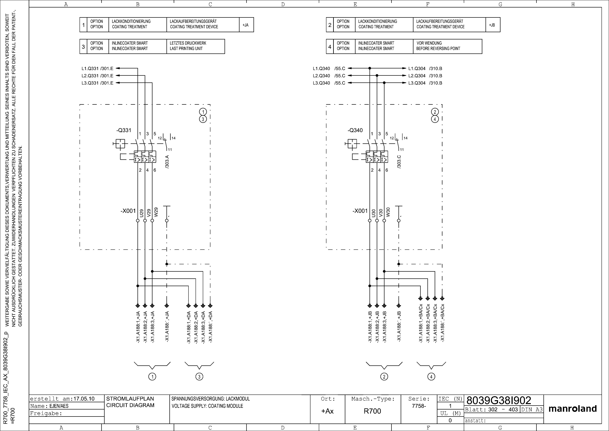

# +Ax — Sheet 302 of 403 — SPANNUNGSVERSORGUNG: LACKMODUL

**VOLTAGE SUPPLY: COATING MODULE**

> Part of the manroland **R700** printing press IEC/UL circuit diagrams.
> Drawing class: **Stromlaufplan / Circuit diagram** (DIN A3).
> Document `+Ax` covers the **Central control console** machine section.

## At a glance

| Field | Value |
|---|---|
| Document | `+Ax`  (8039G38I902) |
| Sheet | **302** of 403 |
| Section (DE) | SPANNUNGSVERSORGUNG: LACKMODUL |
| Section (EN) | VOLTAGE SUPPLY: COATING MODULE |
| Section type | POWER_SUPPLY — Voltage supply |
| Machine type | `R700` |
| Series | `7758` |
| Created | 17.05.10 |
| Replaces | — |
| Columns used | A, B, C, E, F, G |
| Path numbers | — |
| Labels on sheet | 104 |
| Cross-refs out | 11 |
| Cross-refs in | 11 |

**Previous:** [+Ax sheet 301](SHEET_0301.md) · **Next:** [+Ax sheet 303](SHEET_0303.md) · **Document TOC:** [_TOC.md](_TOC.md)  (+Ax) · **Master TOC:** [all sheets](../_MASTER_TOC.md)

## Sheet image (300 DPI, exact vector render)



_Rendered directly from the PDF vector layer at 300 DPI (1-bit), no OCR and no resampling. Use it to confirm anything ambiguous in the text below._

## Cross-references on this sheet

Each entry is a wire leaving this sheet. The printed token is `/sheet.column`; the link resolves to that sheet inside the same document.

| Ref | Target sheet | Col | Path | Destination on target | Target section | From col |
|---|---|---|---|---|---|---|
| `/301.E` | [+Ax sheet 301](SHEET_0301.md) | E | — | L1.Q331 L1.Q340 L1.Q304 | SPANNUNGSVERSORGUNG: LACKMODUL | D |
| `/310.B` | [+Ax sheet 310](SHEET_0310.md) | B | — | L1.Q331 L1.Q340 L1.Q304 | OPTION: IONISATIONSANLAGE ANLEGER | D |
| `/55.C` | [+Ax sheet 55](SHEET_0055.md) | C | — | L1.Q331 L1.Q340 L1.Q304 | LUFTVERSORGUNG | D |
| `/301.E` | [+Ax sheet 301](SHEET_0301.md) | E | — | L2.Q331 L2.Q340 L2.Q304 | SPANNUNGSVERSORGUNG: LACKMODUL | D |
| `/310.B` | [+Ax sheet 310](SHEET_0310.md) | B | — | L2.Q331 L2.Q340 L2.Q304 | OPTION: IONISATIONSANLAGE ANLEGER | D |
| `/55.C` | [+Ax sheet 55](SHEET_0055.md) | C | — | L2.Q331 L2.Q340 L2.Q304 | LUFTVERSORGUNG | D |
| `/301.E` | [+Ax sheet 301](SHEET_0301.md) | E | — | L3.Q331 L3.Q340 L3.Q304 | SPANNUNGSVERSORGUNG: LACKMODUL | D |
| `/310.B` | [+Ax sheet 310](SHEET_0310.md) | B | — | L3.Q331 L3.Q340 L3.Q304 | OPTION: IONISATIONSANLAGE ANLEGER | D |
| `/55.C` | [+Ax sheet 55](SHEET_0055.md) | C | — | L3.Q331 L3.Q340 L3.Q304 | LUFTVERSORGUNG | D |
| `/303.C` | [+Ax sheet 303](SHEET_0303.md) | C | — | — | SPANNUNGSVERSORGUNG: LACKMODUL | F |
| `/303.A` | [+Ax sheet 303](SHEET_0303.md) | A | — | — | SPANNUNGSVERSORGUNG: LACKMODUL | B |

### Incoming references (sheets that point here)

Every other sheet that sends a wire to this one. `Back-ref` is the token printed on *that* sheet; `Path` is its line number.

| From sheet | Cols | Back-ref | Path | Refs | What continues there |
|---|---|---|---|---|---|
| [+Ax#55](SHEET_0055.md) | C | `/55.C` | — | 3 | L1.Q340; L2.Q340; L3.Q340 |
| [+Ax#301](SHEET_0301.md) | E | `/301.E` | — | 3 | L1.Q331; L2.Q331; L3.Q331 |
| [+Ax#303](SHEET_0303.md) | A, C | `/303.A`, `/303.C` | — | 2 | — |
| [+Ax#310](SHEET_0310.md) | A, B | `/310.A`, `/310.B` | — | 3 | L1.Q304; L2.Q304 L2.Q257; L3.Q304 L3.Q257 |


## Devices on this sheet

| Tag | Class | Class meaning (IEC) | Col | Sub | Terminal | Sign |
|---|---|---|---|---|---|---|
| `Q331` | Q | Leistungsschalter / power switching device | B | — | — | — |
| `Q340` | Q | Leistungsschalter / power switching device | E | — | — | — |
| `U29` | U | Umrichter / frequency converter | B | — | — | — |
| `X001` | X | Klemme / terminal, plug connector | B | — | — | — |
| `V29` | V | Diode / semiconductor valve | B | — | — | — |
| `W29` | W | Kabel / cable, line, bus | B | — | — | — |
| `U30` | U | Umrichter / frequency converter | E | — | — | — |
| `X001` | X | Klemme / terminal, plug connector | E | — | — | — |
| `V30` | V | Diode / semiconductor valve | E | — | — | — |
| `W30` | W | Kabel / cable, line, bus | E | — | — | — |

## Potentials / nets

| Potential | Count | Columns | Attached devices | Terminals |
|---|---|---|---|---|
| `L1` | 3 | A, E, F | `Q304`, `Q331`, `Q340` | — |
| `L2` | 3 | A, E, F | `Q304`, `Q331`, `Q340` | — |
| `L3` | 3 | A, E, F | `Q304`, `Q331`, `Q340` | — |


A potential such as `L24+/4` or `M24+` is a named supply/return rail; every place it appears on this sheet is electrically common.

## Wire-end annotations (grouped as printed)

A wire that continues elsewhere is annotated with a small cluster: the destination description, the path/line number `#NN`, and the `/sheet.column` cross reference. Each row below is one such cluster exactly as it is grouped on the drawing.

| Col | Y | Path | Cross-ref | Text on the wire |
|---|---|---|---|---|
| A | 38.9 | — | — | `OPTION OPTION` |
| B | 38.9 | — | — | `LACKKONDITIONIERUNG` |
| C | 38.9 | — | — | `LACKAUFBEREITUNGSGERÄT` |
| E | 38.9 | — | — | `OPTION OPTION` |
| E | 38.9 | — | — | `LACKKONDITIONIERUNG` |
| F | 38.9 | — | — | `LACKAUFBEREITUNGSGERÄT` |
| B | 44.2 | — | — | `1 COATING TREATMENT DEVICE +JA` |
| F | 44.2 | — | — | `2 COATING TREATMENT DEVICE +JB` |
| B | 49.5 | — | — | `COATING TREATMENT` |
| E | 49.5 | — | — | `COATING TREATMENT` |
| C | 81.4 | — | — | `3 LETZTES DRUCKWERK LAST PRINTING UNIT OPTION OPTION` |
| A | 81.4 | — | — | `OPTION OPTION` |
| B | 81.4 | — | — | `INLINECOATER SMART INLINECOATER SMART` |
| F | 81.4 | — | — | `4 BEFORE REVERSING POINT VOR WENDUNG` |
| E | 81.4 | — | — | `INLINECOATER SMART INLINECOATER SMART` |
| D | 129.9 | — | `/301.E`, `/310.B`, `/55.C` | `L1.Q331 L1.Q340 L1.Q304` |
| D | 144.1 | — | `/301.E`, `/310.B`, `/55.C` | `L2.Q331 L2.Q340 L2.Q304` |
| D | 158.3 | — | `/301.E`, `/310.B`, `/55.C` | `L3.Q331 L3.Q340 L3.Q304` |
| C | 215.2 | — | — | `1` |
| F | 215.7 | — | — | `2` |
| C | 229.9 | — | — | `3` |
| F | 229.9 | — | — | `4` |
| B | 249.8 | — | — | `Q331` |
| E | 249.8 | — | — | `Q340` |
| B | 257.6 | — | — | `1` |
| B | 257.6 | — | — | `3` |
| B | 257.6 | — | — | `5` |
| E | 257.6 | — | — | `1` |
| E | 257.6 | — | — | `3` |
| E | 257.6 | — | — | `5` |
| B | 266.6 | — | — | `12 14` |
| F | 266.6 | — | — | `12 14` |
| B | 289.3 | — | — | `11` |
| F | 289.3 | — | — | `11` |
| F | 303.0 | — | `/303.C` | — |
| B | 303.3 | — | `/303.A` | — |
| B | 328.4 | — | — | `2` |
| B | 328.4 | — | — | `4` |
| B | 328.4 | — | — | `6` |
| E | 328.4 | — | — | `2` |
| E | 328.4 | — | — | `4` |
| E | 328.4 | — | — | `6` |
| B | 405.1 | — | — | `W29` |
| E | 405.1 | — | — | `W30` |
| B | 406.8 | — | — | `X001` |
| E | 406.8 | — | — | `X001` |
| B | 408.2 | — | — | `V29` |
| E | 408.2 | — | — | `V30` |
| B | 408.8 | — | — | `U29` |
| E | 408.8 | — | — | `U30` |
| B | 420.4 | — | — | `'` |
| F | 420.4 | — | — | `'` |
| F | 593.9 | — | — | `X1.A188:1,+BA/Cx` |
| F | 593.9 | — | — | `X1.A188:2,+BA/Cx` |
| F | 593.9 | — | — | `X1.A188:3,+BA/Cx` |
| F | 593.9 | — | — | `X1.A188:',+BA/Cx` |
| E | 607.8 | — | — | `X1.A188:1,+JB` |
| E | 607.8 | — | — | `X1.A188:2,+JB` |
| E | 607.8 | — | — | `X1.A188:3,+JB` |
| F | 607.8 | — | — | `X1.A188:',+JB` |
| B | 608.0 | — | — | `X1.A188:1,+JA` |
| B | 608.0 | — | — | `X1.A188:2,+JA` |
| B | 608.0 | — | — | `X1.A188:3,+JA` |
| B | 608.0 | — | — | `X1.A188:',+JA` |
| C | 608.0 | — | — | `X1.A188:1,+DA` |
| C | 608.0 | — | — | `X1.A188:2,+DA` |
| C | 608.0 | — | — | `X1.A188:3,+DA` |
| C | 608.0 | — | — | `X1.A188:',+DA` |
| D | 732.5 | — | — | `1 3 2 4` |


## Reconstructed tables

This sheet carries tabular content (pin map / terminal assignment / index). The grid below was rebuilt from the drawing's own rule lines, so each row is exactly one physical row of the table.

### Table 1 — 2 data rows × 2 columns (at x=235.3, y=147.4)

| C1 | C2 |
|---|---|
| `Q331` |  |
|  | `X001` |


### Table 2 — 3 data rows × 7 columns (at x=269.3, y=147.4)

| 1 |  | 3 |  | 5 | 12 | 14 |
|---|---|---|---|---|---|---|
|  |  |  |  |  |  | `11` |
|  |  |  |  |  |  | `/303.A` |
| `2` | `U29` | `4` | `V29` | `6` | `W29` | `'` |


### Table 3 — 2 data rows × 2 columns (at x=688.8, y=133.2)

| C1 | C2 |
|---|---|
| `Q340` |  |
|  | `X001` |


### Table 4 — 5 data rows × 9 columns (at x=722.8, y=133.2)

|  |  |  |  |  |  | L1.Q304 |  | /310.B |
|---|---|---|---|---|---|---|---|---|
|  |  |  |  |  |  | `L2.Q304` |  | `/310.B` |
| `1` |  | `3` |  | `5` | `12` | `L3.Q304 14` | `2 4` | `/310.B` |
|  |  |  |  |  |  | `11` |  |  |
|  |  |  |  |  |  | `/303.C` |  |  |
| `2` | `U30` | `4` | `V30` | `6` | `W30` | `'` |  |  |


## Notes and free text on this sheet

| Text | Col | Y (pt) |
|---|---|---|
| `X1.A188:1,+JA` | B | 608.03 |
| `X1.A188:2,+JA` | B | 608.03 |
| `X1.A188:3,+JA` | B | 608.03 |
| `X1.A188:',+JA` | B | 608.03 |
| `X1.A188:1,+JB` | E | 607.75 |
| `X1.A188:2,+JB` | E | 607.75 |
| `X1.A188:3,+JB` | E | 607.75 |
| `X1.A188:',+JB` | F | 607.75 |
| `X1.A188:1,+DA` | C | 608.03 |
| `X1.A188:2,+DA` | C | 608.03 |
| `X1.A188:3,+DA` | C | 608.03 |
| `X1.A188:',+DA` | C | 608.03 |
| `X1.A188:1,+BA/Cx` | F | 593.86 |
| `X1.A188:2,+BA/Cx` | F | 593.86 |
| `X1.A188:3,+BA/Cx` | F | 593.86 |
| `X1.A188:',+BA/Cx` | F | 593.86 |
| `OPTION` | A | 38.87 |
| `LACKKONDITIONIERUNG` | B | 38.9 |
| `COATING TREATMENT` | B | 49.54 |
| `LACKAUFBEREITUNGSGERÄT` | C | 38.89 |
| `COATING TREATMENT DEVICE` | C | 49.53 |
| `+JA` | C | 45.94 |
| `OPTION` | E | 38.87 |
| `LACKKONDITIONIERUNG` | E | 38.9 |
| `COATING TREATMENT` | E | 49.54 |
| `LACKAUFBEREITUNGSGERÄT` | F | 38.89 |
| `COATING TREATMENT DEVICE` | F | 49.53 |
| `+JB` | G | 45.91 |
| `INLINECOATER SMART` | B | 81.42 |
| `LETZTES DRUCKWERK` | C | 81.39 |
| `LAST PRINTING UNIT` | C | 92.04 |
| `INLINECOATER SMART` | E | 81.42 |
| `VOR WENDUNG` | F | 81.4 |
| `BEFORE REVERSING POINT` | F | 92.04 |

## Complete label inventory (exact text from the drawing)

Every text object inside the drawing area of this sheet, in DIN reading order (column A→H, then top→bottom). This is the authoritative list: if a string is not here it is not printed on this sheet.

| Col | Y | X | Dir | Type | Text |
|---|---|---|---|---|---|
| A | 38.9 | 176.9 | → | text | `OPTION` |
| A | 44.2 | 160.4 | → | number | `1` |
| A | 49.5 | 176.9 | → | text | `OPTION` |
| A | 81.4 | 176.9 | → | text | `OPTION` |
| A | 86.7 | 160.0 | → | number | `3` |
| A | 92.0 | 176.9 | → | text | `OPTION` |
| A | 130.0 | 159.6 | → | potential | `L1.Q331` |
| A | 144.2 | 159.6 | → | potential | `L2.Q331` |
| A | 158.3 | 159.6 | → | potential | `L3.Q331` |
| B | 38.9 | 218.8 | → | text | `LACKKONDITIONIERUNG` |
| B | 49.5 | 219.4 | → | text | `COATING TREATMENT` |
| B | 81.4 | 218.8 | → | text | `INLINECOATER SMART` |
| B | 92.0 | 218.8 | → | text | `INLINECOATER SMART` |
| B | 129.9 | 196.2 | → | cross-reference | `/301.E` |
| B | 144.1 | 196.2 | → | cross-reference | `/301.E` |
| B | 158.3 | 196.2 | → | cross-reference | `/301.E` |
| B | 249.8 | 227.6 | → | device tag | `Q331` |
| B | 257.6 | 271.3 | → | number | `1` |
| B | 257.6 | 286.0 | → | number | `3` |
| B | 257.6 | 300.2 | → | number | `5` |
| B | 266.6 | 308.4 | → | number | `12` |
| B | 266.6 | 335.3 | → | number | `14` |
| B | 289.3 | 328.3 | → | number | `11` |
| B | 303.3 | 322.7 | ↕ | cross-reference | `/303.A` |
| B | 328.4 | 271.8 | → | number | `2` |
| B | 328.4 | 286.0 | → | number | `4` |
| B | 328.4 | 300.2 | → | number | `6` |
| B | 405.1 | 301.3 | ↕ | device tag | `W29` |
| B | 406.8 | 235.8 | → | device tag | `X001` |
| B | 408.2 | 287.3 | ↕ | device tag | `V29` |
| B | 408.8 | 273.2 | ↕ | device tag | `U29` |
| B | 420.4 | 328.6 | ↕ | other | `'` |
| B | 608.0 | 266.0 | ↕ | text | `X1.A188:1,+JA` |
| B | 608.0 | 280.2 | ↕ | text | `X1.A188:2,+JA` |
| B | 608.0 | 294.4 | ↕ | text | `X1.A188:3,+JA` |
| B | 608.0 | 322.7 | ↕ | text | `X1.A188:',+JA` |
| B | 732.5 | 295.9 | → | number | `1` |
| C | 38.9 | 332.2 | → | text | `LACKAUFBEREITUNGSGERÄT` |
| C | 45.9 | 474.5 | → | text | `+JA` |
| C | 49.5 | 332.8 | → | text | `COATING TREATMENT DEVICE` |
| C | 81.4 | 332.2 | → | text | `LETZTES DRUCKWERK` |
| C | 92.0 | 332.2 | → | text | `LAST PRINTING UNIT` |
| C | 215.2 | 395.1 | → | number | `1` |
| C | 229.9 | 394.9 | → | number | `3` |
| C | 608.0 | 365.2 | ↕ | text | `X1.A188:1,+DA` |
| C | 608.0 | 379.4 | ↕ | text | `X1.A188:2,+DA` |
| C | 608.0 | 393.6 | ↕ | text | `X1.A188:3,+DA` |
| C | 608.0 | 407.8 | ↕ | text | `X1.A188:',+DA` |
| C | 733.0 | 387.8 | → | number | `3` |
| E | 38.9 | 658.8 | → | text | `OPTION` |
| E | 38.9 | 700.7 | → | text | `LACKKONDITIONIERUNG` |
| E | 44.2 | 642.0 | → | number | `2` |
| E | 49.5 | 658.8 | → | text | `OPTION` |
| E | 49.5 | 701.3 | → | text | `COATING TREATMENT` |
| E | 81.4 | 658.8 | → | text | `OPTION` |
| E | 81.4 | 700.7 | → | text | `INLINECOATER SMART` |
| E | 86.7 | 642.0 | → | number | `4` |
| E | 92.0 | 658.8 | → | text | `OPTION` |
| E | 92.0 | 700.7 | → | text | `INLINECOATER SMART` |
| E | 130.0 | 611.7 | → | potential | `L1.Q340` |
| E | 130.0 | 654.0 | → | cross-reference | `/55.C` |
| E | 144.1 | 654.0 | → | cross-reference | `/55.C` |
| E | 144.2 | 611.7 | → | potential | `L2.Q340` |
| E | 158.3 | 611.7 | → | potential | `L3.Q340` |
| E | 158.3 | 654.0 | → | cross-reference | `/55.C` |
| E | 249.8 | 679.7 | → | device tag | `Q340` |
| E | 257.6 | 724.8 | → | number | `1` |
| E | 257.6 | 739.6 | → | number | `3` |
| E | 257.6 | 753.7 | → | number | `5` |
| E | 328.4 | 725.4 | → | number | `2` |
| E | 328.4 | 739.6 | → | number | `4` |
| E | 328.4 | 753.7 | → | number | `6` |
| E | 405.1 | 754.9 | ↕ | device tag | `W30` |
| E | 406.8 | 689.4 | → | device tag | `X001` |
| E | 408.2 | 740.8 | ↕ | device tag | `V30` |
| E | 408.8 | 726.7 | ↕ | device tag | `U30` |
| E | 607.7 | 719.6 | ↕ | text | `X1.A188:1,+JB` |
| E | 607.7 | 733.7 | ↕ | text | `X1.A188:2,+JB` |
| E | 607.7 | 747.9 | ↕ | text | `X1.A188:3,+JB` |
| E | 733.0 | 749.2 | → | number | `2` |
| F | 38.9 | 814.1 | → | text | `LACKAUFBEREITUNGSGERÄT` |
| F | 49.5 | 814.7 | → | text | `COATING TREATMENT DEVICE` |
| F | 81.4 | 815.0 | → | text | `VOR WENDUNG` |
| F | 92.0 | 814.1 | → | text | `BEFORE REVERSING POINT` |
| F | 129.9 | 839.1 | → | cross-reference | `/310.B` |
| F | 130.0 | 798.5 | → | potential | `L1.Q304` |
| F | 144.1 | 839.1 | → | cross-reference | `/310.B` |
| F | 144.2 | 798.5 | → | potential | `L2.Q304` |
| F | 158.3 | 798.5 | → | potential | `L3.Q304` |
| F | 158.3 | 839.1 | → | cross-reference | `/310.B` |
| F | 215.7 | 848.4 | → | number | `2` |
| F | 229.9 | 848.4 | → | number | `4` |
| F | 266.6 | 762.0 | → | number | `12` |
| F | 266.6 | 788.9 | → | number | `14` |
| F | 289.3 | 781.8 | → | number | `11` |
| F | 303.0 | 776.3 | ↕ | cross-reference | `/303.C` |
| F | 420.4 | 782.2 | ↕ | other | `'` |
| F | 593.9 | 818.8 | ↕ | text | `X1.A188:1,+BA/Cx` |
| F | 593.9 | 833.0 | ↕ | text | `X1.A188:2,+BA/Cx` |
| F | 593.9 | 847.1 | ↕ | text | `X1.A188:3,+BA/Cx` |
| F | 593.9 | 861.3 | ↕ | text | `X1.A188:',+BA/Cx` |
| F | 607.8 | 776.2 | ↕ | text | `X1.A188:',+JB` |
| F | 733.0 | 841.3 | → | number | `4` |
| G | 45.9 | 956.4 | → | text | `+JB` |

## Reading-order text block

The same content as a plain block, grouped by DIN column — convenient to paste or to match against a visual description.

```text
=== Column A ===
  38.9  176.9  text         OPTION
  44.2  160.4  numeric      1
  49.5  176.9  text         OPTION
  81.4  176.9  text         OPTION
  86.7  160.0  numeric      3
  92.0  176.9  text         OPTION
 130.0  159.6  net          L1.Q331
 144.2  159.6  net          L2.Q331
 158.3  159.6  net          L3.Q331
=== Column B ===
  38.9  218.8  text         LACKKONDITIONIERUNG
  49.5  219.4  text         COATING TREATMENT
  81.4  218.8  text         INLINECOATER SMART
  92.0  218.8  text         INLINECOATER SMART
 129.9  196.2  xref         /301.E
 144.1  196.2  xref         /301.E
 158.3  196.2  xref         /301.E
 249.8  227.6  devtag       Q331
 257.6  271.3  numeric      1
 257.6  286.0  numeric      3
 257.6  300.2  numeric      5
 266.6  308.4  numeric      12
 266.6  335.3  numeric      14
 289.3  328.3  numeric      11
 303.3  322.7  xref         /303.A
 328.4  271.8  numeric      2
 328.4  286.0  numeric      4
 328.4  300.2  numeric      6
 405.1  301.3  devtag       W29
 406.8  235.8  devtag       X001
 408.2  287.3  devtag       V29
 408.8  273.2  devtag       U29
 420.4  328.6  other        `
 608.0  266.0  text         X1.A188:1,+JA
 608.0  280.2  text         X1.A188:2,+JA
 608.0  294.4  text         X1.A188:3,+JA
 608.0  322.7  text         X1.A188:`,+JA
 732.5  295.9  numeric      1
=== Column C ===
  38.9  332.2  text         LACKAUFBEREITUNGSGERÄT
  45.9  474.5  text         +JA
  49.5  332.8  text         COATING TREATMENT DEVICE
  81.4  332.2  text         LETZTES DRUCKWERK
  92.0  332.2  text         LAST PRINTING UNIT
 215.2  395.1  numeric      1
 229.9  394.9  numeric      3
 608.0  365.2  text         X1.A188:1,+DA
 608.0  379.4  text         X1.A188:2,+DA
 608.0  393.6  text         X1.A188:3,+DA
 608.0  407.8  text         X1.A188:`,+DA
 733.0  387.8  numeric      3
=== Column E ===
  38.9  658.8  text         OPTION
  38.9  700.7  text         LACKKONDITIONIERUNG
  44.2  642.0  numeric      2
  49.5  658.8  text         OPTION
  49.5  701.3  text         COATING TREATMENT
  81.4  658.8  text         OPTION
  81.4  700.7  text         INLINECOATER SMART
  86.7  642.0  numeric      4
  92.0  658.8  text         OPTION
  92.0  700.7  text         INLINECOATER SMART
 130.0  611.7  net          L1.Q340
 130.0  654.0  xref         /55.C
 144.1  654.0  xref         /55.C
 144.2  611.7  net          L2.Q340
 158.3  611.7  net          L3.Q340
 158.3  654.0  xref         /55.C
 249.8  679.7  devtag       Q340
 257.6  724.8  numeric      1
 257.6  739.6  numeric      3
 257.6  753.7  numeric      5
 328.4  725.4  numeric      2
 328.4  739.6  numeric      4
 328.4  753.7  numeric      6
 405.1  754.9  devtag       W30
 406.8  689.4  devtag       X001
 408.2  740.8  devtag       V30
 408.8  726.7  devtag       U30
 607.7  719.6  text         X1.A188:1,+JB
 607.7  733.7  text         X1.A188:2,+JB
 607.7  747.9  text         X1.A188:3,+JB
 733.0  749.2  numeric      2
=== Column F ===
  38.9  814.1  text         LACKAUFBEREITUNGSGERÄT
  49.5  814.7  text         COATING TREATMENT DEVICE
  81.4  815.0  text         VOR WENDUNG
  92.0  814.1  text         BEFORE REVERSING POINT
 129.9  839.1  xref         /310.B
 130.0  798.5  net          L1.Q304
 144.1  839.1  xref         /310.B
 144.2  798.5  net          L2.Q304
 158.3  798.5  net          L3.Q304
 158.3  839.1  xref         /310.B
 215.7  848.4  numeric      2
 229.9  848.4  numeric      4
 266.6  762.0  numeric      12
 266.6  788.9  numeric      14
 289.3  781.8  numeric      11
 303.0  776.3  xref         /303.C
 420.4  782.2  other        `
 593.9  818.8  text         X1.A188:1,+BA/Cx
 593.9  833.0  text         X1.A188:2,+BA/Cx
 593.9  847.1  text         X1.A188:3,+BA/Cx
 593.9  861.3  text         X1.A188:`,+BA/Cx
 607.8  776.2  text         X1.A188:`,+JB
 733.0  841.3  numeric      4
=== Column G ===
  45.9  956.4  text         +JB
```

---
_Generated from the PDF vector text layer; no OCR. Source: `R700_7758_IEC_AX_8039G38I902_p`, sheet 302._
