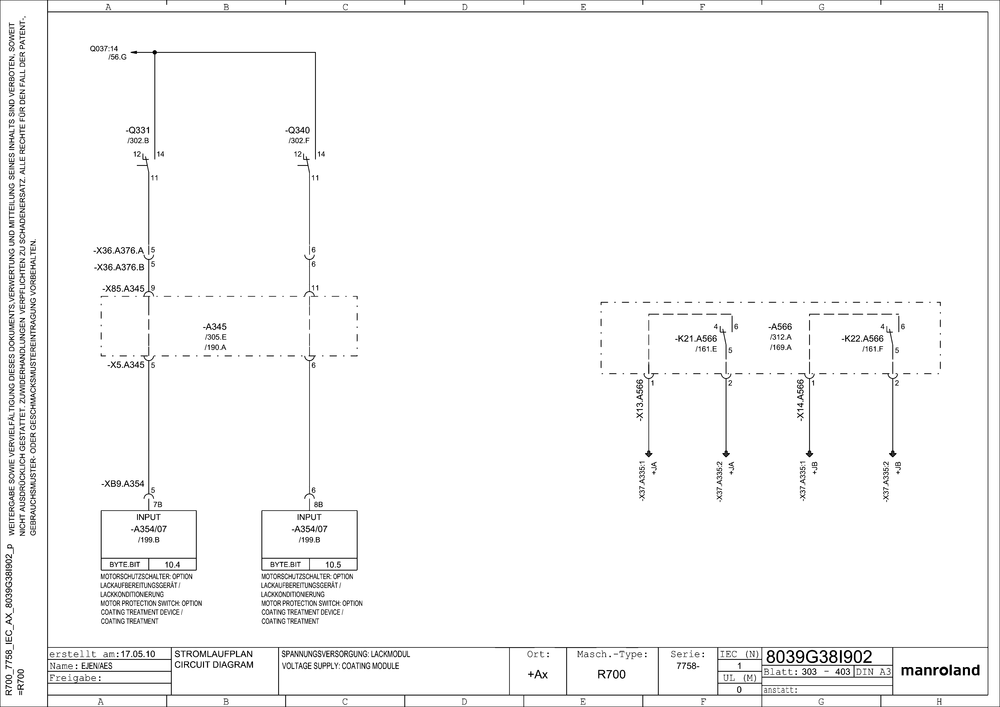

# +Ax — Sheet 303 of 403 — SPANNUNGSVERSORGUNG: LACKMODUL

**VOLTAGE SUPPLY: COATING MODULE**

> Part of the manroland **R700** printing press IEC/UL circuit diagrams.
> Drawing class: **Stromlaufplan / Circuit diagram** (DIN A3).
> Document `+Ax` covers the **Central control console** machine section.

## At a glance

| Field | Value |
|---|---|
| Document | `+Ax`  (8039G38I902) |
| Sheet | **303** of 403 |
| Section (DE) | SPANNUNGSVERSORGUNG: LACKMODUL |
| Section (EN) | VOLTAGE SUPPLY: COATING MODULE |
| Section type | POWER_SUPPLY — Voltage supply |
| Machine type | `R700` |
| Series | `7758` |
| Created | 17.05.10 |
| Replaces | — |
| Columns used | A, B, C, E, F, G, H |
| Path numbers | — |
| Labels on sheet | 81 |
| Cross-refs out | 11 |
| Cross-refs in | 25 |

**Previous:** [+Ax sheet 302](SHEET_0302.md) · **Next:** [+Ax sheet 304](SHEET_0304.md) · **Document TOC:** [_TOC.md](_TOC.md)  (+Ax) · **Master TOC:** [all sheets](../_MASTER_TOC.md)

## Sheet image (300 DPI, exact vector render)



_Rendered directly from the PDF vector layer at 300 DPI (1-bit), no OCR and no resampling. Use it to confirm anything ambiguous in the text below._

## Cross-references on this sheet

Each entry is a wire leaving this sheet. The printed token is `/sheet.column`; the link resolves to that sheet inside the same document.

| Ref | Target sheet | Col | Path | Destination on target | Target section | From col |
|---|---|---|---|---|---|---|
| `/56.G` | [+Ax sheet 56](SHEET_0056.md) | G | — | Q037:14 | LUFTVERSORGUNG | A |
| `/302.B` | [+Ax sheet 302](SHEET_0302.md) | B | — | — | SPANNUNGSVERSORGUNG: LACKMODUL | A |
| `/302.F` | [+Ax sheet 302](SHEET_0302.md) | F | — | — | SPANNUNGSVERSORGUNG: LACKMODUL | C |
| `/305.E` | [+Ax sheet 305](SHEET_0305.md) | E | — | — | SCHÖN & WIDERDRUCK HAUPTSCHALTSCHRANK | B |
| `/190.A` | [+Ax sheet 190](SHEET_0190.md) | A | — | — | RESERVE | B |
| `/312.A` | [+Ax sheet 312](SHEET_0312.md) | A | — | — | OPTION: IR/UV ZWISCHENTROCKNER | G |
| `/169.A` | [+Ax sheet 169](SHEET_0169.md) | A | — | — | ÜBERWACHUNGSRECHNER/RÜCKMELDUNG NOT AUS | G |
| `/161.E` | [+Ax sheet 161](SHEET_0161.md) | E | — | — | ÜBERWACHUNGSRECHNER/ANSTEUERUNG NOT AUS | F |
| `/161.F` | [+Ax sheet 161](SHEET_0161.md) | F | — | — | ÜBERWACHUNGSRECHNER/ANSTEUERUNG NOT AUS | G |
| `/199.B` | [+Ax sheet 199](SHEET_0199.md) | B | — | — | REFERENZMODUL | A |
| `/199.B` | [+Ax sheet 199](SHEET_0199.md) | B | — | — | REFERENZMODUL | C |

### Incoming references (sheets that point here)

Every other sheet that sends a wire to this one. `Back-ref` is the token printed on *that* sheet; `Path` is its line number.

| From sheet | Cols | Back-ref | Path | Refs | What continues there |
|---|---|---|---|---|---|
| [+Ax#56](SHEET_0056.md) | G | `/56.G` | — | 1 | — |
| [+Ax#161](SHEET_0161.md) | E, F | `/161.E`, `/161.F` | — | 2 | — |
| [+Ax#169](SHEET_0169.md) | A | `/169.A` | — | 1 | — |
| [+Ax#190](SHEET_0190.md) | A | `/190.A` | — | 1 | — |
| [+Ax#199](SHEET_0199.md) | B | `/199.B` | — | 2 | — |
| [+Ax#231](SHEET_0231.md) | A | `/231.A` | — | 2 | — |
| [+Ax#242](SHEET_0242.md) | A | `/242.A` | — | 2 | — |
| [+Ax#250](SHEET_0250.md) | F | `/250.F` | — | 2 | — |
| [+Ax#251](SHEET_0251.md) | H | `/251.H` | — | 2 | — |
| [+Ax#279](SHEET_0279.md) | A, B | `/279.A`, `/279.B` | — | 4 | — |
| [+Ax#287](SHEET_0287.md) | C | `/287.C` | — | 2 | — |
| [+Ax#302](SHEET_0302.md) | B, F | `/302.B`, `/302.F` | — | 2 | — |
| [+Ax#305](SHEET_0305.md) | E | `/305.E` | — | 1 | — |
| [+Ax#312](SHEET_0312.md) | A | `/312.A` | — | 1 | — |


## Devices on this sheet

| Tag | Class | Class meaning (IEC) | Col | Sub | Terminal | Sign |
|---|---|---|---|---|---|---|
| `A354/07` | A | Baugruppe / assembly, module, PC board | A | 07 | — | — |
| `Q331` | Q | Leistungsschalter / power switching device | A | — | — | — |
| `A345` | A | Baugruppe / assembly, module, PC board | B | — | — | — |
| `A354/07` | A | Baugruppe / assembly, module, PC board | C | 07 | — | — |
| `Q340` | Q | Leistungsschalter / power switching device | C | — | — | — |
| `A566` | A | Baugruppe / assembly, module, PC board | G | — | — | — |
| `Q037:14` | Q | Leistungsschalter / power switching device | A | — | 14 | — |
| `XB9.A354` | — | cross-device reference | A | — | — | — |
| `10.4` | — | cross-device reference | B | — | — | — |
| `X36.A376.A` | — | cross-device reference | A | — | — | — |
| `X36.A376.B` | — | cross-device reference | A | — | — | — |
| `X5.A345` | — | cross-device reference | A | — | — | — |
| `X85.A345` | — | cross-device reference | A | — | — | — |
| `10.5` | — | cross-device reference | C | — | — | — |
| `K22.A566` | — | cross-device reference | G | — | — | — |
| `X14.A566` | — | cross-device reference | G | — | — | — |
| `K21.A566` | — | cross-device reference | F | — | — | — |
| `X13.A566` | — | cross-device reference | E | — | — | — |
| `X37.A335:1` | — | cross-device reference | E | — | 1 | — |
| `X37.A335:2` | — | cross-device reference | F | — | 2 | — |
| `X37.A335:1` | — | cross-device reference | G | — | 1 | — |
| `X37.A335:2` | — | cross-device reference | H | — | 2 | — |

## Potentials / nets

_No named potentials on this sheet._

## Wire-end annotations (grouped as printed)

A wire that continues elsewhere is annotated with a small cluster: the destination description, the path/line number `#NN`, and the `/sheet.column` cross reference. Each row below is one such cluster exactly as it is grouped on the drawing.

| Col | Y | Path | Cross-ref | Text on the wire |
|---|---|---|---|---|
| A | 54.2 | — | `/56.G` | `Q037:14` |
| A | 150.5 | — | — | `Q331` |
| C | 150.5 | — | — | `Q340` |
| A | 163.6 | — | `/302.B` | — |
| C | 163.6 | — | `/302.F` | — |
| A | 179.6 | — | — | `12` |
| A | 179.6 | — | — | `14` |
| C | 179.6 | — | — | `12` |
| C | 179.6 | — | — | `14` |
| A | 208.0 | — | — | `11` |
| C | 208.0 | — | — | `11` |
| A | 293.7 | — | — | `X36.A376.A 5` |
| C | 293.7 | — | — | `6` |
| A | 310.7 | — | — | `X36.A376.B 5` |
| C | 310.7 | — | — | `6` |
| A | 339.0 | — | — | `X85.A345 9` |
| C | 339.1 | — | — | `11` |
| B | 384.4 | — | — | `A345` |
| G | 384.4 | — | — | `A566` |
| F | 385.1 | — | — | `K21.A566 6` |
| F | 385.1 | — | — | `4` |
| G | 385.1 | — | — | `K22.A566 6` |
| H | 385.1 | — | — | `4` |
| B | 397.5 | — | `/305.E`, `/190.A` | — |
| G | 397.5 | — | `/312.A`, `/169.A` | — |
| F | 411.6 | — | `/161.E` | — |
| G | 411.6 | — | `/161.F` | — |
| F | 413.5 | — | — | `5` |
| H | 413.5 | — | — | `5` |
| A | 429.8 | — | — | `X5.A345 5` |
| C | 431.2 | — | — | `6` |
| E | 451.6 | — | — | `X13.A566` |
| G | 451.6 | — | — | `X14.A566` |
| F | 452.4 | — | — | `1 2` |
| G | 452.4 | — | — | `1 2` |
| E | 548.2 | — | — | `X37.A335:1` |
| G | 548.2 | — | — | `X37.A335:1` |
| F | 549.4 | — | — | `X37.A335:2` |
| H | 549.4 | — | — | `X37.A335:2` |
| G | 549.6 | — | — | `+JB` |
| H | 549.6 | — | — | `+JB` |
| F | 549.9 | — | — | `+JA` |
| F | 549.9 | — | — | `+JA` |
| A | 571.5 | — | — | `XB9.A354 5` |
| C | 580.0 | — | — | `6` |
| A | 597.0 | — | — | `7B` |
| C | 597.0 | — | — | `8B` |
| A | 611.5 | — | — | `INPUT` |
| C | 611.5 | — | — | `INPUT` |
| A | 625.3 | — | — | `A354/07` |
| C | 625.3 | — | — | `A354/07` |
| A | 639.1 | — | `/199.B` | — |
| C | 639.1 | — | `/199.B` | — |
| A | 668.2 | — | — | `BYTE.BIT 10.4` |
| C | 668.2 | — | — | `BYTE.BIT 10.5` |
| A | 683.8 | — | — | `LACKAUFBEREITUNGSGERÄT / LACKKONDITIONIERUNG MOTORSCHUTZSCHALTER: OPTION MOTOR PROTECTION SWITCH: OPTION COATING TREATMENT DEVICE / COATING TREATMENT` |
| C | 683.8 | — | — | `LACKAUFBEREITUNGSGERÄT / LACKKONDITIONIERUNG MOTORSCHUTZSCHALTER: OPTION MOTOR PROTECTION SWITCH: OPTION COATING TREATMENT DEVICE / COATING TREATMENT` |


## Reconstructed tables

This sheet carries tabular content (pin map / terminal assignment / index). The grid below was rebuilt from the drawing's own rule lines, so each row is exactly one physical row of the table.

### Table 1 — 2 data rows × 7 columns (at x=120.5, y=62.4)

| /56.G Q331 /302.B 12 X36.A376.A X36.A376.B X85.A345 X5.A345 XB9.A354 | 11 5 5 9 5 5 | 14 7B | A345 /305.E /190.A | Q340 /302.F 12 | 11 6 6 11 6 6 | 14 8B |
|---|---|---|---|---|---|---|
| `INPUT` | `A354/07 /199.B` |  |  | `INPUT` | `A354/07 /199.B` |  |
| `BYTE.BIT` |  | `10.4` |  | `BYTE.BIT` |  | `10.5` |


## Notes and free text on this sheet

| Text | Col | Y (pt) |
|---|---|---|
| `7B` | A | 596.96 |
| `INPUT` | A | 611.5 |
| `BYTE.BIT` | A | 668.75 |
| `MOTORSCHUTZSCHALTER: OPTION` | A | 683.79 |
| `LACKAUFBEREITUNGSGERÄT /` | A | 694.4 |
| `LACKKONDITIONIERUNG` | A | 705.05 |
| `MOTOR PROTECTION SWITCH: OPTION` | A | 715.67 |
| `COATING TREATMENT DEVICE /` | A | 726.31 |
| `COATING TREATMENT` | A | 736.95 |
| `8B` | C | 596.96 |
| `INPUT` | C | 611.5 |
| `BYTE.BIT` | B | 668.75 |
| `MOTORSCHUTZSCHALTER: OPTION` | C | 683.79 |
| `LACKAUFBEREITUNGSGERÄT /` | C | 694.4 |
| `LACKKONDITIONIERUNG` | C | 705.05 |
| `MOTOR PROTECTION SWITCH: OPTION` | C | 715.67 |
| `COATING TREATMENT DEVICE /` | C | 726.31 |
| `COATING TREATMENT` | C | 736.95 |
| `+JA` | F | 549.92 |
| `+JB` | G | 549.64 |
| `+JB` | H | 549.64 |

## Complete label inventory (exact text from the drawing)

Every text object inside the drawing area of this sheet, in DIN reading order (column A→H, then top→bottom). This is the authoritative list: if a string is not here it is not printed on this sheet.

| Col | Y | X | Dir | Type | Text |
|---|---|---|---|---|---|
| A | 54.2 | 107.1 | → | device tag | `Q037:14` |
| A | 64.0 | 129.3 | → | cross-reference | `/56.G` |
| A | 150.5 | 149.7 | → | device tag | `Q331` |
| A | 163.6 | 151.9 | → | cross-reference | `/302.B` |
| A | 179.6 | 158.2 | → | number | `12` |
| A | 179.6 | 186.2 | → | number | `14` |
| A | 208.0 | 179.1 | → | number | `11` |
| A | 293.7 | 111.1 | → | device ref | `X36.A376.A` |
| A | 293.7 | 179.7 | → | number | `5` |
| A | 310.7 | 179.7 | → | number | `5` |
| A | 313.5 | 112.0 | → | device ref | `X36.A376.B` |
| A | 339.0 | 121.9 | → | device ref | `X85.A345` |
| A | 339.1 | 179.7 | → | number | `9` |
| A | 429.8 | 127.8 | → | device ref | `X5.A345` |
| A | 431.2 | 179.7 | → | number | `5` |
| A | 571.5 | 120.8 | → | device ref | `XB9.A354` |
| A | 580.0 | 179.7 | → | number | `5` |
| A | 597.0 | 182.6 | → | text | `7B` |
| A | 611.5 | 162.3 | → | text | `INPUT` |
| A | 625.3 | 155.8 | → | device tag | `A354/07` |
| A | 639.1 | 164.6 | → | cross-reference | `/199.B` |
| A | 668.8 | 130.4 | → | text | `BYTE.BIT` |
| A | 683.8 | 119.9 | → | text | `MOTORSCHUTZSCHALTER: OPTION` |
| A | 694.4 | 119.6 | → | text | `LACKAUFBEREITUNGSGERÄT /` |
| A | 705.0 | 119.6 | → | text | `LACKKONDITIONIERUNG` |
| A | 715.7 | 119.9 | → | text | `MOTOR PROTECTION SWITCH: OPTION` |
| A | 726.3 | 120.2 | → | text | `COATING TREATMENT DEVICE /` |
| A | 736.9 | 120.2 | → | text | `COATING TREATMENT` |
| B | 384.4 | 241.5 | → | device tag | `A345` |
| B | 397.5 | 244.3 | → | cross-reference | `/305.E` |
| B | 409.9 | 243.8 | → | cross-reference | `/190.A` |
| B | 668.2 | 195.7 | → | device ref | `10.4` |
| B | 668.8 | 321.7 | → | text | `BYTE.BIT` |
| C | 150.5 | 339.6 | → | device tag | `Q340` |
| C | 163.6 | 343.8 | → | cross-reference | `/302.F` |
| C | 179.6 | 349.5 | → | number | `12` |
| C | 179.6 | 377.6 | → | number | `14` |
| C | 208.0 | 370.5 | → | number | `11` |
| C | 293.7 | 371.1 | → | number | `6` |
| C | 310.7 | 371.1 | → | number | `6` |
| C | 339.1 | 370.5 | → | number | `11` |
| C | 431.2 | 371.1 | → | number | `6` |
| C | 580.0 | 371.1 | → | number | `6` |
| C | 597.0 | 373.9 | → | text | `8B` |
| C | 611.5 | 353.6 | → | text | `INPUT` |
| C | 625.3 | 347.1 | → | device tag | `A354/07` |
| C | 639.1 | 355.9 | → | cross-reference | `/199.B` |
| C | 668.2 | 387.1 | → | device ref | `10.5` |
| C | 683.8 | 311.2 | → | text | `MOTORSCHUTZSCHALTER: OPTION` |
| C | 694.4 | 311.0 | → | text | `LACKAUFBEREITUNGSGERÄT /` |
| C | 705.0 | 311.0 | → | text | `LACKKONDITIONIERUNG` |
| C | 715.7 | 311.2 | → | text | `MOTOR PROTECTION SWITCH: OPTION` |
| C | 726.3 | 311.5 | → | text | `COATING TREATMENT DEVICE /` |
| C | 736.9 | 311.5 | → | text | `COATING TREATMENT` |
| E | 451.6 | 757.2 | ↕ | device ref | `X13.A566` |
| E | 548.2 | 760.7 | ↕ | device ref | `X37.A335:1` |
| F | 385.1 | 850.1 | → | number | `4` |
| F | 385.1 | 874.2 | → | number | `6` |
| F | 398.6 | 803.6 | → | device ref | `K21.A566` |
| F | 411.6 | 828.3 | → | cross-reference | `/161.E` |
| F | 413.5 | 867.1 | → | number | `5` |
| F | 452.5 | 774.4 | → | number | `1` |
| F | 452.5 | 867.1 | → | number | `2` |
| F | 549.4 | 852.8 | ↕ | device ref | `X37.A335:2` |
| F | 549.9 | 774.8 | ↕ | text | `+JA` |
| F | 549.9 | 866.9 | ↕ | text | `+JA` |
| G | 384.4 | 914.7 | → | device tag | `A566` |
| G | 397.5 | 917.0 | → | cross-reference | `/312.A` |
| G | 398.6 | 1002.0 | → | device ref | `K22.A566` |
| G | 409.9 | 917.0 | → | cross-reference | `/169.A` |
| G | 411.7 | 1027.0 | → | cross-reference | `/161.F` |
| G | 451.6 | 948.5 | ↕ | device ref | `X14.A566` |
| G | 452.5 | 965.8 | → | number | `1` |
| G | 548.2 | 952.0 | ↕ | device ref | `X37.A335:1` |
| G | 549.6 | 966.1 | ↕ | text | `+JB` |
| H | 385.1 | 1048.5 | → | number | `4` |
| H | 385.1 | 1072.6 | → | number | `6` |
| H | 413.5 | 1065.5 | → | number | `5` |
| H | 452.5 | 1065.5 | → | number | `2` |
| H | 549.4 | 1051.2 | ↕ | device ref | `X37.A335:2` |
| H | 549.6 | 1065.4 | ↕ | text | `+JB` |

## Reading-order text block

The same content as a plain block, grouped by DIN column — convenient to paste or to match against a visual description.

```text
=== Column A ===
  54.2  107.1  devtag       Q037:14
  64.0  129.3  xref         /56.G
 150.5  149.7  devtag       Q331
 163.6  151.9  xref         /302.B
 179.6  158.2  numeric      12
 179.6  186.2  numeric      14
 208.0  179.1  numeric      11
 293.7  111.1  devref       X36.A376.A
 293.7  179.7  numeric      5
 310.7  179.7  numeric      5
 313.5  112.0  devref       X36.A376.B
 339.0  121.9  devref       X85.A345
 339.1  179.7  numeric      9
 429.8  127.8  devref       X5.A345
 431.2  179.7  numeric      5
 571.5  120.8  devref       XB9.A354
 580.0  179.7  numeric      5
 597.0  182.6  text         7B
 611.5  162.3  text         INPUT
 625.3  155.8  devtag       A354/07
 639.1  164.6  xref         /199.B
 668.8  130.4  text         BYTE.BIT
 683.8  119.9  text         MOTORSCHUTZSCHALTER: OPTION
 694.4  119.6  text         LACKAUFBEREITUNGSGERÄT /
 705.0  119.6  text         LACKKONDITIONIERUNG
 715.7  119.9  text         MOTOR PROTECTION SWITCH: OPTION
 726.3  120.2  text         COATING TREATMENT DEVICE /
 736.9  120.2  text         COATING TREATMENT
=== Column B ===
 384.4  241.5  devtag       A345
 397.5  244.3  xref         /305.E
 409.9  243.8  xref         /190.A
 668.2  195.7  devref       10.4
 668.8  321.7  text         BYTE.BIT
=== Column C ===
 150.5  339.6  devtag       Q340
 163.6  343.8  xref         /302.F
 179.6  349.5  numeric      12
 179.6  377.6  numeric      14
 208.0  370.5  numeric      11
 293.7  371.1  numeric      6
 310.7  371.1  numeric      6
 339.1  370.5  numeric      11
 431.2  371.1  numeric      6
 580.0  371.1  numeric      6
 597.0  373.9  text         8B
 611.5  353.6  text         INPUT
 625.3  347.1  devtag       A354/07
 639.1  355.9  xref         /199.B
 668.2  387.1  devref       10.5
 683.8  311.2  text         MOTORSCHUTZSCHALTER: OPTION
 694.4  311.0  text         LACKAUFBEREITUNGSGERÄT /
 705.0  311.0  text         LACKKONDITIONIERUNG
 715.7  311.2  text         MOTOR PROTECTION SWITCH: OPTION
 726.3  311.5  text         COATING TREATMENT DEVICE /
 736.9  311.5  text         COATING TREATMENT
=== Column E ===
 451.6  757.2  devref       X13.A566
 548.2  760.7  devref       X37.A335:1
=== Column F ===
 385.1  850.1  numeric      4
 385.1  874.2  numeric      6
 398.6  803.6  devref       K21.A566
 411.6  828.3  xref         /161.E
 413.5  867.1  numeric      5
 452.5  774.4  numeric      1
 452.5  867.1  numeric      2
 549.4  852.8  devref       X37.A335:2
 549.9  774.8  text         +JA
 549.9  866.9  text         +JA
=== Column G ===
 384.4  914.7  devtag       A566
 397.5  917.0  xref         /312.A
 398.6 1002.0  devref       K22.A566
 409.9  917.0  xref         /169.A
 411.7 1027.0  xref         /161.F
 451.6  948.5  devref       X14.A566
 452.5  965.8  numeric      1
 548.2  952.0  devref       X37.A335:1
 549.6  966.1  text         +JB
=== Column H ===
 385.1 1048.5  numeric      4
 385.1 1072.6  numeric      6
 413.5 1065.5  numeric      5
 452.5 1065.5  numeric      2
 549.4 1051.2  devref       X37.A335:2
 549.6 1065.4  text         +JB
```

---
_Generated from the PDF vector text layer; no OCR. Source: `R700_7758_IEC_AX_8039G38I902_p`, sheet 303._
