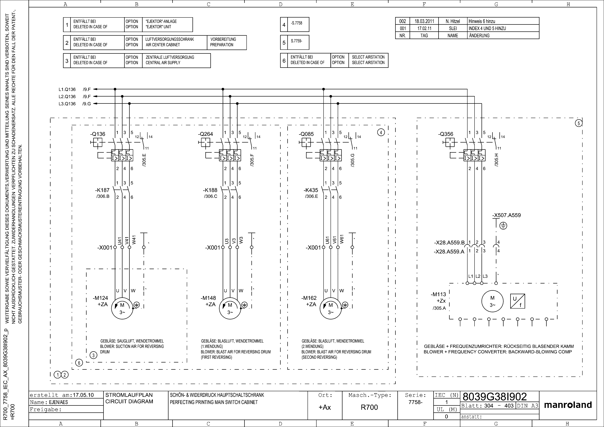

# +Ax — Sheet 304 of 403 — SCHÖN & WIDERDRUCK HAUPTSCHALTSCHRANK

**PERFECTING PRINTING MAIN SWITCH CABINET**

> Part of the manroland **R700** printing press IEC/UL circuit diagrams.
> Drawing class: **Stromlaufplan / Circuit diagram** (DIN A3).
> Document `+Ax` covers the **Central control console** machine section.

## At a glance

| Field | Value |
|---|---|
| Document | `+Ax`  (8039G38I902) |
| Sheet | **304** of 403 |
| Section (DE) | SCHÖN & WIDERDRUCK HAUPTSCHALTSCHRANK |
| Section (EN) | PERFECTING PRINTING MAIN SWITCH CABINET |
| Section type | CIRCUIT — Circuit diagram |
| Machine type | `R700` |
| Series | `7758` |
| Created | 17.05.10 |
| Replaces | — |
| Columns used | A, B, C, D, E, F, G, H |
| Path numbers | — |
| Labels on sheet | 198 |
| Cross-refs out | 11 |
| Cross-refs in | 19 |

**Previous:** [+Ax sheet 303](SHEET_0303.md) · **Next:** [+Ax sheet 305](SHEET_0305.md) · **Document TOC:** [_TOC.md](_TOC.md)  (+Ax) · **Master TOC:** [all sheets](../_MASTER_TOC.md)

## Sheet image (300 DPI, exact vector render)



_Rendered directly from the PDF vector layer at 300 DPI (1-bit), no OCR and no resampling. Use it to confirm anything ambiguous in the text below._

## Cross-references on this sheet

Each entry is a wire leaving this sheet. The printed token is `/sheet.column`; the link resolves to that sheet inside the same document.

| Ref | Target sheet | Col | Path | Destination on target | Target section | From col |
|---|---|---|---|---|---|---|
| `/9.F` | [+Ax sheet 9](SHEET_0009.md) | F | — | L1.Q136 | SPANNUNGSVERSORGUNG, SCHALTSCHRANKBELÜFTUNG | A |
| `/9.F` | [+Ax sheet 9](SHEET_0009.md) | F | — | L2.Q136 | SPANNUNGSVERSORGUNG, SCHALTSCHRANKBELÜFTUNG | A |
| `/9.G` | [+Ax sheet 9](SHEET_0009.md) | G | — | L3.Q136 | SPANNUNGSVERSORGUNG, SCHALTSCHRANKBELÜFTUNG | A |
| `/305.H` | [+Ax sheet 305](SHEET_0305.md) | H | — | — | SCHÖN & WIDERDRUCK HAUPTSCHALTSCHRANK | G |
| `/305.E` | [+Ax sheet 305](SHEET_0305.md) | E | — | — | SCHÖN & WIDERDRUCK HAUPTSCHALTSCHRANK | B |
| `/305.G` | [+Ax sheet 305](SHEET_0305.md) | G | — | — | SCHÖN & WIDERDRUCK HAUPTSCHALTSCHRANK | E |
| `/305.F` | [+Ax sheet 305](SHEET_0305.md) | F | — | — | SCHÖN & WIDERDRUCK HAUPTSCHALTSCHRANK | D |
| `/306.B` | [+Ax sheet 306](SHEET_0306.md) | B | — | — | SCHÖN & WIDERDRUCK HAUPTSCHALTSCHRANK | B |
| `/306.E` | [+Ax sheet 306](SHEET_0306.md) | E | — | — | SCHÖN & WIDERDRUCK HAUPTSCHALTSCHRANK | D |
| `/306.C` | [+Ax sheet 306](SHEET_0306.md) | C | — | — | SCHÖN & WIDERDRUCK HAUPTSCHALTSCHRANK | C |
| `/305.A` | [+Ax sheet 305](SHEET_0305.md) | A | — | — | SCHÖN & WIDERDRUCK HAUPTSCHALTSCHRANK | F |

### Incoming references (sheets that point here)

Every other sheet that sends a wire to this one. `Back-ref` is the token printed on *that* sheet; `Path` is its line number.

| From sheet | Cols | Back-ref | Path | Refs | What continues there |
|---|---|---|---|---|---|
| [+Ax#9](SHEET_0009.md) | F, G | `/9.F`, `/9.G` | — | 3 | L1.Q136; L2.Q136; L3.Q136 |
| [+Ax#272](SHEET_0272.md) | A, C | `/272.A`, `/272.C` | — | 8 | — |
| [+Ax#305](SHEET_0305.md) | A, E, F, G, H | `/305.A`, `/305.E`, `/305.F`, `/305.G`, `/305.H` | — | 5 | +Zx |
| [+Ax#306](SHEET_0306.md) | B, C, E | `/306.B`, `/306.C`, `/306.E` | — | 3 | — |


## Devices on this sheet

| Tag | Class | Class meaning (IEC) | Col | Sub | Terminal | Sign |
|---|---|---|---|---|---|---|
| `K187` | K | Relais / relay, contactor | B | — | — | — |
| `U41` | U | Umrichter / frequency converter | B | — | — | — |
| `X001` | X | Klemme / terminal, plug connector | B | — | — | — |
| `V41` | V | Diode / semiconductor valve | B | — | — | — |
| `W41` | W | Kabel / cable, line, bus | B | — | — | — |
| `Q136` | Q | Leistungsschalter / power switching device | A | — | — | — |
| `K435` | K | Relais / relay, contactor | D | — | — | — |
| `U61` | U | Umrichter / frequency converter | E | — | — | — |
| `X001` | X | Klemme / terminal, plug connector | D | — | — | — |
| `V61` | V | Diode / semiconductor valve | E | — | — | — |
| `W61` | W | Kabel / cable, line, bus | E | — | — | — |
| `Q085` | Q | Leistungsschalter / power switching device | D | — | — | — |
| `K188` | K | Relais / relay, contactor | C | — | — | — |
| `U3` | U | Umrichter / frequency converter | C | — | — | — |
| `X001` | X | Klemme / terminal, plug connector | C | — | — | — |
| `V3` | V | Diode / semiconductor valve | C | — | — | — |
| `W3` | W | Kabel / cable, line, bus | C | — | — | — |
| `Q264` | Q | Leistungsschalter / power switching device | C | — | — | — |
| `Q356` | Q | Leistungsschalter / power switching device | F | — | — | — |
| `X28.A559.B` | — | cross-device reference | F | — | — | — |
| `X28.A559.A` | — | cross-device reference | F | — | — | — |
| `NR.` | — | cross-device reference | F | — | — | — |
| `17.02.11` | — | cross-device reference | F | — | — | — |
| `18.03.2011` | — | cross-device reference | F | — | — | — |
| `X507.A559` | — | cross-device reference | G | — | — | — |
| `S.7758` | — | cross-device reference | D | — | — | — |
| `S.7759` | — | cross-device reference | D | — | — | — |

## Potentials / nets

| Potential | Count | Columns | Attached devices | Terminals |
|---|---|---|---|---|
| `L1` | 1 | A | `Q136` | — |
| `L2` | 1 | A | `Q136` | — |
| `L3` | 1 | A | `Q136` | — |
| `M113` | 1 | F | — | — |
| `M124` | 1 | A | — | — |
| `M148` | 1 | C | — | — |
| `M162` | 1 | D | — | — |


A potential such as `L24+/4` or `M24+` is a named supply/return rail; every place it appears on this sheet is electrically common.

## Wire-end annotations (grouped as printed)

A wire that continues elsewhere is annotated with a small cluster: the destination description, the path/line number `#NN`, and the `/sheet.column` cross reference. Each row below is one such cluster exactly as it is grouped on the drawing.

| Col | Y | Path | Cross-ref | Text on the wire |
|---|---|---|---|---|
| F | 38.3 | — | — | `002 18.03.2011 N. Hitzel Hinweis 6 hinzu` |
| A | 39.3 | — | — | `ENTFÄLLT BEI DELETED IN CASE OF` |
| B | 39.3 | — | — | `OPTION OPTION` |
| B | 39.3 | — | — | `"EJEKTOR" ANLAGE "EJEKTOR" UNIT` |
| D | 42.5 | — | — | `4 S.7758` |
| A | 44.6 | — | — | `1` |
| F | 52.7 | — | — | `001 17.02.11 SLEI INDEX 4 UND 5 HINZU` |
| F | 66.8 | — | — | `NR. TAG NAME ÄNDERUNG` |
| A | 74.7 | — | — | `ENTFÄLLT BEI DELETED IN CASE OF` |
| B | 74.7 | — | — | `OPTION OPTION` |
| B | 74.8 | — | — | `LUFTVERSORGUNGSSCHRANK` |
| C | 74.8 | — | — | `PREPARATION VORBEREITUNG` |
| D | 77.9 | — | — | `5 S.7759` |
| A | 80.1 | — | — | `2` |
| B | 85.4 | — | — | `AIR CENTER CABINET` |
| E | 109.7 | — | — | `6 ENTFÄLLT BEI DELETED IN CASE OF OPTION OPTION SELECT AIRSTATION SELECT AIRSTATION` |
| B | 110.2 | — | — | `3 ENTFÄLLT BEI DELETED IN CASE OF OPTION OPTION` |
| B | 110.2 | — | — | `CENTRAL AIR SUPPLY ZENTRALE LUFTVERSORGUNG` |
| A | 172.4 | — | `/9.F` | `L1.Q136` |
| A | 186.6 | — | `/9.F` | `L2.Q136` |
| A | 200.8 | — | `/9.G` | `L3.Q136` |
| H | 240.1 | — | — | `5` |
| B | 257.6 | — | — | `1` |
| B | 257.6 | — | — | `3` |
| B | 257.6 | — | — | `5` |
| C | 257.6 | — | — | `1` |
| C | 257.6 | — | — | `3` |
| C | 257.6 | — | — | `5` |
| E | 257.6 | — | — | `1` |
| E | 257.6 | — | — | `3` |
| E | 257.6 | — | — | `5` |
| G | 257.6 | — | — | `1` |
| G | 257.6 | — | — | `3` |
| G | 257.6 | — | — | `5` |
| E | 258.2 | — | — | `4` |
| A | 259.7 | — | — | `Q136` |
| C | 259.7 | — | — | `Q264` |
| D | 259.7 | — | — | `Q085` |
| F | 259.7 | — | — | `Q356` |
| B | 266.6 | — | — | `12 14` |
| D | 266.6 | — | — | `12 14` |
| E | 266.6 | — | — | `12 14` |
| G | 266.6 | — | — | `12 14` |
| B | 289.3 | — | — | `11` |
| D | 289.3 | — | — | `11` |
| E | 289.3 | — | — | `11` |
| G | 289.3 | — | — | `11` |
| G | 302.5 | — | `/305.H` | — |
| B | 302.7 | — | `/305.E` | — |
| E | 302.7 | — | `/305.G` | — |
| D | 303.0 | — | `/305.F` | — |
| B | 328.4 | — | — | `2` |
| B | 328.4 | — | — | `4` |
| B | 328.4 | — | — | `6` |
| C | 328.4 | — | — | `2` |
| C | 328.4 | — | — | `4` |
| C | 328.4 | — | — | `6` |
| E | 328.4 | — | — | `2` |
| E | 328.4 | — | — | `4` |
| E | 328.4 | — | — | `6` |
| G | 328.4 | — | — | `2` |
| G | 328.4 | — | — | `4` |
| G | 328.4 | — | — | `6` |
| B | 356.8 | — | — | `1` |
| B | 356.8 | — | — | `3` |
| B | 356.8 | — | — | `5` |
| C | 356.8 | — | — | `1` |
| C | 356.8 | — | — | `3` |
| C | 356.8 | — | — | `5` |
| E | 356.8 | — | — | `1` |
| E | 356.8 | — | — | `3` |
| E | 356.8 | — | — | `5` |
| B | 370.2 | — | — | `K187 6` |
| C | 370.2 | — | — | `K188 6` |
| E | 370.2 | — | — | `K435 6` |
| B | 383.3 | — | `/306.B` | — |
| C | 383.3 | — | `/306.C` | — |
| D | 383.3 | — | `/306.E` | — |
| B | 385.1 | — | — | `2` |
| B | 385.1 | — | — | `4` |
| C | 385.1 | — | — | `2` |
| C | 385.1 | — | — | `4` |
| E | 385.1 | — | — | `2` |
| E | 385.1 | — | — | `4` |
| G | 419.8 | — | — | `X507.A559` |
| E | 461.8 | — | — | `W61` |
| B | 463.2 | — | — | `W41` |
| E | 464.9 | — | — | `V61` |
| E | 465.4 | — | — | `U61` |
| B | 466.3 | — | — | `V41` |
| C | 466.6 | — | — | `W3` |
| B | 466.9 | — | — | `U41` |
| D | 469.0 | — | — | `'` |
| E | 469.0 | — | — | `'` |
| C | 469.7 | — | — | `V3` |
| C | 470.3 | — | — | `U3` |
| F | 473.7 | — | — | `X28.A559.B 1` |
| G | 473.7 | — | — | `2` |
| G | 473.7 | — | — | `3` |
| G | 473.7 | — | — | `4` |
| B | 477.5 | — | — | `'` |
| B | 483.4 | — | — | `X001` |
| C | 483.4 | — | — | `X001` |
| D | 483.4 | — | — | `X001` |
| F | 490.7 | — | — | `X28.A559.A 1` |
| G | 490.7 | — | — | `2` |
| G | 490.7 | — | — | `3` |
| G | 490.7 | — | — | `4` |
| G | 539.8 | — | — | `L1 L2 L3 '` |
| B | 568.2 | — | — | `U V W '` |
| C | 568.2 | — | — | `U V W '` |
| E | 568.2 | — | — | `U V W '` |
| F | 575.7 | — | — | `M113` |
| A | 582.8 | — | — | `M124` |
| C | 582.8 | — | — | `M148` |
| D | 582.8 | — | — | `M162` |
| G | 583.1 | — | — | `3~ M U` |
| F | 588.5 | — | — | `+Zx` |
| B | 595.5 | — | — | `+ZA` |
| C | 595.5 | — | — | `+ZA` |
| D | 595.5 | — | — | `+ZA` |
| G | 597.2 | — | — | `f` |
| B | 597.3 | — | — | `3~ M` |
| C | 597.3 | — | — | `3~ M` |
| E | 597.3 | — | — | `3~ M` |
| F | 603.7 | — | `/305.A` | — |
| B | 669.6 | — | — | `BLOWER: SUCTION AIR FOR REVERSING DRUM GEBLÄSE: SAUGLUFT, WENDETROMMEL` |
| C | 669.6 | — | — | `BLOWER: BLAST AIR FOR REVERSING DRUM (1.WENDUNG) (FIRST REVERSING) GEBLÄSE: BLASLUFT, WENDETROMMEL` |
| E | 669.6 | — | — | `BLOWER: BLAST AIR FOR REVERSING DRUM (2.WENDUNG) (SECOND REVERSING) GEBLÄSE: BLASLUFT, WENDETROMMEL` |
| G | 679.2 | — | — | `BLOWER + FREQUENCY CONVERTER: BACKWARD BLOWING COMP GEBLÄSE + FREQUENZUMRICHTER: RÜCKSEITIG BLASENDER KAMM` |
| A | 697.6 | — | — | `3` |
| A | 712.5 | — | — | `6` |
| A | 735.6 | — | — | `1 2` |


## Reconstructed tables

This sheet carries tabular content (pin map / terminal assignment / index). The grid below was rebuilt from the drawing's own rule lines, so each row is exactly one physical row of the table.

### Table 1 — 2 data rows × 4 columns (at x=467.7, y=175.7)

| 5 | 12 | 14 | Q085 |
|---|---|---|---|
|  |  | `11` |  |
|  |  | `/305.F` |  |


## Notes and free text on this sheet

| Text | Col | Y (pt) |
|---|---|---|
| `U` | B | 569.39 |
| `V` | B | 569.28 |
| `W` | B | 569.02 |
| `M` | B | 597.28 |
| `+ZA` | B | 595.5 |
| `GEBLÄSE: SAUGLUFT, WENDETROMMEL` | B | 669.6 |
| `BLOWER: SUCTION AIR FOR REVERSING` | B | 680.22 |
| `DRUM` | B | 690.88 |
| `U` | E | 569.39 |
| `V` | E | 569.28 |
| `W` | E | 569.02 |
| `M` | E | 597.28 |
| `+ZA` | D | 595.5 |
| `GEBLÄSE: BLASLUFT, WENDETROMMEL` | E | 669.6 |
| `(2.WENDUNG)` | D | 680.21 |
| `BLOWER: BLAST AIR FOR REVERSING DRUM` | E | 690.86 |
| `(SECOND REVERSING)` | E | 701.51 |
| `U` | C | 569.39 |
| `V` | C | 569.28 |
| `W` | C | 569.02 |
| `M` | C | 597.28 |
| `+ZA` | C | 595.5 |
| `GEBLÄSE: BLASLUFT, WENDETROMMEL` | C | 669.6 |
| `(1.WENDUNG)` | C | 680.21 |
| `BLOWER: BLAST AIR FOR REVERSING DRUM` | C | 690.86 |
| `(FIRST REVERSING)` | C | 701.49 |
| `L1 L2 L3` | G | 541.03 |
| `M` | G | 583.1 |
| `U` | G | 584.25 |
| `f` | G | 597.16 |
| `+Zx` | F | 588.53 |
| `GEBLÄSE + FREQUENZUMRICHTER: RÜCKSEITIG BLASENDER KAMM` | G | 679.17 |
| `BLOWER + FREQUENCY CONVERTER: BACKWARD BLOWING COMP` | G | 689.78 |
| `TAG` | F | 66.95 |
| `NAME` | F | 66.94 |
| `ÄNDERUNG` | G | 67 |
| `SLEI` | F | 52.79 |
| `INDEX 4 UND 5 HINZU` | G | 52.81 |
| `N. Hitzel` | F | 38.53 |
| `Hinweis 6 hinzu` | G | 38.5 |
| `ENTFÄLLT BEI` | A | 110.15 |
| `DELETED IN CASE OF` | A | 120.8 |
| `OPTION` | B | 110.16 |
| `ZENTRALE LUFTVERSORGUNG` | B | 110.2 |
| `CENTRAL AIR SUPPLY` | B | 120.82 |
| `"EJEKTOR" ANLAGE` | B | 39.31 |
| `"EJEKTOR" UNIT` | B | 49.94 |
| `LUFTVERSORGUNGSSCHRANK` | B | 74.77 |
| `AIR CENTER CABINET` | B | 85.38 |
| `VORBEREITUNG` | C | 74.76 |
| `PREPARATION` | C | 85.36 |
| `ENTFÄLLT BEI` | D | 109.72 |
| `DELETED IN CASE OF` | D | 120.38 |
| `SELECT AIRSTATION` | E | 109.74 |
| `OPTION` | E | 109.73 |

## Complete label inventory (exact text from the drawing)

Every text object inside the drawing area of this sheet, in DIN reading order (column A→H, then top→bottom). This is the authoritative list: if a string is not here it is not printed on this sheet.

| Col | Y | X | Dir | Type | Text |
|---|---|---|---|---|---|
| A | 39.3 | 145.1 | → | text | `ENTFÄLLT BEI` |
| A | 44.6 | 129.3 | → | number | `1` |
| A | 49.9 | 145.1 | → | text | `DELETED IN CASE OF` |
| A | 74.7 | 145.1 | → | text | `ENTFÄLLT BEI` |
| A | 80.1 | 129.0 | → | number | `2` |
| A | 85.4 | 145.1 | → | text | `DELETED IN CASE OF` |
| A | 110.1 | 145.1 | → | text | `ENTFÄLLT BEI` |
| A | 115.5 | 128.8 | → | number | `3` |
| A | 120.8 | 145.1 | → | text | `DELETED IN CASE OF` |
| A | 172.4 | 163.6 | → | cross-reference | `/9.F` |
| A | 172.5 | 115.7 | → | potential | `L1.Q136` |
| A | 186.6 | 163.6 | → | cross-reference | `/9.F` |
| A | 186.7 | 115.7 | → | potential | `L2.Q136` |
| A | 200.8 | 162.4 | → | cross-reference | `/9.G` |
| A | 200.9 | 115.7 | → | potential | `L3.Q136` |
| A | 259.7 | 178.0 | → | device tag | `Q136` |
| A | 582.8 | 183.1 | → | potential | `M124` |
| A | 697.6 | 182.3 | → | number | `3` |
| A | 712.5 | 153.9 | → | number | `6` |
| A | 735.7 | 111.6 | → | number | `1` |
| A | 736.2 | 125.6 | → | number | `2` |
| B | 39.3 | 247.7 | → | text | `OPTION` |
| B | 39.3 | 287.4 | → | text | `"EJEKTOR" ANLAGE` |
| B | 49.9 | 247.7 | → | text | `OPTION` |
| B | 49.9 | 287.4 | → | text | `"EJEKTOR" UNIT` |
| B | 74.7 | 247.7 | → | text | `OPTION` |
| B | 74.8 | 286.9 | → | text | `LUFTVERSORGUNGSSCHRANK` |
| B | 85.4 | 247.7 | → | text | `OPTION` |
| B | 85.4 | 287.7 | → | text | `AIR CENTER CABINET` |
| B | 110.2 | 247.7 | → | text | `OPTION` |
| B | 110.2 | 287.7 | → | text | `ZENTRALE LUFTVERSORGUNG` |
| B | 120.8 | 247.7 | → | text | `OPTION` |
| B | 120.8 | 287.4 | → | text | `CENTRAL AIR SUPPLY` |
| B | 257.6 | 228.8 | → | number | `1` |
| B | 257.6 | 243.5 | → | number | `3` |
| B | 257.6 | 257.7 | → | number | `5` |
| B | 266.6 | 265.9 | → | number | `12` |
| B | 266.6 | 292.8 | → | number | `14` |
| B | 289.3 | 285.7 | → | number | `11` |
| B | 302.7 | 280.2 | ↕ | cross-reference | `/305.E` |
| B | 328.4 | 229.3 | → | number | `2` |
| B | 328.4 | 243.5 | → | number | `4` |
| B | 328.4 | 257.7 | → | number | `6` |
| B | 356.8 | 228.8 | → | number | `1` |
| B | 356.8 | 243.5 | → | number | `3` |
| B | 356.8 | 257.7 | → | number | `5` |
| B | 370.2 | 187.7 | → | device tag | `K187` |
| B | 383.3 | 190.2 | → | cross-reference | `/306.B` |
| B | 385.1 | 229.3 | → | number | `2` |
| B | 385.1 | 243.5 | → | number | `4` |
| B | 385.1 | 257.7 | → | number | `6` |
| B | 463.2 | 260.2 | ↕ | device tag | `W41` |
| B | 466.3 | 246.2 | ↕ | device tag | `V41` |
| B | 466.9 | 232.1 | ↕ | device tag | `U41` |
| B | 477.5 | 291.4 | → | other | `'` |
| B | 483.4 | 191.9 | → | device tag | `X001` |
| B | 568.2 | 285.7 | → | other | `'` |
| B | 569.0 | 258.0 | → | text | `W` |
| B | 569.3 | 243.8 | → | text | `V` |
| B | 569.4 | 228.8 | → | text | `U` |
| B | 595.5 | 192.5 | → | text | `+ZA` |
| B | 597.3 | 236.8 | → | text | `M` |
| B | 611.5 | 235.6 | → | other | `3~` |
| B | 669.6 | 198.1 | → | text | `GEBLÄSE: SAUGLUFT, WENDETROMMEL` |
| B | 680.2 | 197.6 | → | text | `BLOWER: SUCTION AIR FOR REVERSING` |
| B | 690.9 | 197.6 | → | text | `DRUM` |
| C | 74.8 | 415.3 | → | text | `VORBEREITUNG` |
| C | 85.4 | 414.4 | → | text | `PREPARATION` |
| C | 257.6 | 441.4 | → | number | `1` |
| C | 257.6 | 456.1 | → | number | `3` |
| C | 257.6 | 470.3 | → | number | `5` |
| C | 259.7 | 390.6 | → | device tag | `Q264` |
| C | 328.4 | 441.9 | → | number | `2` |
| C | 328.4 | 456.1 | → | number | `4` |
| C | 328.4 | 470.3 | → | number | `6` |
| C | 356.8 | 441.4 | → | number | `1` |
| C | 356.8 | 456.1 | → | number | `3` |
| C | 356.8 | 470.3 | → | number | `5` |
| C | 370.2 | 400.3 | → | device tag | `K188` |
| C | 383.3 | 402.5 | → | cross-reference | `/306.C` |
| C | 385.1 | 441.9 | → | number | `2` |
| C | 385.1 | 456.1 | → | number | `4` |
| C | 385.1 | 470.3 | → | number | `6` |
| C | 466.6 | 471.4 | ↕ | device tag | `W3` |
| C | 469.7 | 457.4 | ↕ | device tag | `V3` |
| C | 470.3 | 443.2 | ↕ | device tag | `U3` |
| C | 483.4 | 404.5 | → | device tag | `X001` |
| C | 569.0 | 470.6 | → | text | `W` |
| C | 569.3 | 456.4 | → | text | `V` |
| C | 569.4 | 441.4 | → | text | `U` |
| C | 582.8 | 395.7 | → | potential | `M148` |
| C | 595.5 | 405.1 | → | text | `+ZA` |
| C | 597.3 | 449.4 | → | text | `M` |
| C | 611.5 | 448.2 | → | other | `3~` |
| C | 669.6 | 396.6 | → | text | `GEBLÄSE: BLASLUFT, WENDETROMMEL` |
| C | 680.2 | 396.3 | → | text | `(1.WENDUNG)` |
| C | 690.9 | 396.0 | → | text | `BLOWER: BLAST AIR FOR REVERSING DRUM` |
| C | 701.5 | 396.3 | → | text | `(FIRST REVERSING)` |
| D | 42.4 | 573.7 | → | device ref | `S.7758` |
| D | 44.2 | 557.0 | → | number | `4` |
| D | 77.9 | 573.7 | → | device ref | `S.7759` |
| D | 79.6 | 556.9 | → | number | `5` |
| D | 109.7 | 573.2 | → | text | `ENTFÄLLT BEI` |
| D | 115.1 | 557.0 | → | number | `6` |
| D | 120.4 | 573.2 | → | text | `DELETED IN CASE OF` |
| D | 259.7 | 589.0 | → | device tag | `Q085` |
| D | 266.6 | 478.5 | → | number | `12` |
| D | 266.6 | 505.4 | → | number | `14` |
| D | 289.3 | 498.3 | → | number | `11` |
| D | 303.0 | 492.8 | ↕ | cross-reference | `/305.F` |
| D | 370.2 | 598.7 | → | device tag | `K435` |
| D | 383.3 | 601.5 | → | cross-reference | `/306.E` |
| D | 469.0 | 498.3 | → | other | `'` |
| D | 483.4 | 602.9 | → | device tag | `X001` |
| D | 568.2 | 498.3 | → | other | `'` |
| D | 582.8 | 594.1 | → | potential | `M162` |
| D | 595.5 | 603.5 | → | text | `+ZA` |
| D | 680.2 | 594.7 | → | text | `(2.WENDUNG)` |
| E | 109.7 | 654.5 | → | text | `OPTION` |
| E | 109.7 | 694.2 | → | text | `SELECT AIRSTATION` |
| E | 120.4 | 654.5 | → | text | `OPTION` |
| E | 120.4 | 694.2 | → | text | `SELECT AIRSTATION` |
| E | 257.6 | 639.8 | → | number | `1` |
| E | 257.6 | 654.5 | → | number | `3` |
| E | 257.6 | 668.7 | → | number | `5` |
| E | 258.2 | 749.2 | → | number | `4` |
| E | 266.6 | 676.9 | → | number | `12` |
| E | 266.6 | 703.8 | → | number | `14` |
| E | 289.3 | 696.8 | → | number | `11` |
| E | 302.7 | 691.2 | ↕ | cross-reference | `/305.G` |
| E | 328.4 | 640.3 | → | number | `2` |
| E | 328.4 | 654.5 | → | number | `4` |
| E | 328.4 | 668.7 | → | number | `6` |
| E | 356.8 | 639.8 | → | number | `1` |
| E | 356.8 | 654.5 | → | number | `3` |
| E | 356.8 | 668.7 | → | number | `5` |
| E | 385.1 | 640.3 | → | number | `2` |
| E | 385.1 | 654.5 | → | number | `4` |
| E | 385.1 | 668.7 | → | number | `6` |
| E | 461.8 | 669.8 | ↕ | device tag | `W61` |
| E | 464.9 | 655.8 | ↕ | device tag | `V61` |
| E | 465.5 | 641.7 | ↕ | device tag | `U61` |
| E | 469.0 | 696.8 | → | other | `'` |
| E | 568.2 | 696.8 | → | other | `'` |
| E | 569.0 | 669.0 | → | text | `W` |
| E | 569.3 | 654.8 | → | text | `V` |
| E | 569.4 | 639.8 | → | text | `U` |
| E | 597.3 | 647.9 | → | text | `M` |
| E | 611.5 | 646.6 | → | other | `3~` |
| E | 669.6 | 595.0 | → | text | `GEBLÄSE: BLASLUFT, WENDETROMMEL` |
| E | 690.9 | 594.4 | → | text | `BLOWER: BLAST AIR FOR REVERSING DRUM` |
| E | 701.5 | 594.7 | → | text | `(SECOND REVERSING)` |
| F | 38.3 | 787.2 | → | number | `002` |
| F | 38.4 | 817.3 | → | device ref | `18.03.2011` |
| F | 38.5 | 878.9 | → | text | `N. Hitzel` |
| F | 52.7 | 788.5 | → | number | `001` |
| F | 52.7 | 822.9 | → | device ref | `17.02.11` |
| F | 52.8 | 885.4 | → | text | `SLEI` |
| F | 66.8 | 787.5 | → | device ref | `NR.` |
| F | 66.9 | 882.5 | → | text | `NAME` |
| F | 67.0 | 829.1 | → | text | `TAG` |
| F | 259.7 | 864.0 | → | device tag | `Q356` |
| F | 473.7 | 856.1 | → | device ref | `X28.A559.B` |
| F | 491.4 | 855.2 | → | device ref | `X28.A559.A` |
| F | 575.7 | 849.3 | → | potential | `M113` |
| F | 588.5 | 860.9 | → | text | `+Zx` |
| F | 603.7 | 853.2 | → | cross-reference | `/305.A` |
| G | 38.5 | 924.0 | → | text | `Hinweis 6 hinzu` |
| G | 52.8 | 924.0 | → | text | `INDEX 4 UND 5 HINZU` |
| G | 67.0 | 925.1 | → | text | `ÄNDERUNG` |
| G | 257.6 | 923.2 | → | number | `1` |
| G | 257.6 | 938.0 | → | number | `3` |
| G | 257.6 | 952.2 | → | number | `5` |
| G | 266.6 | 960.4 | → | number | `12` |
| G | 266.6 | 987.3 | → | number | `14` |
| G | 289.3 | 980.2 | → | number | `11` |
| G | 302.5 | 974.7 | ↕ | cross-reference | `/305.H` |
| G | 328.4 | 923.8 | → | number | `2` |
| G | 328.4 | 938.0 | → | number | `4` |
| G | 328.4 | 952.2 | → | number | `6` |
| G | 419.8 | 970.6 | → | device ref | `X507.A559` |
| G | 473.7 | 923.2 | → | number | `1` |
| G | 473.7 | 938.0 | → | number | `2` |
| G | 473.7 | 952.2 | → | number | `3` |
| G | 473.7 | 980.5 | → | number | `4` |
| G | 490.7 | 923.2 | → | number | `1` |
| G | 490.7 | 938.0 | → | number | `2` |
| G | 490.7 | 952.2 | → | number | `3` |
| G | 490.7 | 980.5 | → | number | `4` |
| G | 539.8 | 980.2 | → | other | `'` |
| G | 541.0 | 923.2 | → | text | `L1 L2 L3` |
| G | 583.1 | 966.8 | → | text | `M` |
| G | 584.2 | 1011.0 | → | text | `U` |
| G | 597.2 | 1024.6 | → | text | `f` |
| G | 597.3 | 965.5 | → | other | `3~` |
| G | 679.2 | 835.9 | → | text | `GEBLÄSE + FREQUENZUMRICHTER: RÜCKSEITIG BLASENDER KAMM` |
| G | 689.8 | 835.4 | → | text | `BLOWER + FREQUENCY CONVERTER: BACKWARD BLOWING COMP` |
| H | 240.1 | 1139.0 | → | number | `5` |

## Reading-order text block

The same content as a plain block, grouped by DIN column — convenient to paste or to match against a visual description.

```text
=== Column A ===
  39.3  145.1  text         ENTFÄLLT BEI
  44.6  129.3  numeric      1
  49.9  145.1  text         DELETED IN CASE OF
  74.7  145.1  text         ENTFÄLLT BEI
  80.1  129.0  numeric      2
  85.4  145.1  text         DELETED IN CASE OF
 110.1  145.1  text         ENTFÄLLT BEI
 115.5  128.8  numeric      3
 120.8  145.1  text         DELETED IN CASE OF
 172.4  163.6  xref         /9.F
 172.5  115.7  net          L1.Q136
 186.6  163.6  xref         /9.F
 186.7  115.7  net          L2.Q136
 200.8  162.4  xref         /9.G
 200.9  115.7  net          L3.Q136
 259.7  178.0  devtag       Q136
 582.8  183.1  net          M124
 697.6  182.3  numeric      3
 712.5  153.9  numeric      6
 735.7  111.6  numeric      1
 736.2  125.6  numeric      2
=== Column B ===
  39.3  247.7  text         OPTION
  39.3  287.4  text         "EJEKTOR" ANLAGE
  49.9  247.7  text         OPTION
  49.9  287.4  text         "EJEKTOR" UNIT
  74.7  247.7  text         OPTION
  74.8  286.9  text         LUFTVERSORGUNGSSCHRANK
  85.4  247.7  text         OPTION
  85.4  287.7  text         AIR CENTER CABINET
 110.2  247.7  text         OPTION
 110.2  287.7  text         ZENTRALE LUFTVERSORGUNG
 120.8  247.7  text         OPTION
 120.8  287.4  text         CENTRAL AIR SUPPLY
 257.6  228.8  numeric      1
 257.6  243.5  numeric      3
 257.6  257.7  numeric      5
 266.6  265.9  numeric      12
 266.6  292.8  numeric      14
 289.3  285.7  numeric      11
 302.7  280.2  xref         /305.E
 328.4  229.3  numeric      2
 328.4  243.5  numeric      4
 328.4  257.7  numeric      6
 356.8  228.8  numeric      1
 356.8  243.5  numeric      3
 356.8  257.7  numeric      5
 370.2  187.7  devtag       K187
 383.3  190.2  xref         /306.B
 385.1  229.3  numeric      2
 385.1  243.5  numeric      4
 385.1  257.7  numeric      6
 463.2  260.2  devtag       W41
 466.3  246.2  devtag       V41
 466.9  232.1  devtag       U41
 477.5  291.4  other        `
 483.4  191.9  devtag       X001
 568.2  285.7  other        `
 569.0  258.0  text         W
 569.3  243.8  text         V
 569.4  228.8  text         U
 595.5  192.5  text         +ZA
 597.3  236.8  text         M
 611.5  235.6  other        3~
 669.6  198.1  text         GEBLÄSE: SAUGLUFT, WENDETROMMEL
 680.2  197.6  text         BLOWER: SUCTION AIR FOR REVERSING
 690.9  197.6  text         DRUM
=== Column C ===
  74.8  415.3  text         VORBEREITUNG
  85.4  414.4  text         PREPARATION
 257.6  441.4  numeric      1
 257.6  456.1  numeric      3
 257.6  470.3  numeric      5
 259.7  390.6  devtag       Q264
 328.4  441.9  numeric      2
 328.4  456.1  numeric      4
 328.4  470.3  numeric      6
 356.8  441.4  numeric      1
 356.8  456.1  numeric      3
 356.8  470.3  numeric      5
 370.2  400.3  devtag       K188
 383.3  402.5  xref         /306.C
 385.1  441.9  numeric      2
 385.1  456.1  numeric      4
 385.1  470.3  numeric      6
 466.6  471.4  devtag       W3
 469.7  457.4  devtag       V3
 470.3  443.2  devtag       U3
 483.4  404.5  devtag       X001
 569.0  470.6  text         W
 569.3  456.4  text         V
 569.4  441.4  text         U
 582.8  395.7  net          M148
 595.5  405.1  text         +ZA
 597.3  449.4  text         M
 611.5  448.2  other        3~
 669.6  396.6  text         GEBLÄSE: BLASLUFT, WENDETROMMEL
 680.2  396.3  text         (1.WENDUNG)
 690.9  396.0  text         BLOWER: BLAST AIR FOR REVERSING DRUM
 701.5  396.3  text         (FIRST REVERSING)
=== Column D ===
  42.4  573.7  devref       S.7758
  44.2  557.0  numeric      4
  77.9  573.7  devref       S.7759
  79.6  556.9  numeric      5
 109.7  573.2  text         ENTFÄLLT BEI
 115.1  557.0  numeric      6
 120.4  573.2  text         DELETED IN CASE OF
 259.7  589.0  devtag       Q085
 266.6  478.5  numeric      12
 266.6  505.4  numeric      14
 289.3  498.3  numeric      11
 303.0  492.8  xref         /305.F
 370.2  598.7  devtag       K435
 383.3  601.5  xref         /306.E
 469.0  498.3  other        `
 483.4  602.9  devtag       X001
 568.2  498.3  other        `
 582.8  594.1  net          M162
 595.5  603.5  text         +ZA
 680.2  594.7  text         (2.WENDUNG)
=== Column E ===
 109.7  654.5  text         OPTION
 109.7  694.2  text         SELECT AIRSTATION
 120.4  654.5  text         OPTION
 120.4  694.2  text         SELECT AIRSTATION
 257.6  639.8  numeric      1
 257.6  654.5  numeric      3
 257.6  668.7  numeric      5
 258.2  749.2  numeric      4
 266.6  676.9  numeric      12
 266.6  703.8  numeric      14
 289.3  696.8  numeric      11
 302.7  691.2  xref         /305.G
 328.4  640.3  numeric      2
 328.4  654.5  numeric      4
 328.4  668.7  numeric      6
 356.8  639.8  numeric      1
 356.8  654.5  numeric      3
 356.8  668.7  numeric      5
 385.1  640.3  numeric      2
 385.1  654.5  numeric      4
 385.1  668.7  numeric      6
 461.8  669.8  devtag       W61
 464.9  655.8  devtag       V61
 465.5  641.7  devtag       U61
 469.0  696.8  other        `
 568.2  696.8  other        `
 569.0  669.0  text         W
 569.3  654.8  text         V
 569.4  639.8  text         U
 597.3  647.9  text         M
 611.5  646.6  other        3~
 669.6  595.0  text         GEBLÄSE: BLASLUFT, WENDETROMMEL
 690.9  594.4  text         BLOWER: BLAST AIR FOR REVERSING DRUM
 701.5  594.7  text         (SECOND REVERSING)
=== Column F ===
  38.3  787.2  numeric      002
  38.4  817.3  devref       18.03.2011
  38.5  878.9  text         N. Hitzel
  52.7  788.5  numeric      001
  52.7  822.9  devref       17.02.11
  52.8  885.4  text         SLEI
  66.8  787.5  devref       NR.
  66.9  882.5  text         NAME
  67.0  829.1  text         TAG
 259.7  864.0  devtag       Q356
 473.7  856.1  devref       X28.A559.B
 491.4  855.2  devref       X28.A559.A
 575.7  849.3  net          M113
 588.5  860.9  text         +Zx
 603.7  853.2  xref         /305.A
=== Column G ===
  38.5  924.0  text         Hinweis 6 hinzu
  52.8  924.0  text         INDEX 4 UND 5 HINZU
  67.0  925.1  text         ÄNDERUNG
 257.6  923.2  numeric      1
 257.6  938.0  numeric      3
 257.6  952.2  numeric      5
 266.6  960.4  numeric      12
 266.6  987.3  numeric      14
 289.3  980.2  numeric      11
 302.5  974.7  xref         /305.H
 328.4  923.8  numeric      2
 328.4  938.0  numeric      4
 328.4  952.2  numeric      6
 419.8  970.6  devref       X507.A559
 473.7  923.2  numeric      1
 473.7  938.0  numeric      2
 473.7  952.2  numeric      3
 473.7  980.5  numeric      4
 490.7  923.2  numeric      1
 490.7  938.0  numeric      2
 490.7  952.2  numeric      3
 490.7  980.5  numeric      4
 539.8  980.2  other        `
 541.0  923.2  text         L1 L2 L3
 583.1  966.8  text         M
 584.2 1011.0  text         U
 597.2 1024.6  text         f
 597.3  965.5  other        3~
 679.2  835.9  text         GEBLÄSE + FREQUENZUMRICHTER: RÜCKSEITIG BLASENDER KAMM
 689.8  835.4  text         BLOWER + FREQUENCY CONVERTER: BACKWARD BLOWING COMP
=== Column H ===
 240.1 1139.0  numeric      5
```

---
_Generated from the PDF vector text layer; no OCR. Source: `R700_7758_IEC_AX_8039G38I902_p`, sheet 304._
