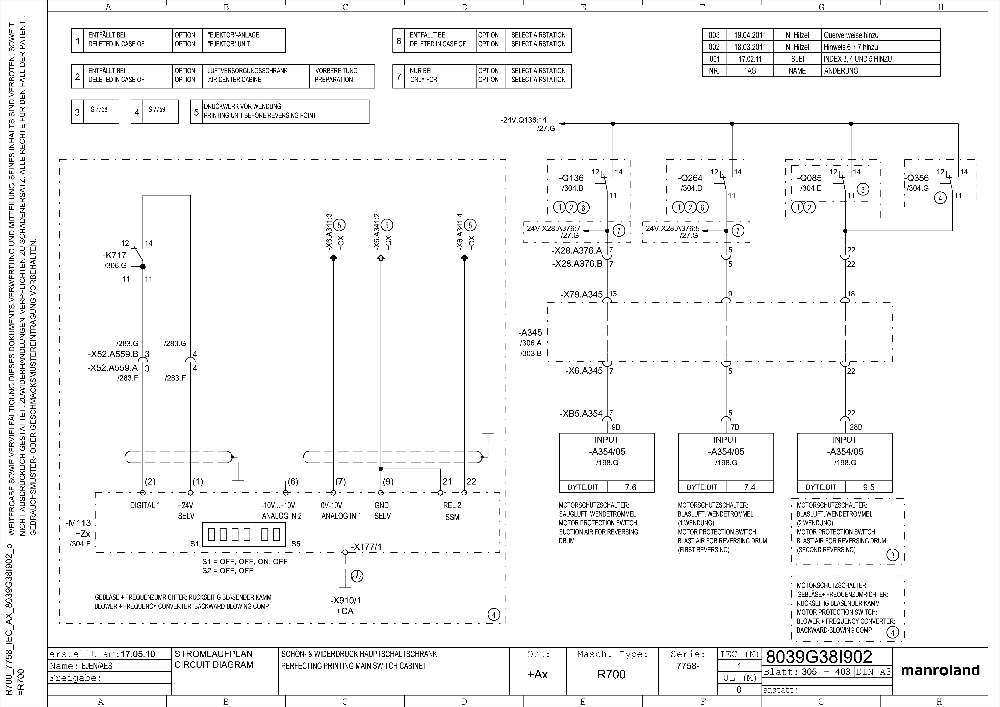

# +Ax — Sheet 305 of 403 — SCHÖN & WIDERDRUCK HAUPTSCHALTSCHRANK

**PERFECTING PRINTING MAIN SWITCH CABINET**

> Part of the manroland **R700** printing press IEC/UL circuit diagrams.
> Drawing class: **Stromlaufplan / Circuit diagram** (DIN A3).
> Document `+Ax` covers the **Central control console** machine section.

## At a glance

| Field | Value |
|---|---|
| Document | `+Ax`  (8039G38I902) |
| Sheet | **305** of 403 |
| Section (DE) | SCHÖN & WIDERDRUCK HAUPTSCHALTSCHRANK |
| Section (EN) | PERFECTING PRINTING MAIN SWITCH CABINET |
| Section type | CIRCUIT — Circuit diagram |
| Machine type | `R700` |
| Series | `7758` |
| Created | 17.05.10 |
| Replaces | — |
| Columns used | A, B, C, D, E, F, G, H |
| Path numbers | — |
| Labels on sheet | 213 |
| Cross-refs out | 18 |
| Cross-refs in | 32 |

**Previous:** [+Ax sheet 304](SHEET_0304.md) · **Next:** [+Ax sheet 306](SHEET_0306.md) · **Document TOC:** [_TOC.md](_TOC.md)  (+Ax) · **Master TOC:** [all sheets](../_MASTER_TOC.md)

## Sheet image (300 DPI, exact vector render)



_Rendered directly from the PDF vector layer at 300 DPI (1-bit), no OCR and no resampling. Use it to confirm anything ambiguous in the text below._

## Cross-references on this sheet

Each entry is a wire leaving this sheet. The printed token is `/sheet.column`; the link resolves to that sheet inside the same document.

| Ref | Target sheet | Col | Path | Destination on target | Target section | From col |
|---|---|---|---|---|---|---|
| `/27.G` | [+Ax sheet 27](SHEET_0027.md) | G | — | 24V.Q136:14 | SPANNUNGSVERSORGUNG, SCHALTSCHRANKBELÜFTUNG | E |
| `/304.B` | [+Ax sheet 304](SHEET_0304.md) | B | — | — | SCHÖN & WIDERDRUCK HAUPTSCHALTSCHRANK | E |
| `/304.E` | [+Ax sheet 304](SHEET_0304.md) | E | — | — | SCHÖN & WIDERDRUCK HAUPTSCHALTSCHRANK | G |
| `/304.G` | [+Ax sheet 304](SHEET_0304.md) | G | — | — | SCHÖN & WIDERDRUCK HAUPTSCHALTSCHRANK | H |
| `/304.D` | [+Ax sheet 304](SHEET_0304.md) | D | — | — | SCHÖN & WIDERDRUCK HAUPTSCHALTSCHRANK | F |
| `/27.G` | [+Ax sheet 27](SHEET_0027.md) | G | — | 24V.X28.A376:7 | SPANNUNGSVERSORGUNG, SCHALTSCHRANKBELÜFTUNG | E |
| `/27.G` | [+Ax sheet 27](SHEET_0027.md) | G | — | 24V.X28.A376:5 | SPANNUNGSVERSORGUNG, SCHALTSCHRANKBELÜFTUNG | F |
| `/306.G` | [+Ax sheet 306](SHEET_0306.md) | G | — | — | SCHÖN & WIDERDRUCK HAUPTSCHALTSCHRANK | A |
| `/306.A` | [+Ax sheet 306](SHEET_0306.md) | A | — | — | SCHÖN & WIDERDRUCK HAUPTSCHALTSCHRANK | E |
| `/303.B` | [+Ax sheet 303](SHEET_0303.md) | B | — | — | SPANNUNGSVERSORGUNG: LACKMODUL | E |
| `/283.G` | [+Ax sheet 283](SHEET_0283.md) | G | — | — | REFERENZMODUL | A |
| `/283.G` | [+Ax sheet 283](SHEET_0283.md) | G | — | 4 | REFERENZMODUL | B |
| `/283.F` | [+Ax sheet 283](SHEET_0283.md) | F | — | 4 | REFERENZMODUL | B |
| `/283.F` | [+Ax sheet 283](SHEET_0283.md) | F | — | — | REFERENZMODUL | A |
| `/198.G` | [+Ax sheet 198](SHEET_0198.md) | G | — | — | REFERENZMODUL | E |
| `/198.G` | [+Ax sheet 198](SHEET_0198.md) | G | — | — | REFERENZMODUL | F |
| `/198.G` | [+Ax sheet 198](SHEET_0198.md) | G | — | — | REFERENZMODUL | G |
| `/304.F` | [+Ax sheet 304](SHEET_0304.md) | F | — | +Zx | SCHÖN & WIDERDRUCK HAUPTSCHALTSCHRANK | A |

### Incoming references (sheets that point here)

Every other sheet that sends a wire to this one. `Back-ref` is the token printed on *that* sheet; `Path` is its line number.

| From sheet | Cols | Back-ref | Path | Refs | What continues there |
|---|---|---|---|---|---|
| [+Ax#27](SHEET_0027.md) | F, G | `/27.F`, `/27.G` | — | 3 | — |
| [+Ax#198](SHEET_0198.md) | G | `/198.G` | — | 3 | — |
| [+Ax#231](SHEET_0231.md) | E | `/231.E` | — | 3 | — |
| [+Ax#233](SHEET_0233.md) | G | `/233.G` | — | 3 | — |
| [+Ax#271](SHEET_0271.md) | D, E | `/271.D`, `/271.E` | — | 6 | — |
| [+Ax#283](SHEET_0283.md) | F, G | `/283.F`, `/283.G` | — | 4 | — |
| [+Ax#286](SHEET_0286.md) | B | `/286.B` | — | 3 | — |
| [+Ax#303](SHEET_0303.md) | B | `/303.B` | — | 1 | — |
| [+Ax#304](SHEET_0304.md) | B, D, E, F, G | `/304.B`, `/304.D`, `/304.E`, `/304.F`, `/304.G` | — | 5 | — |
| [+Ax#306](SHEET_0306.md) | A | `/306.A` | — | 1 | — |


## Devices on this sheet

| Tag | Class | Class meaning (IEC) | Col | Sub | Terminal | Sign |
|---|---|---|---|---|---|---|
| `A354/05` | A | Baugruppe / assembly, module, PC board | F | 05 | — | — |
| `Q264` | Q | Leistungsschalter / power switching device | F | — | — | — |
| `A354/05` | A | Baugruppe / assembly, module, PC board | E | 05 | — | — |
| `Q136` | Q | Leistungsschalter / power switching device | E | — | — | — |
| `A345` | A | Baugruppe / assembly, module, PC board | E | — | — | — |
| `A354/05` | A | Baugruppe / assembly, module, PC board | G | 05 | — | — |
| `Q085` | Q | Leistungsschalter / power switching device | G | — | — | — |
| `X177/1` | X | Klemme / terminal, plug connector | C | 1 | — | — |
| `K717` | K | Relais / relay, contactor | A | — | — | — |
| `Q356` | Q | Leistungsschalter / power switching device | H | — | — | — |
| `X910/1` | X | Klemme / terminal, plug connector | C | 1 | — | — |
| `S1` | S | Schalter / switch | B | — | — | — |
| `S5` | S | Schalter / switch | C | — | — | — |
| `7.4` | — | cross-device reference | F | — | — | — |
| `7.6` | — | cross-device reference | E | — | — | — |
| `XB5.A354` | — | cross-device reference | E | — | — | — |
| `X28.A376.B` | — | cross-device reference | E | — | — | — |
| `X28.A376.A` | — | cross-device reference | E | — | — | — |
| `X6.A345` | — | cross-device reference | E | — | — | — |
| `X79.A345` | — | cross-device reference | E | — | — | — |
| `9.5` | — | cross-device reference | G | — | — | — |
| `X6.A341:3` | — | cross-device reference | C | — | 3 | — |
| `X6.A341:2` | — | cross-device reference | C | — | 2 | — |
| `X52.A559.A` | — | cross-device reference | A | — | — | — |
| `X52.A559.B` | — | cross-device reference | A | — | — | — |
| `X6.A341:4` | — | cross-device reference | D | — | 4 | — |
| `NR.` | — | cross-device reference | F | — | — | — |
| `17.02.11` | — | cross-device reference | F | — | — | — |
| `18.03.2011` | — | cross-device reference | F | — | — | — |
| `19.04.2011` | — | cross-device reference | F | — | — | — |
| `S.7758` | — | cross-device reference | A | — | — | — |
| `S.7759` | — | cross-device reference | A | — | — | — |

## Potentials / nets

| Potential | Count | Columns | Attached devices | Terminals |
|---|---|---|---|---|
| `+24V` | 1 | B | — | — |
| `24V` | 3 | D, E, F | `A376`, `Q136`, `X28` | `14`, `5`, `7` |
| `M113` | 1 | A | — | — |


A potential such as `L24+/4` or `M24+` is a named supply/return rail; every place it appears on this sheet is electrically common.

## Wire-end annotations (grouped as printed)

A wire that continues elsewhere is annotated with a small cluster: the destination description, the path/line number `#NN`, and the `/sheet.column` cross reference. Each row below is one such cluster exactly as it is grouped on the drawing.

| Col | Y | Path | Cross-ref | Text on the wire |
|---|---|---|---|---|
| G | 38.3 | — | — | `003 19.04.2011 N. Hitzel Querverweise hinzu` |
| A | 38.9 | — | — | `1 "EJEKTOR" ANLAGE "EJEKTOR" UNIT` |
| A | 38.9 | — | — | `ENTFÄLLT BEI DELETED IN CASE OF` |
| B | 38.9 | — | — | `OPTION OPTION` |
| D | 38.9 | — | — | `6 ENTFÄLLT BEI DELETED IN CASE OF OPTION OPTION SELECT AIRSTATION SELECT AIRSTATION` |
| G | 52.5 | — | — | `002 18.03.2011 N. Hitzel Hinweis 6 + 7 hinzu` |
| G | 66.9 | — | — | `001 17.02.11 SLEI INDEX 3, 4 UND 5 HINZU` |
| G | 81.0 | — | — | `NR. TAG NAME ÄNDERUNG` |
| A | 81.4 | — | — | `ENTFÄLLT BEI DELETED IN CASE OF` |
| B | 81.4 | — | — | `OPTION OPTION` |
| B | 81.4 | — | — | `LUFTVERSORGUNGSSCHRANK PREPARATION VORBEREITUNG` |
| D | 81.4 | — | — | `7 ONLY FOR OPTION OPTION SELECT AIRSTATION SELECT AIRSTATION` |
| D | 81.4 | — | — | `NUR BEI` |
| A | 86.7 | — | — | `2` |
| B | 92.0 | — | — | `AIR CENTER CABINET` |
| B | 123.9 | — | — | `5 DRUCKWERK VOR WENDUNG PRINTING UNIT BEFORE REVERSING POINT` |
| A | 127.5 | — | — | `3 S.7758 4 S.7759` |
| E | 139.2 | — | `/27.G` | `24V.Q136:14` |
| E | 200.9 | — | — | `Q136 14` |
| E | 200.9 | — | — | `12` |
| F | 200.9 | — | — | `Q264 14` |
| F | 200.9 | — | — | `12` |
| G | 200.9 | — | — | `Q085 14` |
| G | 200.9 | — | — | `12` |
| H | 200.9 | — | — | `Q356 14` |
| H | 200.9 | — | — | `12` |
| E | 220.3 | — | `/304.B` | — |
| F | 220.3 | — | `/304.D` | — |
| G | 220.3 | — | `/304.E` | — |
| H | 220.3 | — | `/304.G` | — |
| G | 222.8 | — | — | `3` |
| E | 229.2 | — | — | `11` |
| F | 229.2 | — | — | `11` |
| G | 229.2 | — | — | `11` |
| H | 229.2 | — | — | `11` |
| H | 233.0 | — | — | `4` |
| E | 243.6 | — | — | `1 2` |
| F | 243.6 | — | — | `6 1 2 6 1 2` |
| C | 254.0 | — | — | `X6.A341:3` |
| C | 254.0 | — | — | `X6.A341:2` |
| D | 254.0 | — | — | `X6.A341:4` |
| C | 265.3 | — | — | `5 5 5` |
| E | 268.1 | — | `/27.G` | `24V.X28.A376:7` |
| F | 268.1 | — | `/27.G` | `24V.X28.A376:5` |
| F | 272.0 | — | — | `7 7` |
| C | 280.6 | — | — | `+CX` |
| C | 280.6 | — | — | `+CX` |
| D | 280.6 | — | — | `+CX` |
| A | 285.9 | — | — | `K717 14` |
| A | 285.9 | — | — | `12` |
| E | 293.7 | — | — | `X28.A376.A 7` |
| F | 293.7 | — | — | `5` |
| G | 293.7 | — | — | `22` |
| E | 309.3 | — | — | `X28.A376.B 7` |
| F | 310.7 | — | — | `5` |
| G | 310.7 | — | — | `22` |
| A | 312.4 | — | `/306.G` | — |
| A | 328.4 | — | — | `11 11` |
| E | 346.1 | — | — | `X79.A345 13` |
| F | 346.1 | — | — | `9` |
| G | 346.1 | — | — | `18` |
| E | 391.5 | — | — | `A345` |
| E | 404.6 | — | `/306.A`, `/303.B` | — |
| A | 405.3 | — | `/283.G` | — |
| B | 405.3 | — | `/283.G` | `4` |
| A | 417.0 | — | — | `X52.A559.B 3` |
| A | 433.3 | — | — | `X52.A559.A 3` |
| B | 434.0 | — | `/283.F` | `4` |
| E | 436.8 | — | — | `X6.A345 7` |
| F | 438.3 | — | — | `5` |
| G | 438.3 | — | — | `22` |
| A | 446.4 | — | `/283.F` | — |
| E | 487.9 | — | — | `XB5.A354 7` |
| F | 487.9 | — | — | `5` |
| G | 487.9 | — | — | `22` |
| E | 504.8 | — | — | `9B` |
| F | 504.8 | — | — | `7B` |
| G | 504.9 | — | — | `28B` |
| E | 519.4 | — | — | `INPUT` |
| F | 519.4 | — | — | `INPUT` |
| G | 519.4 | — | — | `INPUT` |
| E | 533.2 | — | — | `A354/05` |
| F | 533.2 | — | — | `A354/05` |
| G | 533.2 | — | — | `A354/05` |
| E | 547.0 | — | `/198.G` | — |
| F | 547.0 | — | `/198.G` | — |
| G | 547.0 | — | `/198.G` | — |
| C | 568.6 | — | — | `(2) (1) (6) (7) (9) 21 22` |
| E | 576.0 | — | — | `BYTE.BIT 7.6` |
| F | 576.0 | — | — | `BYTE.BIT 7.4` |
| G | 576.0 | — | — | `BYTE.BIT 9.5` |
| C | 598.2 | — | — | `DIGITAL 1 +24V SELV ANALOG IN 2 REL 2` |
| C | 598.2 | — | — | `GND SELV` |
| B | 598.3 | — | — | `10V...+10V` |
| C | 598.3 | — | — | `0V 10V ANALOG IN 1` |
| E | 598.8 | — | — | `DRUM MOTORSCHUTZSCHALTER: MOTOR PROTECTION SWITCH: SAUGLUFT, WENDETROMMEL SUCTION AIR FOR REVERSING` |
| F | 598.8 | — | — | `BLASLUFT, WENDETROMMEL BLAST AIR FOR REVERSING DRUM MOTORSCHUTZSCHALTER: (1.WENDUNG) MOTOR PROTECTION SWITCH: (FIRST REVERSING)` |
| G | 598.8 | — | — | `BLASLUFT, WENDETROMMEL BLAST AIR FOR REVERSING DRUM MOTORSCHUTZSCHALTER: (2.WENDUNG) MOTOR PROTECTION SWITCH: (SECOND REVERSING)` |
| D | 612.4 | — | — | `SSM` |
| A | 618.3 | — | — | `M113` |
| A | 631.0 | — | `/304.F` | `+Zx` |
| B | 643.7 | — | — | `S1 S5` |
| C | 646.6 | — | — | `X177/1` |
| H | 658.2 | — | — | `3` |
| B | 665.0 | — | — | `S1 = OFF, OFF, ON, OFF S2 = OFF, OFF` |
| G | 694.4 | — | — | `RÜCKSEITIG BLASENDER KAMM BLOWER + FREQUENCY CONVERTER: BACKWARD BLOWING COMP MOTORSCHUTZSCHALTER: MOTOR PROTECTION SWITCH: GEBLÄSE+ FREQUENZUMRICHTER:` |
| B | 708.6 | — | — | `BLOWER + FREQUENCY CONVERTER: BACKWARD BLOWING COMP GEBLÄSE + FREQUENZUMRICHTER: RÜCKSEITIG BLASENDER KAMM` |
| C | 710.4 | — | — | `X910/1` |
| C | 723.1 | — | — | `+CA` |
| D | 729.1 | — | — | `4` |
| H | 750.3 | — | — | `4` |


## Reconstructed tables

This sheet carries tabular content (pin map / terminal assignment / index). The grid below was rebuilt from the drawing's own rule lines, so each row is exactly one physical row of the table.

### Table 1 — 2 data rows × 6 columns (at x=170.1, y=232.4)

| 14 11 /283.G 3 3 /283.F | 4 4 |  | X6.A341:3 | X6.A341:2 5 +CX | X6.A341:4 5 +CX |
|---|---|---|---|---|---|
| `(2) +24V 1 SELV` | `(1) S1` | `10V...+10V ANALOG` | `(6) 0V 10V IN 2 S5` | `(7) ANALOG IN 1 X177/1` | `21 (9) REL 2 GND SELV SSM` |
|  |  | `S1 = OFF, OFF, ON, OFF S2 = OFF, OFF` |  |  |  |


### Table 2 — 3 data rows × 7 columns (at x=666.1, y=147.4)

| 12 Q136 /304.B 1 2 6 | 11 | 14 | 24V.X28.A376:5 | 12 Q264 /304.D 1 2 6 | 11 | 14 |
|---|---|---|---|---|---|---|
| `/27.G X28.A376.A X28.A376.B X79.A345 X6.A345 XB5.A354` | `7 7 13 7 7` | `7 9B` |  | `/27.G` | `5 5 9 5 5` | `7 7B` |
| `INPUT` | `A354/05 /198.G` |  |  | `INPUT` | `A354/05 /198.G` |  |
| `BYTE.BIT` |  | `7.6` |  | `BYTE.BIT` |  | `7.4` |


### Table 3 — 3 data rows × 5 columns (at x=949.6, y=147.4)

| 12 Q085 /304.E 1 2 | 11 | 14 3 | 12 Q356 /304.G 4 | 11 |
|---|---|---|---|---|
|  | `18` | `22 22 22 22 28B` |  |  |
| `INPUT` | `A354/05 /198.G` |  |  |  |
| `BYTE.BIT` |  | `9.5` |  |  |


## Notes and free text on this sheet

| Text | Col | Y (pt) |
|---|---|---|
| `7B` | F | 504.84 |
| `INPUT` | F | 519.38 |
| `BYTE.BIT` | F | 576.63 |
| `MOTORSCHUTZSCHALTER:` | F | 598.75 |
| `BLASLUFT, WENDETROMMEL` | F | 609.36 |
| `(1.WENDUNG)` | F | 619.98 |
| `MOTOR PROTECTION SWITCH:` | F | 630.62 |
| `BLAST AIR FOR REVERSING DRUM` | F | 641.27 |
| `(FIRST REVERSING)` | F | 651.89 |
| `9B` | E | 504.84 |
| `INPUT` | E | 519.38 |
| `BYTE.BIT` | E | 576.63 |
| `MOTORSCHUTZSCHALTER:` | E | 598.75 |
| `SAUGLUFT, WENDETROMMEL` | E | 609.37 |
| `MOTOR PROTECTION SWITCH:` | E | 619.99 |
| `SUCTION AIR FOR REVERSING` | E | 630.64 |
| `DRUM` | E | 641.28 |
| `28B` | G | 504.85 |
| `INPUT` | G | 519.38 |
| `BYTE.BIT` | G | 576.63 |
| `MOTORSCHUTZSCHALTER:` | G | 598.75 |
| `BLASLUFT, WENDETROMMEL` | G | 609.36 |
| `(2.WENDUNG)` | G | 619.98 |
| `MOTOR PROTECTION SWITCH:` | G | 630.62 |
| `BLAST AIR FOR REVERSING DRUM` | G | 641.27 |
| `(SECOND REVERSING)` | G | 651.9 |
| `+Zx` | A | 631.05 |
| `GEBLÄSE + FREQUENZUMRICHTER: RÜCKSEITIG BLASENDER KAMM` | B | 708.59 |
| `BLOWER + FREQUENCY CONVERTER: BACKWARD BLOWING COMP` | B | 719.2 |
| `+CX` | C | 280.63 |
| `+CX` | D | 280.63 |
| `GEBLÄSE+ FREQUENZUMRICHTER:` | G | 705.05 |
| `RÜCKSEITIG BLASENDER KAMM` | G | 715.67 |
| `BLOWER + FREQUENCY CONVERTER:` | G | 736.92 |
| `BACKWARD BLOWING COMP` | G | 747.54 |
| `TAG` | F | 81.13 |
| `NAME` | G | 81.11 |
| `ÄNDERUNG` | G | 81.17 |
| `SLEI` | G | 66.96 |
| `INDEX 3, 4 UND 5 HINZU` | G | 66.98 |
| `N. Hitzel` | G | 52.7 |
| `Hinweis 6 + 7 hinzu` | G | 52.67 |
| `Querverweise hinzu` | G | 38.53 |
| `ENTFÄLLT BEI` | A | 81.38 |
| `DELETED IN CASE OF` | A | 92.03 |
| `OPTION` | B | 38.87 |
| `VORBEREITUNG` | C | 81.42 |
| `PREPARATION` | C | 92.02 |
| `LUFTVERSORGUNGSSCHRANK` | B | 81.43 |
| `AIR CENTER CABINET` | B | 92.05 |
| `"EJEKTOR" ANLAGE` | B | 38.89 |
| `"EJEKTOR" UNIT` | B | 49.52 |
| `10V...+10V` | B | 598.3 |
| `ANALOG IN 2` | B | 611.01 |
| `SELV` | B | 610.94 |
| `DIGITAL 1` | A | 598.27 |
| `REL 2` | D | 598.22 |
| `SSM` | D | 612.38 |
| `0V 10V` | C | 598.26 |
| `ANALOG IN 1` | C | 610.98 |
| `GND` | C | 598.23 |
| `SELV` | C | 610.94 |
| `+CA` | C | 723.07 |
| `S1 = OFF, OFF, ON, OFF` | B | 664.98 |
| `S2 = OFF, OFF` | B | 675.61 |
| `DRUCKWERK VOR WENDUNG` | B | 123.91 |
| `PRINTING UNIT BEFORE REVERSING POINT` | B | 134.56 |
| `ENTFÄLLT BEI` | D | 38.86 |
| `DELETED IN CASE OF` | D | 49.51 |
| `SELECT AIRSTATION` | E | 38.88 |
| `OPTION` | D | 38.87 |
| `NUR BEI` | D | 81.37 |
| `ONLY FOR` | D | 92.05 |

## Complete label inventory (exact text from the drawing)

Every text object inside the drawing area of this sheet, in DIN reading order (column A→H, then top→bottom). This is the authoritative list: if a string is not here it is not printed on this sheet.

| Col | Y | X | Dir | Type | Text |
|---|---|---|---|---|---|
| A | 38.9 | 105.4 | → | text | `ENTFÄLLT BEI` |
| A | 44.2 | 89.6 | → | number | `1` |
| A | 49.5 | 105.4 | → | text | `DELETED IN CASE OF` |
| A | 81.4 | 105.4 | → | text | `ENTFÄLLT BEI` |
| A | 86.7 | 89.3 | → | number | `2` |
| A | 92.0 | 105.4 | → | text | `DELETED IN CASE OF` |
| A | 127.5 | 106.0 | → | device ref | `S.7758` |
| A | 127.5 | 176.9 | → | device ref | `S.7759` |
| A | 129.2 | 89.1 | → | number | `3` |
| A | 129.2 | 160.2 | → | number | `4` |
| A | 285.9 | 144.0 | → | number | `12` |
| A | 285.9 | 172.1 | → | number | `14` |
| A | 299.4 | 122.5 | → | device tag | `K717` |
| A | 312.4 | 124.4 | → | cross-reference | `/306.G` |
| A | 328.4 | 145.1 | → | number | `11` |
| A | 328.4 | 172.1 | → | number | `11` |
| A | 405.3 | 138.6 | → | cross-reference | `/283.G` |
| A | 417.0 | 104.9 | → | device ref | `X52.A559.B` |
| A | 417.0 | 172.3 | → | number | `3` |
| A | 433.3 | 104.0 | → | device ref | `X52.A559.A` |
| A | 434.0 | 172.3 | → | number | `3` |
| A | 446.4 | 139.7 | → | cross-reference | `/283.F` |
| A | 568.7 | 172.3 | → | other | `(2)` |
| A | 598.3 | 155.1 | → | text | `DIGITAL 1` |
| A | 618.3 | 78.2 | → | potential | `M113` |
| A | 631.0 | 89.9 | → | text | `+Zx` |
| A | 643.7 | 83.1 | → | cross-reference | `/304.F` |
| B | 38.9 | 208.1 | → | text | `OPTION` |
| B | 38.9 | 247.7 | → | text | `"EJEKTOR" ANLAGE` |
| B | 49.5 | 208.1 | → | text | `OPTION` |
| B | 49.5 | 247.7 | → | text | `"EJEKTOR" UNIT` |
| B | 81.4 | 208.1 | → | text | `OPTION` |
| B | 81.4 | 247.2 | → | text | `LUFTVERSORGUNGSSCHRANK` |
| B | 92.0 | 208.1 | → | text | `OPTION` |
| B | 92.0 | 248.0 | → | text | `AIR CENTER CABINET` |
| B | 123.9 | 242.9 | → | text | `DRUCKWERK VOR WENDUNG` |
| B | 129.2 | 230.9 | → | number | `5` |
| B | 134.6 | 242.9 | → | text | `PRINTING UNIT BEFORE REVERSING POINT` |
| B | 405.3 | 195.3 | → | cross-reference | `/283.G` |
| B | 417.0 | 229.3 | → | number | `4` |
| B | 434.0 | 229.3 | → | number | `4` |
| B | 446.4 | 196.4 | → | cross-reference | `/283.F` |
| B | 568.7 | 229.0 | → | other | `(1)` |
| B | 598.2 | 212.0 | → | potential | `+24V` |
| B | 598.3 | 311.5 | → | text | `10V...+10V` |
| B | 610.9 | 212.0 | → | text | `SELV` |
| B | 611.0 | 312.1 | → | text | `ANALOG IN 2` |
| B | 643.7 | 226.5 | → | device tag | `S1` |
| B | 665.0 | 240.7 | → | text | `S1 = OFF, OFF, ON, OFF` |
| B | 675.6 | 240.7 | → | text | `S2 = OFF, OFF` |
| B | 708.6 | 113.1 | → | text | `GEBLÄSE + FREQUENZUMRICHTER: RÜCKSEITIG BLASENDER KAMM` |
| B | 719.2 | 112.5 | → | text | `BLOWER + FREQUENCY CONVERTER: BACKWARD BLOWING COMP` |
| C | 44.2 | 472.0 | → | number | `6` |
| C | 81.4 | 375.6 | → | text | `VORBEREITUNG` |
| C | 86.7 | 472.0 | → | number | `7` |
| C | 92.0 | 374.7 | → | text | `PREPARATION` |
| C | 254.0 | 387.9 | ↕ | device ref | `X6.A341:3` |
| C | 254.0 | 444.6 | ↕ | device ref | `X6.A341:2` |
| C | 265.3 | 401.9 | → | number | `5` |
| C | 265.3 | 458.6 | → | number | `5` |
| C | 280.6 | 402.1 | ↕ | text | `+CX` |
| C | 280.6 | 458.8 | ↕ | text | `+CX` |
| C | 568.7 | 342.4 | → | other | `(6)` |
| C | 568.7 | 399.1 | → | other | `(7)` |
| C | 568.7 | 455.8 | → | other | `(9)` |
| C | 598.2 | 445.9 | → | text | `GND` |
| C | 598.3 | 382.1 | → | text | `0V 10V` |
| C | 610.9 | 445.9 | → | text | `SELV` |
| C | 611.0 | 383.0 | → | text | `ANALOG IN 1` |
| C | 643.7 | 347.0 | → | device tag | `S5` |
| C | 646.6 | 417.8 | → | device tag | `X177/1` |
| C | 710.4 | 393.3 | → | device tag | `X910/1` |
| C | 723.1 | 400.1 | → | text | `+CA` |
| D | 38.9 | 488.1 | → | text | `ENTFÄLLT BEI` |
| D | 38.9 | 569.5 | → | text | `OPTION` |
| D | 49.5 | 488.1 | → | text | `DELETED IN CASE OF` |
| D | 49.5 | 569.5 | → | text | `OPTION` |
| D | 81.4 | 488.1 | → | text | `NUR BEI` |
| D | 81.4 | 569.5 | → | text | `OPTION` |
| D | 92.0 | 569.5 | → | text | `OPTION` |
| D | 92.1 | 488.7 | → | text | `ONLY FOR` |
| D | 139.2 | 596.4 | → | potential | `24V.Q136:14` |
| D | 254.0 | 543.8 | ↕ | device ref | `X6.A341:4` |
| D | 265.3 | 557.8 | → | number | `5` |
| D | 280.6 | 558.0 | ↕ | text | `+CX` |
| D | 568.6 | 527.0 | → | number | `21` |
| D | 568.6 | 555.3 | → | number | `22` |
| D | 598.2 | 527.8 | → | text | `REL 2` |
| D | 612.4 | 530.4 | → | text | `SSM` |
| D | 729.1 | 586.2 | → | number | `4` |
| E | 38.9 | 609.2 | → | text | `SELECT AIRSTATION` |
| E | 49.5 | 609.2 | → | text | `SELECT AIRSTATION` |
| E | 81.4 | 609.2 | → | text | `SELECT AIRSTATION` |
| E | 92.0 | 609.2 | → | text | `SELECT AIRSTATION` |
| E | 149.1 | 639.5 | → | cross-reference | `/27.G` |
| E | 200.9 | 703.8 | → | number | `12` |
| E | 200.9 | 731.9 | → | number | `14` |
| E | 207.2 | 665.6 | → | device tag | `Q136` |
| E | 220.3 | 669.3 | → | cross-reference | `/304.B` |
| E | 229.2 | 724.8 | → | number | `11` |
| E | 243.6 | 664.4 | → | number | `1` |
| E | 244.1 | 678.3 | → | number | `2` |
| E | 244.8 | 692.5 | → | number | `6` |
| E | 268.2 | 624.3 | → | potential | `24V.X28.A376:7` |
| E | 272.0 | 735.0 | → | number | `7` |
| E | 276.6 | 667.8 | → | cross-reference | `/27.G` |
| E | 293.7 | 656.8 | → | device ref | `X28.A376.A` |
| E | 293.7 | 725.4 | → | number | `7` |
| E | 309.3 | 657.6 | → | device ref | `X28.A376.B` |
| E | 310.7 | 725.4 | → | number | `7` |
| E | 346.1 | 667.6 | → | device ref | `X79.A345` |
| E | 346.2 | 724.8 | → | number | `13` |
| E | 391.5 | 617.1 | → | device tag | `A345` |
| E | 404.6 | 619.4 | → | cross-reference | `/306.A` |
| E | 417.0 | 619.7 | → | cross-reference | `/303.B` |
| E | 436.8 | 673.5 | → | device ref | `X6.A345` |
| E | 438.3 | 725.4 | → | number | `7` |
| E | 487.9 | 666.4 | → | device ref | `XB5.A354` |
| E | 487.9 | 725.4 | → | number | `7` |
| E | 504.8 | 728.2 | → | text | `9B` |
| E | 519.4 | 708.0 | → | text | `INPUT` |
| E | 533.2 | 701.4 | → | device tag | `A354/05` |
| E | 547.0 | 709.9 | → | cross-reference | `/198.G` |
| E | 576.0 | 744.4 | → | device ref | `7.6` |
| E | 576.6 | 676.1 | → | text | `BYTE.BIT` |
| E | 598.8 | 665.6 | → | text | `MOTORSCHUTZSCHALTER:` |
| E | 609.4 | 665.9 | → | text | `SAUGLUFT, WENDETROMMEL` |
| E | 620.0 | 665.6 | → | text | `MOTOR PROTECTION SWITCH:` |
| E | 630.6 | 665.9 | → | text | `SUCTION AIR FOR REVERSING` |
| E | 641.3 | 665.3 | → | text | `DRUM` |
| F | 38.3 | 843.9 | → | number | `003` |
| F | 38.4 | 874.0 | → | device ref | `19.04.2011` |
| F | 52.5 | 843.9 | → | number | `002` |
| F | 52.5 | 874.0 | → | device ref | `18.03.2011` |
| F | 66.9 | 845.2 | → | number | `001` |
| F | 66.9 | 879.6 | → | device ref | `17.02.11` |
| F | 81.0 | 844.2 | → | device ref | `NR.` |
| F | 81.1 | 885.8 | → | text | `TAG` |
| F | 200.9 | 845.6 | → | number | `12` |
| F | 200.9 | 873.6 | → | number | `14` |
| F | 207.2 | 807.3 | → | device tag | `Q264` |
| F | 220.3 | 810.7 | → | cross-reference | `/304.D` |
| F | 229.2 | 866.6 | → | number | `11` |
| F | 243.6 | 806.1 | → | number | `1` |
| F | 244.1 | 820.1 | → | number | `2` |
| F | 244.1 | 834.2 | → | number | `6` |
| F | 268.2 | 766.1 | → | potential | `24V.X28.A376:5` |
| F | 272.0 | 876.7 | → | number | `7` |
| F | 276.6 | 809.6 | → | cross-reference | `/27.G` |
| F | 293.7 | 867.1 | → | number | `5` |
| F | 310.7 | 867.1 | → | number | `5` |
| F | 346.2 | 867.1 | → | number | `9` |
| F | 438.3 | 867.1 | → | number | `5` |
| F | 487.9 | 867.1 | → | number | `5` |
| F | 504.8 | 870.0 | → | text | `7B` |
| F | 519.4 | 849.7 | → | text | `INPUT` |
| F | 533.2 | 843.2 | → | device tag | `A354/05` |
| F | 547.0 | 851.7 | → | cross-reference | `/198.G` |
| F | 576.0 | 886.1 | → | device ref | `7.4` |
| F | 576.6 | 817.8 | → | text | `BYTE.BIT` |
| F | 598.8 | 807.3 | → | text | `MOTORSCHUTZSCHALTER:` |
| F | 609.4 | 807.0 | → | text | `BLASLUFT, WENDETROMMEL` |
| F | 620.0 | 807.3 | → | text | `(1.WENDUNG)` |
| F | 630.6 | 807.3 | → | text | `MOTOR PROTECTION SWITCH:` |
| F | 641.3 | 807.0 | → | text | `BLAST AIR FOR REVERSING DRUM` |
| F | 651.9 | 807.3 | → | text | `(FIRST REVERSING)` |
| G | 38.5 | 935.6 | → | text | `N. Hitzel` |
| G | 38.5 | 981.1 | → | text | `Querverweise hinzu` |
| G | 52.7 | 935.6 | → | text | `N. Hitzel` |
| G | 52.7 | 980.6 | → | text | `Hinweis 6 + 7 hinzu` |
| G | 67.0 | 942.1 | → | text | `SLEI` |
| G | 67.0 | 980.6 | → | text | `INDEX 3, 4 UND 5 HINZU` |
| G | 81.1 | 939.2 | → | text | `NAME` |
| G | 81.2 | 981.8 | → | text | `ÄNDERUNG` |
| G | 200.9 | 987.3 | → | number | `12` |
| G | 200.9 | 1015.4 | → | number | `14` |
| G | 207.2 | 949.0 | → | device tag | `Q085` |
| G | 220.3 | 953.0 | → | cross-reference | `/304.E` |
| G | 222.8 | 1025.6 | → | number | `3` |
| G | 229.2 | 1008.3 | → | number | `11` |
| G | 243.6 | 947.9 | → | number | `1` |
| G | 244.1 | 961.8 | → | number | `2` |
| G | 293.7 | 1008.9 | → | number | `22` |
| G | 310.7 | 1008.9 | → | number | `22` |
| G | 346.2 | 1008.3 | → | number | `18` |
| G | 438.3 | 1008.9 | → | number | `22` |
| G | 487.9 | 1008.9 | → | number | `22` |
| G | 504.9 | 1011.7 | → | text | `28B` |
| G | 519.4 | 991.4 | → | text | `INPUT` |
| G | 533.2 | 984.9 | → | device tag | `A354/05` |
| G | 547.0 | 993.4 | → | cross-reference | `/198.G` |
| G | 576.0 | 1027.8 | → | device ref | `9.5` |
| G | 576.6 | 959.5 | → | text | `BYTE.BIT` |
| G | 598.8 | 949.0 | → | text | `MOTORSCHUTZSCHALTER:` |
| G | 609.4 | 948.8 | → | text | `BLASLUFT, WENDETROMMEL` |
| G | 620.0 | 949.0 | → | text | `(2.WENDUNG)` |
| G | 630.6 | 949.0 | → | text | `MOTOR PROTECTION SWITCH:` |
| G | 641.3 | 948.8 | → | text | `BLAST AIR FOR REVERSING DRUM` |
| G | 651.9 | 949.0 | → | text | `(SECOND REVERSING)` |
| G | 694.4 | 949.0 | → | text | `MOTORSCHUTZSCHALTER:` |
| G | 705.0 | 949.3 | → | text | `GEBLÄSE+ FREQUENZUMRICHTER:` |
| G | 715.7 | 948.8 | → | text | `RÜCKSEITIG BLASENDER KAMM` |
| G | 726.3 | 949.0 | → | text | `MOTOR PROTECTION SWITCH:` |
| G | 736.9 | 948.8 | → | text | `BLOWER + FREQUENCY CONVERTER:` |
| G | 747.5 | 948.8 | → | text | `BACKWARD BLOWING COMP` |
| H | 200.9 | 1114.9 | → | number | `12` |
| H | 200.9 | 1142.9 | → | number | `14` |
| H | 207.2 | 1076.6 | → | device tag | `Q356` |
| H | 220.3 | 1079.7 | → | cross-reference | `/304.G` |
| H | 229.2 | 1135.8 | → | number | `11` |
| H | 233.0 | 1117.7 | → | number | `4` |
| H | 658.2 | 1061.0 | → | number | `3` |
| H | 750.3 | 1061.0 | → | number | `4` |

## Reading-order text block

The same content as a plain block, grouped by DIN column — convenient to paste or to match against a visual description.

```text
=== Column A ===
  38.9  105.4  text         ENTFÄLLT BEI
  44.2   89.6  numeric      1
  49.5  105.4  text         DELETED IN CASE OF
  81.4  105.4  text         ENTFÄLLT BEI
  86.7   89.3  numeric      2
  92.0  105.4  text         DELETED IN CASE OF
 127.5  106.0  devref       S.7758
 127.5  176.9  devref       S.7759
 129.2   89.1  numeric      3
 129.2  160.2  numeric      4
 285.9  144.0  numeric      12
 285.9  172.1  numeric      14
 299.4  122.5  devtag       K717
 312.4  124.4  xref         /306.G
 328.4  145.1  numeric      11
 328.4  172.1  numeric      11
 405.3  138.6  xref         /283.G
 417.0  104.9  devref       X52.A559.B
 417.0  172.3  numeric      3
 433.3  104.0  devref       X52.A559.A
 434.0  172.3  numeric      3
 446.4  139.7  xref         /283.F
 568.7  172.3  other        (2)
 598.3  155.1  text         DIGITAL 1
 618.3   78.2  net          M113
 631.0   89.9  text         +Zx
 643.7   83.1  xref         /304.F
=== Column B ===
  38.9  208.1  text         OPTION
  38.9  247.7  text         "EJEKTOR" ANLAGE
  49.5  208.1  text         OPTION
  49.5  247.7  text         "EJEKTOR" UNIT
  81.4  208.1  text         OPTION
  81.4  247.2  text         LUFTVERSORGUNGSSCHRANK
  92.0  208.1  text         OPTION
  92.0  248.0  text         AIR CENTER CABINET
 123.9  242.9  text         DRUCKWERK VOR WENDUNG
 129.2  230.9  numeric      5
 134.6  242.9  text         PRINTING UNIT BEFORE REVERSING POINT
 405.3  195.3  xref         /283.G
 417.0  229.3  numeric      4
 434.0  229.3  numeric      4
 446.4  196.4  xref         /283.F
 568.7  229.0  other        (1)
 598.2  212.0  net          +24V
 598.3  311.5  text         10V...+10V
 610.9  212.0  text         SELV
 611.0  312.1  text         ANALOG IN 2
 643.7  226.5  devtag       S1
 665.0  240.7  text         S1 = OFF, OFF, ON, OFF
 675.6  240.7  text         S2 = OFF, OFF
 708.6  113.1  text         GEBLÄSE + FREQUENZUMRICHTER: RÜCKSEITIG BLASENDER KAMM
 719.2  112.5  text         BLOWER + FREQUENCY CONVERTER: BACKWARD BLOWING COMP
=== Column C ===
  44.2  472.0  numeric      6
  81.4  375.6  text         VORBEREITUNG
  86.7  472.0  numeric      7
  92.0  374.7  text         PREPARATION
 254.0  387.9  devref       X6.A341:3
 254.0  444.6  devref       X6.A341:2
 265.3  401.9  numeric      5
 265.3  458.6  numeric      5
 280.6  402.1  text         +CX
 280.6  458.8  text         +CX
 568.7  342.4  other        (6)
 568.7  399.1  other        (7)
 568.7  455.8  other        (9)
 598.2  445.9  text         GND
 598.3  382.1  text         0V 10V
 610.9  445.9  text         SELV
 611.0  383.0  text         ANALOG IN 1
 643.7  347.0  devtag       S5
 646.6  417.8  devtag       X177/1
 710.4  393.3  devtag       X910/1
 723.1  400.1  text         +CA
=== Column D ===
  38.9  488.1  text         ENTFÄLLT BEI
  38.9  569.5  text         OPTION
  49.5  488.1  text         DELETED IN CASE OF
  49.5  569.5  text         OPTION
  81.4  488.1  text         NUR BEI
  81.4  569.5  text         OPTION
  92.0  569.5  text         OPTION
  92.1  488.7  text         ONLY FOR
 139.2  596.4  net          24V.Q136:14
 254.0  543.8  devref       X6.A341:4
 265.3  557.8  numeric      5
 280.6  558.0  text         +CX
 568.6  527.0  numeric      21
 568.6  555.3  numeric      22
 598.2  527.8  text         REL 2
 612.4  530.4  text         SSM
 729.1  586.2  numeric      4
=== Column E ===
  38.9  609.2  text         SELECT AIRSTATION
  49.5  609.2  text         SELECT AIRSTATION
  81.4  609.2  text         SELECT AIRSTATION
  92.0  609.2  text         SELECT AIRSTATION
 149.1  639.5  xref         /27.G
 200.9  703.8  numeric      12
 200.9  731.9  numeric      14
 207.2  665.6  devtag       Q136
 220.3  669.3  xref         /304.B
 229.2  724.8  numeric      11
 243.6  664.4  numeric      1
 244.1  678.3  numeric      2
 244.8  692.5  numeric      6
 268.2  624.3  net          24V.X28.A376:7
 272.0  735.0  numeric      7
 276.6  667.8  xref         /27.G
 293.7  656.8  devref       X28.A376.A
 293.7  725.4  numeric      7
 309.3  657.6  devref       X28.A376.B
 310.7  725.4  numeric      7
 346.1  667.6  devref       X79.A345
 346.2  724.8  numeric      13
 391.5  617.1  devtag       A345
 404.6  619.4  xref         /306.A
 417.0  619.7  xref         /303.B
 436.8  673.5  devref       X6.A345
 438.3  725.4  numeric      7
 487.9  666.4  devref       XB5.A354
 487.9  725.4  numeric      7
 504.8  728.2  text         9B
 519.4  708.0  text         INPUT
 533.2  701.4  devtag       A354/05
 547.0  709.9  xref         /198.G
 576.0  744.4  devref       7.6
 576.6  676.1  text         BYTE.BIT
 598.8  665.6  text         MOTORSCHUTZSCHALTER:
 609.4  665.9  text         SAUGLUFT, WENDETROMMEL
 620.0  665.6  text         MOTOR PROTECTION SWITCH:
 630.6  665.9  text         SUCTION AIR FOR REVERSING
 641.3  665.3  text         DRUM
=== Column F ===
  38.3  843.9  numeric      003
  38.4  874.0  devref       19.04.2011
  52.5  843.9  numeric      002
  52.5  874.0  devref       18.03.2011
  66.9  845.2  numeric      001
  66.9  879.6  devref       17.02.11
  81.0  844.2  devref       NR.
  81.1  885.8  text         TAG
 200.9  845.6  numeric      12
 200.9  873.6  numeric      14
 207.2  807.3  devtag       Q264
 220.3  810.7  xref         /304.D
 229.2  866.6  numeric      11
 243.6  806.1  numeric      1
 244.1  820.1  numeric      2
 244.1  834.2  numeric      6
 268.2  766.1  net          24V.X28.A376:5
 272.0  876.7  numeric      7
 276.6  809.6  xref         /27.G
 293.7  867.1  numeric      5
 310.7  867.1  numeric      5
 346.2  867.1  numeric      9
 438.3  867.1  numeric      5
 487.9  867.1  numeric      5
 504.8  870.0  text         7B
 519.4  849.7  text         INPUT
 533.2  843.2  devtag       A354/05
 547.0  851.7  xref         /198.G
 576.0  886.1  devref       7.4
 576.6  817.8  text         BYTE.BIT
 598.8  807.3  text         MOTORSCHUTZSCHALTER:
 609.4  807.0  text         BLASLUFT, WENDETROMMEL
 620.0  807.3  text         (1.WENDUNG)
 630.6  807.3  text         MOTOR PROTECTION SWITCH:
 641.3  807.0  text         BLAST AIR FOR REVERSING DRUM
 651.9  807.3  text         (FIRST REVERSING)
=== Column G ===
  38.5  935.6  text         N. Hitzel
  38.5  981.1  text         Querverweise hinzu
  52.7  935.6  text         N. Hitzel
  52.7  980.6  text         Hinweis 6 + 7 hinzu
  67.0  942.1  text         SLEI
  67.0  980.6  text         INDEX 3, 4 UND 5 HINZU
  81.1  939.2  text         NAME
  81.2  981.8  text         ÄNDERUNG
 200.9  987.3  numeric      12
 200.9 1015.4  numeric      14
 207.2  949.0  devtag       Q085
 220.3  953.0  xref         /304.E
 222.8 1025.6  numeric      3
 229.2 1008.3  numeric      11
 243.6  947.9  numeric      1
 244.1  961.8  numeric      2
 293.7 1008.9  numeric      22
 310.7 1008.9  numeric      22
 346.2 1008.3  numeric      18
 438.3 1008.9  numeric      22
 487.9 1008.9  numeric      22
 504.9 1011.7  text         28B
 519.4  991.4  text         INPUT
 533.2  984.9  devtag       A354/05
 547.0  993.4  xref         /198.G
 576.0 1027.8  devref       9.5
 576.6  959.5  text         BYTE.BIT
 598.8  949.0  text         MOTORSCHUTZSCHALTER:
 609.4  948.8  text         BLASLUFT, WENDETROMMEL
 620.0  949.0  text         (2.WENDUNG)
 630.6  949.0  text         MOTOR PROTECTION SWITCH:
 641.3  948.8  text         BLAST AIR FOR REVERSING DRUM
 651.9  949.0  text         (SECOND REVERSING)
 694.4  949.0  text         MOTORSCHUTZSCHALTER:
 705.0  949.3  text         GEBLÄSE+ FREQUENZUMRICHTER:
 715.7  948.8  text         RÜCKSEITIG BLASENDER KAMM
 726.3  949.0  text         MOTOR PROTECTION SWITCH:
 736.9  948.8  text         BLOWER + FREQUENCY CONVERTER:
 747.5  948.8  text         BACKWARD BLOWING COMP
=== Column H ===
 200.9 1114.9  numeric      12
 200.9 1142.9  numeric      14
 207.2 1076.6  devtag       Q356
 220.3 1079.7  xref         /304.G
 229.2 1135.8  numeric      11
 233.0 1117.7  numeric      4
 658.2 1061.0  numeric      3
 750.3 1061.0  numeric      4
```

---
_Generated from the PDF vector text layer; no OCR. Source: `R700_7758_IEC_AX_8039G38I902_p`, sheet 305._
