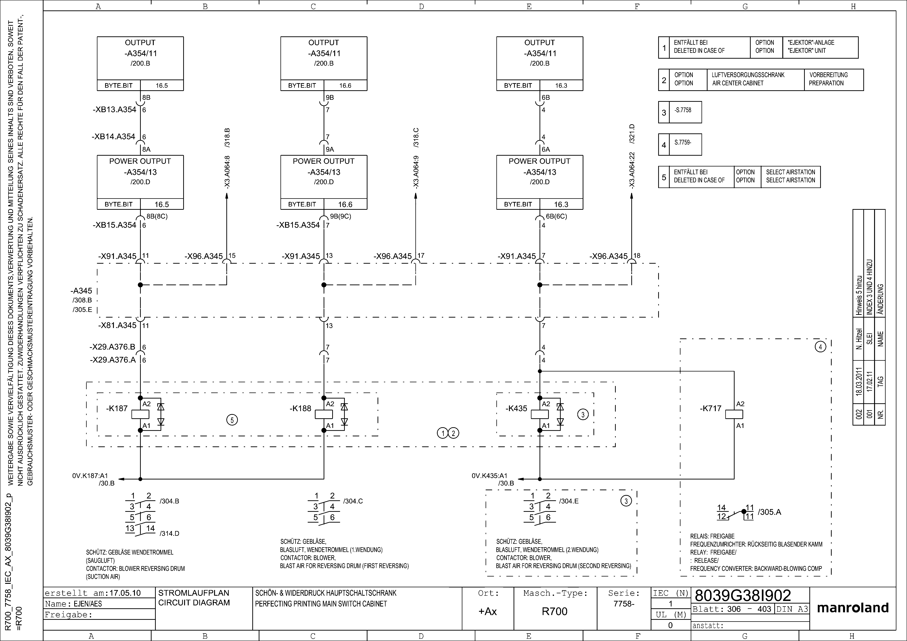

# +Ax — Sheet 306 of 403 — SCHÖN & WIDERDRUCK HAUPTSCHALTSCHRANK

**PERFECTING PRINTING MAIN SWITCH CABINET**

> Part of the manroland **R700** printing press IEC/UL circuit diagrams.
> Drawing class: **Stromlaufplan / Circuit diagram** (DIN A3).
> Document `+Ax` covers the **Central control console** machine section.

## At a glance

| Field | Value |
|---|---|
| Document | `+Ax`  (8039G38I902) |
| Sheet | **306** of 403 |
| Section (DE) | SCHÖN & WIDERDRUCK HAUPTSCHALTSCHRANK |
| Section (EN) | PERFECTING PRINTING MAIN SWITCH CABINET |
| Section type | CIRCUIT — Circuit diagram |
| Machine type | `R700` |
| Series | `7758` |
| Created | 17.05.10 |
| Replaces | — |
| Columns used | A, B, C, D, E, F, G, H |
| Path numbers | — |
| Labels on sheet | 189 |
| Cross-refs out | 17 |
| Cross-refs in | 42 |

**Previous:** [+Ax sheet 305](SHEET_0305.md) · **Next:** [+Ax sheet 307](SHEET_0307.md) · **Document TOC:** [_TOC.md](_TOC.md)  (+Ax) · **Master TOC:** [all sheets](../_MASTER_TOC.md)

## Sheet image (300 DPI, exact vector render)



_Rendered directly from the PDF vector layer at 300 DPI (1-bit), no OCR and no resampling. Use it to confirm anything ambiguous in the text below._

## Cross-references on this sheet

Each entry is a wire leaving this sheet. The printed token is `/sheet.column`; the link resolves to that sheet inside the same document.

| Ref | Target sheet | Col | Path | Destination on target | Target section | From col |
|---|---|---|---|---|---|---|
| `/200.B` | [+Ax sheet 200](SHEET_0200.md) | B | — | — | REFERENZMODUL | A |
| `/200.B` | [+Ax sheet 200](SHEET_0200.md) | B | — | — | REFERENZMODUL | C |
| `/200.B` | [+Ax sheet 200](SHEET_0200.md) | B | — | — | REFERENZMODUL | E |
| `/321.D` | [+Ax sheet 321](SHEET_0321.md) | D | — | X3.A064:22 | OPTION: "EJEKTOR" ANLAGE / SELECT AIRSTATION / | F |
| `/318.C` | [+Ax sheet 318](SHEET_0318.md) | C | — | X3.A064:9 | OPTION: "EJEKTOR" ANLAGE / SELECT AIRSTATION / | D |
| `/318.B` | [+Ax sheet 318](SHEET_0318.md) | B | — | X3.A064:8 | OPTION: "EJEKTOR" ANLAGE / SELECT AIRSTATION / | B |
| `/200.D` | [+Ax sheet 200](SHEET_0200.md) | D | — | — | REFERENZMODUL | A |
| `/200.D` | [+Ax sheet 200](SHEET_0200.md) | D | — | — | REFERENZMODUL | C |
| `/200.D` | [+Ax sheet 200](SHEET_0200.md) | D | — | — | REFERENZMODUL | E |
| `/308.B` | [+Ax sheet 308](SHEET_0308.md) | B | — | — | OPTION: KOMBIGERÄT | A |
| `/305.E` | [+Ax sheet 305](SHEET_0305.md) | E | — | — | SCHÖN & WIDERDRUCK HAUPTSCHALTSCHRANK | A |
| `/30.B` | [+Ax sheet 30](SHEET_0030.md) | B | — | 0V.K187:A1 | SPANNUNGSVERSORGUNG, SCHALTSCHRANKBELÜFTUNG | A |
| `/30.B` | [+Ax sheet 30](SHEET_0030.md) | B | — | 0V.K435:A1 | SPANNUNGSVERSORGUNG, SCHALTSCHRANKBELÜFTUNG | E |
| `/304.B` | [+Ax sheet 304](SHEET_0304.md) | B | — | — | SCHÖN & WIDERDRUCK HAUPTSCHALTSCHRANK | B |
| `/304.E` | [+Ax sheet 304](SHEET_0304.md) | E | — | — | SCHÖN & WIDERDRUCK HAUPTSCHALTSCHRANK | E |
| `/304.C` | [+Ax sheet 304](SHEET_0304.md) | C | — | — | SCHÖN & WIDERDRUCK HAUPTSCHALTSCHRANK | C |
| `/314.D` | [+Ax sheet 314](SHEET_0314.md) | D | — | — | OPTION: ZENTRALE LUFTVERSORGUNG | B |

### Incoming references (sheets that point here)

Every other sheet that sends a wire to this one. `Back-ref` is the token printed on *that* sheet; `Path` is its line number.

| From sheet | Cols | Back-ref | Path | Refs | What continues there |
|---|---|---|---|---|---|
| [+Ax#30](SHEET_0030.md) | B | `/30.B` | — | 2 | — |
| [+Ax#200](SHEET_0200.md) | B, D | `/200.B`, `/200.D` | — | 6 | — |
| [+Ax#250](SHEET_0250.md) | B | `/250.B` | — | 3 | — |
| [+Ax#251](SHEET_0251.md) | C | `/251.C` | — | 3 | — |
| [+Ax#253](SHEET_0253.md) | B | `/253.B` | — | 3 | — |
| [+Ax#273](SHEET_0273.md) | A, B | `/273.A`, `/273.B` | — | 6 | — |
| [+Ax#286](SHEET_0286.md) | E | `/286.E` | — | 3 | — |
| [+Ax#289](SHEET_0289.md) | E | `/289.E` | — | 3 | — |
| [+Ax#290](SHEET_0290.md) | B | `/290.B` | — | 3 | — |
| [+Ax#304](SHEET_0304.md) | B, C, D | `/304.B`, `/304.C`, `/304.D` | — | 3 | — |
| [+Ax#305](SHEET_0305.md) | A, E | `/305.A`, `/305.E` | — | 2 | — |
| [+Ax#308](SHEET_0308.md) | B | `/308.B` | — | 1 | — |
| [+Ax#314](SHEET_0314.md) | D | `/314.D` | — | 1 | — |
| [+Ax#318](SHEET_0318.md) | B, C | `/318.B`, `/318.C` | — | 2 | X3.A064:8; X3.A064:9 |
| [+Ax#321](SHEET_0321.md) | D | `/321.D` | — | 1 | X3.A064:22 |


## Devices on this sheet

| Tag | Class | Class meaning (IEC) | Col | Sub | Terminal | Sign |
|---|---|---|---|---|---|---|
| `A354/11` | A | Baugruppe / assembly, module, PC board | A | 11 | — | — |
| `A354/11` | A | Baugruppe / assembly, module, PC board | C | 11 | — | — |
| `A354/11` | A | Baugruppe / assembly, module, PC board | E | 11 | — | — |
| `A354/13` | A | Baugruppe / assembly, module, PC board | A | 13 | — | — |
| `A354/13` | A | Baugruppe / assembly, module, PC board | C | 13 | — | — |
| `A354/13` | A | Baugruppe / assembly, module, PC board | E | 13 | — | — |
| `A345` | A | Baugruppe / assembly, module, PC board | A | — | — | — |
| `A2` | A | Baugruppe / assembly, module, PC board | A | — | — | — |
| `A1` | A | Baugruppe / assembly, module, PC board | A | — | — | — |
| `K187` | K | Relais / relay, contactor | A | — | — | — |
| `A2` | A | Baugruppe / assembly, module, PC board | C | — | — | — |
| `A1` | A | Baugruppe / assembly, module, PC board | C | — | — | — |
| `K188` | K | Relais / relay, contactor | C | — | — | — |
| `A2` | A | Baugruppe / assembly, module, PC board | E | — | — | — |
| `A1` | A | Baugruppe / assembly, module, PC board | E | — | — | — |
| `K435` | K | Relais / relay, contactor | E | — | — | — |
| `A2` | A | Baugruppe / assembly, module, PC board | G | — | — | — |
| `A1` | A | Baugruppe / assembly, module, PC board | G | — | — | — |
| `K717` | K | Relais / relay, contactor | G | — | — | — |
| `XB13.A354` | — | cross-device reference | A | — | — | — |
| `16.5` | — | cross-device reference | B | — | — | — |
| `16.6` | — | cross-device reference | C | — | — | — |
| `16.3` | — | cross-device reference | E | — | — | — |
| `XB14.A354` | — | cross-device reference | A | — | — | — |
| `16.5` | — | cross-device reference | B | — | — | — |
| `XB15.A354` | — | cross-device reference | A | — | — | — |
| `16.6` | — | cross-device reference | C | — | — | — |
| `XB15.A354` | — | cross-device reference | C | — | — | — |
| `16.3` | — | cross-device reference | E | — | — | — |
| `X29.A376.A` | — | cross-device reference | A | — | — | — |
| `X29.A376.B` | — | cross-device reference | A | — | — | — |
| `X81.A345` | — | cross-device reference | A | — | — | — |
| `X91.A345` | — | cross-device reference | A | — | — | — |
| `X91.A345` | — | cross-device reference | C | — | — | — |
| `X91.A345` | — | cross-device reference | E | — | — | — |
| `X96.A345` | — | cross-device reference | B | — | — | — |
| `X96.A345` | — | cross-device reference | F | — | — | — |
| `X96.A345` | — | cross-device reference | D | — | — | — |
| `X3.A064:9` | — | cross-device reference | D | — | 9 | — |
| `X3.A064:22` | — | cross-device reference | F | — | 22 | — |
| `X3.A064:8` | — | cross-device reference | B | — | 8 | — |
| `NR.` | — | cross-device reference | H | — | — | — |
| `17.02.11` | — | cross-device reference | H | — | — | — |
| `18.03.2011` | — | cross-device reference | H | — | — | — |
| `S.7758` | — | cross-device reference | F | — | — | — |
| `S.7759` | — | cross-device reference | F | — | — | — |

## Potentials / nets

| Potential | Count | Columns | Attached devices | Terminals |
|---|---|---|---|---|
| `0V` | 2 | A, E | `K187`, `K435` | `A1` |


A potential such as `L24+/4` or `M24+` is a named supply/return rail; every place it appears on this sheet is electrically common.

## Wire-end annotations (grouped as printed)

A wire that continues elsewhere is annotated with a small cluster: the destination description, the path/line number `#NN`, and the `/sheet.column` cross reference. Each row below is one such cluster exactly as it is grouped on the drawing.

| Col | Y | Path | Cross-ref | Text on the wire |
|---|---|---|---|---|
| A | 51.6 | — | — | `OUTPUT` |
| C | 51.6 | — | — | `OUTPUT` |
| E | 51.6 | — | — | `OUTPUT` |
| G | 53.0 | — | — | `ENTFÄLLT BEI DELETED IN CASE OF` |
| G | 53.0 | — | — | `OPTION OPTION` |
| G | 53.1 | — | — | `1 "EJEKTOR" ANLAGE "EJEKTOR" UNIT` |
| A | 65.5 | — | — | `A354/11` |
| C | 65.5 | — | — | `A354/11` |
| E | 65.5 | — | — | `A354/11` |
| A | 79.3 | — | `/200.B` | — |
| C | 79.3 | — | `/200.B` | — |
| E | 79.3 | — | `/200.B` | — |
| F | 95.6 | — | — | `OPTION OPTION` |
| G | 95.6 | — | — | `LUFTVERSORGUNGSSCHRANK` |
| H | 95.6 | — | — | `PREPARATION VORBEREITUNG` |
| F | 100.9 | — | — | `2` |
| G | 106.2 | — | — | `AIR CENTER CABINET` |
| A | 108.9 | — | — | `BYTE.BIT 16.5` |
| C | 108.9 | — | — | `BYTE.BIT 16.6` |
| E | 108.9 | — | — | `BYTE.BIT 16.3` |
| A | 124.3 | — | — | `8B` |
| C | 124.3 | — | — | `9B` |
| E | 124.3 | — | — | `6B` |
| A | 139.2 | — | — | `XB13.A354 6` |
| D | 140.6 | — | — | `7 4` |
| F | 141.7 | — | — | `3 S.7758` |
| F | 162.7 | — | `/321.D` | `X3.A064:22` |
| D | 167.7 | — | `/318.C` | `X3.A064:9` |
| B | 167.9 | — | `/318.B` | `X3.A064:8` |
| A | 174.6 | — | — | `XB14.A354 6` |
| C | 176.1 | — | — | `7` |
| E | 176.1 | — | — | `4` |
| F | 184.2 | — | — | `4 S.7759` |
| A | 192.3 | — | — | `8A` |
| C | 192.3 | — | — | `9A` |
| E | 192.3 | — | — | `6A` |
| A | 207.5 | — | — | `POWER OUTPUT` |
| C | 207.5 | — | — | `POWER OUTPUT` |
| E | 207.5 | — | — | `POWER OUTPUT` |
| A | 221.4 | — | — | `A354/13` |
| C | 221.4 | — | — | `A354/13` |
| E | 221.4 | — | — | `A354/13` |
| G | 223.1 | — | — | `5 ENTFÄLLT BEI DELETED IN CASE OF OPTION OPTION SELECT AIRSTATION SELECT AIRSTATION` |
| A | 235.2 | — | `/200.D` | — |
| C | 235.2 | — | `/200.D` | — |
| E | 235.2 | — | `/200.D` | — |
| A | 264.2 | — | — | `BYTE.BIT 16.5` |
| C | 264.2 | — | — | `BYTE.BIT 16.6` |
| E | 264.2 | — | — | `BYTE.BIT 16.3` |
| B | 280.2 | — | — | `8B(8C)` |
| C | 280.2 | — | — | `9B(9C)` |
| E | 280.2 | — | — | `6B(6C)` |
| A | 290.9 | — | — | `XB15.A354 6` |
| D | 290.9 | — | — | `XB15.A354 7 4` |
| D | 332.0 | — | — | `X91.A345 11 X96.A345 15 X91.A345 13 X96.A345 17 X91.A345 7 X96.A345 18` |
| H | 340.4 | — | — | `001 17.02.11 SLEI INDEX 3 UND 4 HINZU` |
| H | 362.0 | — | — | `002 18.03.2011 Hinweis 5 hinzu N. Hitzel` |
| H | 372.9 | — | — | `NR. NAME TAG ÄNDERUNG` |
| A | 377.3 | — | — | `A345` |
| A | 390.4 | — | `/308.B`, `/305.E` | — |
| C | 422.7 | — | — | `X81.A345 11 13 7` |
| A | 451.0 | — | — | `X29.A376.B 6` |
| D | 452.4 | — | — | `7 4` |
| H | 452.7 | — | — | `4` |
| A | 468.0 | — | — | `X29.A376.A 6` |
| C | 469.5 | — | — | `7` |
| E | 469.5 | — | — | `4` |
| A | 526.8 | — | — | `A2` |
| C | 526.8 | — | — | `A2` |
| E | 526.8 | — | — | `A2` |
| G | 526.8 | — | — | `A2` |
| A | 531.8 | — | — | `K187` |
| C | 531.8 | — | — | `K188` |
| E | 531.8 | — | — | `K435` |
| G | 531.8 | — | — | `K717` |
| F | 541.7 | — | — | `3` |
| B | 548.8 | — | — | `5` |
| A | 555.1 | — | — | `A1` |
| C | 555.1 | — | — | `A1` |
| E | 555.1 | — | — | `A1` |
| G | 555.1 | — | — | `A1` |
| D | 565.6 | — | — | `1 2` |
| A | 621.0 | — | `/30.B` | `0V.K187:A1` |
| E | 621.0 | — | `/30.B` | `0V.K435:A1` |
| A | 646.6 | — | — | `13 3 5 1` |
| A | 646.6 | — | — | `14 2 4 6` |
| C | 646.6 | — | — | `3 5 1` |
| C | 646.6 | — | — | `2 4 6` |
| E | 646.6 | — | — | `3 5 1` |
| E | 646.6 | — | — | `2 4 6` |
| B | 654.4 | — | `/304.B` | — |
| C | 654.4 | — | `/304.C` | — |
| E | 654.4 | — | `/304.E` | — |
| F | 655.1 | — | — | `3` |
| G | 662.2 | — | — | `14 12 11 11 /305.A` |
| B | 696.9 | — | `/314.D` | — |
| G | 701.5 | — | — | `RELAIS: FREIGABE FREQUENZUMRICHTER: RÜCKSEITIG BLASENDER KAMM RELAY: FREIGABE/ : RELEASE/ FREQUENCY CONVERTER: BACKWARD BLOWING COMP` |
| C | 708.6 | — | — | `BLASLUFT, WENDETROMMEL (1.WENDUNG) SCHÜTZ: GEBLÄSE,` |
| E | 708.6 | — | — | `BLASLUFT, WENDETROMMEL (2.WENDUNG) SCHÜTZ: GEBLÄSE,` |
| A | 722.8 | — | — | `(SAUGLUFT) (SUCTION AIR) SCHÜTZ: GEBLÄSE WENDETROMMEL CONTACTOR: BLOWER REVERSING DRUM` |
| C | 729.8 | — | — | `BLAST AIR FOR REVERSING DRUM (FIRST REVERSING) CONTACTOR: BLOWER,` |
| E | 729.8 | — | — | `BLAST AIR FOR REVERSING DRUM (SECOND REVERSING) CONTACTOR: BLOWER,` |


## Reconstructed tables

This sheet carries tabular content (pin map / terminal assignment / index). The grid below was rebuilt from the drawing's own rule lines, so each row is exactly one physical row of the table.

### Table 1 — 7 data rows × 14 columns (at x=127.6, y=48.2)

| OUTPUT | A354/11 /200.B |  |  |  | OUTPUT | A354/11 /200.B |  |  |  | OUTPUT | A354/11 /200.B |  |  |
|---|---|---|---|---|---|---|---|---|---|---|---|---|---|
| `BYTE.BIT` |  | `16.5` |  |  | `BYTE.BIT` |  | `16.6` |  |  | `BYTE.BIT` |  | `16.3` |  |
| `XB13.A354 XB14.A354` | `8B 6 6 8A` |  |  | `/318.B` |  | `9B 7 7 9A` |  |  | `/318.C` |  | `6B 4 4 6A` |  |  |
| `POWER` | `OUTPUT A354/13 /200.D` |  |  | `X3.A064:8` | `POWER` | `OUTPUT A354/13 /200.D` |  |  | `X3.A064:9` | `POWER` | `OUTPUT A354/13 /200.D` |  |  |
| `BYTE.BIT` |  | `16.5` |  |  | `BYTE.BIT` |  | `16.6` |  |  | `BYTE.BIT` |  | `16.3` |  |
| `XB15.A354 X91.A345` | `8B(8C) 6 11` |  | `X96.A345` | `15` | `XB15.A354 X91.A345` | `9B(9C) 7 13` |  | `X96.A345` | `17` | `X91.A345` | `6B(6C) 4 7` |  | `X96.A345` |
| `X81.A345 X29.A376.B X29.A376.A` | `11 6 6` |  |  |  |  | `13 7 7` |  |  |  |  | `7 4 4` |  |  |
| `K187` | `A2 A1` |  |  | `5` | `K188` | `A2 A1` |  |  | `1 2 0V.K435:A1` | `K435` | `A2 A1` | `3` |  |


## Notes and free text on this sheet

| Text | Col | Y (pt) |
|---|---|---|
| `8B` | A | 124.29 |
| `OUTPUT` | A | 51.64 |
| `BYTE.BIT` | A | 108.91 |
| `9B` | C | 124.29 |
| `OUTPUT` | C | 51.64 |
| `BYTE.BIT` | C | 108.91 |
| `6B` | E | 124.29 |
| `OUTPUT` | E | 51.64 |
| `BYTE.BIT` | E | 108.91 |
| `8A` | A | 192.32 |
| `8B(8C)` | B | 280.24 |
| `POWER OUTPUT` | A | 207.49 |
| `9A` | C | 192.32 |
| `9B(9C)` | C | 280.24 |
| `POWER OUTPUT` | C | 207.49 |
| `6A` | E | 192.32 |
| `6B(6C)` | E | 280.24 |
| `POWER OUTPUT` | E | 207.49 |
| `SCHÜTZ: GEBLÄSE WENDETROMMEL` | A | 722.75 |
| `(SAUGLUFT)` | A | 733.39 |
| `CONTACTOR: BLOWER REVERSING DRUM` | A | 744.02 |
| `(SUCTION AIR)` | A | 754.65 |
| `SCHÜTZ: GEBLÄSE,` | C | 708.56 |
| `BLASLUFT, WENDETROMMEL (1.WENDUNG)` | C | 719.2 |
| `CONTACTOR: BLOWER,` | C | 729.83 |
| `BLAST AIR FOR REVERSING DRUM (FIRST REVERSING)` | C | 740.48 |
| `SCHÜTZ: GEBLÄSE,` | E | 708.56 |
| `BLASLUFT, WENDETROMMEL (2.WENDUNG)` | E | 719.2 |
| `CONTACTOR: BLOWER,` | E | 729.83 |
| `BLAST AIR FOR REVERSING DRUM (SECOND REVERSING)` | E | 740.48 |
| `RELAIS: FREIGABE` | G | 701.46 |
| `FREQUENZUMRICHTER: RÜCKSEITIG BLASENDER KAMM` | G | 712.14 |
| `RELAY: FREIGABE/` | G | 722.7 |
| `: RELEASE/` | G | 733.29 |
| `FREQUENCY CONVERTER: BACKWARD BLOWING COMP` | G | 744.02 |
| `11 /305.A` | G | 667.87 |
| `TAG` | H | 494.32 |
| `NAME` | H | 434.91 |
| `ÄNDERUNG` | H | 372.93 |
| `SLEI` | H | 437.25 |
| `INDEX 3 UND 4 HINZU` | H | 340.45 |
| `N. Hitzel` | H | 431.29 |
| `Hinweis 5 hinzu` | H | 361.99 |
| `ENTFÄLLT BEI` | F | 53.03 |
| `DELETED IN CASE OF` | G | 63.69 |
| `OPTION` | F | 95.56 |
| `LUFTVERSORGUNGSSCHRANK` | G | 95.6 |
| `AIR CENTER CABINET` | G | 106.22 |
| `VORBEREITUNG` | H | 95.59 |
| `PREPARATION` | H | 106.19 |
| `OPTION` | G | 53.04 |
| `"EJEKTOR" ANLAGE` | H | 53.06 |
| `"EJEKTOR" UNIT` | H | 63.69 |
| `SELECT AIRSTATION` | G | 223.13 |

## Complete label inventory (exact text from the drawing)

Every text object inside the drawing area of this sheet, in DIN reading order (column A→H, then top→bottom). This is the authoritative list: if a string is not here it is not printed on this sheet.

| Col | Y | X | Dir | Type | Text |
|---|---|---|---|---|---|
| A | 51.6 | 164.0 | → | text | `OUTPUT` |
| A | 65.5 | 163.6 | → | device tag | `A354/11` |
| A | 79.3 | 171.6 | → | cross-reference | `/200.B` |
| A | 108.9 | 137.5 | → | text | `BYTE.BIT` |
| A | 124.3 | 186.8 | → | text | `8B` |
| A | 139.2 | 121.9 | → | device ref | `XB13.A354` |
| A | 140.6 | 186.8 | → | number | `6` |
| A | 174.6 | 120.5 | → | device ref | `XB14.A354` |
| A | 176.1 | 186.8 | → | number | `6` |
| A | 192.3 | 186.8 | → | text | `8A` |
| A | 207.5 | 143.4 | → | text | `POWER OUTPUT` |
| A | 221.4 | 162.9 | → | device tag | `A354/13` |
| A | 235.2 | 171.5 | → | cross-reference | `/200.D` |
| A | 264.8 | 137.5 | → | text | `BYTE.BIT` |
| A | 290.9 | 121.9 | → | device ref | `XB15.A354` |
| A | 292.3 | 186.8 | → | number | `6` |
| A | 332.0 | 129.0 | → | device ref | `X91.A345` |
| A | 332.0 | 186.2 | → | number | `11` |
| A | 377.3 | 92.7 | → | device tag | `A345` |
| A | 390.4 | 95.2 | → | cross-reference | `/308.B` |
| A | 402.8 | 95.5 | → | cross-reference | `/305.E` |
| A | 422.7 | 129.0 | → | device ref | `X81.A345` |
| A | 424.1 | 186.2 | → | number | `11` |
| A | 451.0 | 117.6 | → | device ref | `X29.A376.B` |
| A | 452.5 | 186.8 | → | number | `6` |
| A | 468.0 | 118.2 | → | device ref | `X29.A376.A` |
| A | 469.5 | 186.8 | → | number | `6` |
| A | 526.8 | 187.1 | → | device tag | `A2` |
| A | 531.8 | 139.5 | → | device tag | `K187` |
| A | 555.2 | 187.1 | → | device tag | `A1` |
| A | 621.1 | 95.0 | → | potential | `0V.K187:A1` |
| A | 631.0 | 129.8 | → | cross-reference | `/30.B` |
| A | 646.6 | 171.8 | → | number | `1` |
| A | 646.6 | 192.5 | → | number | `2` |
| A | 660.7 | 170.4 | → | number | `3` |
| A | 660.7 | 192.5 | → | number | `4` |
| A | 674.9 | 170.4 | → | number | `5` |
| A | 674.9 | 192.5 | → | number | `6` |
| A | 689.1 | 164.4 | → | number | `13` |
| A | 689.1 | 191.6 | → | number | `14` |
| A | 722.8 | 113.1 | → | text | `SCHÜTZ: GEBLÄSE WENDETROMMEL` |
| A | 733.4 | 112.8 | → | text | `(SAUGLUFT)` |
| A | 744.0 | 113.1 | → | text | `CONTACTOR: BLOWER REVERSING DRUM` |
| A | 754.6 | 112.8 | → | text | `(SUCTION AIR)` |
| B | 108.9 | 204.4 | → | device ref | `16.5` |
| B | 168.0 | 294.4 | ↕ | cross-reference | `/318.B` |
| B | 204.4 | 294.4 | ↕ | device ref | `X3.A064:8` |
| B | 264.2 | 202.8 | → | device ref | `16.5` |
| B | 280.2 | 192.5 | → | text | `8B(8C)` |
| B | 332.0 | 242.4 | → | device ref | `X96.A345` |
| B | 332.0 | 299.6 | → | number | `15` |
| B | 548.8 | 302.7 | → | number | `5` |
| B | 654.4 | 209.8 | → | cross-reference | `/304.B` |
| B | 696.9 | 209.8 | → | cross-reference | `/314.D` |
| C | 51.6 | 404.9 | → | text | `OUTPUT` |
| C | 65.5 | 404.5 | → | device tag | `A354/11` |
| C | 79.3 | 412.6 | → | cross-reference | `/200.B` |
| C | 108.9 | 378.4 | → | text | `BYTE.BIT` |
| C | 108.9 | 445.3 | → | device ref | `16.6` |
| C | 124.3 | 427.7 | → | text | `9B` |
| C | 140.6 | 427.7 | → | number | `7` |
| C | 176.1 | 427.7 | → | number | `7` |
| C | 192.3 | 427.7 | → | text | `9A` |
| C | 207.5 | 384.4 | → | text | `POWER OUTPUT` |
| C | 221.4 | 403.8 | → | device tag | `A354/13` |
| C | 235.2 | 412.4 | → | cross-reference | `/200.D` |
| C | 264.2 | 443.8 | → | device ref | `16.6` |
| C | 264.8 | 378.4 | → | text | `BYTE.BIT` |
| C | 280.2 | 433.4 | → | text | `9B(9C)` |
| C | 290.9 | 362.8 | → | device ref | `XB15.A354` |
| C | 292.3 | 427.7 | → | number | `7` |
| C | 332.0 | 369.9 | → | device ref | `X91.A345` |
| C | 332.0 | 427.2 | → | number | `13` |
| C | 424.1 | 427.2 | → | number | `13` |
| C | 452.5 | 427.7 | → | number | `7` |
| C | 469.5 | 427.7 | → | number | `7` |
| C | 526.8 | 428.0 | → | device tag | `A2` |
| C | 531.8 | 380.4 | → | device tag | `K188` |
| C | 555.2 | 428.0 | → | device tag | `A1` |
| C | 646.6 | 412.7 | → | number | `1` |
| C | 646.6 | 433.4 | → | number | `2` |
| C | 654.4 | 450.7 | → | cross-reference | `/304.C` |
| C | 660.7 | 411.3 | → | number | `3` |
| C | 660.7 | 433.4 | → | number | `4` |
| C | 674.9 | 411.3 | → | number | `5` |
| C | 674.9 | 433.4 | → | number | `6` |
| C | 708.6 | 368.2 | → | text | `SCHÜTZ: GEBLÄSE,` |
| C | 719.2 | 367.7 | → | text | `BLASLUFT, WENDETROMMEL (1.WENDUNG)` |
| C | 729.8 | 368.2 | → | text | `CONTACTOR: BLOWER,` |
| C | 740.5 | 367.7 | → | text | `BLAST AIR FOR REVERSING DRUM (FIRST REVERSING)` |
| D | 167.7 | 542.4 | ↕ | cross-reference | `/318.C` |
| D | 204.4 | 542.4 | ↕ | device ref | `X3.A064:9` |
| D | 332.0 | 490.4 | → | device ref | `X96.A345` |
| D | 332.0 | 547.7 | → | number | `17` |
| D | 565.6 | 579.3 | → | number | `1` |
| D | 566.1 | 593.3 | → | number | `2` |
| E | 51.6 | 688.4 | → | text | `OUTPUT` |
| E | 65.5 | 688.0 | → | device tag | `A354/11` |
| E | 79.3 | 696.0 | → | cross-reference | `/200.B` |
| E | 108.9 | 661.9 | → | text | `BYTE.BIT` |
| E | 108.9 | 728.8 | → | device ref | `16.3` |
| E | 124.3 | 711.2 | → | text | `6B` |
| E | 140.6 | 711.2 | → | number | `4` |
| E | 176.1 | 711.2 | → | number | `4` |
| E | 192.3 | 711.2 | → | text | `6A` |
| E | 207.5 | 667.8 | → | text | `POWER OUTPUT` |
| E | 221.4 | 687.3 | → | device tag | `A354/13` |
| E | 235.2 | 695.9 | → | cross-reference | `/200.D` |
| E | 264.2 | 727.2 | → | device ref | `16.3` |
| E | 264.8 | 661.9 | → | text | `BYTE.BIT` |
| E | 280.2 | 716.9 | → | text | `6B(6C)` |
| E | 292.3 | 711.2 | → | number | `4` |
| E | 332.0 | 653.4 | → | device ref | `X91.A345` |
| E | 332.0 | 711.2 | → | number | `7` |
| E | 424.1 | 711.2 | → | number | `7` |
| E | 452.5 | 711.2 | → | number | `4` |
| E | 469.5 | 711.2 | → | number | `4` |
| E | 526.8 | 711.5 | → | device tag | `A2` |
| E | 531.8 | 663.9 | → | device tag | `K435` |
| E | 555.2 | 711.5 | → | device tag | `A1` |
| E | 621.1 | 619.4 | → | potential | `0V.K435:A1` |
| E | 631.0 | 654.2 | → | cross-reference | `/30.B` |
| E | 646.6 | 696.2 | → | number | `1` |
| E | 646.6 | 716.9 | → | number | `2` |
| E | 654.4 | 734.2 | → | cross-reference | `/304.E` |
| E | 660.7 | 694.8 | → | number | `3` |
| E | 660.7 | 716.9 | → | number | `4` |
| E | 674.9 | 694.8 | → | number | `5` |
| E | 674.9 | 716.9 | → | number | `6` |
| E | 708.6 | 651.7 | → | text | `SCHÜTZ: GEBLÄSE,` |
| E | 719.2 | 651.1 | → | text | `BLASLUFT, WENDETROMMEL (2.WENDUNG)` |
| E | 729.8 | 651.7 | → | text | `CONTACTOR: BLOWER,` |
| E | 740.5 | 651.1 | → | text | `BLAST AIR FOR REVERSING DRUM (SECOND REVERSING)` |
| F | 53.0 | 885.0 | → | text | `ENTFÄLLT BEI` |
| F | 58.4 | 869.1 | → | number | `1` |
| F | 95.6 | 885.5 | → | text | `OPTION` |
| F | 100.9 | 868.8 | → | number | `2` |
| F | 106.2 | 885.5 | → | text | `OPTION` |
| F | 141.7 | 885.5 | → | device ref | `S.7758` |
| F | 143.4 | 868.7 | → | number | `3` |
| F | 162.7 | 825.9 | ↕ | cross-reference | `/321.D` |
| F | 184.2 | 885.5 | → | device ref | `S.7759` |
| F | 185.9 | 868.8 | → | number | `4` |
| F | 199.6 | 825.9 | ↕ | device ref | `X3.A064:22` |
| F | 223.1 | 885.0 | → | text | `ENTFÄLLT BEI` |
| F | 228.5 | 868.7 | → | number | `5` |
| F | 332.0 | 773.9 | → | device ref | `X96.A345` |
| F | 332.0 | 831.1 | → | number | `18` |
| F | 541.7 | 763.4 | → | number | `3` |
| F | 655.1 | 820.1 | → | number | `3` |
| G | 53.0 | 991.8 | → | text | `OPTION` |
| G | 63.7 | 885.0 | → | text | `DELETED IN CASE OF` |
| G | 63.7 | 991.8 | → | text | `OPTION` |
| G | 95.6 | 934.6 | → | text | `LUFTVERSORGUNGSSCHRANK` |
| G | 106.2 | 935.4 | → | text | `AIR CENTER CABINET` |
| G | 223.1 | 966.3 | → | text | `OPTION` |
| G | 223.1 | 1006.0 | → | text | `SELECT AIRSTATION` |
| G | 233.8 | 885.0 | → | text | `DELETED IN CASE OF` |
| G | 233.8 | 966.3 | → | text | `OPTION` |
| G | 233.8 | 1006.0 | → | text | `SELECT AIRSTATION` |
| G | 526.8 | 966.6 | → | device tag | `A2` |
| G | 531.8 | 919.0 | → | device tag | `K717` |
| G | 555.2 | 966.6 | → | device tag | `A1` |
| G | 662.2 | 941.1 | → | number | `14` |
| G | 662.2 | 978.2 | → | number | `11` |
| G | 667.9 | 978.2 | → | text | `11 /305.A` |
| G | 673.5 | 941.1 | → | number | `12` |
| G | 701.5 | 906.2 | → | text | `RELAIS: FREIGABE` |
| G | 712.1 | 906.2 | → | text | `FREQUENZUMRICHTER: RÜCKSEITIG BLASENDER KAMM` |
| G | 722.7 | 906.2 | → | text | `RELAY: FREIGABE/` |
| G | 733.3 | 906.2 | → | text | `: RELEASE/` |
| G | 744.0 | 906.2 | → | text | `FREQUENCY CONVERTER: BACKWARD BLOWING COMP` |
| H | 53.1 | 1034.4 | → | text | `"EJEKTOR" ANLAGE` |
| H | 63.7 | 1034.4 | → | text | `"EJEKTOR" UNIT` |
| H | 95.6 | 1063.0 | → | text | `VORBEREITUNG` |
| H | 106.2 | 1062.1 | → | text | `PREPARATION` |
| H | 340.5 | 1138.5 | ↕ | text | `INDEX 3 UND 4 HINZU` |
| H | 362.0 | 1124.2 | ↕ | text | `Hinweis 5 hinzu` |
| H | 372.9 | 1152.7 | ↕ | text | `ÄNDERUNG` |
| H | 431.3 | 1124.2 | ↕ | text | `N. Hitzel` |
| H | 434.9 | 1152.6 | ↕ | text | `NAME` |
| H | 437.2 | 1138.5 | ↕ | text | `SLEI` |
| H | 452.7 | 1075.2 | → | number | `4` |
| H | 481.9 | 1124.0 | ↕ | device ref | `18.03.2011` |
| H | 487.3 | 1138.4 | ↕ | device ref | `17.02.11` |
| H | 494.3 | 1152.6 | ↕ | text | `TAG` |
| H | 537.3 | 1138.4 | ↕ | number | `001` |
| H | 537.7 | 1124.0 | ↕ | number | `002` |
| H | 537.8 | 1152.5 | ↕ | device ref | `NR.` |

## Reading-order text block

The same content as a plain block, grouped by DIN column — convenient to paste or to match against a visual description.

```text
=== Column A ===
  51.6  164.0  text         OUTPUT
  65.5  163.6  devtag       A354/11
  79.3  171.6  xref         /200.B
 108.9  137.5  text         BYTE.BIT
 124.3  186.8  text         8B
 139.2  121.9  devref       XB13.A354
 140.6  186.8  numeric      6
 174.6  120.5  devref       XB14.A354
 176.1  186.8  numeric      6
 192.3  186.8  text         8A
 207.5  143.4  text         POWER OUTPUT
 221.4  162.9  devtag       A354/13
 235.2  171.5  xref         /200.D
 264.8  137.5  text         BYTE.BIT
 290.9  121.9  devref       XB15.A354
 292.3  186.8  numeric      6
 332.0  129.0  devref       X91.A345
 332.0  186.2  numeric      11
 377.3   92.7  devtag       A345
 390.4   95.2  xref         /308.B
 402.8   95.5  xref         /305.E
 422.7  129.0  devref       X81.A345
 424.1  186.2  numeric      11
 451.0  117.6  devref       X29.A376.B
 452.5  186.8  numeric      6
 468.0  118.2  devref       X29.A376.A
 469.5  186.8  numeric      6
 526.8  187.1  devtag       A2
 531.8  139.5  devtag       K187
 555.2  187.1  devtag       A1
 621.1   95.0  net          0V.K187:A1
 631.0  129.8  xref         /30.B
 646.6  171.8  numeric      1
 646.6  192.5  numeric      2
 660.7  170.4  numeric      3
 660.7  192.5  numeric      4
 674.9  170.4  numeric      5
 674.9  192.5  numeric      6
 689.1  164.4  numeric      13
 689.1  191.6  numeric      14
 722.8  113.1  text         SCHÜTZ: GEBLÄSE WENDETROMMEL
 733.4  112.8  text         (SAUGLUFT)
 744.0  113.1  text         CONTACTOR: BLOWER REVERSING DRUM
 754.6  112.8  text         (SUCTION AIR)
=== Column B ===
 108.9  204.4  devref       16.5
 168.0  294.4  xref         /318.B
 204.4  294.4  devref       X3.A064:8
 264.2  202.8  devref       16.5
 280.2  192.5  text         8B(8C)
 332.0  242.4  devref       X96.A345
 332.0  299.6  numeric      15
 548.8  302.7  numeric      5
 654.4  209.8  xref         /304.B
 696.9  209.8  xref         /314.D
=== Column C ===
  51.6  404.9  text         OUTPUT
  65.5  404.5  devtag       A354/11
  79.3  412.6  xref         /200.B
 108.9  378.4  text         BYTE.BIT
 108.9  445.3  devref       16.6
 124.3  427.7  text         9B
 140.6  427.7  numeric      7
 176.1  427.7  numeric      7
 192.3  427.7  text         9A
 207.5  384.4  text         POWER OUTPUT
 221.4  403.8  devtag       A354/13
 235.2  412.4  xref         /200.D
 264.2  443.8  devref       16.6
 264.8  378.4  text         BYTE.BIT
 280.2  433.4  text         9B(9C)
 290.9  362.8  devref       XB15.A354
 292.3  427.7  numeric      7
 332.0  369.9  devref       X91.A345
 332.0  427.2  numeric      13
 424.1  427.2  numeric      13
 452.5  427.7  numeric      7
 469.5  427.7  numeric      7
 526.8  428.0  devtag       A2
 531.8  380.4  devtag       K188
 555.2  428.0  devtag       A1
 646.6  412.7  numeric      1
 646.6  433.4  numeric      2
 654.4  450.7  xref         /304.C
 660.7  411.3  numeric      3
 660.7  433.4  numeric      4
 674.9  411.3  numeric      5
 674.9  433.4  numeric      6
 708.6  368.2  text         SCHÜTZ: GEBLÄSE,
 719.2  367.7  text         BLASLUFT, WENDETROMMEL (1.WENDUNG)
 729.8  368.2  text         CONTACTOR: BLOWER,
 740.5  367.7  text         BLAST AIR FOR REVERSING DRUM (FIRST REVERSING)
=== Column D ===
 167.7  542.4  xref         /318.C
 204.4  542.4  devref       X3.A064:9
 332.0  490.4  devref       X96.A345
 332.0  547.7  numeric      17
 565.6  579.3  numeric      1
 566.1  593.3  numeric      2
=== Column E ===
  51.6  688.4  text         OUTPUT
  65.5  688.0  devtag       A354/11
  79.3  696.0  xref         /200.B
 108.9  661.9  text         BYTE.BIT
 108.9  728.8  devref       16.3
 124.3  711.2  text         6B
 140.6  711.2  numeric      4
 176.1  711.2  numeric      4
 192.3  711.2  text         6A
 207.5  667.8  text         POWER OUTPUT
 221.4  687.3  devtag       A354/13
 235.2  695.9  xref         /200.D
 264.2  727.2  devref       16.3
 264.8  661.9  text         BYTE.BIT
 280.2  716.9  text         6B(6C)
 292.3  711.2  numeric      4
 332.0  653.4  devref       X91.A345
 332.0  711.2  numeric      7
 424.1  711.2  numeric      7
 452.5  711.2  numeric      4
 469.5  711.2  numeric      4
 526.8  711.5  devtag       A2
 531.8  663.9  devtag       K435
 555.2  711.5  devtag       A1
 621.1  619.4  net          0V.K435:A1
 631.0  654.2  xref         /30.B
 646.6  696.2  numeric      1
 646.6  716.9  numeric      2
 654.4  734.2  xref         /304.E
 660.7  694.8  numeric      3
 660.7  716.9  numeric      4
 674.9  694.8  numeric      5
 674.9  716.9  numeric      6
 708.6  651.7  text         SCHÜTZ: GEBLÄSE,
 719.2  651.1  text         BLASLUFT, WENDETROMMEL (2.WENDUNG)
 729.8  651.7  text         CONTACTOR: BLOWER,
 740.5  651.1  text         BLAST AIR FOR REVERSING DRUM (SECOND REVERSING)
=== Column F ===
  53.0  885.0  text         ENTFÄLLT BEI
  58.4  869.1  numeric      1
  95.6  885.5  text         OPTION
 100.9  868.8  numeric      2
 106.2  885.5  text         OPTION
 141.7  885.5  devref       S.7758
 143.4  868.7  numeric      3
 162.7  825.9  xref         /321.D
 184.2  885.5  devref       S.7759
 185.9  868.8  numeric      4
 199.6  825.9  devref       X3.A064:22
 223.1  885.0  text         ENTFÄLLT BEI
 228.5  868.7  numeric      5
 332.0  773.9  devref       X96.A345
 332.0  831.1  numeric      18
 541.7  763.4  numeric      3
 655.1  820.1  numeric      3
=== Column G ===
  53.0  991.8  text         OPTION
  63.7  885.0  text         DELETED IN CASE OF
  63.7  991.8  text         OPTION
  95.6  934.6  text         LUFTVERSORGUNGSSCHRANK
 106.2  935.4  text         AIR CENTER CABINET
 223.1  966.3  text         OPTION
 223.1 1006.0  text         SELECT AIRSTATION
 233.8  885.0  text         DELETED IN CASE OF
 233.8  966.3  text         OPTION
 233.8 1006.0  text         SELECT AIRSTATION
 526.8  966.6  devtag       A2
 531.8  919.0  devtag       K717
 555.2  966.6  devtag       A1
 662.2  941.1  numeric      14
 662.2  978.2  numeric      11
 667.9  978.2  text         11 /305.A
 673.5  941.1  numeric      12
 701.5  906.2  text         RELAIS: FREIGABE
 712.1  906.2  text         FREQUENZUMRICHTER: RÜCKSEITIG BLASENDER KAMM
 722.7  906.2  text         RELAY: FREIGABE/
 733.3  906.2  text         : RELEASE/
 744.0  906.2  text         FREQUENCY CONVERTER: BACKWARD BLOWING COMP
=== Column H ===
  53.1 1034.4  text         "EJEKTOR" ANLAGE
  63.7 1034.4  text         "EJEKTOR" UNIT
  95.6 1063.0  text         VORBEREITUNG
 106.2 1062.1  text         PREPARATION
 340.5 1138.5  text         INDEX 3 UND 4 HINZU
 362.0 1124.2  text         Hinweis 5 hinzu
 372.9 1152.7  text         ÄNDERUNG
 431.3 1124.2  text         N. Hitzel
 434.9 1152.6  text         NAME
 437.2 1138.5  text         SLEI
 452.7 1075.2  numeric      4
 481.9 1124.0  devref       18.03.2011
 487.3 1138.4  devref       17.02.11
 494.3 1152.6  text         TAG
 537.3 1138.4  numeric      001
 537.7 1124.0  numeric      002
 537.8 1152.5  devref       NR.
```

---
_Generated from the PDF vector text layer; no OCR. Source: `R700_7758_IEC_AX_8039G38I902_p`, sheet 306._
