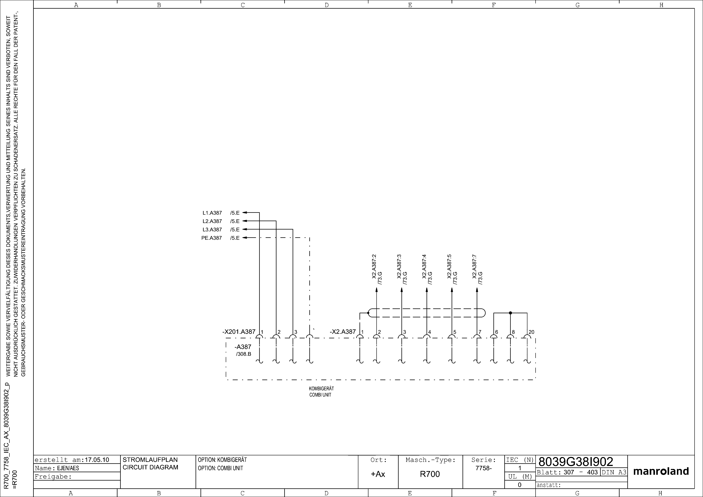

# +Ax — Sheet 307 of 403 — OPTION: KOMBIGERÄT

**OPTION: COMBI UNIT**

> Part of the manroland **R700** printing press IEC/UL circuit diagrams.
> Drawing class: **Stromlaufplan / Circuit diagram** (DIN A3).
> Document `+Ax` covers the **Central control console** machine section.

## At a glance

| Field | Value |
|---|---|
| Document | `+Ax`  (8039G38I902) |
| Sheet | **307** of 403 |
| Section (DE) | OPTION: KOMBIGERÄT |
| Section (EN) | OPTION: COMBI UNIT |
| Section type | CIRCUIT — Circuit diagram |
| Machine type | `R700` |
| Series | `7758` |
| Created | 17.05.10 |
| Replaces | — |
| Columns used | C, D, E, F |
| Path numbers | — |
| Labels on sheet | 37 |
| Cross-refs out | 10 |
| Cross-refs in | 23 |

**Previous:** [+Ax sheet 306](SHEET_0306.md) · **Next:** [+Ax sheet 308](SHEET_0308.md) · **Document TOC:** [_TOC.md](_TOC.md)  (+Ax) · **Master TOC:** [all sheets](../_MASTER_TOC.md)

## Sheet image (300 DPI, exact vector render)



_Rendered directly from the PDF vector layer at 300 DPI (1-bit), no OCR and no resampling. Use it to confirm anything ambiguous in the text below._

## Cross-references on this sheet

Each entry is a wire leaving this sheet. The printed token is `/sheet.column`; the link resolves to that sheet inside the same document.

| Ref | Target sheet | Col | Path | Destination on target | Target section | From col |
|---|---|---|---|---|---|---|
| `/5.E` | [+Ax sheet 5](SHEET_0005.md) | E | — | L1.A387 | SPANNUNGSVERSORGUNG / KUNDENZULEITUNG | C |
| `/5.E` | [+Ax sheet 5](SHEET_0005.md) | E | — | L2.A387 | SPANNUNGSVERSORGUNG / KUNDENZULEITUNG | C |
| `/5.E` | [+Ax sheet 5](SHEET_0005.md) | E | — | L3.A387 | SPANNUNGSVERSORGUNG / KUNDENZULEITUNG | C |
| `/5.E` | [+Ax sheet 5](SHEET_0005.md) | E | — | PE.A387 | SPANNUNGSVERSORGUNG / KUNDENZULEITUNG | C |
| `/73.G` | [+Ax sheet 73](SHEET_0073.md) | G | — | X2.A387:2 | FEUCHTMITTELKÜHLGERÄT | E |
| `/73.G` | [+Ax sheet 73](SHEET_0073.md) | G | — | X2.A387:3 | FEUCHTMITTELKÜHLGERÄT | E |
| `/73.G` | [+Ax sheet 73](SHEET_0073.md) | G | — | X2.A387:4 | FEUCHTMITTELKÜHLGERÄT | E |
| `/73.G` | [+Ax sheet 73](SHEET_0073.md) | G | — | X2.A387:5 | FEUCHTMITTELKÜHLGERÄT | F |
| `/73.G` | [+Ax sheet 73](SHEET_0073.md) | G | — | X2.A387:7 | FEUCHTMITTELKÜHLGERÄT | F |
| `/308.B` | [+Ax sheet 308](SHEET_0308.md) | B | — | — | OPTION: KOMBIGERÄT | C |

### Incoming references (sheets that point here)

Every other sheet that sends a wire to this one. `Back-ref` is the token printed on *that* sheet; `Path` is its line number.

| From sheet | Cols | Back-ref | Path | Refs | What continues there |
|---|---|---|---|---|---|
| [+Ax#5](SHEET_0005.md) | F | `/5.F` | — | 4 | L1.A387; L2.A387; L3.A387; PE.A387 |
| [+Ax#73](SHEET_0073.md) | G | `/73.G` | — | 5 | — |
| [+Ax#220](SHEET_0220.md) | E | `/220.E` | — | 9 | — |
| [+Ax#290](SHEET_0290.md) | H | `/290.H` | — | 4 | — |
| [+Ax#308](SHEET_0308.md) | B | `/308.B` | — | 1 | — |


## Devices on this sheet

| Tag | Class | Class meaning (IEC) | Col | Sub | Terminal | Sign |
|---|---|---|---|---|---|---|
| `A387` | A | Baugruppe / assembly, module, PC board | C | — | — | — |
| `X2.A387` | — | cross-device reference | D | — | — | — |
| `X201.A387` | — | cross-device reference | C | — | — | — |
| `X2.A387:7` | — | cross-device reference | F | — | 7 | — |
| `X2.A387:5` | — | cross-device reference | E | — | 5 | — |
| `X2.A387:4` | — | cross-device reference | E | — | 4 | — |
| `X2.A387:2` | — | cross-device reference | E | — | 2 | — |
| `X2.A387:3` | — | cross-device reference | E | — | 3 | — |

## Potentials / nets

| Potential | Count | Columns | Attached devices | Terminals |
|---|---|---|---|---|
| `L1` | 1 | C | `A387` | — |
| `L2` | 1 | C | `A387` | — |
| `L3` | 1 | C | `A387` | — |
| `PE` | 1 | C | `A387` | — |


A potential such as `L24+/4` or `M24+` is a named supply/return rail; every place it appears on this sheet is electrically common.

## Wire-end annotations (grouped as printed)

A wire that continues elsewhere is annotated with a small cluster: the destination description, the path/line number `#NN`, and the `/sheet.column` cross reference. Each row below is one such cluster exactly as it is grouped on the drawing.

| Col | Y | Path | Cross-ref | Text on the wire |
|---|---|---|---|---|
| C | 356.7 | — | `/5.E` | `L1.A387` |
| C | 370.9 | — | `/5.E` | `L2.A387` |
| C | 385.0 | — | `/5.E` | `L3.A387` |
| C | 399.2 | — | `/5.E` | `PE.A387` |
| E | 430.9 | — | `/73.G` | `X2.A387:2` |
| E | 430.9 | — | `/73.G` | `X2.A387:3` |
| E | 430.9 | — | `/73.G` | `X2.A387:4` |
| F | 430.9 | — | `/73.G` | `X2.A387:5` |
| F | 430.9 | — | `/73.G` | `X2.A387:7` |
| D | 556.1 | — | — | `'` |
| E | 557.3 | — | — | `X201.A387 1 2 3 X2.A387 1 2 3 4 5 7 6 8 20` |
| C | 582.8 | — | — | `A387` |
| C | 595.9 | — | `/308.B` | — |
| D | 655.4 | — | — | `KOMBIGERÄT` |
| D | 666.1 | — | — | `COMBI UNIT` |


## Notes and free text on this sheet

| Text | Col | Y (pt) |
|---|---|---|
| `KOMBIGERÄT` | D | 655.42 |
| `COMBI UNIT` | D | 666.07 |

## Complete label inventory (exact text from the drawing)

Every text object inside the drawing area of this sheet, in DIN reading order (column A→H, then top→bottom). This is the authoritative list: if a string is not here it is not printed on this sheet.

| Col | Y | X | Dir | Type | Text |
|---|---|---|---|---|---|
| C | 356.7 | 343.3 | → | potential | `L1.A387` |
| C | 356.7 | 390.0 | → | cross-reference | `/5.E` |
| C | 370.9 | 343.3 | → | potential | `L2.A387` |
| C | 370.9 | 390.0 | → | cross-reference | `/5.E` |
| C | 385.0 | 390.0 | → | cross-reference | `/5.E` |
| C | 385.1 | 343.3 | → | potential | `L3.A387` |
| C | 399.2 | 341.0 | → | potential | `PE.A387` |
| C | 399.2 | 390.0 | → | cross-reference | `/5.E` |
| C | 557.3 | 376.7 | → | device ref | `X201.A387` |
| C | 558.7 | 441.4 | → | number | `1` |
| C | 558.7 | 470.3 | → | number | `2` |
| C | 582.8 | 397.4 | → | device tag | `A387` |
| C | 595.9 | 400.0 | → | cross-reference | `/308.B` |
| D | 556.1 | 529.8 | → | other | `'` |
| D | 557.3 | 558.7 | → | device ref | `X2.A387` |
| D | 558.7 | 498.6 | → | number | `3` |
| D | 558.7 | 611.4 | → | number | `1` |
| D | 655.4 | 523.6 | → | text | `KOMBIGERÄT` |
| D | 666.1 | 524.1 | → | text | `COMBI UNIT` |
| E | 430.9 | 629.6 | ↕ | device ref | `X2.A387:2` |
| E | 430.9 | 672.1 | ↕ | device ref | `X2.A387:3` |
| E | 430.9 | 714.6 | ↕ | device ref | `X2.A387:4` |
| E | 430.9 | 757.1 | ↕ | device ref | `X2.A387:5` |
| E | 460.3 | 639.5 | ↕ | cross-reference | `/73.G` |
| E | 460.3 | 682.0 | ↕ | cross-reference | `/73.G` |
| E | 460.3 | 724.5 | ↕ | cross-reference | `/73.G` |
| E | 558.7 | 640.3 | → | number | `2` |
| E | 558.7 | 682.9 | → | number | `3` |
| E | 558.7 | 725.4 | → | number | `4` |
| F | 430.9 | 799.6 | ↕ | device ref | `X2.A387:7` |
| F | 460.3 | 767.0 | ↕ | cross-reference | `/73.G` |
| F | 460.3 | 809.6 | ↕ | cross-reference | `/73.G` |
| F | 558.7 | 767.9 | → | number | `5` |
| F | 558.7 | 810.4 | → | number | `7` |
| F | 558.7 | 838.8 | → | number | `6` |
| F | 558.7 | 867.1 | → | number | `8` |
| F | 558.7 | 895.5 | → | number | `20` |

## Reading-order text block

The same content as a plain block, grouped by DIN column — convenient to paste or to match against a visual description.

```text
=== Column C ===
 356.7  343.3  net          L1.A387
 356.7  390.0  xref         /5.E
 370.9  343.3  net          L2.A387
 370.9  390.0  xref         /5.E
 385.0  390.0  xref         /5.E
 385.1  343.3  net          L3.A387
 399.2  341.0  net          PE.A387
 399.2  390.0  xref         /5.E
 557.3  376.7  devref       X201.A387
 558.7  441.4  numeric      1
 558.7  470.3  numeric      2
 582.8  397.4  devtag       A387
 595.9  400.0  xref         /308.B
=== Column D ===
 556.1  529.8  other        `
 557.3  558.7  devref       X2.A387
 558.7  498.6  numeric      3
 558.7  611.4  numeric      1
 655.4  523.6  text         KOMBIGERÄT
 666.1  524.1  text         COMBI UNIT
=== Column E ===
 430.9  629.6  devref       X2.A387:2
 430.9  672.1  devref       X2.A387:3
 430.9  714.6  devref       X2.A387:4
 430.9  757.1  devref       X2.A387:5
 460.3  639.5  xref         /73.G
 460.3  682.0  xref         /73.G
 460.3  724.5  xref         /73.G
 558.7  640.3  numeric      2
 558.7  682.9  numeric      3
 558.7  725.4  numeric      4
=== Column F ===
 430.9  799.6  devref       X2.A387:7
 460.3  767.0  xref         /73.G
 460.3  809.6  xref         /73.G
 558.7  767.9  numeric      5
 558.7  810.4  numeric      7
 558.7  838.8  numeric      6
 558.7  867.1  numeric      8
 558.7  895.5  numeric      20
```

---
_Generated from the PDF vector text layer; no OCR. Source: `R700_7758_IEC_AX_8039G38I902_p`, sheet 307._
