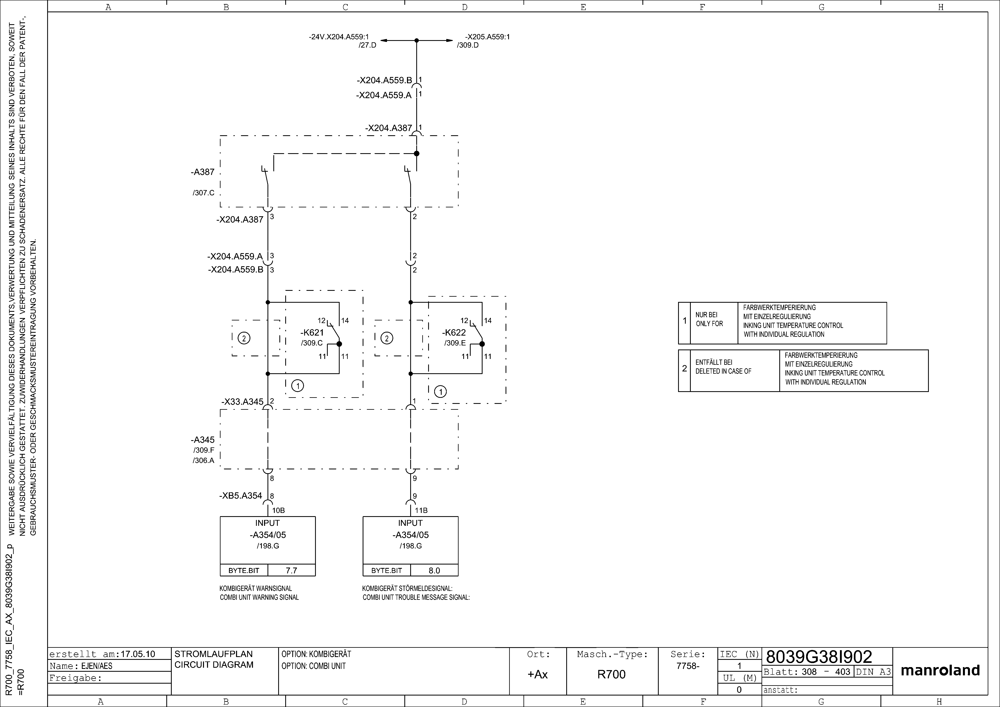

# +Ax — Sheet 308 of 403 — OPTION: KOMBIGERÄT

**OPTION: COMBI UNIT**

> Part of the manroland **R700** printing press IEC/UL circuit diagrams.
> Drawing class: **Stromlaufplan / Circuit diagram** (DIN A3).
> Document `+Ax` covers the **Central control console** machine section.

## At a glance

| Field | Value |
|---|---|
| Document | `+Ax`  (8039G38I902) |
| Sheet | **308** of 403 |
| Section (DE) | OPTION: KOMBIGERÄT |
| Section (EN) | OPTION: COMBI UNIT |
| Section type | CIRCUIT — Circuit diagram |
| Machine type | `R700` |
| Series | `7758` |
| Created | 17.05.10 |
| Replaces | — |
| Columns used | B, C, D, F, G |
| Path numbers | — |
| Labels on sheet | 78 |
| Cross-refs out | 9 |
| Cross-refs in | 22 |

**Previous:** [+Ax sheet 307](SHEET_0307.md) · **Next:** [+Ax sheet 309](SHEET_0309.md) · **Document TOC:** [_TOC.md](_TOC.md)  (+Ax) · **Master TOC:** [all sheets](../_MASTER_TOC.md)

## Sheet image (300 DPI, exact vector render)



_Rendered directly from the PDF vector layer at 300 DPI (1-bit), no OCR and no resampling. Use it to confirm anything ambiguous in the text below._

## Cross-references on this sheet

Each entry is a wire leaving this sheet. The printed token is `/sheet.column`; the link resolves to that sheet inside the same document.

| Ref | Target sheet | Col | Path | Destination on target | Target section | From col |
|---|---|---|---|---|---|---|
| `/27.D` | [+Ax sheet 27](SHEET_0027.md) | D | — | 24V.X204.A559:1 X205.A559:1 | SPANNUNGSVERSORGUNG, SCHALTSCHRANKBELÜFTUNG | D |
| `/309.D` | [+Ax sheet 309](SHEET_0309.md) | D | — | — | OPTION: FARBWERKTEMPERIERUNG | D |
| `/307.C` | [+Ax sheet 307](SHEET_0307.md) | C | — | — | OPTION: KOMBIGERÄT | B |
| `/309.E` | [+Ax sheet 309](SHEET_0309.md) | E | — | — | OPTION: FARBWERKTEMPERIERUNG | D |
| `/309.C` | [+Ax sheet 309](SHEET_0309.md) | C | — | — | OPTION: FARBWERKTEMPERIERUNG | C |
| `/309.F` | [+Ax sheet 309](SHEET_0309.md) | F | — | — | OPTION: FARBWERKTEMPERIERUNG | B |
| `/306.A` | [+Ax sheet 306](SHEET_0306.md) | A | — | — | SCHÖN & WIDERDRUCK HAUPTSCHALTSCHRANK | B |
| `/198.G` | [+Ax sheet 198](SHEET_0198.md) | G | — | — | REFERENZMODUL | B |
| `/198.G` | [+Ax sheet 198](SHEET_0198.md) | G | — | — | REFERENZMODUL | D |

### Incoming references (sheets that point here)

Every other sheet that sends a wire to this one. `Back-ref` is the token printed on *that* sheet; `Path` is its line number.

| From sheet | Cols | Back-ref | Path | Refs | What continues there |
|---|---|---|---|---|---|
| [+Ax#27](SHEET_0027.md) | D | `/27.D` | — | 1 | 24V.X204.A559:1 |
| [+Ax#198](SHEET_0198.md) | G | `/198.G` | — | 2 | — |
| [+Ax#231](SHEET_0231.md) | E | `/231.E` | — | 2 | — |
| [+Ax#233](SHEET_0233.md) | G | `/233.G` | — | 2 | — |
| [+Ax#276](SHEET_0276.md) | F | `/276.F` | — | 2 | — |
| [+Ax#291](SHEET_0291.md) | C, E | `/291.C`, `/291.E` | — | 9 | — |
| [+Ax#306](SHEET_0306.md) | A | `/306.A` | — | 1 | — |
| [+Ax#307](SHEET_0307.md) | C | `/307.C` | — | 1 | — |
| [+Ax#309](SHEET_0309.md) | D, F | `/309.D`, `/309.F` | — | 2 | X205.A559:1 |


## Devices on this sheet

| Tag | Class | Class meaning (IEC) | Col | Sub | Terminal | Sign |
|---|---|---|---|---|---|---|
| `A387` | A | Baugruppe / assembly, module, PC board | B | — | — | — |
| `K621` | K | Relais / relay, contactor | C | — | — | — |
| `K622` | K | Relais / relay, contactor | D | — | — | — |
| `A354/05` | A | Baugruppe / assembly, module, PC board | B | 05 | — | — |
| `A354/05` | A | Baugruppe / assembly, module, PC board | D | 05 | — | — |
| `A345` | A | Baugruppe / assembly, module, PC board | B | — | — | — |
| `X204.A387` | — | cross-device reference | B | — | — | — |
| `X204.A559.B` | — | cross-device reference | C | — | — | — |
| `X204.A559.A` | — | cross-device reference | C | — | — | — |
| `X204.A387` | — | cross-device reference | C | — | — | — |
| `X33.A345` | — | cross-device reference | B | — | — | — |
| `X204.A559.B` | — | cross-device reference | B | — | — | — |
| `X204.A559.A` | — | cross-device reference | B | — | — | — |
| `7.7` | — | cross-device reference | C | — | — | — |
| `XB5.A354` | — | cross-device reference | B | — | — | — |
| `8.0` | — | cross-device reference | D | — | — | — |
| `X205.A559:1` | — | cross-device reference | D | — | 1 | — |

## Potentials / nets

| Potential | Count | Columns | Attached devices | Terminals |
|---|---|---|---|---|
| `24V` | 1 | C | `A559`, `X204` | `1` |


A potential such as `L24+/4` or `M24+` is a named supply/return rail; every place it appears on this sheet is electrically common.

## Wire-end annotations (grouped as printed)

A wire that continues elsewhere is annotated with a small cluster: the destination description, the path/line number `#NN`, and the `/sheet.column` cross reference. Each row below is one such cluster exactly as it is grouped on the drawing.

| Col | Y | Path | Cross-ref | Text on the wire |
|---|---|---|---|---|
| D | 40.0 | — | `/27.D` | `24V.X204.A559:1 X205.A559:1` |
| D | 49.9 | — | `/309.D` | — |
| C | 91.0 | — | — | `X204.A559.B 1` |
| C | 108.0 | — | — | `X204.A559.A 1` |
| C | 147.7 | — | — | `X204.A387 1` |
| B | 200.1 | — | — | `A387` |
| B | 225.6 | — | `/307.C` | — |
| B | 254.0 | — | — | `X204.A387 3` |
| D | 254.0 | — | — | `2` |
| B | 300.8 | — | — | `X204.A559.A 3` |
| D | 300.8 | — | — | `2` |
| B | 316.4 | — | — | `X204.A559.B 3` |
| D | 317.8 | — | — | `2` |
| G | 363.4 | — | — | `FARBWERKTEMPERIERUNG INKING UNIT TEMPERATURE CONTROL MIT EINZELREGULIERUNG` |
| F | 371.9 | — | — | `NUR BEI` |
| F | 377.3 | — | — | `1 WITH INDIVIDUAL REGULATION` |
| C | 378.0 | — | — | `K621 14` |
| C | 378.0 | — | — | `12` |
| D | 378.0 | — | — | `K622 14` |
| D | 378.0 | — | — | `12` |
| F | 382.6 | — | — | `ONLY FOR` |
| C | 400.0 | — | — | `2 2` |
| C | 404.6 | — | `/309.C` | — |
| D | 404.6 | — | `/309.E` | — |
| G | 420.1 | — | — | `FARBWERKTEMPERIERUNG INKING UNIT TEMPERATURE CONTROL MIT EINZELREGULIERUNG` |
| C | 420.6 | — | — | `11 11` |
| D | 420.6 | — | — | `11 11` |
| F | 428.6 | — | — | `ENTFÄLLT BEI DELETED IN CASE OF` |
| G | 434.0 | — | — | `2 WITH INDIVIDUAL REGULATION` |
| C | 456.1 | — | — | `1 1` |
| B | 473.7 | — | — | `X33.A345 2` |
| D | 473.7 | — | — | `1` |
| B | 519.0 | — | — | `A345` |
| B | 532.1 | — | `/309.F`, `/306.A` | — |
| B | 565.8 | — | — | `8` |
| D | 565.8 | — | — | `9` |
| B | 585.7 | — | — | `XB5.A354 8` |
| D | 587.1 | — | — | `9` |
| B | 604.1 | — | — | `10B` |
| D | 604.1 | — | — | `11B` |
| B | 618.6 | — | — | `INPUT` |
| D | 618.6 | — | — | `INPUT` |
| B | 632.4 | — | — | `A354/05` |
| D | 632.4 | — | — | `A354/05` |
| B | 646.2 | — | `/198.G` | — |
| D | 646.2 | — | `/198.G` | — |
| B | 675.3 | — | — | `BYTE.BIT 7.7` |
| D | 675.3 | — | — | `BYTE.BIT 8.0` |
| B | 697.9 | — | — | `KOMBIGERÄT WARNSIGNAL` |
| D | 698.0 | — | — | `KOMBIGERÄT STÖRMELDESIGNAL:` |
| B | 708.6 | — | — | `COMBI UNIT WARNING SIGNAL` |
| D | 708.6 | — | — | `COMBI UNIT TROUBLE MESSAGE SIGNAL:` |


## Reconstructed tables

This sheet carries tabular content (pin map / terminal assignment / index). The grid below was rebuilt from the drawing's own rule lines, so each row is exactly one physical row of the table.

### Table 1 — 4 data rows × 8 columns (at x=262.2, y=182.8)

| X204.A387 X204.A559.A X204.A559.B | 3 3 3 |  |  |  | 2 2 2 |  |  |
|---|---|---|---|---|---|---|---|
| `2` | `K621 /309.C` | `12 11` | `14 11` | `2` |  | `K622 /309.E` | `12 11` |
| `X33.A345 XB5.A354` | `1 2 8 8 10B` |  |  |  | `1 9 9` | `1 11B` |  |
| `INPUT` | `A354/05 /198.G` |  |  | `INPUT` | `A354/05 /198.G` |  |  |
| `BYTE.BIT` | `7.7` |  |  | `BYTE.BIT` |  | `8.0` |  |


## Notes and free text on this sheet

| Text | Col | Y (pt) |
|---|---|---|
| `10B` | B | 604.07 |
| `INPUT` | B | 618.59 |
| `BYTE.BIT` | B | 675.84 |
| `KOMBIGERÄT WARNSIGNAL` | B | 697.93 |
| `COMBI UNIT WARNING SIGNAL` | B | 708.57 |
| `11B` | D | 604.07 |
| `INPUT` | D | 618.59 |
| `BYTE.BIT` | C | 675.84 |
| `KOMBIGERÄT STÖRMELDESIGNAL:` | D | 697.95 |
| `COMBI UNIT TROUBLE MESSAGE SIGNAL:` | D | 708.58 |
| `NUR BEI` | F | 371.92 |
| `ONLY FOR` | F | 382.61 |
| `FARBWERKTEMPERIERUNG` | G | 363.44 |
| `MIT EINZELREGULIERUNG` | G | 374.1 |
| `INKING UNIT TEMPERATURE CONTROL` | G | 384.74 |
| `WITH INDIVIDUAL REGULATION` | G | 395.35 |
| `ENTFÄLLT BEI` | F | 428.62 |
| `DELETED IN CASE OF` | F | 439.28 |

## Complete label inventory (exact text from the drawing)

Every text object inside the drawing area of this sheet, in DIN reading order (column A→H, then top→bottom). This is the authoritative list: if a string is not here it is not printed on this sheet.

| Col | Y | X | Dir | Type | Text |
|---|---|---|---|---|---|
| B | 200.1 | 227.3 | → | device tag | `A387` |
| B | 225.6 | 229.6 | → | cross-reference | `/307.C` |
| B | 254.0 | 321.4 | → | number | `3` |
| B | 256.8 | 257.7 | → | device ref | `X204.A387` |
| B | 300.8 | 246.9 | → | device ref | `X204.A559.A` |
| B | 300.8 | 321.4 | → | number | `3` |
| B | 316.4 | 247.7 | → | device ref | `X204.A559.B` |
| B | 317.8 | 321.4 | → | number | `3` |
| B | 400.0 | 288.6 | → | number | `2` |
| B | 473.7 | 263.6 | → | device ref | `X33.A345` |
| B | 473.7 | 321.4 | → | number | `2` |
| B | 519.0 | 227.3 | → | device tag | `A345` |
| B | 532.1 | 230.5 | → | cross-reference | `/309.F` |
| B | 544.5 | 229.6 | → | cross-reference | `/306.A` |
| B | 565.8 | 321.4 | → | number | `8` |
| B | 585.7 | 261.1 | → | device ref | `XB5.A354` |
| B | 587.1 | 321.4 | → | number | `8` |
| B | 604.1 | 323.7 | → | text | `10B` |
| B | 618.6 | 304.0 | → | text | `INPUT` |
| B | 632.4 | 297.5 | → | device tag | `A354/05` |
| B | 646.2 | 306.0 | → | cross-reference | `/198.G` |
| B | 675.8 | 272.1 | → | text | `BYTE.BIT` |
| B | 697.9 | 261.4 | → | text | `KOMBIGERÄT WARNSIGNAL` |
| B | 708.6 | 261.9 | → | text | `COMBI UNIT WARNING SIGNAL` |
| C | 40.0 | 367.9 | → | potential | `24V.X204.A559:1` |
| C | 49.9 | 427.2 | → | cross-reference | `/27.D` |
| C | 91.0 | 424.9 | → | device ref | `X204.A559.B` |
| C | 108.7 | 424.1 | → | device ref | `X204.A559.A` |
| C | 147.7 | 434.8 | → | device ref | `X204.A387` |
| C | 378.0 | 377.9 | → | number | `12` |
| C | 378.0 | 405.9 | → | number | `14` |
| C | 391.5 | 357.7 | → | device tag | `K621` |
| C | 400.0 | 458.6 | → | number | `2` |
| C | 404.6 | 358.6 | → | cross-reference | `/309.C` |
| C | 420.6 | 379.0 | → | number | `11` |
| C | 420.6 | 405.9 | → | number | `11` |
| C | 456.2 | 352.6 | → | number | `1` |
| C | 675.3 | 340.4 | → | device ref | `7.7` |
| C | 675.8 | 442.2 | → | text | `BYTE.BIT` |
| D | 40.0 | 553.9 | → | device ref | `X205.A559:1` |
| D | 49.9 | 544.3 | → | cross-reference | `/309.D` |
| D | 91.0 | 498.0 | → | number | `1` |
| D | 108.0 | 498.0 | → | number | `1` |
| D | 147.7 | 498.0 | → | number | `1` |
| D | 254.0 | 491.5 | → | number | `2` |
| D | 300.8 | 491.5 | → | number | `2` |
| D | 317.8 | 491.5 | → | number | `2` |
| D | 378.0 | 547.9 | → | number | `12` |
| D | 378.0 | 576.0 | → | number | `14` |
| D | 391.5 | 526.4 | → | device tag | `K622` |
| D | 404.6 | 529.2 | → | cross-reference | `/309.E` |
| D | 420.6 | 549.1 | → | number | `11` |
| D | 420.6 | 576.0 | → | number | `11` |
| D | 463.2 | 522.7 | → | number | `1` |
| D | 473.7 | 491.0 | → | number | `1` |
| D | 565.8 | 491.5 | → | number | `9` |
| D | 587.1 | 491.5 | → | number | `9` |
| D | 604.1 | 493.8 | → | text | `11B` |
| D | 618.6 | 474.1 | → | text | `INPUT` |
| D | 632.4 | 467.6 | → | device tag | `A354/05` |
| D | 646.2 | 476.1 | → | cross-reference | `/198.G` |
| D | 675.3 | 510.5 | → | device ref | `8.0` |
| D | 697.9 | 431.4 | → | text | `KOMBIGERÄT STÖRMELDESIGNAL:` |
| D | 708.6 | 432.0 | → | text | `COMBI UNIT TROUBLE MESSAGE SIGNAL:` |
| F | 371.9 | 828.3 | → | text | `NUR BEI` |
| F | 377.3 | 812.4 | → | number | `1` |
| F | 382.6 | 828.9 | → | text | `ONLY FOR` |
| F | 428.6 | 828.3 | → | text | `ENTFÄLLT BEI` |
| F | 434.0 | 812.1 | → | number | `2` |
| F | 439.3 | 828.3 | → | text | `DELETED IN CASE OF` |
| G | 363.4 | 885.0 | → | text | `FARBWERKTEMPERIERUNG` |
| G | 374.1 | 885.3 | → | text | `MIT EINZELREGULIERUNG` |
| G | 384.7 | 885.0 | → | text | `INKING UNIT TEMPERATURE CONTROL` |
| G | 395.3 | 885.8 | → | text | `WITH INDIVIDUAL REGULATION` |
| G | 420.1 | 934.6 | → | text | `FARBWERKTEMPERIERUNG` |
| G | 430.8 | 934.9 | → | text | `MIT EINZELREGULIERUNG` |
| G | 441.4 | 934.6 | → | text | `INKING UNIT TEMPERATURE CONTROL` |
| G | 452.0 | 935.4 | → | text | `WITH INDIVIDUAL REGULATION` |

## Reading-order text block

The same content as a plain block, grouped by DIN column — convenient to paste or to match against a visual description.

```text
=== Column B ===
 200.1  227.3  devtag       A387
 225.6  229.6  xref         /307.C
 254.0  321.4  numeric      3
 256.8  257.7  devref       X204.A387
 300.8  246.9  devref       X204.A559.A
 300.8  321.4  numeric      3
 316.4  247.7  devref       X204.A559.B
 317.8  321.4  numeric      3
 400.0  288.6  numeric      2
 473.7  263.6  devref       X33.A345
 473.7  321.4  numeric      2
 519.0  227.3  devtag       A345
 532.1  230.5  xref         /309.F
 544.5  229.6  xref         /306.A
 565.8  321.4  numeric      8
 585.7  261.1  devref       XB5.A354
 587.1  321.4  numeric      8
 604.1  323.7  text         10B
 618.6  304.0  text         INPUT
 632.4  297.5  devtag       A354/05
 646.2  306.0  xref         /198.G
 675.8  272.1  text         BYTE.BIT
 697.9  261.4  text         KOMBIGERÄT WARNSIGNAL
 708.6  261.9  text         COMBI UNIT WARNING SIGNAL
=== Column C ===
  40.0  367.9  net          24V.X204.A559:1
  49.9  427.2  xref         /27.D
  91.0  424.9  devref       X204.A559.B
 108.7  424.1  devref       X204.A559.A
 147.7  434.8  devref       X204.A387
 378.0  377.9  numeric      12
 378.0  405.9  numeric      14
 391.5  357.7  devtag       K621
 400.0  458.6  numeric      2
 404.6  358.6  xref         /309.C
 420.6  379.0  numeric      11
 420.6  405.9  numeric      11
 456.2  352.6  numeric      1
 675.3  340.4  devref       7.7
 675.8  442.2  text         BYTE.BIT
=== Column D ===
  40.0  553.9  devref       X205.A559:1
  49.9  544.3  xref         /309.D
  91.0  498.0  numeric      1
 108.0  498.0  numeric      1
 147.7  498.0  numeric      1
 254.0  491.5  numeric      2
 300.8  491.5  numeric      2
 317.8  491.5  numeric      2
 378.0  547.9  numeric      12
 378.0  576.0  numeric      14
 391.5  526.4  devtag       K622
 404.6  529.2  xref         /309.E
 420.6  549.1  numeric      11
 420.6  576.0  numeric      11
 463.2  522.7  numeric      1
 473.7  491.0  numeric      1
 565.8  491.5  numeric      9
 587.1  491.5  numeric      9
 604.1  493.8  text         11B
 618.6  474.1  text         INPUT
 632.4  467.6  devtag       A354/05
 646.2  476.1  xref         /198.G
 675.3  510.5  devref       8.0
 697.9  431.4  text         KOMBIGERÄT STÖRMELDESIGNAL:
 708.6  432.0  text         COMBI UNIT TROUBLE MESSAGE SIGNAL:
=== Column F ===
 371.9  828.3  text         NUR BEI
 377.3  812.4  numeric      1
 382.6  828.9  text         ONLY FOR
 428.6  828.3  text         ENTFÄLLT BEI
 434.0  812.1  numeric      2
 439.3  828.3  text         DELETED IN CASE OF
=== Column G ===
 363.4  885.0  text         FARBWERKTEMPERIERUNG
 374.1  885.3  text         MIT EINZELREGULIERUNG
 384.7  885.0  text         INKING UNIT TEMPERATURE CONTROL
 395.3  885.8  text         WITH INDIVIDUAL REGULATION
 420.1  934.6  text         FARBWERKTEMPERIERUNG
 430.8  934.9  text         MIT EINZELREGULIERUNG
 441.4  934.6  text         INKING UNIT TEMPERATURE CONTROL
 452.0  935.4  text         WITH INDIVIDUAL REGULATION
```

---
_Generated from the PDF vector text layer; no OCR. Source: `R700_7758_IEC_AX_8039G38I902_p`, sheet 308._
