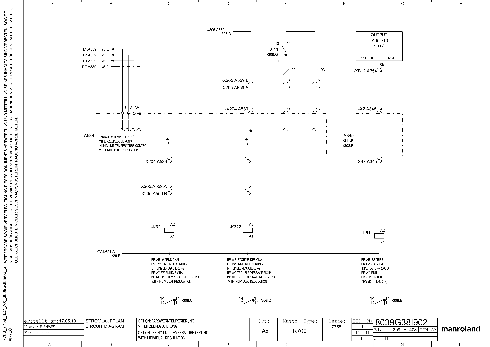

# +Ax — Sheet 309 of 403 — OPTION: FARBWERKTEMPERIERUNG

**MIT EINZELREGULIERUNG**

> Part of the manroland **R700** printing press IEC/UL circuit diagrams.
> Drawing class: **Stromlaufplan / Circuit diagram** (DIN A3).
> Document `+Ax` covers the **Central control console** machine section.

## At a glance

| Field | Value |
|---|---|
| Document | `+Ax`  (8039G38I902) |
| Sheet | **309** of 403 |
| Section (DE) | OPTION: FARBWERKTEMPERIERUNG |
| Section (EN) | MIT EINZELREGULIERUNG |
| Section type | CIRCUIT — Circuit diagram |
| Machine type | `R700` |
| Series | `7758` |
| Created | 17.05.10 |
| Replaces | — |
| Columns used | B, C, D, E, F, G |
| Path numbers | — |
| Labels on sheet | 103 |
| Cross-refs out | 10 |
| Cross-refs in | 30 |

**Previous:** [+Ax sheet 308](SHEET_0308.md) · **Next:** [+Ax sheet 310](SHEET_0310.md) · **Document TOC:** [_TOC.md](_TOC.md)  (+Ax) · **Master TOC:** [all sheets](../_MASTER_TOC.md)

## Sheet image (300 DPI, exact vector render)



_Rendered directly from the PDF vector layer at 300 DPI (1-bit), no OCR and no resampling. Use it to confirm anything ambiguous in the text below._

## Cross-references on this sheet

Each entry is a wire leaving this sheet. The printed token is `/sheet.column`; the link resolves to that sheet inside the same document.

| Ref | Target sheet | Col | Path | Destination on target | Target section | From col |
|---|---|---|---|---|---|---|
| `/308.D` | [+Ax sheet 308](SHEET_0308.md) | D | — | X205.A559:1 | OPTION: KOMBIGERÄT | D |
| `/199.G` | [+Ax sheet 199](SHEET_0199.md) | G | — | — | REFERENZMODUL | G |
| `/5.E` | [+Ax sheet 5](SHEET_0005.md) | E | — | L1.A539 | SPANNUNGSVERSORGUNG / KUNDENZULEITUNG | B |
| `/309.G` | [+Ax sheet 309](SHEET_0309.md) | G | — | — | OPTION: FARBWERKTEMPERIERUNG | E |
| `/5.E` | [+Ax sheet 5](SHEET_0005.md) | E | — | L2.A539 | SPANNUNGSVERSORGUNG / KUNDENZULEITUNG | B |
| `/5.E` | [+Ax sheet 5](SHEET_0005.md) | E | — | L3.A539 | SPANNUNGSVERSORGUNG / KUNDENZULEITUNG | B |
| `/5.E` | [+Ax sheet 5](SHEET_0005.md) | E | — | PE.A539 | SPANNUNGSVERSORGUNG / KUNDENZULEITUNG | B |
| `/311.B` | [+Ax sheet 311](SHEET_0311.md) | B | — | — | OPTION: IONISATIONSANLAGE ANLEGER | F |
| `/308.B` | [+Ax sheet 308](SHEET_0308.md) | B | — | — | OPTION: KOMBIGERÄT | F |
| `/29.F` | [+Ax sheet 29](SHEET_0029.md) | F | — | 0V.K621:A1 | SPANNUNGSVERSORGUNG, SCHALTSCHRANKBELÜFTUNG | B |

### Incoming references (sheets that point here)

Every other sheet that sends a wire to this one. `Back-ref` is the token printed on *that* sheet; `Path` is its line number.

| From sheet | Cols | Back-ref | Path | Refs | What continues there |
|---|---|---|---|---|---|
| [+Ax#5](SHEET_0005.md) | F | `/5.F` | — | 4 | L1.A539; L2.A539; L3.A539; PE.A539 |
| [+Ax#29](SHEET_0029.md) | F | `/29.F` | — | 1 | 0V.K621:A1 |
| [+Ax#199](SHEET_0199.md) | G | `/199.G` | — | 1 | — |
| [+Ax#217](SHEET_0217.md) | H | `/217.H` | — | 1 | — |
| [+Ax#248](SHEET_0248.md) | F | `/248.F` | — | 1 | — |
| [+Ax#283](SHEET_0283.md) | E | `/283.E` | — | 1 | — |
| [+Ax#292](SHEET_0292.md) | A, B, C | `/292.A`, `/292.B`, `/292.C` | — | 15 | — |
| [+Ax#308](SHEET_0308.md) | B, C, D | `/308.B`, `/308.C`, `/308.D` | — | 4 | — |
| [+Ax#309](SHEET_0309.md) | E | `/309.E` | — | 1 | — |
| [+Ax#311](SHEET_0311.md) | B | `/311.B` | — | 1 | — |


## Devices on this sheet

| Tag | Class | Class meaning (IEC) | Col | Sub | Terminal | Sign |
|---|---|---|---|---|---|---|
| `A2` | A | Baugruppe / assembly, module, PC board | D | — | — | — |
| `A1` | A | Baugruppe / assembly, module, PC board | D | — | — | — |
| `K622` | K | Relais / relay, contactor | D | — | — | — |
| `K611` | K | Relais / relay, contactor | E | — | — | — |
| `A2` | A | Baugruppe / assembly, module, PC board | C | — | — | — |
| `A1` | A | Baugruppe / assembly, module, PC board | C | — | — | — |
| `K621` | K | Relais / relay, contactor | C | — | — | — |
| `A539` | A | Baugruppe / assembly, module, PC board | B | — | — | — |
| `A2` | A | Baugruppe / assembly, module, PC board | G | — | — | — |
| `A1` | A | Baugruppe / assembly, module, PC board | G | — | — | — |
| `K611` | K | Relais / relay, contactor | F | — | — | — |
| `A354/10` | A | Baugruppe / assembly, module, PC board | G | 10 | — | — |
| `A345` | A | Baugruppe / assembly, module, PC board | F | — | — | — |
| `X205.A559.B` | — | cross-device reference | C | — | — | — |
| `X205.A559.A` | — | cross-device reference | C | — | — | — |
| `X204.A539` | — | cross-device reference | D | — | — | — |
| `X204.A539` | — | cross-device reference | C | — | — | — |
| `X2.A345` | — | cross-device reference | F | — | — | — |
| `X47.A345` | — | cross-device reference | F | — | — | — |
| `XB12.A354` | — | cross-device reference | F | — | — | — |
| `13.3` | — | cross-device reference | G | — | — | — |
| `X205.A559.B` | — | cross-device reference | D | — | — | — |
| `X205.A559.A` | — | cross-device reference | D | — | — | — |
| `X205.A559:1` | — | cross-device reference | D | — | 1 | — |

## Potentials / nets

| Potential | Count | Columns | Attached devices | Terminals |
|---|---|---|---|---|
| `0V` | 1 | B | `K621` | `A1` |
| `L1` | 1 | B | `A539` | — |
| `L2` | 1 | B | `A539` | — |
| `L3` | 1 | B | `A539` | — |
| `PE` | 1 | B | `A539` | — |


A potential such as `L24+/4` or `M24+` is a named supply/return rail; every place it appears on this sheet is electrically common.

## Wire-end annotations (grouped as printed)

A wire that continues elsewhere is annotated with a small cluster: the destination description, the path/line number `#NN`, and the `/sheet.column` cross reference. Each row below is one such cluster exactly as it is grouped on the drawing.

| Col | Y | Path | Cross-ref | Text on the wire |
|---|---|---|---|---|
| D | 68.3 | — | `/308.D` | `X205.A559:1` |
| G | 80.0 | — | — | `OUTPUT` |
| G | 93.8 | — | — | `A354/10` |
| E | 101.7 | — | — | `K611 14` |
| E | 101.7 | — | — | `12` |
| G | 107.6 | — | `/199.G` | — |
| B | 115.7 | — | `/5.E` | `L1.A539` |
| E | 128.2 | — | `/309.G` | — |
| B | 129.9 | — | `/5.E` | `L2.A539` |
| G | 137.3 | — | — | `BYTE.BIT 13.3` |
| B | 144.1 | — | `/5.E` | `L3.A539` |
| E | 144.2 | — | — | `11 11` |
| G | 152.6 | — | — | `6B` |
| B | 158.3 | — | `/5.E` | `PE.A539` |
| E | 166.4 | — | — | `OG OG` |
| F | 167.6 | — | — | `XB12.A354 4` |
| D | 190.2 | — | — | `X205.A559.B 1` |
| E | 190.2 | — | — | `14` |
| F | 190.2 | — | — | `15` |
| D | 207.2 | — | — | `X205.A559.A 1` |
| E | 207.2 | — | — | `14` |
| F | 207.2 | — | — | `15` |
| D | 254.9 | — | — | `U V W ' X204.A539 1 14 15` |
| F | 259.7 | — | — | `X2.A345 4` |
| B | 324.2 | — | — | `A539 FARBWERKTEMPERIERUNG INKING UNIT TEMPERATURE CONTROL MIT EINZELREGULIERUNG` |
| F | 324.2 | — | — | `A345` |
| F | 337.2 | — | `/311.B`, `/308.B` | — |
| B | 361.3 | — | — | `WITH INDIVIDUAL REGULATION` |
| C | 387.2 | — | — | `X204.A539 3 2` |
| F | 387.2 | — | — | `X47.A345 2` |
| C | 447.5 | — | — | `X205.A559.A 3` |
| D | 449.6 | — | — | `2` |
| C | 465.2 | — | — | `X205.A559.B 3` |
| D | 466.6 | — | — | `2` |
| C | 541.0 | — | — | `A2` |
| D | 541.0 | — | — | `A2` |
| C | 546.0 | — | — | `K621` |
| D | 546.0 | — | — | `K622` |
| G | 555.1 | — | — | `A2` |
| F | 560.1 | — | — | `K611` |
| C | 569.3 | — | — | `A1` |
| D | 569.3 | — | — | `A1` |
| G | 583.5 | — | — | `A1` |
| B | 606.9 | — | `/29.F` | `0V.K621:A1` |
| C | 627.0 | — | — | `RELAIS: WARNSIGNAL FARBWERKTEMPERIERUNG RELAY: WARNING SIGNAL INKING UNIT TEMPERATURE CONTROL MIT EINZELREGULIERUNG` |
| G | 627.0 | — | — | `RELAIS: BETRIEB DRUCKMASCHINE RELAY: RUN PRINTING MACHINE (DREHZAHL >= 3000 D/H) (SPEED >= 3000 S/H)` |
| D | 627.1 | — | — | `RELAIS: STÖRMELDESIGNAL FARBWERKTEMPERIERUNG RELAY: TROUBLE MESSAGE SIGNAL INKING UNIT TEMPERATURE CONTROL MIT EINZELREGULIERUNG` |
| C | 680.2 | — | — | `WITH INDIVIDUAL REGULATION` |
| D | 680.2 | — | — | `WITH INDIVIDUAL REGULATION` |
| C | 718.9 | — | — | `14 12 11 11 /308.C` |
| D | 718.9 | — | — | `14 12 11 11 /308.D` |
| G | 718.9 | — | — | `14 12 11 11 /309.E` |


## Reconstructed tables

This sheet carries tabular content (pin map / terminal assignment / index). The grid below was rebuilt from the drawing's own rule lines, so each row is exactly one physical row of the table.

### Table 1 — 3 data rows × 6 columns (at x=602.4, y=76.5)

|  | 12 K611 /309.G | 14 |  | OUTPUT | A354/10 /199.G |
|---|---|---|---|---|---|
|  |  |  |  | `BYTE.BIT` | `13.3` |
|  | `11 1 1 1` | `11 OG 14 14 14` | `OG 15 15 15` | `XB12.A354 X2.A345` | `6B 4 4` |
| `2 2 2` | `A2 A1` |  | `A345 /311.B /308.B` | `X47.A345 K611` | `2 A2 A1` |


## Notes and free text on this sheet

| Text | Col | Y (pt) |
|---|---|---|
| `11 /308.D` | E | 725.25 |
| `RELAIS: STÖRMELDESIGNAL` | D | 627.08 |
| `FARBWERKTEMPERIERUNG` | D | 637.7 |
| `MIT EINZELREGULIERUNG` | D | 648.36 |
| `RELAY: TROUBLE MESSAGE SIGNAL` | D | 658.97 |
| `INKING UNIT TEMPERATURE CONTROL` | D | 669.62 |
| `WITH INDIVIDUAL REGULATION` | D | 680.24 |
| `11 /308.C` | C | 725.25 |
| `RELAIS: WARNSIGNAL` | C | 627.05 |
| `FARBWERKTEMPERIERUNG` | C | 637.7 |
| `MIT EINZELREGULIERUNG` | C | 648.36 |
| `RELAY: WARNING SIGNAL` | C | 658.95 |
| `INKING UNIT TEMPERATURE CONTROL` | C | 669.62 |
| `WITH INDIVIDUAL REGULATION` | C | 680.24 |
| `U` | B | 257.58 |
| `V` | B | 257.47 |
| `W '` | B | 254.95 |
| `FARBWERKTEMPERIERUNG` | B | 329.43 |
| `MIT EINZELREGULIERUNG` | B | 340.09 |
| `INKING UNIT TEMPERATURE CONTROL` | B | 350.72 |
| `WITH INDIVIDUAL REGULATION` | B | 361.33 |
| `11 /309.E` | G | 725.22 |
| `RELAIS: BETRIEB` | F | 627.05 |
| `DRUCKMASCHINE` | F | 637.73 |
| `(DREHZAHL >= 3000 D/H)` | G | 648.37 |
| `RELAY: RUN` | F | 658.96 |
| `PRINTING MACHINE` | G | 669.62 |
| `(SPEED >= 3000 S/H)` | G | 680.24 |
| `6B` | G | 152.63 |
| `OUTPUT` | G | 79.98 |
| `BYTE.BIT` | F | 137.26 |
| `OG` | E | 166.41 |
| `OG` | F | 166.41 |

## Complete label inventory (exact text from the drawing)

Every text object inside the drawing area of this sheet, in DIN reading order (column A→H, then top→bottom). This is the authoritative list: if a string is not here it is not printed on this sheet.

| Col | Y | X | Dir | Type | Text |
|---|---|---|---|---|---|
| B | 115.7 | 248.3 | → | cross-reference | `/5.E` |
| B | 115.8 | 201.5 | → | potential | `L1.A539` |
| B | 129.9 | 248.3 | → | cross-reference | `/5.E` |
| B | 130.0 | 201.5 | → | potential | `L2.A539` |
| B | 144.1 | 201.5 | → | potential | `L3.A539` |
| B | 144.1 | 248.3 | → | cross-reference | `/5.E` |
| B | 158.3 | 199.3 | → | potential | `PE.A539` |
| B | 158.3 | 248.3 | → | cross-reference | `/5.E` |
| B | 254.9 | 328.8 | → | text | `W '` |
| B | 257.5 | 314.6 | → | text | `V` |
| B | 257.6 | 299.6 | → | text | `U` |
| B | 324.2 | 200.4 | → | device tag | `A539` |
| B | 329.4 | 240.1 | → | text | `FARBWERKTEMPERIERUNG` |
| B | 340.1 | 240.4 | → | text | `MIT EINZELREGULIERUNG` |
| B | 350.7 | 240.1 | → | text | `INKING UNIT TEMPERATURE CONTROL` |
| B | 361.3 | 240.9 | → | text | `WITH INDIVIDUAL REGULATION` |
| B | 606.9 | 236.7 | → | potential | `0V.K621:A1` |
| B | 616.8 | 272.1 | → | cross-reference | `/29.F` |
| C | 387.2 | 349.8 | → | device ref | `X204.A539` |
| C | 388.7 | 413.6 | → | number | `3` |
| C | 447.5 | 339.0 | → | device ref | `X205.A559.A` |
| C | 449.6 | 413.6 | → | number | `3` |
| C | 465.2 | 339.9 | → | device ref | `X205.A559.B` |
| C | 466.6 | 413.6 | → | number | `3` |
| C | 541.0 | 413.9 | → | device tag | `A2` |
| C | 546.0 | 367.7 | → | device tag | `K621` |
| C | 569.3 | 413.9 | → | device tag | `A1` |
| C | 627.0 | 367.7 | → | text | `RELAIS: WARNSIGNAL` |
| C | 637.7 | 367.7 | → | text | `FARBWERKTEMPERIERUNG` |
| C | 648.4 | 367.9 | → | text | `MIT EINZELREGULIERUNG` |
| C | 659.0 | 367.7 | → | text | `RELAY: WARNING SIGNAL` |
| C | 669.6 | 367.7 | → | text | `INKING UNIT TEMPERATURE CONTROL` |
| C | 680.2 | 368.5 | → | text | `WITH INDIVIDUAL REGULATION` |
| C | 718.9 | 388.3 | → | number | `14` |
| C | 718.9 | 425.5 | → | number | `11` |
| C | 725.3 | 425.5 | → | text | `11 /308.C` |
| C | 730.2 | 388.3 | → | number | `12` |
| D | 68.3 | 499.5 | → | device ref | `X205.A559:1` |
| D | 78.2 | 535.7 | → | cross-reference | `/308.D` |
| D | 190.2 | 538.3 | → | device ref | `X205.A559.B` |
| D | 190.2 | 611.4 | → | number | `1` |
| D | 207.3 | 611.4 | → | number | `1` |
| D | 207.9 | 537.4 | → | device ref | `X205.A559.A` |
| D | 259.7 | 546.8 | → | device ref | `X204.A539` |
| D | 261.1 | 611.4 | → | number | `1` |
| D | 388.7 | 604.9 | → | number | `2` |
| D | 449.6 | 604.9 | → | number | `2` |
| D | 466.6 | 604.9 | → | number | `2` |
| D | 541.0 | 605.2 | → | device tag | `A2` |
| D | 546.0 | 557.6 | → | device tag | `K622` |
| D | 569.3 | 605.2 | → | device tag | `A1` |
| D | 627.1 | 551.9 | → | text | `RELAIS: STÖRMELDESIGNAL` |
| D | 637.7 | 551.9 | → | text | `FARBWERKTEMPERIERUNG` |
| D | 648.4 | 552.2 | → | text | `MIT EINZELREGULIERUNG` |
| D | 659.0 | 551.9 | → | text | `RELAY: TROUBLE MESSAGE SIGNAL` |
| D | 669.6 | 551.9 | → | text | `INKING UNIT TEMPERATURE CONTROL` |
| D | 680.2 | 552.8 | → | text | `WITH INDIVIDUAL REGULATION` |
| D | 718.9 | 579.7 | → | number | `14` |
| D | 718.9 | 616.8 | → | number | `11` |
| D | 730.2 | 579.7 | → | number | `12` |
| E | 101.7 | 668.4 | → | number | `12` |
| E | 101.7 | 696.5 | → | number | `14` |
| E | 115.1 | 648.3 | → | device tag | `K611` |
| E | 128.2 | 648.9 | → | cross-reference | `/309.G` |
| E | 144.2 | 669.5 | → | number | `11` |
| E | 144.2 | 696.5 | → | number | `11` |
| E | 166.4 | 708.4 | → | text | `OG` |
| E | 190.2 | 696.5 | → | number | `14` |
| E | 207.3 | 696.5 | → | number | `14` |
| E | 261.1 | 696.5 | → | number | `14` |
| E | 725.3 | 616.8 | → | text | `11 /308.D` |
| F | 137.3 | 874.5 | → | text | `BYTE.BIT` |
| F | 166.4 | 779.2 | → | text | `OG` |
| F | 167.5 | 858.9 | → | device ref | `XB12.A354` |
| F | 190.2 | 767.3 | → | number | `15` |
| F | 207.3 | 767.3 | → | number | `15` |
| F | 259.7 | 870.5 | → | device ref | `X2.A345` |
| F | 261.1 | 767.3 | → | number | `15` |
| F | 324.2 | 831.1 | → | device tag | `A345` |
| F | 337.2 | 833.7 | → | cross-reference | `/311.B` |
| F | 349.6 | 833.7 | → | cross-reference | `/308.B` |
| F | 387.2 | 866.0 | → | device ref | `X47.A345` |
| F | 560.1 | 877.9 | → | device tag | `K611` |
| F | 627.0 | 877.9 | → | text | `RELAIS: BETRIEB` |
| F | 637.7 | 877.9 | → | text | `DRUCKMASCHINE` |
| F | 659.0 | 877.9 | → | text | `RELAY: RUN` |
| F | 718.9 | 898.6 | → | number | `14` |
| F | 730.2 | 898.6 | → | number | `12` |
| G | 80.0 | 901.0 | → | text | `OUTPUT` |
| G | 93.8 | 899.9 | → | device tag | `A354/10` |
| G | 107.6 | 908.4 | → | cross-reference | `/199.G` |
| G | 137.3 | 941.4 | → | device ref | `13.3` |
| G | 152.6 | 923.8 | → | text | `6B` |
| G | 169.0 | 923.8 | → | number | `4` |
| G | 261.1 | 923.8 | → | number | `4` |
| G | 388.7 | 923.8 | → | number | `2` |
| G | 555.2 | 924.1 | → | device tag | `A2` |
| G | 583.5 | 924.1 | → | device tag | `A1` |
| G | 648.4 | 878.2 | → | text | `(DREHZAHL >= 3000 D/H)` |
| G | 669.6 | 877.9 | → | text | `PRINTING MACHINE` |
| G | 680.2 | 878.2 | → | text | `(SPEED >= 3000 S/H)` |
| G | 718.9 | 935.7 | → | number | `11` |
| G | 725.2 | 935.7 | → | text | `11 /309.E` |

## Reading-order text block

The same content as a plain block, grouped by DIN column — convenient to paste or to match against a visual description.

```text
=== Column B ===
 115.7  248.3  xref         /5.E
 115.8  201.5  net          L1.A539
 129.9  248.3  xref         /5.E
 130.0  201.5  net          L2.A539
 144.1  201.5  net          L3.A539
 144.1  248.3  xref         /5.E
 158.3  199.3  net          PE.A539
 158.3  248.3  xref         /5.E
 254.9  328.8  text         W `
 257.5  314.6  text         V
 257.6  299.6  text         U
 324.2  200.4  devtag       A539
 329.4  240.1  text         FARBWERKTEMPERIERUNG
 340.1  240.4  text         MIT EINZELREGULIERUNG
 350.7  240.1  text         INKING UNIT TEMPERATURE CONTROL
 361.3  240.9  text         WITH INDIVIDUAL REGULATION
 606.9  236.7  net          0V.K621:A1
 616.8  272.1  xref         /29.F
=== Column C ===
 387.2  349.8  devref       X204.A539
 388.7  413.6  numeric      3
 447.5  339.0  devref       X205.A559.A
 449.6  413.6  numeric      3
 465.2  339.9  devref       X205.A559.B
 466.6  413.6  numeric      3
 541.0  413.9  devtag       A2
 546.0  367.7  devtag       K621
 569.3  413.9  devtag       A1
 627.0  367.7  text         RELAIS: WARNSIGNAL
 637.7  367.7  text         FARBWERKTEMPERIERUNG
 648.4  367.9  text         MIT EINZELREGULIERUNG
 659.0  367.7  text         RELAY: WARNING SIGNAL
 669.6  367.7  text         INKING UNIT TEMPERATURE CONTROL
 680.2  368.5  text         WITH INDIVIDUAL REGULATION
 718.9  388.3  numeric      14
 718.9  425.5  numeric      11
 725.3  425.5  text         11 /308.C
 730.2  388.3  numeric      12
=== Column D ===
  68.3  499.5  devref       X205.A559:1
  78.2  535.7  xref         /308.D
 190.2  538.3  devref       X205.A559.B
 190.2  611.4  numeric      1
 207.3  611.4  numeric      1
 207.9  537.4  devref       X205.A559.A
 259.7  546.8  devref       X204.A539
 261.1  611.4  numeric      1
 388.7  604.9  numeric      2
 449.6  604.9  numeric      2
 466.6  604.9  numeric      2
 541.0  605.2  devtag       A2
 546.0  557.6  devtag       K622
 569.3  605.2  devtag       A1
 627.1  551.9  text         RELAIS: STÖRMELDESIGNAL
 637.7  551.9  text         FARBWERKTEMPERIERUNG
 648.4  552.2  text         MIT EINZELREGULIERUNG
 659.0  551.9  text         RELAY: TROUBLE MESSAGE SIGNAL
 669.6  551.9  text         INKING UNIT TEMPERATURE CONTROL
 680.2  552.8  text         WITH INDIVIDUAL REGULATION
 718.9  579.7  numeric      14
 718.9  616.8  numeric      11
 730.2  579.7  numeric      12
=== Column E ===
 101.7  668.4  numeric      12
 101.7  696.5  numeric      14
 115.1  648.3  devtag       K611
 128.2  648.9  xref         /309.G
 144.2  669.5  numeric      11
 144.2  696.5  numeric      11
 166.4  708.4  text         OG
 190.2  696.5  numeric      14
 207.3  696.5  numeric      14
 261.1  696.5  numeric      14
 725.3  616.8  text         11 /308.D
=== Column F ===
 137.3  874.5  text         BYTE.BIT
 166.4  779.2  text         OG
 167.5  858.9  devref       XB12.A354
 190.2  767.3  numeric      15
 207.3  767.3  numeric      15
 259.7  870.5  devref       X2.A345
 261.1  767.3  numeric      15
 324.2  831.1  devtag       A345
 337.2  833.7  xref         /311.B
 349.6  833.7  xref         /308.B
 387.2  866.0  devref       X47.A345
 560.1  877.9  devtag       K611
 627.0  877.9  text         RELAIS: BETRIEB
 637.7  877.9  text         DRUCKMASCHINE
 659.0  877.9  text         RELAY: RUN
 718.9  898.6  numeric      14
 730.2  898.6  numeric      12
=== Column G ===
  80.0  901.0  text         OUTPUT
  93.8  899.9  devtag       A354/10
 107.6  908.4  xref         /199.G
 137.3  941.4  devref       13.3
 152.6  923.8  text         6B
 169.0  923.8  numeric      4
 261.1  923.8  numeric      4
 388.7  923.8  numeric      2
 555.2  924.1  devtag       A2
 583.5  924.1  devtag       A1
 648.4  878.2  text         (DREHZAHL >= 3000 D/H)
 669.6  877.9  text         PRINTING MACHINE
 680.2  878.2  text         (SPEED >= 3000 S/H)
 718.9  935.7  numeric      11
 725.2  935.7  text         11 /309.E
```

---
_Generated from the PDF vector text layer; no OCR. Source: `R700_7758_IEC_AX_8039G38I902_p`, sheet 309._
