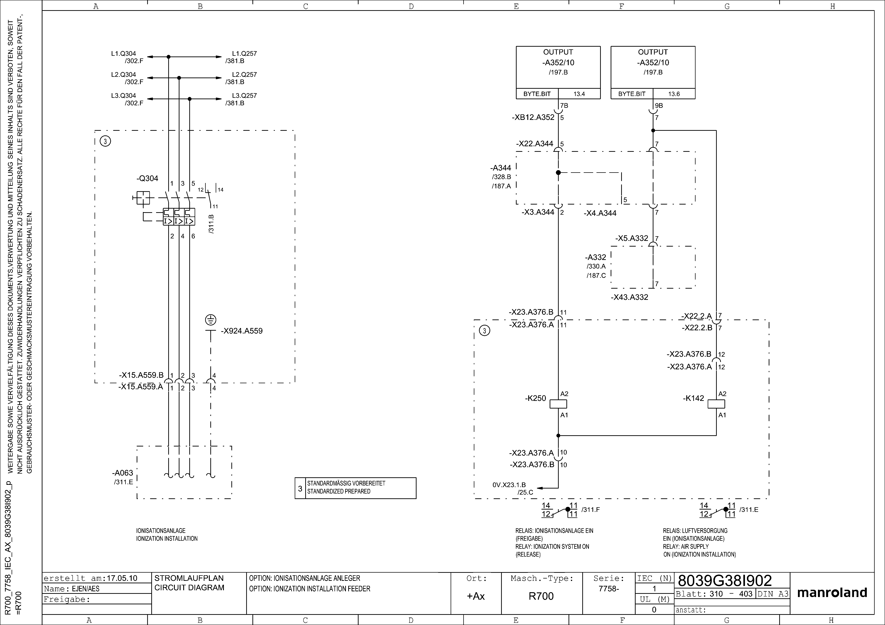

# +Ax — Sheet 310 of 403 — OPTION: IONISATIONSANLAGE ANLEGER

**OPTION: IONIZATION INSTALLATION FEEDER**

> Part of the manroland **R700** printing press IEC/UL circuit diagrams.
> Drawing class: **Stromlaufplan / Circuit diagram** (DIN A3).
> Document `+Ax` covers the **Central control console** machine section.

## At a glance

| Field | Value |
|---|---|
| Document | `+Ax`  (8039G38I902) |
| Sheet | **310** of 403 |
| Section (DE) | OPTION: IONISATIONSANLAGE ANLEGER |
| Section (EN) | OPTION: IONIZATION INSTALLATION FEEDER |
| Section type | CIRCUIT — Circuit diagram |
| Machine type | `R700` |
| Series | `7758` |
| Created | 17.05.10 |
| Replaces | — |
| Columns used | A, B, C, E, F, G |
| Path numbers | — |
| Labels on sheet | 116 |
| Cross-refs out | 15 |
| Cross-refs in | 42 |

**Previous:** [+Ax sheet 309](SHEET_0309.md) · **Next:** [+Ax sheet 311](SHEET_0311.md) · **Document TOC:** [_TOC.md](_TOC.md)  (+Ax) · **Master TOC:** [all sheets](../_MASTER_TOC.md)

## Sheet image (300 DPI, exact vector render)



_Rendered directly from the PDF vector layer at 300 DPI (1-bit), no OCR and no resampling. Use it to confirm anything ambiguous in the text below._

## Cross-references on this sheet

Each entry is a wire leaving this sheet. The printed token is `/sheet.column`; the link resolves to that sheet inside the same document.

| Ref | Target sheet | Col | Path | Destination on target | Target section | From col |
|---|---|---|---|---|---|---|
| `/302.F` | [+Ax sheet 302](SHEET_0302.md) | F | — | L1.Q304 | SPANNUNGSVERSORGUNG: LACKMODUL | A |
| `/381.B` | [+Ax sheet 381](SHEET_0381.md) | B | — | — | OPTION: INLINEFOILER PRINDOR | B |
| `/197.B` | [+Ax sheet 197](SHEET_0197.md) | B | — | — | REFERENZMODUL | E |
| `/197.B` | [+Ax sheet 197](SHEET_0197.md) | B | — | — | REFERENZMODUL | F |
| `/302.F` | [+Ax sheet 302](SHEET_0302.md) | F | — | L2.Q304 L2.Q257 | SPANNUNGSVERSORGUNG: LACKMODUL | B |
| `/381.B` | [+Ax sheet 381](SHEET_0381.md) | B | — | — | OPTION: INLINEFOILER PRINDOR | B |
| `/302.F` | [+Ax sheet 302](SHEET_0302.md) | F | — | L3.Q304 L3.Q257 | SPANNUNGSVERSORGUNG: LACKMODUL | B |
| `/381.B` | [+Ax sheet 381](SHEET_0381.md) | B | — | — | OPTION: INLINEFOILER PRINDOR | B |
| `/328.B` | [+Ax sheet 328](SHEET_0328.md) | B | — | — | OPTION: NONSTOP EINRICHTUNG MANUELL, ANLEGER | E |
| `/187.A` | [+Ax sheet 187](SHEET_0187.md) | A | — | — | RESERVE | E |
| `/311.B` | [+Ax sheet 311](SHEET_0311.md) | B | — | — | OPTION: IONISATIONSANLAGE ANLEGER | B |
| `/330.A` | [+Ax sheet 330](SHEET_0330.md) | A | — | — | OPTION: NONSTOP EINRICHTUNG MANUELL, ANLEGER | F |
| `/187.C` | [+Ax sheet 187](SHEET_0187.md) | C | — | — | RESERVE | F |
| `/311.E` | [+Ax sheet 311](SHEET_0311.md) | E | — | — | OPTION: IONISATIONSANLAGE ANLEGER | A |
| `/25.C` | [+Ax sheet 25](SHEET_0025.md) | C | — | 0V.X23.1.B | SPANNUNGSVERSORGUNG, SCHALTSCHRANKBELÜFTUNG | E |

### Incoming references (sheets that point here)

Every other sheet that sends a wire to this one. `Back-ref` is the token printed on *that* sheet; `Path` is its line number.

| From sheet | Cols | Back-ref | Path | Refs | What continues there |
|---|---|---|---|---|---|
| [+Ax#25](SHEET_0025.md) | C | `/25.C` | — | 1 | — |
| [+Ax#187](SHEET_0187.md) | A, C | `/187.A`, `/187.C` | — | 2 | 2 |
| [+Ax#197](SHEET_0197.md) | B | `/197.B` | — | 2 | — |
| [+Ax#223](SHEET_0223.md) | A | `/223.A` | — | 1 | — |
| [+Ax#226](SHEET_0226.md) | H | `/226.H` | — | 2 | — |
| [+Ax#230](SHEET_0230.md) | F | `/230.F` | — | 1 | — |
| [+Ax#248](SHEET_0248.md) | E | `/248.E` | — | 2 | — |
| [+Ax#253](SHEET_0253.md) | E | `/253.E` | — | 8 | — |
| [+Ax#262](SHEET_0262.md) | A, B, E | `/262.A`, `/262.B`, `/262.E` | — | 4 | — |
| [+Ax#264](SHEET_0264.md) | A, B | `/264.A`, `/264.B` | — | 6 | — |
| [+Ax#281](SHEET_0281.md) | E | `/281.E` | — | 1 | — |
| [+Ax#302](SHEET_0302.md) | D | `/302.D` | — | 3 | L1.Q331 L1.Q340 L1.Q304; L2.Q331 L2.Q340 L2.Q304; L3.Q331 L3.Q340 L3.Q304 |
| [+Ax#311](SHEET_0311.md) | B, E | `/311.B`, `/311.E` | — | 4 | — |
| [+Ax#328](SHEET_0328.md) | B | `/328.B` | — | 1 | — |
| [+Ax#330](SHEET_0330.md) | A | `/330.A` | — | 1 | — |
| [+Ax#381](SHEET_0381.md) | A | `/381.A` | — | 3 | L1.Q257; L2.Q257; L3.Q257 |


## Devices on this sheet

| Tag | Class | Class meaning (IEC) | Col | Sub | Terminal | Sign |
|---|---|---|---|---|---|---|
| `A2` | A | Baugruppe / assembly, module, PC board | E | — | — | — |
| `A1` | A | Baugruppe / assembly, module, PC board | E | — | — | — |
| `K250` | K | Relais / relay, contactor | E | — | — | — |
| `A2` | A | Baugruppe / assembly, module, PC board | G | — | — | — |
| `A1` | A | Baugruppe / assembly, module, PC board | G | — | — | — |
| `K142` | K | Relais / relay, contactor | G | — | — | — |
| `A352/10` | A | Baugruppe / assembly, module, PC board | E | 10 | — | — |
| `A344` | A | Baugruppe / assembly, module, PC board | E | — | — | — |
| `A352/10` | A | Baugruppe / assembly, module, PC board | F | 10 | — | — |
| `A332` | A | Baugruppe / assembly, module, PC board | F | — | — | — |
| `Q304` | Q | Leistungsschalter / power switching device | A | — | — | — |
| `A063` | A | Baugruppe / assembly, module, PC board | A | — | — | — |
| `X23.A376.A` | — | cross-device reference | E | — | — | — |
| `X23.A376.B` | — | cross-device reference | E | — | — | — |
| `X23.A376.B` | — | cross-device reference | G | — | — | — |
| `X23.A376.A` | — | cross-device reference | G | — | — | — |
| `X23.A376.B` | — | cross-device reference | E | — | — | — |
| `X23.A376.A` | — | cross-device reference | E | — | — | — |
| `X22.2.A` | — | cross-device reference | G | — | — | — |
| `X22.2.B` | — | cross-device reference | G | — | — | — |
| `13.4` | — | cross-device reference | F | — | — | — |
| `XB12.A352` | — | cross-device reference | E | — | — | — |
| `X22.A344` | — | cross-device reference | E | — | — | — |
| `13.6` | — | cross-device reference | F | — | — | — |
| `X3.A344` | — | cross-device reference | E | — | — | — |
| `X5.A332` | — | cross-device reference | F | — | — | — |
| `X15.A559.B` | — | cross-device reference | A | — | — | — |
| `X15.A559.A` | — | cross-device reference | A | — | — | — |
| `X4.A344` | — | cross-device reference | F | — | — | — |
| `X43.A332` | — | cross-device reference | F | — | — | — |
| `X924.A559` | — | cross-device reference | B | — | — | — |

## Potentials / nets

| Potential | Count | Columns | Attached devices | Terminals |
|---|---|---|---|---|
| `0V` | 1 | E | `1`, `B`, `X23` | — |
| `L1` | 2 | A, B | `Q257`, `Q304` | — |
| `L2` | 2 | A, B | `Q257`, `Q304` | — |
| `L3` | 2 | A, B | `Q257`, `Q304` | — |


A potential such as `L24+/4` or `M24+` is a named supply/return rail; every place it appears on this sheet is electrically common.

## Wire-end annotations (grouped as printed)

A wire that continues elsewhere is annotated with a small cluster: the destination description, the path/line number `#NN`, and the `/sheet.column` cross reference. Each row below is one such cluster exactly as it is grouped on the drawing.

| Col | Y | Path | Cross-ref | Text on the wire |
|---|---|---|---|---|
| E | 65.8 | — | — | `OUTPUT` |
| F | 65.8 | — | — | `OUTPUT` |
| A | 68.3 | — | `/302.F` | `L1.Q304` |
| B | 68.3 | — | — | `L1.Q257` |
| B | 78.2 | — | `/381.B` | — |
| E | 79.7 | — | — | `A352/10` |
| F | 79.7 | — | — | `A352/10` |
| E | 93.5 | — | `/197.B` | — |
| F | 93.5 | — | `/197.B` | — |
| B | 96.7 | — | `/302.F` | `L2.Q304 L2.Q257` |
| B | 106.6 | — | `/381.B` | — |
| E | 123.1 | — | — | `BYTE.BIT 13.4` |
| F | 123.1 | — | — | `BYTE.BIT 13.6` |
| B | 125.0 | — | `/302.F` | `L3.Q304 L3.Q257` |
| B | 134.9 | — | `/381.B` | — |
| E | 138.5 | — | — | `7B` |
| F | 138.5 | — | — | `9B` |
| E | 153.4 | — | — | `XB12.A352 5` |
| F | 154.8 | — | — | `7` |
| A | 187.4 | — | — | `3` |
| E | 188.8 | — | — | `X22.A344 5` |
| F | 190.2 | — | — | `7` |
| E | 221.4 | — | — | `A344` |
| E | 234.5 | — | `/328.B`, `/187.A` | — |
| A | 235.6 | — | — | `Q304` |
| B | 243.4 | — | — | `1` |
| B | 243.4 | — | — | `3` |
| B | 243.4 | — | — | `5` |
| B | 252.5 | — | — | `12 14` |
| F | 265.4 | — | — | `5` |
| B | 275.1 | — | — | `11` |
| E | 280.9 | — | — | `X3.A344 2` |
| F | 282.4 | — | — | `X4.A344` |
| F | 282.4 | — | — | `7` |
| B | 288.9 | — | `/311.B` | — |
| B | 314.3 | — | — | `2` |
| B | 314.3 | — | — | `4` |
| B | 314.3 | — | — | `6` |
| F | 316.4 | — | — | `X5.A332 7` |
| F | 341.9 | — | — | `A332` |
| F | 354.9 | — | `/330.A`, `/187.C` | — |
| F | 378.8 | — | — | `7` |
| F | 395.7 | — | — | `X43.A332` |
| E | 415.6 | — | — | `X23.A376.B 11` |
| G | 421.3 | — | — | `X22.2.A 7` |
| E | 432.6 | — | — | `X23.A376.A 11` |
| G | 436.9 | — | — | `X22.2.B 7` |
| B | 441.1 | — | — | `X924.A559` |
| E | 442.5 | — | — | `3` |
| G | 472.3 | — | — | `X23.A376.B 12` |
| G | 489.3 | — | — | `X23.A376.A 12` |
| B | 500.6 | — | — | `X15.A559.B 1 2 3 4` |
| B | 516.2 | — | — | `X15.A559.A 1 2 3 4` |
| E | 526.8 | — | — | `A2` |
| G | 526.8 | — | — | `A2` |
| E | 531.8 | — | — | `K250` |
| G | 531.8 | — | — | `K142` |
| E | 555.1 | — | — | `A1` |
| G | 555.1 | — | — | `A1` |
| E | 605.5 | — | — | `X23.A376.A 10` |
| E | 621.1 | — | — | `X23.A376.B 10` |
| A | 632.4 | — | — | `A063` |
| A | 645.5 | — | `/311.E` | — |
| C | 648.3 | — | — | `3 STANDARDMÄSSIG VORBEREITET STANDARDIZED PREPARED` |
| E | 649.4 | — | `/25.C` | `0V.X23.1.B` |
| F | 676.3 | — | — | `14 12 11 11 /311.F` |
| G | 676.3 | — | — | `14 12 11 11 /311.E` |
| B | 712.1 | — | — | `IONISATIONSANLAGE IONIZATION INSTALLATION` |
| E | 712.1 | — | — | `RELAIS: IONISATIONSANLAGE EIN RELAY: IONIZATION SYSTEM ON (FREIGABE) (RELEASE)` |
| G | 712.1 | — | — | `RELAIS: LUFTVERSORGUNG EIN (IONISATIONSANLAGE) RELAY: AIR SUPPLY` |
| G | 744.0 | — | — | `ON (IONIZATION INSTALLATION)` |


## Reconstructed tables

This sheet carries tabular content (pin map / terminal assignment / index). The grid below was rebuilt from the drawing's own rule lines, so each row is exactly one physical row of the table.

### Table 1 — 4 data rows × 2 columns (at x=694.5, y=62.4)

| OUTPUT | A352/10 /197.B |
|---|---|
| `BYTE.BIT` | `13.4` |
| `XB12.A352` | `7B 5` |
| `X22.A344` | `5` |
| `X3.A344 X23.A376.B X23.A376.A K250` | `X4.A344 2 A332 /330.A /187.C 11 11 A2 A1` |


### Table 2 — 4 data rows × 3 columns (at x=836.2, y=62.4)

| OUTPUT | A352/10 /197.B |  |
|---|---|---|
| `BYTE.BIT` | `13.6` |  |
|  | `9B 7` |  |
|  | `7` |  |
| `5 X5.A332 X43.A332` | `7 7 7 X23.A376.B X23.A376.A K142` | `X22.2.A X22.2.B` |


## Notes and free text on this sheet

| Text | Col | Y (pt) |
|---|---|---|
| `11 /311.F` | F | 682.71 |
| `11 /311.E` | G | 682.7 |
| `RELAIS: LUFTVERSORGUNG` | G | 712.12 |
| `EIN (IONISATIONSANLAGE)` | G | 722.74 |
| `RELAY: AIR SUPPLY` | G | 733.37 |
| `ON (IONIZATION INSTALLATION)` | G | 744.02 |
| `7B` | E | 138.46 |
| `OUTPUT` | E | 65.81 |
| `BYTE.BIT` | E | 123.08 |
| `RELAIS: IONISATIONSANLAGE EIN` | E | 712.1 |
| `(FREIGABE)` | E | 722.73 |
| `RELAY: IONIZATION SYSTEM ON` | E | 733.37 |
| `(RELEASE)` | E | 744 |
| `9B` | F | 138.46 |
| `OUTPUT` | F | 65.81 |
| `BYTE.BIT` | F | 123.08 |
| `IONISATIONSANLAGE` | B | 712.11 |
| `IONIZATION INSTALLATION` | B | 722.74 |
| `STANDARDMÄSSIG VORBEREITET` | C | 648.34 |
| `STANDARDIZED PREPARED` | C | 658.98 |

## Complete label inventory (exact text from the drawing)

Every text object inside the drawing area of this sheet, in DIN reading order (column A→H, then top→bottom). This is the authoritative list: if a string is not here it is not printed on this sheet.

| Col | Y | X | Dir | Type | Text |
|---|---|---|---|---|---|
| A | 68.3 | 149.7 | → | potential | `L1.Q304` |
| A | 78.2 | 168.1 | → | cross-reference | `/302.F` |
| A | 96.7 | 149.7 | → | potential | `L2.Q304` |
| A | 106.6 | 168.1 | → | cross-reference | `/302.F` |
| A | 125.0 | 149.7 | → | potential | `L3.Q304` |
| A | 134.9 | 168.1 | → | cross-reference | `/302.F` |
| A | 187.4 | 139.7 | → | number | `3` |
| A | 235.6 | 183.7 | → | device tag | `Q304` |
| A | 500.6 | 160.2 | → | device ref | `X15.A559.B` |
| A | 516.2 | 159.3 | → | device ref | `X15.A559.A` |
| A | 632.4 | 150.8 | → | device tag | `A063` |
| A | 645.5 | 153.6 | → | cross-reference | `/311.E` |
| B | 68.3 | 312.4 | → | potential | `L1.Q257` |
| B | 78.2 | 303.3 | → | cross-reference | `/381.B` |
| B | 96.7 | 312.4 | → | potential | `L2.Q257` |
| B | 106.6 | 303.3 | → | cross-reference | `/381.B` |
| B | 125.0 | 312.4 | → | potential | `L3.Q257` |
| B | 134.9 | 303.3 | → | cross-reference | `/381.B` |
| B | 243.4 | 228.8 | → | number | `1` |
| B | 243.4 | 243.5 | → | number | `3` |
| B | 243.4 | 257.7 | → | number | `5` |
| B | 252.5 | 265.9 | → | number | `12` |
| B | 252.5 | 292.8 | → | number | `14` |
| B | 275.1 | 285.7 | → | number | `11` |
| B | 288.9 | 280.2 | ↕ | cross-reference | `/311.B` |
| B | 314.3 | 229.3 | → | number | `2` |
| B | 314.3 | 243.5 | → | number | `4` |
| B | 314.3 | 257.7 | → | number | `6` |
| B | 441.1 | 297.4 | → | device ref | `X924.A559` |
| B | 502.1 | 228.8 | → | number | `1` |
| B | 502.1 | 243.5 | → | number | `2` |
| B | 502.1 | 257.7 | → | number | `3` |
| B | 502.1 | 286.0 | → | number | `4` |
| B | 519.1 | 228.8 | → | number | `1` |
| B | 519.1 | 243.5 | → | number | `2` |
| B | 519.1 | 257.7 | → | number | `3` |
| B | 519.1 | 286.0 | → | number | `4` |
| B | 712.1 | 183.4 | → | text | `IONISATIONSANLAGE` |
| B | 722.7 | 183.4 | → | text | `IONIZATION INSTALLATION` |
| C | 648.3 | 413.6 | → | text | `STANDARDMÄSSIG VORBEREITET` |
| C | 653.7 | 401.0 | → | number | `3` |
| C | 659.0 | 413.6 | → | text | `STANDARDIZED PREPARED` |
| E | 65.8 | 730.9 | → | text | `OUTPUT` |
| E | 79.7 | 729.8 | → | device tag | `A352/10` |
| E | 93.5 | 738.6 | → | cross-reference | `/197.B` |
| E | 123.1 | 704.4 | → | text | `BYTE.BIT` |
| E | 138.5 | 753.7 | → | text | `7B` |
| E | 153.4 | 688.8 | → | device ref | `XB12.A352` |
| E | 154.8 | 753.7 | → | number | `5` |
| E | 188.8 | 694.5 | → | device ref | `X22.A344` |
| E | 190.2 | 753.7 | → | number | `5` |
| E | 221.4 | 659.6 | → | device tag | `A344` |
| E | 234.5 | 662.2 | → | cross-reference | `/328.B` |
| E | 246.9 | 661.9 | → | cross-reference | `/187.A` |
| E | 280.9 | 701.9 | → | device ref | `X3.A344` |
| E | 282.4 | 753.7 | → | number | `2` |
| E | 415.6 | 684.6 | → | device ref | `X23.A376.B` |
| E | 417.0 | 753.2 | → | number | `11` |
| E | 432.6 | 685.1 | → | device ref | `X23.A376.A` |
| E | 434.0 | 753.2 | → | number | `11` |
| E | 442.5 | 650.0 | → | number | `3` |
| E | 526.8 | 754.0 | → | device tag | `A2` |
| E | 531.8 | 706.4 | → | device tag | `K250` |
| E | 555.2 | 754.0 | → | device tag | `A1` |
| E | 605.5 | 685.1 | → | device ref | `X23.A376.A` |
| E | 605.5 | 753.2 | → | number | `10` |
| E | 621.1 | 686.0 | → | device ref | `X23.A376.B` |
| E | 622.5 | 753.2 | → | number | `10` |
| E | 649.4 | 662.7 | → | potential | `0V.X23.1.B` |
| E | 659.3 | 696.5 | → | cross-reference | `/25.C` |
| E | 676.3 | 728.5 | → | number | `14` |
| E | 687.7 | 728.5 | → | number | `12` |
| E | 712.1 | 693.6 | → | text | `RELAIS: IONISATIONSANLAGE EIN` |
| E | 722.7 | 693.9 | → | text | `(FREIGABE)` |
| E | 733.4 | 693.6 | → | text | `RELAY: IONIZATION SYSTEM ON` |
| E | 744.0 | 693.9 | → | text | `(RELEASE)` |
| F | 65.8 | 858.5 | → | text | `OUTPUT` |
| F | 79.7 | 857.3 | → | device tag | `A352/10` |
| F | 93.5 | 866.1 | → | cross-reference | `/197.B` |
| F | 123.1 | 771.3 | → | device ref | `13.4` |
| F | 123.1 | 832.0 | → | text | `BYTE.BIT` |
| F | 123.1 | 898.9 | → | device ref | `13.6` |
| F | 138.5 | 881.3 | → | text | `9B` |
| F | 154.8 | 881.3 | → | number | `7` |
| F | 190.2 | 881.3 | → | number | `7` |
| F | 265.4 | 838.8 | → | number | `5` |
| F | 282.4 | 785.5 | → | device ref | `X4.A344` |
| F | 282.4 | 881.3 | → | number | `7` |
| F | 316.4 | 828.0 | → | device ref | `X5.A332` |
| F | 317.8 | 881.3 | → | number | `7` |
| F | 341.9 | 787.2 | → | device tag | `A332` |
| F | 354.9 | 789.4 | → | cross-reference | `/330.A` |
| F | 367.4 | 789.4 | → | cross-reference | `/187.C` |
| F | 378.7 | 881.3 | → | number | `7` |
| F | 395.7 | 822.0 | → | device ref | `X43.A332` |
| F | 676.3 | 765.6 | → | number | `11` |
| F | 682.7 | 765.6 | → | text | `11 /311.F` |
| G | 421.3 | 916.7 | → | device ref | `X22.2.A` |
| G | 421.3 | 966.3 | → | number | `7` |
| G | 436.9 | 917.6 | → | device ref | `X22.2.B` |
| G | 438.3 | 966.3 | → | number | `7` |
| G | 472.3 | 897.2 | → | device ref | `X23.A376.B` |
| G | 473.7 | 965.8 | → | number | `12` |
| G | 489.3 | 897.7 | → | device ref | `X23.A376.A` |
| G | 490.7 | 965.8 | → | number | `12` |
| G | 526.8 | 966.6 | → | device tag | `A2` |
| G | 531.8 | 919.0 | → | device tag | `K142` |
| G | 555.2 | 966.6 | → | device tag | `A1` |
| G | 676.3 | 941.1 | → | number | `14` |
| G | 676.3 | 978.2 | → | number | `11` |
| G | 682.7 | 978.2 | → | text | `11 /311.E` |
| G | 687.7 | 941.1 | → | number | `12` |
| G | 712.1 | 892.1 | → | text | `RELAIS: LUFTVERSORGUNG` |
| G | 722.7 | 892.1 | → | text | `EIN (IONISATIONSANLAGE)` |
| G | 733.4 | 892.1 | → | text | `RELAY: AIR SUPPLY` |
| G | 744.0 | 892.6 | → | text | `ON (IONIZATION INSTALLATION)` |

## Reading-order text block

The same content as a plain block, grouped by DIN column — convenient to paste or to match against a visual description.

```text
=== Column A ===
  68.3  149.7  net          L1.Q304
  78.2  168.1  xref         /302.F
  96.7  149.7  net          L2.Q304
 106.6  168.1  xref         /302.F
 125.0  149.7  net          L3.Q304
 134.9  168.1  xref         /302.F
 187.4  139.7  numeric      3
 235.6  183.7  devtag       Q304
 500.6  160.2  devref       X15.A559.B
 516.2  159.3  devref       X15.A559.A
 632.4  150.8  devtag       A063
 645.5  153.6  xref         /311.E
=== Column B ===
  68.3  312.4  net          L1.Q257
  78.2  303.3  xref         /381.B
  96.7  312.4  net          L2.Q257
 106.6  303.3  xref         /381.B
 125.0  312.4  net          L3.Q257
 134.9  303.3  xref         /381.B
 243.4  228.8  numeric      1
 243.4  243.5  numeric      3
 243.4  257.7  numeric      5
 252.5  265.9  numeric      12
 252.5  292.8  numeric      14
 275.1  285.7  numeric      11
 288.9  280.2  xref         /311.B
 314.3  229.3  numeric      2
 314.3  243.5  numeric      4
 314.3  257.7  numeric      6
 441.1  297.4  devref       X924.A559
 502.1  228.8  numeric      1
 502.1  243.5  numeric      2
 502.1  257.7  numeric      3
 502.1  286.0  numeric      4
 519.1  228.8  numeric      1
 519.1  243.5  numeric      2
 519.1  257.7  numeric      3
 519.1  286.0  numeric      4
 712.1  183.4  text         IONISATIONSANLAGE
 722.7  183.4  text         IONIZATION INSTALLATION
=== Column C ===
 648.3  413.6  text         STANDARDMÄSSIG VORBEREITET
 653.7  401.0  numeric      3
 659.0  413.6  text         STANDARDIZED PREPARED
=== Column E ===
  65.8  730.9  text         OUTPUT
  79.7  729.8  devtag       A352/10
  93.5  738.6  xref         /197.B
 123.1  704.4  text         BYTE.BIT
 138.5  753.7  text         7B
 153.4  688.8  devref       XB12.A352
 154.8  753.7  numeric      5
 188.8  694.5  devref       X22.A344
 190.2  753.7  numeric      5
 221.4  659.6  devtag       A344
 234.5  662.2  xref         /328.B
 246.9  661.9  xref         /187.A
 280.9  701.9  devref       X3.A344
 282.4  753.7  numeric      2
 415.6  684.6  devref       X23.A376.B
 417.0  753.2  numeric      11
 432.6  685.1  devref       X23.A376.A
 434.0  753.2  numeric      11
 442.5  650.0  numeric      3
 526.8  754.0  devtag       A2
 531.8  706.4  devtag       K250
 555.2  754.0  devtag       A1
 605.5  685.1  devref       X23.A376.A
 605.5  753.2  numeric      10
 621.1  686.0  devref       X23.A376.B
 622.5  753.2  numeric      10
 649.4  662.7  net          0V.X23.1.B
 659.3  696.5  xref         /25.C
 676.3  728.5  numeric      14
 687.7  728.5  numeric      12
 712.1  693.6  text         RELAIS: IONISATIONSANLAGE EIN
 722.7  693.9  text         (FREIGABE)
 733.4  693.6  text         RELAY: IONIZATION SYSTEM ON
 744.0  693.9  text         (RELEASE)
=== Column F ===
  65.8  858.5  text         OUTPUT
  79.7  857.3  devtag       A352/10
  93.5  866.1  xref         /197.B
 123.1  771.3  devref       13.4
 123.1  832.0  text         BYTE.BIT
 123.1  898.9  devref       13.6
 138.5  881.3  text         9B
 154.8  881.3  numeric      7
 190.2  881.3  numeric      7
 265.4  838.8  numeric      5
 282.4  785.5  devref       X4.A344
 282.4  881.3  numeric      7
 316.4  828.0  devref       X5.A332
 317.8  881.3  numeric      7
 341.9  787.2  devtag       A332
 354.9  789.4  xref         /330.A
 367.4  789.4  xref         /187.C
 378.7  881.3  numeric      7
 395.7  822.0  devref       X43.A332
 676.3  765.6  numeric      11
 682.7  765.6  text         11 /311.F
=== Column G ===
 421.3  916.7  devref       X22.2.A
 421.3  966.3  numeric      7
 436.9  917.6  devref       X22.2.B
 438.3  966.3  numeric      7
 472.3  897.2  devref       X23.A376.B
 473.7  965.8  numeric      12
 489.3  897.7  devref       X23.A376.A
 490.7  965.8  numeric      12
 526.8  966.6  devtag       A2
 531.8  919.0  devtag       K142
 555.2  966.6  devtag       A1
 676.3  941.1  numeric      14
 676.3  978.2  numeric      11
 682.7  978.2  text         11 /311.E
 687.7  941.1  numeric      12
 712.1  892.1  text         RELAIS: LUFTVERSORGUNG
 722.7  892.1  text         EIN (IONISATIONSANLAGE)
 733.4  892.1  text         RELAY: AIR SUPPLY
 744.0  892.6  text         ON (IONIZATION INSTALLATION)
```

---
_Generated from the PDF vector text layer; no OCR. Source: `R700_7758_IEC_AX_8039G38I902_p`, sheet 310._
