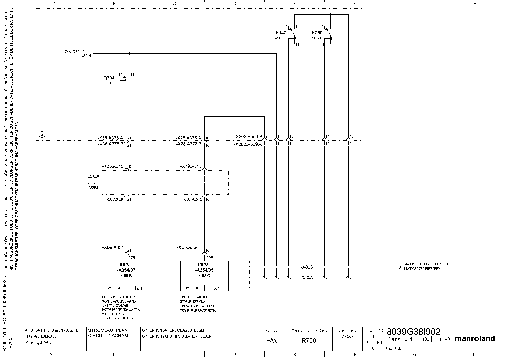

# +Ax — Sheet 311 of 403 — OPTION: IONISATIONSANLAGE ANLEGER

**OPTION: IONIZATION INSTALLATION FEEDER**

> Part of the manroland **R700** printing press IEC/UL circuit diagrams.
> Drawing class: **Stromlaufplan / Circuit diagram** (DIN A3).
> Document `+Ax` covers the **Central control console** machine section.

## At a glance

| Field | Value |
|---|---|
| Document | `+Ax`  (8039G38I902) |
| Sheet | **311** of 403 |
| Section (DE) | OPTION: IONISATIONSANLAGE ANLEGER |
| Section (EN) | OPTION: IONIZATION INSTALLATION FEEDER |
| Section type | CIRCUIT — Circuit diagram |
| Machine type | `R700` |
| Series | `7758` |
| Created | 17.05.10 |
| Replaces | — |
| Columns used | A, B, C, D, E, F, G |
| Path numbers | — |
| Labels on sheet | 82 |
| Cross-refs out | 9 |
| Cross-refs in | 27 |

**Previous:** [+Ax sheet 310](SHEET_0310.md) · **Next:** [+Ax sheet 312](SHEET_0312.md) · **Document TOC:** [_TOC.md](_TOC.md)  (+Ax) · **Master TOC:** [all sheets](../_MASTER_TOC.md)

## Sheet image (300 DPI, exact vector render)



_Rendered directly from the PDF vector layer at 300 DPI (1-bit), no OCR and no resampling. Use it to confirm anything ambiguous in the text below._

## Cross-references on this sheet

Each entry is a wire leaving this sheet. The printed token is `/sheet.column`; the link resolves to that sheet inside the same document.

| Ref | Target sheet | Col | Path | Destination on target | Target section | From col |
|---|---|---|---|---|---|---|
| `/310.G` | [+Ax sheet 310](SHEET_0310.md) | G | — | — | OPTION: IONISATIONSANLAGE ANLEGER | E |
| `/310.F` | [+Ax sheet 310](SHEET_0310.md) | F | — | — | OPTION: IONISATIONSANLAGE ANLEGER | E |
| `/39.H` | [+Ax sheet 39](SHEET_0039.md) | H | — | 24V.Q304:14 | HAUPTANTRIEB | A |
| `/310.B` | [+Ax sheet 310](SHEET_0310.md) | B | — | — | OPTION: IONISATIONSANLAGE ANLEGER | B |
| `/313.C` | [+Ax sheet 313](SHEET_0313.md) | C | — | — | OPTION: STAUBSAUGER MIT BÜRSTE | B |
| `/309.F` | [+Ax sheet 309](SHEET_0309.md) | F | — | — | OPTION: FARBWERKTEMPERIERUNG | B |
| `/199.B` | [+Ax sheet 199](SHEET_0199.md) | B | — | — | REFERENZMODUL | B |
| `/198.G` | [+Ax sheet 198](SHEET_0198.md) | G | — | — | REFERENZMODUL | D |
| `/310.A` | [+Ax sheet 310](SHEET_0310.md) | A | — | — | OPTION: IONISATIONSANLAGE ANLEGER | E |

### Incoming references (sheets that point here)

Every other sheet that sends a wire to this one. `Back-ref` is the token printed on *that* sheet; `Path` is its line number.

| From sheet | Cols | Back-ref | Path | Refs | What continues there |
|---|---|---|---|---|---|
| [+Ax#39](SHEET_0039.md) | H | `/39.H` | — | 1 | — |
| [+Ax#198](SHEET_0198.md) | G | `/198.G` | — | 1 | — |
| [+Ax#199](SHEET_0199.md) | B | `/199.B` | — | 1 | — |
| [+Ax#231](SHEET_0231.md) | A, E | `/231.A`, `/231.E` | — | 2 | — |
| [+Ax#233](SHEET_0233.md) | G | `/233.G` | — | 1 | — |
| [+Ax#242](SHEET_0242.md) | A | `/242.A` | — | 1 | — |
| [+Ax#271](SHEET_0271.md) | D, E | `/271.D`, `/271.E` | — | 2 | — |
| [+Ax#279](SHEET_0279.md) | A, B | `/279.A`, `/279.B` | — | 2 | — |
| [+Ax#286](SHEET_0286.md) | B | `/286.B` | — | 1 | — |
| [+Ax#287](SHEET_0287.md) | C | `/287.C` | — | 1 | — |
| [+Ax#291](SHEET_0291.md) | A | `/291.A` | — | 10 | — |
| [+Ax#309](SHEET_0309.md) | F | `/309.F` | — | 1 | — |
| [+Ax#310](SHEET_0310.md) | A, B | `/310.A`, `/310.B` | — | 2 | — |
| [+Ax#313](SHEET_0313.md) | C | `/313.C` | — | 1 | — |


## Devices on this sheet

| Tag | Class | Class meaning (IEC) | Col | Sub | Terminal | Sign |
|---|---|---|---|---|---|---|
| `A354/05` | A | Baugruppe / assembly, module, PC board | C | 05 | — | — |
| `A063` | A | Baugruppe / assembly, module, PC board | E | — | — | — |
| `K142` | K | Relais / relay, contactor | E | — | — | — |
| `K250` | K | Relais / relay, contactor | E | — | — | — |
| `A354/07` | A | Baugruppe / assembly, module, PC board | B | 07 | — | — |
| `A345` | A | Baugruppe / assembly, module, PC board | B | — | — | — |
| `Q304` | Q | Leistungsschalter / power switching device | B | — | — | — |
| `8.7` | — | cross-device reference | D | — | — | — |
| `XB5.A354` | — | cross-device reference | C | — | — | — |
| `X6.A345` | — | cross-device reference | C | — | — | — |
| `X28.A376.B` | — | cross-device reference | C | — | — | — |
| `X28.A376.A` | — | cross-device reference | C | — | — | — |
| `X79.A345` | — | cross-device reference | C | — | — | — |
| `X202.A559.A` | — | cross-device reference | D | — | — | — |
| `X202.A559.B` | — | cross-device reference | D | — | — | — |
| `12.4` | — | cross-device reference | B | — | — | — |
| `XB9.A354` | — | cross-device reference | B | — | — | — |
| `X5.A345` | — | cross-device reference | B | — | — | — |
| `X36.A376.A` | — | cross-device reference | B | — | — | — |
| `X36.A376.B` | — | cross-device reference | B | — | — | — |
| `X85.A345` | — | cross-device reference | B | — | — | — |

## Potentials / nets

| Potential | Count | Columns | Attached devices | Terminals |
|---|---|---|---|---|
| `24V` | 1 | A | `Q304` | `14` |


A potential such as `L24+/4` or `M24+` is a named supply/return rail; every place it appears on this sheet is electrically common.

## Wire-end annotations (grouped as printed)

A wire that continues elsewhere is annotated with a small cluster: the destination description, the path/line number `#NN`, and the `/sheet.column` cross reference. Each row below is one such cluster exactly as it is grouped on the drawing.

| Col | Y | Path | Cross-ref | Text on the wire |
|---|---|---|---|---|
| E | 59.1 | — | — | `K142 14` |
| E | 59.1 | — | — | `12` |
| E | 59.1 | — | — | `K250 14` |
| E | 59.1 | — | — | `12` |
| E | 85.7 | — | `/310.G` | — |
| E | 85.7 | — | `/310.F` | — |
| E | 101.7 | — | — | `11 11` |
| F | 101.7 | — | — | `11 11` |
| A | 117.9 | — | `/39.H` | `24V.Q304:14` |
| B | 172.5 | — | — | `Q304 14` |
| B | 172.5 | — | — | `12` |
| B | 192.0 | — | `/310.B` | — |
| B | 200.9 | — | — | `11` |
| A | 314.9 | — | — | `3` |
| D | 317.8 | — | — | `X202.A559.B 2` |
| E | 317.8 | — | — | `1` |
| E | 317.8 | — | — | `13` |
| F | 317.8 | — | — | `14` |
| F | 317.8 | — | — | `15` |
| B | 320.6 | — | — | `X36.A376.A 21` |
| C | 320.6 | — | — | `X28.A376.A 16` |
| B | 334.8 | — | — | `X36.A376.B 21` |
| C | 334.8 | — | — | `X28.A376.B 16` |
| D | 334.8 | — | — | `X202.A559.A 2` |
| E | 334.8 | — | — | `1` |
| E | 334.8 | — | — | `13` |
| F | 334.8 | — | — | `14` |
| F | 334.8 | — | — | `15` |
| B | 387.2 | — | — | `X85.A345 16` |
| C | 387.2 | — | — | `X79.A345 6` |
| B | 412.7 | — | — | `A345` |
| B | 425.8 | — | `/313.C` | — |
| B | 438.2 | — | `/309.F` | — |
| C | 465.2 | — | — | `X6.A345 16` |
| B | 466.6 | — | — | `X5.A345 21` |
| B | 578.6 | — | — | `XB9.A354 21` |
| C | 578.6 | — | — | `XB5.A354 16` |
| B | 604.1 | — | — | `27B` |
| D | 604.1 | — | — | `22B` |
| B | 618.6 | — | — | `INPUT` |
| C | 618.6 | — | — | `INPUT` |
| G | 620.0 | — | — | `3 STANDARDMÄSSIG VORBEREITET STANDARDIZED PREPARED` |
| E | 625.3 | — | — | `A063` |
| B | 632.4 | — | — | `A354/07` |
| C | 632.4 | — | — | `A354/05` |
| B | 646.2 | — | `/199.B` | — |
| D | 646.2 | — | `/198.G` | — |
| E | 650.8 | — | `/310.A` | — |
| B | 675.3 | — | — | `BYTE.BIT 12.4` |
| C | 675.3 | — | — | `BYTE.BIT 8.7` |
| C | 697.9 | — | — | `IONISATIONSANLAGE` |
| B | 698.1 | — | — | `IONISATIONSANLAGE IONIZATION INSTALLATION MOTORSCHUTZSCHALTER: SPANNUNGSVERSORGUNG: MOTOR PROTECTION SWITCH: VOLTAGE SUPPLY:` |
| C | 708.6 | — | — | `IONIZATION INSTALLATION STÖRMELDESIGNAL` |
| C | 729.9 | — | — | `TROUBLE MESSAGE SIGNAL` |


## Reconstructed tables

This sheet carries tabular content (pin map / terminal assignment / index). The grid below was rebuilt from the drawing's own rule lines, so each row is exactly one physical row of the table.

### Table 1 — 3 data rows × 3 columns (at x=240.9, y=34.0)

| 12 Q304 /310.B | 11 | 14 |
|---|---|---|
| `X36.A376.A X36.A376.B X85.A345 X5.A345 XB9.A354` | `16` | `21 21 21 21 27B` |
| `INPUT` | `A354/07 /199.B` |  |
| `BYTE.BIT` |  | `12.4` |


### Table 2 — 3 data rows × 9 columns (at x=425.2, y=34.0)

|  |  |  |  | 12 K142 /310.G 11 |  | 14 12 K250 /310.F 11 11 |  | 14 11 |
|---|---|---|---|---|---|---|---|---|
| `X28.A376.A X28.A376.B X79.A345 X6.A345 XB5.A354` | `16 16 6 16 16 22B` | `X202.A559.B X202.A559.A` | `2 2` | `1 1` | `13 13` |  | `14 14` |  |
| `INPUT` | `A354/05 /198.G` |  |  |  |  | `A063 /310.A` |  |  |
| `BYTE.BIT` | `8.7` |  |  |  |  |  |  |  |


## Notes and free text on this sheet

| Text | Col | Y (pt) |
|---|---|---|
| `22B` | D | 604.07 |
| `INPUT` | C | 618.59 |
| `BYTE.BIT` | C | 675.84 |
| `IONISATIONSANLAGE` | C | 697.93 |
| `STÖRMELDESIGNAL` | C | 708.59 |
| `IONIZATION INSTALLATION` | C | 719.2 |
| `TROUBLE MESSAGE SIGNAL` | C | 729.85 |
| `27B` | B | 604.07 |
| `INPUT` | B | 618.59 |
| `BYTE.BIT` | B | 675.84 |
| `MOTORSCHUTZSCHALTER:` | B | 698.08 |
| `SPANNUNGSVERSORGUNG:` | B | 708.04 |
| `IONISATIONSANLAGE` | B | 718.01 |
| `MOTOR PROTECTION SWITCH:` | B | 727.9 |
| `VOLTAGE SUPPLY:` | B | 737.89 |
| `IONIZATION INSTALLATION` | B | 747.84 |
| `STANDARDMÄSSIG VORBEREITET` | G | 620 |
| `STANDARDIZED PREPARED` | G | 630.63 |

## Complete label inventory (exact text from the drawing)

Every text object inside the drawing area of this sheet, in DIN reading order (column A→H, then top→bottom). This is the authoritative list: if a string is not here it is not printed on this sheet.

| Col | Y | X | Dir | Type | Text |
|---|---|---|---|---|---|
| A | 117.9 | 150.0 | → | potential | `24V.Q304:14` |
| A | 314.9 | 97.2 | → | number | `3` |
| B | 127.8 | 193.9 | → | cross-reference | `/39.H` |
| B | 172.5 | 278.6 | → | number | `12` |
| B | 172.5 | 306.7 | → | number | `14` |
| B | 178.9 | 240.4 | → | device tag | `Q304` |
| B | 192.0 | 244.1 | → | cross-reference | `/310.B` |
| B | 200.9 | 299.6 | → | number | `11` |
| B | 320.6 | 230.2 | → | device ref | `X36.A376.A` |
| B | 322.1 | 300.2 | → | number | `21` |
| B | 334.8 | 231.0 | → | device ref | `X36.A376.B` |
| B | 339.1 | 300.2 | → | number | `21` |
| B | 387.2 | 240.9 | → | device ref | `X85.A345` |
| B | 388.7 | 299.6 | → | number | `16` |
| B | 412.7 | 206.1 | → | device tag | `A345` |
| B | 425.8 | 208.3 | → | cross-reference | `/313.C` |
| B | 438.2 | 209.2 | → | cross-reference | `/309.F` |
| B | 466.6 | 246.9 | → | device ref | `X5.A345` |
| B | 466.6 | 300.2 | → | number | `21` |
| B | 578.6 | 241.2 | → | device ref | `XB9.A354` |
| B | 587.1 | 300.2 | → | number | `21` |
| B | 604.1 | 303.0 | → | text | `27B` |
| B | 618.6 | 282.8 | → | text | `INPUT` |
| B | 632.4 | 276.2 | → | device tag | `A354/07` |
| B | 646.2 | 285.0 | → | cross-reference | `/199.B` |
| B | 675.3 | 316.2 | → | device ref | `12.4` |
| B | 675.8 | 250.9 | → | text | `BYTE.BIT` |
| B | 698.1 | 240.7 | → | text | `MOTORSCHUTZSCHALTER:` |
| B | 708.0 | 240.7 | → | text | `SPANNUNGSVERSORGUNG:` |
| B | 718.0 | 240.4 | → | text | `IONISATIONSANLAGE` |
| B | 727.9 | 240.7 | → | text | `MOTOR PROTECTION SWITCH:` |
| B | 737.9 | 240.9 | → | text | `VOLTAGE SUPPLY:` |
| B | 747.8 | 240.4 | → | text | `IONIZATION INSTALLATION` |
| C | 320.6 | 414.4 | → | device ref | `X28.A376.A` |
| C | 334.8 | 415.3 | → | device ref | `X28.A376.B` |
| C | 387.2 | 425.2 | → | device ref | `X79.A345` |
| C | 465.2 | 432.6 | → | device ref | `X6.A345` |
| C | 578.6 | 417.0 | → | device ref | `XB5.A354` |
| C | 618.6 | 467.0 | → | text | `INPUT` |
| C | 632.4 | 460.5 | → | device tag | `A354/05` |
| C | 675.8 | 435.1 | → | text | `BYTE.BIT` |
| C | 697.9 | 424.3 | → | text | `IONISATIONSANLAGE` |
| C | 708.6 | 424.9 | → | text | `STÖRMELDESIGNAL` |
| C | 719.2 | 424.3 | → | text | `IONIZATION INSTALLATION` |
| C | 729.8 | 424.9 | → | text | `TROUBLE MESSAGE SIGNAL` |
| D | 317.8 | 552.5 | → | device ref | `X202.A559.B` |
| D | 322.1 | 483.9 | → | number | `16` |
| D | 335.5 | 551.6 | → | device ref | `X202.A559.A` |
| D | 339.1 | 483.9 | → | number | `16` |
| D | 388.7 | 484.4 | → | number | `6` |
| D | 466.6 | 483.9 | → | number | `16` |
| D | 587.1 | 483.9 | → | number | `16` |
| D | 604.1 | 487.3 | → | text | `22B` |
| D | 646.2 | 469.0 | → | cross-reference | `/198.G` |
| D | 675.3 | 503.4 | → | device ref | `8.7` |
| E | 59.1 | 668.4 | → | number | `12` |
| E | 59.1 | 696.5 | → | number | `14` |
| E | 59.1 | 753.4 | → | number | `12` |
| E | 72.6 | 646.9 | → | device tag | `K142` |
| E | 72.6 | 731.9 | → | device tag | `K250` |
| E | 85.7 | 648.9 | → | cross-reference | `/310.G` |
| E | 85.7 | 735.0 | → | cross-reference | `/310.F` |
| E | 101.7 | 669.5 | → | number | `11` |
| E | 101.7 | 696.5 | → | number | `11` |
| E | 101.7 | 754.6 | → | number | `11` |
| E | 317.8 | 626.2 | → | number | `2` |
| E | 317.8 | 654.0 | → | number | `1` |
| E | 317.8 | 682.3 | → | number | `13` |
| E | 334.8 | 626.2 | → | number | `2` |
| E | 334.8 | 654.0 | → | number | `1` |
| E | 334.8 | 682.3 | → | number | `13` |
| E | 625.3 | 709.2 | → | device tag | `A063` |
| E | 650.8 | 711.5 | → | cross-reference | `/310.A` |
| F | 59.1 | 781.5 | → | number | `14` |
| F | 101.7 | 781.5 | → | number | `11` |
| F | 317.8 | 767.3 | → | number | `14` |
| F | 317.8 | 824.0 | → | number | `15` |
| F | 334.8 | 767.3 | → | number | `14` |
| F | 334.8 | 824.0 | → | number | `15` |
| G | 620.0 | 952.2 | → | text | `STANDARDMÄSSIG VORBEREITET` |
| G | 625.3 | 939.5 | → | number | `3` |
| G | 630.6 | 952.2 | → | text | `STANDARDIZED PREPARED` |

## Reading-order text block

The same content as a plain block, grouped by DIN column — convenient to paste or to match against a visual description.

```text
=== Column A ===
 117.9  150.0  net          24V.Q304:14
 314.9   97.2  numeric      3
=== Column B ===
 127.8  193.9  xref         /39.H
 172.5  278.6  numeric      12
 172.5  306.7  numeric      14
 178.9  240.4  devtag       Q304
 192.0  244.1  xref         /310.B
 200.9  299.6  numeric      11
 320.6  230.2  devref       X36.A376.A
 322.1  300.2  numeric      21
 334.8  231.0  devref       X36.A376.B
 339.1  300.2  numeric      21
 387.2  240.9  devref       X85.A345
 388.7  299.6  numeric      16
 412.7  206.1  devtag       A345
 425.8  208.3  xref         /313.C
 438.2  209.2  xref         /309.F
 466.6  246.9  devref       X5.A345
 466.6  300.2  numeric      21
 578.6  241.2  devref       XB9.A354
 587.1  300.2  numeric      21
 604.1  303.0  text         27B
 618.6  282.8  text         INPUT
 632.4  276.2  devtag       A354/07
 646.2  285.0  xref         /199.B
 675.3  316.2  devref       12.4
 675.8  250.9  text         BYTE.BIT
 698.1  240.7  text         MOTORSCHUTZSCHALTER:
 708.0  240.7  text         SPANNUNGSVERSORGUNG:
 718.0  240.4  text         IONISATIONSANLAGE
 727.9  240.7  text         MOTOR PROTECTION SWITCH:
 737.9  240.9  text         VOLTAGE SUPPLY:
 747.8  240.4  text         IONIZATION INSTALLATION
=== Column C ===
 320.6  414.4  devref       X28.A376.A
 334.8  415.3  devref       X28.A376.B
 387.2  425.2  devref       X79.A345
 465.2  432.6  devref       X6.A345
 578.6  417.0  devref       XB5.A354
 618.6  467.0  text         INPUT
 632.4  460.5  devtag       A354/05
 675.8  435.1  text         BYTE.BIT
 697.9  424.3  text         IONISATIONSANLAGE
 708.6  424.9  text         STÖRMELDESIGNAL
 719.2  424.3  text         IONIZATION INSTALLATION
 729.8  424.9  text         TROUBLE MESSAGE SIGNAL
=== Column D ===
 317.8  552.5  devref       X202.A559.B
 322.1  483.9  numeric      16
 335.5  551.6  devref       X202.A559.A
 339.1  483.9  numeric      16
 388.7  484.4  numeric      6
 466.6  483.9  numeric      16
 587.1  483.9  numeric      16
 604.1  487.3  text         22B
 646.2  469.0  xref         /198.G
 675.3  503.4  devref       8.7
=== Column E ===
  59.1  668.4  numeric      12
  59.1  696.5  numeric      14
  59.1  753.4  numeric      12
  72.6  646.9  devtag       K142
  72.6  731.9  devtag       K250
  85.7  648.9  xref         /310.G
  85.7  735.0  xref         /310.F
 101.7  669.5  numeric      11
 101.7  696.5  numeric      11
 101.7  754.6  numeric      11
 317.8  626.2  numeric      2
 317.8  654.0  numeric      1
 317.8  682.3  numeric      13
 334.8  626.2  numeric      2
 334.8  654.0  numeric      1
 334.8  682.3  numeric      13
 625.3  709.2  devtag       A063
 650.8  711.5  xref         /310.A
=== Column F ===
  59.1  781.5  numeric      14
 101.7  781.5  numeric      11
 317.8  767.3  numeric      14
 317.8  824.0  numeric      15
 334.8  767.3  numeric      14
 334.8  824.0  numeric      15
=== Column G ===
 620.0  952.2  text         STANDARDMÄSSIG VORBEREITET
 625.3  939.5  numeric      3
 630.6  952.2  text         STANDARDIZED PREPARED
```

---
_Generated from the PDF vector text layer; no OCR. Source: `R700_7758_IEC_AX_8039G38I902_p`, sheet 311._
